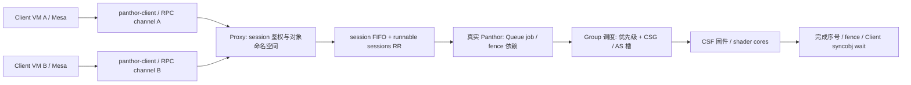

# 多 VM 共享 GPU：调度设计与代码依据

> 历史记录或研究提案；不作为当前运行基线。最新实现见[当前基线](../../../shared/CURRENT_BASELINE.md)。历史分数、失败和未执行项按原版本理解。

分析日期：2026-10-08。依据当前工作树静态代码；功能数据来自 2026-07-11 留存日志，本次未重新运行硬件测试。配套 `ppt/GPU_MULTI_VM_SCHEDULING_20261008.pptx` 为可编辑汇报稿，讲者备注包含逐页源码依据。

## 1. 汇报的主线

**多个 Client VM 将工作送到唯一持有物理 GPU 的 Proxy VM；Proxy 按 session 轮转处理提交，Panthor 再按 Group 优先级与 CSG / GPU 地址空间资源安排执行，CSF 固件驱动实际 GPU 工作。**

这不是 Host 在几台 Client 之间轮流切换整块 GPU 的直通归属。物理设备由 Proxy 持有，多租户任务通过真实 Panthor 对象进入同一个 GPU 调度域。Host CPU 的 affinity、RPC 请求轮转、GPU Group 时间片是不同的控制点。

对象关系必须先讲清：Client VM 是虚拟机；session 是 Client DRM 文件对应的 Proxy 会话；一个 session 可以创建多个 GPU VM（GPU 虚拟地址空间）和多个 Group；Group 包含若干 Queue，绑定一个 GPU VM；Queue 接收 job。源码里的 `group->vm` 指 GPU 地址空间，不能解释成 Firecracker VM。CSG 是固件上下文槽，不是 shader core。



## 2. 自研入口：按 session 轮转接纳 GROUP_SUBMIT

`panthor_proxy_handle_group_submit()` 从实际接收 channel 取得 `client_vmid`，结合 `session_id` 查找会话并校验 `owner_vmid`；不能仅信任请求载荷里的身份。随后调用 `panthor_proxy_submit_sched_run()`，请求加入该 session 的 FIFO。全局 `runnable_sessions` 只保存有待处理请求的 session，避免同一 session 重复占位。

worker 每次取 runnable 表头 session，再取其 FIFO 表头的一个 `GROUP_SUBMIT`；该 session 仍有请求时，将它放回 runnable 表尾。这是**session 粒度、每次一个 RPC 的 round-robin**。同一 RPC 内可以携带多个 queue jobs，执行成本也不同，因此它不构成按 GPU 时间计费的公平性。

单个全局 work 串行调用真实 submit 路径，但没有等待 GPU 完成。完成的只是“将请求转成真实 job 并提交给 Panthor”，随后回包；多个会话的 GPU job 可以同时处于 in-flight 状态。

```text
# 算法示意，假设这些请求已经同时排队，并非默认通道实测队列
Session A: A1 A2 A3     Session B: B1 B2
runnable: [A, B]
处理顺序: A1 → B1 → A2 → B2 → A3

pick(): 取 session 表头；取其 FIFO 表头一个请求；
        如果 FIFO 非空，将 session 放回 runnable 表尾。
```

当前普通 Client 的 `client_comm_vmshm_call()` 使用 `rpc_lock` 串行化同步 RPC；Proxy 的单个 channel 也同步调用 handler，handler 等待 submit worker 的返回后才继续 drain。因此，常规单通道通常无法自由堆积很多未返回请求；不同 Client 的接收工作可以并行。不能把上面的算法示意描述成默认实测 backlog，也不能认为只要两个 Client 就会发生 GPU 时间片抢占。

生命周期保护：pending 总数达到 256 返回 `-EBUSY`；该计数在 pick 时递减，不包括已出队正在处理的请求或 GPU in-flight job。关闭 session 时拒绝新请求并失败唤醒尚未处理的请求，引用计数保护会话生命期。现有上限是全局 pending 保护，并非 per-VM quota。

代码：`panthor-proxy/panthor_proxy_drv.c:82, 127, 137, 571, 610, 641, 654, 686, 707, 2608`；`client_vmshm_comm/client_comm_vmshm.c:939`；`proxy_vmshm_comm/proxy_comm_vmshm.c:1182, 1240`。

## 3. 真实提交：句柄翻译、依赖与 Queue

worker 调用 `panthor_proxy_session_group_submit()`，在 session 命名空间内将 Client group、syncobj 句柄翻译成 Proxy 真实句柄，重建 queue submit 数组，再调用 `panthor_vmshm_group_submit()`。GPU stream 地址与长度进入真实提交路径；它们指向已经有效映射的 BO，而不是 RPC 自身携带 shader 字节。

真实 Panthor 为每个 queue submit 建立 job，收集 syncobj / BO fence 依赖，arm job 并执行 `drm_sched_entity_push_job()`。每个 Queue 配置自己的 DRM scheduler/entity；它控制依赖满足后何时将 job 交给 `queue_run_job()`，不是重新执行一次 Proxy 的 session RR。

`queue_run_job()` 将带 CALL 的包装指令写入内核 Queue ringbuffer，CALL 指向用户 CSF stream。如果 Group 未驻留 CSG，触发 Group 调度；已经驻留则通知 doorbell。该函数返回完成 fence，仍不等到 shader 执行结束。固件/中断触发的 `group_sync_upd_work()` 依据完成序号 signal fence；Client 通过 syncobj 等待路径确认完成后才能安全读取结果。

**两个返回点：GROUP_SUBMIT RSP = 提交调用返回；完成 fence / syncobj = GPU job 完成或报错。两者不能合并。**

代码：`panthor_proxy_drv.c:1770`；`panthor_drv.c:1228, 1254, 2211`；`panthor_sched.c:3334, 3544, 3764`。通用 DRM job/fence 语义参考 [Linux 官方文档](https://www.kernel.org/doc/html/latest/gpu/drm-mm.html)，具体行为以当前本地 Panthor 实现为准。

## 4. 真正的 GPU 调度：Group → CSG / GPU AS

Panthor 在各优先级 runnable lists 上选择可运行 Group；跳过终止、故障、超时和需跳过的 idle Group，同时检查 CSG 槽及 GPU AS 槽容量。不同 Group 使用同一 GPU VM 时可以复用 AS 计数，不同 GPU 地址空间则占用不同 AS 资源。

`group_bind_locked()` 调用 `panthor_vm_active()` 激活 GPU 地址空间并绑定一个 CSG。`csg_slot_prog_locked()` 将 Queue、GPU AS 编号、compute/fragment core mask、endpoint 要求和固件优先级写入固件接口。固件随后消费这些 Group/Queue 的工作。**Group 驻留只表示具有执行上下文，不等于独占某个 shader core；实际工作分配由固件/硬件执行。**

资源不足需要换入别的 Group 时，`tick_ctx_apply()` 对被换出 Group 发 SUSPEND（不能再运行则 TERMINATE），等待固件确认、解绑资源，为新 Group 编程并 START/RESUME；换出的可运行 Group 回到对应优先级队列尾部。按优先级选择、同级轮转实现复用。

默认 `tick_period` 是 10 ms，可由诊断参数覆盖。`tick_ctx_update_resched_target()` 在 CSG 未满或选入 idle Group 时取消周期 tick；CSG 满且最低驻留优先级还有同级 runnable Group 等待时才安排下个周期。AS 容量也是候选约束，不能将这一判断简化成“任意资源冲突都固定 10 ms 轮转”。不存在给每个 Client 固定 10 ms 的 VM 级 quota。

Proxy 的 group-create 拒绝高于 MEDIUM 的请求，因而 Client 能请求 LOW / MEDIUM；HIGH / RT 是底层 Panthor 的能力，当前共享入口不直接开放。LOW 与 MEDIUM 混合仍不能声称各租户相同待遇。

代码：`panthor_sched.c:65, 1320, 1648, 2280, 2647, 2803, 2838, 4241`；`panthor_proxy_drv.c:1037`。

## 5. 两种场景，解释为何不总是轮流执行

场景 A：A、B 的 runnable Groups 都能放入可用 CSG / AS 资源。两者可以同时驻留，由 CSF 固件继续调度，内核不必为了两个 VM 强制启动周期轮转。能驻留不证明两个 shader workload 在任意时刻真正并行。

场景 B：同优先级 Group 超过 CSG 容量且出现同级等待者。内核按 tick 重新选组，SUSPEND 旧 Group、释放槽、START/RESUME 新 Group；被换出的 Group 入队尾等待下一轮。此时才适合画时间片示意。汇报图只画“槽 S：GA → GB → GA”，标注“竞争场景示意；tick 默认 10 ms，切换及运行时间不等于精确配额”，不要画“VM A 固定 50% / VM B 固定 50%”。

## 6. Host CPU 放置与 GPU 核划分的边界

两 Client 自动化脚本在未手工覆盖且存在 CPU 0–3 时默认 broker→0、Proxy→1、Client0→2、Client1→3，默认每台 VM 1 vCPU，退出恢复原 affinity。它减少 CPU 竞争对 RPC / Proxy 处理的干扰，属于实验执行环境，不能当成 GPU 时间片算法。

`group_core_partitions` 默认 0，只有配置 ≥2 才尝试按 session_id 分片修改 Group compute/fragment mask；这是可选诊断实验，当前默认共享设计不是按 VM 固定切 core，更不能宣称硬件 MIG 或已验证的空间隔离。

代码：`scripts/run/run-vmshm-2client-e2e.sh:27, 369`；`panthor_proxy_drv.c:152, 197`。

## 7. 已有证据支持哪些结论

留存目录 `GPU-SFTP/log/shared/vmshm-2client/vmshm-2client-gles-32m-opencca-pmthor-20260711-151421`：两 Client 均识别 Mali-G610 (Panfrost)；`COMPUTE_CHECK=PASS count=8388608 samples=16`；每 Client 20 次迭代平均端到端时延分别 29980.05 μs 和 29986.50 μs。它证明该次双 Client 工作负载跑通、采样结果正确；该时延包含整个迭代，不是纯 GPU 执行时间。

现有日志没有直接证明 session RR 的实测顺序、每 VM GPU 活跃时间、超槽情况下的 Group 切换次数或任意负载的公平性。因此 PPT 用该数据作为功能与历史时延证据；本次静态分析与历史运行应分别标明。

## 8. 汇报贡献与下一步

当前自研贡献：跨 VM 的 Client/Proxy 提交桥接；从 channel 派生身份并隔离 session 对象命名空间；session FIFO + RR 的提交入口；pending 上限与关闭唤醒/引用保护；独立 Client channel 的处理及可重复的双 Client CPU 放置。真实 GPU 执行继续复用 DRM fence/entity、Panthor Group 调度以及 CSF 固件能力。

下一阶段按可验证目标推进：

1. **先测量**：关联 owner_vmid、session、Group、Queue、job/fence；记录 RPC 入队/出队、DRM ready、CSG bind/unbind、完成时间。CSG 驻留时间只能作代理指标，不能直接冒充 shader 实际活跃时间。
2. **再验证竞争**：同优先级多 Group 超过实测 CSG/AS 容量；短/长任务混合；一个 VM 多 session；LOW/MEDIUM 混合。报告排队时延、端到端 p95/p99、进展性、GPU 运行证据。
3. **最后引入策略**：按 owner_vmid 聚合 session；per-VM pending / in-flight 预算、租户优先级政策与限流；需要 GPU 时间 SLA 时再将租户策略与 Group 调度层联动。仅在 RPC 入口加权 RR 无法保证 GPU 时间公平。

## 9. PPT 讲述顺序

1. 一个物理 GPU，多 VM 提交，两处调度控制点。
2. 对象层次与端到端架构图。
3. Proxy session RR 算法和回包边界。
4. DRM 依赖、Queue ringbuffer、完成 fence。
5. Panthor Group / CSG / AS 的执行调度。
6. 可同时驻留与需要换入换出的两种场景。
7. CPU 放置、默认优先级政策、core-mask 实验边界。
8. 已有成功日志及可证明范围。
9. 自研贡献与可测量的开发路线。

建议开场：我们将物理 GPU 的控制集中在 Proxy VM，各 Client 保持 Mesa/Panthor 提交接口。调度分为两处：入口处理的是 session 请求轮转，底层处理的是 GPU Group 资源与执行上下文。先说明这两处，再展示为什么该实现能够接收多个 Client 的任务，以及还需要哪些测量才能声称租户公平。
