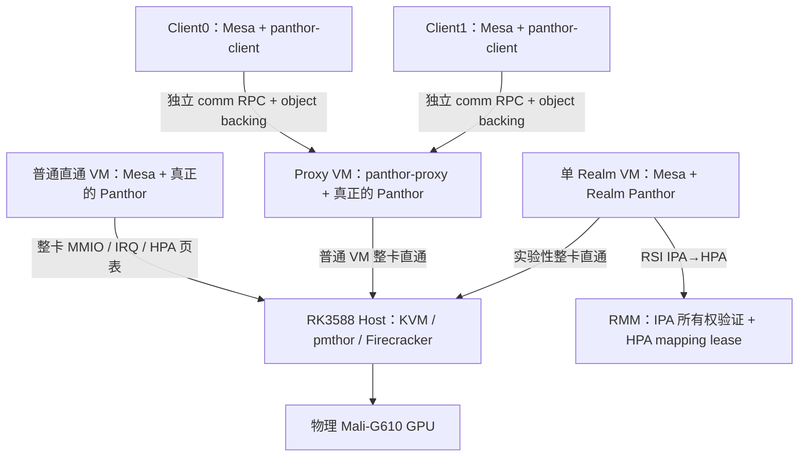
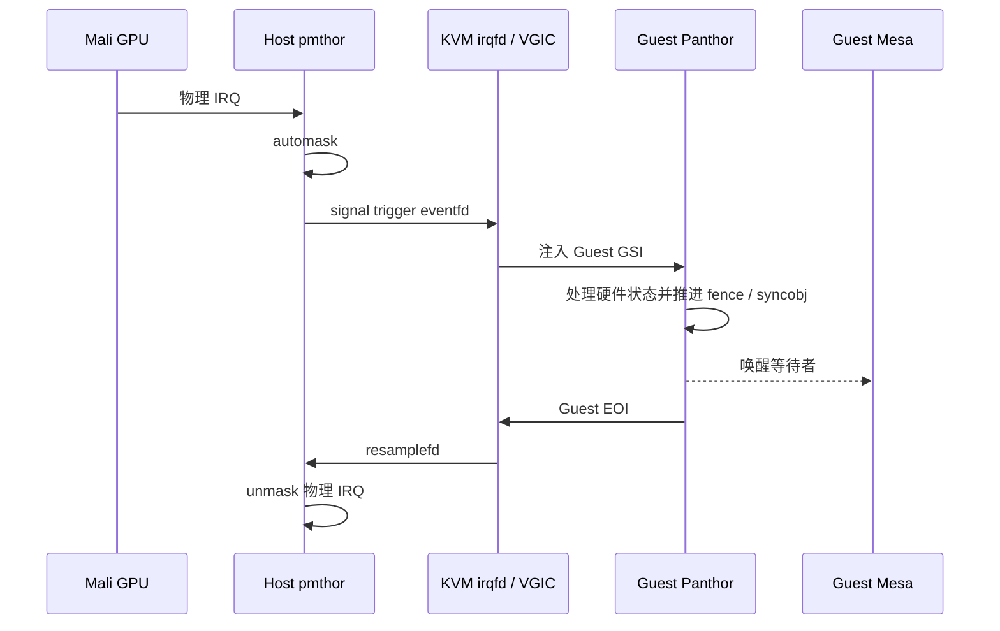
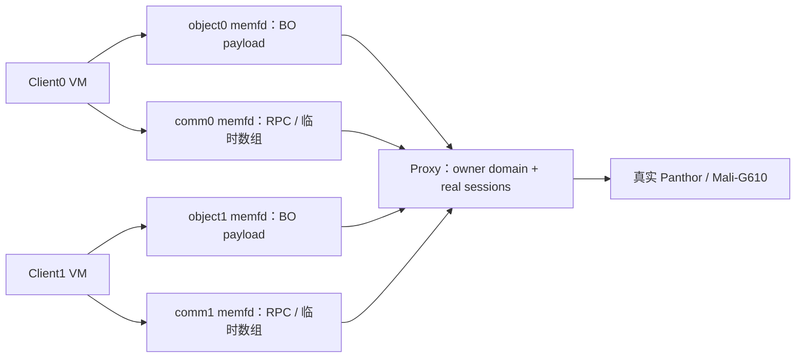
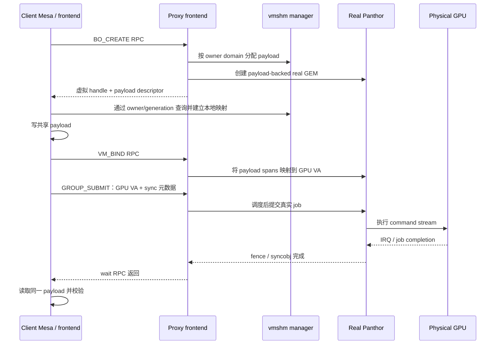
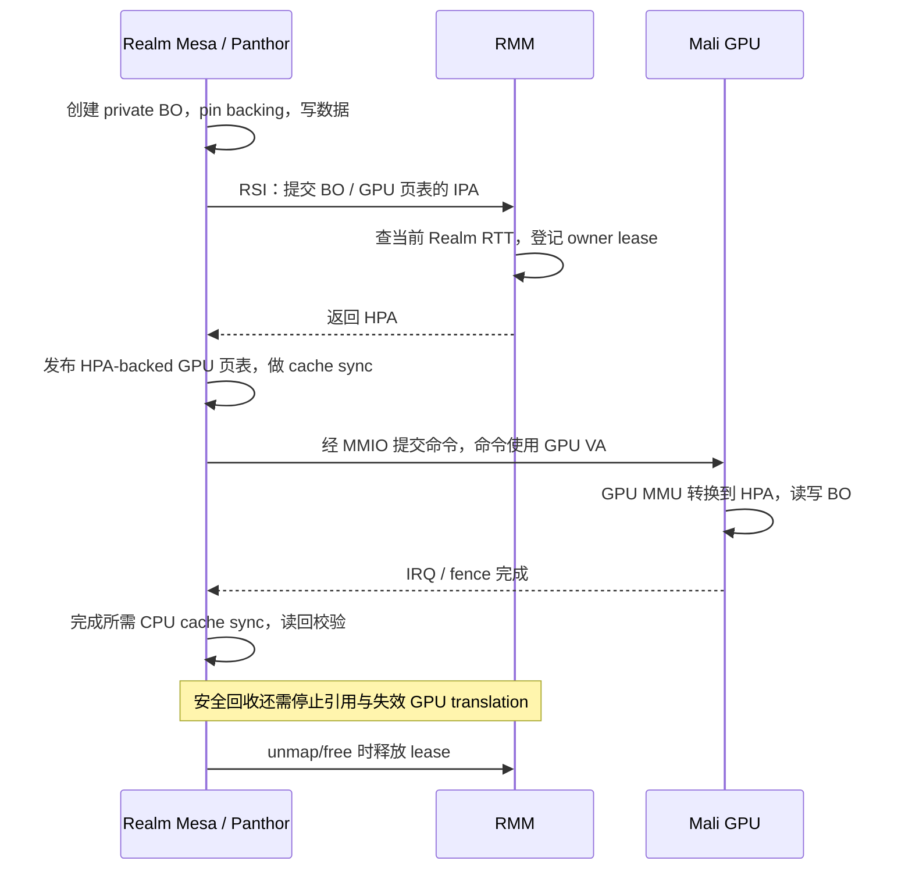
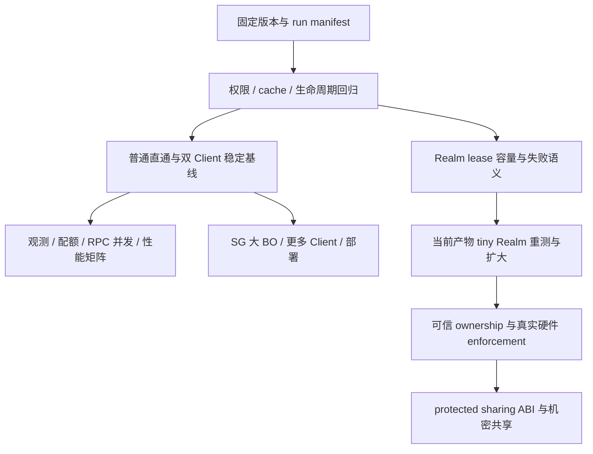

整理日期：<mention-date start="2026-10-08"/>。分析基于 `/home/mzh/RK3588/gpu` 当前工作树、已保存的板端日志，以及 GPU Virtualization 下已有的设计与分析页面。

> 历史记录或研究提案；不作为当前运行基线。最新实现见[当前基线](../../../shared/CURRENT_BASELINE.md)。历史分数、失败和未执行项按原版本理解。

<callout icon="💡" color="blue_bg">
	**项目已经形成三条明确的能力线：普通 VM 整卡直通、普通 VM 双 Client 共享 GPU，以及单 Realm 的实验性 GPU direct path。** 前两条已有真实 Mali-G610 GLES compute 成功记录；Realm 路线已有最小计算闭环，但 RK3588/OpenCCA 上 Host CPU 的硬件内存隔离没有成立。后续应先补齐权限、缓存一致性、资源回收与可复现验证，再扩大调度和 Realm 工作负载；机密共享需要另行解决可信设备控制面和 protected sharing ABI。
</callout>

本文采用“当前实现 → 生命周期 → 验证证据 → 开发任务”的结构。**已实现**指当前代码存在相应路径；**历史实测通过**指保存日志证明某一配置跑通；**本次静态检查通过**只表示本次执行了对应源代码检查。本文没有重新启动板端 VM，也没有把历史运行当成当前工作树的完整回归。

<table_of_contents/>

## 1. 项目目标与完成度

项目的核心问题是：在 RK3588 的 Mali-G610 上，如何让 VM 使用真实 GPU，并在没有现成 SR-IOV/vGPU 接口的情况下，让多个 VM 保留 Mesa/Panthor 用户接口和独立对象空间，共享一张物理 GPU。

普通直通解决设备可见性、GPU 地址转换和中断返回；共享虚拟化在此基础上，把 Client 的 Panthor UAPI 语义代理给拥有 GPU 的 Proxy，并让 Client CPU 和真实 GPU 访问相同 BO payload。Realm 实验进一步研究私有内存如何被真实 Mali 访问。三条路线共享部分底层能力，但完成度和安全性质不同。

| 能力线 | 当前保留的实现 | 验证程度 | 仍需完成 |
| --- | --- | --- | --- |
| 普通单 VM 整卡直通 | Host pmthor + Firecracker/KVM + Guest Panthor；GPU 页表写 HPA；三路 IRQ relay | 保存的 32 MiB compute 与重启后复测通过 | 页表 pin/reclaim 审计、长稳与错误恢复、同环境性能回归 |
| 普通 VM 共享 GPU | 两个 Client frontend + 一个 GPU Proxy；每 Client 独立 object/comm domain；session handle 虚拟化 | 双 Client 32 MiB compute、live BO lookup 与 raw RPC session 负向测试有成功记录 | 权限位强制、缓存协议、异常退出与配额、更多 Client 覆盖 |
| 单 Realm GPU direct path | private BO/PT + RMM IPA→HPA 验证与 lease + MMIO shared alias | 当前设计相关的 64-element compute 日志通过；更大最小 workload 有历史记录 | 当前工作树重新回归、lease 容量/失败语义、较大 workload 和 teardown |
| Host 不可读取 Realm GPU 内存 | 架构目标是 GPT/GPC enforcement | 当前平台只通过静态设计链路检查；runtime probe 读成功 | 需要真实硬件 enforcement，不能靠 Linux 策略替代 |
| 多 Realm 机密共享 GPU | 仍处于后续设计范围 | shared runner 显式阻断 Realm 模式 | 可信 GPU owner、DMA/MMIO 隔离、protected sharing ABI 与撤销协议 |

**当前最准确的项目定位是：具有真实 GLES compute 验证的 Mali/Panthor 直通与 split-driver 共享 GPU 原型，并包含单 Realm 私有内存 GPU 访问实验。** 已有双 Client 结果不能直接外推成任意数量 VM 的稳定服务，也不能外推成对恶意 Host 的机密 GPU 方案。

## 2. 当前整体架构与职责

### 2.1 三条执行路径



这个图表示组件依赖，数据的最终地址关系在后文展开。共享路线中的 Proxy 也是一台直通 VM，因此 shared workload 的延迟包含 Client/Proxy RPC、Proxy 驱动处理、Proxy 直通页表和 IRQ 完成链路，不能把整体结果简单归因于 vmshm。

### 2.2 组件边界

| 组件 | 当前职责 | 关键代码入口 |
| --- | --- | --- |
| Host pmthor | 持有整卡会话；设备 quiesce/reset；物理 IRQ mask、eventfd signal 与 resample unmask | `Linux-Host-GPU/drivers/pmthor/pmthor_drv.c` |
| Host KVM | 普通 VM GPA→HPA helper；自定义 MMIO 映射；Realm MMIO unprotected alias | `arch/arm64/kvm/hypercalls.c`、`mmu.c`、`rme.c` |
| Firecracker | 设备/FDT、irqfd/resamplefd；vmshm memslot/doorbell；Realm 实验 gate | `src/vmm/src/gpu_passthrough.rs`、`vmshm.rs`、`builder.rs` |
| vmshm-broker | 为 domain 创建 memfd，通过 SCM_RIGHTS 分发 fd；通知 relay | `firecracker/vmshm-broker/src/` |
| Client frontend | 提供 Mesa 可用的 DRM/Panthor ioctl；打包 RPC；维护虚拟 BO 和本地 mmap | `Linux-Guest-GPU/drivers/gpu/drm/panthor-client/panthor_client_drv.c` |
| Proxy frontend | 绑定请求身份；创建真实 session；翻译 VM/BO/group/syncobj/heap handle；提交调度 | `Linux-Guest-GPU/drivers/gpu/drm/panthor-proxy/panthor_proxy_drv.c` |
| vmshm manager | 每 owner domain 分配 payload；generation/grant/pin；延迟回收 | `Linux-Guest-GPU/drivers/char/proxy_vmshm_manager/` |
| 真正的 Guest Panthor | GPU VM、页表、group/queue、DRM scheduler、CSF firmware、fence | `Linux-Guest-GPU/drivers/gpu/drm/panthor/` |
| RMM GPU RSI 扩展 | 验证当前 Realm IPA，返回 HPA，记录与释放 owner-scoped lease | `opencca/tf-rmm/runtime/rsi/opencca_gpu.c` |

broker 提供共享资源，不承担 GPU 对象权限或 VM 生命周期管理。Firecracker 配置决定每个 fd 的 GPA/slot 和 FDT 身份；Proxy 根据收到请求的 channel 取得 Client VMID。当前实现依赖可信 Host/VMM/Proxy 正确配置这些关联。

## 3. 普通 VM 整卡直通：当前成功的底座

### 3.1 启动与所有权

普通直通 VM 设置 `gpu_passthrough=true` 后，Firecracker 持有 `/dev/pmthor`，建立设备会话，注册 GPU 三路 IRQ 的 trigger/resample eventfd，并通过 KVM 的 MMIO 扩展映射真实 GPU aperture。FDT 向 Guest 暴露 GPU，Guest Panthor 按真实硬件 probe、加载 CSF firmware、创建 DRM 节点，Mesa/Panfrost 使用这套真实驱动。

`GpuPassthroughManager` 把 KVM irqfd 与 pmthor IRQ 绑定起来，并提供失败回滚/退出 detach。pmthor 的 session release 清理事件绑定并 quiesce GPU。它承担正常运行中的整卡占用和交接；这些软件措施本身不等于恶意 Host 无法重编程 GPU。

### 3.2 GPU 页表为什么必须写 HPA

Guest CPU 的 GPA→HPA 由 KVM stage-2 管理，但 Mali 的 page-table walker 不会自动替 Guest 做同样的转换。当前方案让 Guest Panthor 在发布 GPU 页表前，批量把 GPA 转换成 HPA，并把 HPA 写进 Mali leaf PTE、table descriptor 和相应页表基址。

普通 VM 调用 `ARM_SMCCC_VENDOR_HYP_GPA_TO_HPA_FUNC_ID`，Host `kvm_gpa_to_hpa()` 校验数组长度/对齐、拒绝 private memory，并通过 `gfn_to_pfn_prot()` 取得数据页 PFN；交换数组由 `kvm_vcpu_map()` 原地处理。Guest 页表维护仍要保留 CPU 可访问的 table 地址关联，不能把页表中的 HPA 直接当作 Guest CPU 地址。

保留的有效实现包括：每 io-pgtable scratch page、批量翻译、Host 原地数组处理，以及 **2 MiB candidate + HPA 连续性验证 + 4 KiB fallback**。Guest GPA 连续不代表 HPA 连续；只有 512 个 4 KiB HPA 页连续且起始地址 2 MiB 对齐时，才可安装 block PTE。没有形成实际 block 时，批量 fallback 仍可以减少构建开销。

### 3.3 完成通知是闭环而非单向注入



真实 GPU 完成、Guest IRQ 处理、fence signal、用户 readback 和 EOI/unmask 是相关但不同的事件。缺少回程可能让 level IRQ 长期被 mask；把这条链路全部计为“GPU 执行时间”也会遮蔽 vCPU 与 worker 调度延迟。

当前 Panthor `panthor-csf-sched` 使用 bound workqueue，保留 `WQ_MEM_RECLAIM`；`WQ_HIGHPRI` 与 scheduler tick 参数是诊断选项。页表、IRQ、submit 的计时统计按需开启，正式性能样本应关闭额外热路径日志。

## 4. 共享 GPU：从 Client BO 到物理 GPU 的完整生命周期

### 4.1 每 Client 两类窗口，Proxy 汇聚多组 domain

当前双 Client runner 创建四个 broker domain：`vmshm-object-client0`、`vmshm-object-client1`、`vmshm-comm-client0`、`vmshm-comm-client1`。Client0 仅连接自己的 object/comm socket，Client1 同理；Proxy 映射两组窗口，并以 VMID 1/2 注册对应 owner domain 与通信 channel。

这是当前 runner 和保存的 2026-07-11 broker/VM JSON 配置共同确认的结构。**“每 Client 两类 memslot”不能理解成“所有 Client 共用一个 object memfd”。** 每个 Client 内部的 object window 承载它的多个 BO，comm window 承载请求/响应和瞬时数组。



Host/VMM 从同一 domain 收到的是同一 memfd 的引用，以 `MAP_SHARED` 映射并注册到不同 KVM 实例，因此双方 GPA 可以不同而 HPA backing 相同。不同 Client 的 domain 是不同 backing，不能只依据 GPA 数值判断共享或隔离。

### 4.2 OPEN_SESSION：对象空间首先绑定实际请求来源

Client 打开 DRM frontend 后，Proxy 创建 `panthor_proxy_session` 和对应真实 `panthor_vmshm_session`。session 保存 `owner_vmid`、自己的 lock 和 VM/BO/syncobj/group/heap xarray。不同 Client 即使使用相同的虚拟 handle 数值，也只能在自己的 session 对象空间中翻译。

`panthor_proxy_session_lookup()` 与 destroy 都检查 `owner_vmid == requester_vmid`。这里的 requester 来源于 `proxy_comm_vmshm_channel_client_vmid(channel)`，而非 Client 随意填写的请求字段。manager 接收 GET_OBJECT 时也覆盖 `req.requester_vmid`，再执行 owner/generation/state lookup。因此已完成的不仅是 handle 重命名，还有 channel→VMID→session/object 的身份关联。

### 4.3 BO_CREATE：真实 GEM 外壳与共享 payload

Proxy `panthor_proxy_session_bo_create()` 按 session owner，在对应 object domain 中执行 `proxy_vmshm_alloc_ext()`，当前设置 `PROXY_VMSHM_F_CONTIG`，再调用 `panthor_vmshm_bo_create_from_payload()` 创建真实 GEM 对象。真实 GEM 为 GPUVA、reservation、driver 引用和生命周期提供载体；实际由 Client 写入、GPU 消费的字节来自 vmshm payload。

一个 BO 要同时区分四类地址/身份：

| 身份 | 用途 | 权威归属 |
| --- | --- | --- |
| Client GEM handle / fake mmap offset | Mesa ioctl 与本地用户映射入口 | 当前 Client DRM file |
| Proxy real GEM handle | 操作真实 Panthor 对象 | 当前 Proxy real session |
| payload handle / generation / domain offset | 跨 VM backing 标识、过期引用检查、定位共享页 | Proxy vmshm manager |
| GPU VA | shader、descriptor、command stream 中的地址 | 对应真实 Panthor GPU VM |

它们不可相互替代。Client 的 mmap offset 不会直接成为 Proxy 的 GEM offset；`stream_addr` 是 GPU VA，也不是 RPC 内的用户指针。

### 4.4 mmap → VM_BIND → GROUP_SUBMIT

Client 查询 payload descriptor，并为本地 virtual BO 建立映射。`panthor_client_mmap()` 最终映射自己 object window 的 BO range，默认用户 VMA 使用 WC；`bo_mmap_cached=1` 是 WB 诊断开关。

Mesa 在这些页中写 shader、descriptor、command stream、SSBO 等数据。之后 Client 把 VM_BIND 参数数组打包到 comm，Proxy 翻译 VM/BO handle。真实 Panthor 对 vmshm-backed BO 调用 `proxy_vmshm_obj_translate()` 取得 spans，`panthor_vm_map_vmshm_spans()` 将这些 payload span 映射到 GPU VA；普通 shmem backing 分支只用于其他 BO。

GROUP_SUBMIT 传递 group handle、queue submits、nested syncs 和 stream GPU VA。瞬时数组经过 copy/flatten/reconstruct，但 **正常 submit 路径不复制整份 BO payload**。Proxy 翻译句柄后将真实 submit 交给 Panthor/DRM scheduler；GPU 页表最终解析到 Client mmap 所指向的同一 backing。



### 4.5 同步与释放

真实 completion 权威在 Proxy Panthor 的 fence/syncobj，而非 RPC response。GROUP_SUBMIT 返回只说明请求已处理到对应阶段，不能表示 GPU 已计算完成；Client 通过同步 UAPI 等待，之后才读回结果。

Client 的 BO handle 关闭也不应立即释放 backing：用户 VMA 仍可持有本地 BO 引用，Proxy real GEM/GPU mapping 也可能持有引用。当前 Client 有 BO/VMA 引用与 `destroy_pending` 处理；Proxy 关闭真实 GEM 后请求 manager free，real GEM 最终释放才 `proxy_vmshm_unpin()`。manager 先移除公开 lookup，再让仍有 pin 的 backing 保留为 ZOMBIE，最后一个 pin 释放后才回收。

这个机制构成正确的延迟回收基础，但异常退出、module remove、force cleanup、GPU timeout 下是否全部有序，仍需专项测试；不能用一次正常 exit 推导所有错误路径已闭环。

## 5. 多 Client 调度与隔离：已经具备什么

### 5.1 两级 GPU 提交调度

当前 Proxy 的 submit scheduler 为每 session 保留 FIFO，并维护 runnable session 队列。`panthor_proxy_submit_sched_pick_locked()` 每次取一个 session 的一个 submit，如果该 session 仍有请求就放回 runnable 队尾。这是进入真实 Panthor 之前的轮转入口。

全局 pending 上限 `PANTHOR_PROXY_SUBMIT_SCHED_MAX_DEPTH=256`，超过返回 `-EBUSY`。work item 调用真实 group submit 后，唤醒等候 RPC handler；它等待的是这次真实提交调用结束，而非 GPU job 完成。真实 GPU 执行仍由 Panthor、DRM scheduler、CSF firmware、group priority/CSG slot 等决定。

这提供了每 session FIFO 和跨 session 轮转的基础，**尚未提供按 GPU 时间计量的公平性、权重、deadline 或 per-client inflight 配额**。提交次数相近不代表不同大小的 GPU job 获得相同服务时间。

通信 handler registry 使用 rwsem：dispatch 持 read lock，注册/注销持 write lock。不同 channel 可以并发进入 handler；每 session 自身仍按需要串行处理对象状态。Client `client_comm_vmshm_call()` 则仍由 `rpc_lock` 串行化，故单 Client 多线程 RPC 吞吐还有提升空间。

### 5.2 当前隔离需要按层说明

| 层次 | 当前已实现 | 结论边界 |
| --- | --- | --- |
| Client 间 backing | 默认双 Client runner 为每 Client 独立 object/comm memfd；Proxy 映射全部 | 防止通过本 VM 已注册窗口直接访问另一 Client domain；依赖 Host/VMM 正确配置 |
| RPC 身份 | VMID 从 Proxy channel 获取 | 可以拒绝自报 VMID、跨 session lookup/destroy |
| Object namespace | session xarray、owner VMID、generation、grant target 检查 | 公开 API 上的身份与过期引用检查已存在 |
| 权限位 | lookup 接口带 `required_perms`，对象带 perms | 当前 lookup/grant lookup 仍忽略 required_perms，细粒度权限未强制 |
| GPU 访问域 | 每 session 真实 GPU VM、VM_BIND、真实 Panthor 对象 | 成功 smoke 不等于恶意 CSF command stream 已被完整验证 |
| Host/Proxy 威胁 | Host 持有所有 backing，Proxy 管真实 GPU | 普通 shared path 没有针对恶意 Host/Proxy 的机密性保证 |

当前每 Client 独立 domain 是重要进展，但 Client kernel 仍能访问自己已映射的整个 object window，不能把 owner domain 内的 BO API 权限等同于 BO 子页的 KVM stage-2 权限。不同安全目标需要不同粒度的映射与撤销。

## 6. Realm GPU 直通：私有内存如何被 GPU 使用，以及当前完成到哪里

### 6.1 这条路线要解决什么问题

这条路线把整张 GPU 分配给一台 Realm VM，Mesa 和真正的 Panthor 都在 Realm 内运行。目标是让 Realm 创建的 command buffer、shader、SSBO 和 GPU 页表保持 private，同时让 Mali 能读取命令、执行计算并写回结果。这里不经过前文的 Client→Proxy RPC，也不使用 vmshm payload 承载 BO。

它包含两个需要分别完成的目标：**功能上，Realm CPU 和 GPU 能读写同一批 BO 页；安全上，Host 不能读取这些页，也不能借助重编程 GPU 来访问它们。** 当前最小 workload 已证明前一个目标的数据通路成立；后一个目标在 RK3588/OpenCCA 上尚未成立。

这里的 private 是 Realm 内存管理和地址映射中的属性。只有平台真正执行 GPT/GPC 访问检查，它才会成为对 Host CPU 的硬件保护。RK3588/OpenCCA 的模型保留了相关状态，但不能把“BO 没有转成 shared”直接等同于“Host 实际读不到”。

### 6.2 先分清两套页表和三种地址

Realm CPU 使用 CPU 页表访问内存：进程 VA 经过 Guest stage-1 变成 IPA，再由 RMM 管理的 Realm stage-2/RTT 解析到 HPA。Mali 则使用自己的 GPU MMU：command stream 中的 GPU VA 经过 Mali 页表解析到设备最终访问的物理地址。**CPU 的 Realm stage-2 不会自动替这条 Mali 数据路径翻译 Guest IPA，因此 Mali 页表必须提供 HPA。**

| 地址 / 对象 | 谁使用 | 在当前实现中的作用 |
| --- | --- | --- |
| Realm CPU VA | Mesa、Guest kernel | CPU 读写 BO、构建命令与 GPU 页表 |
| Realm IPA / Guest GPA | Guest 与 RMM 的 RSI 接口 | 表示当前 Realm 内的页，交给 RMM 验证并转换 |
| GPU VA | Mali command stream、shader、GPU MMU | 表示 BO 在某个 Panthor GPU VM 中的地址 |
| HPA | Mali page-table walker 与 DMA | Mali 页表最终指向的真实物理页 |

以一个 12 KiB BO 为例，下面是**地址关系示意，不是实测地址**。RMM 对三页分别转换，GPU 页表再把它们连接成一个连续 GPU VA 区间：

```text
Realm IPA       RMM 验证/转换后的 HPA       建立的 GPU 映射
0x84000000  →   0x35000000                 GPU VA 0x100000 → 0x35000000
0x84001000  →   0x35700000                 GPU VA 0x101000 → 0x35700000
0x84002000  →   0x35100000                 GPU VA 0x102000 → 0x35100000

CPU 路径：Realm VA → Realm IPA → Realm RTT → 同一 HPA
GPU 路径：GPU VA → Mali GPU 页表          → 同一 HPA
```

所以 Realm BO 也不要求整块 HPA 连续。连续 GPU VA 可以对应分散的 HPA；只有准备安装 2 MiB block PTE 时，才额外要求对应 HPA 范围连续且对齐，否则退回 4 KiB 页映射。

### 6.3 跟随一次 BO：分配、映射、执行与回收

**分配与填充。** Realm Panthor 创建原生 BO，`panthor_gem_share_realm_gpu_pages()` pin shmem pages，使 backing 在使用期间保持稳定，不调用 `set_memory_decrypted()`。Mesa 随后通过 CPU 映射写入命令和数据。BO payload、GPU 页表页和 RSI exchange page 都保留 private 属性。源码中的 `realm_gpu_shared` 是历史字段名，当前表示这个 BO 已完成 GPU 使用前的准备，不表示转换成 Host-shared 页。

**转换与建立 GPU 映射。** `io-pgtable-arm.c` 将待映射页的 IPA 放进 private exchange page，通过 `rsi_opencca_gpa_to_hpa()` 发起 RSI。RMM `handle_rsi_opencca_gpa_to_hpa()` 从当前 Realm 的 RTT 查找各 IPA，并在成功后返回 HPA。RMM 通过 protected buffer mapping 读写 exchange page，不需要把这页暴露成 Host-shared 通信缓冲区。

Guest 再把结果写进 Mali leaf PTE。GPU 页表页自身也要转换：Mali 读取 table descriptor 和页表根地址时，同样需要找到真实物理页，因此 table pointer 和最终 TTBR 也使用 HPA。只翻译用户 BO、仍在 table descriptor 中保留 IPA，不能构成完整的 GPU 可访问页表。

**提交与读回。** CPU 写过数据不代表 GPU 已经能看到，GPU 写完数据也不代表 CPU cache 中的内容已经更新。当前驱动为 Realm BO、页表和 kernel BO 增加显式 cache clean/invalidate 与 DMA ordering；`panthor_vm_sync_mapped_bos()` 按方向调用 `panthor_gem_sync_realm_bo_for_device()` 或 `panthor_gem_sync_realm_bo_for_cpu()`。Panthor/CSF 用 GPU VA 执行命令，经 HPA-backed GPU 页表访问 BO，完成后沿现有 IRQ/fence/syncobj 链路推进。CPU 在完成同步与所需缓存维护之后读回结果。最小 compute PASS 验证了这条闭环，但没有覆盖所有缓存竞争和错误路径。

**解除映射与回收。** RMM 每次转换成功时，用 `RD + HPA + refcount` 登记 mapping lease；重复登记同 owner HPA 增加计数，其他 RD 不能登记同一 active HPA。Guest unmap/free 路径调用 `RSI_OPENCCA_GPU_REVOKE` 释放记录，Realm destroy 做残留清理。

lease 的计数用于登记和检查软件映射关系，**它不是 GPU 硬件授权，也不能单独证明页面已被固定或已安全回收**。实际回收还必须保证 GPU 不再执行相关 job、旧 GPU translation 失效、backing 引用可以释放。`GPU_REVOKE` 的名字表示移除 RMM 记录，不能据此认为一次 RSI 就停止了 GPU DMA；这些顺序和失败处理属于后续生命周期审计。



上述时序表示成功路径的依赖关系，不宣称当前所有异常退出和 reclaim 顺序已经验证。核心源码是 `panthor_gem.c` 的 private BO/sync helpers、`panthor_mmu.c` 的 `panthor_vm_sync_mapped_bos()`、`io-pgtable-arm.c` 的 HPA PTE/table/TTBR 路径，以及 `opencca/tf-rmm/runtime/rsi/opencca_gpu.c`。

### 6.4 GPU 寄存器为什么走 shared alias，BO 却保持 private

前面的步骤还需要 Realm 能访问 GPU 寄存器，配置页表基址、队列和 doorbell。寄存器属于 NS device aperture，它与装载 shader/SSBO 的 DRAM 页是两类资源。

Realm Guest 访问这类设备时使用 shared IPA alias。Host `kvm_set_mmio_region()` 将寄存器地址映射到 `addr | BIT_ULL(ia_bits - 1)`，通过 `realm_map_non_secure_phys()` 调用 RMM `RTT_MAP_UNPROTECTED`。**这个 shared alias 只描述设备寄存器映射，不会把 BO 和 GPU 页表一起转换成 shared memory。**

| 资源 | 当前映射方式 | 解决的问题 |
| --- | --- | --- |
| GPU MMIO registers | shared/unprotected IPA → NS device PA | Realm CPU 能配置 GPU、写 doorbell、读设备状态 |
| BO payload、GPU 页表 | private Realm 页；Mali 页表提供 HPA | Realm CPU 与 GPU 能访问同一 backing |
| RSI exchange page | private 页；RMM 用 protected mapping 读写 | 传递 IPA/HPA 数组，完成可信侧地址验证 |

Firecracker 的 `FC_ALLOW_TRUSTED_GPU_REALM=1` 和 runner 的 `--vm-realm-trusted-gpu-experimental` 负责显式开启实验。runner 限制 count≤4096、iterations≤3、warmup≤1，共享 runner 仍阻断 Realm Client/Proxy。这些 gate 限制误用范围；它们没有从硬件上剥夺 Host 对 GPU 寄存器的控制权。

### 6.5 为什么计算跑通，还不能称为机密 GPU

**第一道边界是 Host CPU 直接访问内存。** 在具备真实 enforcement 的 CCA 平台上，GPT 记录物理 granule 的安全归属，GPC 按访问方检查，目标是让 Host 的 NS CPU load/store 被拒绝。当前 RK3588/OpenCCA 使用 spoofed GPCCR/GPTBR accessor，TF-A 地址属性代码还把 Realm PAS 当 NS 处理。因此模型中的 Realm 状态没有变成这块板上真正的 Host CPU 访问拒绝。private BO 策略解决了内存属性保持和 GPU 功能路径；它没有补出硬件 GPC。

**第二道边界是 Host 借 GPU 间接访问内存。** 即使将来 Host CPU 受到真实 GPC 限制，GPU 的 DMA 访问还需要独立约束。当前 Mali direct path 按平台模型直接使用 HPA，RMM lease 不被 GPU 硬件消费；Host 若能替换 GPU 页表基址、提交命令或 reset/reassign GPU，就可能让 GPU 读出 Realm 页。

因此完整的机密 GPU 目标需要同时成立：Host CPU 不能读取 Realm 页；Host 不能绕过可信 owner 重编程 GPU；GPU DMA 被限制在允许的页；交接时有 quiesce/TLB invalidation/reset/scrub/reclaim 闭环。当前单 Realm whole-GPU 分配是运行方式，还没有证明这套可信 ownership。多 Realm 机密共享还需额外解决 protected buffer sharing 与撤销，不能直接组合普通 vmshm 与单 Realm direct path 得到。

### 6.6 当前证据与下一步：分别验收功能、模型和隔离

| 要验证的性质 | 已有证据 | 当前结论 |
| --- | --- | --- |
| Realm CPU→GPU→CPU 的最小计算闭环 | `trusted-gpu-realm-host-deny-20260718-185436` 的 64-element workload；Mali renderer、COMPUTE_CHECK=PASS、GPU_SMOKE_RESULT=PASS | 历史功能通过，不等于当前工作树的完整回归 |
| GPT 设计链路存在 | 整理时执行 `check-opencca-gpt-design-denial.sh`，得到 DESIGN_GPT_HOST_DENIAL_CHECK=PASS | rg/grep 静态检查通过；未执行 CBMC，也未证明真实硬件拒绝 |
| Host CPU 不能读取 live GPU backing | 同次 probe 选取 HPA `0x3573a000`，记录 HOST_READ_SUCCEEDED；总体 RESULT: FAIL | Host denial 未通过，不能把整次测试改称安全 PASS |
| 恶意 Host 无法借 GPU 读取 Realm 页 | 尚无不可绕过的 MMIO/DMA enforcement 验证 | 未证明 |
| 大 BO、重复提交与完整回收 | 有其他 7 月 4096-element compute PASS 记录，但构建/诊断状态未与当前产物哈希完整关联 | 只作历史覆盖，仍需锁定产物后扩大验证 |

Host probe 读取的是日志选取的 live GPU 映射页，未证明它对应全部用户 SSBO；但读取成功已经足以否定当前平台“Host 读不到任何 Realm GPU HPA”的笼统断言。这样解释结果，既保留最小计算通路的成功，也保留安全测试总体 FAIL 的准确含义。

后续顺序应是：先锁定当前产物并重测 tiny compute，再审计 lease 容量、partial-failure 和回收顺序，随后扩大 BO/重复提交/cache 测试。强机密性则作为独立目标，先确认真实平台的 CPU 内存保护与可信 GPU MMIO/DMA 控制能力，再推进 ownership 和 protected sharing。详细任务与验收条件见第 8 节。

## 7. 验证成果与性能口径

### 7.1 采用可追溯的成功记录

以下 run ID 相对于 `GPU-SFTP/log/`。日期是历史运行日期，本次只重新检查本地保存结果；没有发现 8—10 月的本地 `result` 文件可作为新的板端实测。

| 路径 / run ID | 成功证据 | 准确解释 |
| --- | --- | --- |
| `passthrough/perf/gpu-perf-32m-opencca-pmthor-20260711-145942` | Host/VM 都有 Mali renderer 与 COMPUTE_CHECK；总体 PASS | 普通直通 32 MiB 功能通过 |
| `passthrough/perf/gpu-perf-32m-reboot-check-20260712-180722` | 总体 PASS；Host 25852.10 μs，VM 32800.55 μs | 重启后功能复测通过，时间比约 0.788 |
| `shared/vmshm-2client/vmshm-2client-gles-32m-opencca-pmthor-20260711-151421` | 双 Client Mali renderer、COMPUTE_CHECK、GPU_SMOKE_RESULT；GLES_PASS；CPU mask 恢复 | 双 Client 当前拓扑的历史成功样本 |
| `shared/vmshm-2client/vmshm-2client-gles-isolation-holder2-20260612-024226` | live BO holder、VMSHM_ISOLATION_RESULT=PASS、后续 compute PASS | 对另一个 Client live payload 的公开 lookup 拒绝成立 |
| `shared/vmshm-2client/vmshm-2client-gles-isolation-rawrpc-kick-20260612-031721` | raw RPC 被消费；Proxy lookup/destroy 都记录 SESSION_ACCESS_DENIED；后续 GLES_PASS | 跨 channel 查询/关闭他人 session 被服务端拒绝 |

raw RPC probe 有 `CONSUMED_NO_RSP`，说明响应可能被正常 Client worker 收走；隔离结论依靠 Proxy 的实际 deny 日志与原 owner 继续可用，不只依靠 probe 打印的 PASS。live BO lookup 与 raw session probe 属于负向功能验证，不计入性能基线。

原始直通日志还有一个需单独处理的收尾边界：上述 7 月 11/12 日样本都在 `GPU_SMOKE_RESULT=PASS` 和 `smoke test finished; powering off` 之后记录 `Attempted to kill init! exitcode=0x00000000` panic。7 月 12 日 Firecracker 随后退出，`restore-status.txt` 确认 driver 恢复为 pmthor。因此这些记录证明计算闭环与 Host 恢复，但没有证明 Guest 正常关机；runner 的总 PASS 不能覆盖这项异常。后续应修复 PID 1 收尾并将 post-workload panic 纳入 cleanup 判据。

### 7.2 性能结果应按相同条件比较

当前 smoke 输出 `PERF_INIT_US`、`PERF_ITER_US` 和 `cpu_prepare / buffer_upload / dispatch_call / memory_barrier / map_wait / unmap / iter_total`。后置正确性校验不计入 iter_total；`--exclude-cpu-prepare` 决定是否计入 CPU input fill。buffer bytes 指 count×4 的测试数据规模，不表示整台 VM 或所有 GPU BO 的内存总量。

| 样本 | Host direct 平均 μs | VM / Client0 平均 μs | Client1 平均 μs | 使用方式 |
| --- | --- | --- | --- | --- |
| 7 月 11 日普通直通 32 MiB | 25467.20 | 35609.00 | — | 同一 run 的 Host/VM≈0.715 |
| 7 月 12 日普通直通 32 MiB | 25852.10 | 32800.55 | — | 同一 run 的 Host/VM≈0.788 |
| 7 月 11 日双 Client 32 MiB | 未在该 run 配套采集 | 29980.05 | 29986.50 | 双 Client 功能与绝对延迟参考，不输出正式 Host/shared 比值 |
| 6 月 12 日 autoaffinity 双 Client 32 MiB | 配套历史 Host 样本 25458.05 | 27311.35 | 27453.75 | shared 平均 27382.55，历史 Host/shared≈0.930 |

6 月 Host 基线来自 `gpu-host-32m-4cpu-baseline-20260612-005518`，shared 来自 `vmshm-2client-gles-32m-autoaffinity-20260612-010111`。0.930 是历史 elapsed-time ratio，不是所有 workload 的 GPU 吞吐保证。7 月 shared 不应借用 6 月 Host 数字，也不应与不同 CPU online 条件下的直通样本直接判定谁更快。

双 Client 的均值表示每个 Client 的每轮延迟，不能自动变成并发总吞吐、两倍 GPU 算力或完整公平性证明。下一步需要同时采集 wall-clock、重叠执行窗口、每 Client completed jobs、GPU busy time 和 P95/P99。

### 7.3 当前性能方向

保留的优化重点是批量页表处理、减少 Host hypercall 数组管理、bound scheduler workqueue、关闭热路径 printk，以及明确 CPU placement。双 Client runner 默认 `auto-4cpu-split`：broker CPU0、Proxy CPU1、Client0 CPU2、Client1 CPU3，运行后恢复原 online mask。这是一套已记录的实验配置，不能直接推广成所有平台的最优放置。

历史分阶段记录提示 submit/RPC/完成唤醒的固定成本值得优先分析，但旧文档中的具体毫秒数和锁瓶颈不是当前实现的现成结论。当前应重新沿 `Client copy → RPC publish → broker relay → Proxy IRQ/work → session queue → real submit → fence → readback` 打点，区分同步调用开销、GPU 执行与 vCPU 调度。

## 8. 下一阶段开发路线与验收条件

以下均为建议开发任务，不写成已经实现的能力。优先级以现有正确性和可验证边界为依据，采用完成条件而非未经评估的日期承诺。

### P0：固定一个可复现的当前工作树基线

当前顶层和多个组件有未提交修改，历史日志没有统一绑定所有实际内核、firmware、Firecracker 和 rootfs 哈希。先建立单次 run 的 manifest：记录各 repo HEAD/dirty diff 摘要、Image/DTB/modules/Firecracker/RMM/TF-A/rootfs/smoke SHA-256、运行参数、CPU mask/affinity、频率/温度、内存余量与所用配置。

**验收：** 从锁定 manifest 重建并完成普通直通、双 Client、live object isolation、raw session isolation 和 tiny Realm compute；保留所有原始日志。硬件不支持的 Host denial 独立记录为未达成，而不是混入 GPU 功能 pass。每轮结束检查 pmthor 恢复、CPU mask 恢复、无残留 VM/broker、无 panic/Oops/GPU fault/job timeout。

这里首先要补齐直通 rootfs/init 的关机行为与 runner 判据：compute PASS 后的 PID 1 exit panic 也必须记入 cleanup 状态，不能因为 Firecracker exit code 为零就略过。

产物分发继续沿现有 source-build 与 rootfs manifest 路线，保持 rootfs payload 运行前注入。测试结果文件应能分别表达 `functional`、`isolation`、`performance`、`cleanup` 和 `platform_security` 状态，避免一个总 PASS 掩盖不同维度。

### P0：闭合对象权限和缓存一致性契约

`proxy_vmshm_lookup_pin()` 与 `proxy_vmshm_grant_lookup_pin()` 当前 `(void)required_perms`，应补上权限集合包含检查；grant 权限不得超过 object 权限。CPU mmap 的读/写权限与 VM_BIND 的 GPU 访问权限也要分别有 enforcement，不能只在 descriptor 中声明。

**验收：** CPU-only、GPU-readonly、缺少 MMAP、权限提升、stale handle/grant、跨 VMID、revoke 后 lookup 都有拒绝测试；允许的 owner 正常运行。测试需记录拒绝发生的层次，避免把 API 检查误写成 stage-2 页隔离。

缓存方面先明确每种 CPU alias 与 GPU DMA 的属性和同步责任：CPU 写→submit 前可见；GPU 写→fence 后 CPU 可见；发布 descriptor/PTE→doorbell 前有序；unmap→TLB invalidate→free 不得倒置。不要把 GPU `latest_flush` 等同于跨 VM CPU cache maintenance。

**验收：** 默认 WC 与诊断 WB 分开，覆盖 cacheline 边界、CPU 写后立即 submit、GPU 写后立即读、不同 BO 大小、两个 Client 独立 BO、长时间反复 map/unmap。每次 workload 必须做数据 pattern 校验，不以 wait 成功代替内容正确。

### P0：审计资源生命周期与失败回滚

沿 shared BO 的 Client VMA ref→Proxy real GEM→GPUVA/fence→manager pin→ZOMBIE reclaim 审计正常和异常退出。特别检查 in-flight close、session destroy、Proxy module remove、comm teardown、GPU timeout/reset 和 force cleanup。

普通直通另审 `gfn_to_pfn_prot()` 获取 PFN 后的 pin/release 对应关系、重复翻译、memslot 更新/撤销以及 VM 退出；不能只验证地址翻译成功。Realm 审计每次 RSI translation 的 lease 增计数与每次 unmap/free 的减计数是否匹配，确认 destroy 只是兜底而非稳态泄漏补救。

**验收：** 重复 create/bind/submit/close 后 object/pin/lease 数量回到初始值；人为中断发生时不会提前回收 GPU 仍可能访问的页；重启同样 workload 后状态不累积。补充对应统计项和有限量日志，正式性能运行关闭详细 trace。

### P1：让 Realm direct path 可扩大，而不是直接做机密共享

RMM `OPENCCA_GPU_MAPPING_MAX=8192` 是全局 fixed table。4 KiB granule 下，它只提供约 32 MiB 的不同 HPA 条目容量，而且 BO、firmware、queue、页表等都会占条目；这不是“支持 32 MiB 用户 buffer”的承诺。当前逐条线性扫描，也会在 workload 扩大时带来成本。

优先定义 per-RD 数据结构与容量策略，并审计 batch partial-failure：当前 handler 逐项 track+写回，后续项失败时没有可见的整批回滚。因此需要明确成功前缀、回滚/重试协议、refcount overflow、失败清理与 teardown 可观察性，避免重复重试增加残留 lease。

**验收：** 非法 IPA、RIPAS fault、中途失败、满表、重复映射、重复/缺失 revoke、Realm destroy 都有明确状态；已发布 GPU 地址在队列 drain/TLB invalidate 之前不回收。扩 workload 前先调整 runner tiny gate，保持显式实验入口。

扩大顺序建议：锁定当前产物的 64/4096 elements → 64 KiB → 1 MiB → 更大的重复 workload。每一级分别检验 leaf/table HPA、cache sync、2 MiB block/fallback、sync writeback、teardown。32 MiB 应在 lease 容量和内部 BO 开销问题解决后再进入。

### P1：以观测和背压为基础完善多 Client 调度

先保留 per-session FIFO/RR 和真实 Panthor/CSF 调度关系，补充 session queue wait、real submit duration、fence latency、inflight jobs/bytes、completion rate。全局深度 256 应逐步扩展成 per-client 限额和受控背压，防止一个 Client 占满队列或 payload pool。

**验收：** 两个 Client 运行不同大小/不同提交频率的 workload，低负载 Client 不被持续饥饿；queue/full 返回值可预期且可恢复；统计每 Client 的 P95/P99 与 GPU 服务份额，再决定是否引入权重/credit。只有确实掌握耗时与资源占用后，才讨论按 GPU 时间计量的调度策略。

单 Client RPC 并发优化应独立推进：多 outstanding seq、请求生命周期、timeout/cancel、响应匹配与 session close 必须一起设计；移除 `rpc_lock` 之前先证明 ring/array ownership 在并发中正确。

### P1：统一性能与扩展性矩阵

普通直通、单 Client shared、双 Client shared 使用同 rootfs/Mesa/smoke、同 workload 参数与 CPU-fill 口径；记录 Host online CPUs、GPU 频率/温度和内存压力。默认性能运行与 stats-on 诊断运行分别归档。

**验收：** 多次重复得到均值与尾延迟，而非仅一个最优 run。增加 small-job、32 MiB、较大 BO、多 outstanding、长时间运行矩阵；同时报告 per-client latency 和总 throughput。更多 Client 的启动和 domain 配置必须实际运行验证，不能由两 Client 推断。

### P2：大 BO、SG 与部署能力

当前 BO_CREATE 要求 contiguous payload，manager 返回给 Client 的 descriptor 也限制 contiguous。Proxy allocator/translate 与真实 Panthor 已有 spans 接口，但完整 SG BO 还需 Client descriptor 与连续用户 VMA 的逐段映射支持，并覆盖部分 mmap、offset、overflow、segment lifetime 与失败回滚。

**验收：** 在碎片化 object pool 中分配较大 BO，Client 连续 VMA 与 GPU VA 均对应同一组 spans；读写和 GPU compute 正确；释放后 allocator 与 pin 状态复原。只修改 allocator flag 不算 SG 功能完成。

部署方向包括 broker peer credential/socket 权限、Client↔domain/VMID 配置校验、health/metrics、run manifest 和一致的重启恢复。broker fd 分发的信任关系应显式化，避免把请求中的 participant/role 名称当作认证。

### P2：可信 GPU ownership 与机密共享的技术决策

首先明确目标平台能否提供真实 Host memory denial 和 Host 不可绕过的 GPU MMIO/DMA enforcement。若要对抗恶意 Host，必须找到可信 monitor 可控制的设备/总线防火墙、可用 SMMU 隔离或硬件等价机制；Host driver unbind、环境变量 gate 和 Linux policy 只能构成操作流程。

建议 ownership 生命周期为 `IDLE → ACQUIRE → ASSIGNED → RUNNING → QUIESCE → RESET_SCRUB → RELEASE → IDLE`。每次交接需停止新 submit、等 in-flight 完成/终止、invalidate GPU TLB、清 firmware/queue 状态、释放 backing 和 lease，最后才恢复 Host 使用。

**验收：** ASSIGNED/RUNNING 期间恶意 Host 无法重编程关键 GPU MMIO；GPU DMA 不可越过 owner 允许的物理页；跨 owner 交接无残留数据/地址；异常 reset 不绕过撤权。若 RK3588 无对应硬件支撑，应将这部分定位为模型研究并迁移 enforcement 实验，而非承诺纯软件实现同等保护。

机密共享随后才讨论可信 Proxy/monitor、Realm 间 buffer 的 owner/share/permission ABI、private/shared 转换、映射 revoke、fence 与回收关系。现有 Host memfd 不是 protected Realm sharing ABI；普通 shared 功能和单 Realm direct 功能同时存在，也不代表两者已经可以安全组合。

## 9. 开发顺序与完成标志



下一阶段最有价值的交付物不是更多开关，而是一套能回答“哪个对象、哪组 backing、谁有访问权、任务何时完成、页何时能回收、哪些日志证明这一点”的稳定验证框架。沿着现有成功的 GPU 数据通路增加约束和观测，才能把原型推进到可维护的多 VM 服务。

## 10. 代码、日志与历史文档索引

### 10.1 当前源码锚点

所有相对路径以 `/home/mzh/RK3588/gpu` 为根。行号对应本次整理的工作树，后续修改可能漂移，查找时优先用函数名。

| 主题 | 路径与锚点 |
| --- | --- |
| 普通 VM HPA 翻译 | `Linux-Host-GPU/arch/arm64/kvm/hypercalls.c:270`，`kvm_gpa_to_hpa()` |
| GPU IRQ session | `Linux-Host-GPU/drivers/pmthor/pmthor_drv.c:178`，`pmthor_vfio_irq_release_session()`；`:295` automasked handler |
| Firecracker IRQ attach | `firecracker/Firecracker-CCA-MZH/src/vmm/src/gpu_passthrough.rs:45`，`attach_to_kvm()` |
| memfd/memslot/notify | `firecracker/Firecracker-CCA-MZH/src/vmm/src/vmshm.rs:380`、`:567`、`:583` |
| Client 同步 RPC | `Linux-Guest-GPU/drivers/char/client_vmshm_comm/client_comm_vmshm.c:939`，`client_comm_vmshm_call()` |
| Proxy session owner | `Linux-Guest-GPU/drivers/gpu/drm/panthor-proxy/panthor_proxy_drv.c:82`、`:353`、`:522`、`:571` |
| Proxy FIFO/RR 提交 | 同一 `panthor_proxy_drv.c:654`、`:707`；全局深度常量 `:40` |
| shared BO_CREATE | 同一 `panthor_proxy_drv.c:897`，`panthor_proxy_session_bo_create()` |
| Client BO mmap | `Linux-Guest-GPU/drivers/gpu/drm/panthor-client/panthor_client_drv.c:2683` |
| owner domain/pin/lookup | `Linux-Guest-GPU/drivers/char/proxy_vmshm_manager/proxy_vmshm_manager.c:1258`、`:1657`、`:1686`、`:2054` |
| 可信 channel 覆盖 VMID | 同一 `proxy_vmshm_manager.c:2246` |
| GPU payload spans | `Linux-Guest-GPU/drivers/gpu/drm/panthor/panthor_mmu.c:1124`、`:1507`、`:2339` |
| Realm private BO/sync | `Linux-Guest-GPU/drivers/gpu/drm/panthor/panthor_gem.c:27`、`:33`、`:79` |
| GPU HPA table/block path | `Linux-Guest-GPU/drivers/iommu/io-pgtable-arm.c:408`、`:597`、`:722`、`:845` |
| RMM lease 与 batch | `opencca/tf-rmm/runtime/rsi/opencca_gpu.c:17`、`:144`、`:226`、`:247`、`:306` |
| Realm MMIO alias | `Linux-Host-GPU/arch/arm64/kvm/mmu.c:2411`；`rme.c` 的 `realm_map_non_secure_phys()` |
| Realm experimental gate | `firecracker/Firecracker-CCA-MZH/src/vmm/src/builder.rs:291`；`scripts/run/run-host-vs-passthrough-gles-perf.sh` |
| 每 Client 独立窗口 | `scripts/run/run-vmshm-2client-e2e.sh:1379`，Client config；`:1457` 起 Proxy config |
| 性能口径 | `GPU-SFTP/tests/gpu-compute-smoke/gles_compute_smoke.c:715` |
| 平台隔离检查 | `scripts/check/check-opencca-gpt-design-denial.sh`；TF-A `opencca/include/opencca.h` 与 `lib/xlat_tables_v2/aarch64/xlat_tables_arch.c:61` |

版本参考：顶层 HEAD `8b5f83e`；Guest `5f95656`；Host `e34e29a`；Firecracker `6b775c0`；broker `b2c9ab9`；OpenCCA `fa0c09b`；RMM `72c3c99`；TF-A `fb03b9e`。多个组件 dirty，**这些 HEAD 不足以单独复现本文当前源码状态**；应结合工作树与后续 run manifest。

### 10.2 成功设计与本地报告

`docs/archive/20261018/history/GPU_VIRTUALIZATION_DRIVER_ANALYSIS.md` 与 `PANTHOR_IOCTL_VIRTUALIZATION_DESIGN.md` 提供 split-driver/通信/object 机制背景；`PANTHOR_SHARED_VIRTUALIZATION_WORKLOG.md` 提供历史实现与实测出处；`docs/passthrough/GPU_PASSTHROUGH_EFFECTIVE_OPTIMIZATIONS.md` 提供已保留的直通优化依据；`docs/archive/20261018/history/CCA_TRUSTED_GPU_REALM_DIRECT_ACCESS_IMPLEMENTATION_REPORT.md` 与 `CCA_CONFIDENTIAL_GPU_SHARING_DESIGN.md` 提供最新 Realm 模型和平台边界。旧记录的性能口径和实现状态需与当前代码/配置核对，本文主体采用本次确认仍成立的设计。

### 10.3 Notion 延伸阅读与本次核对结果

- <mention-page url="https://app.notion.com/p/3bc659a3b8cc81c496c4c270629a6028"/>：ioctl 语义 RPC、handle namespace、backing memory 的总体模型。
- <mention-page url="https://app.notion.com/p/3bd659a3b8cc817293cbe1c02233b064"/>：BO 创建、mmap、VM_BIND、submit 与延迟释放的深入分析；权限与 cache 缺口仍与当前源码一致。
- <mention-page url="https://app.notion.com/p/3be659a3b8cc8105b55dc169dbb8134b"/>：memfd→SCM_RIGHTS→KVM memslot 的地址模型。该页对“所有参与 VM 共映射同一 object window”的表述不代表当前双 Client runner；本文以每 Client 独立 domain 的源码和保存 JSON 为准。
- <mention-page url="https://app.notion.com/p/375659a3b8cc8068a8a6f0bfb334f638"/>：shared 分阶段性能分析背景。当前 registry 已是 rwsem、session 已绑定 owner VMID；旧锁模型不能继续作为现状，旧性能数值不混入本文最新样本。
- <mention-page url="https://app.notion.com/p/375659a3b8cc80d794c9d2affde3780e"/>：多 Client 调度目标与早期测试背景；本文以当前 FIFO/RR 源码和明确口径的日志补足进度说明。
- <mention-page url="https://app.notion.com/p/373659a3b8cc80bb921ecb82fb7e96e6"/>：直通生命周期与完成链分析背景。当前 GPU 页表已支持经过 HPA 校验的 2 MiB candidate/fallback，不能再概括为只支持逐页映射。

以上页面本次均已读取。本文只新增进展与路线页面，不改写这些历史原页；用当前代码、真实保存配置和原始日志作为冲突时的判定依据。
