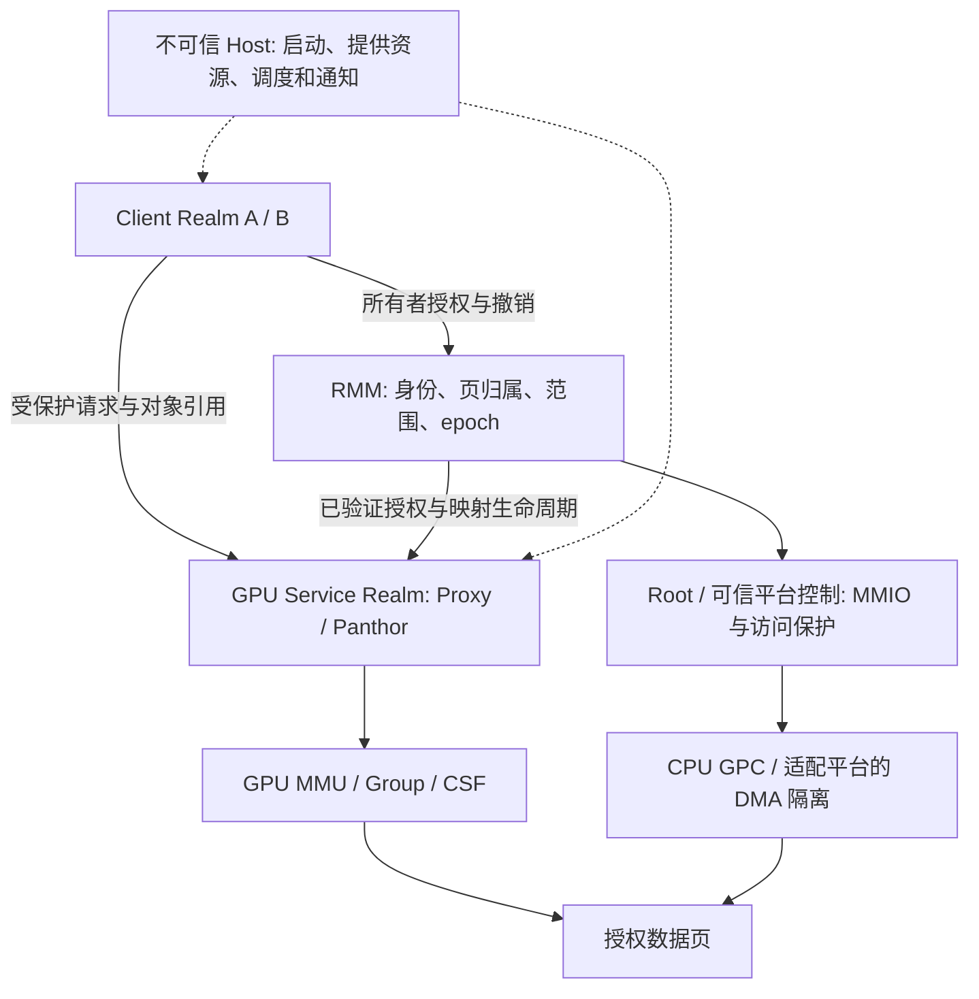

# Proxy VM / RMM 可信 GPU Broker 可行性、PORTAL / CAGE 对比与研究方向

> 历史记录或研究提案；不作为当前运行基线。最新实现见[当前基线](../../../shared/CURRENT_BASELINE.md)。历史分数、失败和未执行项按原版本理解。

日期：2026-10-15。依据固定源码、既有测试证据和论文原文；本次未运行硬件测试、未改驱动或固件。为核对源码，初始化了 OpenCCA 已固定的 tf-rmm 和 TF-A 子模块，没有更新指针或部署它们。

## 1. 结论与术语

**Proxy VM 具备成为 GPU 服务 Broker 的主要功能基础；RMM 适合作为授权与生命周期的可信裁决层；两者当前都不能直接替代 Host vmshm-broker 的全部职责，更未组成可对抗恶意 Host 的机密多租户 GPU。**

需要区分三类 Broker，不能因为名称相同就迁移全部功能：

| 角色 | 核心职责 | 合适位置 | 当前情况 |
| --- | --- | --- | --- |
| 通道/资源提供者 | 创建共享 backing、连接端点、配置通知 | Host bootstrap 或受控服务 | vmshm-broker + Firecracker/KVM |
| GPU 服务 Broker | BO/VM/Group/syncobj 管理、租户策略、提交与完成 | Proxy VM；机密目标为受证明的 Proxy Realm | 普通 VM 路径已具备很多功能 |
| 可信授权者 | Realm 身份、页归属、授权范围、撤销、回收条件 | 小型 RMM 扩展 + Root/硬件执行 | 当前仅有地址查询与 lease 记录 |

“Proxy Realm”是目标架构，不是本次 32 项普通 Client/Proxy 回归已验证的运行形态。该路径与单 Realm direct 实验目前是两条独立证据链。

## 2. 源码确认的能力与缺口

### 2.1 Host broker 没有逐请求转发 GPU 数据

`DomainRuntime::new()` 创建 memfd 和两个方向 eventfd，`handle_connection()` 把 fd 传给连接方，`register_notify_participant()` 记录通知元数据。握手只检查协议、名称格式与 role 值，没有在该连接路径将身份与 Realm 证明绑定，也未使用 SO_PEERCRED 校验请求身份。重复 role 注册会覆盖通知记录。

Firecracker 将 backing 注册为 KVM memslot，并把 eventfd 分别注册到 ioeventfd/irqfd。正常通知由内核机制连接两个端点，不是 broker 用户态每次读取并转发。因此，把 broker 进程移入 Proxy/RMM 不会自动消除已有毫秒级延迟。

代码：[broker.rs](../../../../firecracker/vmshm-broker/src/broker.rs)、[Firecracker vmshm.rs](../../../../firecracker/Firecracker-CCA-MZH/src/vmm/src/vmshm.rs)。

### 2.2 Proxy 已具备服务 Broker 雏形

源码中存在以下功能：

- 从接收 channel 取得 owner_vmid，检查 session 归属；不是直接信任请求中的 session_id。
- 将 Client 句柄翻译为真实 Panthor VM、BO、Group、heap、syncobj。
- 每个 session 可创建独立 GPU 虚拟地址空间，Group 绑定对应 GPU VM。
- FIFO + runnable session round-robin 接纳 GROUP_SUBMIT，全局 pending 上限 256。
- 将提交交给真实 Panthor，GPU 完成由 fence 机制确认。
- 有可选 Group core mask 分片代码，但默认关闭；不是已证明的硬件安全分区。

代码：[panthor_proxy_drv.c](../../../../Linux-Guest-GPU/drivers/gpu/drm/panthor-proxy/panthor_proxy_drv.c)。

这些能力足够支撑普通 GPU 服务化，但还有四个关键限制：

1. **身份根仍由 Host 配置。** channel 的 client_vmid 来自设备树 `vmshm-client-vmid`。可信通道必须将身份绑定到 RMM 验证的 Realm 实例，而不是只保留这个数值。
2. **权限尚不完整。** `proxy_vmshm_lookup_pin()` 与 `proxy_vmshm_grant_lookup_pin()` 都显式忽略 `required_perms`。它们有 generation 和 owner/target 检查，但不能据此声称已有完整的读写授权。这是接口层检查缺口，不等同于已证明可实际绕过所有下层检查。
3. **GPU 时间公平未实现。** RR 按 session 和提交请求数，不按 owner Realm 聚合或 GPU 实际执行时间；多开 session 和长任务会影响策略。底层 Panthor/CSF 的调度与 Proxy RR 是不同层次。
4. **数据可被可信 Proxy 接触。** 如果完整 Proxy Linux、Panthor 和 firmware 都控制租户明文与 GPU 映射，它们属于租户数据的 TCB。放进 Realm 只是保护该服务免受 Host 篡改，不会自动缩小其 TCB 或让租户不必信任它。

代码：[身份来源](../../../../Linux-Guest-GPU/drivers/char/proxy_vmshm_comm/proxy_comm_vmshm.c)、[对象与 grant](../../../../Linux-Guest-GPU/drivers/char/proxy_vmshm_manager/proxy_vmshm_manager.c)。

### 2.3 RMM 当前可以认证“自己的地址”，不能代理访问别人的私有页

固定 tf-rmm 提交：`3de4fbe9ad5adbf28f66a0d6843abf7647f1115c`。

`handle_rsi_opencca_gpa_to_hpa()` 按当前 rec 走当前 Realm 的 RTT，查询其 IPA 对应的 HPA；mapping 表记录 `(RD, HPA, refcount)`，拒绝其他 RD 重复登记相同活动 HPA。

这意味着：Proxy Realm 不能仅通过该 RSI，把 Client Realm 的 IPA 当成自己的 IPA 查询。要支持跨 Realm GPU 服务，需要新增所有者显式同意、服务身份校验、对象范围、权限及生命周期约束的授权机制。

`handle_rsi_opencca_gpu_revoke()` 调用 untrack，只减少/删除表项；没有同步修改 GPU 页表、SMMU、GPC 或等待 GPU 停止。现有 ABI 注释也明确说明它不改变硬件设备权限。因此，目前的 revoke 是软件记账释放，不是物理访问撤销。

代码：[RMM opencca_gpu.c](../../../../opencca/tf-rmm/runtime/rsi/opencca_gpu.c)、[Guest RSI ABI](../../../../Linux-Guest-GPU/arch/arm64/include/asm/rsi_smc.h)。

RMM 可扩展为授权根，但不适合运行完整 Rust/Linux broker、DRM 对象管理、复杂调度或 shader 编译。RMM 不是 Linux 进程，也没有直接创建 Host memfd/eventfd 或控制 Host KVM fd 的同一套接口；需要重新定义边界。

### 2.4 当前硬件不能支撑恶意 Host 隔离结论

固定 TF-A 提交：`fb03b9ed73edfee30072f2db9e3a69a30b0ba0f3`。源码替换 GPCCR/GPTBR 访问，且将 Realm PAS 按 NS 处理；历史 runtime probe 记录 `HOST_READ_SUCCEEDED`。

因此不能以“在 RMM 中加入授权表”推导“Host 已无法读租户内存”。必须有真正消费该授权的 CPU/GPU/DMA 访问控制，以及对 MMIO、页表和 firmware 状态的可信控制。

证据：[OpenCCA GPC accessor](../../../../opencca/trusted-firmware-a/opencca/include/opencca.h)、[PAS 处理](../../../../opencca/trusted-firmware-a/lib/xlat_tables_v2/aarch64/xlat_tables_arch.c)、[direct 实验及 caveat](../history/CCA_TRUSTED_GPU_REALM_DIRECT_ACCESS_IMPLEMENTATION_REPORT.md)。

## 3. 与 PORTAL、CAGE 的实质区别

本文中的 PORTAL 指 *PORTAL: Fast and Secure Device Access with Arm CCA*；CAGE 指 NDSS 2024 *CAGE: Complementing Arm CCA with GPU Extensions*，不混用 CAGE 后续扩展版本的性能数字。

| 比较维度 | CAGE | PORTAL | 当前实现 / 建议目标 |
| --- | --- | --- | --- |
| 核心抽象 | Realm 的 GPU shadow task | Realm 与设备的受保护明文 I/O | 每租户 GPU 对象、上下文与服务调用 |
| 安全控制位置 | Root Monitor 的安全模块 | System Realm 管 SMMU，RMM/Monitor 协作 | 当前 Host/Proxy；目标 RMM 授权 + Proxy Realm 服务 |
| GPU 软件信任 | 通过影子任务复用不可信栈 | 不以完整 GPU ioctl 服务为主要抽象 | 直接信任 Proxy 的 Linux/Panthor；TCB 较大 |
| 隔离机制 | CPU/GPU/外设 GPC 视图 | GPC 与 CPU/SMMU stage-2 | 当前 memfd + 软件 owner + GPU VM；机密强制边界未闭合 |
| 资源管理粒度 | GPU 任务与环境保护 | 动态设备归属交接 | 目标为设备长期由服务持有，按对象/上下文授予租户使用权 |
| 实验边界 | FVP 功能 + 实板性能原型 | FVP 功能 + RK3588 性能原型 | 当前实板功能/性能；不能证明真实 GPC denial |

依据：[CAGE §IV / §V](https://www.ndss-symposium.org/wp-content/uploads/2024-763-paper.pdf)、[PORTAL §4 / §5](https://mainarke.github.io/assets/papers/sp25_sang.pdf)。

**PORTAL 已有 System Realm、受保护队列、动态设备交接与运行时度量。** 所以“搬 Broker 到 Realm”“用 ring 减少切换”“记录动态归属”本身不能作为相对 PORTAL 的新贡献。它的 §4.6 重点是设备独占权交接；本项目可研究设备不随租户更换 owner 的受控 GPU 服务。

**CAGE 的 shadow task 和保护后恢复 GPU 环境也不是空白。** 本项目不能仅凭已有 Proxy 或 reset 再提出同名贡献。可研究的差异是持久多租户上下文中的细粒度授权，以及异步 in-flight 工作在崩溃、重启、页重用时的安全撤销。

上述为对论文所展示机制的比较，不声称对方原则上无法扩展支持这些目标，也不把论文的模拟原型说成真实 RK3588 GPC enforcement。

另外，[CAEC](https://caec-paper.github.io/) 已研究受保护跨 CVM 内存共享，[Honeycomb](https://www.usenix.org/conference/osdi23/presentation/mai) 已研究通过验证缩小 GPU TCB。因此，受保护共享或小型验证器单独提出，也不足以确认新颖性。

## 4. 推荐架构：服务和可信裁决分开



这是目标图，不是当前已完成部署。

### 4.1 第一阶段：信任整个服务 Realm

明确假设 Client 信任测量确认的 Proxy Linux/Panthor 与 GPU firmware。Host 不可信，但仍可拒绝服务；通知只能提示“可能有消息”，不能作为 GPU 工作完成的权威证据。

必须补齐：

1. Client 绑定服务的测量与运行实例，RMM 从真实调用者上下文取得身份。
2. 新增所有者驱动的 grant，确定对象页、接收者、GPU context、权限和有效代次。
3. 用受保护共享替换对 Host 可见的敏感 memfd backing；保留 Host 为可丢失/重复的通知传输方。密文通道也是备选，但不能直接让 GPU 计算密文。
4. 保护设备 MMIO、GPU 页表及相关 DMA 配置，Host 不能用重编程设备绕过页的 CPU 隔离。
5. 将所有 grant 的安装、撤销与 GPU 完成、缓存/TLB 处理、最终回收组成协议。

此阶段最接近现有代码；代价是 Proxy 服务的整个相关软件栈进入 TCB。

### 4.2 第二阶段：进一步缩小服务 TCB

将策略、统计和非敏感对象准备与小型可信映射/提交控制器分开。若希望不信任完整 Panthor，需要另外解决特权命令、页表构造、doorbell、固件上下文及验证后的不可变性；仅检查 RPC handle 不够。

这是更困难的研究方向；不能在完整 Proxy 仍可读取全部授权数据时声称“数据对 Proxy 机密”。若服务本身不可信，单纯 CPU 共享页加密也不能解决它控制 GPU 作为 DMA oracle 的问题。

### 4.3 并行共享不必机械地要求每 Client 一个 SID

可信 Proxy 控制所有 GPU 页表和特权配置、GPU MMU 确实隔离用户上下文且 firmware 可信时，同一物理设备/SID 内仍可能经多个 GPU VM 实现受控共享。独立 VF/SID 不是所有可信中介方案的必要条件。

但 GPU VM、CSG 和 core mask 不自动等于独立安全设备接口。若 SMMU 只能看到整个 GPU 的一个身份，它不能在下游区分两个租户；此时隔离依赖可信 GPU 页表控制与 firmware，而非独立的逐租户 DMA 安全域。若这些假设不成立，应退回串行隔离模式，不能靠软件宣称安全并行。

## 5. 最值得验证的三个研究假设

下列为候选贡献，不是已实现功能，也不是经完整相关工作检索后确认的首创。

### A. 面向 GPU 对象和上下文的跨 Realm 授权

问题：设备长期绑定服务 Realm 时，怎样让其他 Realm 使用它而不将整窗内存暴露给 Host/其他租户？

候选机制：RMM 维护不可由 Host 伪造的授权记录，绑定 `(owner RD instance, service instance, object/range, rights, context, epoch)`。服务通过受保护通道取得授权引用；每次提交只使用已经验证并固定生命周期的对象。owner 身份不能是 FDT 传入的数字；授权引用不能只是可重用裸 handle。若通过不可信传输，必须认证引用与请求，不能仅依赖 generation 的不可猜测性。

核心性质：其他租户不能扩张范围或写权限；旧服务实例、旧 session 和旧 epoch 不能重放；GPU 映射的实际页集合必须是当前授权集的子集。

区别的重心是“对象授权与实际 GPU context 的绑定”；不是一般的共享内存或设备 attach。已有 manager generation/grant 是起点，尤其需先补齐 required_perms。

### B. 异步 GPU 的故障安全撤权与页重用

问题：Proxy 崩溃、fence 超时或 unbind 失败后，什么时候才能把页归还原 owner 或重新分配给另一个 Realm？

提出一个有明确线性化点的状态机：

```text
ACTIVE -> REVOKING -> DRAINING -> INVALIDATED -> RECLAIMABLE
                         |
                         +-- 无法确认停止 --> QUARANTINED
```

撤销开始先拒绝新请求，已接纳的 in-flight 工作由协议处理；只有相关工作终止、GPU 映射及所需 CPU/DMA alias 已撤销、TLB/cache 与权限更新完成，才能确认撤销并允许重用。硬件无法证明停止时保留页/隔离设备，不把“返回一个失败码”当成撤销完成。

reset epoch 必须覆盖 session/Group/syncobj/授权引用。设备级 reset 会影响其他租户，不能假装为单租户恢复；只有可信层验证完成的 reset/隔离条件才可放行。普通 Client 的 fence 完成也不自动意味着所有其他队列已停止。

原 Host pmthor 已有 reset 成功后才释放 PFN、reset 失败则保留的 fail-closed 逻辑；创新不能只是重新包装它，而应扩展为 RMM 授权、GPU 异步生命周期与跨 Realm 重用的一致协议并给出证明与故障注入证据。

与本轮实验直接相关：128 MiB 后发生卸载 Oops，说明“计算正确”与“安全回收”必须分别证明。这里不声称原生 Oops 已导致跨租户泄露，也不将其等同于 pmthor 回收路径同一个缺陷。

### C. 授权验证摊销与语义保持的快速提交

问题：在不削弱授权和 fence 语义的情况下，怎样降低细粒度 RPC 开销？

候选机制：慢路径创建并验证 BO/VM/grant；在 grant 的固定 epoch 内，热路径批量提交已授权对象引用，聚合通知与完成事件。权限变更或恢复使相关缓存失效。批次仍需逐项返回错误，保持依赖、失败顺序和 fence 语义。

不能只提出 ring、batch 或 zero-copy：当前已有共享数据面，PORTAL 也已有队列机制。研究价值需体现为“授权生命周期允许哪些检查安全摊销”，并量化它与 revoke 延迟、tail latency、内存占用和租户公平之间的关系。

本轮 Compute 时间比 14.206× → 1.404× 只是动机；IOCTL 等组合计时包含等待，不足以证明 broker、RPC 或 RMM 是瓶颈。需补充分阶段测量后再选择优化点。

## 6. 安全性质与可证伪实验

| 目标性质 | 必要机制 | 必须做的反例测试 |
| --- | --- | --- |
| 调用者真实性 | 调用上下文与受证明通道绑定 | Host 改 FDT VMID、交换 channel、重放旧服务身份 |
| 最小授权 | 页范围/权限检查与 GPU context 绑定 | 越界 range、只读转写、其他 tenant BO/Group |
| 检查后不变 | 可信拷贝、只读保护或适当快照 | 校验后改 ring/descriptor/page list；需要不可变的命令在验证后被改写 |
| 撤销后无访问 | 终止/排空、映射失效、缓存/TLB 同步 | 延迟 DMA、旧 PTE、旧 doorbell、旧 epoch submit |
| 安全重用 | 撤销确认后才释放与必要清理 | Proxy SIGKILL、GPU hang、reset 失败、owner destroy 并发 |
| 恢复不接受旧对象 | 可信实例与 device epoch | 重启 Proxy 后提交旧 capability / syncobj / Group |
| Host 无数据访问 | 真正 CPU/GPU/DMA enforcement | Host CPU 和另一 DMA master 读写同一活动页 |

对任意 GPU 指令流不宜轻率声称“静态验证后安全”；若采用该路线，需覆盖间接地址、特权命令、自修改、shader 与 command buffer 的可变性，并与 Honeycomb 等比较。

模型/证明建议验证：授权安装与撤销的原子边界、并发映射/销毁、部分批次失败回滚和不重用仍可达页面。RMM 当前全局 8192 条线性扫描表和锁也需单独评估容量与并发扩展，不能直接当作可扩展 Broker 的最终结构。

## 7. 实验路线与论文叙事

1. **实现前先固定威胁模型。** 第一版信任 Proxy Realm/firmware，Host 与其他租户不可信；物理攻击、侧信道和恶意 Host 的调度拒绝服务另列。将 RPC RR 公平与硬件安全隔离分开。
2. **先做对象授权和撤权模型。** 用相同的状态机约束普通原型与 RMM 目标实现；修正 required_perms，再增加 owner/context/epoch 绑定。模型与静态检查均不能代替运行时硬件隔离证据。
3. **RK3588 做机制与性能实验。** 复用现有 32 项，但额外加入负向授权、撤权竞争、恢复和页重用测试；标明 OpenCCA 仿真限制。
4. **FVP/具备相应强制机制的平台做安全实验。** 用真实执行访问检查的模型/硬件验证恶意 CPU/DMA denial。FVP 不提供 Mali 实测性能，不能把 test engine 等价为 Mali firmware 验证。
5. **性能做分解和消融。** 记录 Client 提交、通知、Proxy 接纳、Panthor submit、fence 完成；比较原生、原共享、可信中介、快速路径。报告 p50/p95/p99、CPU 使用、吞吐、grant/revoke 时延和 quarantine 内存。
6. **多租户按 owner 评估。** 2/4/8 个 Client、短长任务混合、多 session 攻击与故障恢复；测 owner 级公平和跨租户影响。Host 可任意暂停服务时，不承诺硬实时 SLA。

可用工作标题：**面向 Arm CCA 集成 GPU 的对象授权与故障安全多租户中介**。

主张应围绕一个问题组织：设备由可信服务持续持有时，如何将租户的内存授权与 GPU 的异步执行、故障恢复和页重用保持一致。快速提交作为该协议的优化，而不是把若干普通优化并列成多个首创点。

## 8. 证据与论文链接

- [完整实验报告](../history/GPU_COMPREHENSIVE_EXPERIMENT_REPORT_20261015.md)：功能回归、性能异常与原生 Oops。
- [原生 / Clientproxy 性能专项](../history/GPU_NATIVE_CLIENTPROXY_PERFORMANCE_20261015.md)：不能直接与论文 overhead 比较，两侧安全目标和测量方法不同。
- [既有多 VM 调度分析](../history/GPU_MULTI_VM_SCHEDULING_PPT_20261008.md)：区分 Proxy RR、Panthor Group 和 CSF。
- [既有 CCA 相关工作分析](CCA_CAGE_ACAI_RME_DA_GPU_SHARING_ANALYSIS_20261013.md)：其中“必须每 Realm 独立硬件 endpoint 才能共享”的强表述不应推广到本文明确选择信任 GPU 服务/页表控制的中介模型。
- [PORTAL 原文](https://mainarke.github.io/assets/papers/sp25_sang.pdf)：重点 §4.2、§4.4、§4.6、§5。
- [CAGE NDSS 2024 原文](https://www.ndss-symposium.org/wp-content/uploads/2024-763-paper.pdf)：重点 §IV-B/C、§V；CAGE 不应被笼统描述为绝不使用 RMM，其部署讨论将 RMM 作为可选组件。
- [CAEC 项目](https://caec-paper.github.io/)：跨 CVM 受保护内存共享已有相关工作。
- [Honeycomb OSDI 2023](https://www.usenix.org/conference/osdi23/presentation/mai)：GPU 验证和缩小 TCB 已有相关工作。

本报告确认可行的职责拆分和可实验的研究问题，没有确认学术首创、完成可信 Broker 或证明 RK3588 机密隔离。
