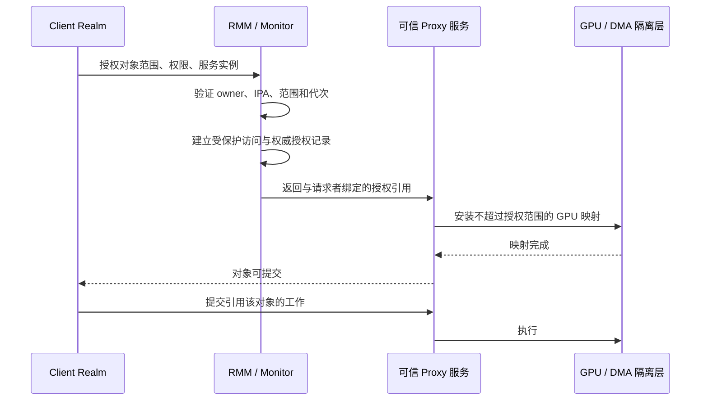

# PORTAL 实现原理与本项目对比

> 历史记录或研究提案；不作为当前运行基线。最新实现见[当前基线](../../../shared/CURRENT_BASELINE.md)。历史分数、失败和未执行项按原版本理解。

日期：2026-10-15。范围：论文机制分析、当前仓库源码检查和设计推演；本次未构建、部署或重跑硬件测试。

主要依据：[PORTAL 原文，S&P 2025](https://mainarke.github.io/assets/papers/sp25_sang.pdf)，重点是 §4、图 7–10、表 2 和 §5。本报告没有审计 PORTAL 作者的完整实现仓库；下文的“论文机制”不能等同于已经逐行验证作者源码。示例、实现检查项及本项目建议是我们的分析。

## 1. 应当怎样理解 PORTAL

论文机制可以压缩为：在其集成 SoC 威胁模型下，通过 P-GPT/N-GPT 区分授权与非授权内存视图，以 CPU/SMMU stage-2 细分 Realm/设备权限，由 System Realm 可信管理 SMMU，并协调运行时设备交接。它允许受控明文 DMA，而不是以 Host 可读共享区承载敏感明文。依据原文 §3–4。

对本项目最有用的理解是：**可信服务 VM 只能承担管理逻辑；谁能读数据、改映射和完成撤权，仍须由不可绕过的机制共同保证。** 把一个进程改名为 Broker，或者把它放进 VM，都不能独自产生这种保证。

## 2. 先分清五种机制

| 机制 | 回答的问题 | 对本项目的直接含义 |
| --- | --- | --- |
| Realm CPU stage-2 / RTT | 这个 Realm 的 IPA 能映射到哪些 HPA？ | RMM 应验证请求者自己的映射和页归属 |
| GPU 内部 MMU | GPU VA 最终被翻译成什么设备侧地址？ | Panthor VM/context 页表不能任由非授权方修改 |
| SMMU stage-2 | 某个设备流可访问哪些系统物理页？ | 必须先确认平台实际 DMA 路径及隔离能力 |
| GPT / GPC | 这类安全状态的物理访问是否被允许？ | Host 即使伪造页表也不应获得保护页 |
| 度量与证明 | 远端接受的是哪个软件和策略实例？ | 日志中的 VMID 或 session_id 不等于可信身份 |

HPA 是最终系统物理地址；PAS 是访问控制属性。改变 PAS 视图不等于搬动 DRAM 中的数据。GPU 内部 MMU 与 SoC SMMU 是不同层；它们即使同时存在，也不能彼此替代。

## 3. 核心：同一 HPA，授权方和 Host 看到不同访问规则

论文 §4.3 的关键是两类 GPT：授权视图 P-GPT 和非授权视图 N-GPT。PORTAL 区域在授权视图为 Normal PAS，在非授权视图为 Root PAS；细粒度权限继续由可信 stage-2 控制。CPU 的授权视图随 Realm 进入/退出切换；设备侧有相应视图。依据图 7–8。

下面用自拟例子解释它的必要性：假设 HPA `P` 保存 Client A 的输入，GPU 需要读取它。

| 攻击/访问情形 | 只有普通共享页时 | 需要形成的保护效果 |
| --- | --- | --- |
| A 的 CPU 访问 P | 能读写 | 通过 A 的可信映射访问 |
| 已授权 GPU 访问 P | 能 DMA | 仅授权设备/映射允许 DMA |
| Host 把 P 加入自己的页表 | 能读写共享页 | 物理访问检查仍拒绝 |
| Realm B 请求映射 P | 取决于软件约束 | RMM 拒绝非授权映射 |
| 其他 DMA 设备访问 P | 取决于设备路径 | 设备侧视图与 I/O 映射拒绝 |

由此可见，“把页设为 Normal PAS，让 GPU 访问”只解决兼容性。若 Host 同时可读，机密性仍然失败；若只有 CPU 保护、其他 DMA 可读，也仍然失败。

P-GPT/N-GPT 不是第五种 PAS，也不是独立的新地址空间。它们的意义在于：可信控制者维护的访问视图，使恶意 Host 无法仅凭自己的页表解除保护。Root/可信管理层仍在信任边界内。

工程检查应覆盖：所有 Realm 返回路径、异常路径、多核并发、GPT 更新同步以及相关缓存失效。这里只列出实现必须满足的条件，不声称论文图示已提供完整指令级证明。

## 4. System Realm 为什么有必要

论文将 SMMU 管理放入专用 System Realm，保护配置 MMIO、Stream Table 和 I/O 页表，避免 Host 改写授权；同时将复杂管理逻辑与 RMM/Monitor 分层。依据 §4.2、§4.4。

可以用三个反例理解：

1. 只保护页表、放任 Host 写 SMMU 配置寄存器：Host 可能切换表基址或改变工作方式。
2. 只保护配置寄存器、放任 Host 写页表：Host 仍能扩大设备可达页集。
3. 表和寄存器都保护，但管理服务相信请求中的任意 HPA/VMID：攻击者可经合法接口申请非法映射。

因此可信服务必须同时保护“配置入口、配置内容、授权判断”。服务放在 EL1 可以限制其对更高权限层的破坏范围，但不能推出服务被攻破后数据仍安全：它仍掌握重要 I/O 权限。

本项目 Proxy 的潜在角色比这更大。它处理 GPU 对象、Panthor 请求、提交和完成，可能接触客户数据。将其升级为可信 Realm 服务后，仍须明确：信任整个 Linux/Panthor/Proxy，还是进一步把授权安装与普通调度拆开。

## 5. 初始化与控制通道：谁的话可以当作授权

论文的初始化通过 Realm 度量、固定设备 MMIO 地址检查和受保护队列建立管理关系；不是接受 Host 任意指定的服务身份和设备地址。依据 §4.4、图 9。

对实现审查而言，初始化至少要回答：

| 问题 | 不充分的做法 | 建议检查的证据 |
| --- | --- | --- |
| 谁是可信服务？ | 名字叫 Proxy、配置中写某 VMID | RMM 认可的 Realm 实例及度量/策略 |
| 申请的是哪块设备？ | 相信 Host 传入的“设备地址” | 可信平台描述与真实 MMIO 范围匹配 |
| 谁发了命令？ | 相信 payload 中 owner 字段 | 受保护端点绑定的实际请求者 |
| 授权是否陈旧？ | 句柄数值仍存在就接受 | 实例、对象、设备代次及生命周期检查 |
| 通知是否可靠？ | eventfd 到达即视为完成 | 从受保护状态读取可验证结果 |

论文的管理队列不能直接等同于本项目 memfd/eventfd：队列承担 SMMU 管理，且存在 RMM 参与的保护和身份关联；本项目普通 Host 共享内存本身不提供同等边界。

论文 §4.4 对请求来源的部分接口叙述还需结合作者源码确认。架构解释应区分 Realm 发起的 RSI 与 Host 发起的 RMI，不宜将文中的每句接口描述直接当成可编译 ABI。

## 6. 用一个对象说明完整 DMA 授权应怎样闭合

论文 §4.5 的 DMA 设置由 Realm 页申请、RMM 地址解析、保护视图配置及 System Realm 的设备映射组成。下面将这一思路改写为适合本项目的设计示例；它不是当前已实现的协议。



这个例子的难点在于“映射不超过授权范围”如何强制执行。若 Proxy 完全可信，可以由服务实现；若想降低其信任，必须防止它绕过接口直接改 GPU 页表/MMIO，不能只增加一次 RMM 检查。

授权元组可设计为：`(owner_instance, service_instance, object, range, rights, gpu_context, epoch)`。它把“某个地址合法”提升为“这个参与者在这个生命周期内能以这种权限访问这个对象”。

当前 RMM 代码已有可信地址解析入口，但只返回/登记 HPA 并不限制 GPU 后续还能访问什么。要获得可信 Broker 能力，还必须将授权结果绑定到实际设备可达页集。

## 7. 设备交接和对象撤权：必须关注中间状态

论文 §4.6、图 10 通过 RMM 状态机协调旧 Realm 的 MMIO 撤销、System Realm 的 I/O 映射切换和新 Realm 的 MMIO 开放；REM 记录运行时设备管理历史。

这个顺序可推广为本项目的一条要求：**在旧控制者仍可命令设备时，不应让设备开始访问新 owner 的私有数据。**

但从整设备交接图不能直接推出以下问题都已解决：Mali CSF 在途工作何时停止、设备缓存是否清理、旧页表 alias 是否失效、旧 owner 不响应如何处理、reset 失败时能否回收页。这些需要具体实现和实验，不应把缺少图示细节当成已证实漏洞。

对持久 Proxy 服务，本项目可以研究对象级撤权：

```text
ACTIVE -> REVOKING -> DRAINING -> INVALIDATED -> RECLAIMABLE
                         |
                         +-- 无法确认停止 --> QUARANTINED
```

含义是：先拒绝新提交，再排空/终止旧工作，随后撤销所有相关映射并完成必要同步，最后才允许页交给新 owner。无法确认停止时保留页面；单纯删除软件记录不能代表回收安全。

REM/日志可以证明记录与度量关联，不能独自证明硬件已经停止 DMA。设备完成、可信状态更新和记录内容必须有明确绑定关系。

## 8. 与当前代码的逐项对照

| 项目部分 | 当前代码能说明什么 | 距离可信 Broker 还差什么 |
| --- | --- | --- |
| vmshm-broker | Host 创建/分发通信资源 | 不具备阻止 Host 读写共享页的边界 |
| Proxy session | 有 owner_vmid 检查 | owner 与真实 Realm 实例的可信绑定 |
| vmshm manager | 有对象、pin、grant、generation | 权限强制执行及与硬件授权对应 |
| RMM 地址查询 | 从当前 Realm RTT 解析 IPA | 显式服务授权、设备映射绑定 |
| RMM GPU_REVOKE | 删除映射登记 | GPU 排空、硬件失效及可回收确认 |
| pmthor reset/清理 | 有失败时保留资源的基础 | 关联跨 Realm 授权和设备 epoch |

可核查入口：

- [Host broker](../../../../firecracker/vmshm-broker/src/broker.rs)：资源创建和 fd 分发；它不是每次 GPU RPC 都经过的可信仲裁器。
- [Proxy session](../../../../Linux-Guest-GPU/drivers/gpu/drm/panthor-proxy/panthor_proxy_drv.c)：session owner 检查和 OPEN_SESSION 的 owner 来源。
- [通信端点](../../../../Linux-Guest-GPU/drivers/char/proxy_vmshm_comm/proxy_comm_vmshm.c)：`vmshm-client-vmid` 配置读取。配置标签不能自动替代 RMM 身份。
- [对象 manager](../../../../Linux-Guest-GPU/drivers/char/proxy_vmshm_manager/proxy_vmshm_manager.c)：`proxy_vmshm_lookup_pin()` 和 grant 查询中存在 `(void)required_perms`。这不表示所有 owner 检查都缺失，但说明不能据此宣称完整读写权限隔离。
- [RMM GPU 接口](../../../../opencca/tf-rmm/runtime/rsi/opencca_gpu.c)：`handle_rsi_opencca_gpa_to_hpa()` 验证当前 Realm 地址并登记；`handle_rsi_opencca_gpu_revoke()` 调用 untrack。这里没有设备停止或 SMMU/GPT 撤权完成协议。
- [GPU 页表路径](../../../../Linux-Guest-GPU/drivers/iommu/io-pgtable-arm.c)：自定义 HPA 路径必须单独审查，不能直接认定它受到 PORTAL 式 SMMU 保护。
- [Host pmthor](../../../../Linux-Host-GPU/drivers/pmthor/pmthor_drv.c)：reset 与资源保留逻辑可作为失败关闭设计基础。

因此，当前 Proxy VM 已有“GPU 服务 Broker”的功能形态；当前 RMM 已有部分可信地址管理入口。二者组合尚不能直接称为具备 PORTAL 同等隔离能力的 Broker。

## 9. 原型和实验能够证明什么

论文 §5 将 RME FVP 的功能/隔离验证与 RK3588 Mali-G610 的性能原型分开。不能把后者当成真实硬件 CCA 隔离已经在 RK3588 上实现的证据，也不能把其加密对照收益当作相对原生驱动的收益。

本项目同样需要分开两类结论：

| 已有证据 | 可以支持 | 不能支持 |
| --- | --- | --- |
| 普通 VM 的完整 32 项回归 | 对应 run-id 下列出功能可用 | 恶意 Host 下的机密性 |
| Native/Clientproxy 性能结果 | 对应条件与成功样本的开销 | 所有负载稳定性、跨论文直接排名 |
| 单 Realm GPU 路径 | 指定实验中的地址/执行路径可工作 | 多 Realm 授权和撤权安全 |
| Host 读取实验 | 对应映射下实际可读性 | 用模拟 CCA 宣称真实 GPC 阻断 |

相关实验见[综合报告](../history/GPU_COMPREHENSIVE_EXPERIMENT_REPORT_20261015.md)与[性能报告](../history/GPU_NATIVE_CLIENTPROXY_PERFORMANCE_20261015.md)。历史 PASS 不覆盖后续已记录的 fence 超时及其他新失败。

## 10. 对本项目最有价值的推进顺序

1. 明确信任模型：先以可信 Proxy Realm 为目标，列出 Linux、Panthor、firmware、RMM/Monitor 和硬件的信任范围。
2. 把身份建立在 Realm 实例上：配置 VMID 仅作路由标签，敏感授权由可信端点和 owner 归属确认。
3. 完成对象授权闭环：范围、读写权限、服务实例、GPU context 与 epoch 一起验证；先补实当前权限检查。
4. 确认实际硬件可达性：画出 Mali 内部 MMU、系统 DMA 路径、SMMU/防火墙及所有配置入口。软件模拟与真实硬件保证分别记录。
5. 定义撤权完成语义：以“页可以安全交给其他 owner”为成功条件；对 fence 卡死、Proxy 崩溃和 reset 失败做故障注入。
6. 再评估并发与性能：报告可信控制路径、数据路径、额外复制、同步和恢复代价，避免只比较成功渲染的 FPS。

与 PORTAL 比较时，更有研究价值的问题是：**设备长期由一个可信 GPU 服务持有时，怎样按对象/context 向多个 Client Realm 提供可验证授权，并在异步失败后安全回收？** 这是候选研究方向；是否构成新贡献，还需要与相关工作进行系统查新，不能仅凭架构差异宣称首创。
