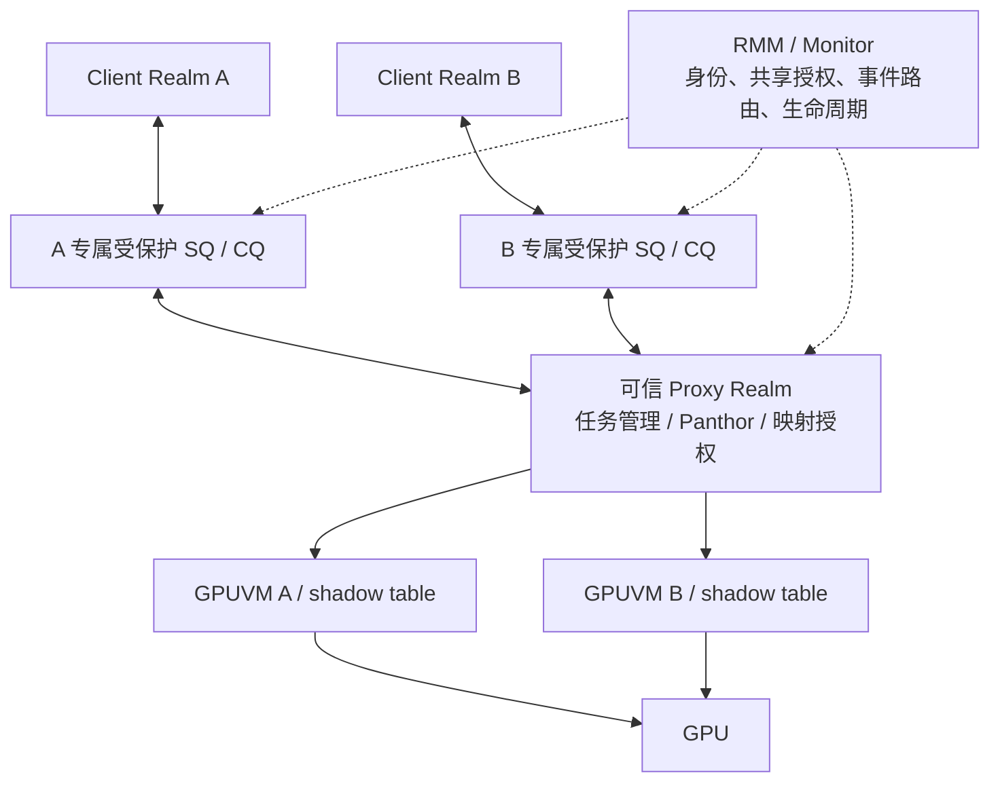
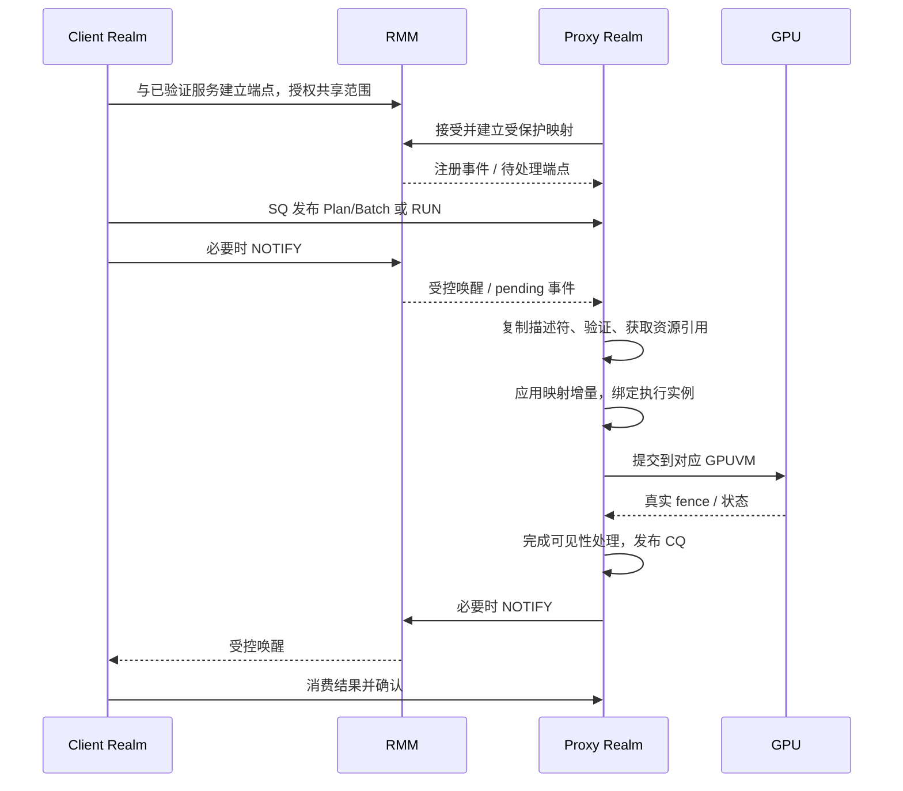

# Proxy Realm GPU 服务整体方案 V2：可信通信、任务代理与映射隔离

> 历史记录或研究提案；不作为当前运行基线。最新实现见[当前基线](../../../shared/CURRENT_BASELINE.md)。历史分数、失败和未执行项按原版本理解。

日期：2026-10-17。本文保留原始设计目标；用户授权后的实际改动、构建、部署和逐轮测试见
[实现记录](../history/PROXY_TASK_SERVICE_IMPLEMENTATION_20261017.md)。任务计划、RMM 共享、可信 IPC IRQ、
多 Client 实算及共享撤销已有板端功能验证；GPU shadow 隔离尚未实现。
RK3588/OpenCCA 没有真实 GPT/GPC，功能验证不等于恶意 Host 下的硬件机密性证明；
本文其余设计目标是否实现，以实现记录中的逐项证据为准。
接口名为项目扩展，不属于现有 Arm 标准 ABI。性能数字分为既有实测、论文结果和待验证目标，不互相替代。

## 1. 设计结论

采用三个相互关联的机制：

1. GPU 虚拟化从逐对象 RPC 演进为执行批次与可复用任务计划。
2. 通信改为 RMM 授权的 Realm 间受保护共享内存、持久事件状态和按需通知；常态数据不经 RMM 搬运。
3. 可信 Proxy Realm 管理真实 GPUVM/shadow page table，把任务、资源授权、映射版本和真实完成绑定；撤销成功以页面可以安全重用为准。

物理 GPU 长期由 Proxy Realm 持有。Client 不获得设备 MMIO、真实页表或全局 reset 权限。RMM 管身份、参与者、页归属和生命周期，复杂 GPU 驱动继续在 Proxy 中运行。

第一版信任 Proxy Realm 的内核、Panthor 与相关服务；逻辑上拆出映射授权模块并不构成同一内核内的安全隔离。移除整个 Proxy 驱动的信任是独立研究目标，不能通过多加一次 RMM 调用实现。

## 2. 新调研对方案的修正

### 2.1 与本方案直接相关的论文

| 工作 | 可核查的思想 | 本方案取舍 |
| --- | --- | --- |
| [PORTAL，S&P 2025](https://mainarke.github.io/assets/papers/sp25_sang.pdf) | System Realm 管理 SMMU，RMM 建立管理队列并通知注册 | 借鉴控制面分层，不复制整设备交接作为每次任务路径 |
| [CAEC，EuroS&P 2026，v5](https://arxiv.org/html/2512.01594v5) | RMM 支持参与 Realm 间受保护共享，并绑定可证明身份 | CPU 通信共享以此类机制为基础；不声称共享页本身创新 |
| [Devlore，RAID 2026，v3](https://arxiv.org/abs/2408.05835v3) | 委托中断管理，由可信软件检查真实性 | 区分硬件 IRQ 与软件 IPC 事件，授权通知路由 |
| [Elasticlave，USENIX Security 2022](https://www.usenix.org/conference/usenixsecurity22/presentation/yu-jason) | 非对称权限和受控共享 | 区分长期共享、独占写入和撤权，避免权限检查与使用竞争 |
| [CAGE，NDSS 2024](https://fengweiz.github.io/paper/cage-ndss24.pdf) | stub/real task 分离，可信执行前绑定 | 复用准备结构；不照搬其 GPU GPT 与任务独占机制 |
| [StrongBox，CCS 2022](https://compass.sustech.edu.cn/strongbox/) | 在不可信 OS/驱动条件下保护 GPU 执行环境 | 识别设备控制状态与数据保护的完整边界 |
| [ACAI，USENIX Security 2024](https://www.usenix.org/system/files/usenixsecurity24-sridhara.pdf) | 扩展 CCA 不变量到设备身份、归属与映射 | 定义跨 CPU/设备授权一致性，不套用其硬件前提 |
| [Graviton，OSDI 2018](https://www.usenix.org/system/files/osdi18-volos.pdf) | 可信控制组件跟踪 GPU 资源归属与清理 | 建立资源生命周期账本，不假定 G610 有对应硬件扩展 |
| [Honeycomb，OSDI 2023](https://www.usenix.org/system/files/osdi23-mai.pdf) | 静态验证约束 GPU 执行 | 后续受限计算任务可注册验证；不是现成 Mali 验证器 |
| [Guardian](https://arxiv.org/abs/2401.09290) | PTX 插桩约束同一地址空间内的访问 | 作为软件隔离对照；本方案首选独立 GPUVM，不直接移植 PTX |
| [gVirt，USENIX ATC 2014](https://www.usenix.org/conference/atc14/technical-sessions/presentation/tian) / [gHyvi，USENIX ATC 2015](https://www.usenix.org/conference/atc15/technical-session/presentation/dong) | 受控特权路径与减少 shadow 映射同步 | 保持地址稳定、批量更新；不延迟安全撤销 |
| [AvA，ASPLOS 2020](https://oscarlab.github.io/papers/ava-asplos20.pdf) | 结构化加速器 API 虚拟化 | 明确对象语义与协议生成边界 |
| [Telekine，NSDI 2020](https://www.usenix.org/conference/nsdi20/presentation/hunt) | 关注不可信交互中的秘密相关行为 | 明确计划形状、时间和资源大小可能泄漏 |
| [Blueprint, Bootstrap, and Bridge，MLSys 2026](https://arxiv.org/abs/2507.02770v2) | 系统性分析 GPU 机密计算实现与边界 | 单独审计启动、身份建立及 CPU–GPU 桥接，避免局部安全推导整体安全 |

CAEC 论文版本依据 v5（2026-05-06），其作者页面确认 EuroS&P 2026 发表信息：[作者出版记录](https://katahdin.dartmouth.edu/~kotz/research/abdollahi-caec/index.html)。本提案查阅论文与公开资料，没有对上述项目的完整代码进行安全审计，不直接引用其最大加速倍数作为本项目预期。

### 2.2 PORTAL 的两种通信不能混淆

PORTAL 图 9 中，RMM 建立队列映射后触发异常，通知 System Realm 注册；随后由执行循环处理管理请求。论文不支持“每条消息均把完整载荷作为异常参数传递”的解释。其管理队列涉及 RMM/System Realm，不应未经源码核对就视作 Client 与 System Realm 任意直写的大型共享区。

本方案选择：注册、权限变更、撤销等低频事件由可信控制面处理；任务与完成记录放在已建立的队列。异常/通知只促使接收方查看状态。

### 2.3 创新边界

RMM 共享映射、System Realm、ring buffer、capability、doorbell、shadow task 都已有先例。创新候选应落在：跨 CPU 共享授权与 GPU 映射的统一执行租约、异步失败下可证明的回收点、与任务批次协同的有界通知开销。它们仍需要查新、形式化与实验，不宣称首创。

## 3. 重构前实现的直接依据

- `panthor_vmshm.h`：476 字节有效载荷限制 VM_BIND 操作数和 GROUP_SUBMIT 数量；需要解除传输槽与 GPU ABI 的耦合。
- `panthor_client_drv.c`：精确 fence 快照与非阻塞轮询已经存在；不能删掉语义而只追求减少 RPC。
- `panthor_proxy_drv.c`：有 Session owner、句柄与引用管理，可保留；粗粒度锁和单个 submit 工作项需要重新安排。
- `proxy_vmshm_manager.c`：已有对象、generation、pin、grant，但两处 lookup 的 `required_perms` 尚被忽略；grant 删除只是软件查找能力撤销。
- `client_comm_vmshm.c`：有 seq 匹配、IRQ 模式并发 RPC；超时不等于远端未执行。
- Firecracker `vmshm.rs`：当前 memfd/memslot 与 eventfd/irqfd 不构成恶意 Host 下的机密边界。
- RMM `opencca_gpu.c`：地址解析与 lease 是基础；既有 lease 不是硬件 GPU 访问权限。

既有实测基线：同 Host、实际 GPU 594 MHz，720p 原生/Clientproxy score 为 1432/1058，1080p 为 997/847。来源：[性能报告](../history/GPU_GLMARK_PERFORMANCE_REPORT_20261016.md)。它们不是新方案性能结果，完整矩阵仍需重新运行，旧 PASS 不覆盖新设计或已记录的额外超时。

## 4. 威胁模型、硬件前提和可声明范围

| 对象 | 第一版处理 |
| --- | --- |
| 不同 Client Realm | 互不信任；请求、索引、命令与资源引用均可能恶意 |
| Proxy Realm | 受信任，能够接触被授权数据；不是对 Proxy 隐藏数据的方案 |
| RMM / Monitor / 安全启动 | 受信任 |
| GPU 硬件、固件、特权配置 | 列入可信假设；需审计实际可达性与控制路径 |
| Host/VMM | 不作为授权方；可拒绝调度或延迟通知，通用可用性不保证 |
| 物理攻击、微架构侧信道 | 第一版不声称防御；记录时间、形状、大小泄漏 |

设备配置保护必须覆盖 MMIO、页表根、CSF 管理状态、doorbell、reset 和电源/时钟控制中会影响隔离的入口。卸载 Host 驱动仅是运行配置，不是防恶意 Host 的机制。

分开验证三种环境：

1. RK3588/OpenCCA：功能、性能、软件攻击与恢复测试；没有真实 GPT/GPC，不能证明 Host 读写被硬件阻断。
2. 有 RME 的 FVP：CPU 共享映射、身份和 RMM 状态机；若 GPU 是模型，不能声称验证了真实 G610 全部硬件行为。
3. 满足设备控制和内存访问保护前提的平台：端到端机密性目标。若缺少此平台，明确保留为条件性安全论证。

## 5. 三层架构



RMM 不解析 GPU 指令、不执行复杂调度、不逐任务扫描共享队列，也不搬运大块 BO。Proxy 负责这些工作。Host 负责启动、资源供给与调度辅助，但不能修改授权结论。

跨 Realm 操作显式扩展现有固件模型。不能假定标准 RMM 已经允许同一受保护 DATA granule 随意映射给多个 RD；必须扩展元数据、验证规则、RTT 更新及销毁路径。

## 6. 可信身份与端点

### 6.1 身份

RMM 分配 Realm 实例身份，并与证明及服务策略关联。RIM 相同不代表同一个实例；VMID、RD 地址、配置标签都不能独自作为长期安全身份。重启或重建生成新实例代际。

参与方验证服务度量、协议版本和共享策略后才建立通道。生产部署需绑定已验证实例与新鲜挑战，避免合法镜像的错误实例替换。开发白名单仅作原型配置，不能冒充远程证明。

### 6.2 端点记录

```text
Endpoint = {
  creator_instance, peer_instance, generation,
  rights, queue_grants, event_bits,
  pending_sequence, acknowledged_sequence, state, quota
}
```

标识符即使公开或可猜测，也不能仅凭数值获得权限；每次可信操作检查当前调用者。授权引用只对指定参与者、范围、权限和代际有效。

## 7. 共享内存：两类保护域，三个用途

### 7.1 CPU 控制共享与 GPU 数据授权必须分开

CPU 通信域的目标映射：

| 主体 | 允许路径 |
| --- | --- |
| Client A | 自己 S1 → 自己 RTT → 共享 HPA |
| Proxy | 自己 S1 → 自己 RTT → 同一共享 HPA |
| Client B | RTT 不存在该映射 |
| Host | 对真实硬件上的 Realm PAS 页，GPC 阻止其直接访问 |

CPU 共享页保持 Realm PAS，参与者权限由 RMM 管理的 RTT 决定。不是简单把页设为 Host 可读的 Normal shared。RMM 维护一个明确的提供者和参与者集合，不能将共享页伪装为多个独占 owner。

GPU 数据域另行授权。CPU 控制共享不能自动推出设备可达：若设备访问受 GPC 检查且只能发 Normal 事务，Realm PAS 页可能无法直接使用；需要平台支持的设备保护路径、PORTAL 类视图，或其他经过验证的可信访问机制。RK3588 的实验 DMA 路径不能替代通用设备保护证明。

### 7.2 用途布局

| 区域 | 数据 | 生命周期 |
| --- | --- | --- |
| SQ/CQ | 固定描述符和结果 | 端点级，长期存在 |
| 描述符池 | 资源列表、映射增量、参数 | 有界租用，受理后可回收 |
| BO 数据池 | 输入、输出、纹理等 | 对象级，按授权与在途引用管理 |

每个 Client 只映射自己的区域，Proxy 聚合各域；不让所有 Client 共享一个整窗。BO 可复用已授权 arena，权限或参与者不同的对象按页隔离，不能混在同一个授予页中。不同 owner 重用前按策略清理内容。

### 7.3 建立与销毁

拟议 `RSI_XSHM_OFFER / ACCEPT / ATTACH / REVOKE_BEGIN / STATUS` 表达双方同意、目标地址预留、映射建立与撤销。Host RMI 只提供已委托页或推进受检操作，不能替任一 Realm 同意。

跨 RD 加锁采用固定顺序；大范围创建/撤销有工作预算和可继续令牌；失败时停留在显式状态并回滚或继续，不能把半完成范围公布为 ACTIVE。共享 metadata 的页数、范围数与参与者数均设额度。

所有 DATA_DESTROY、RTT 拆除、undelegate、Realm 销毁路径检查共享引用和设备在途租约。不能绕过新接口通过旧 RMI 提前回收物理页。

## 8. 通知：可信 pending 状态，按需异常/虚拟 IRQ

### 8.1 拟议服务

```text
RSI_XEVENT_NOTIFY(endpoint, generation, event_class)
RSI_XEVENT_ARM(endpoint, observed_event_sequence)
RSI_XEVENT_ACK(endpoint, consumed_event_sequence)
```

通知调用不信任发送方自报的 owner、目标 VMID、ring producer index 或“已完成”标志。RMM 根据调用者与端点确定目标，递增/合并可信事件状态并限流；实际 ring 内容仍由接收方验证。

通知向接收方投递一个约定的合成事件，可在可信恢复入口形成异常/虚拟 IRQ；具体选择须与 REC 保存恢复、来宾驱动和异常语义一起实现。它不是篡改页表或制造真实访存错误作为常规消息通道。

接收 REC 未运行时记录 pending，通过 Host 可见的调度提示请求运行；Host 不合作则不能承诺即时送达。目标在其他核心运行时，必须实现安全的跨核唤醒/入口同步，不能仅写共享 flag 就声称立即注入。

### 8.2 常态快路径

1. 生产者写描述符，执行必要内存顺序操作后发布 producer。
2. 接收方运行时可直接排空已授权队列；每条记录不调用 RMM。
3. 接收方准备休眠时调用 ARM，RMM 原子比较事件序列并登记等待。
4. 基线版本每个已发布批次都调用 NOTIFY；端点由 pending 状态合并多次事件。合并投递不等于省掉通知调用，调用次数通过批量发布减少。
5. 若 NOTIFY 先于 ARM，序列比较使 ARM 立即返回；若 ARM 先到，后续 NOTIFY 设置待投递事件。

队列检查与 ARM 之间必须保存一致的观察序列，通知后不能只因 ACK 而抹掉更新的事件。允许 spurious wake，不允许依赖一个可丢失的脉冲作为唯一事件记录。

忙时采用有限自适应轮询减少切换，闲时休眠；轮询时间计入 CPU 预算。后续若省略活跃阶段的 NOTIFY，必须另行实现并验证 armed 发布、队列重检查与发送方状态观察的完整握手；不能仅凭一次“接收方在运行”的读取跳过通知。唤醒合并不能无限延迟短任务：低延迟模式立即通知，吞吐模式设置批次和计时器上限。最终参数由实测确定。

### 8.3 不同事件的语义

| 事件 | 事实来源 | 能证明什么 |
| --- | --- | --- |
| SQ 有请求 | Client 发布，RMM 授权通知 | 指定端点需要检查；不证明请求合法 |
| CQ 有记录 | 可信 Proxy 发布 | 可读取完成/失败记录；需匹配 operation 与代际 |
| GPU 硬件 IRQ | 设备/可信 IRQ 路径 | 设备报告事件；不等于特定任务已成功 |
| 任务完成 | 捕获的真实 GPU fence 和状态 | 对应执行实例达到终态 |

Host eventfd/irqfd 可以保留为原型唤醒后端，但只作提示；真实硬件可信模式改用受检查事件路径。两者不能在报告中被描述为同等安全实现。

## 9. 队列协议和恶意参与方

每 Client 使用独立 SQ/CQ。第一版由 Client 内核把多个线程请求汇聚为单生产者；多 lane 可后续扩展，不一开始引入跨 Realm 全局 MPMC 锁。

producer/consumer 与写入者私有状态分离，尽量位于不同 cache line；需要不同写权限的状态放不同页并由 RTT 强制。若双方必须写同页，则以不可信索引处理，不能称其硬件单写者。

接收方校验单调性、差值不超过容量、长度、范围与整数溢出；使用本地可信消费进度，不能接受对端任意推进自己的 consumer。64 位序号回绕前切换代际，不静默复用。

描述符先复制到可信私有内存，再校验并只使用该副本；不能校验共享内存后再次读取作为执行参数。大列表有总长度和数量上限，使用受理/错误记录回收；Client 修改尚未受理内容只能导致拒绝，不能扩大权限。

CQ 容量、在途 Execution 与结果保留采用 credit；满时停止受理新任务，不能覆盖未确认终态。断连后使用明确关闭与隔离资源策略，不无限保留可增长记录。

## 10. 虚拟化：兼容批次与可复用计划

### 10.1 统一后端

```text
DRM IOCTL 前端 → EXECUTE_BATCH ─┐
                              ├→ 统一 Execution / GPUVM / 完成后端
REGISTER_PLAN + RUN ───────────┘
```

Mesa 暂留 Client，避免立刻迁移完整图形 API。DRM 前端仅在语义允许时批量化；需要即时结果的创建、查询、错误边界仍提供同步语义。进一步跨 IOCTL 合并可能需要 Mesa 修改。

### 10.2 执行描述符

```text
Execution = {
  protocol_version, endpoint_generation, operation_id,
  domain_id, plan_id_or_command_ref,
  resource_bindings, mapping_epoch, dependencies,
  parameter_ref, completion_id
}
```

每个资源绑定带对象、代际、offset、length、访问权限。稳定计划不嵌入可任意替换的物理地址；可信侧将绑定解析为真实执行状态。

CAGE 式准备/真实绑定分离主要用于重复计算：注册稳定任务骨架，逐次绑定数据。动态图形保留批次路径。Proxy 受信任时，不必为了名称维护两份完整驱动状态。

验证缓存键至少包含计划内容版本、参数布局与策略版本。代码、间接描述符或映射变化时失效；不能把注册通过当成所有后续输入都安全。初期只对受限计算接口提供计划验证，不宣称通用 Mali 二进制静态验证已完成。

## 11. GPUVM 与可信 shadow page table

一个 Realm 可有多个安全域。互不信任的 Group 不共享含双方私有数据的 GPUVM；同一安全域的 Group 可共享。独立 Session 或 shader core mask 不自动提供访存隔离。

Client 仅提供 GPUVA 到资源范围的意图；可信 Proxy 根据已授权页生成 GPUVA→HPA 的真实表。shadow 是可信实现，不要求 Client 另建一份硬件页表。

在无设备 Stage-2 时，这是软件预先合成授权映射、由 GPU MMU 在访存时执行；不是软件在每次 GPU 访存上运行 Stage-2 检查。

保护范围包括页表页、AS 配置、页表根、Group/CSF 到地址空间的绑定及特权设备入口。页表页不映射为 Client 可写 GPU 数据；共享固件/管理映射采用显式最小 allowlist，不把其他 Client 数据带入。

维持：

```text
ReachablePages(domain) ⊆ AuthorizedPages(domain) ∪ AuditedManagementPages
```

CPU read-only 不代表 GPU read-only；CPU 与设备权限分别转换并检查。命令/描述符的可变性也分别处理：协议描述符复制稳定不代表 CSF 执行读取的间接对象已经稳定。安全配置需保护特权命令与相关间接引用；无法证明的动态特性不进入缩小 TCB 的安全配置。

初期新增/修改映射在受影响 GPUVM 的安全边界处理，允许使用整 GPUVM 排空；只在证明无在途冲突后采用细粒度增量更新。mapping_epoch 是版本标识，不是硬件同时运行两套页表的保证。

## 12. 联合生命周期：共享撤权不能早于 GPU 退出

引入 DeviceLease，绑定对象范围、GPU 安全域、设备 epoch、执行引用。RMM 管理 CPU 共享与回收资格，可信 Proxy 管理设备在途引用；双方通过受保护记录协调。

```text
ACTIVE → CLOSING → DRAINING → GPU_UNMAPPED → CPU_UNMAPPED → RECLAIMABLE
                      └─ 无法确认停止 → QUARANTINED
```

流程：

1. RMM 将 grant 标记 CLOSING；Proxy 禁止新执行引用，处理并发受理竞争。
2. 排空或终止引用该对象的旧任务；持有物理页和授权记录。
3. Proxy 解除 GPU 映射，完成必要缓存/TLB 同步，发送可信实例的撤权确认。
4. RMM 更新参与 Realm 的 RTT、完成 CPU TLB 失效与引用清理。
5. 按清理策略擦除后，允许页面回收或改归属。

授权开始关闭后仍有受理中的请求，必须通过引用获取与关闭的原子顺序决定其属于旧任务还是被拒绝。延迟的旧 grant 引用不能重新激活映射。

Proxy 崩溃或不回应时，RMM 不能凭超时认定 GPU 已停止。只有受信任的设备停止/复位路径确认无残留访问，才能推进；否则 quarantine。Host 口头报告 reset 成功不作为证明。GPU 级 reset 会影响其他安全域，必须将全部受影响 Execution 标为错误。

标准 CPU 共享撤权与 GPU 在途 DMA 的联合关闭是本方案的研究重点；不能简单调用一个 CPU CSM revoke 后立即复用物理页。

## 13. 真实完成、超时与重放

```text
RECEIVED → VALIDATED → QUEUED → SUBMITTED → COMPLETED / FAILED
                 └→ REJECTED
```

RECEIVED 只代表已有稳定请求副本；SUBMITTED 不代表执行成功。输出可供 CPU 读取的完成点还包括该平台要求的缓存可见性操作。

精确 fence 导出返回不可变完成引用；由真实 fence 回调写 CQ、Client signal 本地 dma_fence。错误 fence 保留错误，不把失败视为成功完成。可变 syncobj reset/import/transfer 仍保留原语义。

操作 ID 在同一端点代际内去重，终态保留至显式确认；未知 ID 和超时可查询。不能通用地自动重试执行，不承诺跨服务崩溃恰好一次。新服务或设备 epoch 使旧计划执行绑定、完成引用与租约失效。

## 14. 一次完整执行



授权共享与计划注册属于低频路径；稳定资源重复执行时不重新建立 RTT 或逐页调用 RMM。多个任务可由一次批次发布和一次 NOTIFY 覆盖；基线不承诺每个单任务提交都免于固件调用。

## 15. 并发与公平

先实现多域排队、准备并行与安全分时，验证控制链和清理路径。再在有证据时开放不同 GPUVM 驻留并发。

并发门槛：真实 AS 绑定正确、无跨域可写映射、特权控制受保护、CSF/固件假设明确、错误与 reset 影响范围已测。共享缓存侧信道和设备级 DoS 不能从独立页表推导消除。

按 Realm 限制共享页、固定页、在途任务、通知频率和结果缓存；避免通过开多个 Session 绕过配额。带权轮转只是接纳策略，使用 GPU 时间/资源统计评估公平；无可靠抢占时不提供硬实时保证。

## 16. 性能保障：结构约束、预算与实验门槛

没有实验不能保证 FPS。第一版保证可检查的成本结构：

| 约束 | 预期效果 |
| --- | --- |
| 固定资源重复 RUN 不新建 RTT，不重新逐页授权 | 将页表/共享建立成本移出常态路径 |
| 常态 SQ/CQ 不由 RMM 逐条搬运/解析 | 固件成本不随载荷字节数增长 |
| 活跃队列可连续消费，基线按批次通知并合并投递 | 减少逐条唤醒；通知调用仍计入成本 |
| 真实 fence 事件驱动完成 | 避免默认反复 WAIT RPC |
| 计划、Group、GPUVM 与 GPUVA 可长期复用 | 减少对象重建与重复准备 |
| 固件操作、列表和排队有上限 | 防止无界持锁、内存膨胀和通知风暴 |

RMM 通知费用是待测项，不能认为一定快于 eventfd/irqfd。以有限忙轮询、批量化和独立核心选项对冲；额外核心成本单独报告。

端到端时间分解：

```text
T = Tprepare + Tpublish + Tnotify/schedule + Tvalidate/map
    + Tqueue + Tgpu + Tvisibility + Tcompletion
```

流水线可能重叠这些部分，因此不盲目相加累计 CPU 时间。跨 Realm 时钟未校准前，不直接用双方时间戳相减；先用单端往返及可信相关序号分解。

待验证目标（不是承诺）：重复计算提交链路 RPC/陷入数量减少；受保护共享的稳态带宽接近同权限布局的普通明文共享对照；事件完成降低查询量且不恶化尾延迟。每项建立基线后再给出微秒预算。

建议发布门槛：正确性/安全负向项全部满足；固定环境交替重复下主要收益置信区间支持改善；典型应用若稳定回退超过约 3% 则查因或保持可选，不能用总分覆盖单项回退。3% 是工程拟议阈值，需结合噪声重新确定，不是论文结论。

## 17. 验证矩阵

### 17.1 通信微基准

- 64 B、512 B、4 KiB、64 KiB、1 MiB 描述符/数据；单条与批次。
- 4/16/64/128 MiB 数据池复用，按实际内存容量扩展。
- 双方活跃、接收方睡眠、共享核心与独立核心、1/2/4 Client；物理设备容量不支持时标记未执行。
- 对照当前 memfd/eventfd、受保护映射+原通知、受保护映射+RMM 事件、轮询与混合模式。
- 报告 RTT P50/P95/P99、吞吐、CPU 周期、陷入/通知数、丢失唤醒、背压、固定页和空闲 CPU 占用。

不能把不同平台 FVP 时间与 RK3588 实测合并作同一延迟结论，也不以加密基线的倍数代替相对当前明文路径的改进。

### 17.2 GPU 消融

原生 / 当前代理 / 新完成机制 / 新通信 / 批次 / 计划复用 / 完整隔离。锁频、亲和性、用户态和任务一致，交替重复，保留失败与未执行项。额外跟踪每任务 RPC、映射与 TLB 次数、GPU 空闲、尾延迟、CPU 和内存。

现有完整 32 项重新执行，并单独保留历史额外 Group fence 超时的专项回归。动态图形与固定计算分别报告，不能用计划 API 收益代表所有旧应用收益。

### 17.3 安全与故障

伪造服务/实例、旧代际重放、越权 grant、超范围映射、CPU/GPU 权限不一致、修改描述符/间接命令、篡改索引、CQ 满、通知重放/洪泛、ARM/NOTIFY 竞争、丢回复、重复 RUN、并发撤权、Client/Proxy 销毁、GPU hang、reset 失败和跨 owner 页重用。

形式化重点：端点 pending/ARM 无丢失唤醒；关闭后不新增设备引用；RECLAIMABLE 时无 CPU alias 和在途设备引用。形式模型结论必须列出硬件停止/失效原语的假设，不等于证明真实芯片全实现。

## 18. 组件改动与阶段

| 组件 | 预计改动 |
| --- | --- |
| RMM / Monitor | 实例身份、共享元数据与 RTT、端点事件、回收约束；保护设备控制入口的平台支持 |
| Client 内核 | 受保护共享驱动、SQ/CQ、本地 fence、兼容批次前端 |
| Proxy 内核/服务 | 授权引用、任务状态、计划、shadow 映射、完成事件和撤销确认 |
| Panthor | GPUVM/AS 绑定审计、映射发布边界、故障与设备 epoch 联动 |
| Firecracker/KVM | 按受检流程提供页和调度提示；敏感内存不再普通 memfd 整窗共享 |
| Mesa / 计算适配层 | 后续跨 IOCTL 合并、可复用计划入口；初期兼容路径保留 |

阶段 A：冻结 ABI 草案与不变量，先验证身份/映射和通知状态机。

阶段 B：独立完成可信共享与通知原型，做通信微基准；CPU-only 先验收，不带 GPU。

阶段 C：完成事件、操作 ID、状态查询与兼容批次；旧版本仅保留固定基准载荷用于 A/B，
不在产品代码中长期保留重复提交路径。

阶段 D：接入 DeviceLease、可信 shadow 映射、联合撤权及安全分时。

阶段 E：固定计算 Plan/RUN 与图形兼容路径分别验收。

阶段 F：满足审计门槛后开启跨 GPUVM 并发，作为独立验收项。

实施遵循仓库 runbook、固定 manifest 和硬件单回归要求；实际阶段进度以实现记录的证据为准。

## 19. 推荐研究主张

研究题目可表述为：**面向代理 GPU 的 Realm 间授权通信与异步执行生命周期协同设计**。

主问题不是怎样再建立一个共享 ring，而是：在 GPU 不提供设备 Stage-2 的情况下，能否用持久可信服务把 CPU 共享页、GPUVM 授权和异步完成组合起来，在减少交互的同时，给出明确的安全回收点。

候选贡献：

1. 共享授权与 GPU 执行租约协同：同一对象的 CPU 映射、GPU 映射、在途任务和回收状态使用统一代际及关闭协议。
2. 与任务批次协同的可信事件通路：有界通知成本、无丢失唤醒、真实完成与可恢复结果，不让 RMM 成为逐任务代理。
3. 缺少设备 Stage-2 时的受控映射发布与异步撤销：明确正确性不变量、故障隔离和性能权衡。

CAEC 已覆盖通用机密共享，PORTAL 已覆盖可信管理与设备交接，CAGE 已覆盖影子任务；本方案必须用新的联合协议、证明与实测支撑差异，而不是组件组合或改名。
