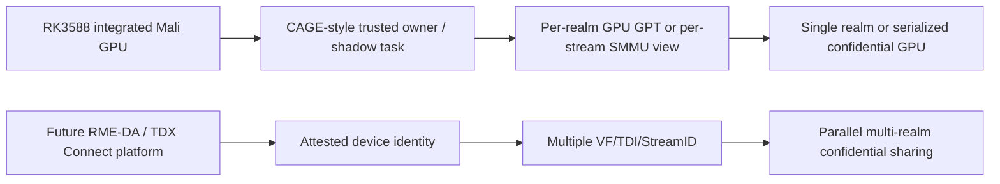
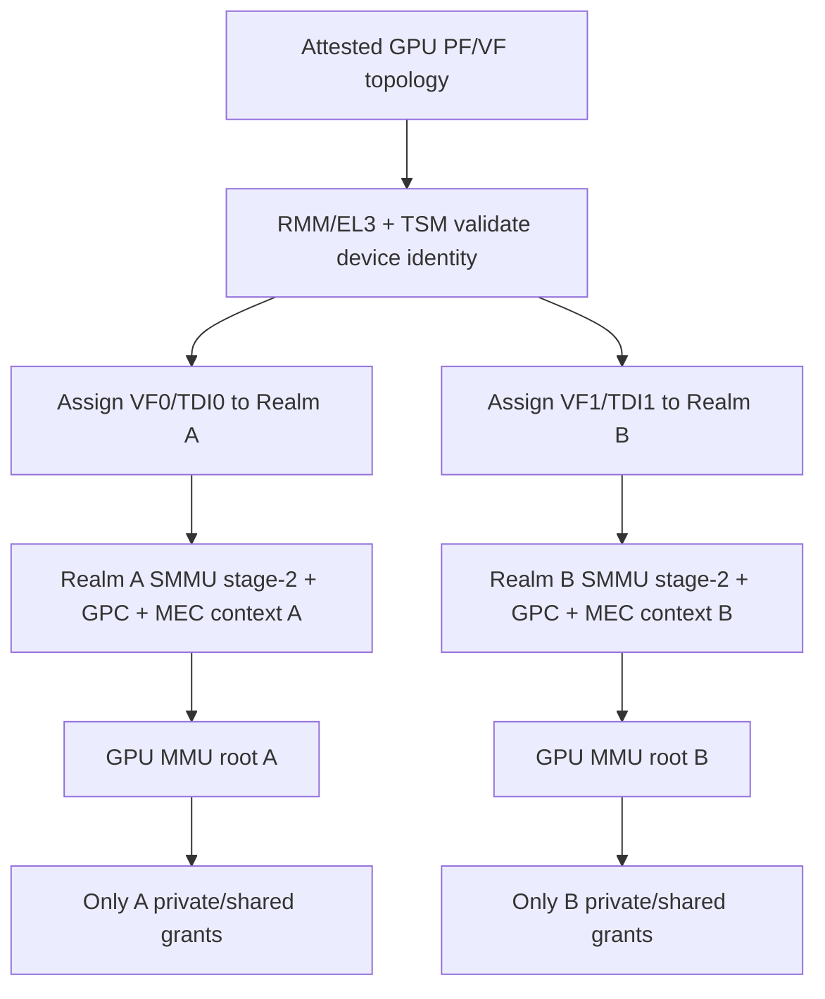

# CCA 多 VM 机密 GPU 共享：CAGE、ACAI 与 RME-DA 的边界

整理日期：<mention-date start="2026-10-13"/>。

分析对象是 `/home/mzh/RK3588/gpu` 当前工作树，重点比较三类路线：

1. 当前 `vmshm + Panthor proxy` 普通 GPU 共享实现；
2. 当前单 Realm GPU direct path / OpenCCA 实验；
3. CAGE、ACAI、RME-DA / TDX Connect 代表的机密加速器模型。

<table_of_contents/>

## 核心结论

**不应在 CAGE 和 ACAI 之间二选一，而应拆开问题：CAGE 用于解释集成 GPU 在现有 CCA/GPC 约束下如何做单 Realm 影子任务和 GPU GPT；ACAI 用于借鉴设备绑定、SMMU/RME-DA、MEC/IDE、设备 attestation 这些更接近现代设备赋值的安全不变量。**

对当前 RK3588 工作树，安全边界必须如下表述：

| 问题 | 设计目标 | 当前代码 / 硬件事实 | 结论 |
| --- | --- | --- | --- |
| Realm 是否同一把密钥 | 目标 CCA + MEC 应做到每个 Realm 独立 encryption context | RK3588/OpenCCA 当前没有可用的 MEC/MPE 实证 | 不能假设同一把，更不能假设已按 Realm 分 key；当前实际是“无硬件加密证据” |
| 是否支持 GPU GPT | CAGE 假设 CPU、GPU、untrusted peripheral 的 GPC/GPT 可配置 | 当前只有 OpenCCA 模拟 GPT/GPI 设计链；Mali direct path 用 HPA 写 GPU MMU PTE | 当前没有真实 GPU GPT enforcement |
| 是否考虑硬件加解密 | ACAI 使用 MPE/MEC 保护 DRAM，PCIe 另有 IDE/设备 TEE | 当前 direct-path 设计明确把 physical attack 排除；普通 vmshm 无加密 | 当前不考虑硬件加解密 |
| 是否支持 RME-DA | 目标平台用 RME-DA/SMMUv3 做 Realm device assignment | TF-RMM 有 `RMM_CCA_DA` experimental 选项且默认 OFF；本工作树没有完整 DA 链路 | 当前不支持 RME-DA |

因此，**当前普通 shared GPU virtualization 是功能性原型，不是机密 GPU**。它证明 Client/Proxy 分层、memfd 数据面、eventfd/irqfd 通知、Panthor ioctl 转发和 per-session GPU VM 可以工作，但不能对抗恶意 Host，也不能证明不同 VM 的 CPU/GPU/DMA 边界。当前单 Realm direct path 证明功能路径，历史 probe 还记录了 `HOST_READ_SUCCEEDED`，因此也不能称为已实现 Host denial。

更准确的目标分两层：

1. **单 Realm / 串行机密 GPU**：参考 CAGE，用可信 monitor/RMM 控制 GPU ownership、GPU GPT、任务切换、TLB invalidation、scrub/reclaim。这里可以先用模型和仿真验证。
2. **多 VM 并行机密共享**：必须依赖 ACAI/RME-DA/TDX Connect 式设备赋值能力：多个独立安全接口、独立 StreamID/TDI/VF、独立 SMMU/GPC 视图和 attestation。单个不可安全划分的 Function 不能按 Queue/Group 自动安全地共享给多个 Realm。

## 1. 当前代码中的共享路径

### 1.1 控制面与数据面

当前普通 shared path 的主线是：

```text
Client userspace Mesa/Panfrost
  -> /dev/dri Panthor-compatible frontend
  -> panthor-client DRM frontend
  -> client_vmshm_comm ring
  -> guest doorbell MMIO write
  -> KVM ioeventfd
  -> broker direct eventfd bridge
  -> peer KVM irqfd
  -> proxy guest IRQ
  -> proxy_vmshm_comm
  -> panthor-proxy RPC handler
  -> real DRM_PANTHOR in Proxy VM
  -> CSF firmware / Mali GPU
```

关键代码：

- `firecracker/vmshm-broker/src/broker.rs`
  - `DomainRuntime::new()` 为每个 domain 创建独立 `memfd` 和两个方向 eventfd；
  - `handle_connection()` 通过 `SCM_RIGHTS` 返回 `memfd + kick eventfd + irq eventfd`；
  - `register_notify_participant()` 只登记 role 和 doorbell/IRQ 元数据。
- `firecracker/Firecracker-CCA-MZH/src/vmm/src/vmshm.rs`
  - `connect_and_map_region()` 连接 broker、接收 fd、映射 `memfd`；
  - `register_region()` 把该映射作为 KVM memory slot 加给 VM；
  - `register_notify()` 对 guest doorbell 注册 KVM ioeventfd，对 guest IRQ 注册 KVM irqfd；
  - `validate_region()` 检查对齐、大小、guest RAM overlap、KVM slot 冲突和 vmshm range overlap。
- `Linux-Guest-GPU/drivers/char/proxy_vmshm_manager/proxy_vmshm_manager.c`
  - `proxy_vmshm_alloc_ext()` 为对象记录 `owner_vmid`、offset、size、generation、pin/refcnt；
  - `proxy_vmshm_lookup_pin()` 校验 handle generation 和 owner；
  - `proxy_vmshm_obj_translate()` 把 BO logical range 转成 payload span。
- `Linux-Guest-GPU/drivers/gpu/drm/panthor-proxy/panthor_proxy_drv.c`
  - `panthor_proxy_handle_open_session()` 从 proxy comm channel 取 `client_vmid`；
  - `panthor_proxy_session_lookup()` 拒绝跨 `owner_vmid` session 访问；
  - `panthor_proxy_session_vm_create()` 为 client session 创建 real Panthor VM；
  - `panthor_proxy_session_group_create()` 把 group 绑定到该 session 的 native VM；
  - `panthor_proxy_session_group_submit()` 只翻译 session-local handle/syncobj，再交给 real Panthor。
- `Linux-Guest-GPU/drivers/gpu/drm/panthor/panthor_mmu.c`
  - `panthor_vm_prepare_map_op_ctx()` 为 vmshm-backed BO 翻译 payload spans；
  - `panthor_vm_map_vmshm_spans()` 把 BO 的 GPU VA 映射到 payload span 的 Proxy GPA；
  - passthrough/realm 分支再把 GPA 转成 HPA 写入 Mali page table。

这套设计的性能价值在于：大数据 BO 和 command stream 不走 virtqueue，也不在 RPC 中复制；RPC 只传描述符和 ioctl 参数，GPU 数据面通过共享内存直达。

### 1.2 当前已有的防护

当前代码已经有一些软件隔离点：

- 每个 client 使用独立 comm memfd domain，proxy 侧通过 FDT `vmshm-client-vmid` 标记 channel；
- forged session 或 forged handle 会经过 `owner_vmid` / generation 检查；
- `panthor-proxy` 的 VM、BO、syncobj、group、heap handle 都做 session-local namespace 翻译；
- Firecracker 检查 guest RAM、KVM slot、vmshm window 和 doorbell range overlap；
- broker 不解析 ring 内容，只分发 fd，数据面攻击面较小；
- vmshm `memfd` 可加 `F_SEAL_SHRINK | F_SEAL_GROW | F_SEAL_SEAL`，防止 resize 破坏映射。

这些能降低误操作和普通恶意 client 的 API 伪造风险，但不是硬件强制隔离。

### 1.3 已有实验证明的范围

历史文档记录：

- 双 Client shared GLES compute 曾经达到 `GPU_SMOKE_RESULT=PASS` / `COMPUTE_CHECK=PASS`；
- raw RPC / forged session 检查证明 client 不能简单冒用另一个 client 的 session；
- 单 Realm direct path 曾完成 4096-element GLES compute；
- 同一平台的 `realm_host_access_probe` 记录过 `HOST_READ_SUCCEEDED`；
- `DESIGN_GPT_HOST_DENIAL_CHECK=PASS` 只是静态设计链检查，不代表硬件 GPC denial。

因此证明的是：

- ioctl 转发、对象管理、共享 BO、GPU submit、completion 通知等功能闭环成立；
- 部分 software namespace check 成立。

不能证明的是：

- 恶意 Host 无法读取；
- 恶意 guest kernel 无法越过 manager 直接访问共享窗口；
- 其他 DMA 设备无法访问；
- GPU firmware 无法越过 GPU MMU；
- Realm 间密钥隔离、密文完整性、物理攻击防护；
- reset/fault 后的数据残留清零和地址泄漏防护。

## 2. CAGE 与 ACAI：应该借鉴什么

### 2.1 CAGE 模型

论文：*CAGE: Complementing Arm CCA with GPU Extensions*, NDSS 2024, DOI `10.14722/ndss.2024.24763`。

CAGE 的目标是在 Arm 集成 GPU 上，把 CCA 的 realm 隔离扩展到 GPU 执行环境。它有两个关键设计：

1. **shadow task**：由可信 monitor 接管/重建 GPU 任务执行所需的状态，在 Realm 任务运行期间控制 GPU 环境；
2. **多 GPT/GPC 视图**：为 CPU、GPU、untrusted peripheral 配置不同 GPT/GPC 视图，实现 Realm GPU 环境与其他组件的双向隔离。

CAGE 的威胁模型很强：normal world / secure world 软件、GPU 软件、hypervisor 都可被控制；攻击者可直接访问统一内存、控制 DMA 外设、提交恶意 GPU task 修改其他 Realm 数据。CAGE 明确将 side-channel 和 DoS 排除在外，并讨论了物理攻击时可依靠 CCA memory encryption。

CAGE 对本项目的价值：

- 它最接近 RK3588 Mali 集成 GPU 的物理形态：CPU/GPU 共享 DRAM，GPU 没有 PCIe 设备 TEE；
- 它说明了“Host CPU denial 不等于 GPU DMA denial”：GPU 可被当作 DMA oracle；
- 它明确了 GPU MMIO、GPU page table、queue/firmware 状态必须由可信 owner 控制；
- 它指出多 GPT 维护、同步和初始化是主要开销；
- 它指出现实 SMMU GPC 的限制：一个 MMIO GPT 配置区域可能让多个 connected peripherals 共享同一个 memory view，缺少 StreamID 粒度的独立 GPC 配置。

这正是“CAGE 不能并行”的根因：**不是 GPU 算力不能并行，而是安全视图不能同时按不同 Realm 独立切换**。如果 GPU GPT/SMMU GPC 只有一个全局有效视图，那么并行运行多个 Realm task 时，GPU 看到的是同一套允许/拒绝表，无法同时代表多个互不信任 Realm 的地址授权。

### 2.2 ACAI 模型

论文：*ACAI: Protecting Accelerator Execution with Arm Confidential Computing Architecture*, USENIX Security 2024 / arXiv:2305.15986。

ACAI 面向 PCIe accelerator，提出安全不变量来扩展 CCA：

- 设备必须 attestation 后获得不可伪造 identity；
- 一个 device/stream 只能绑定到明确 VM；
- device-side translation 必须与 Realm VM 的 IPA-to-PA 映射一致；
- 其他 VM、设备、hypervisor 不能访问 protected region；
- DRAM 加密和 PCIe link 防护必须进入威胁模型；
- SMMU/GPC 配置由可信 monitor 控制，避免 hypervisor/RMM 竞争篡改；
- 需要处理 attach/detach、映射撤销、TLB invalidation 和重用安全。

ACAI 依赖的关键硬件能力：

- CCA/RMM；
- SMMU/RME-DA；
- MEC/MPE，每个 Realm 可有独立 key；
- PCIe IDE 与 TEE-enabled accelerator，保护 link 和设备侧执行。

论文报告 GPU 平均 overhead 约 43.5%，FPGA 约 12.1%；对系统其他部分影响约 3.8% / 1.9%。它还比较了 bounce-buffer/software encryption 模式，说明 protected direct access 的动机。

ACAI 对本项目的价值：

- 提供比 CAGE 更接近 RME-DA/TDX Connect 的设备赋值不变量；
- 强调“设备身份、绑定关系、DMA 授权、总线加密”必须一起设计；
- 明确 target CCA 不应默认所有 Realm 共用一把 key；
- 说明没有设备 TEE / IDE / 多安全接口时，不能把一个物理设备同时安全赋给多个互不信任 VM。

### 2.3 选择结论

建议采用组合模型：



不要把 CAGE 的“无硬件修改、可用 GPC 建模”误解为 RK3588 当前已经具备这些硬件能力；也不要把 ACAI 的 MEC/IDE/TEE device 假设直接套到 Mali-G610。论文模型是设计参照，不是当前板级事实。

## 3. CCA 特性逐项确认

### 3.1 Realm 是否同一把密钥

目标模型：**不应当设计为所有 Realm 共用同一把 key**。Arm 2022 RME 扩展中，MEC 引入多个 Realm physical address space encryption context，可用于每个 Realm 独立 key；ACAI 也把“每个 Realm 自己的 key”作为 DRAM 保护的组成。

当前模型：RK3588/OpenCCA 工作树没有证据表明存在 MEC/MPE 硬件加密或 per-Realm key。`cc_platform_has(CC_ATTR_MEM_ENCRYPT)` 在部分代码中被当作 Realm 特性指示，但这不能证明外部 DRAM 加密、密钥隔离或总线完整性已经成立。

结论：

- **设计文档**：写“目标要求 per-Realm encryption context，除非平台显式不支持 MEC，则必须降级威胁模型”；
- **当前实现**：写“未启用/未证明硬件加密，物理攻击和离线 DRAM 读取不在防护范围”；
- **共享 buffer**：如果两个 Realm 显式共享同一明文页，则该页不能同时保留两个互斥 confidentiality domain；共享必须变成显式 `private -> shared` 生命周期，或用端到端加密/认证保护。

### 3.2 是否支持 GPU GPT

CAGE 的模型是每个 Realm 有独立 GPU GPT，配合 CPU/peripheral GPT 形成双向隔离。当前代码没有实现 CAGE 意义上的 GPU GPT：

- OpenCCA TF-A/GPT 相关路径是模拟/设计链，RK3588 上 `GPCCR_EL3` / `GPTBR_EL3` 是 spoofed/dummy 场景；
- Realm PAS 在 xlat 层被 fold 到 NS；
- Mali direct path 通过 RMM 验证 GPA 并返回 HPA，然后 guest Panthor 写 GPU MMU PTE；
- 该 PTE 属于 GPU MMU address translation，不是系统级 GPC/GPT 权限表；
- RMM mapping lease 是软件 bookkeeping，不是 GPU/DMA hardware enforcement。

因此当前只能描述为：

```text
Realm CPU / Proxy guest software
  -> custom io-pgtable GPA-to-HPA
  -> Mali GPU MMU PTE
  -> physical DRAM
```

而不是：

```text
GPU transaction -> GPU GPC -> per-Realm GPU GPT -> deny/allow
```

### 3.3 是否考虑硬件加解密

当前两个路径都没有硬件加解密：

- 普通 `vmshm`：Host `memfd` 明文共享；
- 单 Realm direct path：依赖 GPA-to-HPA 与模拟 GPT 设计，不提供物理攻击防护；
- PCIe IDE / MEC / MPE 均未接入；
- GPU firmware 与 GPU 内部 buffer 的机密性未单独处理。

如果目标包含物理攻击，必须至少明确：

1. DRAM data-at-rest 加密与 per-Realm key；
2. GPU/CPU 到 DRAM path 的完整性；
3. PCIe 或 SoC interconnect link 加密/认证；
4. GPU 内部 memory / firmware / queue state 的隔离；
5. reset/scrub 后密文和 key 生命周期。

### 3.4 是否支持 RME-DA

当前不支持完整 RME-DA。证据：

- `opencca/tf-rmm/docs/getting_started/build-options.rst` 标明 `RMM_CCA_DA` 默认 `OFF`，且是 experimental；
- `opencca/tf-rmm/cmake/CommonConfigs.cmake` 只在开启后链接 SPDM requester 相关库；
- 当前 OpenCCA build 配置没有开启 `RMM_CCA_DA`；
- RK3588 Mali GPU 侧没有 TDISP/RME-DA device interface 或多个安全 endpoint 的实现。

RME-DA 的目标能力是：RME System Architecture/SMMUv3 支持 device assignment，让每个 Realm 能显式允许一个 off-processor resource 访问其地址空间中的区域。它解决的是“设备是否可访问 Realm 内存”，不自动解决“设备内部多任务隔离”。

## 4. 威胁模型逐项判断

| 攻击者 / 威胁 | 当前普通 shared path | 当前单 Realm direct path | 目标防护 |
| --- | --- | --- | --- |
| 恶意 Host / Hypervisor | 不防护；Host 可读 memfd、控制 VMM/KVM/broker/GPU 生命周期 | 设计目标是防护，但 RK3588 当前无真实 GPC/GPT；Host probe 曾读成功 | Root/RMM/monitor 控制 GPC、SMMU/RME-DA、GPU MMIO ownership |
| 其他恶意 VM / Realm CPU | KVM stage-2 阻止普通 guest RAM；共享 object memfd 被整窗映射，malicious guest kernel 可能直接访问同 domain 内其他 offset；comm domain 分离降低 forged RPC 风险 | RMM RTT/lease 是软件记录；无硬件 GPC 时不构成强制隔离 | per-client memfd / 受控 subrange；RMM protected sharing + GPC；不得把 participant name 当认证 |
| 其他 VM 的恶意 GPU task | proxy 为每个 session 建 native Panthor VM，group 绑定 VM，GPU VA 只映射该 session 授权 BO；可限制普通越界 GPU VA | 单 Realm 独占运行；Host 可重编程时仍可借 GPU 做 DMA oracle | GPU MMU + trusted page-table ownership + per-stream GPC/ASID；firmware reset/quiesce |
| 其他恶意 DMA 设备 | 无当前防护；Host 可配置设备 DMA | 当前模拟 GPT 不约束 Mali DMA，更不约束其他设备 | SMMU/RME-DA、GPC per StreamID、IOMMU firewall、IDE |
| 恶意共享 buffer 参与者 | 共享页本身明文可写；可篡改 command/data/ring，存在 TOCTOU；只能靠 proxy 校验元数据 | 普通 memfd 与 Realm direct path 尚未组成 protected sharing ABI | 显式 grant、copy-in/copy-out 或认证加密、seq/freshness、page lifetime pin/revoke |
| 物理 GPU 攻击 / GPU 固件攻击 | 不防护；Proxy Linux、real Panthor、CSF firmware 都在 TCB | 同样不防护；GPU firmware/queue/MMIO 可成为攻击面 | GPU attestation、设备 TEE/TDI、IDE、可信 firmware、安全启动、故障隔离 |

需要特别区分两类“其他 VM 恶意 GPU task”：

1. **应用提交恶意 shader / command stream**：如果 native Panthor VM 只映射该 client 的 BO，恶意指令访问未映射 GPU VA 会 fault，最多破坏自己的 GPU VA 空间或造成 DoS；
2. **恶意设备固件 / Host 重编程 GPU MMIO**：GPU MMU 无法防御控制它的人；必须有可信 ownership 和硬件 DMA/MMIO enforcement。

当前 Proxy 路径能改善第 1 类，不能独立解决第 2 类。

## 5. monitor / broker 安全性

### 5.1 当前 broker 的信任位置

`vmshm-broker` 是 Host normal-world 进程。它负责创建 memfd、创建 eventfd bridge、通过 Unix socket 传 fd。它不启动 VM、不管理生命周期、不解析 ring。

这是一个好的最小化方向，但在恶意 Host 威胁下它不能是可信根：

- Host 能读 broker 进程内存；
- Host 能替换配置、重连 socket、伪造或复制 fd；
- Host 能控制 Firecracker 和 KVM mapping；
- Host 能重启 / fork broker 或改变 topology；
- Host 能访问 shared memfd；
- Host 能影响 GPU passthrough / reset / MMIO；
- Host 能注入或滥用 eventfd/irqfd。

因此，**如果威胁模型包含恶意 Host，broker 必须移入 attested Root/Realm/TEE monitor，或由 RMM/EL3/设备 TSM 承担同等职责。普通 Host broker 只能作为性能数据面，不能作为安全信任根。**

### 5.2 当前软件缺口

当前 `handle_connection()` 对 name 和 role 做基本解析，但没有把 name/role 与连接身份做强绑定：

- 没有 `SO_PEERCRED` / SCM_CREDENTIALS 校验；
- 没有 pinned `pid/ns/uid` 到 VM 实例的 manifest；
- participant name 只是请求字段，不是不可伪造身份；
- role 也是请求字段；
- 没有明确拒绝重复 client/proxy role 连接；
- 每个 accepted 连接都可拿到该 domain 的 memfd；
- eventfd bridge 没有 per-doorbell rate limit / authorization quota。

这不影响当前受控实验，但会影响多租户安全声明。

### 5.3 必要加固

短期 Host-untrusted 之外的软件加固：

1. **连接认证**
   - 对每个连接调用 `getsockopt(SO_PEERCRED)`；
   - 使用 launch manifest 把 `(pid, pid namespace id, uid, fd)` 绑定到 `(VM instance, domain, role)`；
   - 一个 role 只允许一个 active participant；
   - 重连必须走显式 revoke/teardown。
2. **socket 权限**
   - 每个 domain 一个 socket；
   - parent directory `0700`；
   - 只允许 attested VMM 用户访问；
   - 禁止 `/run/vmshm` 全局可写。
3. **fd 治理**
   - 只由 broker 创建和分发 eventfd；
   - 拒绝客户端传入的 notify fd，当前已忽略 legacy fd，但应显式关闭并计审计；
   - 对 `memfd` 设置 `CLOEXEC` 和 seals；
   - 记录 fd generation 与 object generation。
4. **进程隔离**
   - broker 使用 seccomp、no-new-privileges、mount namespace、最小 capabilities；
   - 禁止 broker 加载任意配置或执行 shell；
   - 静态编译或可复现构建；
   - 运行 manifest 记录二进制哈希。
5. **通知治理**
   - 每个 VM/role 设 doorbell rate limit；
   - IRQ 注入有 quota 和恢复策略；
   - 检测 eventfd storm、半连接、peer death；
   - close/revoke 时拆除 ioeventfd/irqfd。
6. **可观测性**
   - 记录 peer credential、domain、role、fd generation、mapping range、slot、IRQ；
   - 所有拒绝路径可审计；
   - 日志不能泄露 buffer 内容。

在 CCA 场景，这些措施仍不够；broker 代码和配置必须进入 attested TCB，并接受远程证明。

## 6. CPU 侧 memfd 共享是否引入新问题

答案是：**会，而且是当前 shared path 的核心隔离缺口之一。**

### 6.1 当前 object domain 形态

双 client 配置中：

- `vmshm-object` 是一个共享给 Proxy 和所有 Client 的大 `memfd` domain；
- 每个 Client 的 Firecracker 把同一个 host memfd 映射到自己的 GPA window；
- Proxy 也映射同一 window；
- `proxy_vmshm_manager` 在软件中按 `owner_vmid` 和 object handle 分配/查找子区间；
- `client_vmshm_manager` 通过 RPC 获取本 VM 被允许的 descriptor offset；
- Client frontend 和 mmap 路径按 descriptor 暴露 offset。

这对正常 guest userspace 是兼容的，因为 Linux 只把 DRM BO mmap 到 descriptor 对应的 VMA。但对恶意 guest kernel 或攻击者，整个 guest GPA window 是同一个 KVM memory slot。如果它知道或猜测其他 object 的 GPA offset，就可能绕过 char device API 直接访问同 domain 里的其他数据。

因此：

```text
软件对象表隔离 != CPU physical mapping isolation
```

### 6.2 当前管理器的具体 caveat

`proxy_vmshm_manager.c` 中 `proxy_vmshm_lookup_pin()` 和 grant lookup 都校验 owner / target，但 `required_perms` 目前被 `(void)required_perms` 忽略。也就是说权限位还不能作为 enforced access right。

同时，`client_vmshm_manager.c` 的 `client_vmshm_manager_get()` 验证 descriptor 是否 contiguous 且在窗口内，但它信任 Proxy 返回的 descriptor 和 FDT 提供的整窗映射。

因此当前 CPU 侧防护是：

- handle/generation/owner 检查：有；
- comm ring 独立 domain：有；
- 全 window 物理隔离：无；
- permissions enforcement：不完整；
- hardware-protected sharing：无。

### 6.3 是否需要“类 GPT”

分两种目标：

**普通多 VM 功能共享**

不一定需要类 GPT，但至少要改变映射拓扑：

1. 每个 Client 一个独立 object memfd domain，Proxy 分别映射；
2. 或 Firecracker 为每个 VM 只映射被授权的 subrange，KVM slot 以 object/grant 为粒度建立；
3. 或引入受信任的 mapper service，为每次 mmap 建临时最小 VMA，并确保 guest 没有整窗 KVM slot；
4. Proxy 侧也避免把所有 Client 的 object 放进同一个无差别 KVA window。

短期工程上，**per-client memfd domain 是最清晰、最不容易被配置错误破坏的方案**。代价是对象分配更碎、Proxy 映射更多、跨 Client 显式共享必须新建 shared domain。

**Realm 机密共享**

软件 KVM slot 隔离不够，必须进入 RMM/GPC/MEC 模型：

1. `private -> shared` 转换由 Realm 显式请求；
2. RMM 记录 owner、participants、permissions、lifetime；
3. GPC/GPT 提供硬件 deny；
4. 共享页无法同时被伪装成某个 Realm 的 private page；
5. revoke 时先 quiesce GPU/DMA，再 invalid TLB，最后才允许复用；
6. 如果需要保密，即使共享页也使用认证加密或受 MEC 保护的 shared context。

也就是说，类 GPT 不是为了替代 `proxy_vmshm_manager` 的 handle 表，而是为了让“越界 offset + 直连映射”这条路在硬件层失败。

## 7. GPU 侧恶意任务的越界问题

### 7.1 当前 Proxy 的 GPU VA 隔离

当前已有结构是正确的方向：

1. 每个 Client open 得到一个 `panthor_proxy_session`；
2. session 内 VM/BO/syncobj/group handle 独立；
3. `VM_CREATE` 调用 real Panthor 创建 native VM；
4. `BO_CREATE` 在该 owner 的 vmshm payload 中分配 backing，并创建 real Panthor GEM wrapper；
5. `VM_BIND` 只能把 session-local BO 映射到该 session 的 native VM；
6. `GROUP_CREATE` 将 group 绑定到该 native VM；
7. `GROUP_SUBMIT` 的 `stream_addr` / resource pointer 由 GPU MMU 在该 native VM 中解析；
8. 未映射 GPU VA 会 fault，而不是自动落到其他 Client 的 BO。

所以对一个恶意应用，GPU MMU 是第一层地址空间隔离。Proxy 不需要完整解析所有 shader 指令；它需要保证 page table 中只出现该 client 被授权的 BO。

### 7.2 当前不能解决的问题

GPU MMU 不足以对抗以下攻击：

- Proxy VM kernel / real Panthor driver 被攻破；
- GPU firmware 被攻破或加载不受信 firmware；
- Host 能重编程 GPU MMIO / page-table base / AS 配置；
- 恶意任务通过硬件 bug 或固件漏洞越过 GPU MMU；
- reset/fault 路径泄漏 stale page/queue/firmware state；
- shared BO 的另一个 participant 篡改 command stream；
- Host 或其他 DMA 设备直接访问同一物理页。

因此“恶意 GPU task 只能破坏自己”必须限定为：在 trusted Proxy、trusted GPU firmware、不可绕过的 GPU MMU/page-table ownership 和正常 shared-buffer 协议成立时。当前这些条件没有全部被证明。

### 7.3 CAGE 并行问题与可信 GPU 地址空间

CAGE 的单安全视图限制可以抽象为：

```text
Realm A wants GPU view A:
  pages owned by A = allow; B/root/NS metadata = deny

Realm B wants GPU view B:
  pages owned by B = allow; A/root/NS metadata = deny

Single GPU GPT active view:
  cannot represent A and B simultaneously
```

可行改进有三种：

1. **时间复用**
   - 一次只运行一个 Realm；
   - 切换前 quiesce、invalidate、scrub，切换后装载新 GPT；
   - 安全性强，吞吐和延迟受损。
2. **地址空间硬隔离**
   - 每个 Realm 一个 GPU address-space / page-table root / ASID；
   - page table pages 属于 protected memory，只有 trusted owner 可写；
   - GPU task 通过 ASID 只能使用自己的 root；
   - 共享页必须显式出现在双方 root，并有生命周期约束。
3. **StreamID / endpoint 硬隔离**
   - SMMU/GPC 按 StreamID、TDI、VF 提供独立安全视图；
   - 不同 VM 的请求从不同硬件 identity 进入；
   - 这是 RME-DA/TDX Connect 式模型。

对当前 Mali/Panthor，native Panthor VM 已提供类似第 2 类的 software/GPU-MMU 结构，但 confidential 版本还必须保护 page-table root、AS register、doorbell、CSF queue、firmware metadata 不被 Host/Proxy adversary 重编程。

## 8. RME-DA / TDX Connect 的多 VM 约束

### 8.1 RME-DA 能解决什么

RME-DA 的目标不是“把一个 GPU 自动拆成任意多个安全 GPU”，而是：

1. 给设备 / stream 建立 Realm 可授权的访问路径；
2. SMMUv3 按 device assignment 规则做 stage-2 translation / GPC；
3. RMM/monitor 可信地管理 assignment；
4. 每个 Realm 只允许自己 assigned device 访问指定地址区域。

它要求设备侧和总线侧有可验证 identity。对 PCIe/TDX Connect 路线，TDISP/TDI 和 IDE 提供设备接口锁定、attestation、MMIO 属性和 link protection 等机制；本地 EDK2/libspdm 的 `pci_tdisp.h` 也体现了 `function_id` 作为 TDI 标识、每个 TDI 有 `CONFIG_UNLOCKED -> CONFIG_LOCKED -> RUN` 状态机的协议形态。

### 8.2 单 Function / 单 TDI 不可按 Queue 划分

如果物理 GPU 只暴露一个不可进一步安全划分的 Function / TDI / StreamID，则同一时刻只能绑定一个 Realm / TD。原因是：

- Queue、Group、CSG 是 driver/firmware 层调度对象，不是硬件安全 identity；
- Host 或 Proxy 可以重编程 doorbell、queue、page-table root、firmware 状态；
- 一个 malicious firmware/task 可以使用同一 device identity 发起 DMA；
- RME-DA/SMMU 看到的是“这个 TDI/StreamID 的所有流量”，无法区分这条流量来自哪个 VM queue；
- 共享 TDI 无法同时安装两个互斥 Realm 的 SMMU/GPC/MEC 上下文。

因此多 VM 机密 GPU 共享需要以下任一硬件形态：

- SR-IOV VF，每个 VF 是独立安全接口；
- GPU MIG / hardware slicing；
- 多个 TDI / StreamID endpoint；
- 多个物理 GPU；
- 可证明的 per-queue hardware isolation 和独立 DMA identity。

如果没有这些能力，只能：

- 单 Realm 独占 GPU；
- 或时间复用并做完整 quiesce/reset/scrub；
- 或把系统降级为“信任 Proxy/firmware 的普通共享”，不能称为恶意 Host / malicious co-tenant 安全。

### 8.3 RME-DA 上的建议设计

假设未来平台提供 `GPU VF0..VFn`，每个 VF 有独立 TDI/StreamID：



生命周期必须包含：

1. device attestation；
2. bind TDI/VF to one Realm；
3. program SMMU/RME-DA mapping；
4. establish MEC/IDE context；
5. load/verify firmware；
6. run；
7. stop new submissions；
8. wait/abort in-flight；
9. invalidate GPU/SMMU TLB；
10. reset and scrub device state；
11. revoke mappings and key context；
12. release for next owner。

只有第 6 步运行成功不够；9-12 是跨 owner 重用安全的必要条件。

## 9. 直通共享 vs Proxy / 影子任务共享

| 维度 | 多 VM 直通 / VF 赋值 | Hypervisor/firmware/Proxy 转发 / shadow task |
| --- | --- | --- |
| 性能路径 | Guest 直接提交原生 command stream，数据面少一层 RPC/调度 | 大 BO 可 zero-copy，但 ioctl、handle 翻译、scheduler、completion 多跨 VM/进程 |
| 语义 | 更接近 native driver，减少 ABI 重写 | 需要持续补齐 ioctl、fault、sync、reset、power 语义 |
| 隔离根 | IOMMU/SMMU/RME-DA/GPC/TDI/MEC/IDE | Proxy kernel、real driver、GPU firmware、共享内存协议都在 TCB |
| 多租户并行 | 需要多个硬件安全接口；否则只能单 owner | 单 PF 可以软件复用，但只能得到功能性隔离 |
| 恶意 Host | 硬件 assignment + attestation 才可能防护 | 普通 Host Proxy 无法防护；Root/Realm Proxy 才可能 |
| 恶意 GPU task | 每 VF/TDI/VM 独立 address space 更自然 | per-session native VM 有帮助，但 page-table/firmware 可信性依赖 Proxy |
| 故障恢复 | VF reset/FLR 影响范围可硬件化 | Proxy 可集中做 reset/scheduler，但一个 PF fault 可能影响所有 client |
| 调度公平 | 受 VF 资源粒度限制 | 可做软件 quota、priority、backpressure |
| 共享 buffer | 需要 protected sharing ABI | memfd 灵活，但明文共享与 TOCTOU 风险高 |

### 9.1 直通的优势

直通不是“更快就安全”，而是当硬件 identity 存在时，**安全边界可以随设备接口下沉**：

- 每个 VF/TDI 有独立 MMIO/BAR/interrupt/stream identity；
- IOMMU/SMMU policy 可按 VF 绑定；
- guest driver 直接控制自己的 VF，不需要 Proxy 解析所有 API；
- GPU page-table root 和 firmware queue 的权限可以与 VF 对齐；
- reset/FLR 可限制故障影响域。

代价是：

- 设备必须真的支持 SR-IOV/MIG/TDI；
- 每个 VF 的 firmware、scheduler、memory 带宽资源是否真正隔离需要证明；
- 稀缺资源调度粒度变粗；
- hotplug/reset/rebalance 更复杂；
- 共享 BO 仍需要显式安全协议。

### 9.2 Proxy / shadow task 的优势

Proxy 的价值是兼容性和可控性：

- 一块普通 PF 也能服务多个 VM；
- 可以隐藏设备版本差异，给 Client 暴露稳定 Panthor ABI；
- 集中校验 ioctl、限制优先级/core mask/queue 数/BO 大小；
- 统一收集 per-client latency、fault、inflight；
- 在 fault/reset 时做集中恢复；
- 可实现 per-session native VM，避免共享 GPU VA space。

但它不能证明完整 command stream 安全，也不应该把大 Proxy Linux + GPU firmware 当成小 TCB。Proxy 的安全声明应限定为：

> 在 Proxy VM、real Panthor、GPU firmware 和 Host 提供的映射/IRQ/MMIO 均可信的前提下，per-session handle 和 native GPU VM 可隔离普通恶意 Client 的 API 级访问。

这不足以满足恶意 Host / 恶意固件 / physical adversary 模型。

### 9.3 建议的平衡路线

短期继续当前 shared path，但把它定位为功能和观测平台：

1. 修复 memfd whole-window 问题：per-client object domain 或 subrange slot；
2. 实现 permissions check，不再忽略 `required_perms`；
3. 给 broker 加 peer credential 和 launch manifest；
4. Proxy comm channel 与 VMID 强绑定，participant name 只作 display name；
5. 补恶意 client / malformed ioctl / shared buffer race fuzz；
6. 统计 RPC latency、GPU fault、reset 影响、per-client fairness。

中期做单 Realm CAGE-style 实验：

1. 可信 monitor/RMM 独占 GPU ownership；
2. 锁定 MMIO、page-table base、queue doorbell；
3. per-Realm GPU GPT 或切换视图；
4. shadow task 生命周期；
5. submit/quiesce/invalidate/scrub/reclaim 状态机；
6. 在真实 GPC 平台复测 Host denial 和 GPU DMA oracle。

长期做多 VM 机密共享：

1. 要求多个 VF/TDI/StreamID 或 MIG；
2. 使用 RME-DA/SMMUv3 + GPC + MEC；
3. 每个 VF/TDI attestation 后绑定一个 Realm/TD；
4. shared BO 用显式 protected grant + 认证加密；
5. Proxy 只保留资源编排和监控，不进入数据面 TCB；
6. 对 fault/reset/rebalance 做跨 owner scrub 验证。

## 10. 推荐的安全不变量

后续设计文档和代码 review 可以把下面条件作为验收口径：

1. **Identity**
   - VM、Realm、device、VF/TDI/StreamID、buffer object 都有不可伪造 identity；
   - participant name / role 不是 credential。
2. **Binding**
   - 一个安全设备接口同一时间只绑定一个 owner；
   - 一个 buffer page 的 owner/participant/permission 集合是唯一且可撤销的。
3. **Translation**
   - CPU、SMMU、GPU MMU 对同一页的授权不能互相矛盾；
   - Proxy 不能把 A 的 BO handle 映射进 B 的 native VM，除非存在显式 grant。
4. **DMA deny**
   - 未授权 CPU、GPU stream、其他 DMA device 的访问必须在硬件层失败；
   - software lease 不称为 enforcement。
5. **Crypto**
   - per-Realm MEC/IDE key 或显式端到端认证加密；
   - shared page 不能伪装成 exclusive private page。
6. **Concurrency**
   - 并行 Realm 必须有并行安全视图：多 GPT/多 StreamID/多 TDI/多 address-space root；
   - 单安全视图只能串行切换。
7. **Lifecycle**
   - revoke 前完成 quiesce、fence、TLB invalidate；
   - reset 后 scrub firmware/queue/page-table/cache residue；
   - key 和 mapping 生命周期一致。
8. **Availability**
   - 明确接受或防护 IRQ storm、queue flood、GPU fault、reset DoS；
   - 机密性目标不能通过声称 DoS out-of-scope 掩盖调度资源耗尽。

## 11. 结论

当前项目已经有两条有价值的功能路径：

- `vmshm + Panthor proxy`：适合继续做多 VM API 兼容、性能和调度研究；
- 单 Realm direct GPU：适合继续做 OpenCCA/GPA-to-HPA/GPT 模型研究。

但机密 GPU 共享必须显式升级安全根：

```text
software handle isolation
  + per-client mapping topology
  + trusted monitor / attestation
  + hardware CPU/GPU/DMA access control
  + per-Realm crypto context
  + multi-interface or serialized ownership
  -> confidential multi-VM GPU sharing
```

在当前 RK3588 上，最诚实的定位是：

> 用 CAGE 说明集成 GPU 的安全视图和 shadow task 问题；用 ACAI/RME-DA 说明未来设备赋值和硬件加密边界；当前代码作为 functional prototype，验证共享 API、内存映射、通知和调度，不宣称恶意 Host / malicious co-tenant / physical adversary 安全。

## 参考

1. Chenxu Wang et al., *CAGE: Complementing Arm CCA with GPU Extensions*, NDSS 2024. DOI: `10.14722/ndss.2024.24763`.
2. Supraja Sridhara et al., *ACAI: Protecting Accelerator Execution with Arm Confidential Computing Architecture*, USENIX Security 2024; arXiv:2305.15986.
3. Arm, *Arm and Confidential Computing* — RME 2022 extensions: MEC and Device Assignment. <https://developer.arm.com/community/arm-community-blogs/b/architectures-and-processors-blog/posts/arm-and-confidential-computing>
4. Arm, *Realm Device Assignment* / RME System Architecture DEN0125 相关规格入口。
5. PCI-SIG TDISP / libspdm industry header: `pci_tdisp.h`, including `pci_tdisp_interface_id_t.function_id` and TDI state machine.
6. 本仓库：
   - `docs/shared/CCA_TRUSTED_GPU_REALM_DIRECT_ACCESS_IMPLEMENTATION_REPORT.md`
   - `docs/shared/CCA_CONFIDENTIAL_GPU_SHARING_DESIGN.md`
   - `docs/shared/GPU_VIRTUALIZATION_DRIVER_ANALYSIS.md`
   - `docs/shared/GPU_PROJECT_PROGRESS_AND_ROADMAP_20261008.md`
