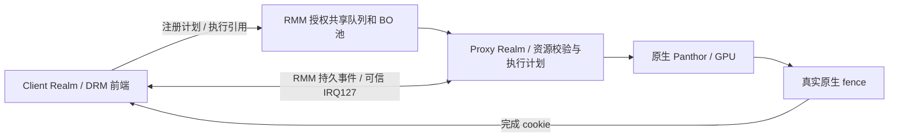

# 当前开发基线：RMM-only / P42 + BO 容量修复

更新：2026-10-18。**memfd旧路径已退役，清理后源码与下述旧冻结测量包不同；新组合完整720p1157（旧1161，−0.34%）；验证见[退役记录](MEMFD_RETIREMENT_20261018.md)。**

日常开发以本页、当前源码和对应冻结输入为准。普通 VM/memfd 发布包和历史论文方案不代表当前 Realm 实现；固定 Git 发布载荷也不会自动包含本地未提交改动。

## 阅读入口

| 内容 | 文档 |
| --- | --- |
| 环境、设备角色、构建与测试流程 | [主手册](../start/AGENT_ENVIRONMENT_AND_TEST_RUNBOOK.md) |
| 当前 Native / ProxyClient 全部有效对照 | [性能汇总](GPU_NATIVE_PROXYCLIENT_COMPARISON_20261018.md) |
| 大 BO 分配、512 MiB 配置及最新验收 | [BO 修复报告](GPU_BO_CAPACITY_FIX_20261018.md) |
| 资源、租约与产物管理 | [开发规范](../start/DEVELOPMENT_AND_ARTIFACT_HYGIENE.md) |
| 多 Realm 通信、GPU 转发与执行的代码和原理 | [代码讲解](REALM_COMMUNICATION_AND_GPU_EXECUTION_CODE_WALKTHROUGH_20261018.md) |
| RMM 共享接口与测试用法 | [Realm 工具说明](../../GPU-SFTP/tests/realm-xshm/README.md) |
| 基线 Git 同步、组件版本与发布检查 | [同步记录](GIT_BASELINE_PUBLICATION_20261018.md) |
| 历史失败、逐轮优化与论文调研 | [归档索引](../archive/20261018/README.md) |

## 已实现的数据路径



- **提交：** 资源注册与可复用执行计划代替直接 GROUP_SUBMIT RPC；Proxy 按会话校验引用，资源生命周期变化使计划失效。不是 GPU shadow task 或跨 Group 页表隔离。
- **共享：** RMM 校验 Realm 端点、通道和授权范围，建立长期池，支持分段 attach/detach/revoke；队列身份来自 RMM。描述符和消息先复制到私有内存再校验，队列几何及本端进度保存在私有状态。
- **通知：** RMM 保存 pending/ack/armed 状态并控制 IRQ127；hard IRQ 只调度接收工作，worker 排空后 ACK+ARM 并重查。中断只提示检查队列，不是访问授权或 GPU 完成证明。
- **缓存：** tiler heap 初始化后按 GPU 所有权交接，避免逐提交重复同步；固件输出按实际读取范围维护。保留真实 DMA 缓存维护及发布顺序，不能以 CPU 屏障代替。
- **完成：** 原生完整 fence/chain 成功后发布精确 cookie；Client 在对象、cookie、epoch 和无后续写入等条件满足时本地确认完成，否则回退真实等待。
- **回收：** 私有快照最后引用释放后有界排队，下一次新导出附带回收；不复用旧快照，不在含糊的传输失败后重放执行。
- **BO：** GPU 连续对象按页分配 extent，沿用 pin、引用、撤销和释放清零；大负载显式启用512 MiB池，默认仍为256 MiB。

## 代码入口

| 职责 | 当前路径 |
| --- | --- |
| Client 前端、完成凭据和快照回收 | [panthor_client_drv.c](../../Linux-Guest-GPU/drivers/gpu/drm/panthor-client/panthor_client_drv.c) |
| Proxy 会话、计划与原生后端 | [panthor_proxy_drv.c](../../Linux-Guest-GPU/drivers/gpu/drm/panthor-proxy/panthor_proxy_drv.c) |
| 通信与对象协议 | [panthor_vmshm.h](../../Linux-Guest-GPU/include/linux/panthor_vmshm.h)、[vmshm_comm_protocol.h](../../Linux-Guest-GPU/include/linux/vmshm_comm_protocol.h) |
| GPU BO 分配器 | [proxy_vmshm_manager.c](../../Linux-Guest-GPU/drivers/char/proxy_vmshm_manager/proxy_vmshm_manager.c) |
| Realm Guest 共享前端 | [realm_xshm.c](../../Linux-Guest-GPU/drivers/char/realm_xshm.c) |
| RMM 端点、共享和 IRQ 策略 | [runtime/core](../../opencca/tf-rmm/runtime/core/) 中的 xshm_endpoint / xshm_memory / xshm_service / xshm_irq |
| 成套构建配置 | [configs/performance](../../configs/performance/README.md) |
| 受租约保护的测试入口 | [run-realm-xshm.py](../../scripts/run/run-realm-xshm.py)、[lab-run.py](../../scripts/maintenance/lab-run.py) |

Host原生与单VM直通对照入口保留。普通VM的memfd/irqfd共享入口、Host broker和外部memslot集成已删除；vmshm名称仍用于当前RMM队列/对象协议，不代表继续使用memfd。

## 测量基线与边界

| 项目 | 最新有效结果 | 说明 |
| --- | --- | --- |
| 当前完整720p | 1157，Native参考1437 | RMM-only清理后，默认256 MiB；清理前1161 → 1157，−4/−0.34%，单次差异不证明稳定回退 |
| 完整1080p | 901，Native997 | 显式512 MiB；旧失败分数无效 |
| ResNet50 | 1463.96ms，Native1162.99ms | 显式512 MiB；随机权重性能模型 |
| P42重复性能验证 | 1159 / 1163 | 修复前同镜像两轮，历史参考 |
| 当前33项对照条目 | 21项修复后实测，12项P42参考 | 另列P42双Client性能；不称当前32/32 |

清理前BO修复组合通过默认720p、大配置ResNet50/1080p/17项API/128 MiB Compute及双Client负例；清理后组合单独验收，范围见退役记录，不继承历史PASS。

glmark为离屏null-noop / finish、完整33场景；validation为26成功、1已知数值例外、6无判据。GPU请求600MHz、实际594MHz；未固定CPU恒定频率。不能把不同资源配置和历史批次解释为单变量收益。

RK3588/OpenCCA的GPT/GPC仍有模拟边界；本基线未实现GPU跨Group shadow页表隔离、完整远程证明、多vCPU验收或长期压力证明。Host仍可拒绝调度。历史失败继续保留，不从旧PASS推断新版本全通过。

## 冻结输入与复现

**当前RMM-only组合：** `build/memfd-retirement-20261018/candidate/`，720p已实测1157，双Client API/Compute/权限与IRQ负例通过；client/proxy/initrd/VMM随当前runtime-manifest归档恢复。输入哈希见[新组合清单](evidence/memfd-retirement-20261018/inputs.json)，当前源码哈希见[新源码清单](evidence/memfd-retirement-20261018/runtime-source-hashes.json)。

下表为**清理前已验证对照包** `build/bo-capacity-20261018/final/`，其1080p/ResNet50等历史结果不能直接继承给新源码。其[SHA与清理前60项源码清单](evidence/current-baseline-20261018/source-hashes.json)用于识别版本；不能仅凭一个提交号或Image文件名宣称等同已测组合。

| 输入 | SHA-256 |
| --- | --- |
| client-Image | `5dc92273d905f49f2a47ae6b418b74cb6aa68494ec3a7c9a7de97f94201d195a` |
| proxy-Image | `dc2e26213e378abb8466821ffe2bdad166921c9b213871cfb24e0974f251be7e` |
| initrd.cpio | `c3cdd4fa34c168e528460c9dd63f58354b5b66437c51973415fc5edb60931299` |
| runner.py | `e7703ec7d913676cb65f87e5e92e1751943f933000a039df4bb6414edd2152e9` |
| RMM ELF | `643b0e212a5f44646baa86779c9a9f347b10163852df8079ace588c0cd05a4ec` |

Host为`6.12.0-opencca-pmthor-opp3 #7`，需匹配模块、固件与只读用户态rootfs。主手册说明部署前检查；健康Host不因整理目录而刷写。运行前确认无其他硬件任务，用新的唯一run-id：

```bash
python3 scripts/maintenance/lab-run.py --run-id <唯一ID> -- \
  python3 scripts/run/run-realm-xshm.py --images build/memfd-retirement-20261018/candidate \
  --workload glmark --performance --benchmark-only --suite --profiles glmark-720
```

大负载另加`--large-pool`，选择`--profiles ncnn-resnet50 glmark-1080 ioctl compute-128`；双Client功能使用`--workload compute`。未选负载记为未执行。

前一轮目录整理未改运行代码，见[整理记录](WORKSPACE_CLEANUP_20261018.md)。随后memfd退役修改了运行代码；其构建、性能与新输入单独记录于[退役记录](MEMFD_RETIREMENT_20261018.md)。
