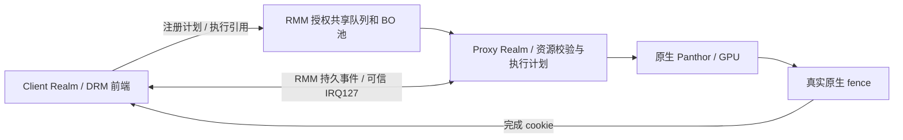

# 当前冻结基线：RMM 私有 GPU 内存（2026-11-02）

**按用户要求冻结到独立分支，停止继续性能优化实验。** 新 baseline 为FU RMM＋FT Client＋原DX，已保留971／971、最新原版对照972；最后FX980未过预设982／目标1000，已撤回。[可恢复的运行包、固件、配置与版本清单](../../baselines/rmm-private-fu-ft-20261102/README.md)。旧版是Proxy分配Client内存的1158／1158组合，另存[旧设计分支](https://github.com/marsha1111mao-del/gpu/tree/baseline/legacy-proxy-allocated-1158-20261102)，Native1431.50与80.89%仅为指定历史参考；CPU频率和资源条件不同，不作为新旧同期性能比较。版本归档未改运行代码，无新增性能测量。

**FX READY／RETURN租约摘要复用已撤回，仍保留FU RMM＋FT Client＋原DX。** 紧邻完整720p原版972→候选980（+8／+0.82%），未达预设982保留线。实际核心42组差分证明热路径BO扫描2→0，冷路径双遍扫描、真实NC屏障及硬件／完成检查保持；3个编译错误变体拒绝、完整私有回归退出0和平台／核心／RSI检查通过。两轮33场景validation逐项26/1/6一致、健康／资源与各11份SHA通过；219项FU输入、实际SD2及四Guest已恢复，246项候选输入另以封存副本核验。**无新增保留提速，1000与整体目标未完成，ML／API／多Client未扩展。** 见[实施记录FX节](GPU_RMM_PRIVATE_BO_IMPLEMENTATION_20261030.md#fxreadyreturn-复用已持有租约摘要2026-11-02)。

**FW当前成本诊断已撤下，仍保留FU RMM＋FT Client＋原DX。** 近期未修改对照972→诊断969（−3／−0.31%，非紧邻／重启条件），无新增保留提速；原保留971／971。当前空闲anchor重验约32.218µs／退休批，占保留域准备92.410%；STATUS ACK约29.819µs／批，占完整FINISH29.537%。20项130标量冻结快照、实际后端三种计时模式输出一致／3错误变体、完整33场景逐项validation26/1/6、12份SHA、健康／资源核验通过；219项FU源码／实际SD2／四Guest已恢复并核验，诊断模块及Pi临时上传已清理。计时互有包含，不能相加当作CPU收益；优先研究回调边界完整的提交／完成事务组织，避免重复微调等待。1000与整体目标未完成，ML／API／多Client未扩展。见[实施记录FW节](GPU_RMM_PRIVATE_BO_IMPLEMENTATION_20261030.md#fwfu-当前路径分段成本与冻结快照2026-11-02)。

**FV提示反馈候选已撤回，当前仍为FU RMM＋FT Client＋原DX。** 同期完整720p972→974（+2／+0.21%），未达预设982保留线；提示跳过／批5.923→2.723、立即排队5.962→3.704µs，但主动暂停293.803→300.226µs，局部减少没有足够整机收益。两轮33场景validation逐项26/1/6一致、健康／资源及各11份证据SHA通过。136个实际worker模型、3个编译错误变体、ARM64构建及634条私有PASS标记通过；两项源码撤回后130场景模型、219项FU冻结输入／实际SD2／四Guest终检通过。RMM未重建或刷写，**974不保留**；原保留两轮971／971，最新纯对照972。1000及整体目标未完成，不扩展ML／API／多Client，不仅调预测／等待常数重试。见[实施记录FV节](GPU_RMM_PRIVATE_BO_IMPLEMENTATION_20261030.md#fv提示未到达反馈训练首查预测2026-11-02)。

**当前性能保留候选：FU RMM＋FT Client＋原DX，完整720p971／971。** 同期FT对照957，**+14分／+1.46%**，两轮均过预设967保留线。稳定租约内复用BO元数据谓词，36处写边界失效；身份／映射代次／槽位及硬件根／故障／真实完成检查保持新鲜。三轮33场景validation逐项26/1/6一致，健康／资源及各11份证据SHA通过；折射86→82／79FPS的回退保留。20个暖摘要模型、7个错误变体、完整私有634条PASS标记和实际平台／核心／RSI检查通过；219冻结输入、实际SD2／四Guest终检通过。新包`build/rmm-client-bo-20261030/lease-summary-fu/runtime-candidate/`及同目录`firmware/`；FT保留回退。**1000尚未达到，ML／完整API／多Client未扩展，整体目标未完成。** CPU自动频率，两次候选不证明跨负载稳定收益。详见[实施记录FU节](GPU_RMM_PRIVATE_BO_IMPLEMENTATION_20261030.md#fu稳定租约元数据摘要与ft提示观察组合2026-11-02)。

**当前性能保留候选：FS RMM＋FT Client＋原DX，完整720p958／956，均值957。** 对原版DA／ED纯对照934为 **+24／+22分（+2.57%／+2.36%），均值+23／+2.46%**；两轮均超过预设944保留线。FT在FS原样RMM进度提示基础上，允许提示提前结束Client原有短等待，随后仍走真实FINISH；原始命令准入、权限、错误、deadline及回收语义保留。两轮33场景逐项validation与对照一致（26/1/6）、VM0/0、健康／资源及各11份证据SHA通过；193冻结输入、实际SD2及四Guest终检通过。新保留包为`build/rmm-client-bo-20261030/hint-wait-ft/runtime-candidate/`，固件为同目录下的`../firmware/`；旧DA／ED保留回退。对照非本轮紧邻重测，CPU自动频率，不能据两轮宣称一般负载稳定收益；RMM与Client组合效果不拆分归因。**1000门槛与整体目标未完成，ML／API／多Client为NOT_RUN**，既有超时／EBUSY／validation例外仍保留。见[实施记录FT节](GPU_RMM_PRIVATE_BO_IMPLEMENTATION_20261030.md#ft提示到达时提前结束有界等待两轮958956保留2026-11-02)。

**FS可信侧生成进度提示：完整720p934→936（+2／+0.21%），未达944保留线，已撤回恢复DA／ED。** 保留原始命令准入、受保护完成计数及真实FINISH；新提示只指导有界查询跳过，不授权fence完成或页回收。实际每退休批查询2.463→1.138，但观察间隔265.867→339.845µs，没有足够端到端收益。完整33场景及逐场景validation26/1/6一致，VM0/0、健康／资源及11份证据SHA通过；166项生产输入、201项冻结候选输入、实际DA SD2及四项ED Guest核验，Pi临时副本已清理。当前保留仍DA＋ED＋原DX、最新纯对照934；1000与整体目标未完成，ML／API／多Client未扩展。见[实施记录FS节](GPU_RMM_PRIVATE_BO_IMPLEMENTATION_20261030.md#fs可信侧生成进度提示完整720p934936撤回2026-11-02)。

**FR仅提高RMM编译优化等级：完整720p934→934（0／0.00%），已撤回恢复DA／ED。** 运行源码不变、Debug／断言／ISA保持，23份编译参数仅`-O2→-O3`；代码段+21.69%、BSS不变，未达预设944保留线。完整33场景及逐场景validation与原版一致（26/1/6），VM0/0、健康／资源、11份证据SHA通过；633条私有套件／4288条后端模型PASS标记及O3 timer131072／66通过，标记非独立硬件用例。165生产／198冻结输入、四项Guest和实际DA SD2恢复核验，清理本轮Pi临时副本。当前仍DA＋ED＋原DX、最新纯对照934；无新增保留提速，1000及整体目标未完成，不扩展ML／API／多Client。见[实施记录FR节](GPU_RMM_PRIVATE_BO_IMPLEMENTATION_20261030.md#frrmm-o3编译候选完整720p934934撤回2026-11-02)。

**FQ本地完成提示候选在上板前否决；原版完整720p新对照934分。** Client命令跳板使RMM暂存时只验证跳板范围，实际RMM页表／引用核心复现两种清理次序下“原始未映射命令拒绝、改写后跳板接纳”的反例；未部署候选，未产生候选GPU分数。三项Client源码已恢复，165项生产输入及193项原冻结输入核验；恢复后Client113／heap151模型通过。原版33场景、validation26/1/6、VM0/0、健康／资源及11份证据SHA通过，较此前933为+1／+0.11%，未改运行代码，不计优化收益。当前仍DA＋ED＋原DX，1000门槛未过。见[实施记录FQ节](GPU_RMM_PRIVATE_BO_IMPLEMENTATION_20261030.md#fq本地完成提示的准入反例与原版对照2026-11-02)。

**FP完成观察分段诊断：纯对照933→诊断936（+3／+0.32%），已撤下恢复DA／ED，无新增保留提速。** 原ED／Proxy／DX／Host不变；固定70字段快照的两次SMC和两次文件读取一致，已取得完整观察各阶段及嵌套控制读取成本，不依赖UART。633条本地PASS、三种错误计数变体拒绝、完整33场景／validation26/1/6、内核健康／资源与12份SHA核验；165生产／205冻结输入、四Guest与实际DA SD2恢复核验，timer131072／66和Client113复测通过。当前仍933，1000与整体目标未完成。见[实施记录FP节](GPU_RMM_PRIVATE_BO_IMPLEMENTATION_20261030.md#fp完整完成观察分段与冻结快照2026-11-02)。

**FO全短等待协作已撤回：完整720p933→855（-78／-8.36%），无新增保留提速。** 在FN一致timer快照基础上，将原首次与八次短等待改为绝对零slack睡眠，保留真实FINISH／原deadline／回退。122个Client模型、timer与快照检查、ARM64构建及普通ED可执行代码逐字节复核通过；完整33场景、validation26/1/6、VM0/0、健康／资源与11份SHA核验。未达预设944保留线，165生产／221冻结输入、四项Guest与实际DA SD2恢复核验，timer131072／66和Client113复测通过。当前仍DA＋ED＋原DX、最新纯对照933；1000及整体目标未完成，不扩展ML／API／多Client。见[实施记录FO节](GPU_RMM_PRIVATE_BO_IMPLEMENTATION_20261030.md#fo一致timer快照基础上的全短等待协作2026-11-02)。

**FN共同timer退出快照验证完成：原ED新对照933→候选932（−1／−0.11%），未达944保留线，已恢复DA／ED。** 同一冻结睡眠诊断Client的DA478→FN891，最大架构timer入口晚到15.660秒→7.497毫秒、≥10ms19→0；该诊断改善没有转化为原ED提分，未捕获此前实际Host／REC错配。四轮完整33场景、validation26/1/6、VM0/0、健康／资源及各11份SHA通过；165项生产／270项冻结输入、四项Guest和实际SD2恢复核验，timer131072／66与Client113复测通过。保留基线仍DA＋ED＋原DX，最新纯对照933；1000与整体目标未完成。FO后续验证与回退见上方最新记录。见[实施记录FN节](GPU_RMM_PRIVATE_BO_IMPLEMENTATION_20261030.md#fn共同保存的定时器退出快照与两组完整720p对照2026-11-02)。

**FM实际timer LR／空闲位置诊断：最近纯对照934→诊断314（−620／−66.38%），已撤下恢复DA／ED，无新增保留提速。** 292字段冻结快照完整取回；最大timer入口晚到15.842801秒，99.999582%重合`run_realm`＋PAuth，共钟不确定度2.042µs。六个最长13.538–15.843秒区间均IRQ退出，匹配镜像符号及反汇编确认退出PC为`cpu_do_idle+0x8`、紧随WFI；两端timer均到期、CVAL未变，全部LR中无IRQ27匹配项。端点不证明整个区间持续空闲。三个有效前序handler为CTL5→5，不支持在该handler内重装／到期的原假设。源码另发现Host报告timer后再保存REC，跨读取到期可能造成两边基线不一致；实际源码块的3600时序模型复现850个组合，包含虚拟timer反例，共同保存快照候选仅在隔离模型中验证，**尚未实现／部署，也未证明是FM实机根因或ED全部差距的来源**。完整33场景、validation26/1/6、VM0/0、健康／资源与12份证据SHA、163生产／270冻结输入／四项Guest及实际DA SD2恢复核验，timer131072／66和Client113复测通过；本轮未重跑完整639套件。下一步验证共同退出快照，再做实机因果及原ED性能对照。当前仍DA＋ED＋原DX、934分，1000与整体目标未完成。见[实施记录FM节](GPU_RMM_PRIVATE_BO_IMPLEMENTATION_20261030.md#fm实际定时器-lrguest-空闲位置与退出快照竞态反例2026-11-02)。

**FL完整阶段取回与归因：最近纯对照934→诊断341（−593／−63.49%），已撤下恢复DA／ED，无新保留提速。** 固定334字段、冻结代次、两次SMC读取及两次文件读取一致，越界／旧代次拒绝通过，解决FK的UART报告完整性问题。完整33场景、validation26/1/6、VM0/0、健康／资源及12份证据SHA核验。最大timer入口晚到15.470060秒，其中99.999434%重合`run_realm`＋PAuth区间，共钟不确定度约2.042µs；timer检查最大1.458µs、退出处理最大127.701ms，保留的这两类长区间均未与该样本重合。**尚不能区分Guest执行／空闲、虚拟timer交付或monitor，不是已定位或修复的timer缺陷；top6不提供完整时间覆盖。** 六个最长run边界均为CNTV_CTL=5、CVAL未变、PPI27关闭；到期PPI屏蔽本身是设计行为，LR127属于事件通道，不能当作timer LR。下一步检查实际timer LR、Guest PC／HCR及前序timer输出状态，再决定优化。163项生产输入、271项冻结输入、四项Guest和实际DA SD2恢复，原timer131072／66及Client113模型复测通过。当前仍DA＋ED＋原DX、934分，1000与整体目标未完成。见[实施记录FL节](GPU_RMM_PRIVATE_BO_IMPLEMENTATION_20261030.md#fl冻结阶段快照与长等待归因2026-11-02)。

**FK RMM内部阶段诊断：最近纯对照934→诊断190（−744／−79.66%），已撤下恢复DA／ED，无新保留提速。** 完整33场景、validation26/1/6、VM0/0、健康／资源及11份证据SHA核验。只对固定Client CPU2记录timer检查／`run_realm`／退出处理最慢6段；初版全CPU记录表超出BSS边界，失败保留，缩减后在原固定内存／栈范围内通过构建、布局及FIT。**RMM UART阶段报告损坏，严格校验FAIL，不能定位调用内部阶段。** 两组Client文件报告另行独立核验（262／106218次睡眠），最大架构入口晚到16.404910秒、回调到恢复122.208µs；原单报告解析失败保留，不合并两组计数或锚点。161项生产输入、225项冻结输入、四项Guest与实际DA SD2恢复，原timer131072／66及Client113模型复测通过。下一步先提供完整可核验的诊断状态读取，再做阶段归因，不从UART碎片修改timer／EOI。当前仍DA＋ED＋原DX、934分，1000与整体目标未完成。见[实施记录FK节](GPU_RMM_PRIVATE_BO_IMPLEMENTATION_20261030.md#fkrmm内部阶段诊断与报告完整性失败2026-11-02)。

**FJ共钟追踪诊断：最近纯对照934→诊断391（−543／−58.14%），已撤下恢复DA／ED，无新保留提速。** 最大架构timer入口晚到约11.299秒，其中Host换出Client vCPU仅14µs，99.9990%的区间落在一次未返回的`kvm_rec_enter`内；该调用包含Guest、RMM及可能的WFI，尚不能进一步归因。全局追踪因CPU0 overrun31401而FAIL，后续只采用固定CPU2、零丢失的局部对账；不宣称全Host追踪通过。64组Host计数器校准与两份Guest锚点核验，映射不确定度约4.83µs；报告锚点字段的变量覆盖错误已独立更正，原报告保留，重算端点一致。完整33场景、validation26/1/6、VM0/0、健康／资源及11份证据SHA核验；159项生产输入、222项冻结输入、四项Guest及实际DA SD2恢复。下一步区分RMM内部处理与Guest运行／timer重装和IRQ交付，不凭已有EOI源码推定根因。本轮为睡眠＋计时＋Host追踪的组合诊断，非紧邻生产性能对照。当前仍DA＋ED＋原DX、934分，1000和整体目标未完成。见[实施记录FJ节](GPU_RMM_PRIVATE_BO_IMPLEMENTATION_20261030.md#fjhostguest共同计数器时间线与cpu2局部对账2026-11-02)。

**FI定时器PPI使能候选：同FH诊断Client紧邻对照579→609（+30／+5.18%），未消除长暂停，已撤回恢复DA／ED。** 架构timer入口最长晚到15.983047→15.878619秒，≥10ms次数14→18；因此不能把Host保存使能位遗漏认定为已观测暂停的修复。实际平台／核心131072转换、66有界退休、私有套件633条PASS标记及构建／布局通过；两轮完整33场景、validation26/1/6、VM0/0、健康／资源和各11份日志SHA核验。候选固件仅SD2部署与原DA回退，154项生产输入、215项冻结输入、四项Guest和实际SD2恢复核验。两轮均为睡眠诊断，不是原ED提分对照；保留基线仍DA＋ED＋原DX、934分，1000及整体目标未完成。见[实施记录FI节](GPU_RMM_PRIVATE_BO_IMPLEMENTATION_20261030.md#fi独立使能realm定时器ppi的实际因果对照2026-11-02)。

**FH架构定时器中断分段诊断：最近纯对照934→诊断655（−279／−29.87%），已撤下恢复DA／ED。** 279727次回调都有有效的同次IRQ链；最大16.062023秒暂停中，进入架构timer处理函数已晚16.061678秒，入口到回调13.125µs。主要延迟在处理函数入口之前，尚不能在Guest屏蔽／分发、Host调度或硬件路由之间归因。空闲Host CPU0–1的虚拟／物理timer PPI均启用；不能据此判定异常期间状态。实际RMM使能逻辑的Host关闭位反例在离线模型中得到复现，隔离候选修正通过131072个转换与66个有界退休检查；FH结束时未部署，后续实际检验见上方FI。完整33场景、validation26/1/6、VM0/0、健康／资源及11份证据SHA核验；152项生产输入、213项冻结输入、四项Guest和实际SD2恢复。当前保留成绩仍934，无新增保留提速，1000及整体目标未完成。见[实施记录FH节](GPU_RMM_PRIVATE_BO_IMPLEMENTATION_20261030.md#fh架构timer中断入口分段诊断2026-11-02)。

**FG定时器分段诊断：原ED对照934→诊断639（-295／-31.58%），已撤下恢复DA／ED。** 281762次首次睡眠均记录到回调；最大15.239841秒暂停中，回调晚于目标15.239570秒，回调到worker恢复191.042µs、取消0.291µs。最大异常主要发生在回调之前，下一步区分Guest定时器IRQ进入／处理和Host vCPU／IRQ交付；尚不能认定具体层有bug。不据此再只改slack或worker优先级。完整33场景、validation26/1/6、VM0/0、健康／资源和11份日志SHA核验；151项生产输入、188项冻结输入、四项Guest及实际SD2恢复核验。无新增保留提速，当前纯对照仍934，1000与整体验收未完成。见[实施记录FG节](GPU_RMM_PRIVATE_BO_IMPLEMENTATION_20261030.md#fg定时器触发唤醒与恢复分段诊断2026-11-01)。

**FF首次预测等待协作：紧邻原版934→候选566（-368／-39.40%），已撤回恢复DA／ED。** 仅首次等待改绝对截止零slack高精度timer，后续8次50µs仍主动观察；RMM／权限／完成／原deadline不变。保留线946，场景保护False，长尾保护False；118个Client模型场景通过，两轮完整33场景、validation26/1/6、VM0/0、健康／资源及各11份日志SHA核验。146项生产输入、187项冻结输入、四项Guest与实际SD2恢复核验。无本轮保留提速，最新纯对照934；1000和扩展矩阵／整体目标未完成。见[实施记录FF节](GPU_RMM_PRIVATE_BO_IMPLEMENTATION_20261030.md#ff首次预测等待使用绝对高精度timer2026-11-01)。

**FE稀疏身份诊断：完整720p935→932（-3／-0.32%），已撤下恢复DA／ED。214个暂停后快照中，真正可运行／延迟出队／队列过渡状态分别出现在211／3／0个快照，类别可重叠。FD的nr_running>1不能直接解释为应用竞争；EEVDF睡眠任务可仍计入该数。只增加诊断，无保留提速；1000和扩展矩阵／整体目标未完成。** 完整33场景、validation26/1/6、VM0/0、健康／资源与11份日志SHA通过；146项生产输入、187项冻结输入、四项Guest和实际SD2恢复核验。详见[实施记录FE节](GPU_RMM_PRIVATE_BO_IMPLEMENTATION_20261030.md#fe稀疏任务身份与eevdf延迟出队核验2026-11-01)。

**FD主动等待竞争诊断：纯对照935→诊断932（-3／-0.32%），已撤下恢复DA／ED。** 869596次暂停中，99.1765%在至少一个端点观测到nr_running>1（FE补充：可能包括已睡眠的EEVDF延迟出队任务，不能直接视作CPU竞争）；这些区间累计时长占99.6114%，不等于连续竞争时间、应用占用或可节省时间。只加统计，未改等待／调度／完成检查；无保留性能优化。完整33场景、validation26/1/6、VM0/0、健康／资源与11份日志SHA通过，146项生产输入、182项冻结输入、四项Guest及实际SD2核验。最新纯对照仍935，1000／扩展矩阵与整体目标未完成。见[实施记录FD节](GPU_RMM_PRIVATE_BO_IMPLEMENTATION_20261030.md#fd主动等待的guest就绪竞争诊断2026-11-01)。

**FC通用memcpy宽字复制：紧邻原版935→候选934（−1／−0.11%），未达946保留线，已撤回恢复DA／ED。** 仅RMM复制函数增加精确边界的对齐64位路径，23份编译选项相同、权限／根／完成检查未改。原版／候选各1057282组复制边界检查、完整私有633条及后端4288条PASS标记；这些是模型标记，非独立硬件用例数。两轮完整33场景、validation26/1/6、VM0/0、健康／资源及各11份证据SHA核验。146项生产输入、43项冻结输入、四项板端Guest与实际SD2恢复核验；当前仍DA＋ED＋原DX，**最新纯对照935**，1000门槛与扩展矩阵／整体目标未完成。详见[实施记录FC节](GPU_RMM_PRIVATE_BO_IMPLEMENTATION_20261030.md#fc通用-memcpy-宽字复制完整720p-935934撤回恢复daed2026-11-01)。

**FB Cortex-A55 编译调优：紧邻原版929→候选937（+8／+0.86%），未达946保留线，已撤回恢复DA／ED。** 仅RMM增加`-mtune=cortex-a55`，23份编译选项核验，原O2／Debug／断言／指令集保持，运行源码未改。两轮完整33场景、validation26/1/6、VM0/0、健康／资源及各11份证据SHA核验；本地私有套件633条PASS标记。145项生产输入、162项冻结输入、14项执行脚本、四项Guest与实际SD2恢复核验。当前仍DA＋ED＋原DX，**最新纯对照929**，937未保留；1000门槛、扩展矩阵和整体目标未完成。见[实施记录FB节](GPU_RMM_PRIVATE_BO_IMPLEMENTATION_20261030.md#fbcortex-a55-编译调优929937撤回恢复daed2026-11-01)。

**FA短行STATUS诊断：纯对照931→诊断935（+4／+0.43%），已撤下并恢复DA／ED。** 严格三段／独立副本规则取得38组有效报告；最后认证前缀内830805次成功握手，平均6.368次轮询／20.431µs，非GPU完成时间或纯CPU开销。末组68丢失，未补后缀、不使用Client全程分母。完整33场景、validation26/1/6、VM0/0、健康／资源及11份证据SHA核验；145项生产输入、163项冻结输入、17项控制脚本、四项Guest和实际SD2恢复核验。无新保留优化，当前纯对照仍931，1000／扩展回归和整体目标未完成。见[实施记录FA节](GPU_RMM_PRIVATE_BO_IMPLEMENTATION_20261030.md#fa短行status诊断935分取得有效统计前缀恢复daed2026-11-01)。

**EZ STATUS ACK计数诊断：纯对照931→诊断936（+5／+0.54%），无保留优化，已恢复DA／ED。** 完整33场景、validation26/1/6、VM0/0、健康／资源及11份证据SHA核验通过；退出1仅因未达1000。统计长行遭UART截断，严格解析无足够完整副本，不能引用循环次数或耗时分布。145项生产输入、163项冻结输入、17项脚本、四项Guest与实际SD2恢复核验。后续FA仅把报告拆为短行重采，原检查／超时／计数机制不变；当前纯基线仍931，1000／扩展回归及整体目标未完成。见[实施记录EZ节](GPU_RMM_PRIVATE_BO_IMPLEMENTATION_20261030.md#ezstatus-ack循环计数诊断936分串口统计失败已恢复daed2026-11-01)。

**EY稳定租约BO元数据摘要：紧邻原ED931→候选944（+13／+1.40%），未达预设946保留线，已撤回并恢复DA／ED。** 仅缓存受保护BO元数据检查，以全局单调代次覆盖36处写边界；context／映射代次／生命周期／AS槽位及实际硬件根／配置／完成检查保持新鲜。56组原cache-set、19组新摘要场景及6＋7个编译错误变体拒绝、实际后端／RSI、634条私有套件PASS标记和固件构建通过；模型不代表实体隔离。两轮完整33场景、validation26/1/6、VM0/0、健康／资源及各11份证据SHA核验。145项生产输入、164项实验冻结输入、11项执行脚本、四项板端Guest及实际SD2恢复核验；当前仍DA＋ED＋原DX，**最新纯对照931**，944仅为已撤回候选。1000未过，API／ML／多Client不扩展，整体未完成。见[实施记录EY节](GPU_RMM_PRIVATE_BO_IMPLEMENTATION_20261030.md#ey稳定租约bo元数据摘要完整720p944分撤回恢复daed2026-11-01)。

**EX集中BO热字段：紧邻原ED935→候选932（−3／−0.32%），未达946保留线，已撤回并恢复DA／ED。** 仅RMM内部字段顺序改变，BO仍600字节、容量及真实新鲜检查不变；静态字段覆盖3.125→1.75条缓存行不等于硬件miss或提分。56组cache-set／31组live-lease差分、六个错误变体、实际后端／RSI、ARM64结构布局及固件构建检查通过。两轮完整33场景、validation26/1/6、VM0/0、健康／资源及各11份证据SHA核验；145项原生产输入、162项冻结输入、8项执行脚本、四项板端Guest和实际SD2恢复核验。当前仍DA＋ED＋原DX，**最新纯对照935**；1000未过，API／ML／多Client不扩展。稳定租约BO摘要仍未实现。见[实施记录EX节](GPU_RMM_PRIVATE_BO_IMPLEMENTATION_20261030.md#ex集中-bo-热字段完整720p932分撤回恢复daed2026-11-01)。

**EW定位BO元数据扫描，完整720p934→929（−5／−0.54%），临时计时已撤下并恢复DA＋ED。** 最终计数器三行的三份副本一致：live_eligible平均2.039µs、BO集合检查1.845µs，区间嵌套不相加；原完整帧规则仅认证至37222次可信退休，最终每批归一化不可用，次级分析不补帧头／尾。实际核心／RSI、私有套件、构建和布局通过；33场景、validation26/1/6、VM0/0、健康／资源及11份证据SHA核验。4项源码、145项生产输入、8项ED包、四项板端Guest与实际SD2恢复核验。当前纯基线仍934，1000未过；下一候选是有严格失效边界的稳定租约BO摘要，尚未实现，不省略真实根／完成检查。见[实施记录EW节](GPU_RMM_PRIVATE_BO_IMPLEMENTATION_20261030.md)。

**EV无OOM提示：紧邻原ED934→候选938（+4／+0.43%），未达946保留线，已撤回恢复DA＋ED。** 可选FINISH接口复用最后完整检查中的stream request／ACK，实机观测每文件值534623次省略即时堆查询；COMPLETE调用／退休批−6.92%，查询次数+3.43%、间隔+3.94%，局部减少工作没有等额变成总分。两轮33场景、validation26/1/6、VM0/0、健康／资源及各11份证据SHA核验；本地、构建与RSI验证完成。精确恢复10项源码，145项生产输入、8项ED包、四项板端Guest和实际SD2匹配。当前仍DA＋ED＋原DX，**最新纯对照934**（EU936为历史），938未保留；1000门槛未通过，不扩展API／ML／多Client，整体未完成。见[实施记录EV节](GPU_RMM_PRIVATE_BO_IMPLEMENTATION_20261030.md)。

**EU空闲提交提前调度：紧邻原ED936→候选933（−3／−0.32%），已撤回并恢复ED。** 只有无活动任务且已有依赖重试timer时，新提交才提前调度，不改变活动GPU查询预算。未达到预先规则计算出的946分保留线；观测到每文件计数值17，不能视为节省的等待次数或延迟。两轮均完整33场景、validation26/1/6、VM0/0，健康／资源及各11份证据SHA核验；恢复后145项生产输入、8项ED包、四项板端Guest与实际SD2匹配，113项Client模型通过。当前仍DA＋ED＋原DX，**最新纯基线936**（历史929／934），无本轮保留提分；1000门槛未通过，API／ML／多Client不扩展，整体目标未完成。见[实施记录EU节](GPU_RMM_PRIVATE_BO_IMPLEMENTATION_20261030.md)。

**ES／ET两轮完整720p均933分，属于诊断，已撤下并恢复ED。** 相对最新纯基线929为+4／+0.43%，不计优化收益；1000门槛仍未通过。ES发现printk local_clock与用户态CLOCK_MONOTONIC不可直接拼接，关联器明确拒绝；ET给每1024批统计增加ktime_get_ns()，成功关联96256批（全文件27.19%），仅已覆盖窗口显示refract有较重timer回退、大卷积effect2d有约7.912次查询／批且未进入timer回退。不同瓶颈不能统一调参；未知窗口不补标签。两轮33场景、validation26/1/6、VM0/0、内核健康／资源及11份证据SHA核验，最终145项生产输入、8项ED包、四项板端Guest与实际SD2匹配。无保留的新运行优化；当前仍DA＋ED＋原DX，纯基线最新929／历史934，API／ML／多Client未扩展，整体目标未完成。见[实施记录ES／ET节](GPU_RMM_PRIVATE_BO_IMPLEMENTATION_20261030.md)。

**ER补齐历史完成等待对账，无新增GPU测量。** ED最新929的COMPLETE间隔266.565µs／批中，立即worker排队只有3.232µs／批；主动暂停约90%，不能把整个间隔当成线程切换开销。最慢10个已保存窗口集中了约84%延迟重排等待，但缺同一Guest时钟的场景边界，暂不归因具体场景。四份历史日志与17项解析／对账检查完成，145项生产输入及8项ED包不变；未改运行代码，无新增性能测量。保留DA＋ED＋原DX，最新929／历史934，1000门槛未通过。见[实施记录ER节](GPU_RMM_PRIVATE_BO_IMPLEMENTATION_20261030.md)。

**EP／EQ性能探索已收尾，保留DA RMM＋ED Client＋原DX runner，最新完整720p实测929分（此前934）。** EP双vCPU配置在首个计算检查停滞，glmark未执行，清理出现RTT WARNING，健康FAIL；已恢复原输入并同固件重启，原ED完整对照929。EQ仅分离VMM I/O线程，紧邻对照929→928（−1／−0.11%），未达944保留线，已撤回。两轮完整计分均33场景、validation26/1/6、VM0/0、内核健康及资源恢复通过，计分外层均因低于1000退出1；不代表全部图像正确性PASS。145项生产输入、各18项实验冻结输入、8项ED包、四项板端Guest与实际SD2均核验，Host空闲。无保留的新运行代码或有效提分；1000门槛与整体安全验收未完成，API／ML／多Client扩展矩阵仍NOT_RUN。见[实施记录EP／EQ节](GPU_RMM_PRIVATE_BO_IMPLEMENTATION_20261030.md)。

**EO事件唤醒链实测878分，已撤回并恢复ED934：934→878（−56／−6.00%）。** 接通RMM事件检查、Proxy JOB threaded IRQ、有界会话提示与Client合并唤醒；实机接收33958条提示，但查询／退休批增加3.62%，未达944保留线，blur140低于141保护线。完整33场景、validation26/1/6、VM0/0、健康／资源及11份日志SHA核验；145项源码、8项冻结输入、四项板端Guest与实际SD2已恢复核验。当前仍为DA RMM＋ED Client＋DX runner，934是此前实测引用，回退后未新增GPU测量；1000门槛与整体目标未完成。见[实施记录EO节](GPU_RMM_PRIVATE_BO_IMPLEMENTATION_20261030.md#eo事件确认proxy通知与client唤醒完整接通878分撤回并恢复ed2026-11-01)。

**EN设备事件确认原型通过离线验证，Guest连接尚未实现，未部署。** 62项事件／23项平台模型及启用掩码后的实际后端生命周期变体通过；运行期双Client事件确认未推进完成字、缓存归还或释放。结果仅为替身验证，不能证明实际IRQ或提分。138项生产源码及8项ED包内容SHA不变，无板端连接、无新增性能测量；当前仍引用ED934，1000门槛FAIL，整体未完成。见[实施记录EN节](GPU_RMM_PRIVATE_BO_IMPLEMENTATION_20261030.md)。

**EM硬件能力缓存候选本地否决，未部署。** 实际后端回归失败；补充对照确认设备型号／MMU／AS／shader／tiler六类安装后变化由基线全部拒绝、候选全部接受。有限平台模型的MMIO31→23不代表整体通过或提速。138项生产源码及ED保留包SHA不变，无板端连接、无新增性能测量；当前仍引用ED934，1000门槛FAIL。见[实施记录EM节](GPU_RMM_PRIVATE_BO_IMPLEMENTATION_20261030.md)。

**EL准入计时诊断：934→936（+2／+0.21%），诊断已撤下并恢复ED934。** 新测每退休批PICK0.929µs、STAGE14.742µs，PREPARE137.496／COMPLETE198.954µs；阶段为累计墙钟，不是纯CPU成本。完整33场景、validation26/1/6、VM0/0、健康／资源及11份证据SHA核验完成；138项源码、四项Guest及SD2已恢复核验。无固件刷写；1000门槛FAIL，整体未完成。见[实施记录EL节](GPU_RMM_PRIVATE_BO_IMPLEMENTATION_20261030.md)。

**EK Proxy接收worker高优先级：934→931（-3／-0.32%），未达944保留线，撤回并恢复ED934。** 只有Proxy Image变化；ARM64构建、普通Proxy可执行段同基线、完整33场景、validation26/1/6、VM0/0、健康／资源及11份日志SHA核验完成。最终138项源码、四项Guest及原DA固件SD2读回核验；当前引用934，1000门槛FAIL、整体未完成。见[实施记录EK节](GPU_RMM_PRIVATE_BO_IMPLEMENTATION_20261030.md)。

**EJ同调用复用PUBLISH接纳结果：934→935（+1／+0.11%），未达到944保留线，撤回并恢复ED934。** 实际保留域提交START由7→6，所有回调两侧与发布后真实检查、完成／生命周期保持；无跨调用根证明。私有套件633标记／DMA／实际RSI／ARM64构建及完整33场景、validation26/1/6、VM0/0、健康／资源与11份日志SHA通过。137项源码、四项Guest、SD2和冻结输入最终核验。当前保留934，1000门槛FAIL、整体未完成。见[实施记录EJ节](GPU_RMM_PRIVATE_BO_IMPLEMENTATION_20261030.md)。

**EI完成DISPATCH内部计时：934→932（−2／−0.21%，仅诊断），已恢复DA RMM＋ED Client及实际SD2。** 保留域提交约86.541µs，准备44.218µs／发布25.861µs；7次START检查共占该类提交约50.64%，嵌套区间不可相加。完整33场景、validation26/1/6、VM0/0、健康／资源及11份证据SHA通过；137项源码、四项Guest、SD2恢复核验。后续验证同次PUBLISH接纳结果消除外层重复START；尚无新增保留优化，当前仍引用ED934，1000及整体未完成。见[实施记录EI节](GPU_RMM_PRIVATE_BO_IMPLEMENTATION_20261030.md)。

**EH完成原ED镜像的RPC诊断：934→931（−3／−0.32%，仅诊断，不计优化）。** RMM_TASK占累计RPC墙钟99.426%，平均往返138.172µs、Proxy handler93.491µs；VM_BIND仅0.284%。范围含预热／校验及计时扰动，不是整个GPU生命周期占比；没有逐请求零睡眠证明。完整33场景、validation26/1/6、VM0/0、健康／资源恢复及11份证据SHA核验；137项源码、154项冻结输入、8项ED包内容、四项Guest及SD2最终匹配，Host空闲。当前仍保留ED934，1000门槛与整体目标未完成。见[实施记录EH节](GPU_RMM_PRIVATE_BO_IMPLEMENTATION_20261030.md)。

**EG映射队列高优先级候选934→935（+1／+0.11%），未达944保留线，已撤回并核验恢复ED。** 仅Client的VM_BIND有序队列变化；完整33场景、validation26/1/6、VM0/0、内核健康／资源恢复及11份证据SHA核验完成。当前仍为DA RMM＋ED Client＋DX runner，934引用ED此前确认轮；1000门槛与整体目标未完成。见[实施记录EG节](GPU_RMM_PRIVATE_BO_IMPLEMENTATION_20261030.md)。

**ED高优先级GPU推进worker两轮931／934分，保留：紧邻普通优先级892→931／934（+39／+42，+4.37%／+4.71%）。** 仅Client私有GPU有序队列使用`WQ_HIGHPRI`；RMM、Proxy、Host、initrd与DX runner相同，无刷写／重启。三轮完整33场景、validation26/1/6、VM0/0、健康／资源恢复及各11份证据SHA通过；1000门槛仍FAIL。普通版本重建代码段与旧Image完全一致，原ED镜像复测确认收益；保留包`build/rmm-client-bo-20261030/worker-priority-ed/candidate/`，固件仍DA。EF高精度睡眠934→937（+3／+0.32%），未达944保留线，已核验撤回并恢复ED；整体未完成。见[实施记录ED节](GPU_RMM_PRIVATE_BO_IMPLEMENTATION_20261030.md)。

**EC分阶段STATUS候选819分，已撤回恢复DA：DX同条件参考891→819（−72/−8.08%）。** 保留域FINISH在ACK未到时返回并接续同一请求；查询/批增加48.13%，调用与worker间隔合计增加17.96%，三个场景保护均FAIL，未满足902保留线。完整33场景、validation26/1/6、VM0/0、健康/资源及11份证据SHA通过，1000门槛FAIL；不能把退出忙等当作提分。原源码137项、四项Guest与实际SD2已核验恢复，当前仍为DA路径/DX runner（DX891、DA893为历史参考），整体未完成。见[实施记录EC节](GPU_RMM_PRIVATE_BO_IMPLEMENTATION_20261030.md)。

**EA／EB完成实际保留域状态诊断：DX891→EA892／EB893（+0.11%／+0.22%），均已撤下并恢复DA。** EA漏接主保留域，覆盖失败明确保留；EB补齐后通过启用模型与实际RSI回归。完整33场景、validation26/1/6、VM0/0、健康/资源及每轮11份证据SHA通过，1000门槛仍FAIL。EB原整帧解析器拒绝UART丢数字；事后仅采用同组至少两份逐项一致的完整30行表，最终205/206/207行表一致，退休头仅一份完整并明确不可认证，不补数字。首次94.65% pending，保留域pending几乎均为成员进度未满，未见idle阶段pending；统计含预热/内部yield，不是GPU实际完成时间或提分。各178项恢复输入、四项Guest与实际SD2核验，当前仍保留DA路径及DX runner（DX参考891、DA历史893），整体未完成。见[实施记录EA／EB节](GPU_RMM_PRIVATE_BO_IMPLEMENTATION_20261030.md#eaeb覆盖实际保留域的完成状态诊断892893分已恢复da2026-11-01)。

**DZ首查预测候选881分，已撤回恢复DA：同条件891→881（−10/−1.12%）。** 将pending调用成本纳入预测、首查上限400µs并独立保留八次重查；查询/批减少20.95%，但调用与worker间隔合计增加2.04%，无端到端收益。118项worker模型及7个编译变体拒绝通过；完整33场景、validation26/1/6、VM0/0、健康/资源与11份证据SHA核验。246项冻结输入、137项恢复来源、四项板端输入及实际SD2核验，恢复版113项通过。当前仍为DA路径及DX runner，1000门槛与整体目标未完成。见[实施记录DZ节](GPU_RMM_PRIVATE_BO_IMPLEMENTATION_20261030.md#dz结合pending调用成本预测首查881分撤回并恢复da2026-11-01)。

**DY诊断确认首次FINISH有94.30%返回未完成：完整720p891→892（+1/+0.11%），诊断已撤下并恢复。** 843,036次查询、340,588批退休对账；首次pending调用平均65.217µs，后续成功查询起点平均在Client接纳后393.332µs。均为含抢占/设备交互的累计墙钟，不是GPU执行时间或可直接省去的开销。只换临时Client镜像，113项模型、33场景、validation26/1/6、VM0/0、健康/资源和11份证据SHA通过；188项冻结输入及157项恢复核验通过，四项板端输入/实际SD2匹配。当前保留DA路径及DX runner，1000门槛与整体目标未完成。见[实施记录DY节](GPU_RMM_PRIVATE_BO_IMPLEMENTATION_20261030.md)。

**DX完成CPU策略对照：自动891→固定1.8GHz 888（-3/-0.34%），未形成主要提分依据，原策略已恢复。** 同DA内核/RMM与GPU594MHz；两轮完整33场景、validation26/1/6、VM0/0、健康/资源恢复和各11份证据SHA核验通过，计分仍低于1000退出1；固定组另遇回执重名失败，已独立只读补核验退出0。仅扩展runner受控频率入口并通过37项离线检查，无数据路径或固件修改；每秒采样不等于连续频率驻留证明，不宣称代码提速。保留DA数据路径，DA历史893、本轮自动891；整体未完成。见[实施记录DX节](GPU_RMM_PRIVATE_BO_IMPLEMENTATION_20261030.md#dxcpu频率策略对照891888保留受控测试能力2026-11-01)。

**DW补齐真实RMI外层分发与policy gate验证：完整私有套件633条PASS，12个编译错误变体被指定检查拒绝。** 使用生产分发表、FID头文件、`handle_ns_smc()`和完整授权策略；FPU开/关各196项检查，含各32次确定性双线程竞争，检查授权到执行之间不释放锁、拒绝不进入叶子、输出寄存器清理及REC_ENTER例外。底层锁为受检查的pthread互斥锁，叶子处理与占用状态为替身，不证明真实RD创建/重建并发、Arm锁指令或实体GPT/GPC。只改验证代码，未连接板端或部署；未改运行代码，无新增性能测量。当前仍引用DA历史893，1000门槛与整体未完成项保持。见[实施记录DW节](GPU_RMM_PRIVATE_BO_IMPLEMENTATION_20261030.md#dw真实rmi外层分发与授权执行锁范围验证2026-11-01)。

**DV细分运行AS检查的内部元数据与平台寄存器成本：完整720p893→891（-2/-0.22%），诊断已撤下并核验恢复DA。** 五段统计覆盖Client最终退休批；所有真实根/属性、固件及动态故障检查保留。完整33场景、validation26/1/6、VM0/0、健康/资源及11份证据SHA通过；计时含扰动，不是纯CPU profile或稳定收益。149项原输入、四项Guest及实际SD2恢复；当前仍引用DA历史893，1000门槛及整体未完成项保持。见[实施记录DV节](GPU_RMM_PRIVATE_BO_IMPLEMENTATION_20261030.md#dv运行as检查细分诊断891分已恢复da8932026-11-01)。

**DU补齐实际RMI销毁策略与Realm销毁体的双Client回归：完整私有套件630条PASS，8个编译错误变体均被指定断言拒绝。** 覆盖提前销毁、部分回收、REC/根RTT独立守卫、RD/RTT清零调用顺序、旧GPU/事件身份释放和同地址模型身份复用；无关Client通道保留。只改验证代码；真实RMI dispatcher、Realm创建、并发及实体隔离未覆盖。本轮未连接板端，运行包/固件17项SHA不变，未改运行代码，无新增性能测量；DA893、1000门槛和整体未完成项保持。见[实施记录DU节](GPU_RMM_PRIVATE_BO_IMPLEMENTATION_20261030.md#du真实rmi销毁策略与realm销毁链630条pass2026-11-01)。

**DT去除缓存包装函数重复DSB，完整720p为893→895（+2/+0.22%），未满足预设保留条件，已撤回恢复DA源码与实际SD2固件。** 非零范围屏障2→1、零长度保持屏障；新旧各18,440个模型场景及6个编译错误变体拒绝，完整私有套件626条PASS和后端检查通过。完整33场景、validation26/1/6、VM0/0、健康/资源及11份日志SHA核验。当前仍引用DA历史893，1000门槛与整体目标未完成。见[实施记录DT节](GPU_RMM_PRIVATE_BO_IMPLEMENTATION_20261030.md#dt缓存包装函数去除重复dsb895分撤回恢复da8932026-11-01)。

**DS完成START内部区间诊断：893→891（-2/-0.22%），已恢复DA源码与实际SD2固件。** 首启/重验分开记录；已启动重验102.345µs/累计退休批，最大区间为真实运行AS、根与固件配置检查。仅诊断，不是纯CPU profile或可保留优化；完整33场景、validation26/1/6、VM0/0、健康/资源及11份日志SHA通过。恢复145项输入及四项Guest哈希；当前仍引用DA历史893，1000门槛与整体目标未完成。见[实施记录DS节](GPU_RMM_PRIVATE_BO_IMPLEMENTATION_20261030.md#dsstart内部阶段诊断891分恢复da8932026-11-01)。

**DR将实际Host PRIVATE_RECLAIM接入双Client任务/内存链：7个场景、25个编译错误变体拒绝，完整私有套件626条PASS。** 新增Client与Proxy死亡后的回收，检查现存REC、NEW状态及可信撤销前提，验证513页控制内存分批清零/恢复、存活Client注册保留及旧服务身份解除。仅改三个验证文件；RD生命周期、REC计数与外层RMI锁仍为模型，未覆盖真实并发或实体隔离。未改运行代码，无新增性能测量或硬件部署；当前仍为DA893历史结果，1000门槛及整体目标未完成。见[实施记录DR节](GPU_RMM_PRIVATE_BO_IMPLEMENTATION_20261030.md#dr实际host-private_reclaim接入双client任务内存链2026-11-01)。

**DQ将实际RMI GPU控制与撤销回调接入双Client任务/内存链：5个场景、20个编译错误变体拒绝，完整私有套件624条PASS。** 覆盖复位失败后的引用/真实PTE/隐藏控制页保留、隔离Proxy旧RESET接口拒绝、Host参数检查、成功撤销及同物理页重用后的旧任务/上下文拒绝。仅修改三个验证文件；RMI外层锁、REC/RTT/缓存/MMIO仍为模型，未覆盖实体隔离或并发。未改运行代码，无新增性能测量或硬件部署；当前仍为DA893历史结果，1000门槛与整体目标未完成。见[实施记录DQ节](GPU_RMM_PRIVATE_BO_IMPLEMENTATION_20261030.md#dq实际rmi控制撤销接入双client任务内存链2026-11-01)。

**DP仅精简已启动任务的START输入复制，完整720p为893→895（+2/+0.22%），未达902保留线，已撤回并核验恢复DA。** 重试输入读取56→5个字，首次完整复制和全部检查保留；3024项新模型检查、新旧输出逐字一致及5个编译变体断言拒绝、完整私有套件622条PASS通过。完整33场景、validation26/1/6、VM0/0、三项场景门槛、健康/资源和11份证据SHA通过。恢复145项本地输入、四项Guest输入及实际SD2字节；新增测试保留。1000门槛与整体目标仍未完成，当前运行仍为DA893历史实测。见[实施记录DP节](GPU_RMM_PRIVATE_BO_IMPLEMENTATION_20261030.md#dpstart重试仅读取实际检查的输入895分撤回并恢复da8932026-11-01)。

**DO完成DA路径START调用位置诊断：893→889（-4/-0.45%），已恢复DA源码与实际SD2固件。** 10处独立计时，69组重复一致快照覆盖339853批退休；START约15.107次/批、103.372µs/批，包含等待及预热/校验，不能当作纯CPU成本。完整33场景、validation26/1/6、VM0/0、健康/资源及日志SHA通过；恢复143项源码与四项Guest输入。诊断不保留为优化，当前分数仍引用DA历史893，1000门槛及整体目标未完成。见[实施记录DO节](GPU_RMM_PRIVATE_BO_IMPLEMENTATION_20261030.md#doda运行路径的start调用位置诊断889分恢复da8932026-11-01)。

**DN将实际RSI内存回调贯通到双Client任务生命周期，完整私有套件621条PASS，未改运行代码。** 同链覆盖固件加载/启动、私有GPU页表、委托dispatch、FINISH、CPU归还及退休；三个主机模型场景分别执行177/179/179次RSI，15个成功编译的错误变体由指定断言拒绝。完成读取期间篡改Client根或stream状态时，失败任务保留引用、拒绝数据归还与重放；移除模型故障后另一Client完成。CPU归还同时检查AS禁用及挂起应答。仅验证代码变化，无部署、板端测试或新增性能测量，不证明shader执行、实体GPT/GPC或真实并发；当前运行包仍为DA893，1000门槛与整体目标未完成。见[实施记录DN节](GPU_RMM_PRIVATE_BO_IMPLEMENTATION_20261030.md#dn实际rsi内存回调贯通到双client任务生命周期2026-11-01)。

**DM补齐GPU完成eventfd实机探针的工具与接线，尚未部署或实机执行。** 实际GLES dispatch后导出私有sync_file，经本地binary/timeline syncobj通知并核验最终成功状态；每轮使用不同输入并逐元素检查结果。38个探针模型场景、16个EGL桥接检查、36项runner检查及完整私有套件618条PASS，ARM64编译与独立候选initrd校验通过。DRM/EGL模型不证明真实GPU完成、pending回调或中断安全。仅测试工具、init/runner与打包接线变化，未改RMM/内核数据路径，无部署或新增GPU性能测量；当前运行包仍为DA893，1000门槛与整体目标未完成。见[实施记录DM节](GPU_RMM_PRIVATE_BO_IMPLEMENTATION_20261030.md#dmgpu完成eventfd探针与冻结载荷接线待实机执行2026-11-01)。

**DL补齐同一RSI链中的身份、输入复制、页归属及实际内存回调验证：61次RSI请求、12个编译后断言拒绝的错误变体，完整私有套件617条PASS。** 实际端点/RSI/IPA翻译/私有核心/xshm_rtt与物理冲突表连通，独立检查实际GPU页表叶子、驻留/NC交接和513页控制内存回收；底层REC/RTT、锁、缓存与MMIO仍为模型，未覆盖GPU任务启动或实机并发/GPC。仅新增测试及套件入口，113项本地输入冻结；未改运行代码，无新增性能测量，无部署或板端测试。DA893及DK板端核验仍为历史证据，1000门槛与整体目标未完成。见[实施记录DL节](GPU_RMM_PRIVATE_BO_IMPLEMENTATION_20261030.md#dl同一rsi链贯通身份页归属和实际内存回调2026-11-01)。

**DK控制页缓存范围候选查重后撤回，已恢复DA893匹配源码与实际SD2固件，无新增GPU性能测量。** 本轮漏查AK/BG既有同类实验，在构建和部署开始后发现重复；未继续跑完整720p，全部三项候选修改撤回，86项源码、四项板端输入与实际SD字节核验通过。新增[优化实验索引](GPU_PRIVATE_OPTIMIZATION_DECISION_INDEX.md)供候选提出前查重。当前仍为`private-running-check-candidate/`与`firmware-private-running-check/`；893是DA历史成绩，1000门槛及整体目标未完成。见[实施记录DK节](GPU_RMM_PRIVATE_BO_IMPLEMENTATION_20261030.md#dk控制页缓存范围候选查重后撤回无新增gpu测量2026-11-01)。

**DJ补测实际BO来源检查和物理内存回调：8227个模型场景，11个编译错误变体均由预期断言拒绝；完整私有套件616条PASS。** 链接真实私有核心/xshm_rtt并原样提取七个RSI内存函数；外部busy探针、RD/RTT、锁和缓存效果仍为模型，未接回DH同一RSI链。仅改测试，83项本地输入冻结；未改运行代码，无新增性能测量，无部署或硬件测试。当前仍引用DA893历史结果及DI回退核验，1000门槛FAIL，整体目标未完成。见[实施记录DJ节](GPU_RMM_PRIVATE_BO_IMPLEMENTATION_20261030.md#dj实际bo来源检查及物理内存回调模型2026-11-01)。

**DI真实live刷新前后合并运行检查已实测：DA893→DI896（+3/+0.34%），未满足预设保留条件，撤回DI并核验恢复DA893；整体目标未完成。** 模型MMIO146→124，真实LOCK/FLUSH_MEM及双侧/别名/动态检查保留；实际平台/核心/RSI、7个编译变体断言拒绝、私有套件615条PASS通过。完整33场景、validation26/1/6、VM0/0、健康/资源及11份证据SHA核验；最终74项源码、四项板端输入与SD2字节核验通过。1000门槛仍FAIL，单轮不证明稳定收益。见[实施记录DI节](GPU_RMM_PRIVATE_BO_IMPLEMENTATION_20261030.md#di真实live刷新前后复用组合运行检查896分撤回并恢复da8932026-11-01)。

**DH将真实端点、输入复制和IPA翻译接入同一RSI边界模型：新增410次拒绝请求，合计1800次，9个编译变体均被指定断言捕获。** 相同IPA按调用REC选择不同页，覆盖私有副本、翻译失败、通道成员/accept/close及身份重注册；完整私有套件615条PASS，DF独立模型继续通过。仅替换边界checker中的旧替身并新增测试，74项本地输入冻结；未改运行代码，无新增性能测量，无部署或硬件测试，DA893仍引用历史实测。真实REC/RTT、并发与物理隔离尚未验收，1000门槛仍FAIL，整体目标未完成。见[实施记录DH节](GPU_RMM_PRIVATE_BO_IMPLEMENTATION_20261030.md#dh真实通道输入复制与ipa翻译接入同一rsi边界模型2026-11-01)。

**DG同次RSI内有界执行完整FINISH已实测：DA893→DG894（+1/+0.11%），未达902保留线，已撤回并核验恢复DA893；整体目标未完成。** 每次最多3次完整观察，以可信计数器的100µs窗口决定是否再观察；成功、错误和CPU归还游标立即返回，不替换真实完成检查。窗口不保证调用墙钟上限。38类模型、5个编译变体拒绝、实际RSI双/三次观察及私有套件616条PASS通过。完整33场景、VM0/0、健康/资源及11份证据SHA核验，validation26/1/6保留；源码72项、四项板端输入和SD2固件字节核验恢复，回退后无新增GPU测量。1000门槛仍FAIL。见[实施记录DG节](GPU_RMM_PRIVATE_BO_IMPLEMENTATION_20261030.md#dg同次rsi内有界完整finish观察894分撤回并恢复da8932026-11-01)。

**DF补测实际输入复制/IPA翻译与通道身份函数：8222个复制用例、96轮通道生命周期，8个编译变体断言拒绝；完整私有套件615条PASS。** 未改运行代码，无新增性能测量；本轮无硬件测试或部署，保留DA893历史结果，1000门槛仍FAIL。另复现已撤回DE在32队列时的非法位移：原模型只测1–8队列，此helper不在当前生产代码中，归档不重用。72项当前输入及本地冻结包哈希核验；整体目标未完成。见[实施记录DF节](GPU_RMM_PRIVATE_BO_IMPLEMENTATION_20261030.md#df实际输入复制ipa翻译与通道身份验证补记撤回de的32队列缺陷2026-11-01)。

**DE同轮多队列完成页快照已实测：DA893→DE892（-1/-0.11%），撤回DE并核验恢复DA893；整体目标未完成。** 每次OBSERVE/idle检查将同页完成计数合并读取；单队列读取顺序不变，刷新前后各取新快照，全部STATUS/逐队列/根/错误/退休检查保持。1004轮独立模型、实际后端/RSI、私有套件和12个编译错误变体拒绝通过；完整33场景、VM0/0、健康/资源及11份证据SHA核验，validation26/1/6保留。预设保留线902，1000门槛FAIL。见[实施记录DE节](GPU_RMM_PRIVATE_BO_IMPLEMENTATION_20261030.md)。

**DD补充实际RSI跨Client边界模型：10组生命周期矩阵、1390次越权请求全部拒绝，4个编译变体被捕获；未改运行代码，无新增性能测量。** 完整私有套件与补丁清单通过；拒绝后实际对象、页表、授权、任务状态与寄存器字节不变，设备/控制访问计数不变。REC身份、通道、输入复制及设备适配仍是模型替身，不能替代实机隔离验收。独占只读核验64项当前输入、四项板端输入及SD2固件，保留DA893，1000门槛仍FAIL。见[实施记录DD节](GPU_RMM_PRIVATE_BO_IMPLEMENTATION_20261030.md)。

**DC仅RMM开启LTO已实测：DA893→DC889（-4/-0.45%），撤回DC并核验恢复DA893；整体目标未完成。** 55项冻结源码不变，O2 Debug/断言保留，23份flags仅增加IPO；修正链接器保留freestanding内存函数。实际平台/核心/RSI、私有套件及4个编译变体拒绝通过。完整33场景、VM0/0、健康/资源与11份证据SHA核验；validation26/1/6保留，1000门槛FAIL。当前包`private-running-check-candidate/`与`firmware-private-running-check/`。 见[实施记录DC节](GPU_RMM_PRIVATE_BO_IMPLEMENTATION_20261030.md)。

**DB同次RSI内复用控制页映射已实测：DA893→DB898（+5/+0.56%），撤回DB并核验恢复DA893；整体目标未完成。** 只复用CPU本地临时映射，每次仍核验控制对象/DATA并失效整页缓存，策略解锁前解除全部别名；不缓存内容或授权。模型9次读取由9次map减为3次，配套High VA槽位预算42→50。完整33场景、VM0/0、健康/资源及11份日志SHA核验；validation26/1/6保留，1000门槛FAIL。当前包`private-running-check-candidate/`与`firmware-private-running-check/`。 见[实施记录DB节](GPU_RMM_PRIVATE_BO_IMPLEMENTATION_20261030.md)。

**DA合并运行AS与固件配置检查已实测：CX881→DA893（+12/+1.36%），保留DA实验候选；整体目标未完成。** 同次可信调用合并重复MCU/根验证，动态状态与故障在Client AS读取后复查，不跨调用缓存证明，不改STATUS/heap推进或Client等待。模型MMIO读取42→31；545阶段实际后端、80阶段实际RSI、私有套件与四个成功编译后被断言拒绝的变体通过。完整33场景、VM0/0、健康/资源及11份证据SHA核验；validation26/1/6保留，1000门槛FAIL。当前包`private-running-check-candidate/`与`firmware-private-running-check/`。 见[实施记录DA节](GPU_RMM_PRIVATE_BO_IMPLEMENTATION_20261030.md)。

**CZ当前完成路径分段诊断已完成，已恢复CX881；整体目标未完成。** 仅RMM加入临时计时，完整720p为881→881（0/0%），未作为优化保留。207份完整快照覆盖最终336530批退休；FINISH域172.926µs/批中，成功89.820、仍在等待83.106（48.06%），无错误分支。真实live刷新18.934、设备缓存交接3.773、CPU归还0.184µs/批；这些指标有嵌套，不能全部相加。结合CU的等待增多与场景退化，下一步先区分pending中的设备推进与重复验证成本，保持推进频率并研究同次调用内的检查复用；不直接重做轻量轮询。完整33场景、validation26/1/6、VM退出0/0、健康/资源及11份证据SHA核验；1000门槛FAIL。源码51项、板端四项输入和实际SD2固件已核验恢复CX。 见[实施记录CZ节](GPU_RMM_PRIVATE_BO_IMPLEMENTATION_20261030.md)。

**CY按STATUS应答边界扫描stream已实测：CX881→CY877（-4/-0.45%），撤回CY并核验恢复CX881；整体目标未完成。** RMM先等待父/CSG应答，到齐后完整检查全部stream，再读取队列与序号；等待循环省去重复扫描，原超时、真实刷新、根/配置、错误与退休检查保持。545阶段实际后端、80阶段实际RSI和私有套件通过；96次延迟应答、四个成功编译后被拒的变体，O2 Debug/23份flags与ELF/BSS/FIT检查通过。完整33场景、计算预热、CPU SIGNAL/eventfd/basic、VM0/0、Host健康/资源及11份证据SHA核验；validation26/1/6与1000门槛FAIL保留。仅RMM运行输入变化，GPU594MHz/CPU未锁恒频，单轮不证明稳定收益。当前包`private-delegated-dispatch-fixed-candidate/`与`firmware-private-delegated-dispatch/`；多Client与恶意Client/Proxy实机负例未验收。 见[实施记录CY节](GPU_RMM_PRIVATE_BO_IMPLEMENTATION_20261030.md)。

**CX单任务授权合并启动已实测：CT867→CX881（+14/+1.61%），保留CX实验候选；整体目标未完成。** Client在依赖就绪后以DEFERRED|DELEGATE明确授权这一个任务，Proxy保持逐任务session/channel/group/context检查；RMM一次性消费授权，执行原PREPARE_LAUNCH和一个有界READY_LAUNCH。缓存未交接完只返回PREPARED，由原Client READY继续，Proxy不重试启动；真实FINISH/错误/退休保持。545直接后端与80实际RSI阶段、113提交/151桥接及613私有PASS标记通过，7个成功编译的错误变体被拒绝；O2 Debug/23份flags、两端Image与ELF/BSS/FIT通过。完整33场景、计算预热、CPU SIGNAL/eventfd/basic、VM0/0、健康/资源及11份证据SHA核验；validation26/1/6保留，1000门槛FAIL。blur152→154、terrain26→27、5×5 effect2d711→714FPS；三组件组合改动、GPU594MHz/CPU未锁恒频，单轮不证明稳定收益。初轮CX统计未初始化问题已修正并以cx2重新冻结复测，初轮仅作诊断。当前包`private-delegated-dispatch-fixed-candidate/`与`firmware-private-delegated-dispatch/`；多Client/实体安全尚未验收。 见[实施记录CX节](GPU_RMM_PRIVATE_BO_IMPLEMENTATION_20261030.md)。

**CW合并FINISH与真实堆事件查询已实测：CT867→CW867（+0/+0.00%），撤回CW并核验恢复CT867；整体目标未完成。** 可选TASK_FINISH_SERVICE先执行原FINISH_DOMAIN，仅GPU仍pending时执行原HEAP_EVENT；实际全队列/根/配置/堆扫描保持，无事件kind2只省去Client随后重复的RSI。CPU归还、真实OOM增长及错误/退休语义保持，Proxy仍逐任务接纳。420组合、114提交、164桥接、533直接后端与68实际RSI阶段、614私有PASS标记及9个编译错误变体拒绝通过；O2 Debug/23份flags、Client构建和ELF/BSS/FIT通过。完整33场景、计算预热、CPU SIGNAL/eventfd/basic、VM0/0、健康/资源与11份证据SHA核验；validation26/1/6例外保留，1000门槛FAIL。blur152→152、terrain26→26、5×5 effect2d711→715FPS；GPU594MHz、CPU未锁恒频，单轮不证明稳定因果收益。当前包`private-domain-policy-candidate/`与`firmware-private-domain-policy/`；多Client/实体隔离未验收。见[实施记录CW节](GPU_RMM_PRIVATE_BO_IMPLEMENTATION_20261030.md#cw同次finish执行真实堆事件查询867分撤回恢复ct2026-10-31)。

**CV无OOM先读ACK已实测：CT867→CV866（-1/-0.12%），撤回CV并核验恢复CT867；整体目标未完成。** 仅RMM改变：堆事件扫描保留完整216字节缓存失效，先读ACK/request；无OOM不复制其余字段，实际OOM重新失效/完整读取并复查事件位及原队列/地址/计数条件。其他固件函数与CT逐字一致，无新ABI或轮询策略。77项实际helper模型、完整私有与533直接/68RSI阶段、6个编译错误变体拒绝、O2 Debug/23份flags及ELF/BSS/FIT通过。完整33场景、计算预热、CPU SIGNAL/eventfd/basic、VM0/0、Host健康/资源与11份证据SHA核验；validation26/1/6例外保留，1000门槛FAIL。blur152→153、terrain26→26、5×5 effect2d711→722FPS；GPU594MHz、CPU未锁恒频，单轮不证明稳定因果收益。当前包`private-domain-policy-candidate/`与`firmware-private-domain-policy/`；多Client/实体隔离未验收。见[实施记录CV节](GPU_RMM_PRIVATE_BO_IMPLEMENTATION_20261030.md#cv无oom先读ack866分撤回恢复ct2026-10-31)。

**CU有界轻量序号提示已实测：CT867→CU866（-1/-0.12%），撤回CU并核验恢复CT867；整体目标未完成。** 可选TASK_POLL仅认证身份/公开token并新鲜读取受保护终止序号，不判定完成；最多连续3次busy提示后强制原FINISH及heap服务，ready/不确定提示立即完整FINISH。ABI2/RPC4、bit35协商，原完成/刷新/归还/退休标准保持。109项提交、156项桥接模型及11个成功编译后拒绝的错误变体，O2 Debug/23份flags、ELF/BSS/FIT和Client构建通过。完整33场景、计算预热、CPU SIGNAL/eventfd/basic、VM0/0、Host健康/资源恢复及11份证据SHA核验；validation26/1/6既有例外保留，1000门槛FAIL。blur152→155、terrain26→20、5×5 effect2d711→125FPS；CPU未锁恒频、单轮不证明稳定因果收益。当前包`private-domain-policy-candidate/`与`firmware-private-domain-policy/`；多Client实体安全及物理GPT/GPC隔离仍未验收。详见[实施记录CU节](GPU_RMM_PRIVATE_BO_IMPLEMENTATION_20261030.md#cu有界轻量序号提示866分撤回恢复ct2026-10-31)。

**CT按可信竞争状态选择上下文保留周期：CQ848→CT867（+19/+2.24%），满足857保留线，保留实验候选；整体目标未完成。** 仅RMM改变：无其他公开组任务时最多32批，有其他活动组任务时8批，有已接纳、未启动/未准备且处于RESERVED的等待组时，下一个真实完成边界完整停止并让出。空组和被拒请求不影响策略；准备中、隔离中组不误当可运行等待者。每批新鲜STATUS、真实刷新、身份/租约/错误及退休检查保持，不承诺墙钟公平性。533直接阶段、68实际RSI阶段、613私有PASS标记和7个策略错误编译变体拒绝通过；O2 Debug/23份flags、ELF/BSS/FIT检查通过。完整33场景、计算预热、CPU SIGNAL/eventfd/basic、VM0/0、Host健康/资源恢复与11份证据SHA核验；validation26/1/6既有例外保留，1000门槛FAIL。blur148→152、terrain26→26、5×5 effect2d707→711FPS；COMPLETE操作累计358.727→347.499µs/批，CPU未锁恒频，单轮不证明稳定因果收益。当前使用`private-domain-policy-candidate/`与`firmware-private-domain-policy/`；多Client实体调度/安全、真实GPU完成eventfd及物理GPT/GPC隔离仍未验收。详见[实施记录CT节](GPU_RMM_PRIVATE_BO_IMPLEMENTATION_20261030.md#ct按可信竞争状态选择保留周期867分保留2026-10-31)。

**CS同次DRAIN复用新鲜观察：CQ848→CS856（+8/+0.94%），未达857保留线，撤回并核验恢复CQ848；整体目标未完成。** 将新鲜STATUS全部队列检查及其读后START重查的空闲结果作为调用内私有输出，省去真实FLUSH_MEM前重复快照和START，刷新后的全部队列/根/配置检查、真实握手及引用保持不变；无新RSI/Guest ABI。正常DRAIN控制读取9→6，新增6种最后读回调故障；539直接阶段、74实际RSI阶段、613私有PASS标记及7个编译变体拒绝通过，O2 Debug/23份flags与ELF/BSS/FIT检查通过。完整33场景/计算预热、CPU SIGNAL/eventfd/basic、VM0/0、两端日志/解绑、Host健康/资源恢复及11份证据SHA通过；validation26/1/6、1000门槛FAIL。blur148→149、terrain26→26、5×5 effect2d707→710FPS，场景保护通过；COMPLETE累计墙钟358.727→349.718µs/批，CPU未锁恒频、单轮不证明稳定因果收益。仅RMM固件变化；候选与恢复均SD2部署，最终51项源码、四项运行输入及实际SD2核验CQ，恢复后未新增GPU测量。当前仍用`private-idle-revalidate-candidate/`，见[实施记录CS节](GPU_RMM_PRIVATE_BO_IMPLEMENTATION_20261030.md#cs同次drain复用新鲜观察856分撤回恢复cq2026-10-31)。

**CR缩短首次预测等待：CQ848→CR852（+4/+0.47%），未达857保留线，已撤回并核验恢复CQ848；整体目标未完成。** 仅Client首次等待/训练上限200→100µs，后续8次50µs、真实FINISH/heap/错误/租约/原始期限保持；RMM/Proxy/Host/initrd不变，无刷写或重启。101项提交模型和608条私有套件PASS标记；两处旧上限数值断言修正后通过，失败日志保留。完整33场景、计算预热、CPU SIGNAL/eventfd/basic、VM0/0、两端日志/解绑、Host健康与资源恢复及11份证据SHA核验；validation26/1/6，1000门槛FAIL。blur148→144、terrain26→25、5×5 effect2d707→695FPS，场景保护通过。首次等待174.213→97.161µs/累计批，但查询2.528→3.201次/批，COMPLETE操作与间隔合计637.810→634.771µs/批；CPU未锁恒频、单轮及累计窗口不证明稳定收益。51项源码、四项运行载荷和实际SD2恢复核验通过，恢复后未新增GPU测量。当前包仍为`private-idle-revalidate-candidate/`；见[实施记录CR节](GPU_RMM_PRIVATE_BO_IMPLEMENTATION_20261030.md#cr首次预测等待上限200100µs852分撤回恢复cq2026-10-31)。

**CQ隐藏空闲anchor复用已实测：CP803→CQ848（+45/+5.60%），保留实验候选；整体目标未完成。** FINISH仍以新鲜STATUS/全部队列检查、真实AS刷新和屏障建立排空证明；仅当token已转为内部anchor、映射epoch/归属/NC或常驻租约有效、生产者未变化时，PREPARE在写入前后重新核验真实根/配置及全部队列，省去重复STATUS/FLUSH_MEM。交接清除证明，Client READY及每8批完整让出保持；任何检查或写回调失败清除证明并隔离，保留引用。533直接后端+68实际RSI阶段、4196条PASS标记，私有套件613条，9个编译变体被断言拒绝，51项源码及O2 Debug/FIT/BSS检查通过。完整33场景/计算预热、CPU SIGNAL/eventfd/basic、VM0/0、两端日志/解绑、Host健康/资源恢复和11份SHA通过；validation26/1/6、1000门槛FAIL。blur136→148、terrain24→26、5×5 effect2d682→707FPS，满足812保留线和场景下限。PREPARE累计墙钟146.694→94.821µs/批；查询2.532→2.528次/批，单轮/不同任务数不证明稳定因果收益。当前包`build/rmm-client-bo-20261030/private-idle-revalidate-candidate/`、固件`firmware-private-idle-revalidate/`，CP803回退保留；广泛API/ML/多Client及实体攻击未执行，RK模拟不证明物理CPU/DMA拒绝。见[实施记录CQ节](GPU_RMM_PRIVATE_BO_IMPLEMENTATION_20261030.md#cq隐藏空闲anchor排空证明重验848分保留候选2026-10-31)。

**CP同次PREPARE排空复用已实测：CO758→CP803（+45/+5.94%），保留实验候选；整体目标未完成。** 第一次完整STATUS/真实AS刷新保留，仅将同锁内写未发布wrapper后的第二次排空替换为snapshot前后真实根/配置及全部队列检查；FINISH、READY门控和每8批让出保持。511直接后端+46实际RSI阶段共3844条PASS，私有套件613条，7个编译变体拒绝；51项最终源码、O2 Debug/FIT/BSS通过。完整33场景、计算预热、CPU SIGNAL/eventfd/basic、VM0/0、两端日志/解绑、Host健康与资源恢复及11份SHA通过；validation26/1/6、1000门槛FAIL。blur127→136、terrain22→24、5×5 effect2d658→682FPS，满足766和场景下限。PREPARE累计墙钟201.085→146.694µs/批，单轮/不同任务数不证明纯CPU或稳定因果收益；对CG728累计+75/+10.30%。新增用例路由缺陷和变体编译失败均保留并修正后重测。当前包`build/rmm-client-bo-20261030/private-live-handoff-check-candidate/`、固件`firmware-private-live-handoff-check/`，CO758回退保留；尚未实现跨调用证明复用，未扩展API/ML/多Client和实体攻击。见[实施记录CP节](GPU_RMM_PRIVATE_BO_IMPLEMENTATION_20261030.md#cp同次prepare内复用新鲜排空边界803分保留候选2026-10-31)。

**CO授权映射前让出修正已实测：CG728→CO758（+30/+4.12%），保留实验候选；整体目标未完成。** CN遗漏`MAP_AUTHORIZE → SERVICE_MAP`的让出，资格阶段VM_BIND EBUSY/WARN_ON失败；CO在创建pending授权前可信让出，补齐service映射/解映射与group控制入口，不放宽pending或引用检查。490直接后端阶段加25实际RSI阶段共3508条PASS标记，7个成功编译后被断言拒绝的变体，51项源码冻结与O2 Debug/FIT/BSS通过。SD2部署/回读及Realm能力通过；完整33场景、计算预热、CPU SIGNAL/eventfd/basic、VM0/0、两端日志/解绑、Host健康与资源恢复通过，11份证据SHA核验；validation26/1/6，1000门槛FAIL。blur120→127、terrain22→22、5×5 effect2d633→658FPS，满足预设736及场景下限，单轮CPU未锁恒频不证明稳定因果收益。当前运行包`build/rmm-client-bo-20261030/private-live-map-yield-candidate/`、固件`firmware-private-live-map-yield/`，CG728回退保留。PREPARE仍有两次真实排空，未实现检查复用；AE EBUSY、真实GPU完成eventfd、广泛API/ML/多Client和实体攻击仍未验收。见[实施记录CO节](GPU_RMM_PRIVATE_BO_IMPLEMENTATION_20261030.md#co授权映射前让出连续执行域758分保留候选2026-10-31)。

**CM补齐可信排空与NC/常驻租约交接基础：源码候选已本地验证、未部署；板端仍为CG728，整体目标未完成。** 新鲜STATUS/受保护队列与完整配置检查前后夹住真实AS刷新，只有全部队列排空才记录证明；保留映射与BO租约，普通WB继续停止/归还。内部hold/put/handoff保持anchor、同owner/epoch和token归属，失败不允许CPU归还或资源退休；没有新RSI/Guest ABI或提前成功fence，生产持久域/ring/token接线尚未完成。466阶段后端/3026条PASS标记、613私有标记、11个成功编译后断言拒绝的错误变体、O2 Debug及ELF/BSS布局通过；49项源码冻结，相对CL变化10项，context仍112字节，预留不扩大。无板端写入/新增完整720p或实体隔离测量，1000门槛仍未满足，见[实施记录CM节](GPU_RMM_PRIVATE_BO_IMPLEMENTATION_20261030.md#cm可信排空检查与保留租约交接基础源码候选未部署2026-10-31)。

**CL补齐保留映射的可信内存刷新原语：源码候选已实现、本地验证，未部署；板端仍为CG728，整体目标未完成。** 实际detach复用`LOCK/FLUSH_MEM`原语，在刷新前后检查精确Client/固件根、属性、全部非零AS别名、运行配置和计时频率；原语不停止CSG、不禁用AS、不授权CPU缓存归还或资源退休。405阶段后端/2538条PASS标记、582私有标记、10个成功编译后被断言拒绝的错误变体、O2 Debug构建与ELF/BSS布局检查通过；双Client模型检查刷新成功不能提前回收，29类刷新后故障使实际FINISH保留引用。48项源码冻结，较CG仅平台、内部头文件和后端测试3项变化；板端未写入。完整720p及硬件正确性、1000门槛均无新增测量，不能宣称提分或实体隔离。持久执行域、跨批完成与租约转移仍未实现，见[实施记录CL节](GPU_RMM_PRIVATE_BO_IMPLEMENTATION_20261030.md#cl保留映射的可信内存刷新原语源码候选未部署2026-10-31)。

**CK补测当前RMM关键路径：CG728→诊断727（−1/−0.14%），诊断撤下并核验恢复CG728；整体目标未完成。** 207份完整快照、0份拒绝，最后累计278177次RMM成功退休，对照最终Client文件277845次，总数覆盖判据通过；包含其他预热/校验任务，不是逐token或纯计分窗口审计。双向缓存交接8.867µs/累计批，START/STATUS/SUSPEND等待合计208.029µs/批；START/观察/停止整函数包含子项，不重复相加。375阶段后端输出与CG对照逐字一致、582私有标记、4个成功编译的计时错误变体拒绝、18解析用例及O2 Debug/FIT/BSS检查通过。完整33场景/计算预热、CPU SIGNAL/eventfd/basic、VM0/0、健康/资源和11份证据SHA通过；validation26/1/6、1000门槛FAIL。仅临时诊断，不宣称提分；46项源码、四项Guest输入及实际SD2恢复核验CG，恢复后无新GPU测量。后续优先研究重复握手和生命周期，持久执行域尚未实现或验证。见[实施记录CK节](GPU_RMM_PRIVATE_BO_IMPLEMENTATION_20261030.md#ck当前基线分段计时727分诊断后恢复cg2026-10-31)。

**CJ终止序号辅助SUSPEND实验：CG728→CJ729（+1/+0.14%），未达736保留线，已撤回并核验恢复CG728；整体目标未完成。** 仅RMM内部FINISH变化：所有队列终止序号精确、extract合法但过期时，用真实SUSPEND刷新快照；读页后完整START重查、停止后全队列/根/配置检查及CPU归还/退休保持。401阶段后端含26新增场景、582私有标记、11个成功编译后被拒绝的错误变体及O2 Debug/FIT/BSS检查通过。实际新增路径命中17086次；完整33场景/计算预热、CPU SIGNAL/eventfd/basic、VM0/0、Host健康/资源恢复及11份证据SHA通过；validation仍26/1/6，1000门槛FAIL。blur120→120、terrain22→22、5×5 effect2d633→632FPS，场景保护通过，单轮不证明稳定提分。46项源码、四项Guest输入及实际SD2均核验恢复CG，恢复后无新GPU测量。AE EBUSY、真实GPU完成eventfd、多Client/实体攻击仍未验收。见[实施记录CJ节](GPU_RMM_PRIVATE_BO_IMPLEMENTATION_20261030.md#cj终止序号辅助真实suspend728729撤回恢复cg2026-10-31)。

**CI合法未完成观察实验：CG728→CI718（−10/−1.37%），已撤回并恢复CG728；整体目标未完成。** FINISH只对合法未完成终止序号省去STATUS，读页后完整START重查、不发布进度或释放引用，真实最终完成/停止/CPU归还/退休不变。398阶段后端含23新增场景、582私有标记、7个成功编译后被拒绝的错误变体及O2 Debug/FIT/BSS检查通过。实际命中621285次，完成操作墙钟每批0.463495→0.413815ms，但查询2.841385→3.268890次/批、worker间隔0.305628→0.373426ms，不能当纯CPU或稳定因果收益；5×5 effect2d633→125FPS，未达736保留线与场景保护。完整33场景/计算、CPU SIGNAL/eventfd/basic、VM0/0、健康/资源及11份SHA核验；validation26/1/6、1000门槛FAIL。源码及SD2固件已恢复CG，46项源码、四项Guest输入及实际SD2核验，恢复后无新GPU测量。AE EBUSY、GPU完成eventfd、多Client/实体攻击仍未验收。见[实施记录末节](GPU_RMM_PRIVATE_BO_IMPLEMENTATION_20261030.md)。

**CH补齐实际路径诊断：CG728→CH728（0/0%），临时诊断已撤回，当前仍为CG728；整体目标未完成。** 375阶段后端输出与CG逐字一致、582私有标记及O2 Debug/FIT/BSS检查通过。完整33场景/计算、CPU SIGNAL/eventfd/basic、VM0/0、健康/资源与11份SHA核验；validation26/1/6、1000门槛FAIL。四份UART必需前缀完整，截至262144批记录快速完成210052次、回退533961次，回退首先均遇extract不匹配；q/e/z尾部受损，不补齐、不外推、不宣称terminal序号状态。证明CG快路径在硬件中使用，不证明稳定提分。已恢复CG源码/固件，46项源码、四项Guest输入及实际SD2核验，恢复后无新GPU测量。后续候选在CI实施并撤回，见首条；CH时尚未实现。见[实施记录末节](GPU_RMM_PRIVATE_BO_IMPLEMENTATION_20261030.md)。

**CG用真实SUSPEND兼作完成快照：CC717→CG728（+11/+1.53%），通过预设725与场景保护，保留实验候选；整体目标未完成。** 仅RMM变化，先用保护页中的精确队列值选择路径，真实SUSPEND及AS flush/disable后重新核验所有队列与OOM边沿，再完整检查停止/根/配置；原CPU归还/退休保持，提示不符回退COMPLETE，停止失败保留资源。375后端阶段含24新增、80既有FINISH场景、582私有标记、8个成功编译的错误变体拒绝、O2 Debug/断言/FIT/BSS检查通过。完整33场景/计算、CPU SIGNAL/eventfd/basic、VM0/0、健康/资源与11份SHA核验通过；validation26/1/6、1000门槛FAIL。blur117→120、terrain21→22、5×5 effect2d622→633FPS。fast/fallback串口行被teardown交错破坏，硬件命中次数不可用，不宣称稳定因果收益。冻结包`build/rmm-client-bo-20261030/private-suspend-observe-candidate/`，固件`firmware-private-suspend-observe-final/`；46项源码、四项Guest输入和实际SD2核验，CC717回退继续保留。AE EBUSY、GPU完成eventfd、多Client/实体攻击仍未验收。见[实施记录末节](GPU_RMM_PRIVATE_BO_IMPLEMENTATION_20261030.md)。

**CF联合首次等待、主动预算与快速观察窗口：717→716分（-1/-0.14%），未通过预设保留条件，已撤回恢复CC717；整体目标未完成。** 首次预测上限400µs、累计请求主动等待≤600µs，前8次重查可等≤50µs；预算耗尽后仍可零空转快速重排，总快速重排≤16且仅在启动后2ms内决定，真实FINISH/heap/停止/AS禁用/缓存归还/退休与绝对期限保持。582条本地标记、141项提交场景含40项新增、12个成功编译的错误变体拒绝及Client ARM64构建通过。完整33场景/计算、eventfd/basic、VM0/0、Host健康/资源及11份SHA核验；validation26/1/6、1000门槛FAIL。blur117→118、terrain21→22、5×5 effect2d622→630FPS；场景保护通过。46项源码、四项板端输入及实际SD2已恢复核验CC，无刷写/重启；最终状态核验后无新GPU测量。AE EBUSY、多Client/实体攻击仍未验收。见[实施记录末节](GPU_RMM_PRIVATE_BO_IMPLEMENTATION_20261030.md)。

**CE同时限制完成重查次数与观察窗口：717→718分（+1/+0.14%），未达725保留线，已撤回恢复CC717；整体目标未完成。** 保留首次≤200µs等待和前8次50µs，启动后2ms内最多补充8次无空转重查，总快速重排≤16；时间/次数仅控制调度，真实FINISH、heap、停止/AS禁用/缓存归还/退休和原始超时不变。582条本地标记、129项提交场景含28项新增、9个成功编译的错误变体拒绝及Client ARM64构建通过。完整33场景/计算、eventfd/basic、VM0/0、Host健康/资源及11份SHA核验；validation仍26/1/6，1000门槛FAIL。blur117→117、terrain21→21、5×5 effect2d622→621FPS，场景保护通过；8454次额外重排决定不等于独立任务或已执行查询。46项源码、四项板端输入及实际SD2恢复核验CC，无刷写/重启，恢复后无新GPU测量。AE EBUSY、多Client/实体攻击仍未验收。见[实施记录末节](GPU_RMM_PRIVATE_BO_IMPLEMENTATION_20261030.md)。

**CD取消后续主动等待：717→710分（-7/-0.98%），已撤回并恢复CC717；整体目标未完成。** 首次自适应等待仍≤200µs，后续最多8次立即重排真实FINISH/heap检查，取消逐次50µs空转；真实完成、停止/AS禁用/缓存归还/退休与原始超时不变。582条本地标记、112项提交场景含11项新增、7个成功编译的错误变体拒绝及Client ARM64构建通过。完整33场景/计算、eventfd/basic、VM0/0、Host健康/资源恢复及11份证据SHA通过；validation仍26/1/6，1000门槛FAIL。terrain21→16、5×5 effect2d622→125FPS，未通过预设场景保护；完成查询/批2.90→3.60，主动等待减少未形成端到端收益。46项源码、四项板端输入及实际SD2核验恢复CC，无刷写/重启；恢复后无新GPU测量。AE EBUSY、多Client/实体攻击仍未验收。见[实施记录末节](GPU_RMM_PRIVATE_BO_IMPLEMENTATION_20261030.md)。

**CC修正私有Client的eventfd冒烟预期：718→717分（-1/-0.14%），保留测试修正；整体目标未完成。** 私有syncobj由Client本地DRM核心处理，旧测试要求EVENTFD不受支持已过时；新测试实测binary/timeline、一次性通知、非法参数及销毁待通知对象通过，旧共享路径继续检查拒绝。25项本地模型和ARM64静态编译通过；仅initrd变更，GPU数据路径/Client与Proxy内核/RMM/Host保持CA，未刷写或重启，不宣称性能收益。完整33场景/计算预热、VM0/0、Host健康/资源恢复、11份证据SHA、四项运行输入和实际SD2核验通过。validation仍26/1/6，1000门槛FAIL；CPU SIGNAL测试不证明GPU完成eventfd，AE EBUSY、多Client/实体攻击仍未验收。当前测试包为`build/rmm-client-bo-20261030/private-eventfd-probe-candidate/`，见[实施记录末节](GPU_RMM_PRIVATE_BO_IMPLEMENTATION_20261030.md)。

**CB重新分配完成等待预算：718→702分（-16/-2.23%），已撤回并恢复CA718；整体目标未完成。** 首次预测上限200→400µs，后续短等共用原600µs请求预算，最多8次且耗尽回普通tick；真实FINISH/heap/停止/归还/退休及绝对期限保持。581条本地标记、113项提交场景含12项新增、8个编译错误变体拒绝及ARM64构建通过。完整33场景/计算、VM0/0、健康/资源及11份SHA核验；validation26/1/6和可选eventfd失败保留。1000门槛FAIL，AE EBUSY、多Client/实体攻击未验收。见[实施记录末节](GPU_RMM_PRIVATE_BO_IMPLEMENTATION_20261030.md)。

**CA恢复启动接纳快速路径：706→718分（+12/+1.70%），保留CA718实验候选；整体目标未完成。** 仅Client复合READY_LAUNCH可在可信暂停的组、所有流精确匹配及新CSG/父子门铃ACK通过时省去额外启动STATUS；旧STOP快照回退完整握手。COMPLETE/PROGRESS仍独立刷新STATUS，真实停止/AS禁用/缓存归还/退休函数逐字未变。581条本地标记、351阶段后端含16项新增恢复场景、6个成功编译的错误变体被拒绝及O2 Debug/FIT/BSS检查通过。完整33场景/计算、VM0/0、健康/资源及11份SHA核验；validation26/1/6与可选eventfd失败保留。1000门槛FAIL，AE EBUSY、多Client/实体攻击仍未验收。见[实施记录末节](GPU_RMM_PRIVATE_BO_IMPLEMENTATION_20261030.md)。

**BZ完成观察中的无堆事件提示：706→713分（+7/+0.99%），未达预设714保留线，terrain21→18FPS未通过场景保护，已撤回恢复BS706；整体目标未完成。** 可选FINISH_HINT只在完整新鲜队列/根/配置观察未发现OOM时返回kind2，Client省去紧邻的一次HEAP_EVENT查询；旧FINISH、完整停止/AS禁用/CPU归还/退休与原始期限保留。本轮实际省429661次查询，仅另查询1次；COMPLETE墙钟每批0.455729→0.439235ms，worker间隔0.268448→0.281209ms，不能当纯CPU或稳定因果收益。581条本地标记、114项提交/164项桥接、335/336阶段后端与8个编译变体拒绝、O2 Debug/断言及FIT/BSS检查通过。完整33场景/计算、VM0/0、健康/资源及11份SHA核验；validation26/1/6、可选eventfd失败保留。42项源码、板端四项输入及实际SD2恢复/核验BS，恢复后101项模型通过，无新GPU测量；1000门槛FAIL，AE EBUSY、多Client/实体攻击未验收。见[实施记录末节](GPU_RMM_PRIVATE_BO_IMPLEMENTATION_20261030.md)。

**BY后继发布后补充有界短轮询：706→710分（+4/+0.57%），未达预设714保留线，已撤回恢复BS706；整体目标未完成。** 在BX整链合批上，仅成功发布新成员后重置8次短等待预算，重复进度/错误/CPU归还不重置；最多6波/48次请求50us等待，原始期限与完整FINISH不变。33640次重置中340次此前达到预算上限；完整720p中blur BS117/BX38→BY165FPS、terrain21/10→30FPS、refract42/41→50FPS，预设场景退化检查通过，但单轮CPU未锁恒频不能证明稳定比例或唯一因果。181项提交场景（比BX新增15项）、581条标记、12个错误变体拒绝、ARM64构建及33场景/计算、VM0/0、健康/恢复与11份SHA核验；validation26/1/6、可选eventfd失败保留。42项源码、板端四项输入及实际SD2已恢复/核验BS，恢复后101项模型通过、无新GPU测量；1000门槛FAIL，AE EBUSY、多Client/实体攻击未验收。见[实施记录末节](GPU_RMM_PRIVATE_BO_IMPLEMENTATION_20261030.md)。

**BX整链依赖闭包实验：706→706分（0/0%），未达预设714保留线，已撤回恢复BS706；整体目标未完成。** Client以RCU安全引用检查每个job最多64个额外依赖节点，所有未完成叶子须精确匹配已选同组前驱，未知对象/错误/预算耗尽继续等待；按RMM新鲜PROGRESS放行后继，对外fence仍等完整FINISH。实际5847个依赖切片/20275成员，14416个任务使用整链闭包，但没有整体提分；desktop blur117→38FPS、terrain21→10FPS明显退化，shadow457→503FPS。单轮不证明因果或稳定性；READY累计53.885→47.198s，COMPLETE间隔72.227→85.774s，两轮任务数不同，不能作单项因果归因。581条本地标记、166项提交场景和9个错误变体拒绝、ARM64构建及完整33场景/计算、VM0/0、健康/恢复、11份SHA核验；validation26/1/6、可选eventfd失败保留。42项源码、板端四项输入及实际SD2已恢复/核验BS，恢复后101项模型通过、未新增GPU测量；1000门槛FAIL，AE EBUSY、多Client/实体攻击未验收。见[实施记录末节](GPU_RMM_PRIVATE_BO_IMPLEMENTATION_20261030.md)。

**BW完整依赖诊断确认首阻塞盲点，已撤回并恢复BS706；整体目标未完成。** 诊断720p为708（706→708，+2/+0.28%），不作优化收益。28762次直接匹配已选前驱的观察中，28748次（99.95%）还有未完成chain，仅14次全部未完成依赖为内部直接fence；首阻塞chain仅7次，但完整探测发现342125次未完成chain。重复/顺序观察不能当唯一任务或完整链可放行证明，下一步验证有界整链依赖闭包。581条本地标记、110项提交场景（新增9项）、ARM64构建及33场景/计算、VM0/0、健康/资源、11份SHA通过；validation26/1/6与可选eventfd失败保留，1000门槛FAIL。42项源码、四项板端输入及实际SD2核验恢复BS，恢复后未新测；AE EBUSY、多Client/实体攻击未验收。见[实施记录末节](GPU_RMM_PRIVATE_BO_IMPLEMENTATION_20261030.md)。

**BV队列资格诊断结束，已撤回并恢复BS706；整体目标未完成。** 诊断完整720p为707（706→707，+1/+0.14%），只有Client计数变化，不作为提分；581条本地标记、101项提交场景及ARM64构建通过。269359次IOCTL均为单任务；269377次picker中89.23%深度1、10.77%有积压。首个阻塞依赖为343685次直接fence/6次chain，28992次直接匹配已选前驱，但统计可能重复，且未观察后续依赖，不能据此断言不存在合批机会或排除后续timeline阻塞。33场景/计算、VM0/0、健康/资源及11份SHA核验；validation26/1/6、可选eventfd失败保留，1000门槛FAIL。42项源码、板端四项输入及实际SD2已恢复/核验BS，恢复后未新测；AE EBUSY、多Client/实体攻击未验收。见[实施记录末节](GPU_RMM_PRIVATE_BO_IMPLEMENTATION_20261030.md)。

**BU依赖任务切片合并：706→707分（+1/+0.14%），未达预设714保留线，已撤回并恢复BS706；整体目标未完成。** Client通过已有RMM READY/PUBLISH/START/PROGRESS接口，在同一完整缓存租约内按可信进度发布后继；对外fence仍等全批FINISH退休，RMM/Proxy/ABI不变。581条本地标记、134项提交场景（新增33项）、6个错误变体拒绝及ARM64构建通过；实际269365批中仅7批/20成员使用新路径（0.00260%），未证明有实际整体收益。完整33场景/计算、VM0/0、健康/资源及11份SHA已核验，validation26/1/6和可选eventfd失败保留，1000门槛FAIL。源码42项、板端四项输入及实际SD2已恢复/核验BS，恢复后未新测；CPU未锁恒频，单轮不能证明稳定收益。AE EBUSY、多Client和实体攻击未验收。见[实施记录末节](GPU_RMM_PRIVATE_BO_IMPLEMENTATION_20261030.md)。

**BT同次调用内启动配置传递：706→707分（+1/+0.14%），未达预设714保留线，撤回并恢复BS706。** 后端模型成功完成路径MMIO读取353→334、配置检查6→5；完成观察前复用同次完整START检查的栈结果，fresh STATUS、队列后复查及停止/AS禁用/回收链保持。最终581/2013条本地标记及O2 Debug/断言、FIT/ELF/BSS检查通过；完整33场景/计算、VM0/0、健康/资源及11份SHA已核验，validation26/1/6和可选eventfd失败保留。1000门槛FAIL，单轮CPU未锁恒频不证明稳定收益；最终源码42项与BS相同，后端重跑及实际SD2/四项运行输入核验通过。回退后未新增GPU测量，当前706引用原BS；AE EBUSY、多Client/实体攻击仍未验收，整体目标未完成。见[实施记录末节](GPU_RMM_PRIVATE_BO_IMPLEMENTATION_20261030.md)。

**BS受保护映射集合复用：645→706分（+61/+9.46%），保留BS706实验候选；整体目标未完成。** 完整READY扫描后，RMM在同一context代数/非回绕映射epoch内复用NC/驻留BO集合，逐批重新检查归属、生命周期、隐藏前缀、缓存租约及NC屏障；WB、映射变更、记录替换或未完成扫描回退原路径。4项记录/游标共612字节，原BO/PT/context容量不变；固件完成/停止/AS禁用/退休代码保持。原580/2013条标记一致，新增28组双路径模型及6个错误变体拒绝，O2 Debug/断言及预留保持。完整33场景/计算、VM0/0、健康/资源、11份SHA及最终实际SD2核验通过；validation26/1/6、可选eventfd失败保留。仅RMM变化、CPU未锁恒频，单轮不证明稳定收益；1000门槛FAIL，AE EBUSY、多Client/实体攻击未验收。见[实施记录末节](GPU_RMM_PRIVATE_BO_IMPLEMENTATION_20261030.md)。

**BR可信待完成预检查：645→634分（-11/-1.71%），撤回并恢复BM645；整体目标未完成。** FINISH在完整身份/root/各stream预检查后读取RMM解析的CPU隐藏完成页；仅计数仍落后时提前返回INCOMPLETE，每连续四次后强制完整STATUS刷新。不提前报告进度/成功、停止、CPU归还、退休或释放；公开COMPLETE/PROGRESS语义保持。595/2165条本地标记、15项队列模型及两Client模型各19项新场景、四个错误变体运行拒绝通过。O2 Debug/断言及0x2800000预留保持，任务元数据+1024字节。仅RMM候选变化，其他运行输入与BM相同；CPU未锁恒频，单轮不证明稳定收益。完整33场景/计算、VM0/0、Host健康/资源及11份SHA通过，validation26/1/6含已知数值失败；1000门槛FAIL，可选eventfd仍FAIL。最终运行输入/实际SD2核验通过；AE EBUSY、多Client/实体攻击仍未验收。见[实施记录末节](GPU_RMM_PRIVATE_BO_IMPLEMENTATION_20261030.md)。

**BQ RMM深度计时诊断结束并恢复BM645，整体目标未完成。** BM645→诊断642（-3/-0.47%），仅RMM增加计数，Client/Proxy/Host/initrd/runner不变；O2 Debug/全部断言、ABI2/RPC4及能力34359738363不变。去除统计后七个原函数语句与BM一致，580/2013条原模型标记保持，启用计时的335阶段后端及四个错误变体拒绝通过。完整33场景/计算、VM0/0、Host健康/资源及11份证据SHA通过；validation26/1/6含既有数值失败，可选eventfd失败保留，1000门槛FAIL。最终统计覆盖失败，仅按较早的完整快照分析部分累计区间，不相加包含关系，也不把诊断分数当稳定收益；五项生产源码和SD2已恢复BM，最终实际固件及四项运行输入核验通过。AE EBUSY、多Client/实体隔离未验收。详见[实施记录末节](GPU_RMM_PRIVATE_BO_IMPLEMENTATION_20261030.md)。

**BP Client有界连续推进：645→645分（+0/+0.00%），撤回至BM645；整体目标未完成。** 同一GPU worker至多推进四个立即可运行阶段，以1ms和调度请求控制步间让出；锁外允许调度，恢复后再次检查预算/关闭/原始期限。只改变Client Image，RMM/Proxy/Host/initrd/runner与实际SD2不变，无刷写/重启；CPU未锁恒频，单轮不证明稳定收益。完整33场景/计算、VM0/0、Host健康/资源与11份证据SHA通过，validation26/1/6仍含已知失败，可选eventfd失败保留。581条模型PASS、113提交场景/其中12项连续推进、五个错误变体拒绝；最终四项运行输入与实际SD2核验通过，当前BM645。1000性能门槛FAIL；多Client/实体攻击、AE EBUSY仍未验收。见[实施记录末节](GPU_RMM_PRIVATE_BO_IMPLEMENTATION_20261030.md)。

**BO批量stream状态观察：645→648分（+3/+0.47%），撤回至BM645；整体目标未完成。** 五处不穿插外部回调或输入发布的循环，将各stream原216字节失效操作合并为一次末尾DSB，再读取五个实际字段；两处存在发布/回调边界的循环保留逐项观察。652分实验保留条件在测量前记录，整体1000门槛FAIL。仅RMM变化，Client/Proxy/Host/initrd/runner相同，CPU未锁恒频，单轮不证明稳定收益。完整33场景/计算、VM0/0、Host健康/资源与11份证据SHA通过；validation26/1/6仍含已知失败，可选eventfd失败保留。640组缓存模型、六个错误变体拒绝，581/2013条本地通过标记；O2 Debug/断言不变，FIT/BSS布局通过。14数组大小不变，仅符号寻址IOMMU归属索引平移16字节。最终实际SD2和四项输入核验通过，当前BM645；AE EBUSY、多Client/实体攻击未验收。见[实施记录末节](GPU_RMM_PRIVATE_BO_IMPLEMENTATION_20261030.md)。

**BN固件状态缓存范围实验已撤回，当前仍为BM645；整体目标未完成。** 单次stream状态失效范围216→136字节（64字节对齐时4→3条缓存行），五个字段、全部stream/错误/根/停止/回收检查保留；完整720p **645→643，−2/−0.31%**，未达到预先记录的652分实验保留条件。READY/FINISH墙钟每批+0.16%/+0.34%，场景帧时中位数+0.25%；同Client/Proxy/Host/initrd/runner，两轮均在固件重启后、CPU未锁恒频，单轮不证明稳定退化。完整33场景/计算、VM0/0、健康/资源及11份SHA核验通过，validation26/1/6含已知失败；1000门槛FAIL，可选eventfd失败保留。640次新鲜度检查/版本及四个错误变体拒绝、原579项模型标记一致加1项新测试、后端模型通过；23份O2 Debug参数和14静态数组不变。生产固件核心/后端夹具已恢复，新增可运行测试保留；独占恢复BM的SD2固件并核验实际字节与四项运行输入，恢复后无新增GPU测量。首页BE611旧状态一并纠正。能力34359738363、完整执行位清零；AE EBUSY/多Client/实体隔离未验收。见[实施记录末节](GPU_RMM_PRIVATE_BO_IMPLEMENTATION_20261030.md)。

**BM对齐归属标签读取：636.5 → 645（+8.5/+1.34%），保留实验候选；整体目标未完成。** 仅RMM固件变化：同锁内四个真实16位leaf归属标签在8字节对齐时合并读取，仍检查四个实际PTE，不匹配回退原逐项路径；原缓存/完成/停止/回收检查和Client查询预测不变。与BL636逐阶段比较，READY/FINISH墙钟每批−2.41%/−1.84%，场景帧时中位数−1.27%；CPU未锁恒频且BM在固件重启后运行，单轮不证明稳定收益。完整33场景/计算、VM0/0、健康/资源及11份SHA核验通过，validation26/1/6含已知失败；1000门槛FAIL，可选eventfd失败保留。原版/候选各320项逐项故障对照及四个错误变体拒绝、冻结输入重放、579项原模型标记一致通过。23份O2 Debug/断言参数、14静态数组及0x2800000预留不变；板端四项运行输入及实际SD2固件SHA核验通过。当前包`build/rmm-client-bo-20261030/private-packed-tags-candidate/`，配`firmware-private-packed-tags/`；BK/BL与BF保留回退。能力34359738363、完整执行位清零，AE EBUSY/多Client/实体隔离未验收。见[实施记录末节](GPU_RMM_PRIVATE_BO_IMPLEMENTATION_20261030.md)。

**BK/BL队列首次查询预测：BF620 → 637/636，均值636.5（+16.5/+2.66%），保留实验候选；整体目标未完成。** 仅Client变化：各group/queue从已成功退休任务的GPU-pending查询起点学习首次FINISH等待，最大请求200µs；后续八次50µs、原始期限及全部RMM真实完成/授权/缓存/退休检查保留。两轮完整33场景/计算、VM0/0、健康/资源及各11份SHA核验通过，validation26/1/6含已知失败；1000门槛均FAIL，可选eventfd失败保留。收益主要集中于一个effect2d场景，不能推广为所有负载加速。101项提交模型、完整私有模型、四个错误变体拒绝及冻结输入重放通过；板端四项输入和实际SD2固件SHA核验，无刷写/重启。当前包改为`build/rmm-client-bo-20261030/private-poll-predict-candidate/`，配原BF固件`firmware-private-finish/`；BF620保留回退。能力34359738363、完整执行位清零，AE EBUSY/多Client/实体隔离未验收。见[实施记录末节](GPU_RMM_PRIVATE_BO_IMPLEMENTATION_20261030.md)。

**BI清理分段诊断及BJ锁外发布实验已结束，均恢复BF620；整体目标未完成。** BI **620→619，−1/−0.16%**；约0.166ms/批的清理时间主要落在fence发布（0.164526ms，72.71%调用发生Guest线程切换），task/job释放很小，不能当作纯CPU或可节约时间。BJ成功退休后锁内移除run、锁外发布fence，**620→622，+2/+0.32%**，phase4墙钟反而+13.03%，单轮未证明稳定收益，已撤回。两轮完整33场景/计算、validation26/1/6、VM0/0、Host健康/资源及各11份SHA通过；1000门槛均FAIL，可选eventfd失败保留。96项交错模型及两个错误副本拒绝通过，实验源码已归档并恢复BF38项；独占恢复板端BF Client、四项运行输入及实际SD2 SHA通过，无刷写/重启，恢复后无新增GPU测量。RMM/Proxy/Host/initrd/runner始终BF，能力34359738363、完整执行位清零，AE EBUSY/多Client/实体隔离未验收。见[实施记录末两节](GPU_RMM_PRIVATE_BO_IMPLEMENTATION_20261030.md)。

**BH完成查询分类诊断已结束并恢复BF620；整体目标未完成。** 仅Client增加观测，完整720p **620→620，0分/0%**；平均每批GPU pending 2.933次、CPU归还续传0.065次，反复查询主要来自GPU pending。phase4内另有0.166ms/批未归因、worker间隔0.212ms/批，尚不能归为特定函数成本。33场景/计算、validation26/1/6、VM0/0、Host健康/资源及11份SHA通过；1000门槛FAIL，可选eventfd失败保留。临时源码归档并恢复，独占恢复板端BF Client，四项运行输入和SD2实际字节SHA通过，无刷写/重启；恢复后无新增GPU测量。RMM/Proxy/Host/initrd/runner始终BF，能力34359738363、完整执行位清零；AE EBUSY/多Client/实体隔离仍未验收。见[实施记录末节](GPU_RMM_PRIVATE_BO_IMPLEMENTATION_20261030.md)。

**BG控制页缓存范围实验已撤回，当前仍保留BF620；整体目标未完成。** 小控制读取从整页invalidate改为覆盖实际快照缓存行，8字节读64行→1行；完整720p **620→620，0分/0%**，未测得整体收益，生产RSI源码和SD2固件已恢复BF。33场景/计算、validation26/1/6、VM0/0、Host健康/资源及11份SHA通过；1000门槛FAIL，可选eventfd失败保留。新增32,376次实际回调模型、BF对照和四个错误副本拒绝通过；恢复后保留回归测试。仅RMM试验变化，两端Guest/Host/initrd/runner相同；O2 Debug/断言、23份flags、14静态数组和0x2800000预留不变。恢复后GPU未新增测量，620为原BF实测；能力34359738363、ABI2/RPC4、完整执行位清零，AE EBUSY/多Client/实体隔离未验收。见[实施记录末节](GPU_RMM_PRIVATE_BO_IMPLEMENTATION_20261030.md)。

**当前进展：BE611 → BF620（+9/+1.47%），保留实验候选；整体目标未完成。** Client独占FINISH在同一RMM策略锁内完成真实完成检查、有界CPU归还与精确退休，省独立RECLAIM入口/worker；只复用紧邻的完整停止检查，跨批与缓存末检保留，fence仅在退休成功后发布。完整33场景/计算、validation26/1/6、VM0/0、Host健康/资源及11份SHA通过；1000门槛FAIL，可选eventfd冒烟失败仍单列。335阶段后端、41类新场景/80标记、原294阶段对照和三个错误副本拒绝通过。RMM与两端Guest变化，Host/initrd/runner不变；O2 Debug/断言、23份flags、静态数组及0x2800000预留不变。能力34359738363、ABI2/RPC4、完整执行位清零；单轮不证明稳定收益，AE EBUSY/多Client/实体隔离未验收。见[实施记录末节](GPU_RMM_PRIVATE_BO_IMPLEMENTATION_20261030.md)。

**当前进展：BD592 → BE611（+19/+3.21%），保留实验候选，单轮不证明稳定收益；整体验收未完成。** Proxy在PREPARE时授予精确一次性启动许可，Client在RMM完成缓存交接/发布/完整START，省一次START RPC；全部真实检查保留。完整33场景、计算、validation26/1/6、VM0/0及Host健康/资源通过；1000门槛FAIL。可选eventfd冒烟失败单列，详见末节。 RMM与两端Guest变化，Host/initrd/runner相同；能力17179869179、ABI2/RPC4。详见[实施记录末节](GPU_RMM_PRIVATE_BO_IMPLEMENTATION_20261030.md)。

**BD已验证对齐的固件接口快照：591→592分（+1/+0.17%），保留实验候选，单轮不证明稳定收益；当前保留592分，整体目标未完成。** 28处完整接口读取消除逐字节memcpy，stream状态20次字节读取→5次32位读取，依赖启动发现已有的64字节对齐检查；全部复制/缓存维护范围、根/全stream/真实握手/完成及回收检查保留。BC/BD270阶段后端对照、六种未对齐接口和两个错误副本、完整私有/DMA模型通过；O2 Debug/全部断言、23份flags、14静态数组及0x2800000预留不变。完整33场景/计算/validation26-1-6、VM0/0、Host健康/资源及11份SHA通过，1000门槛FAIL。仅RMM固件变化，ABI/能力不变；AE EBUSY、多Client/实体隔离仍未验收。详见[实施记录末节](GPU_RMM_PRIVATE_BO_IMPLEMENTATION_20261030.md)。

**BC stream状态按实际字段读取：587→591分（+4/+0.68%），保留实验候选，单轮不证明稳定收益；当前保留591分，整体目标未完成。** 七处216字节整块复制改为五字段局部快照，完整216字节invalidate、实际根/全部stream、真实ACK/错误/完成与回收检查保留，heap完整输出路径不变。BB/BC同270阶段后端对照及六个错误副本、完整私有/DMA模型、O2 Debug/断言、23份flags、FIT/布局通过，14静态数组及0x2800000预留不变。完整33场景/计算/validation26-1-6、VM0/0、Host健康/资源及11份SHA通过，1000门槛FAIL。仅RMM固件变化，能力/ABI不变；AE EBUSY、多Client/实体隔离仍未验收。详见[实施记录末节](GPU_RMM_PRIVATE_BO_IMPLEMENTATION_20261030.md)。

**BB Client有界READY与首次PUBLISH合并：586→587分（+1/+0.17%），保留实验候选，单轮不证明稳定收益；当前保留587分，整体目标未完成。** 仅未发布/未启动的deferred任务可用，INCOMPLETE不发布，完整后仍执行原PUBLISH的根/全stream/cursor/ACK检查，Proxy仍独立请求START；真实PTE、物理缓存、完成与回收条件保留。新op56/bit32以u64协商，ABI2/RPC4，完整执行位清零。18组顺序参考/组合对照及四个错误副本、269阶段私有/DMA模型、O2 Debug/断言、FIT/布局通过，14个静态数组及0x2800000预留不变。完整33场景/计算/validation26-1-6、VM0/0、Host健康/资源及11份SHA通过，1000门槛FAIL。仅RMM与Client变化；单轮不证明稳定收益，AE EBUSY、多Client/实体隔离仍未验收。详见[实施记录末节](GPU_RMM_PRIVATE_BO_IMPLEMENTATION_20261030.md)。

**BA 连续实际叶项四项检查：559→586分（+27/+4.83%），保留实验候选，单轮不证明稳定收益。** 同锁内逐一读取四个实际tag/PTE，合并必需位判断与cursor推进；任何不一致回退原逐项路径，首错位置、control/WB处理、16384/512预算及物理回调后的重新检查保留。AX/BA各21组边界、8组负载、320组精确首错检查及四个错误副本拒绝通过；完整私有/DMA模型、O2 Debug/全部断言、FIT/布局通过，14个静态数组实例地址/大小及0x2800000预留不变。完整33场景/计算/validation26-1-6、VM0/0、Host健康/资源和11份SHA通过，1000门槛FAIL；仅RMM固件变化。 AE EBUSY、多Client/实体隔离仍未验收，整体目标未完成。详见[实施记录末节](GPU_RMM_PRIVATE_BO_IMPLEMENTATION_20261030.md)。

**AY/AZ RMM内部计时诊断已结束，源码与SD2固件已恢复AX559，未新增优化。** 相对AX559，AY560（+1/+0.18%）、AZ558（−1/−0.18%）；两轮完整33场景/计算/validation26-1-6、VM0/0、Host健康/资源及11份证据SHA通过，1000门槛均FAIL。AY串口统计损坏，弃用；AZ六个累计快照中前五个完整，采用截至163840次成功退休的统计，最后一个196608快照整份排除，不拼补。READY/RECLAIM的已计时回调约占6%/12%，大量内部耗时尚未细分，不能直接归因于MMIO、缓存或授权扫描。仅RMM临时观测变化，AZ还增加串口输出间隔，不作为性能候选；O2 Debug/全部断言及0x2800000预留不变。恢复后GPU未新增测量，559仍是原AX实测；能力4294967291、完整执行位清零、AE EBUSY/多Client/实体隔离未验收。详见[实施记录末节](GPU_RMM_PRIVATE_BO_IMPLEMENTATION_20261030.md)。

**AX 单次RMM归还与退休：553→559分（+6/+1.08%），保留实验候选，整体验收未完成。** 新增Client独占TASK_RECLAIM，仅可信COMPLETE后允许；单次有界CPU归还完成后立即退休，复用相邻末检，期间无回调、发布或解锁。独立abort/RETURN/RETIRE仍完整检查；首次停止、实际PTE/租约、物理缓存前后与旧token撤销保留。模型普通归还+退休读取225→150，513页仍分批。完整33场景/计算/validation26-1-6、两端日志/解绑、VM0/0、Host健康/资源及11份SHA通过；1000门槛FAIL。RMM与Client变化，Proxy/Host/initrd/runner相同；O2 Debug/全部断言、静态数组及0x2800000预留不变。单轮结果，AE EBUSY、多Client/实体隔离仍未验收。

**AW 完成观察与首次停止检查合并：546→553分（+7/+1.28%），保留实验候选，整体验收未完成。** 只在同一持锁COMPLETE内复用紧邻的读后完整START重查，消除首次SUSPEND前的重复重查；中间无回调、发布或解锁。外部停止仍独立完整检查，真实SUSPEND握手、全部stream/根/AS禁用、缓存归还及退休保留。模型成功COMPLETE读取414→353。完整33场景/计算/validation26-1-6、两端日志/解绑、VM0/0、Host健康/资源和11份SHA通过；1000门槛FAIL。仅RMM固件变化，O2 Debug/全部断言、静态数组和0x2800000预留不变；单轮结果，AE EBUSY、多Client/实体隔离仍未验收。

**AV 无清零 RETIRE 检查合并：541→546分（+5/+0.92%），保留实验候选，整体验收未完成。** 仅在保留组状态、没有物理清零回调时，将两个相邻检查边界合并为一次新鲜完整检查；真实清零路径仍检查前后，STOP/SUSPEND、所有stream/ACK、根/禁用AS、输入清理和引用退休条件保留。模型有效RETIRE MMIO读取150→75，未据此推算硬件收益。完整33场景/计算/validation26-1-6、两端日志/解绑、VM0/0、Host健康/资源及11份SHA通过；1000门槛FAIL。仅RMM固件变化，O2 Debug/全部断言、静态数组和0x2800000预留不变；单轮结果，AE EBUSY、多Client/实体隔离仍未验收。

**AU 合批机会诊断：541→539分（-2/-0.37%），仅诊断，源码与板端Client Image已恢复AR541。** 记录提交大小、提交时活跃阶段、picker深度/选中数和首个未完成依赖；未修改调度或完成条件。203154成员/203154批，平均1.000000成员/批。完整33场景/计算/validation26-1-6、两端日志/解绑、VM0/0、Host健康/资源与11份SHA通过；1000门槛FAIL。RMM/Proxy/Host/initrd/runner与固件未改。恢复后GPU未新增测量，541为原AR实测；AE EBUSY、多Client/实体隔离及goal仍未完成。

**AT 同队列有界前缀合批：541→540分（-1/-0.18%），已撤回，源码和板端Client Image恢复AR541。** Client利用RMM受保护wrapper的scoreboard/FIFO顺序，将同group、同queue的已选精确前驱依赖保留在GPU侧，最多6个成员共用一次完整任务生命周期；外部/跨队列/chain依赖及错误/期限/映射等待保留，CPU fence仍等可信COMPLETE/RETURN/RETIRE。正式计分203750批、203764成员，平均1.000069成员/批，仅7批含多个成员。完整33场景/计算/validation26-1-6、两端日志/解绑、VM0/0、Host健康/资源及11份SHA通过；1000门槛FAIL。只换Client Image；RMM/Proxy/Host/initrd/runner和0x2800000预留不变。AE EBUSY、多Client/实体隔离仍未验收。 恢复后GPU未新增测量，541为原AR实测。

**AS 一次性无堆事件提示：541→536分（-5/-0.92%），已撤回，源码与SD2恢复AR541。** RMM完整COMPLETE检查仍未完成且所有stream未见OOM时，只允许下一次HEAP_EVENT复用一次无事件提示；不授权扩容、完成、数据访问或回收。新事件/故障最多延后一次查询报告，下一次COMPLETE完整检查；发布/观察/停止/有效扩容清除提示，未决扩容不能命中。完整33场景/计算/validation26-1-6、两端日志/解绑、VM0/0、Host健康/资源及11份SHA通过；1000门槛FAIL。O2 Debug/全部断言、静态数组和0x2800000预留不变。单轮测量；AE EBUSY、多Client/实体隔离仍未验收。 恢复后GPU未新增测量，541为原AR实测。

**AR 已停止任务的配置校验合并：536→541 分（+5/+0.93%），保留实验候选，整体验收未完成。** 将已禁用AS重查的完整固件配置验证集中到可信后端，在AS检查前后各执行一次；首次STOP/SUSPEND握手、真实队列/全部stream/ACK、根归属和缓存归还/清零回收前后检查保留。模型中有效重查MMIO读取105→75，未据此推算硬件收益。完整33场景/计算/validation26-1-6、两端日志/解绑、VM0/0、Host健康/资源和11份SHA通过；1000门槛FAIL。O2 Debug/全部断言、静态数组及0x2800000预留不变。单轮结果，AE EBUSY、多Client/实体隔离仍未验收。

**AQ 队列历史移入 RMM：535→536 分（+1/+0.19%），保留实验候选，尚未整体验收。** 准备/发布/观察/退休的单调历史不再读写捐赠控制页，而在 RMM 私有状态维护；所有队列预检和真实租约退休成功后才统一提交，中止时归零。历史复用仅启动发现期使用的缓冲区，实际数组/栈地址、大小与0x2800000预留不变。真实队列I/O、状态ACK、根/全stream、缓存交接及生命周期检查保留。完整33场景/计算/validation26-1-6、两端日志/解绑、VM0/0、Host健康/资源及11份SHA通过；1000门槛FAIL。AE EBUSY、多Client/实体隔离仍未验收。 仅高1分不足以证明稳定提速，作为RMM状态归属与退休原子性改进保留。

**AP 完成等待探测实验：535→524 分（-11/-2.06%），已撤回，保留 AN535。** 只有完整观察已确认未完成后，才允许最多四次只读计数探测省去状态握手；计数仅能让调用继续等待。计数就绪仍须完整 STATUS ACK/队列/错误/SUSPEND/AS 禁用检查；PROGRESS 和新 INSERT 清除旧探测预算。回调前后保留真实根及所有 stream 检查，不凭计数释放页面或发布 fence。完整33场景/计算/validation26-1-6、两端日志/解绑、VM0/0、Host健康/资源及11份SHA通过；1000门槛FAIL。多Client/实体攻击及AE EBUSY未完成。详见实施记录末节。 源码与SD2固件已恢复AN并回读核验；恢复后GPU未新增测量，535为原AN实测。

**历史实验 AO 已撤回，当前仍保留 AN535。** AO 仅尝试合并只读 MMIO 快照的屏障；完整 720p 为 533 分，对照 AN535 为 −2/−0.37%，没有测得整体收益。完整 33 场景、计算、validation 26/1/6、Host 健康及资源恢复检查通过，外层仍因低于 1000 分退出 1；单轮微小差异不能证明稳定退化。源码与 SD2 固件已恢复 AN，实际 SD 字节回读一致；恢复后 GPU 未新增测量，535 是原 AN 轮结果。实验、首次模型解析失败及修正证据均保留，详见实施记录末节。AE 的 VM_BIND EBUSY、多 Client 与实体隔离验收仍未完成。

**上一实验候选：RMM组内连续页表扫描，an有效535分，am492→535为+43/+8.74%；整体验收仍未完成。** 同一持锁调用内复用最多32项的表/分组定位，每项仍读取实际tag和PTE，物理缓存回调后重新检查表/分组；不缓存跨调用证明。READY+RETURN 0.389337→0.256270ms/任务（-34.18%）。元数据16384/物理512预算、真实硬件前后检查、O2 Debug/全部断言和静态数组不变。完整33场景/计算/validation26-1-6、两端日志/解绑、VM0/0、Host健康/资源恢复和11份SHA通过；1000门槛FAIL，入口rc1。`private-group-walk-candidate/`配`firmware-private-group-walk/`，RMM SHA `cbf5909fde9c1abf83991ca93a391620b64cf16e6357fdbb699fb4de650b4d0e`；Client/Proxy/Host/initrd/runner与am相同。新旧核心各21组边界+8组固定负载，另36组分组/表边界坏PTE用例及六项错误副本拒绝通过；完整私有/DMA模型、ARM64/FIT/布局、SD2部署ac/回读通过。末址0x2800000、ABI2/RPC4及执行位清零不变，ae EBUSY、多Client/实体攻击及goal未完成。详见[实施记录末节](GPU_RMM_PRIVATE_BO_IMPLEMENTATION_20261030.md)。

**上一实验候选：RMM元数据扫描窗口，am有效492分，al464→492为+28/+6.03%；整体验收仍未完成。** 每次元数据预算4096→16384，实际PTE/归属/生命周期/租约检查完整保留，物理缓存维护仍限512页；每批前后真实硬件检查不变。READY调用3.184→1.060次/任务，READY+RETURN 0.484666→0.389337ms/任务（-19.67%）。仅提高有界窗口，不是新的授权算法；单次调用可更长，多Client长尾/公平性未验收。O2 Debug/全部断言及静态数组不变。完整33场景/计算/validation26-1-6、两端日志/解绑、VM0/0、Host健康/资源恢复和11份SHA通过；1000门槛FAIL，入口rc1。新`private-scan-window-candidate/`配`firmware-private-scan-window/`，RMM SHA `7ec3a4fc594a9eb81dd3ace292f1113137b111c8b1cfad877d8d771104021fe8`；两端Image/Host/initrd/runner与al相同。新旧核心各21组边界+8组固定负载、四项错误副本拒绝及完整私有/DMA模型、ARM64/FIT/布局、SD2部署ab/回读通过，末址0x2800000不扩大。ABI2/RPC4、执行位清零，ae EBUSY、多Client/实体攻击及goal未完成。详见[实施记录末节](GPU_RMM_PRIVATE_BO_IMPLEMENTATION_20261030.md)。

**上一实验候选：RMM私有租约分组索引，al有效464分，aj459→464为+5/+1.09%；整体验收仍未完成。** 每上下文16位索引覆盖1024个BO，退休只检查取得过租约的组；普通READY和动态heap扩展同时维护，失败保留到可信reset。组内仍检查真实cache_context/owner/service/control，全部预检通过后才释放。RETIRE 0.250074→0.229801ms/任务（-8.11%）。上下文仍112字节、BO600字节，两数组地址/大小不变；实际PTE、缓存交接、硬件清理前后检查、O2 Debug/断言及4096/512预算不变。完整33场景/计算/validation26-1-6、两端日志/解绑、VM0/0、Host健康/资源恢复和11份SHA通过；1000门槛FAIL，入口rc1。新`private-lease-groups-candidate/`配`firmware-private-lease-groups-reviewed/`，RMM SHA `4a07a299d6ec350866118d35fb77c2bff3c69d97d67b37dad9a7d5ee7b44ee0d`；两端Image/Host/initrd/runner与aj相同。26组新增核心用例、两种非整分组配置共52组、五项错误副本拒绝及完整私有/DMA模型通过；ARM64/FIT/布局、SD2部署aa/回读通过，末址0x2800000不扩大。ABI2/RPC4、执行位清零，ae EBUSY未解决，多Client/实体攻击及goal未完成。详见[实施记录末节](GPU_RMM_PRIVATE_BO_IMPLEMENTATION_20261030.md)。

**上一实验候选：RMM完整归还后的纯状态重查，aj有效459分，ai451→459为+8/+1.77%；整体验收仍未完成。** 仅已完整RETURN的精确任务可复用RMM私有完成游标/页数/租约证明，每次重查先核验真实STOP/SUSPEND及禁用AS；首次和部分RETURN仍在缓存维护前后检查，RETIRE仍检查清理前后两个边界。O2 Debug/全部断言、实际PTE扫描、4096/512预算和真实完成条件不变，无新增静态内存。完整33场景/计算/validation26-1-6、两端日志/解绑、VM0/0、Host健康/资源恢复和11份SHA通过；1000门槛FAIL，入口rc1。新`private-return-replay-candidate/`配`firmware-private-return-replay/`，RMM SHA `9cc5ff7408ee8bf50b6c922582937c6397645676232240cacbcf909199006151`；Client/Proxy/Host/initrd/runner与ai相同。23组新增实际核心状态负例、20次后端重查计数、四项错误副本/旧参考拒绝、完整私有/DMA模型、ARM64/FIT/布局及SD2部署x/字节核验通过，RMM末址0x2800000不扩大。ABI2/RPC4、能力2147483643、完整执行位清零，ae EBUSY仍未定位，多Client/实体攻击和goal未完成。详见[实施记录末节](GPU_RMM_PRIVATE_BO_IMPLEMENTATION_20261030.md)。

**历史控制页缓存范围实验ak已撤回：有效458分，对照aj459为−1/−0.22%，没有可测收益。** 实际RSI短读缓存行操作64→1，但完整33场景、单位任务COMPLETE/RETIRE耗时基本不变；正确性、日志/解绑、VM0/0、Host健康/资源恢复及11份SHA通过。ak撤回时，运行源码与SD2固件恢复aj459组合并回读核验；该次回退后未新增GPU测量，459为原aj实测。候选/测试/四项错误副本/失败门槛证据保留，未用预备保留脚本改写为提分。1000门槛、多Client/实体攻击及goal仍未完成，ae EBUSY继续保留。

**上一实验候选：RMM调用内复用NC/驻留BO检查，ai有效451分，ah339→451为+112/+33.04%；整体验收仍未完成。** 只在一次持锁调用内复用最近已认证的NC/驻留BO归属/生命周期/缓存租约状态，仍逐一读取tag和实际PTE；跨续调用、普通物理缓存维护不复用。READY+RETURN 1.092→0.482ms/任务；O2 Debug/全部断言、4096元数据/512物理维护预算、真实完成检查不变，无新增静态内存。完整33场景/计算/validation26-1-6、两端日志/解绑、VM0/0、Host健康/资源恢复及11份证据SHA通过；1000门槛FAIL，入口rc1。新`private-scan-runs-candidate/`配`firmware-private-scan-runs/`，RMM SHA `2931a84c20e1e6c2e9b804e391c31dd939693ed71da6d30938c0ed58b3f7ffde`；Client/Proxy/Host/initrd/runner与ah相同。21组实际核心新旧对照、完整私有/DMA模型、ARM64/FIT/布局及SD2部署w/字节核验通过，末址0x2800000不扩大。ABI2/RPC4、能力2147483643、完整执行位清零；ae EBUSY仍未定位，多Client/实体攻击未执行，goal未完成。详见[实施记录末节](GPU_RMM_PRIVATE_BO_IMPLEMENTATION_20261030.md)。

**上一实验候选：RMM保留Debug/断言的O2构建，ah有效339分，ag270→339为+69/+25.56%；整体验收仍未完成。** 只改变RMM C优化-Og→-O2，运行源码、DEBUG/全部断言和ASM参数不变；23个目标参数文件逐项核验。READY+RETURN 1.705→1.092ms/任务；全部实际PTE、归属、生命周期、租约和真实完成检查保留。完整33场景/计算/validation26-1-6、两端日志/解绑、VM0/0、Host健康/资源恢复及11份证据SHA通过；1000门槛FAIL，入口rc1。新`private-debug-o2-candidate/`配`firmware-private-debug-o2/`，RMM SHA `24ef41b65236978e977e0717e3cde22be0a9a8471ffa043bbd8f8466e4d2c4f3`；Client/Proxy/Host/initrd/runner与ag相同。O2本地私有/DMA模型、ARM64/FIT/布局、SD2部署v和字节核验通过，RMM末址0x2800000不扩大。这是构建配置收益，不是新算法；ABI2/RPC4、能力2147483643、完整执行位清零，ae EBUSY仍未定位，多Client/实体攻击未执行，goal未完成。详见[实施记录末节](GPU_RMM_PRIVATE_BO_IMPLEMENTATION_20261030.md)。

**上一实验候选：RMM分离元数据扫描与缓存维护预算，ag有效270分，af216→270为+54/+25.00%；性能和隔离验收仍未完成。** 仅RMM运行代码变化，每次最多处理4096项本上下文表项/区段检查、实际缓存维护仍限512页；每个有效PTE/对象归属/生命周期/缓存租约及真实完成检查保留。READY每任务调用20.364→3.148，RETURN相同方向单列见实施记录；READY+RETURN 2.443→1.705ms/任务。计算/完整33场景/validation26-1-6、两端日志/解绑、VM0/0、Host健康/资源恢复及11份证据SHA通过；1000门槛仍FAIL，入口rc1。新`private-cache-budget-candidate/`配`firmware-private-cache-budget/`，RMM SHA `e30638434819d72467e374b30900272b71733a4a4870976e4648d0bf63ce5ca6`；Client/Proxy/Host/initrd/runner与af相同。11组新增实际PT核心模型、完整私有/DMA固件回归、ARM64/FIT/布局及SD2部署u/字节核验通过，RMM末址0x2800000不扩大。ABI2/RPC4、能力2147483643、完整执行位清零；ae的215原成绩无效且EBUSY仍未定位，多Client/实体攻击与goal未完成。详见[实施记录末节](GPU_RMM_PRIVATE_BO_IMPLEMENTATION_20261030.md)。

**上一实验候选：绑定错误来源诊断+有界主动间隔af有效216分，ad178→216为+38/+21.35%；1000门槛与隔离验收仍未通过。** af完整33场景/计算/validation26-1-6和严格解析、两端日志/解绑、VM0/0、Host健康/资源恢复及11份SHA通过，入口仅因1000门槛rc1。只更新Client Image，沿用NC RMM/Host/Proxy/initrd/runner，cap128/期限/授权取消/实际PTE/真实完成条件不变。失败时新增stage+在途计数定位日志；本轮无绑定错误，但ae的validation EBUSY仍未定位，215原成绩继续无效。COMPLETE gap104.284→12.047s（−88.45%），最长主动间隔12.891ms，CPU重查调用增加，READY+RETURN仍约2.443ms/任务；benchmark墙钟−11.20%，refract帧时+11.81%退化保留，不宣称全部场景或长期稳定性。当前`private-bind-diagnostics-candidate/`配原`firmware-private-uncached/`，Client SHA `e32bf20ca55db40b4797ff7337b4656fe7f574cb71dd543f7648432498f4ce7e`。本地绑定41/提交99、完整私有模型、ARM64/补丁清单通过；ABI2/RPC4、能力2147483643、执行位清零与0x2800000预留不变。多Client/实体攻击及goal仍未完成。详见[实施记录末节](GPU_RMM_PRIVATE_BO_IMPLEMENTATION_20261030.md)。

**历史ae实验已撤回：ae打印215分无效，当时恢复ad诊断版，最近有效成绩178分；goal未完成。** ae在validation refract出现`VM_BIND err=16`，严格runner拒绝成绩，不能宣称178→215有效提分；表面+37/+20.79%仅记录原始输出。主动间隔将COMPLETE gap104.284→11.974s（−88.52%）、最长短等待27.061s→10.953ms，但绑定错误来源未定位，不证明纯等待改动已安全可用。计算/内层marker和33场景输出不覆盖validation错误；两端日志/解绑、VM0/0、Host健康/资源恢复及11份SHA通过。源码、冻结镜像和失败日志保留，运行源码已恢复ad，板端冻结Client输入经独占入口恢复；无回退后新GPU测量。RMM/Host/Proxy/initrd/runner未改，仍配`firmware-private-uncached/`，0x2800000预留/执行位清零不变。下一步应区分Client bind admission、授权和远端执行的EBUSY来源；1000门槛、多Client/实体攻击未完成。详见[实施记录末节](GPU_RMM_PRIVATE_BO_IMPLEMENTATION_20261030.md)。

**历史ad诊断：ad178分，对照ac178为0分/0%；完成路径长等待已定位到短睡眠区间，尚未修复/验收。** 只改Client计时并将窗口128→1024，原RMM/Host/Proxy/initrd/runner与等待逻辑相同。COMPLETE gap104.284s中103.740s（99.48%）位于释放锁后的50–100us睡眠区间，最长27.061s；排队与抢锁占比很小，但不能据此断言具体timer/IRQ根因。完整33场景/计算/validation26-1-6、两端日志/解绑、VM0/0、Host健康/恢复和11份证据SHA通过，入口仍因1000门槛rc1。buffer/map异常恢复而function/conditionals等退化，单轮墙钟−7.20%不作为稳定收益。冻结包`private-completion-profile-candidate/`配原`firmware-private-uncached/`；主动间隔ae打印215分但validation VM_BIND EBUSY，成绩无效，已撤回并恢复诊断源码/冻结输入。ABI2/RPC4、能力2147483643，执行位清零、0x2800000预留不扩大；多Client/攻击及整体验收未完成、goal active。详见[实施记录末节](GPU_RMM_PRIVATE_BO_IMPLEMENTATION_20261030.md)。

**历史NC实验候选：RMM强制普通Client BO的CPU Stage-2 Normal NC，ac178分（ab62→178，+116/+187.10%），尚未验收。** 创建时由RMM隐藏/TLBI/flush后恢复NC，完整转换对象才省去逐任务数据维护，实际PTE/归属/生命周期/租约及真实完成检查保留，回收隐藏/清零/恢复WB；tiler驻留不变。READY+RETURN每任务11.987→2.431ms（−79.72%），30/33场景改善，但buffer interleaved/map帧时22.156→13473.613ms、pulsar/function退化，COMPLETE累计gap27.365→135.103s、benchmark墙钟+17.44%；保留作实验定位，不能宣称全面加速。完整33场景/计算/validation26-1-6、两端日志/解绑、VM0/0、Host健康/资源恢复及11份SHA通过，入口仍因1000门槛rc1；Guest窗口从37888任务起，早期历史缺失。SD2部署t和负载后实际固件字节核验a均rc0。新包`private-uncached-candidate/`配`firmware-private-uncached/`，RMM SHA `e6893196527dfb8b1f5b6d5e617b910c169742fce5351f02ed567b6249c9b549`；RMM/两端Image变化，Host/initrd/runner相同。本地24类NC、实际RTT/policy、151项Client生命周期、完整私有/DMA固件模型、ARM64/FIT/布局通过，未扩大0x2800000预留。ABI2/RPC4、能力2147483643、完整执行位清零。1000门槛、多Client/实体攻击、动态OOM、长等待及CPU读密集负载代价未验收，goal active。详见[实施记录末节](GPU_RMM_PRIVATE_BO_IMPLEMENTATION_20261030.md)。

**前一私有候选：RMM可信稀疏扫描，ab62分（aa55→62，+7/+12.73%），性能和隔离验收仍未完成。** 只改RMM：每张GPU页表用16位私有摘要维护32项区段占用，跳过空组，所有有效PTE/归属/对象/缓存租约、普通数据同步及驻留CPU隐藏检查保留。每任务每方向READY/RETURN调用43.726→20.182（−53.85%），缓存操作13.298→11.987ms（−9.86%），逐场景帧时变化中位数−4.91%；ideas/loop异常和长等待保留。完整33场景、计算及validation26-1-6通过，日志回收/解绑正常，Host健康、VM0/0、CPU/频率/pmthor和资源恢复，11份证据SHA核验；入口仍因1000门槛rc1。新包`private-sparse-scan-candidate/`配`firmware-private-sparse-scan/`，RMM SHA `2c874ac6c4954bf0ba43ab5190e1fb6ef973deb2cf6f91003aef45f48255cd78`，Host/两端Image/initrd/runner与aa相同。SD2部署s退出0；负载后实际SD固件字节SHA核验a退出0。新增六类实际PT核心模型、完整私有/DMA固件回归、ARM64构建、FIT/布局及固定补丁清单通过，相关夹具失败保留；仅增加896字节元数据，不扩大末址0x2800000的RMM预留。ABI2/RPC4、能力1073741819、完整执行位仍清零；相对x46分累计+16/+34.78%，不继承共享1405。多Client/实体攻击、真实动态OOM覆盖和1000分门槛未通过，goal active。详见[实施记录末节](GPU_RMM_PRIVATE_BO_IMPLEMENTATION_20261030.md)。

**前一阶段Client tiler可信驻留复测：aa55分，首轮z58分，对照x46分；1000分门槛及隔离验收仍未通过。** aa提升+9/+19.57%（z为+12/+26.09%）；RMM将初始化后的tiler BO以assigned-empty RTT撤销CPU访问，先TLBI再执行一次缓存交接，仅完整隐藏BO省去后续READY/RETURN重复维护。普通数据BO、实际PTE/根、ACK/错误/完成和退休检查保留，销毁先清零后恢复CPU访问。新增操作52/53及bit29，ABI2/RPC4、能力1073741819，完整执行位清零，RMM预留末址仍0x2800000。19类实际PT核心、真实RTT/policy、129类heap联合、完整私有/DMA固件回归、ARM64构建、FIT及布局检查通过；SD2部署r退出0。当时为`private-resident-log-drain-candidate/`配`firmware-private-resident/`，RMM SHA `b831cd785d6a7a86629592db43e2789516cc550c3217384173c6ec6ae9ed06c7`。aa完整33场景/计算/validation26-1-6通过，日志回收/解绑正常，Host健康、VM0/0、CPU/频率/pmthor及资源恢复，11份证据SHA核验；入口仍rc1。z日志超时/回复错位及10份证据保留，aa仅将失败后日志预算15→120秒，GPU输入相同。单位任务缓存16.773→13.298ms（−20.72%），同步页次−26.48%，调用数仅−0.30%；aa texture linear/loop及z jellyfish异常、间歇COMPLETE长等待保留，不能宣称所有场景或总墙钟改善。对x为RMM/两端内核组合变化，Host/initrd及测试设置相同；不继承共享1405。多Client/实体攻击未验收，动态OOM实体覆盖NOT_VERIFIED，goal active。详见[实施记录末节](GPU_RMM_PRIVATE_BO_IMPLEMENTATION_20261030.md)。


**历史y轮32页缓存批处理已撤回，当时恢复x源码与冻结输入；现已由上文驻留版本替代。** y仅更新RMM，完整33场景46分，对x为0分/0%；单位任务READY/RETURN操作16.773→17.508ms（+4.38%），逐场景帧时变化中位数+4.04%，不能作为性能优化保留。y计算/validation26-1-6、额外失败及BO/映射/提交错误0，Host健康PASS、VM0/0、资源恢复，11份证据SHA核验。2178组缓存适配器/8类核心、本地私有与DMA固件模型、构建/FIT/布局曾通过，但不替代实体隔离验收。候选源码与日志已归档，活动代码完整撤回，未保留批回调、额外slot或DATA锁例外。SD2恢复q退出0，当前仍为`private-log-quiet-candidate/`配原`firmware-private-suspend-barrier/`，未追加回退后GPU测试；x原46分不冒充新测量。回退后本地回归和真实重编译通过，rmm.img除构建时间字符串外与冻结x逐字节相同；部署使用原冻结固件。主要成本仍是每任务每方向约39MiB页次的全上下文同步；后续需有可信所有权依据地减少同步量。1000分门槛、多Client/攻击及动态堆事件覆盖仍未完成，执行位清零、goal active。详见[实施记录末节](GPU_RMM_PRIVATE_BO_IMPLEMENTATION_20261030.md)。

**q轮已定位初始化回归，新原生SUSPEND边界候选待实机。** q为QUIESCE step6：SUSPEND ACK已到，额外TERMINATE/child ACK未到；负载FAIL、无分数，Host健康/VM0/0/资源恢复及10份证据SHA通过。按固定原生Panthor，成功任务挂起后仅重置CS请求，不再终止或等待旧CS ACK；新候选保留真实SUSPEND/parent/child/status/error、AS flush/disable及sequence检查，下次启动仍强制新STATUS ACK。193阶段固件模型、完整私有本地回归、旧q核心预期失败、ARM64/FIT/布局通过；预留不扩大。新包 `private-suspend-barrier-candidate/` 配 `firmware-private-suspend-barrier/`，RMM SHA `36e4723c0c15bfa9ab3a063cf4c27a0d3540ac301712f076807e318c237a1d5e`，仅RMM变化；部署o退出0；r轮退出1，真实COMPLETE/RETURN已过，Guest因旧规则拒绝成功RETIRE的合法0清理页而在phase6返回−EPROTO。Host健康/VM0/0/恢复及10份证据SHA通过，仍无计算/图形PASS；拟修正Guest回复解析。执行能力位仍清零，无有效私有glmark成绩或隔离验收。详细证据见[实施记录末节](GPU_RMM_PRIVATE_BO_IMPLEMENTATION_20261030.md)。


**2026-10-30 私有路径首次实际计算校验通过；图形任务仍失败，无有效私有性能成绩。**
`private-heap-rmm-20261030-l` 已将 endpoint toggle 修正固件部署至 SD2，退出0。配套 `private-endpoint-toggle-candidate/` 与 `firmware-private-endpoint-toggle/`，RMM SHA `298fc3013664ec4d0a932ddbcd5ba655e033cabc1ed47460a18544bd7f055906`。o轮完整720p入口退出1：Mali-G610/Panfrost 上的私有 GLES 计算预热返回 `COMPUTE_CHECK=PASS count=1 samples=1`，随后 glmark 首个图形校验触发 `CS_INSTR_INVALID (0x49)`，VM_BIND报错且校验进程退出139。该计算成功是功能进展，不代表图形、完整720p、缓存全覆盖或多Client隔离验收。Host健康PASS、CPU/频率/驱动及资源恢复，VM退出码为 **[0,−15]**（Client清理时被终止），10份证据已回收SHA核验。179阶段后端、完整本地私有回归、RMM ARM64及FIT/含BSS布局通过，预留末址仍0x2800000、无余量。完整执行能力位继续清零；无有效私有glmark分数，历史共享1405不可继承。详见[实施记录末节](GPU_RMM_PRIVATE_BO_IMPLEMENTATION_20261030.md)。

**o轮后的连续提交状态保留候选首次实机仍失败。** 对照Mesa上下文初始化发现HEAP_SET/异常处理器在单独提交中设置，旧RMM逐批TERMINATE并清零会丢失原生持久CS状态。新候选在真实完成后SUSPEND保存，再终止/禁用AS并交回数据；成功退休保留组状态，后续RESUME，ring游标/sequence持续递增，显式中止及组销毁仍清理。188阶段模型（含38轮环绕、失败保留、单队列续提交）、旧核心预期失败、完整本地私有回归、ARM64/FIT/布局通过，预留不扩大。实际配套 `private-persistent-csg-candidate/` 与 `firmware-private-persistent-csg-reviewed/`，RMM SHA `809297955557c87ae9e3c79bd0df9cf09a13ae07d52e264693f94209d45151b0`；仅RMM变化。SD2部署m退出0；p轮退出1，Mesa初始化任务phase4 COMPLETE失败，计算预热未通过，未进入glmark validation。Host健康PASS、VM0/0及资源恢复，10份证据SHA通过。仍需定位SUSPEND/终止/观察握手，不能认定已解决实体0x49；无有效私有性能分数或隔离验收。


AS0分类诊断候选h部署首次Host启动失败（保留FAIL），仅重启恢复a后正常上线，未再次写存储。k负载仍FAIL：`type=c3 access=2 source=7cd0 region=2`，为固件低VA读访问L3缺页。Host健康/退出/恢复PASS，无有效私有性能分数；配套 `private-as0diag-candidate/` 与 `firmware-private-as0diag/`，179阶段模型/构建/FIT/布局通过。

l轮页号诊断已确认AS0故障在低VA `0x7000` 页，仍FAIL，无有效私有分数；Host健康/退出/恢复PASS，10份证据回收核验。对照固定原生Panthor运行时MCU共享窗口 `0x04000000..0x08000000`，原RMM arena从窗口上界开始；新 `private-mcu-window-candidate/` 配 `firmware-private-mcu-window/` 将完整arena移至 `0x05000000..0x06000000`，保留授权/CPU隐藏及真实启动完成检查。新增窗口约束、旧方案负对照、179阶段后端/完整私有测试、ARM64/FIT/布局均通过，未扩大预留。是否解决实体缺页仍待验证，不能宣称已确认根因；只更新RMM，其他载荷与l相同。 SD2部署j退出0；m轮在TASK_PUBLISH提前失败、未执行START，故尚不能验证原缺页是否消除。m的Host健康/退出/恢复及10份证据SHA通过，继续定位发布失败。 n轮诊断确认唯一差异为停止槽位保留的endpoint ACK bit4（csg=0x10），PREPARE清零该位制造了未确认请求；拟继承已确认位，保留START的新请求及严格握手。n仍未START，无性能成绩，健康/恢复及证据核验通过。

**2026-10-30 私有 tiler 动态扩容源码/载荷阶段记录（后续部署状态见上）。**
原 Client 通过新 RSI 操作50/51查询并消费真实堆事件，身份由实际RD与认证通道取得；Client内核按task/context/heap匹配私有heap，采用原生target/max策略分配零初始化私有chunk，由RMM分批建表、缓存交接并恢复固件。worker只在COMPLETE未完成时处理事件，保留原截止时间，不重放START、不把扩容当作fence成功；未知heap、坏回复与不确定结果终止并保留引用。动态页和VA纳入同一精确BO回收，分配期间并发销毁不释放预留。堆管理107项（含31个扩容模型）、RSI适配13项、任务桥87项、提交worker91项、完整私有/176阶段固件后端回归通过；RMM及两端Image构建通过。新候选`build/rmm-client-bo-20261030/private-heap-candidate/`仅与`firmware-private-heap/`配套，实际FIT/ELF与含BSS布局检查通过，未扩大预留。ABI2/RPC4，总能力536870907，新增堆能力268435456，完整执行位仍清零。旧候选/FIT不覆盖；Pi/RK SSH仍认证失败，真实GPU/缓存/隔离/完整720p与退出回收均未验证，无新增性能测量。详见[实施记录末节](GPU_RMM_PRIVATE_BO_IMPLEMENTATION_20261030.md)。

**2026-10-30 私有 tiler OOM 可信处理核心（控制机验证，Guest 尚未接线）。**
RMM 内部新增真实 OOM 事件快照与扩容消费：核对正在执行的 owner/task/AS/CSG，按 req/ACK 差异识别事件，绑定不可复用事件ID、队列、heap 与渲染批次；仅接受原 Client 的新私有 BO，分批完成受限建表后按 CS→CSG→global 发布 chunk/ACK/门铃，支持零 chunk 的原生 ENOMEM 回退。部分通知/ACK失败隔离并保留引用，精确重试仅核验，不重复发布；待处理事件不能成为成功 fence。修正 OOM 原始ACK位被当作错误，以及任务/不同队列数组复用时旧事件和门铃ACK失配。26项新增实际核心/固件/平台模型通过，含扩容后完整 COMPLETE/RETURN/RETIRE、双Client配置保持与复用；总176个固件阶段、本地私有回归、ARM64 RMM及含BSS布局检查通过。内部函数仍仅由验证调用，尚无新 RSI、能力位或 Client worker/heap 分配接线，完整执行位仍清零；新 ELF未打入FIT、未部署，无新增性能或实体隔离结论。详见[实施记录末节](GPU_RMM_PRIVATE_BO_IMPLEMENTATION_20261030.md)。

**2026-10-30 私有任务运行期间的受限页表扩展基础（控制机验证，未接通动态扩容）。**
RMM 新增仅供可信固件处理路径使用的内部扩展函数：固定原 Client/context/task，仅把新注册、未映射的私有 BO 加到完整空闲 VA 范围；每次最多512页，先同步数据再发布 RW/XN/WB PTE，并仅刷新原硬件 AS。跨批固定 BO/VA，拒绝替换、提前 RETURN/RETIRE；部分失败保留页和空表，等待可信复位回收。36项实际核心场景（含小页表池耗尽）、实际平台 LOCK/FLUSH_PT 与刷新前后状态检查、完整本地回归和 ARM64 RMM/布局检查通过。无新增 RSI/能力位，完整执行位仍清零；固件 OOM 认证、Client 分配与恢复执行尚未接入。新 ELF 尚未组装进 FIT，现有 `private-admission-candidate/` 与 `firmware-private-first/` 仍是上一阶段配套包，不包含此改动；禁止与新 ELF 混用。修改 RMM 运行源码，无新增性能测量，无真实 Realm/GPU 验收；详见[实施记录末节](GPU_RMM_PRIVATE_BO_IMPLEMENTATION_20261030.md)。

**2026-10-30 私有 GPU 共享准入等待（控制机验证，未部署）。**
修正多 Client 争用执行槽位时将临时 FULL 当作永久故障的问题：Client 保留原任务依赖、fence 和绝对截止时间；任务暂存容量不足时延后再试，PREPARE 返回 ENOSPC 时仅在原 Client 通过 RMM 成功取消尚未准备的精确任务后，才重新暂存新 token。准备已开始、取消失败或回复不确定时继续保留引用并禁止重放；START 不重试。85项任务桥、88项提交路径、完整私有回归及新增两个实际核心/平台源码争用模型通过，两端 ARM64 Image 构建通过。旧 worker 在新增等待断言中预期失败；测试夹具的两次后端失败保留。新配套包 `build/rmm-client-bo-20261030/private-admission-candidate/` 复用已组装的私有固件/Host/initrd/runner，仅更新两端 Image。Pi/RK SSH 仍认证失败，未部署、未运行真实 GPU，完整执行能力位仍清零。本阶段修改 Guest 运行代码，无新增性能测量；历史共享1405分不构成私有路径成绩。详见[实施记录末节](GPU_RMM_PRIVATE_BO_IMPLEMENTATION_20261030.md)。

**2026-10-30 私有 GPU 首次部署载荷已组装，尚未部署。**
固定 U-Boot 提交、既有 BL31/DDR 和当前私有 RMM 已在独立目录完成构建，候选位于 `build/rmm-client-bo-20261030/firmware-private-first/`；不覆盖原运行载荷。系统 SWIG 4.4 与旧 libfdt 不兼容的失败保留，改用校验过 SHA 的 SWIG 4.2.1 后构建成功，未改 U-Boot 源码。新增 FIT/ELF 一致性检查并接入部署入口，实际两个 RMM 段、加载地址、入口、摘要及全部配置引用核对通过，20 项离线检查包括错配 FIT 在访问板端前拒绝。RMM/U-Boot 含 BSS 布局与 SD 槽位大小检查通过。Pi/RK SSH 当前均认证失败，未刷写、未启动候选，实际 GPU/Realm/完整720p及退出回收仍 NOT_RUN，完整执行能力位仍清零。本阶段仅修改部署检查工具，未改 GPU/Host/Guest 运行代码，无新增性能测量；详见[实施记录末节](GPU_RMM_PRIVATE_BO_IMPLEMENTATION_20261030.md)。

**2026-10-30 私有 GPU 死亡 Realm 回收接线（控制机验证，未部署）。**
RMM 新增 GPU_PM 操作7：用实际 RD 引用计数确认没有 REC，拒绝仍可创建 REC 的 NEW Realm；在可信撤销后按512页批次退休该 owner 的 BO，捐赠页先清零再恢复原 CPU 映射。死亡 Proxy 的 service 引用从其他 Client 的已撤销对象中解除，保留其 BO；仍有私有对象时拒绝新原始 MMIO 授权。Host 已在销毁全部 vCPU 后接入有界回收及 RTT 重试；不能把 Host 的停止声明当作证明。新增30项真实核心/适配器/Host helper 源码替身检查、实际 RTT 回收模型、完整私有回归及 RMM ARM64/布局检查通过，Host ARM64对象及完整Image构建通过，镜像内置release核对为`6.12.0-opencca-pmthor-opp3`；板端模块匹配未验证。新 Host 要求配套支持操作7的 RMM，旧冻结包不自动包含此组合；实际 Realm/GPU/退出回收与性能仍 NOT_RUN，完整执行能力位仍清零。详见[实施记录](GPU_RMM_PRIVATE_BO_IMPLEMENTATION_20261030.md)末尾。本阶段修改运行代码，无新增性能测量，不改变1405历史共享基线。

**2026-10-30 RMM 私有 BO/PT 实施中。** [实施记录](GPU_RMM_PRIVATE_BO_IMPLEMENTATION_20261030.md)包含 Client 私有 BO、精确 MAP 授权、Proxy 元数据导入、不可逆 MMIO 交权、停机页表安装/失效，以及可信固件封存、MCU 启动/全局配置、受保护 arena 和 Client/context 组资源。正常 DRM GROUP_CREATE/DESTROY 已接托管对象及 Proxy 元数据校验；Client 授权的 ring 参数、真实软件 PTE 和任务暂存已有本地验证。新增操作 38 TASK_PREPARE：RMM 在认证 MCU 运行时选择非零 AS 与空闲 CSG，安装 Client 根，将授权 wrapper 写入受保护 ring，并配置保持 STOP/TERMINATE 的 CS/CSG。首次安装只接受空根；重试只核对同一根及属性，不重写描述符或门铃；失败保留部分状态。双 Client、缓存接口地址、错误根/属性、部分写入与可信复位的实际平台后端模型通过。新增操作 39 TASK_READY：实际 Client 在依赖/CPU 写入结束后确认就绪，RMM 按真实冻结映射分批执行数据页到设备的缓存交接；Proxy 不能代确认，内部控制页不进入数据同步，BO 别名冲突和失败保持引用。双 Client、513 页跨批、重复就绪和部分同步失败的模型检查通过。新增操作 40 TASK_START：隔离服务只能使用原 Client 已就绪的精确 token；RMM 核对真实根与上下文绑定，按 CS→CSG→global 发布受保护输入并写固定门铃，有界检查实际 ACK。第一次发布前记录尝试；精确重试不重发，部分失败保留资源。20 类新增启动模型通过，包含双 Client、状态位/根/故障与重复启动拒绝。新增操作 41 TASK_QUIESCE：RMM 发布 CS STOP/CSG TERMINATE，核验真实 ACK 后按固定顺序 FLUSH_MEM、清根并切为 UNMAPPED=1，精确重试只检查停止/禁用状态。15 个新增停止模型及同 context 第二组发布拒绝通过，任务/缓存/backing 引用仍保留。新增 Client 操作 42 TASK_RETURN 和 43 TASK_RETIRE：每批前后核验停止/禁用状态，由 RMM 失效私有数据缓存，再清零组控制页并释放精确任务/缓存/AS/CSG 租约；旧 token 失效，BO 映射和其他暂存引用保留。18 个新增场景 48–65 通过，覆盖跨批/身份/失败、双 Client、中止后连续复用及显式销毁。新增 Client 操作 44 TASK_COMPLETE：主动请求 fresh STATUS_UPDATE 并核验真实 ACK、受保护 ring 进度/scoreboard/错误/同步记录，再完成 STOP、排空及 AS 禁用后才返回成功；显式中止不能升级，重复成功查询只核验硬件。28 个新增模型场景 66–93 通过，包含伪造计数、旧 ACK、部分消费、故障与完成后 RETURN/RETIRE/复用。诊断模型不是私有应用可运行证明。私有同步对象及 WAIT/导入导出改用 Client DRM 核心，不读取共享完成页或远端证明；同步/异步 VM_BIND 已接 Client 本地有序 worker、依赖等待和本地 fence。新增操作 45 MAPPING_CHECK，由原 Client 核验实际 PTE/对象/权限与跨批 epoch，拒绝 Proxy 虚假成功；仅证明映射快照。25 个实际驱动函数控制机替身场景通过，包含时间线当前点错误传播、假 UNMAP、部分成功和等待中断后的引用保持。新增默认关闭的 `panthor.rmm_service=1`：交权前缓存硬件能力，RMM 撤销 MMIO 后释放内核映射，仅保留私有对象/GPUVA 服务，不启动原生 GPU IRQ、固件、任务调度、复位或 PM；拒绝本地 DRM open、普通 VM/共享 BO 和原生任务/heap 创建。CSIF 来自已配置 RMM 的属性查询；新增 service-bootstrap 工具串联可信固件和 arena 初始化。26 个实际初始化/MMU/查询函数替身场景通过，含普通模式 IRQ 保留。新增操作 46 TASK_STAGE_BATCH：实际 Client 最多授权六个成员，共用映射/缓存引用，同队列顺序追加，所有参与队列共同准备/启动/停止及完成核验，支持 fence-only；18 个实际平台源模型场景通过，保留旧单条和双 Client 回归。额外成员紧凑保存并在准备时生成 wrapper，固定 RMM 预留内链接通过。新增 Client 内核 typed 任务托管和 Proxy 受限任务 RPC，54 个实际源码替身场景通过：私有输入快照、会话/通道/context 绑定、重复 token 和诊断接口限制、回复丢失不重放、准备后放弃保留；准备/启动/停止回复不成为完成证明。正常逐 job 依赖/信号与跨提交进度尚未接通，不能将批次统一启动/完成替代 DRM 同步语义。新增初始 Client 私有 tiler heap 的正常 DRM 创建/销毁：Client 初始化原生 context/chunk 链、私有 VA 预留及失败游标保持，RMM 分批建立 RW/XN/WB PTE 并判定真实释放；Proxy 不接收 heap backing。52 个实际驱动与真实 RMM 核心联合场景通过，含双 owner、真实 task hold、部分失败/撤销和配额；普通 VM_BIND 在授权/RPC 前限制为用户 VA，bind 场景增至27。补充操作47 UNMAP_BO，由RMM在策略锁内按实际BO/页偏移原子回收，保留已有或旧授权重建的其他BO映射；heap联合场景增至75，旧回收函数在新冲突场景复现失败。Client私有模式握手要求该能力。新增操作48 TASK_PROGRESS：RMM与整批COMPLETE共用fresh STATUS观察，按成员在各队列的顺序核对受保护sequence与消费前缀，返回成员位图并拒绝倒退；不停止GPU、不归还CPU缓存或释放引用，即使位图全满也不是任务fence成功。18个新增实际平台源模型通过，任务托管接口场景增至64；Client typed接口核对位图/成员数/队列集合，诊断入口不能代改托管任务。新增操作49 TASK_PUBLISH：Client typed暂存固定使用DEFERRED标志，PREPARE仍构造全部受保护wrapper但INSERT为零；READY后由实际Client授权各队列的累积前缀，允许启动前发布或运行中追加同批成员。Proxy只能启动空队列或已授权前缀，不能代发布。精确重试只读，写入/通知/ACK不确定时保留引用并隔离；PROGRESS按已发布计数检查，COMPLETE要求全批结束。新增18个平台发布场景通过，多队列模型共54项，任务桥74项。最新正常私有 GROUP_SUBMIT 已接 Client 本地逐任务依赖/队列FIFO和就绪切片，经 RMM COMPLETE、RETURN、RETIRE 后才 signal 成功 fence；提交调度76项、VM_BIND32项源码替身及两端Image构建通过。新增按VM的映射/执行互斥：VM_BIND与heap变更等待已选中任务可信退休，等待票据阻止同VM新片抢先，SYNC_ONLY不占映射锁；保留显式依赖，不把BOOKKEEP误当自动等待。旧picker在新抢先用例中复现失败。新增显式私有启动入口 --private-gpu：两端实际驱动参数核验、固定固件打包和RMM服务bootstrap、独立控制池/私有数据内存预算及私有DRM探针/完整720p路径已接线，31项离线runner/打包检查和静态工具构建通过。冻结候选 private-runner-candidate 尚未部署；控制池解绑不代表GPU/arena已安全回收。跨批运行中追加、私有tiler动态扩容、死亡Realm/arena清理及真实Realm/GPU验收仍未完成；drm-submit-selftest仅构建、未执行。私有 ABI 2、能力 268435451（完整执行位清零）、RPC ABI 4；RMM/两端完整 Image 构建及本地回归通过，未部署、无新增性能测量，不改变下述已测基线或扩大其安全保证。

**2026-10-28 整体设计方案（文档）。** [Arm GPU 高效虚拟化共享与多 Client 任务安全隔离](GPU_VIRTUALIZATION_SHARING_SECURITY_DESIGN_20261028.md)按“功能实现、共享开销优化、共享调度”和“访存隔离、事件通信安全、驱动安全与权限隔离”组织，区分现有可信 Proxy 与拟实现的独立可信管理器。未改运行代码，无新增性能测量；不改变下述运行基线，不将拟实现机制计作当前保证。

**2026-10-24最新本地基线：有界提前观察真实GPU完成，1405分。**
在1311之上，完整720p两轮**1406/1404，均值1405（+94/+7.17%）**，
分别+7.25%/+7.09%。仅Proxy改变：保留原JOB中断mask、IRQ线程及ACK/
drain/unmask，硬IRQ以trylock和真实GPU计数有界完成最多8个原生job fence，
引用回收留在进程上下文；原完整链证明、错误/取消、缓存同步和权限保留。
同单Client/128MiB、CPU1.8GHz/GPU594MHz、round-robin、telemetry/TRANSFER
及关闭阶段计时，不改RPC协议、频率、优先级或轮询窗口。两轮各33场景及
validation26/1/6、VM0/0、健康/恢复通过；双Client各18项API、实际GPU计算、
权限/IRQ/内存及fence生命周期、GEMM/卷积正确性通过。四项wrapper/runner
均rc0、42份日志SHA核验，源码/板端镜像/实际SD固件最终审计通过。

**当前复现使用1405组合。** 冻结包
`build/raw-fence-observation-20261024/candidate/`，配套既有
`build/fast-target-irq-20261024/firmware-final/`和同一SGI15模块/包装入口。
1158→1182→1208→1237→1267→1311→1405，累计**+247/+21.33%**。
后两项为继续探索后分别达标的两项新增设计，旧四项不重复计数；下一项
独立2%整数门槛1434。原阶段未测范围由下述10月25日审查及完整同频glmark补测补充；
当前Native同期ML速度对照已由10月26日补测；完整优化链ML消融、长稳/reset压力及独立IRQ到cookie计时仍未测；未提交发布。命令、run-id、
退出码、日志、输入/源码SHA及边界见[提前完成报告](GPU_RAW_FENCE_COMPLETION_OPTIMIZATION_20261024.md)。
下方1311及更早内容为历史阶段和回退入口，不覆盖本段复现配置。

**2026-10-25 正确性与通用性审查。** 逐项分析25类保留机制及51份源码/测试输入，
未改生产运行代码，720p基线仍为1405（没有重跑或新增提分归因）。新增完整1080p为
**1044**；性能模式双Client API/实际计算、分段BO、主动越界故障/错误fence及受害者恢复，
双Client GEMM/卷积正确性，无SGI15回退与普通native GPUVM，以及1000组真实内核
fence语义测试通过。五项成功运行、三项测试夹具失败及未覆盖边界分别记录；没有把
条件优化宣称为任意平台通用，也明确披露四Client/ResNet内存配置的特化。
测试后精确恢复1405载荷并核验源码、六项输入、实际SD固件与资源状态。
详见[逐项审查报告](GPU_OPTIMIZATION_CORRECTNESS_AND_GENERALITY_REVIEW_20261025.md)。

**2026-10-25 多Client与内存补测。** 同一1405冻结组合，未改生产运行代码，
新增完整720p四Client为**379/381/382/382，均分381**，共同窗口99.86%；
对历史四Client均分355.50为+25.50/+7.17%，但VMM/固件/runner及在途限制等有变化，
不是近期单项优化的独立提分证明。三/四Client GEMM和卷积实际正确性通过，复用已有双Client结果；
VM退出、内核健康、资源恢复及63份证据SHA通过。128MiB池下2/3/4Client的VM RAM预算
仍为1200/1696/2192MiB；四Client图形/计算的Host最低可用量为1247.39/1291.86MiB。
旧目标后备页回收保留，新增控制字段为小结构变化，不把Host可用量相减当作控制结构精确占用。
六项板端输入、实际SD固件及51份源码输入最终核验通过；该批次未测ResNet50、四Client1080p或长稳，图形缺项已由下一批补齐。
详见[多Client与内存报告](GPU_CURRENT_MULTICLIENT_MEMORY_20261025.md)。

**2026-10-25 固定频率完整 glmark 对照。** 同一1405冻结组合，未改生产运行代码，
重新执行Native/Clientproxy、720p/1080p、1–4并发全部16个配置，每配置一轮；
两侧CPU固定1.8GHz，GPU请求600MHz/实际594MHz。Native720p均分为
1561/811/535.33/384.50，Clientproxy为1395/832/537.33/381.50；
Native1080p前三项1129/587.50/394，四进程GPU超时失败，异常分数不计；
Clientproxy1080p为1043/603/392.67/280，八项全部通过。
有效项的33场景、validation26/1/6、并发窗口、计分期频率、内核健康及恢复通过，
174份采集文件SHA核验，无未执行项；Native失败批次rc1保留。
新表替代此前混用动态Native和固定Clientproxy的对照口径，不覆盖历史失败或优化基线；
单Client1395对历史1405为−10/−0.71%，1080p1043对历史1044为−1/−0.10%，
两侧新增相同外部采样且测试时段不同，不归因为代码改变。
Native nVHE/Realm protected hVHE及既有四Client在途限制差异保留。
最终六项板端输入和实际SD固件核验通过，环境恢复；完整表已追加至Notion合集末尾。
完整表格、逐进程分数、命令/退出码/日志及条件见
[固定频率完整对照](GPU_FIXED_FREQUENCY_GLMARK_20261025.md)。

**2026-10-26 当前版本 ML / NCNN 同频对照。** 同一1405冻结组合，即最新完整glmark矩阵1395/1043版本，未改生产运行代码、无新增glmark测量。10项任务、1–4并发，两侧各40个配置新测，Native N进程对照N个Client Realm。CPU固定1.8GHz、GPU实际594MHz；Native NCNN以cpuset约束，首批仅taskset的12项排除。Native 33/40、Clientproxy 37/40通过，32行可计算同并发耗时保留比例，失败项保留且不用异常时间补位。完整条件、run-id、退出码、日志与表格见[当前ML对照报告](GPU_CURRENT_NATIVE_ML_COMPARISON_20261026.md)。六项板端输入、实际SD固件与51份源码输入最终核对通过，环境恢复。本轮不是1311/1405或完整优化链的ML消融，不将图形提分比例套用于ML。

**上一档本地基线：完整前缀已完成时直接观察当前原生fence，1311分。**
仅Proxy改变，在1267之上完整720p为**1314/1308，均值1311（+44/+3.47%）**，
两轮分别+3.71%/+3.24%。保留完整原生链身份和强引用，旧前缀确已完成才
在当前真实fence注册回调，否则保留整链路径；取消、错误和slot生命周期保留。
同单Client/128MiB、CPU1.8GHz/GPU594MHz、round-robin、telemetry/TRANSFER
及关闭阶段计时；不改RPC数、频率、绑核、Host或固件。两轮各33场景及
validation26/1/6、VM0/0、健康/恢复通过；双Client各18项API、实际GPU计算、
权限/IRQ/内存及快照/timeline生命周期、GEMM/卷积正确性通过，四项均rc0、
42份日志SHA核验。另有1000组真实内核fence语义测试及源码/板端审计。

**1311阶段回退组合。** 冻结包
`build/chain-callback-proof-20261024/candidate/`，配套
`build/fast-target-irq-20261024/firmware-final/`及同一SGI15模块/包装入口。
1158→1182→1208→1237→1267→1311，累计**+153/+13.21%**；这是第五项
完整保留设计、继续探索后的第一项新增设计。下一项独立2%门槛1338。
未提交发布；1080p、多Client性能、长稳、SGI匹配计时和ML速度对照未测。
命令、退出码、run-id、SHA、回退及边界见
[回调优化报告](GPU_FENCE_CALLBACK_OPTIMIZATION_20261024.md)。
下方1267及更早内容为历史阶段和回退入口，不覆盖本段复现配置。

后续“按竞争状态屏蔽独立CSG_IDLE通知”完整720p **1313（+2/+0.15%）**，
未达1338，已撤回。实际JOB IRQ仍约104万，空闲事件仍随其他通知被观察；
未产生预期的大幅通知减少。33场景、validation26/1/6、VM0/0、健康/恢复及
11文件SHA通过、wrapper/runner rc0。另补查旧IRQ快照，确认此前idle-tick
延后方案已把物理JOB IRQ从104万降至54万，却仍只提分0.69%；不能仅据
减少中断数宣称性能提升。详见[探索记录](GPU_PROXYCLIENT_OPTIMIZATION_EXPLORATION_20261024.md)。

后续“PLAN_EXEC附带直接fence快照并延迟原生对象创建”完整720p **1304**，
对1311为**−7/−0.53%**，未达1338，已撤回。511144次匹配TRANSFER在Client
本地完成、无捕获失败，但未产生合格提分。33场景、validation26/1/6、VM0/0、
健康/恢复和11文件SHA通过，wrapper/runner rc0；未追加复测/API/ML。
精确源码/helper及板端Client/Proxy恢复1311，详见[探索记录](GPU_PROXYCLIENT_OPTIMIZATION_EXPLORATION_20261024.md)。

后续“无竞争时合并group空闲调度”候选完整720p **1320（对1311为+9/+0.69%）**，
未达1338门槛，已撤回；源码、未跟踪fence helper及板端Proxy恢复精确1311。
529687次idle tick请求被延后，IRQ-tail回退尝试由基线A的524690降为7469，
但不能当成物理IRQ减少或关键等待节省；整体分数不足以保留。33场景、
validation26/1/6、VM0/0、健康/恢复和11文件SHA通过，wrapper/runner rc0；
没有复测/API/ML，竞争分支及独立runtime autosuspend计量未测。见[探索记录](GPU_PROXYCLIENT_OPTIMIZATION_EXPLORATION_20261024.md)。

后续“调度锁忙时独立观察真实完成”候选完整720p **1317（对1311为+6/+0.46%）**，
未达1338门槛，已撤回；源码和板端Proxy恢复精确1311。538791次忙路径group观察
只证明路径启用，不等于省下相同数量的关键等待。33场景、validation26/1/6、VM0/0、
健康/恢复和11文件SHA通过，wrapper/runner rc0；没有复测/API/ML，不更新基线。
见[探索记录](GPU_PROXYCLIENT_OPTIMIZATION_EXPLORATION_20261024.md)。

后续“在屏蔽的JOB IRQ排空循环内处理完成”候选完整720p **1313（对1311为
+2/+0.15%）**，未达1338门槛，已撤回；源码与板端Proxy均在独立回退检查点
恢复精确1311。33场景、validation26/1/6、VM0/0、健康/恢复和11文件SHA通过，
wrapper/runner rc0；没有复测/API/ML，不更新基线。见[探索记录](GPU_PROXYCLIENT_OPTIMIZATION_EXPLORATION_20261024.md)。

后续“无等待者时跳过全局同步扫描”候选完整720p **1320（对1311为
+9/+0.69%）**，未达1338门槛，已撤回源码；不更新基线。33场景、
validation26/1/6、VM0/0、健康/恢复及11文件SHA核验通过，wrapper/runner
均rc0。517438次空扫描入队请求被跳过，但非空等待/新等待者重查分支本轮
未覆盖，不追加复测/API/ML；源码及板端Proxy恢复1311。详见
[探索记录](GPU_PROXYCLIENT_OPTIMIZATION_EXPLORATION_20261024.md)。

**上一档本地基线：提交与完成两端线程交接组合，1267分。**
仅Proxy改变，在1237之上完整720p取得**1274 / 1260，均值1267（+30/+2.43%）**；
第二轮单独+1.86%，按预先记录的首轮及两轮均值门槛保留，不宣称每轮均达2%。
提交端在释放预留锁后尝试复用原DRM就绪job调度，完成端在原JOB IRQ线程
排空/解除屏蔽后尝试处理原固件完成事件；锁忙、依赖未就绪及reset保留worker。
真实fence、缓存同步及权限/生命周期保留，不改RPC数量、频率或绑核。
同单Client/128MiB、CPU固定1.8GHz/GPU594MHz、round-robin、telemetry/TRANSFER
及关闭阶段诊断；B额外5点只读条件采样，不是全程监控。两轮33场景及
validation26/1/6、VM0/0、Host/Guest健康/资源恢复通过；双Client各18项API、
实际计算及权限/IRQ/内存、GEMM/卷积正确性通过，四项wrapper/runner均rc0、
共42份日志SHA核验。源码和实际SD固件最终审计通过。

**1267阶段回退组合。** 冻结包为
`build/both-native-handoffs-20261024/candidate/`，配套final1237的
`build/fast-target-irq-20261024/firmware-final/`及SGI15模块/包装入口。
Client/initrd/runner/Host/RMM/Root沿用final1237，本轮没有刷写Host或固件。
本地保留链为**1158 → 1182 → 1208 → 1237 → 1267，累计+109/+9.41%**；
这是第四项完整设计，不将先前未达标单项计为成功；当时下一项2%门槛1293。
尚未提交发布；1080p、多Client性能及长稳未测，ML不宣称提分。命令、退出码、
run-id、SHA、保留/回退及未测范围见[组合验收报告](GPU_NATIVE_HANDOFF_OPTIMIZATION_20261024.md)。
下方1237及更早内容为阶段记录/回退入口，先前失败项继续保留。

后续“内联调度前顺带回收已完成job”候选完整720p **1256**，对1267为
**−11/−0.87%**，未达1293门槛，源码已撤回至精确1267 diff；不更新基线。
wrapper/runner均rc0，33场景/validation26-1-6、VM0/0、健康/资源恢复及
11份日志SHA核验通过，不追加复测/API/ML。条件、命令及回退见
[探索记录](GPU_PROXYCLIENT_OPTIMIZATION_EXPLORATION_20261024.md)。

1267的[中断路径诊断](GPU_IRQ_ROUTE_PROFILE_20261024.md)已完成：irqfd原子
注入1042976次全部成功、worker回退0、DIR陷入0；SGI陷入487972次，来源待确认。
开启RPC/Host诊断的完整720p为1240，对1267为−27/−2.13%，只作诊断分差；
正确性/健康/退出/恢复及11文件SHA通过，模块卸载和pmthor计时参数恢复。
未改GPU运行代码，不更新性能基线。

后续“提交线程尾部处理固件完成事件”候选完整720p **1262**，对1267为
**−5/−0.39%**，未达1293门槛，源码及板端Proxy已恢复1267；不更新基线。
wrapper/runner均rc0，33场景/validation26-1-6、VM0/0、健康/资源恢复及
11份日志SHA核验通过。实际尾部直接处理12303次，仅证明路径启用，
不据单轮微小分差断言显著退化；不追加复测/API/ML。详见
[探索记录](GPU_PROXYCLIENT_OPTIMIZATION_EXPLORATION_20261024.md)。

此前单独IRQ线程尾部完成候选取得完整720p **1252（对1237为+15/+1.21%）**，未达
1262门槛，已撤回；33场景/validation26-1-6、VM0/0、健康及恢复通过，
wrapper/runner均0、11份日志SHA核验。当时源码及板端Proxy恢复1237组合，
没有复测/API/ML扩展，详细条件与run-id见[探索记录](GPU_PROXYCLIENT_OPTIMIZATION_EXPLORATION_20261024.md)。
保留1237基线的最新[分阶段计时](GPU_CURRENT_RPC_PROFILE_20261024.md)显示
PLAN_EXEC平均37.576μs，RPC残差24.017μs；计时轮1233仅作诊断，不更新基线。

后续候选“私有快照直接持有真实fence、按需创建原生句柄”取得完整720p
**1249**，相对保留基线1237为**+12/+0.97%**，未达2%整数门槛1262，
已经撤回；不更新基线。33场景、validation26/1/6、VM0/0、健康/资源恢复
及11份日志SHA核验通过，wrapper/runner均rc0；源码及板端镜像恢复1237。
只改Proxy，其余最终1237输入、实际固件、单Client/128MiB/CPU1.8GHz/
GPU594MHz/round-robin/telemetry/TRANSFER及关闭计时条件一致。492280次
直接快照中仅2222次需要原生句柄，但未形成足够收益；无复测/API/ML扩展。
细节见[探索记录](GPU_PROXYCLIENT_OPTIMIZATION_EXPLORATION_20261024.md)。

**2026-10-24最新本地基线：目标端可信通知直接返回，1237分。** 在1208之上，两轮完整720p为**1234 / 1240，均值1237（+29/+2.40%）**，分别+2.15%/+2.65%。三项独立保留设计形成**1158 → 1182 → 1208 → 1237，累计+79/+6.82%**。新方案通过独立SGI15、Root精确pending清除及RMM私有LR注入，省去目标端Host往返；普通调度IPI保留原路径。相同单Client/128MiB、CPU1.8GHz/GPU594MHz、round-robin、telemetry/TRANSFER及关闭阶段诊断条件；Proxy/RMM/Root与Host辅助模块构成一个组合，不给子项单独归因。两轮33场景/validation26-1-6、VM0/0及健康/恢复通过；随后双Client各18项API、实际计算、权限/IRQ/内存检查及GEMM/卷积正确性通过。四项wrapper/runner均rc0，共42份日志SHA核验，实际SD固件和当前源码核对通过。

**当前复现配置以本段为准，下方1208及更早包保留为阶段记录和回退入口。** 使用`build/fast-target-irq-20261024/candidate-final/`、匹配的`firmware-final/`及SGI15辅助模块，通过`scripts/run/run-realm-wake-sgi.py`包装普通Realm入口；缺少辅助模块会走兼容回退，不能据此复现1237。未更换Host镜像、Client/initrd/runner。旧1208冻结包及驻留固件均保留。代码已本地保留，未提交或发布；两轮不是长期压力证明。设计、命令、run-id、构建/输入SHA、各项退出码与日志、原始失败及NOT_RUN范围见[目标端通知优化报告](GPU_TARGET_IRQ_RETURN_OPTIMIZATION_20261024.md)。

**2026-10-24后续探索：基线仍为1208。** 原生ready-job内联调度取得1219（对1208为+11/+0.91%）；可信IRQ投递时重新武装取得1205（−3/−0.25%）。两项均未达下一档2%门槛1233，已撤回候选源码，不计为第三项有效设计。各完成完整720p/33场景、validation26/1/6、VM退出0/0、Host/Guest健康及资源恢复，wrapper/runner均rc0，各11份日志SHA核验通过；没有追加复测/API/ML。前者只改Proxy，后者改Proxy/RMM；其余CPU1.8GHz/GPU594MHz、单Client/128MiB、round-robin、telemetry/TRANSFER和关闭诊断条件一致。命令、run-id、构建/SHA、失败原因边界及固件/载荷回退证据见[探索记录](GPU_PROXYCLIENT_OPTIMIZATION_EXPLORATION_20261024.md)。未提交或发布新代码。

**2026-10-24当前本地基线：队列与GPU提交/完成路径的所有权复用组合。** 完整720p在上一档1182分之上取得**1210 / 1206，均值1208（+26/+2.20%）**，两轮分别+2.37%/+2.03%；连同上一项驻留请求唤醒，1158 → 1182 → 1208，累计**+50/+4.32%**，达到两项有效设计的目标。只将完整组合作为一项达标方案，不给未独立达标的组件分摊收益。组合包含私有队列credit缓存与有界副本、managed GPUVM root预留及精确缓存所有权、同一真实完整fence的观察器复用和CS输入按写入点发布；原生接纳、fence、owner/generation及RMM授权保留。频率、绑核、轮询窗口、优先级和RPC数量不变。两轮完整33场景/validation、双Client各18项API及实际计算、权限/IRQ/内存、GEMM/卷积、Host/Guest健康、退出与资源恢复均通过，42份日志SHA核验通过；ML仅作正确性验证，1080p、多Client性能、长稳和完整对抗矩阵未执行，历史额外group fence超时继续保留。冻结包`build/pipeline-ownership-20261024/candidate/`配套上一档`build/request-resident-20261024/firmware/`，本轮未改Host/固件；上一档1182冻结包保留回退。本地源码与已测补丁一致，尚未提交发布，GitHub基线仍为下文39d95。后续开发使用1208均值，下一项2%的整数门槛1233；命令、run-id、SHA、边界和最终审计见[组合验收报告](GPU_PIPELINE_OWNERSHIP_OPTIMIZATION_20261024.md)。下文1182为上一档基线记录。

**2026-10-24本地开发基线：Proxy驻留时请求通知。** 完整720p对照1158 → 1183/1181，两轮均值**1182（+24/+2.07%）**；第二轮单独+1.99%，按均值达到保留门槛，收益接近门槛。仅接收Proxy主动启用，RMM在目标REC0实际驻留另一物理CPU时调用Root发固定SGI0提示，目标重新进入RMM后按私有pending注入IRQ127；非驻留/同CPU/失败回退Host，Client回复路径不变。单Client/128MiB/CPU1.8GHz/GPU594MHz/round-robin/TRANSFER及telemetry相同，高频计时关闭；Client/initrd/runner与1158基线相同。A/B、双Client功能及GEMM/卷积均rc0，正确性、Host/Guest健康和资源恢复通过；ML没有同条件速度对照，provider replacement、1080p、多Client性能及完整安全矩阵未执行。RMM/Root/Proxy组合已测且保留，尚未提交发布；新开发对照采用1182均值，下一项至少2%的整数门槛为1206。冻结包`build/request-resident-20261024/candidate/`及固件必须配套，具体run-id、命令、SHA、边界与回退见[验收报告](GPU_RESIDENT_REQUEST_WAKE_20261024.md)。后续可变源码中的候选不自动属于本冻结基线。

**2026-10-23当前GitHub源码基线：** Guest提交`39d95dd028d485ca837bf1b3c5123db2eefbaa75`已推送并核对远端`main`；主仓库以包含本段和[发布记录](GIT_CODE_CHECKPOINT_20261023.md)的提交固定Guest指针、runner、分析工具、设计文档与配图。Host、RMM、OpenCCA和Firecracker没有新的运行代码改动。当前正式路径保留`PLAN_REGISTER/PLAN_EXEC`、完成cookie、TRANSFER预捕获及默认关闭的RPC/通知/完成诊断，删除或撤回无稳定收益的A/B专用协议、提交融合和Proxy接收侧8微秒轮询。

**当前基线硬件验收：** 清理版Client/Proxy ARM64 Image均构建rc0；SHA-256分别为`8e336f099408d90e178b64fab84fd4a115bd1d8b8b6316b55e2387246230a564`和`ea4714ecadf358e6ea794a5bc9c48001ac631cb03a738b7468f50dbd80ecfa27`。单Client完整720p在CPU固定1.8GHz、GPU请求600MHz/实际594MHz、128MiB紧凑池、round-robin落核、TRANSFER预捕获开启且RPC/通知/完成诊断关闭时得分**1160**；对历史同条件1156为+4/+0.35%，仅一轮，不宣称稳定提分。33场景、validation 26/1/6、两个VM退出0、Host内核健康、GPU/DMA租约归零及普通输入恢复通过；外层rc0，run-id `clientproxy-cleanup-720-20261023-b`。准备轮`clientproxy-cleanup-720-20261023-a`因旧runner仍检查已删除的A/B参数而在glmark前失败，无分数并保留。当前版本没有重跑1080p、API、计算、多Client或完整安全回归，不继承旧组合的全矩阵PASS。

计划缓存专项报告已同步并回读核验：[GLMark实测：Submission-Plan Caching收益与控制结构内存开销](https://www.notion.so/401659a3b8cc81a4a08afa846bb674e5)。

**2026-10-23无收益实验路径清理：** 当前Guest源码已删除只为计划缓存A/B对照新增的`plan_cache=0`、`UNCACHED_SUBMIT`协议/处理器及控制结构分配账本，并将仅剩单一调用者的计划初始化辅助函数合回正式注册路径，恢复账本曾改写的原生fence释放。正式实现只保留`PLAN_REGISTER/PLAN_EXEC`；计划缓存本体、安全校验、完成cookie、TRANSFER预捕获及默认关闭的RPC/通知/完成计时不变。`SUBMIT_CAPTURE`融合与Proxy接收侧8微秒轮询已在各自负收益实验结束时撤回，本轮复核确认工作源码无残留。历史分数、失败、源码diff、冻结输入和分析工具继续保留用于审计，不把A/B接口作为当前兼容ABI。Client/Proxy ARM64完整Image增量构建命令为`make -C Linux-Guest-GPU O=build/verified-kernels/{client,proxy} ARCH=arm64 CROSS_COMPILE=aarch64-linux-gnu- CONFIG_EXTRA_FIRMWARE_DIR=build/verified-kernels/firmware -j8 Image`，两项均rc0；清理版硬件验收范围和边界见上文。

**2026-10-22～23计划缓存独立对照已完成：** 同一组Guest镜像、关闭RPC计时与分配账本、单Client/CPU1.8GHz/GPU594MHz，缓存关闭→开启两轮均分720p为1153.50→1158.00（+4.50/+0.39%），1080p为901.00→901.00（0/0%）；720p分差小于关闭组轮间7分，未证明稳定明显提分。对照关闭模式使用单次UNCACHED_SUBMIT，不人为增加REGISTER往返。独立1080p诊断中lookup+validate+assemble为2.549→1.264μs，而RPC残差仍约63μs。新增分配账本直接计量：720p已跟踪分配器峰值Proxy1061.05KiB/Client44.62KiB；1080p同时开启RPC计时，诊断临时缓冲单列，不把池余量当控制内存。8项正式GLMark、3项内存、缓存开关各双Client/19项API及门槛轮经独立审计，健康/租约归零/退出/恢复/SHA通过；失败准备轮保留。普通candidate-c已恢复，实验未更新默认载荷，未重跑Native或多Client性能。条件、分差、命令、rc、run-id、控制内存覆盖和RMM固定容量见[缓存收益与内存计量](GPU_PLAN_CACHE_AB_AND_CONTROL_MEMORY_20261022.md)。

**2026-10-22提交路径计时已完成：** 新Proxy诊断构建完整720p关闭计时1156，对旧candidate-c关闭1159为−3/−0.26%，同CPU1.8GHz/GPU594MHz、单Client/128MiB/落核及TRANSFER设置，单轮不同Image/时段不归因提分。1080p单Client开启RPC诊断892分、353662次执行尝试平均81.152μs，其中通信/排队残差61.238μs（75.46%）、lookup0.324、validate0.497、assemble0.320、native16.695及aux2.077μs；正常失效重注册与实际353520次原生提交分开核对。注册摊销0.024μs/尝试；Proxy Guest忙碌26.38%，不从Host vCPU忙碌100%推断Proxy算力饱和。完整glmark、双Client各19项API/计算/SG及健康/退出/租约归零/恢复/SHA通过；普通candidate-c输入已恢复，高频计时默认关闭，诊断分数不改主表。实测边界、条件、命令、rc和日志见[提交路径分解](GPU_SUBMIT_PHASES_20261022.md)，[Notion新文档](https://www.notion.so/401659a3b8cc81e0837df0c8a4362465)已回读验证。

**2026-10-22 ML同任务数对照已补充：** Native四进程10项均已尝试，7项有效、GEMM和Attention-256/320因GPU超时/Mesa提交错误不采信，失败批次保持rc1；Clientproxy复用原四Client结果，未重复测量。Reduction/Softmax保留88.77%/96.21%，卷积/深度卷积77.97%/77.01%，ResNet50为40.06%；MobileNet超过100%的比例受公共工作负载窗口及配置差异影响，不能称为稳态虚拟化提速。原生同样因并发而变慢，原表Native不变是历史单进程引用。Native结束已恢复protected/CPU0–1/pmthor，文件SHA及逐项健康/频率/退出/恢复核验通过，Notion合集已追加并保留原40条。此对照未改GPU运行代码，无新增glmark测量；条件、命令、rc、日志和失败见[Native四进程ML对照](GPU_NATIVE_ML4_COMPARISON_20261022.md)。

**2026-10-22 glmark任务内存已补测：** 单Client、每200ms采样，720p原生226.43 → 共享230.93 MiB（+4.50/+1.99%），1080p原生301.83 → 共享294.23 MiB（−7.59/−2.52%）；均为已测分项峰值合计，不含OS/VM固定预算和全部协议私有开销。明确的共享池余量/控制加已计量元数据为37.29/12.05 MiB，Client旧目标后备均直接核验为0；总差受CPU驻留及BO采样峰值差影响，不据1080p负差宣称共享节省内存。四项完整glmark共享1132/881、原生1538/1118，各33场景/validation/clean、健康、退出/租约归零和SHA核验通过；新增采样有开销、条件不完全相同，不替换下述性能基线。原生恢复protected/CPU0–1/pmthor，普通candidate-c initrd/runner已恢复；首轮旧诊断模块版本不匹配的setup失败保留。未改GPU运行代码，未测多Client内存；分项、分差、条件、run-id、命令、rc及日志见[glmark内存对照](GPU_GLMARK_MEMORY_COMPARISON_20261022.md)。

**2026-10-22性能回退疑问已复核：** 按用户补充要求保留实现，仅关闭RPC/通知/完成回传诊断。最新完成回传candidate-c完整720p **1159**，对同输入开启诊断的1144为**+15/+1.31%**，对历史1158为**+1/+0.086%**，恢复原有成绩水平。两轮runner/VMM/Client/Proxy/initrd/rootfs哈希相同，本轮继续开启TRANSFER预捕获以保持优化路径一致；CPU固定1.8GHz、GPU594MHz、单Client/128MiB、落核及33场景一致，分属不同时段，仅一轮新关闭测量，不精确归因各计时开销。三个诊断默认关闭，`--performance`不自动打开；没有删除运行代码，TRANSFER仍无已证明提分、维持独立默认关闭。外层/runner/采集/两项审计均rc0、11文件SHA、正确性/健康、Realm退出0/0、GPU/DMA租约归零及Pi/RK恢复通过。run-id `completion-diagnostics-off-720-20261022-a`，命令、日志、近期改动保留依据及范围见[关闭诊断复核](GPU_PERFORMANCE_DIAGNOSTICS_REVIEW_20261022.md)。本轮新增一项720p测量，未重跑旧矩阵或改运行代码。

**2026-10-22 Native动态调频复测已完成：** 按用户缩减范围，仅测720p 1–4进程和1080p单/四进程；11项新有效样本，另复用同条件历史720p单进程1428，该项两次样本为1428/1435，取消多余的本次单进程B，未重复完整旧矩阵。Native单进程720p为1431.50（含历史复用）、1080p为1008.50，对原固定1.8GHz的1560.50/1130分别−129/−8.27%、−121.50/−10.75%；保留原Clientproxy1158/902，对应80.89%/89.44%。本次四进程Native两轮有效均分720p378.13、1080p277.38，对原Clientproxy355.50/276.63为94.02%/99.73%。1080p双/三进程未复测、仍为固定频率历史值；Clientproxy八项全部未重测。Native采用schedutil 1008–1800MHz，Clientproxy沿用固定1.8GHz且RMM组合/时段不同，不称同期同频比较。独立核验VERIFIED，无缺失、无GPU超时；两个计分前取消及非零批次状态如实保留，旧失败不被新PASS改写。未改GPU运行代码，新增调频测量；命令、退出码、run-id、日志、SHA、驻留与恢复见[动态复测](GPU_NATIVE_DYNAMIC_GLMARK_20261022.md)，[汇总首表](GPU_FAIR_MULTICLIENT_GLMARK_20261021.md)已更新。

**2026-10-22当前开发候选已验收：** TRANSFER预捕获默认关闭，同镜像完整720p关闭1158→开启1156（−2/−0.17%），约38万次导出复用快照，独立快照RPC计时轮仅31次，尚无图形提分证据。[通知拆分](GPU_NOTIFICATION_LATENCY_20261022.md)已部署RMM ELF `47c479824b871b1a37413565481baa6097e4f0c91ee8b60550398651b324e3ee`并通过SD2启动、ABI授权/合并、完整720p及跨端配对；RMM内部平均1.042μs、通知总时长30.971μs，Host目标调度等待未取得可配对wakeup样本，不填零。[完成回传](GPU_COMPLETION_LATENCY_20261022.md)无诊断候选1159（对通知阶段1152为+7/+0.61%）；补齐RPC分支后的candidate-c计时轮1144（对首轮计时1146为−2/−0.17%，对上一版关闭诊断1159为−15/−1.29%），诊断组合与Client版本不同，均为单轮，不能归因优化。真实完整fence回调至首次cookie确认15676个样本，均值14.095μs、p95 17.500μs、p99 67.667μs，包含40个RPC回退样本；无对应cookie的RPC等待不在该分布内。candidate-c随后双Client各19项API、计算/SG、覆盖/RESET/导出/并发语义及计时ABI通过；glmark和API的正确性、健康、退出、SHA、GPU/DMA租约归零及Pi/RK恢复均通过。各项run-id、命令、退出码、失败/未执行项和日志见三个专项报告；该候选当时未提交，其保留实现现已纳入顶部2026-10-23源码基线，旧发布载荷manifest仍不变，且不继承历史全矩阵PASS。

**2026-10-22已推送源码检查点：** 主仓库`fec4065`、Guest `206c612af`、RMM `15c7ee14a`、OpenCCA `8014f360`已推送并核对远端main；包含TRANSFER预捕获及通知ABI诊断源码。之后新增的Host探针、完成回传计时及报告在该检查点尚未发布，现已由顶部2026-10-23基线取代。更早分段BO/在途准入/目标后备回收及2 GiB租约的提交记录见[GitHub源码快照](GIT_CODE_CHECKPOINT_20261022.md)。源码提交不自动更新旧预编译载荷manifest。

**2026-10-22 RPC关键路径细分已验收：** 增加既有开关下的Client五阶段及Proxy响应聚合计时，完整720p **1152**，对旧计时诊断1144为+8/+0.70%；同单Client/128MiB/CPU1.8GHz/GPU594MHz，只作诊断分差，不宣称提分。PLAN_EXEC/TRANSFER/快照融合往返76.43/53.46/56.65微秒，入队0.42–0.49、请求通知23.11–30.63微秒；Proxy聚合回复发布0.775微秒，99.42%回复已抑制通知。优先检查减少整次同步RPC及请求侧NOTIFY，不能把轮询墙钟全算本端成本或把通知全记为RMM执行。该轮只完成TRANSFER预捕获可行性分析；随后已实现并测得大量RPC命中但无图形提分，提交融合与8微秒轮询则因回退撤回，状态见本页顶部。33场景、既定validation/clean、健康、退出0/0、11文件SHA、租约归零及Pi/RK资源恢复通过，构建/lab/采集/审计退出0；本轮未新增Native/1080p/API/多Client。冻结诊断包 `build/rpc-path-breakdown-20261022/candidate/`，run-id `rpc-breakdown-720-20261022-a`，命令、证据和状态见[RPC关键路径排查](GPU_RPC_CRITICAL_PATH_20261022.md)。

**2026-10-22 Native百余分提分来源已验证（更新此前未归因结论）：** 同一#31/nVHE启动、同Panthor模块/rootfs/CPU2/GPU594MHz，完整720p固定1.8GHz → 旧schedutil 1008–1800MHz → 固定1.8GHz为 **1561 / 1428 / 1559**。旧策略1428 → 固定均值1560为+132/+9.24%，固定两轮仅差2分；分别贴近历史1437与新均值1560.5，主要原因是CPU调频测试策略变化。旧策略166次瞬时采样全部1.8GHz，驻留计数仍显示29.84%时间低于1.8GHz，稀疏采样不能排除动态降频。各33场景、正确性、健康、12文件SHA和protected/CPU0–1/pmthor恢复、Pi/RK资源检查均通过，lab/采集/审计退出0。未改GPU运行代码，新增调频对照测量；1080p反切未执行；后续单Client反切已完成，见下文。run-id `native-origin-cpufreq-20261022-a`，命令、证据与解释边界见[Native提分来源](GPU_NATIVE_SCORE_ORIGIN_20261022.md)。

**2026-10-22单Client锁频响应已验证：** 同candidate-f/protected启动，完整720p固定1.8GHz → schedutil 1008–1800MHz → 固定1.8GHz为 **1155 / 1159 / 1151**，固定均值1153较动态−6分/−0.52%；固定自身差4分，不据小负差宣称策略回退。三个条件每轮167个计分观测点的驻留差分均100%为1.8GHz；Native动态时则有29.84%低频驻留，因此锁频给两条路径带来的频率增量不同。代码显示Client同步RPC先有界忙轮询，Host/Realm idle记账也影响共享policy负载；各机制独占贡献未拆分。33场景、既定validation/clean、健康、退出0、每轮11文件SHA、租约归零和Pi/RK恢复均通过，lab/采集/审计/资源检查退出0。未改GPU运行代码，新增调频对照测量，未新增1080p/多Client/API回归。run-id `client-freq-fixed-20261022-a`、`client-freq-schedutil-20261022-a`、`client-freq-fixed-20261022-b`，代码原理、逐场景与证据见[调频响应分析](GPU_CLIENT_CPU_FREQUENCY_RESPONSE_20261022.md)。

**2026-10-22单Client路径诊断：** 未改GPU运行代码，以当前candidate-f/2 GiB RMM开启已有RPC计时，完整720p **1144**，对公平均值1158为−14/−1.21%，对当前无RPC统计单轮1157为−13/−1.12%；条件变化及单轮差异不能独立归因。PLAN_EXEC/同步对象传递/快照融合的Client平均往返77.64/53.69/56.68微秒，对应Proxy handler20.53/2.58/7.29微秒，各有数十万次调用；Proxy非idle31.12%，Client99.25%含轮询。高频同步往返是优先排查方向，尚未证明硬件上限；本项RPC诊断本身没有分离Native调频影响，后续720p调频对照结论见上文。33场景、正确性、健康、两个Realm退出0、SHA及GPU/DMA租约归零、Pi/RK恢复检查通过，lab/采集/审计退出0；本项未重测Native/1080p/多Client，无新增优化性能测量。命令、run-id `single-path-720-20261022-a`、逐场景约170微秒栈差与边界见[诊断报告](GPU_SINGLE_CLIENT_PATH_DIAGNOSIS_20261022.md)。

**2026-10-22未完成ML九项已补齐：** 四Client七算子及三/四Client ResNet50均已独立验收；[当前结果表](GPU_MULTICLIENT_ML_RESULTS_20261021.md)共40条，原31条逐值保留，新增九条通过，不代表新组合全40项重测。板端经SD2正式入口部署2 GiB GPU页租约RMM（ELF `f0f625e3cfedc40eccd536a53cfa7df69aec55a12a0923477ee98b0efe673482`），Host仍#31/pmthor。四Client以真实fence限制最多三个在途任务，原5秒超时不变；旧驻留组限流已撤回。模型采用目标后备回收和逐阶段准入，F将32MiB Client空闲CMA预算转给Proxy，VM合计4152MiB、稳态私有上界2808MiB和Host256MiB准入门槛不变，实测最低Host可用156.45MiB；四模型均值5660.18ms、五Realm退出0、健康/恢复/租约归零及18文件SHA核验通过。双Client各19项API/计算/SG通过。完整720p1157，对同期旧均值1158为−1/−0.086%，同128MiB池、CPU固定1.8GHz/round-robin、GPU594MHz，正确性/健康/退出/回收通过。独立审计100份原始Client输出通过，失败候选证据保留。配置、命令及边界见[修复报告](GPU_ML_COMPLETION_20261022.md)；下方1 GiB及旧缺口均为相应历史组合，不替换原发布manifest，[Notion合集](https://www.notion.so/3ff659a3b8cc813bbab7c109be10ad21)已同步并回读40条/205单元格，原31条、glmark/内存区及历史原因表保留。此次发布未改运行代码，无新增性能测量。

**2026-10-22共享目标后备回收已验证：** 仅改Firecracker，在私有转共享成功后释放旧guest_memfd缓存；直接检查确认Client旧目标98304页→0，Proxy源98304页保持。相同单Client ResNet50与384 MiB源池，已测分项峰值合计903.26→519.33 MiB（−383.93 MiB / −42.50%），对历史两轮Native454.17 MiB额外14.35%；不含OS/VM固定预算、页表及未计全的协议分配，不是同时总峰值。完整720p1157，对公平旧均值1158为−1/−0.086%；双Client匹配F探针的API/计算/隔离/SG/权限及IRQ检查、模型、健康/退出/租约归零通过。旧探针setup失败与全量VMM单测12个既有接口编译错误保留，聚焦生产函数单测通过；ResNet50本轮1545.78 ms较旧1217.04 ms增27.01%，耗时差未解释，不宣称推理无回退。Guest/CMA预算和准入未变，三/四Client ResNet50未重测；板端保留候选，不替换原发布manifest。见[实现、结果及限制](GPU_SHARED_MEMORY_RECLAIM_20261022.md)。

**2026-10-21任务内存对照已完成：** 同一ResNet50单Client与两轮Native，排除OS/VM固定预算及GPU页表；按已测各分项峰值合计，Native454.17 MiB、共享903.26 MiB，增449.09 MiB/+98.88%。两侧GPU用户BO均327.77 MiB；共享384 MiB源池外，Client原目标后备384 MiB仍滞留在guest_memfd缓存，构成主要增量；私有分配器元数据至少2.24 MiB，其他协议私有分配尚未完全计量，以上不是同时发生的完整总峰值。共享及两轮Native任务、健康/回收/SHA通过，Native-a采样器权限setup失败保留，日志回传阶段一条调度警告保留；已恢复#31/protected/pmthor/CPU0–1/300MHz，独立核验PASS。未改GPU运行代码，本轮未测glmark，既有1158不作新增提分；三/四Client ResNet50原NOT_RUN不变。详见[实测、口径与命令](GPU_TASK_MEMORY_COMPARISON_20261021.md)。

**2026-10-21同期同并发glmark对照已完成：** 同#31/RMM timer-v6+1GiB租约、同F输入/rootfs/用户态、CPU0–3固定1.8GHz且负载按2/3/2/3放置、GPU请求600/实际594MHz；720p/1080p原生1–4进程与1–4Client各两轮，共32组全部执行，29有效、3组原生GPU超时失败。720p单/双/三Client对同并发Native保留74.21%/94.52%/92.86%，1080p为79.82%/101.66%/98.14%；四进程Native不足两轮有效结果，不计算比例，不补历史单进程分母。Realm全部16组通过；另四Client1080p计时诊断通过、退出0、五Realm正常退出和租约归零。Proxy Guest无持续满载证据，Client发送区间及Panthor提交锁等待值得继续定位；墙钟计时不等于CPU/GPU利用率，VM_BIND细分计时未覆盖内核服务路径。Native为nVHE、Realm为protected hVHE，只比较整体执行栈；不宣称纯代理开销或纯GPU扩展效率。旧F完整720p单轮1157→本轮单Client两轮均值1158，+1/+0.086%；频率/落核/采样及统计口径变化，未改GPU运行代码，不宣称代码提分。最终核验VERIFIED_WITH_FAILURES，所有失败保留，Pi/RK恢复检查通过；Notion仅更新glmark区，40条ML/NCNN及原因逐字保留。结果、实际命令/退出码、SHA、诊断与边界见[公平对照报告](GPU_FAIR_MULTICLIENT_GLMARK_20261021.md)。

**2026-10-21多Client ML/NCNN测试已记录：** 10项负载×1–4Client共40条，31条有效性能、4条整轮GPU错误导致无效、1条无公共窗口、2条GPU提交失败、2条内存准入拒绝未执行。一至三Client九项常规负载、四Client两个MobileNet及单/双Client ResNet50通过；六个完成运行均健康、19个Realm退出0、GPU/DMA租约归零。四Client Attention-256/320出现真实GPU job timeout及Mesa提交错误，尚未修复，其失败整轮其他耗时不采信；ResNet50三/四Client未启动。Native为历史Host #7单进程参考，当前仍#31/RMM timer-v6+1GiB租约，GPU内核未改；**本轮未重测glmark，1157仅为既有F门槛记录**，不宣称提分或四Client ML全通过。结果、恢复条件、命令/rc与保留失败见[报告](GPU_MULTICLIENT_ML_20261021.md)及[结果表](GPU_MULTICLIENT_ML_RESULTS_20261021.md)。40条结果已写入[Notion多Client并行测试结果合集](https://app.notion.com/p/3ff659a3b8cc813bbab7c109be10ad21)并回读核对；原glmark表格保留。此次发布未改运行代码，无新增性能测量。

**2026-10-21多Client完整1080p已通过：** 板端Host仍为#31；RMM在timer v6基础上将全局GPU页租约扩为1GiB，ELF `dc755c2395a8906df651a9e51aff4ab1ee035e73a060d4a5a179addfa86ce227`，SD2部署/备份/恢复通过。Guest修正RSI正数错误及失败撤销；紧凑模式保留192MiB Client普通内存，CMA额外预留和SWIOTLB均为16MiB。F完整720p **1157**，对旧SG-A1158为−1/−0.086%；三Client1080p **292/569/303，均分388**，四Client **296/280/271/260，均分276.75**，分别重叠96.50%/99.10%，全部33场景、validation/clean、Host/Guest健康、退出/恢复及租约归零通过。租约实测峰值553.95/750.86MiB，确认原512MiB全局容量不足；四Client总RAM2944→2704MiB，最低Host可用144.70MiB。同期双Client各19项API、实际计算、SG mmap及权限/IRQ回归通过，未注入GPU故障。D/E削减普通内存的OOM失败保留，废弃C/D/E共233.76MiB已清理；三/四Client各一轮，不宣称长期稳定性或纯GPU扩展效率。旧三Client原ETIME诊断撤回，历史失败不删除。冻结F、命令/rc、SHA、布局、资源和[Notion](https://app.notion.com/p/3ff659a3b8cc816aab11c72ce915f014)表格见[设计与验收](GPU_MULTICLIENT1080_DESIGN_20261021.md)。下文timer v6/旧SG包结果仅对应各自历史组合，不代表现板固件；未更新发布manifest。

**分段BO功能回归：** `bo-sg-api-compute-2c-20261020-b`双Client各19项检查（原18项API+强制碎片化mmap）、实际计算、权限/IRQ、Host/Guest健康、退出0/0/0及资源恢复通过。内核确认1 MiB BO实际为2段，完整及跨段局部mmap读写通过；未注入GPU故障。性能与三Client超时边界见下方分段内存报告。

**2026-10-20 BO分段内存候选：** 同一owner授权池内的碎片可拼接为连续GPU VA与Client用户VMA，配套更新Client/Proxy内部描述符协议。完整720p为1158（对128 MiB池旧均值1157.5为+0.5/+0.043%）；完整1080p为905（对旧均值902.5为+2.5/+0.277%，池/内存/CPU放置也变化，只记录组合结果）。1080p池512→192 MiB、减少62.5%，单Client的Proxy+Client RAM 2048→928 MiB、减少54.69%；实际4/18段GPU映射已通过完整图形负载。双Client完整1080p为597/596，评分重叠99.9999%，健康/退出/回收通过；三Client出现5次VM_BIND ETIME、整轮FAIL，未记有效分数，最低Host可用494.55 MiB且BO分配零错误，根因未定位。Host/RMM不变，当前为本地开发组合，不替换旧发布包。多Client及CPU分段mmap结果、命令和证据见[分段内存报告](GPU_BO_SEGMENTED_MEMORY_20261020.md)。

**分段改造前的2026-10-20完整1080p复测（历史对照）：** 512 MiB池、单Client两轮904/901，均值902.5，相对历史原生997保留90.52%；对历史512 MiB Proxy/Client901为+1.5分/+0.17%，Host/安全实现组合不同，不归因单项优化。完整33场景、validation/clean、131072页共享检查、Host/Guest健康、Realm退出0/0及资源恢复均通过。128/160/192/256 MiB紧凑池该轮均有连续BO碎片化错误，927/929为无效分数；512 MiB多Client超过现有内存准入预算，2/3/4Client标记NOT_RUN。该轮未新增720p测量，不替换原冻结基线；命令、SHA、失败与逐场景原生对照见[1080p报告](GPU_GLMARK1080_VALIDATION_20261020.md)。

更新：2026-10-19。**原冻结 GPUVM 待同步映射列表组合：完整720p1171 / 1170，对同期基线1162 / 1160，均值+9.5分/+0.82%；该组合双Client各17项API、实际计算、权限及IRQ验收通过。** 六方向共八候选，其余无新增收益证据已撤回，见[优化实验](SAFE_PERFORMANCE_OPTIMIZATION_20261018.md)。memfd已退役；旧发布manifest不包含该阶段本地三文件补丁，冻结包为`build/safe-optimization-20261018/final/`。该优化阶段的无收益镜像、临时执行代码和重复冻结目录已清理，仅保留列表三文件补丁；当前源码另含下述安全服务开发改动，对比证据见优化实验中的清理复核。

日常开发以本页、当前源码和对应冻结输入为准。普通 VM/memfd 发布包和历史论文方案不代表当前 Realm 实现；固定 Git 发布载荷也不会自动包含本地未提交改动。

场景二的简明实现清单见[当前实现状态](SCENARIO2_IMPLEMENTATION_STATUS.md)。Notion「假设场景2实现」按用户要求仅维护已实现、未实现/部分实现两区；历史开发与失败证据在仓库原报告保留。

**2026-10-20多Client完整720p验收：** 同期1/2/3/4Client各两轮，共8轮PASS/rc0、20次Client完整评分、660条场景及28个Realm正常退出；每轮均完成validation、Host/Guest健康与资源恢复。单Client均值1157.5，2/3/4Client的轮均分均值分别为668.25/497.17/360.25，相对同期单Client为57.73%/42.95%/31.12%。128MiB池及按Client数扩展Proxy普通内存后，四Client加Proxy总配置2432MiB、最低1秒采样MemAvailable240.88MiB，无OOM；双Client轮间波动和三/四Client域间评分不均须结合固定CPU2–3预算阅读，不能作为纯GPU扩展效率。执行包`build/multiclient-glmark-20261020/candidate-e/`，不替换原冻结1171/1170；详见[报告、命令与清理](GPU_MULTICLIENT_GLMARK_20261020.md)及[Notion](https://app.notion.com/p/3ff659a3b8cc813bbab7c109be10ad21)。

**2026-10-20 GPUVM隔离v1已验收：** 可信Proxy/Panthor检查session/owner/generation、对象权限/类型、用户VA和不可变BO根身份；显式隔离GPUVM一生只允许一个Group。互不信任任务须使用独立GPUVM及`DRM_PANTHOR_VM_CREATE_ISOLATED`，普通Mesa同GPUVM内Group仍共享地址空间。最终F完整720p **1159**，对同Host #31/RMM timer v6既有1159为**0分/0%**；33场景、正确性、双Client各18项API/计算、实际GPU越域VA故障与受害Group恢复、Host/Guest健康和资源恢复通过。Guest源码`af4eb42a1`，开发冻结包`build/gpuvm-isolation-20261020/final-f/`；不替换原冻结1171/1170或旧runtime-manifest，见[设计](GPUVM_ISOLATION_V1_20261020.md)与[验收/范围/清理](GPUVM_ISOLATION_VALIDATION_20261020.md)。Notion最新状态迁移需连接重新认证，本地保留全部14条目。

**2026-10-20三端清理完成：** 移除35,360个废弃文件和332个空目录；控制机build含迁回归档后净减5.55GiB，Pi/RK根分区可用分别增加1.00/1.75GiB。运行源码、当前构建树、冻结/回退/恢复输入与失败证据保留，RK仍为#31/pmthor/CPU0–1/300MHz。两次独占维护rc0；仅维护验证，无新增GPU回归或性能测量。命令与清单见[清理记录](WORKSPACE_ARTIFACT_CLEANUP_20261020.md)。

**2026-10-20平台假设与完成状态：** 按用户确认，可信页表/控制内存、IOMMU关键配置、工作态任务MMIO及未授权CPU/DMA访问的物理保护，均假设目标平台已提供，不列为当前模拟工程待开发任务。**统一安全IOMMU服务、Host与其他IOMMU设备的托管映射控制均已实现并完成当前范围验收。** 软件owner/generation、授权/映射互斥、撤销及回收仍由代码执行；不引入EL2接管普通VM页表。历史绕过FAIL与NOT_RUN原样保留，其他软件/发布任务独立跟踪。详见[平台假设与完成范围](SCENARIO2_PLATFORM_ASSUMPTIONS_20261020.md)。本次纯文档整理，未改运行代码，无新增性能测量。

**板端当前：Host #31 / protected hVHE / RMM timer v6。选定模拟主流程验收通过。** 按用户要求，以硬件模拟行为、总体设计一致和主流程可运行为准；完整物理对抗隔离不在本轮验收范围，也不作完成声明。既有完整720p **1159**，相对#29的1152为 **+7/+0.61%**；相同33场景、256MiB、null-noop/finish、GPU请求600/实际594MHz、CPU未锁恒频。Host stage-2/异常处理组合变化，单轮仅记录组合观测；正确性、Host/Guest健康与资源恢复通过。本轮失败复核未改Host/RMM/Guest内核运行代码，无新增性能测量。Host内核及`/dev/mem`直接访问GPU MMIO已分别验证拒绝，第二Realm映射拒绝通过；普通VM物理写入仍 **FAIL_BYPASS_DETECTED**，作为物理隔离边界保留。按用户方向采用RMM资源归属，不引入EL2接管普通VM页表。当前双Client各17项API及实际计算、Host managed-IOMMU22项、Guest RSI17项、Guest设备授权14项、GPU backing3项及空闲电源循环独立通过，Host/Guest生命周期健康。Group fence本轮通过、历史间歇超时仍保留观察；PL330旧绕过和未执行项不删除。命令、退出码、run-id、日志及两项测试入口/异常清理修正见[失败项状态复核](GPU_FAILURE_STATUS_AUDIT_20261019.md)；既有性能与物理边界见[Host MMIO与资源归属验收](GPU_HOST_MMIO_ENFORCEMENT_20261019.md)；不替换原冻结1171/1170。

**上一受保护Host/Realm运行兼容候选（历史保留）。** Host `6.12.0-opencca-pmthor-opp3 #29`，RMM timer v6；protected hVHE、Realm能力1、pmthor正常。独立完整720p **1152**，对#27的1168为 **−16/−1.37%**；同默认池/负载/频率，Host/RMM/protected与CPU初始化/timer同时变化，只记录组合差异。33场景、validation、Host/Guest内核健康、Realm退出[0,0]及CPU0–1/300MHz恢复通过；其他功能不继承#27结果。该候选Host物理MMIO强制保护未实现，原绕过记录保留，整体 **PARTIAL / INCOMPLETE**。输入SHA、全部新增失败及命令见[受保护Realm验证](GPU_PROTECTED_REALM_VALIDATION_20261019.md)；不替换原冻结1171/1170。

**上一托管 IOMMU 故障中断候选（历史保留）。** Host `6.12.0-opencca-pmthor-opp3 #27`（Image `16c6d4832169d03317ee1274f52fb313d2cf86b1487698258b60c3ac9e9df82c`），RMM ELF `208110a40dbea82b3c7c5049f2867e16c8df03a9694d3ffde7d079be5a0f7b78`。managed IRQ的缓存清理/页故障结束/清中断迁入RMM；Host/Guest共用授权、真实root检查与失败隔离。八项独立功能运行退出0：完整720p **1168**（对#26的1173为 **−5/−0.43%**，对冻结均值1170.5为 **−2.5/−0.21%**；同默认池/频率/负载，Host与RMM同时变化，单轮只记录组合观测），Guest设备14/14、RSI17/17、Host22/22、双Client各17项API/计算及电源循环通过，GPU租约峰值5559、最终GPU/DMA均0。#27独立物理写负例仍退出2，0→1→0复现Host直接修改任务IRQ mask；整体仍 **PARTIAL / INCOMPLETE**。实体IOMMU故障注入、活跃任务断电、完整攻击/冻结矩阵未验收；不替换原冻结1171/1170。见[本轮验收与清理](GPU_IOMMU_FAULT_VALIDATION_20261019.md)。

**上一设备授权与 GPU 电源顺序修复候选（历史保留）。** Host `6.12.0-opencca-pmthor-opp3 #26`，Image `ce66d275ba9509104dfbe38ac01c7785d42ac27889d7e460d37132a36b688be2`；RMM device-grant，ELF `7cc379993f609720a947bc5d4658c539e46f42f1352da1082e5534cd35591d13`。最终七项独立回归退出0，完整720p **1173**（对原冻结均值1170.5为 **+2.5分 / +0.21%**），双Client各17项API/计算、内核和资源恢复通过；RMM GPU租约峰值5511、最终GPU/DMA均0。Guest真实codec IOMMU授权/供电生命周期9项、RSI15项、Host22项通过；空闲GPU电源域on/off/on及恢复后KVM11项通过。见[当前设备授权与电源验收](GPU_DEVICE_ASSIGNMENT_VALIDATION_20261019.md)。Host管理板级供电/时钟/合法OPP，任务MMIO由指定Proxy控制，复位/撤销/回收经RMM。Host直接物理访问的硬件强制保护、完整攻击/故障与冻结矩阵仍未完成，整体安全状态为PARTIAL / INCOMPLETE；单轮分差不证明稳定提分，不替换原冻结基线。

**后续物理访问负例与负载专项：** 同一Host #26 / RMM device-grant，Host在测试Realm持有GPU MMIO时仍可经物理映射修改IRQ mask，`host-mmio-physical-audit-20261019-a/b`均退出2，安全结论为 **FAIL_BYPASS_DETECTED**；11项ABI检查及恢复通过不能抵消此失败。另行`managed-iommu-live-device-grant-20261019-c`退出0、28/28，补齐活跃GPU页映射拒绝/SG回滚专项；完整720p为1171（对独立性能轮1173为−2/−0.17%，同时有探针与UART，条件不同，不替换原测量）。仅改验证代码，未改部署运行代码；详见[追加验收与边界](GPU_DEVICE_ASSIGNMENT_VALIDATION_20261019.md)。整体安全仍未完成。

**上一阶段统一安全服务候选（历史保留）：** Host #23 / RMM page-reclaim 完整720p **1167**，对原冻结均值−3.5分/−0.30%；七项回归、双Client各17项API/计算与租约归零通过，峰值4401。见[上一阶段验收与三端清理](SECURE_SERVICES_VALIDATION_20261019.md)。随后新增空闲电源循环发现平台detach先于devres复位的竞态，三次失败及诊断偶然PASS均保留；该问题由当前候选修复。

**历史 DMA 防护候选：** 新增 Host/RMM 映射准入检查，独立完整 720p 为 1169，双 Client 功能验收通过。
该阶段用户确认的验收范围为 **IOMMU 映射入口的物理页互斥**，见
[IOMMU 映射防火墙](IOMMU_MAPPING_FIREWALL_20261018.md)。基础 15 项与 GPU 负载期间扩展 21 项全部通过，
本轮完整 720p 仍为 1169，正确性、内核健康及资源恢复通过；NPU 未启用，使用 codec 的真实 IOMMU domain 验证映射入口。
先前直接 PTE 和无 IOMMU PL330 的绕过记录作为扩展边界保留，后者不纳入本轮验收。
本页 1171/1170 来自原 Host/RMM 组合，不得将候选视为已冻结安全基线。
部署输入、测试与回退记录见 [DMA 防护开发报告](GPU_DMA_GUARD_IMPLEMENTATION_20261018.md)。

**2026-10-19 PM owner 生命周期候选：** 修复未创建 Realm 的 RTT 路径和 Proxy GPU MMIO owner 先于 PM session 释放问题。最终 Host/RMM 已部署并连续通过两轮 KVM/MMIO/PM 探针、双 Client compute teardown、compute 后复用探针；完整 720p glmark 为 **1164**（对照 1171/1170 均值 -6.5 分 / -0.56%），门槛 1000、正确性、内核健康与资源恢复通过。完整 API/多 Client/冻结回归未重跑，不继承历史 PASS。见 [PM owner 生命周期修复](GPU_PM_OWNER_LIFECYCLE_FIX_20261019.md)。

**后续架构与负例验证：** 同一#27临时添加`kvm_arm.mode=protected`可启动且所列RMI电源调用通过，但Realm能力从1变0，集成为FAIL；原配置已恢复。新增Host内核`ioremap`负例也读回IRQ mask的0→1→0，退出2，原`/dev/mem`负例独立复验仍失败；各自11项授权检查、恢复和内核健康通过不能抵消绕过。未改Host/RMM/Guest运行代码、无新增性能测量，原冻结与全部状态项保留。见[受保护EL2兼容性与内核别名负例](GPU_PROTECTED_EL2_COMPATIBILITY_20261019.md)。

## 阅读入口

| 内容 | 文档 |
| --- | --- |
| 环境、设备角色、构建与测试流程 | [主手册](../start/AGENT_ENVIRONMENT_AND_TEST_RUNBOOK.md) |
| 最新串行RPC减少、通知拆分与完成回传测量 | [TRANSFER预捕获](GPU_TRANSFER_CAPTURE_20261022.md)、[通知拆分](GPU_NOTIFICATION_LATENCY_20261022.md)、[完成回传](GPU_COMPLETION_LATENCY_20261022.md) |
| PLAN_EXEC多在途与请求通知合并候选 | [撤回报告](GPU_PLAN_EXEC_WINDOW_OPTIMIZATION_20261023.md)：同期720p均值1153→1160，+0.61%，未达1%门槛，运行代码已清除 |
| 六方向优化、同期对照及最终验收 | [优化实验](SAFE_PERFORMANCE_OPTIMIZATION_20261018.md) |
| 当前统一IOMMU、GPU可信复位/回收与三端清理 | [开发验收](SECURE_SERVICES_VALIDATION_20261019.md) |
| Guest设备授权、Host受限电源与工作态MMIO、电源顺序修复 | [当前设备授权验收](GPU_DEVICE_ASSIGNMENT_VALIDATION_20261019.md) |
| PM owner teardown 修复与2026-10-19候选验收 | [生命周期修复](GPU_PM_OWNER_LIFECYCLE_FIX_20261019.md) |
| 当前 Native / ProxyClient 全部有效对照 | [性能汇总](GPU_NATIVE_PROXYCLIENT_COMPARISON_20261018.md) |
| 大 BO 分配、512 MiB 配置及最新验收 | [BO 修复报告](GPU_BO_CAPACITY_FIX_20261018.md) |
| 资源、租约与产物管理 | [开发规范](../start/DEVELOPMENT_AND_ARTIFACT_HYGIENE.md) |
| 多 Realm 通信、GPU 转发与执行的代码和原理 | [代码讲解](REALM_COMMUNICATION_AND_GPU_EXECUTION_CODE_WALKTHROUGH_20261018.md) |
| 当前Client–Proxy架构、基础机制、内存与RPC性能原理 | [2026-10-22架构精解](GPU_CLIENTPROXY_ARCHITECTURE_GUIDE_20261022.md)；未改运行代码，无新增性能测量 |
| RMM 共享接口与测试用法 | [Realm 工具说明](../../GPU-SFTP/tests/realm-xshm/README.md) |
| 基线 Git 同步、组件版本与发布检查 | [同步记录](GIT_BASELINE_PUBLICATION_20261018.md) |
| 历史失败、逐轮优化与论文调研 | [归档索引](../archive/20261018/README.md) |

## 已实现的数据路径



- **提交：** 资源注册与可复用执行计划代替直接 GROUP_SUBMIT RPC；Proxy按会话校验引用，资源生命周期变化使计划失效。提交计划不生成GPU shadow task；互不信任Group的地址空间隔离由独立真实GPUVM及隔离策略实现。
- **共享：** RMM 校验 Realm 端点、通道和授权范围，建立长期池，支持分段 attach/detach/revoke；队列身份来自 RMM。描述符和消息先复制到私有内存再校验，队列几何及本端进度保存在私有状态。
- **通知：** RMM 保存 pending/ack/armed 状态并控制 IRQ127；hard IRQ 只调度接收工作，worker 排空后 ACK+ARM 并重查。中断只提示检查队列，不是访问授权或 GPU 完成证明。
- **缓存：** tiler heap 初始化后按 GPU 所有权交接，避免逐提交重复同步；固件输出按实际读取范围维护。保留真实 DMA 缓存维护及发布顺序，不能以 CPU 屏障代替。
- **完成：** 原生完整 fence/chain 成功后发布精确 cookie；Client 在对象、cookie、epoch 和无后续写入等条件满足时本地确认完成，否则回退真实等待。
- **回收：** 私有快照最后引用释放后有界排队，下一次新导出附带回收；不复用旧快照，不在含糊的传输失败后重放执行。
- **BO：** GPU 连续对象按页分配 extent，沿用 pin、引用、撤销和释放清零；大负载显式启用512 MiB池，默认仍为256 MiB。

## 代码入口

| 职责 | 当前路径 |
| --- | --- |
| Client 前端、完成凭据和快照回收 | [panthor_client_drv.c](../../Linux-Guest-GPU/drivers/gpu/drm/panthor-client/panthor_client_drv.c) |
| Proxy 会话、计划与原生后端 | [panthor_proxy_drv.c](../../Linux-Guest-GPU/drivers/gpu/drm/panthor-proxy/panthor_proxy_drv.c) |
| 通信与对象协议 | [panthor_vmshm.h](../../Linux-Guest-GPU/include/linux/panthor_vmshm.h)、[vmshm_comm_protocol.h](../../Linux-Guest-GPU/include/linux/vmshm_comm_protocol.h) |
| GPU BO 分配器 | [proxy_vmshm_manager.c](../../Linux-Guest-GPU/drivers/char/proxy_vmshm_manager/proxy_vmshm_manager.c) |
| Realm Guest 共享前端 | [realm_xshm.c](../../Linux-Guest-GPU/drivers/char/realm_xshm.c) |
| RMM 端点、共享和 IRQ 策略 | [runtime/core](../../opencca/tf-rmm/runtime/core/) 中的 xshm_endpoint / xshm_memory / xshm_service / xshm_irq |
| 成套构建配置 | [configs/performance](../../configs/performance/README.md) |
| 受租约保护的测试入口 | [run-realm-xshm.py](../../scripts/run/run-realm-xshm.py)、[lab-run.py](../../scripts/maintenance/lab-run.py) |

Host原生与单VM直通对照入口保留。普通VM的memfd/irqfd共享入口、Host broker和外部memslot集成已删除；vmshm名称仍用于当前RMM队列/对象协议，不代表继续使用memfd。

## 测量基线与边界

| 项目 | 最新有效结果 | 说明 |
| --- | --- | --- |
| 原冻结完整720p | 1171 / 1170，Native历史参考1437 | GPUVM同步列表；同期对照1162 / 1160 → 均值+9.5/+0.82%；默认256 MiB，Native本轮未重测 |
| 当前Host MMIO候选720p | 1159 | 对#29的1152为+7/+0.61%；同timer v6、默认池/频率/负载，Host stage-2/异常处理组合变化，单轮观测；Host直接访问拒绝通过，普通VM绕过FAIL；不替换冻结基线 |
| 上一IOMMU故障中断候选720p（历史） | 1168 | 对上一#26的1173为−5/−0.43%，对原冻结均值1170.5为−2.5/−0.21%；Host/RMM组合变化，单轮观测；功能通过，物理MMIO保护FAIL，不替换冻结基线 |
| 上一设备授权候选720p（历史） | 1173 | 对原冻结均值+2.5/+0.21%；相对上一阶段1167为+6/+0.51%，中间Host #23/device-grant为1170；选定回归通过，未替换原冻结基线 |
| 完整1080p | 901，Native997 | 显式512 MiB；旧失败分数无效 |
| ResNet50 | 1463.96ms，Native1162.99ms | 显式512 MiB；随机权重性能模型 |
| P42重复性能验证 | 1159 / 1163 | 修复前同镜像两轮，历史参考 |
| BO修复阶段33项对照条目 | 21项修复后实测，12项P42参考 | 另列P42双Client性能；不称当前32/32 |

列表版本新增两轮完整720p和双Client功能验收，范围见优化实验；未重测1080p、ResNet50等性能。清理前BO修复组合及memfd退役组合的历史验收分别保留，不继承为新代码全项PASS。

glmark为离屏null-noop / finish、完整33场景；validation为26成功、1已知数值例外、6无判据。GPU请求600MHz、实际594MHz；未固定CPU恒定频率。不能把不同资源配置和历史批次解释为单变量收益。

RK3588/OpenCCA的GPT/GPC仍有模拟边界；本基线未实现GPU跨Group shadow页表隔离、完整远程证明、多vCPU验收或长期压力证明。Host仍可拒绝调度。历史失败继续保留，不从旧PASS推断新版本全通过。

## 冻结输入与复现

**原冻结列表组合：** `build/safe-optimization-20261018/final/`，与两轮1171/1170的输入逐字节相同，该组合双Client验收通过。[输入SHA](evidence/safe-optimization-20261018/retained-inputs.json)、[源码SHA](evidence/safe-optimization-20261018/runtime-source-hashes.json)、[验收](evidence/safe-optimization-20261018/final-validation.json)。该阶段相对Guest已发布提交仅三个文件的列表补丁；当前安全服务候选另有改动和输入，见新报告。未改旧runtime-manifest和归档，后续发布需单独打包。

**原已发布RMM-only对照：** `build/memfd-retirement-20261018/candidate/`，720p已实测1157，双Client API/Compute/权限与IRQ负例通过；client/proxy/initrd/VMM随当前runtime-manifest归档恢复。输入哈希见[新组合清单](evidence/memfd-retirement-20261018/inputs.json)，当前源码哈希见[新源码清单](evidence/memfd-retirement-20261018/runtime-source-hashes.json)。

下表为**清理前已验证对照包** `build/bo-capacity-20261018/final/`，其1080p/ResNet50等历史结果不能直接继承给新源码。其[SHA与清理前60项源码清单](evidence/current-baseline-20261018/source-hashes.json)用于识别版本；不能仅凭一个提交号或Image文件名宣称等同已测组合。

| 输入 | SHA-256 |
| --- | --- |
| client-Image | `5dc92273d905f49f2a47ae6b418b74cb6aa68494ec3a7c9a7de97f94201d195a` |
| proxy-Image | `dc2e26213e378abb8466821ffe2bdad166921c9b213871cfb24e0974f251be7e` |
| initrd.cpio | `c3cdd4fa34c168e528460c9dd63f58354b5b66437c51973415fc5edb60931299` |
| runner.py | `e7703ec7d913676cb65f87e5e92e1751943f933000a039df4bb6414edd2152e9` |
| RMM ELF | `643b0e212a5f44646baa86779c9a9f347b10163852df8079ace588c0cd05a4ec` |

Host为`6.12.0-opencca-pmthor-opp3 #7`，需匹配模块、固件与只读用户态rootfs。主手册说明部署前检查；健康Host不因整理目录而刷写。运行前确认无其他硬件任务，用新的唯一run-id：

```bash
python3 scripts/maintenance/lab-run.py --run-id <唯一ID> -- \
  python3 scripts/run/run-realm-xshm.py --images build/safe-optimization-20261018/final \
  --workload glmark --performance --benchmark-only --suite --profiles glmark-720
```

大负载另加`--large-pool`，选择`--profiles ncnn-resnet50 glmark-1080 ioctl compute-128`；双Client功能使用`--workload compute`。未选负载记为未执行。

前一轮目录整理未改运行代码，见[整理记录](WORKSPACE_CLEANUP_20261018.md)。随后memfd退役修改了运行代码；其构建、性能与新输入单独记录于[退役记录](MEMFD_RETIREMENT_20261018.md)。
