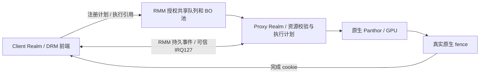

# 当前开发基线：RMM-only / P42 + BO 容量修复 + GPUVM同步列表

**2026-10-22当前源码提交快照：** Guest分段BO/在途准入/RPC诊断、Firecracker旧目标后备回收及2 GiB RMM租约已提交并推送，主仓库固定相应组件指针、测试脚本和文档，详见[GitHub源码快照](GIT_CODE_CHECKPOINT_20261022.md)。本次未改运行代码内容，无新增性能测量；旧预编译载荷manifest不随源码提交自动更新。

**2026-10-22 RPC关键路径细分已验收：** 增加既有开关下的Client五阶段及Proxy响应聚合计时，完整720p **1152**，对旧计时诊断1144为+8/+0.70%；同单Client/128MiB/CPU1.8GHz/GPU594MHz，只作诊断分差，不宣称提分。PLAN_EXEC/TRANSFER/快照融合往返76.43/53.46/56.65微秒，入队0.42–0.49、请求通知23.11–30.63微秒；Proxy聚合回复发布0.775微秒，99.42%回复已抑制通知。优先检查减少整次同步RPC及请求侧NOTIFY，不能把轮询墙钟全算本端成本或把通知全记为RMM执行。TRANSFER顺带捕获不可变快照、供后续export复用完成可行性分析，尚未实现或验证收益。33场景、既定validation/clean、健康、退出0/0、11文件SHA、租约归零及Pi/RK资源恢复通过，构建/lab/采集/审计退出0；本轮未新增Native/1080p/API/多Client。冻结诊断包 `build/rpc-path-breakdown-20261022/candidate/`，run-id `rpc-breakdown-720-20261022-a`，命令、证据和状态见[RPC关键路径排查](GPU_RPC_CRITICAL_PATH_20261022.md)。

**2026-10-22 Native百余分提分来源已验证（更新此前未归因结论）：** 同一#31/nVHE启动、同Panthor模块/rootfs/CPU2/GPU594MHz，完整720p固定1.8GHz → 旧schedutil 1008–1800MHz → 固定1.8GHz为 **1561 / 1428 / 1559**。旧策略1428 → 固定均值1560为+132/+9.24%，固定两轮仅差2分；分别贴近历史1437与新均值1560.5，主要原因是CPU调频测试策略变化。旧策略166次瞬时采样全部1.8GHz，驻留计数仍显示29.84%时间低于1.8GHz，稀疏采样不能排除动态降频。各33场景、正确性、健康、12文件SHA和protected/CPU0–1/pmthor恢复、Pi/RK资源检查均通过，lab/采集/审计退出0。未改GPU运行代码，新增调频对照测量；1080p反切未执行；后续单Client反切已完成，见下文。run-id `native-origin-cpufreq-20261022-a`，命令、证据与解释边界见[Native提分来源](GPU_NATIVE_SCORE_ORIGIN_20261022.md)。

**2026-10-22单Client锁频响应已验证：** 同candidate-f/protected启动，完整720p固定1.8GHz → schedutil 1008–1800MHz → 固定1.8GHz为 **1155 / 1159 / 1151**，固定均值1153较动态−6分/−0.52%；固定自身差4分，不据小负差宣称策略回退。三个条件每轮167个计分观测点的驻留差分均100%为1.8GHz；Native动态时则有29.84%低频驻留，因此锁频给两条路径带来的频率增量不同。代码显示Client同步RPC先有界忙轮询，Host/Realm idle记账也影响共享policy负载；各机制独占贡献未拆分。33场景、既定validation/clean、健康、退出0、每轮11文件SHA、租约归零和Pi/RK恢复均通过，lab/采集/审计/资源检查退出0。未改GPU运行代码，新增调频对照测量，未新增1080p/多Client/API回归。run-id `client-freq-fixed-20261022-a`、`client-freq-schedutil-20261022-a`、`client-freq-fixed-20261022-b`，代码原理、逐场景与证据见[调频响应分析](GPU_CLIENT_CPU_FREQUENCY_RESPONSE_20261022.md)。

**2026-10-22单Client路径诊断：** 未改GPU运行代码，以当前candidate-f/2 GiB RMM开启已有RPC计时，完整720p **1144**，对公平均值1158为−14/−1.21%，对当前无RPC统计单轮1157为−13/−1.12%；条件变化及单轮差异不能独立归因。PLAN_EXEC/同步对象传递/快照融合的Client平均往返77.64/53.69/56.68微秒，对应Proxy handler20.53/2.58/7.29微秒，各有数十万次调用；Proxy非idle31.12%，Client99.25%含轮询。高频同步往返是优先排查方向，尚未证明硬件上限；本项RPC诊断本身没有分离Native调频影响，后续720p调频对照结论见上文。33场景、正确性、健康、两个Realm退出0、SHA及GPU/DMA租约归零、Pi/RK恢复检查通过，lab/采集/审计退出0；本项未重测Native/1080p/多Client，无新增优化性能测量。命令、run-id `single-path-720-20261022-a`、逐场景约170微秒栈差与边界见[诊断报告](GPU_SINGLE_CLIENT_PATH_DIAGNOSIS_20261022.md)。

**2026-10-22未完成ML九项已补齐：** 四Client七算子及三/四Client ResNet50均已独立验收；[当前结果表](GPU_MULTICLIENT_ML_RESULTS_20261021.md)共40条，原31条逐值保留，新增九条通过，不代表新组合全40项重测。板端经SD2正式入口部署2 GiB GPU页租约RMM（ELF `f0f625e3cfedc40eccd536a53cfa7df69aec55a12a0923477ee98b0efe673482`），Host仍#31/pmthor。四Client以真实fence限制最多三个在途任务，原5秒超时不变；旧驻留组限流已撤回。模型采用目标后备回收和逐阶段准入，F将32MiB Client空闲CMA预算转给Proxy，VM合计4152MiB、稳态私有上界2808MiB和Host256MiB准入门槛不变，实测最低Host可用156.45MiB；四模型均值5660.18ms、五Realm退出0、健康/恢复/租约归零及18文件SHA核验通过。双Client各19项API/计算/SG通过。完整720p1157，对同期旧均值1158为−1/−0.086%，同128MiB池、CPU固定1.8GHz/round-robin、GPU594MHz，正确性/健康/退出/回收通过。独立审计100份原始Client输出通过，失败候选证据保留。配置、命令及边界见[修复报告](GPU_ML_COMPLETION_20261022.md)；下方1 GiB及旧缺口均为相应历史组合，不替换原发布manifest，[Notion合集](https://www.notion.so/3ff659a3b8cc813bbab7c109be10ad21)已同步并回读40条/205单元格，原31条、glmark/内存区及历史原因表保留。此次发布未改运行代码，无新增性能测量。

**2026-10-22共享目标后备回收已验证：** 仅改Firecracker，在私有转共享成功后释放旧guest_memfd缓存；直接检查确认Client旧目标98304页→0，Proxy源98304页保持。相同单Client ResNet50与384 MiB源池，已测分项峰值合计903.26→519.33 MiB（−383.93 MiB / −42.50%），对历史两轮Native454.17 MiB额外14.35%；不含OS/VM固定预算、页表及未计全的协议分配，不是同时总峰值。完整720p1157，对公平旧均值1158为−1/−0.086%；双Client匹配F探针的API/计算/隔离/SG/权限及IRQ检查、模型、健康/退出/租约归零通过。旧探针setup失败与全量VMM单测12个既有接口编译错误保留，聚焦生产函数单测通过；ResNet50本轮1545.78 ms较旧1217.04 ms增27.01%，耗时差未解释，不宣称推理无回退。Guest/CMA预算和准入未变，三/四Client ResNet50未重测；板端保留候选，不替换原发布manifest。见[实现、结果及限制](GPU_SHARED_MEMORY_RECLAIM_20261022.md)。

**2026-10-21任务内存对照已完成：** 同一ResNet50单Client与两轮Native，排除OS/VM固定预算及GPU页表；按已测各分项峰值合计，Native454.17 MiB、共享903.26 MiB，增449.09 MiB/+98.88%。两侧GPU用户BO均327.77 MiB；共享384 MiB源池外，Client原目标后备384 MiB仍滞留在guest_memfd缓存，构成主要增量；私有分配器元数据至少2.24 MiB，其他协议私有分配尚未完全计量，以上不是同时发生的完整总峰值。共享及两轮Native任务、健康/回收/SHA通过，Native-a采样器权限setup失败保留，日志回传阶段一条调度警告保留；已恢复#31/protected/pmthor/CPU0–1/300MHz，独立核验PASS。未改GPU运行代码，本轮未测glmark，既有1158不作新增提分；三/四Client ResNet50原NOT_RUN不变。详见[实测、口径与命令](GPU_TASK_MEMORY_COMPARISON_20261021.md)。

**2026-10-21同期同并发glmark对照已完成：** 同#31/RMM timer-v6+1GiB租约、同F输入/rootfs/用户态、CPU0–3固定1.8GHz且负载按2/3/2/3放置、GPU请求600/实际594MHz；720p/1080p原生1–4进程与1–4Client各两轮，共32组全部执行，29有效、3组原生GPU超时失败。720p单/双/三Client对同并发Native保留74.21%/94.52%/92.86%，1080p为79.82%/101.66%/98.14%；四进程Native不足两轮有效结果，不计算比例，不补历史单进程分母。Realm全部16组通过；另四Client1080p计时诊断通过、退出0、五Realm正常退出和租约归零。Proxy Guest无持续满载证据，Client发送区间及Panthor提交锁等待值得继续定位；墙钟计时不等于CPU/GPU利用率，VM_BIND细分计时未覆盖内核服务路径。Native为nVHE、Realm为protected hVHE，只比较整体执行栈；不宣称纯代理开销或纯GPU扩展效率。旧F完整720p单轮1157→本轮单Client两轮均值1158，+1/+0.086%；频率/落核/采样及统计口径变化，未改GPU运行代码，不宣称代码提分。最终核验VERIFIED_WITH_FAILURES，所有失败保留，Pi/RK恢复检查通过；Notion仅更新glmark区，40条ML/NCNN及原因逐字保留。结果、实际命令/退出码、SHA、诊断与边界见[公平对照报告](GPU_FAIR_MULTICLIENT_GLMARK_20261021.md)。

**2026-10-21多Client ML/NCNN测试已记录：** 10项负载×1–4Client共40条，31条有效性能、4条整轮GPU错误导致无效、1条无公共窗口、2条GPU提交失败、2条内存准入拒绝未执行。一至三Client九项常规负载、四Client两个MobileNet及单/双Client ResNet50通过；六个完成运行均健康、19个Realm退出0、GPU/DMA租约归零。四Client Attention-256/320出现真实GPU job timeout及Mesa提交错误，尚未修复，其失败整轮其他耗时不采信；ResNet50三/四Client未启动。Native为历史Host #7单进程参考，当前仍#31/RMM timer-v6+1GiB租约，GPU内核未改；**本轮未重测glmark，1157仅为既有F门槛记录**，不宣称提分或四Client ML全通过。结果、恢复条件、命令/rc与保留失败见[报告](GPU_MULTICLIENT_ML_20261021.md)及[结果表](GPU_MULTICLIENT_ML_RESULTS_20261021.md)。40条结果已写入[Notion多Client并行测试结果合集](https://app.notion.com/p/3ff659a3b8cc813bbab7c109be10ad21)并回读核对；原glmark表格保留。此次发布未改运行代码，无新增性能测量。

**2026-10-21多Client完整1080p已通过：** 板端Host仍为#31；RMM在timer v6基础上将全局GPU页租约扩为1GiB，ELF `dc755c2395a8906df651a9e51aff4ab1ee035e73a060d4a5a179addfa86ce227`，SD2部署/备份/恢复通过。Guest修正RSI正数错误及失败撤销；紧凑模式保留192MiB Client普通内存，CMA额外预留和SWIOTLB均为16MiB。F完整720p **1157**，对旧SG-A1158为−1/−0.086%；三Client1080p **292/569/303，均分388**，四Client **296/280/271/260，均分276.75**，分别重叠96.50%/99.10%，全部33场景、validation/clean、Host/Guest健康、退出/恢复及租约归零通过。租约实测峰值553.95/750.86MiB，确认原512MiB全局容量不足；四Client总RAM2944→2704MiB，最低Host可用144.70MiB。同期双Client各19项API、实际计算、SG mmap及权限/IRQ回归通过，未注入GPU故障。D/E削减普通内存的OOM失败保留，废弃C/D/E共233.76MiB已清理；三/四Client各一轮，不宣称长期稳定性或纯GPU扩展效率。旧三Client原ETIME诊断撤回，历史失败不删除。冻结F、命令/rc、SHA、布局、资源和[Notion](https://app.notion.com/p/3ff659a3b8cc816aab11c72ce915f014)表格见[设计与验收](GPU_MULTICLIENT1080_DESIGN_20261021.md)。下文timer v6/旧SG包结果仅对应各自历史组合，不代表现板固件；未更新发布manifest。

**分段BO功能回归：** `bo-sg-api-compute-2c-20261020-b`双Client各19项检查（原18项API+强制碎片化mmap）、实际计算、权限/IRQ、Host/Guest健康、退出0/0/0及资源恢复通过。内核确认1 MiB BO实际为2段，完整及跨段局部mmap读写通过；未注入GPU故障。性能与三Client超时边界见下方分段内存报告。

**2026-10-20 BO分段内存候选：** 同一owner授权池内的碎片可拼接为连续GPU VA与Client用户VMA，配套更新Client/Proxy内部描述符协议。完整720p为1158（对128 MiB池旧均值1157.5为+0.5/+0.043%）；完整1080p为905（对旧均值902.5为+2.5/+0.277%，池/内存/CPU放置也变化，只记录组合结果）。1080p池512→192 MiB、减少62.5%，单Client的Proxy+Client RAM 2048→928 MiB、减少54.69%；实际4/18段GPU映射已通过完整图形负载。双Client完整1080p为597/596，评分重叠99.9999%，健康/退出/回收通过；三Client出现5次VM_BIND ETIME、整轮FAIL，未记有效分数，最低Host可用494.55 MiB且BO分配零错误，根因未定位。Host/RMM不变，当前为本地开发组合，不替换旧发布包。多Client及CPU分段mmap结果、命令和证据见[分段内存报告](GPU_BO_SEGMENTED_MEMORY_20261020.md)。

**分段改造前的2026-10-20完整1080p复测（历史对照）：** 512 MiB池、单Client两轮904/901，均值902.5，相对历史原生997保留90.52%；对历史512 MiB Proxy/Client901为+1.5分/+0.17%，Host/安全实现组合不同，不归因单项优化。完整33场景、validation/clean、131072页共享检查、Host/Guest健康、Realm退出0/0及资源恢复均通过。128/160/192/256 MiB紧凑池该轮均有连续BO碎片化错误，927/929为无效分数；512 MiB多Client超过现有内存准入预算，2/3/4Client标记NOT_RUN。该轮未新增720p测量，不替换原冻结基线；命令、SHA、失败与逐场景原生对照见[1080p报告](GPU_GLMARK1080_VALIDATION_20261020.md)。

更新：2026-10-19。**原冻结 GPUVM 待同步映射列表组合：完整720p1171 / 1170，对同期基线1162 / 1160，均值+9.5分/+0.82%；该组合双Client各17项API、实际计算、权限及IRQ验收通过。** 六方向共八候选，其余无新增收益证据已撤回，见[优化实验](SAFE_PERFORMANCE_OPTIMIZATION_20261018.md)。memfd已退役；旧发布manifest不包含该阶段本地三文件补丁，冻结包为`build/safe-optimization-20261018/final/`。该优化阶段的无收益镜像、临时执行代码和重复冻结目录已清理，仅保留列表三文件补丁；当前源码另含下述安全服务开发改动，对比证据见优化实验中的清理复核。

日常开发以本页、当前源码和对应冻结输入为准。普通 VM/memfd 发布包和历史论文方案不代表当前 Realm 实现；固定 Git 发布载荷也不会自动包含本地未提交改动。

场景二的简明实现清单见[当前实现状态](SCENARIO2_IMPLEMENTATION_STATUS.md)。Notion「假设场景2实现」按用户要求仅维护已实现、未实现/部分实现两区；历史开发与失败证据在仓库原报告保留。

**2026-10-20多Client完整720p验收：** 同期1/2/3/4Client各两轮，共8轮PASS/rc0、20次Client完整评分、660条场景及28个Realm正常退出；每轮均完成validation、Host/Guest健康与资源恢复。单Client均值1157.5，2/3/4Client的轮均分均值分别为668.25/497.17/360.25，相对同期单Client为57.73%/42.95%/31.12%。128MiB池及按Client数扩展Proxy普通内存后，四Client加Proxy总配置2432MiB、最低1秒采样MemAvailable240.88MiB，无OOM；双Client轮间波动和三/四Client域间评分不均须结合固定CPU2–3预算阅读，不能作为纯GPU扩展效率。执行包`build/multiclient-glmark-20261020/candidate-e/`，不替换原冻结1171/1170；详见[报告、命令与清理](GPU_MULTICLIENT_GLMARK_20261020.md)及[Notion](https://app.notion.com/p/3ff659a3b8cc813bbab7c109be10ad21)。

**2026-10-20 GPUVM隔离v1已验收：** 可信Proxy/Panthor检查session/owner/generation、对象权限/类型、用户VA和不可变BO根身份；显式隔离GPUVM一生只允许一个Group。互不信任任务须使用独立GPUVM及`DRM_PANTHOR_VM_CREATE_ISOLATED`，普通Mesa同GPUVM内Group仍共享地址空间。最终F完整720p **1159**，对同Host #31/RMM timer v6既有1159为**0分/0%**；33场景、正确性、双Client各18项API/计算、实际GPU越域VA故障与受害Group恢复、Host/Guest健康和资源恢复通过。Guest源码`af4eb42a1`，开发冻结包`build/gpuvm-isolation-20261020/final-f/`；不替换原冻结1171/1170或旧runtime-manifest，见[设计](GPUVM_ISOLATION_V1_20261020.md)与[验收/范围/清理](GPUVM_ISOLATION_VALIDATION_20261020.md)。Notion最新状态迁移需连接重新认证，本地保留全部14条目。

**2026-10-20三端清理完成：** 移除35,360个废弃文件和332个空目录；控制机build含迁回归档后净减5.55GiB，Pi/RK根分区可用分别增加1.00/1.75GiB。运行源码、当前构建树、冻结/回退/恢复输入与失败证据保留，RK仍为#31/pmthor/CPU0–1/300MHz。两次独占维护rc0；仅维护验证，无新增GPU回归或性能测量。命令与清单见[清理记录](WORKSPACE_ARTIFACT_CLEANUP_20261020.md)。

**2026-10-20平台假设与完成状态：** 按用户确认，可信页表/控制内存、IOMMU关键配置、工作态任务MMIO及未授权CPU/DMA访问的物理保护，均假设目标平台已提供，不列为当前模拟工程待开发任务。**统一安全IOMMU服务、Host与其他IOMMU设备的托管映射控制均已实现并完成当前范围验收。** 软件owner/generation、授权/映射互斥、撤销及回收仍由代码执行；不引入EL2接管普通VM页表。历史绕过FAIL与NOT_RUN原样保留，其他软件/发布任务独立跟踪。详见[平台假设与完成范围](SCENARIO2_PLATFORM_ASSUMPTIONS_20261020.md)。本次纯文档整理，未改运行代码，无新增性能测量。

**板端当前：Host #31 / protected hVHE / RMM timer v6。选定模拟主流程验收通过。** 按用户要求，以硬件模拟行为、总体设计一致和主流程可运行为准；完整物理对抗隔离不在本轮验收范围，也不作完成声明。既有完整720p **1159**，相对#29的1152为 **+7/+0.61%**；相同33场景、256MiB、null-noop/finish、GPU请求600/实际594MHz、CPU未锁恒频。Host stage-2/异常处理组合变化，单轮仅记录组合观测；正确性、Host/Guest健康与资源恢复通过。本轮失败复核未改Host/RMM/Guest内核运行代码，无新增性能测量。Host内核及`/dev/mem`直接访问GPU MMIO已分别验证拒绝，第二Realm映射拒绝通过；普通VM物理写入仍 **FAIL_BYPASS_DETECTED**，作为物理隔离边界保留。按用户方向采用RMM资源归属，不引入EL2接管普通VM页表。当前双Client各17项API及实际计算、Host managed-IOMMU22项、Guest RSI17项、Guest设备授权14项、GPU backing3项及空闲电源循环独立通过，Host/Guest生命周期健康。Group fence本轮通过、历史间歇超时仍保留观察；PL330旧绕过和未执行项不删除。命令、退出码、run-id、日志及两项测试入口/异常清理修正见[失败项状态复核](GPU_FAILURE_STATUS_AUDIT_20261019.md)；既有性能与物理边界见[Host MMIO与资源归属验收](GPU_HOST_MMIO_ENFORCEMENT_20261019.md)；不替换原冻结1171/1170。

**上一受保护Host/Realm运行兼容候选（历史保留）。** Host `6.12.0-opencca-pmthor-opp3 #29`，RMM timer v6；protected hVHE、Realm能力1、pmthor正常。独立完整720p **1152**，对#27的1168为 **−16/−1.37%**；同默认池/负载/频率，Host/RMM/protected与CPU初始化/timer同时变化，只记录组合差异。33场景、validation、Host/Guest内核健康、Realm退出[0,0]及CPU0–1/300MHz恢复通过；其他功能不继承#27结果。该候选Host物理MMIO强制保护未实现，原绕过记录保留，整体 **PARTIAL / INCOMPLETE**。输入SHA、全部新增失败及命令见[受保护Realm验证](GPU_PROTECTED_REALM_VALIDATION_20261019.md)；不替换原冻结1171/1170。

**上一托管 IOMMU 故障中断候选（历史保留）。** Host `6.12.0-opencca-pmthor-opp3 #27`（Image `16c6d4832169d03317ee1274f52fb313d2cf86b1487698258b60c3ac9e9df82c`），RMM ELF `208110a40dbea82b3c7c5049f2867e16c8df03a9694d3ffde7d079be5a0f7b78`。managed IRQ的缓存清理/页故障结束/清中断迁入RMM；Host/Guest共用授权、真实root检查与失败隔离。八项独立功能运行退出0：完整720p **1168**（对#26的1173为 **−5/−0.43%**，对冻结均值1170.5为 **−2.5/−0.21%**；同默认池/频率/负载，Host与RMM同时变化，单轮只记录组合观测），Guest设备14/14、RSI17/17、Host22/22、双Client各17项API/计算及电源循环通过，GPU租约峰值5559、最终GPU/DMA均0。#27独立物理写负例仍退出2，0→1→0复现Host直接修改任务IRQ mask；整体仍 **PARTIAL / INCOMPLETE**。实体IOMMU故障注入、活跃任务断电、完整攻击/冻结矩阵未验收；不替换原冻结1171/1170。见[本轮验收与清理](GPU_IOMMU_FAULT_VALIDATION_20261019.md)。

**上一设备授权与 GPU 电源顺序修复候选（历史保留）。** Host `6.12.0-opencca-pmthor-opp3 #26`，Image `ce66d275ba9509104dfbe38ac01c7785d42ac27889d7e460d37132a36b688be2`；RMM device-grant，ELF `7cc379993f609720a947bc5d4658c539e46f42f1352da1082e5534cd35591d13`。最终七项独立回归退出0，完整720p **1173**（对原冻结均值1170.5为 **+2.5分 / +0.21%**），双Client各17项API/计算、内核和资源恢复通过；RMM GPU租约峰值5511、最终GPU/DMA均0。Guest真实codec IOMMU授权/供电生命周期9项、RSI15项、Host22项通过；空闲GPU电源域on/off/on及恢复后KVM11项通过。见[当前设备授权与电源验收](GPU_DEVICE_ASSIGNMENT_VALIDATION_20261019.md)。Host管理板级供电/时钟/合法OPP，任务MMIO由指定Proxy控制，复位/撤销/回收经RMM。Host直接物理访问的硬件强制保护、完整攻击/故障与冻结矩阵仍未完成，整体安全状态为PARTIAL / INCOMPLETE；单轮分差不证明稳定提分，不替换原冻结基线。

**后续物理访问负例与负载专项：** 同一Host #26 / RMM device-grant，Host在测试Realm持有GPU MMIO时仍可经物理映射修改IRQ mask，`host-mmio-physical-audit-20261019-a/b`均退出2，安全结论为 **FAIL_BYPASS_DETECTED**；11项ABI检查及恢复通过不能抵消此失败。另行`managed-iommu-live-device-grant-20261019-c`退出0、28/28，补齐活跃GPU页映射拒绝/SG回滚专项；完整720p为1171（对独立性能轮1173为−2/−0.17%，同时有探针与UART，条件不同，不替换原测量）。仅改验证代码，未改部署运行代码；详见[追加验收与边界](GPU_DEVICE_ASSIGNMENT_VALIDATION_20261019.md)。整体安全仍未完成。

**上一阶段统一安全服务候选（历史保留）：** Host #23 / RMM page-reclaim 完整720p **1167**，对原冻结均值−3.5分/−0.30%；七项回归、双Client各17项API/计算与租约归零通过，峰值4401。见[上一阶段验收与三端清理](SECURE_SERVICES_VALIDATION_20261019.md)。随后新增空闲电源循环发现平台detach先于devres复位的竞态，三次失败及诊断偶然PASS均保留；该问题由当前候选修复。

**历史 DMA 防护候选：** 新增 Host/RMM 映射准入检查，独立完整 720p 为 1169，双 Client 功能验收通过。
该阶段用户确认的验收范围为 **IOMMU 映射入口的物理页互斥**，见
[IOMMU 映射防火墙](IOMMU_MAPPING_FIREWALL_20261018.md)。基础 15 项与 GPU 负载期间扩展 21 项全部通过，
本轮完整 720p 仍为 1169，正确性、内核健康及资源恢复通过；NPU 未启用，使用 codec 的真实 IOMMU domain 验证映射入口。
先前直接 PTE 和无 IOMMU PL330 的绕过记录作为扩展边界保留，后者不纳入本轮验收。
本页 1171/1170 来自原 Host/RMM 组合，不得将候选视为已冻结安全基线。
部署输入、测试与回退记录见 [DMA 防护开发报告](GPU_DMA_GUARD_IMPLEMENTATION_20261018.md)。

**2026-10-19 PM owner 生命周期候选：** 修复未创建 Realm 的 RTT 路径和 Proxy GPU MMIO owner 先于 PM session 释放问题。最终 Host/RMM 已部署并连续通过两轮 KVM/MMIO/PM 探针、双 Client compute teardown、compute 后复用探针；完整 720p glmark 为 **1164**（对照 1171/1170 均值 -6.5 分 / -0.56%），门槛 1000、正确性、内核健康与资源恢复通过。完整 API/多 Client/冻结回归未重跑，不继承历史 PASS。见 [PM owner 生命周期修复](GPU_PM_OWNER_LIFECYCLE_FIX_20261019.md)。

**后续架构与负例验证：** 同一#27临时添加`kvm_arm.mode=protected`可启动且所列RMI电源调用通过，但Realm能力从1变0，集成为FAIL；原配置已恢复。新增Host内核`ioremap`负例也读回IRQ mask的0→1→0，退出2，原`/dev/mem`负例独立复验仍失败；各自11项授权检查、恢复和内核健康通过不能抵消绕过。未改Host/RMM/Guest运行代码、无新增性能测量，原冻结与全部状态项保留。见[受保护EL2兼容性与内核别名负例](GPU_PROTECTED_EL2_COMPATIBILITY_20261019.md)。

## 阅读入口

| 内容 | 文档 |
| --- | --- |
| 环境、设备角色、构建与测试流程 | [主手册](../start/AGENT_ENVIRONMENT_AND_TEST_RUNBOOK.md) |
| 六方向优化、同期对照及最终验收 | [优化实验](SAFE_PERFORMANCE_OPTIMIZATION_20261018.md) |
| 当前统一IOMMU、GPU可信复位/回收与三端清理 | [开发验收](SECURE_SERVICES_VALIDATION_20261019.md) |
| Guest设备授权、Host受限电源与工作态MMIO、电源顺序修复 | [当前设备授权验收](GPU_DEVICE_ASSIGNMENT_VALIDATION_20261019.md) |
| PM owner teardown 修复与2026-10-19候选验收 | [生命周期修复](GPU_PM_OWNER_LIFECYCLE_FIX_20261019.md) |
| 当前 Native / ProxyClient 全部有效对照 | [性能汇总](GPU_NATIVE_PROXYCLIENT_COMPARISON_20261018.md) |
| 大 BO 分配、512 MiB 配置及最新验收 | [BO 修复报告](GPU_BO_CAPACITY_FIX_20261018.md) |
| 资源、租约与产物管理 | [开发规范](../start/DEVELOPMENT_AND_ARTIFACT_HYGIENE.md) |
| 多 Realm 通信、GPU 转发与执行的代码和原理 | [代码讲解](REALM_COMMUNICATION_AND_GPU_EXECUTION_CODE_WALKTHROUGH_20261018.md) |
| 当前Client–Proxy架构、基础机制、内存与RPC性能原理 | [2026-10-22架构精解](GPU_CLIENTPROXY_ARCHITECTURE_GUIDE_20261022.md)；未改运行代码，无新增性能测量 |
| RMM 共享接口与测试用法 | [Realm 工具说明](../../GPU-SFTP/tests/realm-xshm/README.md) |
| 基线 Git 同步、组件版本与发布检查 | [同步记录](GIT_BASELINE_PUBLICATION_20261018.md) |
| 历史失败、逐轮优化与论文调研 | [归档索引](../archive/20261018/README.md) |

## 已实现的数据路径



- **提交：** 资源注册与可复用执行计划代替直接 GROUP_SUBMIT RPC；Proxy按会话校验引用，资源生命周期变化使计划失效。提交计划不生成GPU shadow task；互不信任Group的地址空间隔离由独立真实GPUVM及隔离策略实现。
- **共享：** RMM 校验 Realm 端点、通道和授权范围，建立长期池，支持分段 attach/detach/revoke；队列身份来自 RMM。描述符和消息先复制到私有内存再校验，队列几何及本端进度保存在私有状态。
- **通知：** RMM 保存 pending/ack/armed 状态并控制 IRQ127；hard IRQ 只调度接收工作，worker 排空后 ACK+ARM 并重查。中断只提示检查队列，不是访问授权或 GPU 完成证明。
- **缓存：** tiler heap 初始化后按 GPU 所有权交接，避免逐提交重复同步；固件输出按实际读取范围维护。保留真实 DMA 缓存维护及发布顺序，不能以 CPU 屏障代替。
- **完成：** 原生完整 fence/chain 成功后发布精确 cookie；Client 在对象、cookie、epoch 和无后续写入等条件满足时本地确认完成，否则回退真实等待。
- **回收：** 私有快照最后引用释放后有界排队，下一次新导出附带回收；不复用旧快照，不在含糊的传输失败后重放执行。
- **BO：** GPU 连续对象按页分配 extent，沿用 pin、引用、撤销和释放清零；大负载显式启用512 MiB池，默认仍为256 MiB。

## 代码入口

| 职责 | 当前路径 |
| --- | --- |
| Client 前端、完成凭据和快照回收 | [panthor_client_drv.c](../../Linux-Guest-GPU/drivers/gpu/drm/panthor-client/panthor_client_drv.c) |
| Proxy 会话、计划与原生后端 | [panthor_proxy_drv.c](../../Linux-Guest-GPU/drivers/gpu/drm/panthor-proxy/panthor_proxy_drv.c) |
| 通信与对象协议 | [panthor_vmshm.h](../../Linux-Guest-GPU/include/linux/panthor_vmshm.h)、[vmshm_comm_protocol.h](../../Linux-Guest-GPU/include/linux/vmshm_comm_protocol.h) |
| GPU BO 分配器 | [proxy_vmshm_manager.c](../../Linux-Guest-GPU/drivers/char/proxy_vmshm_manager/proxy_vmshm_manager.c) |
| Realm Guest 共享前端 | [realm_xshm.c](../../Linux-Guest-GPU/drivers/char/realm_xshm.c) |
| RMM 端点、共享和 IRQ 策略 | [runtime/core](../../opencca/tf-rmm/runtime/core/) 中的 xshm_endpoint / xshm_memory / xshm_service / xshm_irq |
| 成套构建配置 | [configs/performance](../../configs/performance/README.md) |
| 受租约保护的测试入口 | [run-realm-xshm.py](../../scripts/run/run-realm-xshm.py)、[lab-run.py](../../scripts/maintenance/lab-run.py) |

Host原生与单VM直通对照入口保留。普通VM的memfd/irqfd共享入口、Host broker和外部memslot集成已删除；vmshm名称仍用于当前RMM队列/对象协议，不代表继续使用memfd。

## 测量基线与边界

| 项目 | 最新有效结果 | 说明 |
| --- | --- | --- |
| 原冻结完整720p | 1171 / 1170，Native历史参考1437 | GPUVM同步列表；同期对照1162 / 1160 → 均值+9.5/+0.82%；默认256 MiB，Native本轮未重测 |
| 当前Host MMIO候选720p | 1159 | 对#29的1152为+7/+0.61%；同timer v6、默认池/频率/负载，Host stage-2/异常处理组合变化，单轮观测；Host直接访问拒绝通过，普通VM绕过FAIL；不替换冻结基线 |
| 上一IOMMU故障中断候选720p（历史） | 1168 | 对上一#26的1173为−5/−0.43%，对原冻结均值1170.5为−2.5/−0.21%；Host/RMM组合变化，单轮观测；功能通过，物理MMIO保护FAIL，不替换冻结基线 |
| 上一设备授权候选720p（历史） | 1173 | 对原冻结均值+2.5/+0.21%；相对上一阶段1167为+6/+0.51%，中间Host #23/device-grant为1170；选定回归通过，未替换原冻结基线 |
| 完整1080p | 901，Native997 | 显式512 MiB；旧失败分数无效 |
| ResNet50 | 1463.96ms，Native1162.99ms | 显式512 MiB；随机权重性能模型 |
| P42重复性能验证 | 1159 / 1163 | 修复前同镜像两轮，历史参考 |
| BO修复阶段33项对照条目 | 21项修复后实测，12项P42参考 | 另列P42双Client性能；不称当前32/32 |

列表版本新增两轮完整720p和双Client功能验收，范围见优化实验；未重测1080p、ResNet50等性能。清理前BO修复组合及memfd退役组合的历史验收分别保留，不继承为新代码全项PASS。

glmark为离屏null-noop / finish、完整33场景；validation为26成功、1已知数值例外、6无判据。GPU请求600MHz、实际594MHz；未固定CPU恒定频率。不能把不同资源配置和历史批次解释为单变量收益。

RK3588/OpenCCA的GPT/GPC仍有模拟边界；本基线未实现GPU跨Group shadow页表隔离、完整远程证明、多vCPU验收或长期压力证明。Host仍可拒绝调度。历史失败继续保留，不从旧PASS推断新版本全通过。

## 冻结输入与复现

**原冻结列表组合：** `build/safe-optimization-20261018/final/`，与两轮1171/1170的输入逐字节相同，该组合双Client验收通过。[输入SHA](evidence/safe-optimization-20261018/retained-inputs.json)、[源码SHA](evidence/safe-optimization-20261018/runtime-source-hashes.json)、[验收](evidence/safe-optimization-20261018/final-validation.json)。该阶段相对Guest已发布提交仅三个文件的列表补丁；当前安全服务候选另有改动和输入，见新报告。未改旧runtime-manifest和归档，后续发布需单独打包。

**原已发布RMM-only对照：** `build/memfd-retirement-20261018/candidate/`，720p已实测1157，双Client API/Compute/权限与IRQ负例通过；client/proxy/initrd/VMM随当前runtime-manifest归档恢复。输入哈希见[新组合清单](evidence/memfd-retirement-20261018/inputs.json)，当前源码哈希见[新源码清单](evidence/memfd-retirement-20261018/runtime-source-hashes.json)。

下表为**清理前已验证对照包** `build/bo-capacity-20261018/final/`，其1080p/ResNet50等历史结果不能直接继承给新源码。其[SHA与清理前60项源码清单](evidence/current-baseline-20261018/source-hashes.json)用于识别版本；不能仅凭一个提交号或Image文件名宣称等同已测组合。

| 输入 | SHA-256 |
| --- | --- |
| client-Image | `5dc92273d905f49f2a47ae6b418b74cb6aa68494ec3a7c9a7de97f94201d195a` |
| proxy-Image | `dc2e26213e378abb8466821ffe2bdad166921c9b213871cfb24e0974f251be7e` |
| initrd.cpio | `c3cdd4fa34c168e528460c9dd63f58354b5b66437c51973415fc5edb60931299` |
| runner.py | `e7703ec7d913676cb65f87e5e92e1751943f933000a039df4bb6414edd2152e9` |
| RMM ELF | `643b0e212a5f44646baa86779c9a9f347b10163852df8079ace588c0cd05a4ec` |

Host为`6.12.0-opencca-pmthor-opp3 #7`，需匹配模块、固件与只读用户态rootfs。主手册说明部署前检查；健康Host不因整理目录而刷写。运行前确认无其他硬件任务，用新的唯一run-id：

```bash
python3 scripts/maintenance/lab-run.py --run-id <唯一ID> -- \
  python3 scripts/run/run-realm-xshm.py --images build/safe-optimization-20261018/final \
  --workload glmark --performance --benchmark-only --suite --profiles glmark-720
```

大负载另加`--large-pool`，选择`--profiles ncnn-resnet50 glmark-1080 ioctl compute-128`；双Client功能使用`--workload compute`。未选负载记为未执行。

前一轮目录整理未改运行代码，见[整理记录](WORKSPACE_CLEANUP_20261018.md)。随后memfd退役修改了运行代码；其构建、性能与新输入单独记录于[退役记录](MEMFD_RETIREMENT_20261018.md)。
