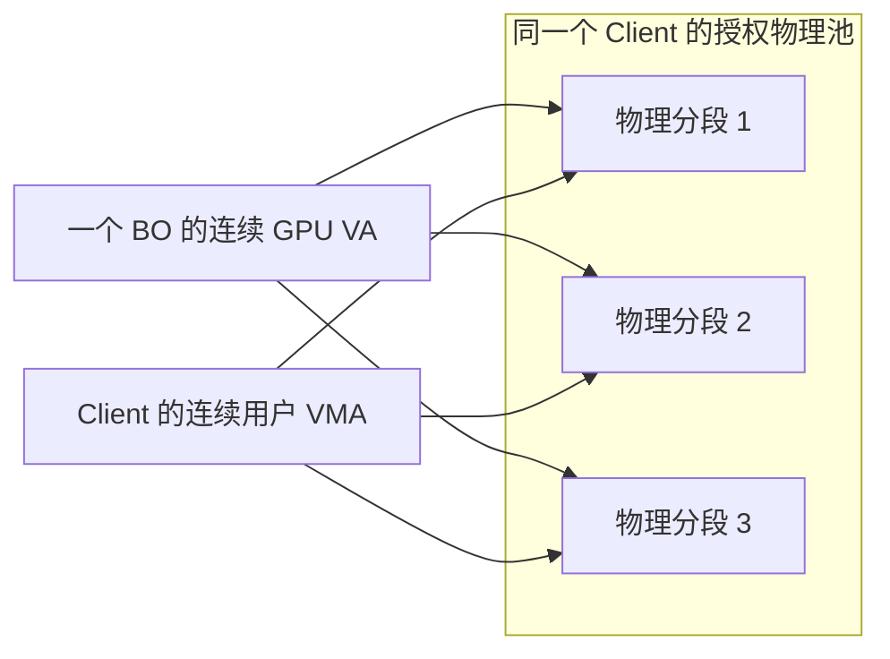

# GPU BO 分段内存：降低 1080p 多 Client 内存需求

**2026-10-21后续：** 在本报告SG基础上，将RMM全局GPU租约512MiB→1GiB、紧凑SWIOTLB/CMA余量64→16MiB，保留普通内存后，F完整720p1157、三Client完整1080p292/569/303、四Client296/280/271/260均PASS，租约/健康/退出/恢复通过。三Client实测租约峰值553.95MiB，确认旧512MiB上限不足；四Client总RAM2704MiB、最低Host可用144.70MiB。设计、具体命令、失败尝试与最终功能验收见[后续记录](GPU_MULTICLIENT1080_DESIGN_20261021.md)。下文A/B的分数、失败、固件和未执行项保留为对应阶段证据，不代表当前板端组合。

本次修改 GPU BO 的物理内存组织。旧实现要求每个 BO 占用一整段连续物理空间；新版先尝试连续分配，碎片化时从同一 owner 的授权池拼接多个分段，再映射为连续 GPU VA。Client 的用户态 mmap 同样按逻辑顺序映射这些分段。应用和 Mesa 无须改变。

## 为什么原来需要大池

旧 256 MiB 池失败时仍约有 118–130 MiB 空闲，但最大连续空间约 30 MiB，无法满足约 45 MiB 的 BO。将池加到 512 MiB 是规避碎片化的容量办法，并非每个 Client 实际必须使用 512 MiB。只改 best-fit 选址仍失败，相关实现已撤回，失败证据保留。

新版不压缩图形数据、不删减场景，也不让不同 Client 共用可写 BO。当前池本身仍是连续 CMA 区域；消除的是**池内单个 BO 必须物理连续**的限制。



## 具体实现与隔离边界

1. Proxy 的 GPU BO 分配器优先分配按页取整的连续 extent，失败时允许使用原有 SG 分配器，最多 256 段；分配始终限定在当前 owner 的池内。
2. GET_OBJECT 内部协议按 `segment_index` 返回分段。每次请求沿用 transport 身份、owner、generation、权限与 pin 检查；Client 验证描述符一致、段范围/对齐、不重叠和总长度。
3. 原有 Panthor GPUVM 映射路径已支持多物理段，新版将其用于 GPU BO，映射至连续 GPU VA。不可变 GPUVM root、映射 pin 与撤销规则不变。
4. Client 使用多个 `remap_pfn_range` 在同一用户 VMA 内拼接分段，支持页对齐的局部映射；控制页和 completion 页保留连续内核映射。
5. 沿用释放清零、撤销后拒绝新映射和已有引用生命周期。没有扩大 RMM grant，也没有把可信控制页放进 GPU 可映射 BO。

内部 GET_OBJECT 响应发生变化，Client 与 Proxy 必须配套更新。旧的连续 GPA helper 已删除；没有保留 best-fit 实验分支。Host/RMM/固件和 SD 未修改。

## 已完成的性能验证

| 场景 | 旧版 | 新版 | 分差及比例 | 条件差异 |
| --- | --- | --- | --- | --- |
| 单 Client 完整 720p | 1157.5（两轮均值） | 1158（一轮） | +0.5 / +0.043% | 同为 128 MiB 池；新版 BO 组织变化，单轮不宣称稳定提分 |
| 单 Client 完整 1080p | 902.5（904/901 均值） | 905（一轮） | +2.5 / +0.277% | 512→192 MiB 池，Realm/CMA 与 CPU 放置也变化，只记录组合结果 |

历史 Native 单进程 1080p 为 997，新版单 Client 905 保留 90.77%；Native 使用历史 Host #7，新版为 Host #31，属于历史参考，未重测同期 Native。

单 Client 1080p 的授权池 **512→192 MiB，减少 62.5%**；Proxy+Client 配置 RAM **2048→928 MiB，减少 54.69%**。新版实际最低 Host MemAvailable 为 2070.45 MiB。128 MiB 池的新版 720p 最低为 2203.75 MiB。最低值来自一秒采样，非精确峰值。

两轮均完成全部 33 场景，validation 为 26 成功 / 1 已知失败 / 6 Unknown，与既定基线一致；clean、Host/Guest 内核健康、Realm 退出 0/0 和资源恢复均通过。1080p 的实际 BO 已出现 4 段和 18 段的 GPU VM_BIND，证明分段回退在真实图形负载中生效。

| 新版完整 1080p | 每 Client 分数 | 均分 / 历史 Native 997 | Proxy+Client RAM | 最低 Host MemAvailable | 结果 |
| --- | --- | --- | --- | --- | --- |
| 1 Client | 905 | 905 / 90.77% | 928 MiB | 2070.45 MiB | PASS |
| 2 Client 并发 | 597 / 596 | 596.5 / 59.83% | 1600 MiB | 1294.18 MiB | PASS |
| 3 Client 并发 | 不记有效分数 | — | 2272 MiB | 494.55 MiB | FAIL：RMM 映射拒绝 |

双 Client 的两边均为完整 33 场景、validation 26/1/6、无 BO/export/bind/submit 错误，评分窗口重叠 99.9999%，Realm 退出 0/0/0，Host/Guest 健康及资源恢复通过。并发均分是每 Client 分数；对照的是历史单进程 Native，不能解释为多进程 Native 的同期扩展效率。

三 Client 的 Client 2 在后段出现 5 次 `DRM_IOCTL_PANTHOR_VM_BIND failed (err=62)`，raw score 不作为有效成绩。后续复查发现 Proxy 同时记录五次 `[GPA2HPA] translation failed ret=1`，即 RMM `RSI_ERROR_INPUT`；内核错误地向上传递正状态，用户态显示的 errno 可能沿用旧值，因此撤回原“ETIME/超时”的诊断。旧 RMM 全局租约只容纳 512 MiB 独立页，三个 192 MiB 池及可信 GPU 内存可能超过该上限，正在用只读峰值监测验证。Host 无 OOM/内核错误，4 个 Realm 均退出 0，CPU/频率恢复完成；整体 Guest 健康检查和评分重叠判定因提前失败为 NOT_RUN。原始失败证据保留，不将诊断修正等同于运行通过。

双 Client API/计算与专门 CPU 分段 mmap 回归已通过：两侧各完成原 18 项 API + 1 项 SG mmap，共 19 项；实际计算均为 `COMPUTE_CHECK=PASS count=65536 samples=16`、`alu_iters=64`。权限/内存/IRQ检查、Host/Guest健康、Realm退出0/0/0及资源恢复通过。

SG mmap 测试两侧均用10个512 KiB BO填满小池、隔项释放，再申请1 MiB BO。用户态完整读写和跨段局部别名读写通过；Client内核日志明确记录 `segments=2`，完整映射大小 `0x100000`，局部映射 `bo_offset=0x7f000 size=0x2000`。已覆盖实际分段路径，并非仅在连续BO上通过读写检查。预期的填池ENOMEM不视为内核OOM，没有执行GPU故障注入。

## 输入与复现

图形测试冻结包：`build/bo-sg-20261020/candidate-a/`。

| 文件 | SHA-256 |
| --- | --- |
| client-Image | `5056758c81746b68af63d307117c7d7ddbcc2abc96a24060c1d473c59329d9e4` |
| proxy-Image | `a32acb994d81fc8ed99094aa6e6753edf273e2683bb5f23662d2f71219484e16` |
| initrd.cpio | `d8b6e898fb5437e97cb77aa4bca9b11896f2ee2f146b8d29914424131a509604` |
| runner.py | `9c080e62940eb47dbcb8a554ef637ab84231f0c03add8f6e74e1fc50f6c40b1b` |

Host #31 / protected hVHE / RMM timer v6；GPU 请求 600 MHz、实际约 594 MHz，恢复时 300 MHz；完整 glmark null-noop / finish。紧凑配置遵循现有内存准入门槛和 256 MiB Host 预算。

```bash
python3 scripts/maintenance/lab-run.py --run-id <唯一ID> -- \
  python3 scripts/run/run-realm-xshm.py \
  --images build/bo-sg-20261020/candidate-a \
  --workload glmark --performance --benchmark-only --suite \
  --profiles glmark-1080 --clients 1 --compact-memory --pool-mib 192
```

720p 改用 `--profiles glmark-720 --pool-mib 128`。多 Client 修改 `--clients`，不得绕过准入门槛。

功能回归使用 `candidate-b/`：Client/Proxy Image 与 A 完全相同；initrd增加新版smoke，runner增加可选检查入口。initrd SHA为 `6ab898fdc19c3ab61726cfbc607a5993fd7170ddb951f887c0b7d98640e527d6`，runner SHA为 `398d2db4ddb9bacf4a946ce817f7d76a9a2630b691e70e1e9db0ea0e5294f695`。正常模式仍为18项，增加 `--bo-sg-mmap` 才执行额外检查：

```bash
python3 scripts/maintenance/lab-run.py --run-id <唯一ID> -- \
  python3 scripts/run/run-realm-xshm.py \
  --images build/bo-sg-20261020/candidate-b --workload compute --bo-sg-mmap
```

| 目的/处理 | run-id | 命令/退出码 | 日志位置 |
| --- | --- | --- | --- |
| 完整 720p 门槛 / 保留 | `bo-sg-720-128m-20261020-a` | 上述 720p 命令；外层及 workload 均 0 | `build/bo-sg-20261020/runs/<run-id>/` |
| 完整 1080p 小池 / 保留 | `bo-sg-1080-192m-20261020-a` | 上述 1080p 单 Client 命令；外层及 workload 均 0 | 同上 |
| 双 Client 完整 1080p / 保留 | `bo-sg-1080-2c-192m-20261020-a` | 上述命令改 `--clients 2`；外层及两个 workload 均 0 | 同上 |
| 三 Client 并发边界 / 保留失败 | `bo-sg-1080-3c-192m-20261020-a` | 上述命令改 `--clients 3`；外层 1，Client 2 workload 125 | 同上；18 个远端文件 SHA 验证通过 |
| 双 Client API/计算/SG mmap / 保留 | `bo-sg-api-compute-2c-20261020-b` | 上述compute命令；外层0，两侧各19项及compute均0 | 同上；10个远端文件SHA验证通过 |
| best-fit 试验 / 撤回实现、保留证据 | `bo-bestfit-1080-256m-20261020-a` | best-fit 冻结包、1080p/256 MiB；外层 1、workload 125，4 次 BO 错误 | `build/bo-bestfit-20261020/runs/<run-id>/` |

回收副本的 `collection.json` 登记文件 SHA-256 与 VERIFIED；`lab-result.json`、`lab-before.json`、`lab-after.json` 和 `realm-launch.json` 保存执行及资源证据。原 128/160/192/256 MiB 连续分配失败仍见[旧 1080p 报告](GPU_GLMARK1080_VALIDATION_20261020.md)，不以新版 PASS 删除历史失败。

## 开发验证及剩余边界

Client/Proxy 内核构建通过，日志 `build/verified-kernels/{client,proxy}-sg-build.log`。Guest diff check 与 checkpatch 通过，checkpatch 为 0 errors / 0 warnings。新增内核碎片化自测验证连续分配拒绝、SG 覆盖、GPU 映射权限、pin/revoke 及释放后全池清零；既有跨 owner / generation / 控制页检查保留。

当前不是按需扩缩池或跨 Realm 内存超分配。192 MiB 池的 4 Client 配置加 Host 预算超过当前约 3 GiB 可用内存，尚未运行；更小池的 1080p 容量也未重新证明。故障注入、长期压力和其他工作负载未从图形 PASS 自动继承。当前源码为本地开发组合，未更新发布 manifest。

## 产物与收尾

保留A图形性能包、B功能验收包、增量构建树、源码补丁/哈希与所有PASS/FAIL日志。本次删除已撤回best-fit包的两个Image、重复initrd/runner及一份临时smoke副本，共5文件、78.66 MiB；其失败证据、allocator补丁与旧输入哈希继续保留。准确路径、删除前大小/mtime/SHA与结果见 `build/bo-sg-20261020/cleanup-inventory.json`。未清理其他任务或Pi产物，本次未在Pi创建镜像。

最后功能回归的 `lab-after.json` 确认RK恢复pmthor/CPU0–1、无残留VM与loop；独立只读核对GPU为300 MHz。Notion的[1080p结果](https://app.notion.com/p/3ff659a3b8cc816aab11c72ce915f014)已更新并回读确认仅保留四列表格，标注历史单进程Native、有效单/双Client成绩和三Client未通过状态。
