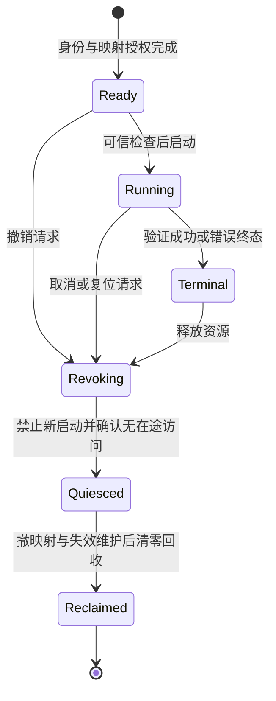

# CCA / TEE 加速器保护调研续篇：共享、可信完成与撤销

日期：2026-10-27。接续 [聚焦调研](GPU_CCA_TEE_FOCUSED_RESEARCH_20261027.md)，保留 PORTAL、CAGE、ACAI 主线。本文补充十项相关工作及一项 SoK，按与项目的机制关系分析，不把 NPU、可信 I/O 或摘要候选混称为已精读的 GPU TEE。未修改运行代码，无新增性能测量。

后续进展：本文以下表格保留形成时的证据状态；目前已取得 LEAP、WarpGuard、FlexServe 全文并写成独立解读，PORTAL/CAGE/ACAI/MOLE/PhantomMap 等也已各自补充原文与公开实现范围。最新逐篇状态、Notion 页面及回读证据以 [研究进度](gpu-security-papers/progress.json) 为准，不再用本文的历史“未取得”状态覆盖后续成果。

## 1. 本轮结论与证据范围

最值得吸收的新增证据来自 **TZ-LLM 的可信任务启动与时分共享协议，以及 ASGARD 对恶意中断的明确安全讨论**。它们说明：即使已经控制页表、MMIO 和设备归属，错误的启动顺序、伪完成、重放与撤销竞争仍需独立设计。

对本项目而言，后续研究可集中为：**RMM 认证的 Client 身份 → 当前授权映射与任务快照 → 可信启动 → 可信终态 → 正确 Client 的通知 → 停止访问后的撤销回收。** 这是研究建议，不是已经证明的新颖性，也不是对当前代码已存在漏洞的判定。

本轮取得并分析 ASGARD、TZ-LLM、MyTEE 原文，复读已有 ccAI 原文；另取得 NDSS 2026 SoK 原文做分类与引用追踪。AvaGPU、LEAP、XpuTEE、BarriCCAde、FlexServe、WarpGuard 尚未取得或未完成原文核验，以下明确限制结论。没有新增作者代码审计或板端实验。原先泛 GPU 清单的逐篇任务及计数不因本报告改变。

| 工作与入口 | 类型与相关性 | 本轮证据 | 优先阅读理由 |
| --- | --- | --- | --- |
| [ASGARD，NDSS 2025](https://www.ndss-symposium.org/wp-content/uploads/2025-449-paper.pdf) | pKVM / NPU；共享与重置对照 | 原文核心设计、安全分析及评估 | 明确承认恶意中断能破坏算子执行顺序 |
| [TZ-LLM，EuroSys 2026](https://ipads.sjtu.edu.cn/zh/publications/eurosys26-wang.pdf) | TrustZone / NPU；任务共享对照 | 原文 §§3–7 及 artifact 附录 | 最小可信数据面、启动代际/顺序检查、安全切换 |
| [ccAI，MICRO 2025](https://doi.org/10.1145/3725843.3756104) | TVM / PCIe GPU 与其他 xPU | 复读原文设计、安全与评估 | 完整驱动可信路线；传输保护与中断保护的边界 |
| [MyTEE，NDSS 2023](https://www.ndss-symposium.org/wp-content/uploads/2023-41-paper.pdf) | TrustZone / 可信 I/O | 原文设计、安全与评估 | 缓冲区封锁、受控 MMIO、操作记录验证 |
| [AvaGPU，CCS 2023](https://doi.org/10.1145/3576915.3623197) | Arm GPU TEE / 有界执行 | 索引摘要及 SoK | 将可用性和优先级反转与机密性区分 |
| LEAP，IEEE TMC | TrustZone / 移动应用与 GPU | ASGARD、SoK 的原文相关工作 | 直接设备访问与应用级 TEE 的对照路线 |
| [XpuTEE，TOCS 2025](https://doi.org/10.1145/3719653) | Intel CPU–GPU 联合 TEE | 索引摘要、作者页面及 SoK | 联合隔离抽象与减少 CPU–GPU 拷贝 |
| [BarriCCAde，EuroS&P Workshops 2024](https://doi.org/10.1109/EuroSPW61312.2024.00033) | CCA / 闭源驱动隔离 | 索引摘要及元数据 | 驱动被隔离后，授权接口仍可能被滥用 |
| [FlexServe，2026 预印本候选](https://arxiv.org/abs/2606.23370) | TrustZone / NPU | 索引摘要；全文未取得 | 区分资源管理权限和数据访问权限 |
| [WarpGuard，2026 预印本候选](https://arxiv.org/abs/2607.13640) | CPU–GPU 控制流证明 | 索引摘要；全文未取得 | 将启动事件与调用点、跨设备执行关系绑定 |

分类依据还包括 [SoK: Analysis of Accelerator TEE Designs，NDSS 2026](https://www.ndss-symposium.org/wp-content/uploads/2026-f1424-paper.pdf)。SoK 可用于查漏，但其中设备类型、年份及 TCB 表仍应回到各论文核实。例如 MyTEE 涉及 framebuffer/VideoCore，并不等于实现了完整 GPU 计算 TEE；LEAP 的 online 年份与卷期年份也不能混用。

## 2. 沿用的项目假设

采用用户确认的目标模型：可信 ProxyRealm 持有完整 GPU 驱动并统一管理 SMMU；RMM 认证实际 Client；平台保护实际页表、root、关键 MMIO 和受保护页面，阻断未授权 CPU/DMA 修改；固件加载与重载可信。GPU 仅使用硬件 Stage-1，IPA→HPA 翻译及对象、物理页、权限、生命周期授权在映射建立阶段由可信软件完成。执行期间 Stage-1 持续约束访问。

因此，本文不以 RK3588 的硬件限制否定目标架构，也不建议仅为绕过实验板限制复制其他系统的全部机制。需要比较的是保护对象、可信边界、状态转换和可验证的不变量。其他论文的目标平台、TEE 类型和信任假设不同，性能数字不作直接排名。

## 3. ASGARD：设备独占与重置解决不了全部中断语义

**ASGARD: Protecting On-Device Deep Neural Networks with Virtualization-Based Trusted Execution Environments**，Myungsuk Moon、Minhee Kim、Joonkyo Jung、Dokyung Song，NDSS 2025，DOI [10.14722/ndss.2025.240449](https://doi.org/10.14722/ndss.2025.240449)。核心依据为原文 §§III–VII，尤其 §IV 的不变量和 §VI-A 的安全讨论。

### 保护模型和实现

ASGARD 信任 EL2 的 pKVM TEEvisor、Secure World 和 enclave 内的软件栈，允许攻击者控制 REE OS 及 EL1 的 REEvisor。实现在 RK3588S 的 Rockchip NPU，使用 Android 13、Linux 5.10、pKVM/crosvm；它讨论未来迁移 CCA，但不是已经评估的 CCA Realm 系统。

其三项不变量是：敏感接口完整仲裁、同一时刻设备只归一个 enclave、切换后没有前一使用者的残留状态。TEEvisor 从可信启动获得真实 IOMMU、设备及 reset 接口信息，控制 CPU Stage-2、IOMMU 配置和实际映射；设备 acquire/release 检查 owner 并以互斥避免竞争。切换涉及 MMIO 授权、IOMMU root、TLB/IOTLB 清理以及 reset。

实际分配粒度是**整设备在 enclave 间时分独占**。真实 IOMMU 可映射 enclave 拥有的全部内存，并非本项目期望的每任务、每对象最小权限授权。不能从其排他分配不变量推出多个恶意 Client GPUVM 同时运行时的隔离。

论文一般设计讨论 firmware wipe/reload；Rockchip 原型实际采用寄存器 reset，并禁用可选 SRAM，明确表示该实现没有动态固件重载。不能把一般建议写成原型已完成固件证明和重载。可信 reset 也要按设备验证，函数返回成功本身不证明所有在途状态均被清除。

### 最关键的中断安全证据

§VI-A 的 **“Attacks by Raising Rogue NPU Interrupts”** 明确指出：REE 管理中断，攻击者可以在不合预期的时刻触发中断或抑制应到中断。前者可能让后续算子使用未完成或错误的中间结果；作者进一步讨论在特殊条件下对权重保护的潜在影响，同时表示端到端模型提取仍很困难，并建议引入类似 Devlore 的中断真实性检查。

这属于**作者承认并提出缓解方向的威胁**，不是本轮复现的攻击，也不是原型已经消除的风险。它直接支持本项目研究“伪完成 → 提前推进任务/释放资源”的因果链。但即使引入真实 IRQ 认证，也还要验证正确 job 的实际终态，不能从真实 IRQ 自动推导整个作业成功或 DMA 停止。

### 性能与可信基的正确读法

ASGARD 根据模型 DAG 合并可安全组合的 CPU fallback，减少退出及中断交付，不是任意丢弃完成事件。MobileNet 对 REE 的端到端开销为 2.01%，该实验排除了 VSOCK 开销；NPU 中断从 Host EL1 handler 到 enclave driver 的交付延迟为 REE 的 3.684 倍。不同模型结果不能概括为全部接近零开销。

新增 IOMMU 控制约 2k LoC、分配/回收约 200 LoC，建立在约 12k LoC 的既有 TEEvisor 上；此外还信任 enclave 内核、运行时和模型服务。该软件栈按单个可信应用裁剪，不能把其中减少内部隔离的选择直接用于互不信任 Client。

**迁移价值：** 明确 acquire、启动、结束、reset、release 的安全边界；把 reset 完成与页表撤销、页面复用建立可检查关系。**不宜照搬：** 每次切换整设备重置、授权整个 enclave 内存，或用全设备独占结果证明作业级并发共享。

作者仓库入口：[yonsei-sslab/asgard](https://github.com/yonsei-sslab/asgard)。本轮未取得固定提交并审计，论文机制不能记作已核验代码事实。

## 4. TZ-LLM：可信启动检查与安全切换顺序最值得借鉴

**TZ-LLM: Protecting On-Device Large Language Models with Arm TrustZone**，Xunjie Wang、Jiacheng Shi 等，EuroSys 2026，DOI [10.1145/3767295.3769334](https://doi.org/10.1145/3767295.3769334)。以下重点依据 §§4.1–4.3、§6、§7 与 artifact 附录。

### 可信数据面与不可信调度器

系统保护模型参数、中间结果和 KV cache，允许 REE OS、REE 驱动及其他设备恶意；信任 TEE OS、TEE 驱动、LLM 框架、EL3 与相关硬件。实际设备为 Orange Pi 5 Plus / RK3588 NPU，使用 OpenHarmony/Linux 5.10，不是 Arm GPU 或 CCA Realm 实现。物理攻击、侧信道及拒绝服务不在其完整保证范围。

它将完整驱动控制面和调度队列保留在 REE，TEE 内只保留一个闭合的数据面：建立执行上下文（I/O 页表、寄存器命令、输入输出）、通过 MMIO 启动、处理完成中断。REE 为安全任务保存一个**空执行上下文的 shadow job**，任务获调度时才将控制交给 TEE。

重要的是，REE 调度到某个 shadow job 不构成启动授权。TEE 检查对应安全任务已经初始化、尚未发出，并将预先分配的单调序号与当前执行序号比较，以阻止任意启动、重复启动、重放和乱序。TEE 启动真实任务，收到安全中断后恢复非安全模式，再通知 REE shadow job 完成。

这为本项目提供了明确对照：身份认证不能替代任务状态检查；不可信端提出“现在执行/已完成”，可信端必须依据自己的对象及状态机决定。项目已经选择完整驱动可信，不必为模仿论文重建 co-driver；可把相同原则落实在 Proxy 内部。

### 切换顺序本身是安全机制

原文 §4.3 的非安全→安全切换依次执行：

1. 通过 TZPC 封锁 REE 对 NPU MMIO 的访问，并将 NPU IRQ 路由至 TEE。
2. 等待已在执行的非安全任务结束。
3. 通过 TZASC 授予 NPU 对安全内存的访问。

先封锁启动入口，保证等待旧任务期间不能再启动新非安全任务；先等旧任务结束，再开放受保护内存，防止旧任务利用新授权访问秘密。这是可以迁移到 Proxy 的授权时序原则，具体 TZASC/TZPC 寄存器方案无需照搬。

但它的“收到安全 IRQ 后任务完成”仍依赖设备及可信驱动的语义。论文没有据此给出任意恶意 GPU 程序、多个 Client GPUVM 并发、合并 IRQ、reset 与完成竞争的完整证明。应借鉴序列检查，而不是将一个全局严格序号直接套用于允许并行和乱序完成的 GPU。项目可按 session/queue 记录可接受状态与依赖图，允许合法并行。

### 内存保护与生命周期优化

§§4.1–4.2 将加载、分配、解密和执行流水化，并将“已分配”和“已保护”分离：REE 可先把密文直接读入已分配但尚未保护的内存，TEE 建立保护后再解密。TEE 校验连续分配要求；撤销时撤映射、收缩保护区并在交还 REE 前清除敏感数据。

系统利用可预测模型图，以逆拓扑顺序释放参数，使 TZASC 区间保持连续，也可缓存早期参数减少下一轮启动延迟。这是特定应用的访问模式优化，不能推广为任意 Client 分配、释放和共享对象的普遍规则。动态 MoE 等非确定工作负载也是作者说明的限制。

对于本项目，值得借鉴的是**区分所有权、CPU 可访问、GPU 可访问、可回收几个状态**，以及在证明不变量后减少重复映射与拷贝。现有持久池、执行计划和缓存所有权交接可按此思路解释；没有必要再增加不解决实际威胁的加密层。

### TCB、性能和代码证据

TEE OS 约 17k LoC，新增映射代码 62 行、TZASC/TZPC 50 行；此外 TA 有约 1.2k 流水线代码、约 1k NPU 数据面代码及 OpenSSL。不能将“约百行特权修改”写成“系统 TCB 只有百行”。用户态 NPU 驱动被限制为只映射该设备 MMIO，NPU 只获得任务执行上下文访问权限，这种服务内权限收缩也值得研究。

论文 TTFT 降低 76.1%–90.9% 的基线是 TrustZone strawman；它不是相对无保护 REE 的加速比例。安全 LLM 与普通 NN 时分共享的实验中，相对 REE 时分共享基线，NN、LLM 的额外减速分别最高 3.8%、3.0%。这些是特定模型、设备及调度条件下的结果，不代表本项目可预期收益。

公开 artifact：[Zenodo 17213486](https://doi.org/10.5281/zenodo.17213486)。本轮阅读了附录，未下载并审计实现。

## 5. ccAI：可信完整驱动路线相近，但传输保护不等于完成证明

**ccAI: A Compatible and Confidential System for AI Computing**，MICRO 2025，原文 [作者 PDF](https://compass.sustech.edu.cn/paper/ccai-micro25.pdf)。本轮复读已有缓存，重点是架构、§4 的 packet action 及评估 Figure 8。

CPU 侧 TVM 信任完整 GPU 驱动、runtime 和适配层；外部可信 PCIe Security Controller 对事务过滤、加密或认证。控制器实现在 Intel Agilex 7 FPGA，系统信任控制器至 xPU 的内部链路及设备固件完整性，并结合启动清理及证明。它追求兼容已有 GPU/xPU，但**确实引入了额外可信硬件**，不是无需新增硬件的 CCA 实现。

它将事务区分为拒绝、敏感数据加密与完整性、控制请求完整性与安全检查、一般事务直接传输。原文明确将 **interrupt requests** 归入 **Full Accessible / A4**，部分 interrupt status 读取也不附加同类安全检查。因此，可以判断该设计的传输保护目标不同于 Devlore 式受保护中断记录与注入协议；不能进一步据此断言所有中断都能被任意伪造，因为请求源及地址过滤等约束仍可能适用。

对项目最有用的比较是：**GPU 服务栈可信，仍要把原始 Client 权限传递到服务端检查；PCIe 包经过认证，也不自动证明 job 与 Client 的逻辑关联。** ccAI 不提供本项目恶意多 Client 共享同一设备的完整独立证据。

TVM 新增约 3.1k LoC 不包含原有完整 GPU 软件栈。论文摘要与正文给出 0.05%–5.67% 开销范围，Figure 8 端到端 latency 与该范围相符；但 Figure 8(e) TTFT 标有 **+6.13%**，与正文“全部指标不超过 5.67%”的概括不一致。因此不应把 5.67% 当成所有测量的严格上界，也不与本项目 glmark 直接比较。

## 6. MyTEE：作为可信 I/O 支撑文献，避免错误归类

**MyTEE: Own the Trusted Execution Environment on Embedded Devices**，Seungkyun Han、Jinsoo Jang，NDSS 2023，DOI [10.14722/ndss.2023.23041](https://doi.org/10.14722/ndss.2023.23041)。实际平台为 Raspberry Pi 3 / BCM2837、OP-TEE、Linux 4.15。

MyTEE 面向缺少完整 TrustZone 外设保护设施的嵌入式设备，用 CPU 虚拟化和 Stage-2、受保护 EL2 页表及指令约束封锁敏感访问。对 DMA controller 的敏感 MMIO 进行 trap、验证与模拟；对需要权限提升的驱动片段施加约束，封锁数据缓冲区，并由 TA 验证操作记录。例子包括 TPM、USB 键盘与 framebuffer。

值得借鉴的是**不可信驱动的操作必须绑定已封锁的缓冲区和可验证事务**。但它没有因此实现可编程 GPU kernel 的完整机密执行或多 Client GPUVM 隔离。“拦截 DMA controller MMIO”也不能扩写成对任意设备每个 DMA 数据包逐一验证。

其小型监控组件之外仍有 kernel 修改、驱动及 TA 代码。论文讨论部分动态模块合谋的加固仍留作未来工作；可验证的小规模设计目标不等于完成形式化验证。framebuffer 实验的性能改善含关闭中断等执行条件变化，不作 GPU 安全方案的普遍性能证据。

作者入口：[sssecret2019/mytee](https://github.com/sssecret2019/mytee)。本轮未审计作者代码。由于目标平台已经假设保护页表与 MMIO，本项目无需复制其硬件补偿路径。

## 7. 更直接的 GPU / CCA 候选：目前只采用受证据支持的结论

### AvaGPU：把可用性定义成可评估目标

正式标题 **Secure and Timely GPU Execution in Cyber-physical Systems**，CCS 2023，Jinwen Wang、Yujie Wang、Ning Zhang，作者以正式 DOI 的 Crossref 元数据核验。部分第三方清单的会议标注有误，SoK 的参考文献作者也存在差异，不据其直接扩写作者姓名。

当前取得的索引摘要片段强调 CPS 中实时 GPU 任务的可用性，而既有有可用性保证的 TEE 主要面向 CPU。它最适合补充“恶意任务是否能长期阻塞受害者”的讨论。原文尚未取得，本轮不确认其具体抢占算法、驱动拆分或性能数字。

项目可以先明确保证边界：Host 拒绝运行 Realm 的全局 DoS 仍可排除；Proxy 在被调度且设备正常时，对一个 Client 的超量提交、队列耗尽或超长 GPU job 可以提供配额、抢占或有界故障恢复。Round-robin 本身不足以证明有界等待，必须包含最坏任务长度、抢占和 reset 对其他 Client 的影响。

### LEAP：直接设备访问与应用级隔离的对照

正式标题 **LEAP: TrustZone Based Developer-Friendly TEE for Intelligent Mobile Apps**。ASGARD 的参考文献列为 IEEE TMC 22(12):7138–7155，2023；SoK 表列 2022，需区分 online 与卷期年份，本轮不猜测未核 DOI。

原文未取得。依据 ASGARD 相关工作，它采用一个或多个专属 CPU 核及外设直通，建立近似 VM 的可信环境。这可补充“完整系统隔离”和“应用/任务隔离”粒度比较；不能仅由专属核及设备直通推导并发恶意 Client 共享 GPU 的能力。

### XpuTEE：联合 CPU–GPU 保护抽象

**XpuTEE: A High-Performance and Practical Heterogeneous Trusted Execution Environment for GPUs**，Shulin Fan、Zhichao Hua、Yubin Xia、Haibo Chen，ACM TOCS 2025。

作者页面确认论文；索引摘要定义 XpuEnclave，由 CPU CEnclave 与多个 GPU XEnclave 组成，强调联合保护抽象以去掉 CPU–GPU 通信中的额外加密和拷贝。SoK 将其放入 Intel SGX/TDX、VMX root 路线。它提供“把跨设备调用看成一个授权域”的比较视角，尤其适合讨论现有共享对象与低拷贝路径。

ACM 全文抓取返回 403，作者页面本轮未找到可用全文，因此尚不能核实其设备并发模型、中断、撤销协议或摘要的平均 2.48% 开销。不能宣称它已经解决本项目所有多 Client 问题。

### BarriCCAde：保护内核免受驱动攻击，与保护 GPU 作业的方向不同

**BarriCCAde: Isolating Closed-Source Drivers with ARM CCA**，Matti Schulze、Christian Lindenmeier、Jonas Röckl，EuroS&P Workshops 2024。

索引摘要提出借助 CCA 隔离闭源驱动，并用 eBPF 过滤器约束驱动如何使用被允许的内核接口，不只约束它可以访问哪些资源。它强调不把 hypervisor 加入该设计的可信计算基。

其直接目标是**保护内核免受被隔离驱动的攻击**，不能自动等同于保护模型免受 Host 或恶意 GPU kernel 的攻击。对当前可信 Proxy 的启发是：接口调用者已经过身份认证，仍可能滥用合法 API；后续如收缩 Proxy 内权限，需同时限制资源范围和允许的操作序列。当前未取得全文，不声称其有完整 GPU 原型、性能证明或可直接复用的过滤规则。

## 8. 新预印本观察：先保留候选，不下安全结论

### FlexServe：管理权限与访问权限分离

索引存在两个同名、同作者条目：[2603.09046](https://arxiv.org/abs/2603.09046) 与 [2606.23370](https://arxiv.org/abs/2606.23370)，标题均为 **FlexServe: A Fast and Secure LLM Serving System for Mobile Devices with Flexible Resource Isolation**。本轮全文均未取得，不能确认两者精确版本关系；作为一组候选，不重复计数，也未确认正式录用状态。

较新索引摘要提出 Recallable Resource Isolation，构建 Flex-Mem 与 Flex-NPU：普通世界可分配、回收资源，同时无权访问受保护内容。它是 NPU 工作，值得追踪的研究问题是：**谁能请求回收，与谁能读取内容是两种权限；回收请求何时才真正生效，由可信端决定。**

这与项目撤销协议直接相关，但不能仅由摘要认定它已解决恶意 GPU 长任务、在途 DMA、TLB 和旧通知复用。摘要中的性能倍数不作为本项目的收益预测。

### WarpGuard：调用关系证明不等于内存授权或结果正确性

**WarpGuard: Towards Control-Flow Attestation for Heterogeneous CPU-GPU Execution**，索引为 2026 预印本 [2607.13640](https://arxiv.org/abs/2607.13640)，未确认正式会议。

索引摘要描述联合 CPU/GPU CFG、运行期 GPU 控制流证明、按调用点限制 kernel launch，并在 Jetson Orin Nano 上评估软件插桩。全文未取得，无法核实插桩/证明数据的防篡改假设与具体覆盖面。

它提示可将“谁在什么上下文启动了哪个 GPU kernel”纳入组合证明。但控制流符合预期不等于数据没有越权、输出数值正确、作业已完成或 DMA 已停止。本项目更应先做好身份、映射、job、通知与撤销的实例绑定，而不是直接引入完整控制流证明系统。

## 9. 对项目设计的增量建议

结合 [前篇的 Devlore、CAEC、TEEtime 分析](GPU_CCA_TEE_FOCUSED_RESEARCH_20261027.md)，建议保持“直通/共享实现与性能”和“恶意 Client 下任务隔离”两部分，并在第二部分组织以下机制。

| 建议 | 相关证据 | 应形成的可检查性质 |
| --- | --- | --- |
| 可信启动事务 | TZ-LLM 的初始化/未发出/序号检查；CAGE 的受保护任务区间 | 校验到启动期间，Client 不能替换控制数据、root、backing 或权限 |
| 分层完成认证 | ASGARD 的 rogue IRQ；Devlore；ccAI 的 IRQ 边界 | 真实 IRQ 触发检查；可信设备/固件状态确认 job；RMM 通知目标 Client |
| 代际绑定 | CAEC 对端实例；TZ-LLM 防重放 | session、job、对象 backing、device reset 的旧代状态不能操作新对象 |
| 统一撤销状态机 | ASGARD reset；TZ-LLM 切换顺序；FlexServe 的权限分离候选 | 拒绝新引用、阻止新启动、确认停止、撤映射并清 TLB/cache、清零、再复用 |
| 限制恶意 Client 的局部影响 | AvaGPU 候选；可信 Proxy 的服务边界 | 明确队列/对象/在途任务配额，区分可拒绝任务与设备级 reset 的影响 |
| 可解释的低开销实现 | TZ-LLM 的生命周期流水线；XpuTEE 联合抽象候选 | 优化持久对象、批通知及映射复用时，不弱化授权和撤销语义 |

可信启动事务不要求每次提交复制全部大缓冲区。可采用不可变控制页、私有快照、pin 与强引用、generation 或受保护计划；可变数据页按 job 权限继续访问。需要冻结的是授权及控制输入，不是所有计算数据。

可用以下抽象说明生命周期；这是建议的规格，不是当前代码已经实现的状态机：

其中通知可以合并或重复，只提示接收方读取权威状态；不得凭中断次数累加作业完成数。SUCCESS、ERROR、CANCELLED 是逻辑终态，**Terminal 与 Quiesced 是两种事实**。超时、软件 fence 已 signal 或 Client 已关闭，都不能单独证明设备停止访问。

正常完成无需每次整设备 reset；应按目标设备语义证明任务或地址空间的停止条件，仅在必要故障恢复中提升到设备级 reset。多个 Client 同时执行时，reset 对其他 Client 的错误传播与重新授权必须明确。

当前 RMM 已有受保护 IRQ127、pending/armed/ACK_ARM 机制，Proxy session 已关联实际 channel Client VMID，完成路径也保留真实 native fence 及 cookie/epoch 基础。本报告不把它们写成从零缺失。后续重点应是审查这些现有事实能否组成完整安全论证，尤其恶意 GPU 工作负载能否写到被当成完成证据的状态页。此问题仍是待审计假设，未证实漏洞。

建议下一步写出不变量表及负例验证计划，覆盖：旧 session/句柄复用、重复与乱序通知、合并 IRQ、恶意 GPU 写同步状态、完成与 cancel/reset 竞争、撤销期间新提交、撤销后 HPA 复用。指标同时记录错误拒绝、受害 Client 正确性、最终资源恢复、完成与撤销延迟。侧信道和 Host 全局 DoS 应另列边界，不以本文文献自动扩大保证范围。

## 10. 来源、限制及同步状态

本报告是机制调研，未对全部论文代码或形式化证明进行审计。已读原文与摘要候选分开记录；不存在“十篇全部完成原文精读”的结论。部分候选抓取超时，XpuTEE ACM PDF 返回 403，均保留在证据清单中。

可复核来源与哈希见 [证据清单](evidence/cca-followup-research-20261027/sources.json)。下载原文和文本位于 `build/cca-gpu-followup-20261027/`；ccAI 使用已有 `build/security-design-review-20261026/ccai.pdf`。这些是本地研究缓存，不提交论文二进制或运行产物。

**Notion：本轮未同步。** 当前会话没有可用 Notion 读写工具；此前已发布页面的状态未被本报告更改，也未声称本续篇已经写入 Notion。

统一记录：补充 CCA/TEE 加速器论文并比较共享、完成与撤销协议｜历史优化基线 1405、最新完整同频单 Client 720p 1395 → 本次未测｜分差及百分比不适用｜未改运行代码，无新增性能测量｜无硬件 run-id、无新增硬件 PASS；仅文档和来源校验｜保留调研，原文候选、代码核验及机制验证待后续任务。
