# GPU Client–Proxy 架构精解：从基础能力到安全、内存与性能

版本：2026-10-22。本文依据当前工作树、`CURRENT_BASELINE.md`和对应实测证据编写，面向希望从原理读懂实现的读者。文中的“当前”指RMM-only Realm共享路径；旧普通VM的memfd/irqfd通信方案已退役。**本文未修改运行代码，无新增性能测量；所有分数均引用已注明条件的既有实验。**

## 1. 阅读路线：先追一项任务，再拆开每一层

本项目的核心是：**应用仍在Client中产生GPU命令；可信Proxy集中管理真实GPU；双方通过RMM授权的共享页传递控制消息和数据，并以真实GPU fence确认完成。** RMM提供身份、共享映射、事件和物理页归属等基础能力，应用图形API与GPU调度细节仍由用户态和可信驱动栈完成。

建议第一次依次阅读第2–7节，建立组件、对象和地址的对应关系；第二次阅读第8–17节，理解通信、GPU映射与安全边界；第三次阅读第18–25节，理解同步、缓存、内存回收和优化。第26–28节结合实验解释性能与下一步方向，第29–31节给出状态、排查和参考索引。

每个重点机制都回答四个问题：为什么需要、具体怎么做、代码在哪里、能保证到什么范围。图中的箭头有明确含义，不能把“能访问控制接口”“拥有映射”“任务已完成”混为同一件事。标为“教学伪代码”的片段只解释算法，不是可直接运行的补丁或部署脚本。

## 2. 为什么选择Client–Proxy，而不是把GPU切成多个完整设备

RK3588上的Mali-G610只有一套物理设备控制状态。本项目希望多个隔离执行环境中的应用共享它。如果每个Client都运行一个能够直接改写相同MMIO的完整驱动，设备初始化、页表根、固件状态、中断和复位会相互干扰。

因此，真正操作设备的原生Panthor放在Proxy Realm中。Client的`panthor-client`实现应用所需的DRM接口，将资源操作转成受控RPC；Proxy的`panthor-proxy`验证请求并转成真实Panthor操作。它属于驱动接口层的半虚拟化：没有逐条转发OpenGL函数，也没有为每个Client模拟一块完整Mali硬件。

### 图1：总体架构与三条路径

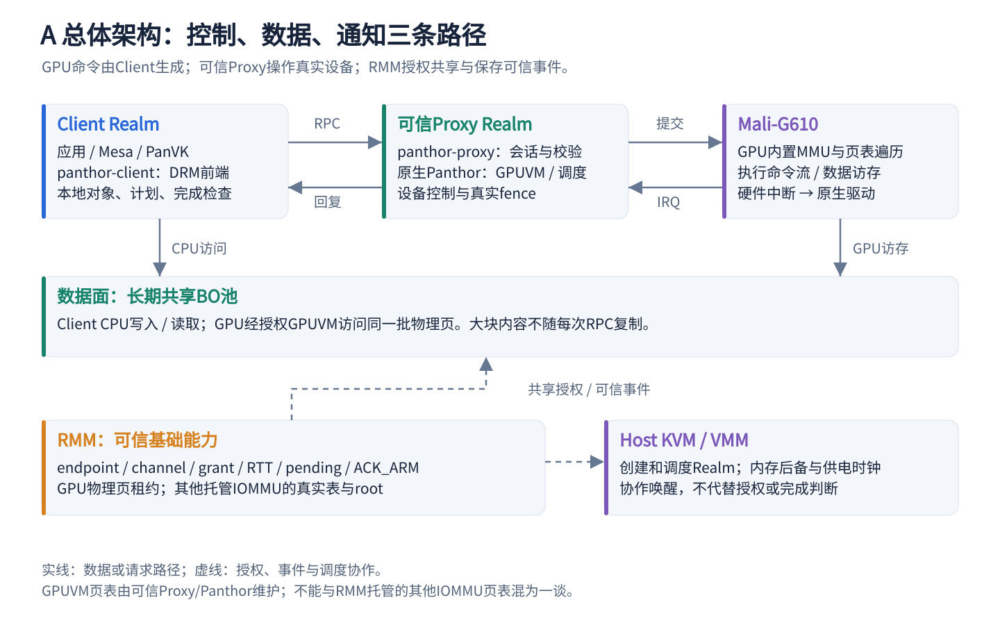

**图怎么读：** 左上框是Client内部的软件层，横向RPC箭头经过控制队列，传递对象编号、长度、地址和同步点等小消息；右上框是真实GPU。中间横条是数据池，大块顶点、纹理、计算输入输出和命令流留在其中，GPU按自己的页表直接访问这些页。底部RMM虚线表示授权、可信事件与Host调度协作，不搬运BO内容；Host唤醒也不代替共享授权。

这三条路径分开后，可以分别优化：控制面减少RPC次数和固定往返，数据面减少复制和连续内存需求，通知面减少不必要中断。把三者都称为“共享内存通信开销”，会掩盖真正的瓶颈。

| 组件 | 具体职责 | 必须理解的边界 |
| --- | --- | --- |
| Client用户态 | 产生命令流、配置资源、通过DRM ioctl提交 | GPU命令在Client生成，并非都由Proxy重新生成 |
| Client前端 | 复制用户参数、本地句柄、BO mmap、计划缓存、同步对象 | 不接受用户给出的Proxy内核指针作为对象 |
| Proxy后端 | 认证通道对应的session、资源查表、分配和转交请求 | 属于共同可信计算基，能访问多个Client授权池 |
| 原生Panthor | 真实GPUVM、页表、group、job、固件、中断、fence | 复用Linux成熟驱动能力，仍需适配Realm地址和缓存 |
| RMM | Realm身份、RTT共享、可信事件、GPU页租约、托管IOMMU服务 | 不验证每条Mali shader，也不替代完整GPU驱动 |
| Host与VMM | 创建和运行Realm、内存后备、板级供电时钟、协作唤醒 | 工作态任务MMIO和关键配置按平台授权边界控制；Host仍可拒绝调度 |

## 3. 先理解基础名词：接口、对象、地址与同步

| 名词 | 从零解释 | 本项目中的实例 |
| --- | --- | --- |
| ioctl | 用户进程请求设备驱动执行一个结构化操作 | 创建BO、绑定GPUVA、提交group |
| DRM | Linux图形设备的内核接口与对象框架 | 应用打开render节点后取得一个DRM文件 |
| Mesa / PanVK | 将OpenGL ES或Vulkan操作转为Mali命令和DRM请求的用户态实现 | Client中运行，Proxy无需执行应用的OpenGL代码 |
| BO / GEM | Buffer Object是GPU使用的存储对象；GEM提供引用和句柄管理 | 命令流、纹理、张量、顶点缓冲 |
| mmap | 把对象页面放进进程CPU虚拟地址空间 | 应用用指针读写BO，而不是把内容塞进每次ioctl |
| GPUVM | GPU自己的虚拟地址空间和页表 | 将GPUVA映射到被授权的BO页面 |
| group / queue / job | 调度组、组内执行队列、一次异步工作 | 一个group可以包含多条队列与多个job |
| syncobj / timeline point | 可被句柄引用的同步对象；timeline用数值区分不同提交点 | 等待第P点，或把第P点的fence转到binary对象 |
| dma_fence | 内核对异步操作完成与错误的引用对象 | CPU提交返回后，GPU仍在运行，fence稍后完成 |
| sync_file | 通过文件描述符传递一份fence引用 | 导出时捕获快照，不追随源同步对象后续修改 |
| Realm / RMM | 隔离执行环境、管理Realm的监控器 | Client与Proxy运行于不同Realm |
| endpoint / channel / grant | 实际Realm身份、两端通道、某段内存的共享授权 | 指定谁可以与谁共享哪段页 |
| session / handle | 一次DRM打开对应的资源命名空间、其中的对象编号 | 相同整数在不同session中不代表相同BO |
| MMIO / IRQ | 通过地址访问设备寄存器、设备或事件中断 | MMIO用于设置GPU；IRQ提示处理完成等事件 |
| IOMMU / IOTLB | 设备地址翻译单元、其翻译缓存 | 托管其他设备的DMA映射与撤销 |
| CMA / SG | 连续内存分配区、散布聚集分段 | 启动共享窗口和把碎片页拼成连续逻辑BO |

**glmark2是什么？** 它是图形基准程序，在多个场景中执行渲染并报告FPS和综合分数。本项目使用完整33场景、离屏null-noop、`frame-end finish`，因此每帧的提交与完成同步会直接影响得分。它不是GPU理论算力测试，也不涵盖所有真实应用。

## 4. 从一帧渲染看端到端执行

### 图2：一项任务穿过哪些软件层

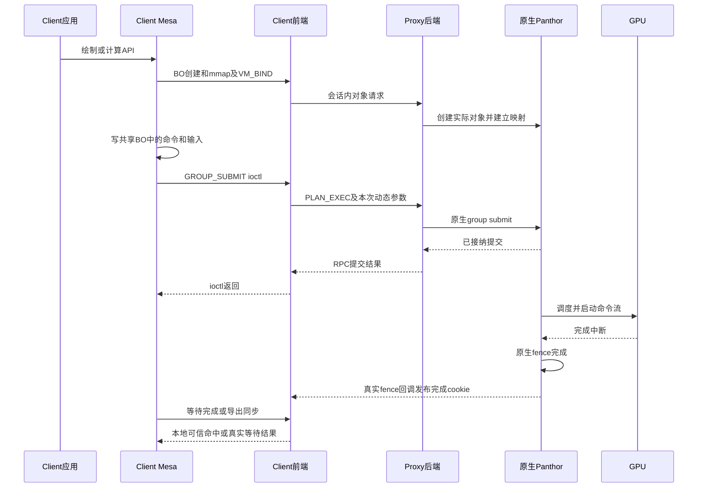

**图怎么读：** 上半段的对象建立通常不是每帧都做；对象和计划可以复用。中间的提交RPC返回表示驱动已经接纳这项工作，GPU可能还未运行。下半段才是异步执行与完成。完成cookie实际通过共享完成页被Client观察，图中的跨层箭头表示逻辑信息流，并不是Panthor直接调用另一Realm的函数。

这里有三个不同时间点：共享请求已发布、原生提交已接纳、GPU工作已完成。优化可以提前返回“已接纳”，却不能伪装成“已完成”。同样，RPC超时也不证明GPU任务没有执行；这会决定后文的重试规则。

## 5. 身份与对象：为什么只知道一个编号还不够

RMM的endpoint是Realm身份，channel是两端关系；Proxy的session是一个DRM文件的资源空间。GPUVM和group又是设备内部资源。它们解决不同问题，不能以一个“VM ID”代替所有身份。

### 图3：两层身份与会话内对象表

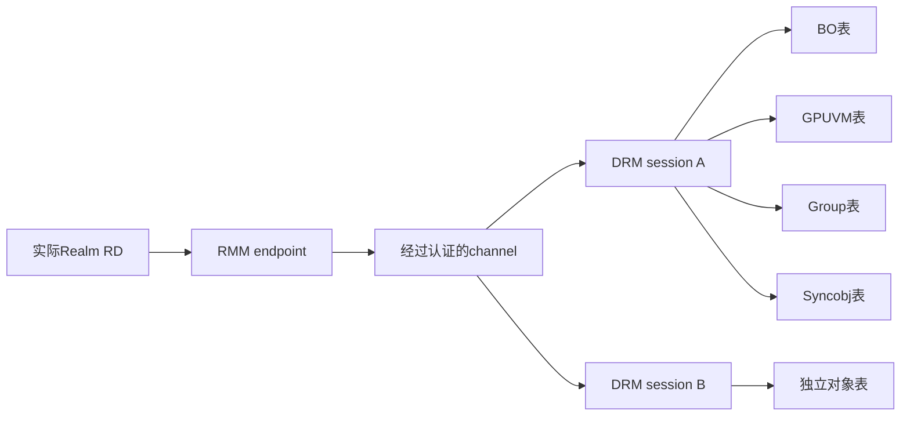

**图怎么读：** 左侧身份由RMM根据当前REC所属RD确认；消息中的自报字段不能替代它。一个Realm可以多次打开DRM，因而右侧可以出现多个session。资源句柄必须同时带着正确的通道/session上下文解释，`BO=7`在session A中存在，不说明session B也能访问它。

`panthor_proxy_session_create()`为会话创建原生后端文件和BO/VM/group/syncobj等私有表。`panthor_proxy_session_lookup()`同时比较session ID与从可信channel取得的请求方身份。资源操作随后从当前session的xarray查找对象；Client不能用别的session的整数句柄绕过这一层。

共享对象管理器还使用`generation`。其64位handle由generation和对象ID组成，解决“旧对象释放后，新对象复用了同一整数ID”的ABA问题。**session句柄、带generation的payload handle、GPUVA是三种不同名称**，不能直接互换。

代码入口：`panthor_proxy_drv.c`中的会话创建/lookup和对象翻译函数；`proxy_vmshm_manager.c`中的`proxy_vmshm_make_obj_handle()`；Client的`panthor_client_file`及本地xarray。

## 6. 系统启动：把可调度Realm变成可用GPU通道

Host/VMM创建Realm，只说明这些执行环境存在。能否共享内存、是否能绑定通信驱动、谁拥有GPU MMIO，还需要独立授权过程。当前runner协调这些步骤，但身份最终取自RMM上下文。

### 图4：启动的依赖顺序

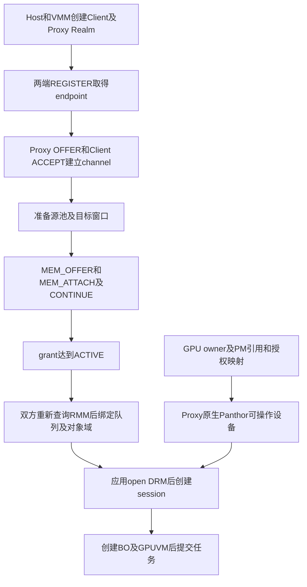

**图怎么读：** 纵向箭头是必须满足的先决条件。ACTIVE是上层绑定的条件，不能仅凭Host传来一个内存地址就注册通信设备。右侧设备授权与PM引用是另一条必要链；已经连通共享队列，不意味着已经获得GPU寄存器访问权。

Guest的`realm_xshm_bind()`会重新查询`MEM_DESCRIBE`与`MEM_STATUS`，核对channel、端点、角色、页数和本地IPA，再构造平台设备数据。RPC驱动因此绑定到实际授权窗口，而不是直接相信用户态或Host提供的“这就是Client0的池”。

当前测试每Realm一个已验收vCPU，可信事件绑定REC0。完整镜像远程证明和“根据度量确认这个endpoint确为预期Proxy软件”的协议尚未完成；RMM端点认证不等于软件身份远程证明。目标平台保护能力另见安全章节。

## 7. CPU地址、GPU地址和对象偏移：一张图避免三类混淆

### 图5：同一物理页的不同访问路径

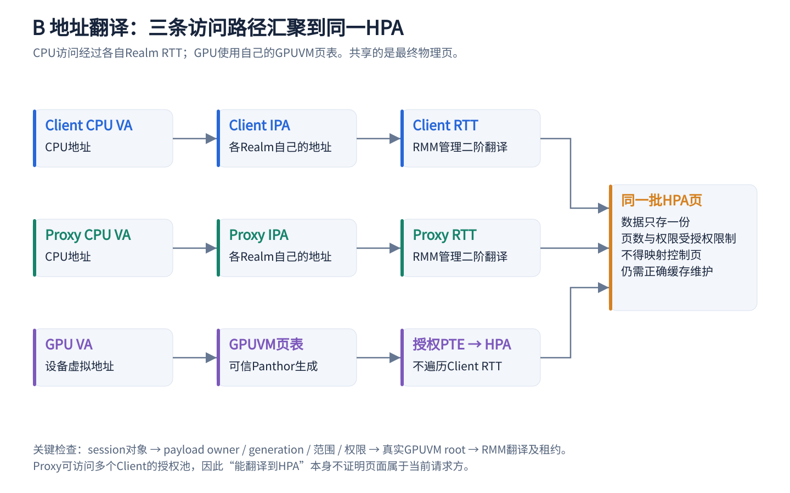

**图怎么读：** 上方两行是CPU路径，各自的VA到IPA箭头代表本Realm的stage-1翻译，随后经过自己的Realm RTT，双方IPA不必相等。共享建立后，它们指向同一HPA，所以不是两份内容相同的内存。下方GPU从GPUVA出发，使用GPU内置MMU的表，也到达这些物理页；CPU的RTT不会被GPU自动当成第二级页表来遍历。BO offset则由对象管理器解释为对应分段和页内偏移，不是第四种可直接写入PTE的物理地址。

举例：同一BO字节可能位于Client进程地址`0x7f...`、Client IPA `0x8b...`、Proxy IPA `0xa2...`和GPUVA `0x100000`。这些数值不同并不矛盾，真正的共享关系是最后指向同一批物理页。RPC中的BO offset只表达对象内偏移，不能把它直接当HPA写入GPU页表。

由此得到三个结论：建立CPU共享映射不会自动建立GPU映射；GPUVM隔离不能只靠Client CPU RTT；Client没有“给出任意HPA就让Proxy映射”的接口。具体映射必须经过会话对象、授权span、RMM翻译和真实PTE构造。

## 8. RMM如何建立共享：从grant到实际RTT条目

Proxy准备源池，Client准备目标IPA窗口。`MEM_OFFER`检查源页；`MEM_ATTACH`检查目标未被占用，然后RMM把目标RTT条目指向源RTT解析出的PA。授权与实际PTE修改都在RMM中完成，Host不能仅靠给请求换一个自报owner取得其他Realm的页。

源页必须是合法受保护范围中的assigned RAM；目标需要准备好L3未分配RAM条目。源映射仍然权威，安装时重新取得源PA，不接受调用者自行指定HPA。撤销时也核对目标仍指向预期页，再移除映射并执行必要TLBI。

### 图6：共享授权的分段状态机

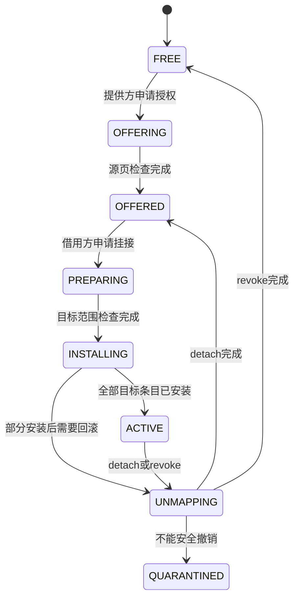

**图怎么读：** OFFERED表示源授权就绪，不表示Client已经映射；ACTIVE表示全部安装完成，可信Guest此时才绑定上层通信。若中途失败，先走UNMAPPING清理已安装前缀，不能直接把记录标成FREE。QUARANTINED保留保护状态，避免在未确认撤销时复用物理页。图只展示主状态，不包含每一种参数错误的返回。

每次RSI最多推进64个状态机工作步，大池通过`MEM_CONTINUE`继续。512 MiB有131072个4 KiB页，拆分可避免单次监控器调用过长。64步不应理解成任何状态都恰好映射64页；某些状态执行检查或清理。

ACTIVE也不是整个窗口在硬件上同一时刻出现：INSTALLING已经逐步写入目标PTE。本实现让可信Guest在ACTIVE后启用队列，不声称恶意借用方在ACTIVE前绝对无法读取已安装前缀。

代码入口：`xshm_memory.c`的状态推进、`xshm_rtt.c`的源读取/目标安装和撤销、`xshm_policy.c`对数据页销毁、RTT变化、RIPAS变化和Realm销毁的协调检查。

## 9. 共享池与BO分配：固定授权窗口，动态对象

长期池解决“不要每次提交都创建和撤销跨Realm映射”；对象分配器解决“池中哪些字节属于哪个活跃BO”。两者粒度不同：释放一个BO通常只归还池内空间，不等于马上释放Host物理页或解除整个grant。

控制区保留前1 MiB，采用WB映射，存放高频CPU访问的队列等数据。payload区采用当前约定的WC映射，容纳BO及其他共享对象。对象类型、owner、generation、权限、存续状态和pin仍保存在可信管理逻辑中；不是池里任何地址都可以成为GPU工作负载页。

Proxy管理器包含buddy、小对象slab和GPU BO extent/SG等分配路径。GPU BO先尝试按页取整的连续extent；碎片化时可退回同一owner池内的多个span，当前上限256段。大对象因此不必因为找不到一个足够大的连续空洞而失败。

### 图7：物理碎片如何组成连续逻辑BO

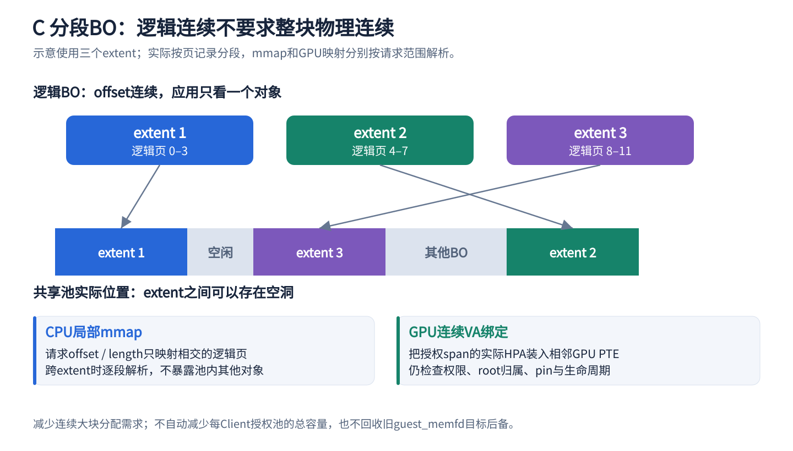

**图怎么读：** 顶部逻辑页0–11连续，颜色表示三个extent；中间物理span的顺序可以不同，也可以隔着空闲区或其他活跃对象。底部左右框分别说明CPU与GPU映射：它们的页表把相同逻辑顺序映射为连续地址，所以应用仍看到一个连续缓冲。示例的12页和三个等长span是教学数字，真实span大小不必相同。

这项优化消除的是**单个BO必须物理连续**的要求。当前源池本身仍通过连续CMA准备，不能把它写成已经实现任意离散物理页的动态跨Realm池。

## 10. 分段BO如何mmap、绑定和安全复用

Client按`segment_index`查询对象分段。它不是接到一个数组就照单全收，而是验证同一对象描述的一致性、段数、对齐、范围、不重叠和总覆盖长度，再将池内偏移转换为自己的本地IPA。Proxy保留owner和generation检查，跨Client的空闲页不能混入同一对象。

Client通过多个`remap_pfn_range()`在同一个用户VMA中拼接分段。局部mmap同样先在BO逻辑区间中定位，再切出与各span的交集。GPUVM的`panthor_vm_map_vmshm_spans()`按相同逻辑顺序安装GPU PTE；发现逻辑覆盖有洞或某段失败时，撤销已建立部分。

可以用一个边界例子理解：BO前512 KiB在span A，后512 KiB在span B。用户从BO offset `0x7f000`映射`0x2000`字节，会先映射A末尾4 KiB，再映射B开头4 KiB。用户VMA仍连续8 KiB。既有专项确实强制制造两个span，覆盖了这一跨段局部别名读写，不是只在连续BO上测试。

BO关闭先删除公开查表入口，已有GEM、VMA、任务和pin引用仍保留backing。最后一个合法引用退出后分配器才清零并归还空间。新Client或新BO因此不能在旧GPU任务仍可能写入时提前拿到同一批页。

代码入口：`proxy_vmshm_manager.c`的extent/SG与`proxy_vmshm_obj_translate()`；`client_vmshm_manager.c`的分段获取和mmap；`panthor_mmu.c`的`panthor_vm_map_vmshm_spans()`；`panthor_gem.c`的最终释放。

## 11. 共享队列：数据结构、发布顺序与不可信输入

每条通道有两个单向控制队列，分别传请求和回复。每队列256槽、每槽512字节；wire消息payload从第36字节开始，因此业务payload上限476字节。两个端点当前均为AArch64 little-endian，这不是通用跨端序网络协议。

### 图8：一个控制队列里的四种状态


**图怎么读：** 消息槽放内容，描述符说明本次内容位置和长度，avail表示“已发布可消费”，used表示“已消费可回收”。这四者不是四份相同队列。发送者在读到used前不能覆盖尚未消费的槽；接收者在读到avail后才解析消息。

发送的关键步骤可用以下教学伪代码表示：

```c
peer_used = load_acquire(shared_used_index);
if (local_avail - peer_used >= queue_capacity)
    return -EAGAIN;
fill_fixed_message_slot(private_request);
fill_descriptor_from_private_geometry();
write_memory_barrier();
publish_avail_entry();
store_release(shared_avail_index, local_avail + 1);
notify_peer();
```

release/acquire约束“先填内容、后公布可见”的顺序。否则接收方可能看到新的avail，却读到旧payload。它不替代CPU/GPU非一致缓存维护，也不是对恶意发送者内容的真实性证明。

接收方把描述符和整个固定消息槽复制到私有内存，随后只依据私有副本检查类型、长度、序号和偏移。队列容量、mask和本端进度由本端私有状态提供，不信任共享头里可被对端修改的几何。即使复制期间被篡改形成混合快照，所有解析与边界检查也必须只使用该私有副本，业务对象仍另外认证。

这就是为什么不能为节省一次小复制而把handler直接指向共享payload：即使校验时合法，对端仍可在使用前改写长度或句柄，造成TOCTOU。共享BO数据本来允许Client修改，但设备控制描述符需要更严格的私有化和检查。

代码入口：`vmshm_comm_protocol.h`、Client和Proxy通信驱动的`queue_send()`/`queue_recv()`。

## 12. RPC不是简单地“写一段内存然后等中断”

RPC需要把一个线程的请求与正确响应匹配。Client在发送前分配seq、登记私有waiter及响应容量；响应按`reply_to`查waiter，并核对预期响应类型和长度。若先发送后登记，Proxy的快速回复可能赶在waiter存在前到达。

### 图9：同步RPC的本端状态变化

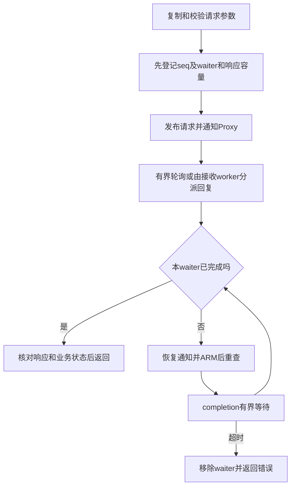

**图怎么读：** DONE检查的是当前请求的waiter，不是队列中“出现过某条响应”。并发调用可以由同一接收路径分派回复，但不能把另一个请求完成当成自己完成。ERR只描述Client观察到超时，不能倒推出Proxy从未执行。

实现中还需要区分传输错误和业务返回值：消息成功到达，不意味着VM_BIND成功；另一方面，传输响应丢失时业务可能已执行。对有副作用的提交，不能随意重发。执行计划只允许在明确的、提交前发生的STALE结果上重新注册；不能在未知执行状态下“再试一次”。

当前可开启`concurrent_rpc`，避免用一个全局串行RPC锁阻塞所有调用；但队列发布、waiter匹配和资源对象仍需要各自锁。单线程应用本身产生的依赖链，不会因为打开并发开关就变成可并行请求。

## 13. 可信通知：RMM保存事件，Host只协助调度

### 图10：请求通知到接收worker的完整链路

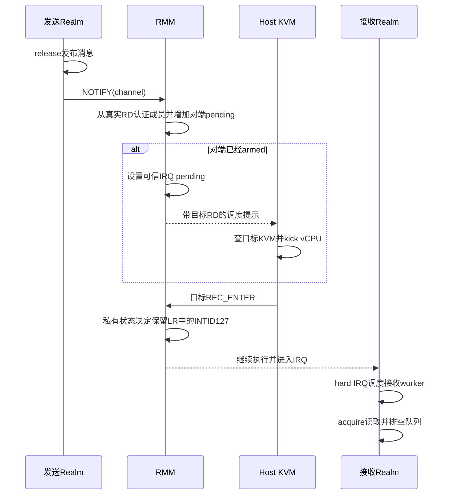

**图怎么读：** 发送端先公布队列，再通知RMM。RMM维护pending/acknowledged/armed；只有接收端已经准备等待，才需要向Host发唤醒提示。目标再次进入Realm时，RMM根据自己保存的可信状态注入保留虚拟中断。Host协作kick不等于拥有事件来源认证权。

`xshm_irq.c`保护保留LR和INTID127，拒绝Host通过其他活动LR伪造这个事件；保存恢复到Host可见状态时不暴露可随意覆盖的可信保留LR。Guest hard IRQ只派发已注册回调、调度worker，不在硬中断上下文执行可能睡眠的复杂GPU请求。

一个IRQ可以提示多条消息，一条消息也不要求一一对应一个IRQ。通知只是“请检查”，完成证明来自之后校验的响应或真实fence。Host仍然可以不调度Realm，可信通知并不提供对恶意调度者的可用性保证。

代码入口：`runtime/rsi/xshm.c`、`xshm_endpoint.c`、`xshm_irq.c`、RMM `runtime/rmi/run.c`、Host `rme-exit.c`与`rme.c`、Guest `realm_xshm.c`。

## 14. 为什么ACK_ARM后还必须重查：解决丢唤醒

最危险的交错是：接收者看到队列为空，发送者发布消息但发现对端还未睡，接收者随后真的睡下。没有后续消息时，双方都认为不需要再做事，这就是丢唤醒。

### 图11：排空、ARM、重查的三种交错

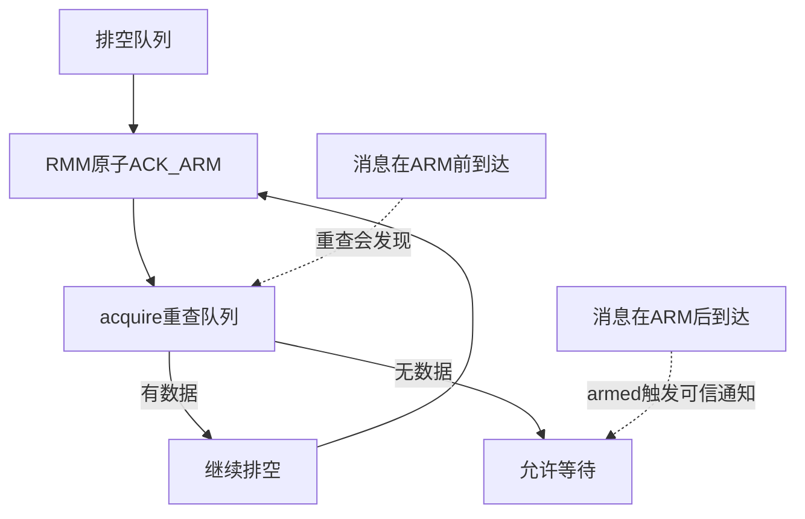

**图怎么读：** 上方纵线是接收路径，左右虚线是发送者可能插入的时机。ARM之前到的消息即使被ACK一并确认，后续重查仍能发现内容；ARM之后到的消息看到armed，建立可信通知。重查之后到达也属于后者，所以可以安全返回等待。前提是发送者保持“发布内容在前、通知在后”的顺序。

Client短轮询期间用`USED_NO_NOTIFY`告诉Proxy暂缓回复通知。退出轮询后恢复提示、重查，并在确实尚未完成时ARM后再次检查。未取得轮询所有权的并发调用同样不能省略睡前准备。这个标志只是性能提示，不能授予权限，也不能证明GPU完成。

有界轮询上限1000微秒，遇到完成、预算到期或`need_resched()`退出，不是每个请求都固定忙等1毫秒。它减少短RPC的睡眠/调度往返，同时会抬高CPU非idle，因此“Client CPU接近100%”不等于应用有效计算已经满核。

## 15. GPUVM映射：从Client的BO请求到真实GPU PTE

VM_BIND请求表达“将本session中的BO某段，映射到该GPUVM的某个GPUVA”。Proxy不能把请求中的整数地址直接写成PTE：它先解析本session的VM和BO，再由可信对象管理器得到授权span，最后进入原生Panthor映射。

### 图12：GPU映射的完整检查链

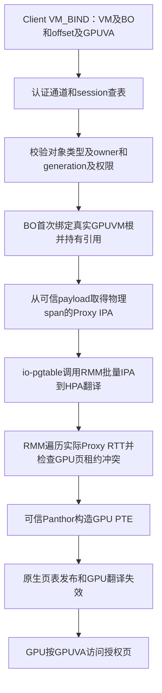

**图怎么读：** 顶部参数是Client可表达的对象关系；越向下越接近真正的物理映射。HPA不是Client传来的，而是RMM从实际Realm RTT取得的。原生Panthor最后写PTE并维护GPU翻译缓存；这与第8节“RMM写CPU共享RTT条目”是两个不同操作。

Guest `io-pgtable-arm.c`的`panthor_gpa_to_hpa_batch()`通过RSI批量翻译，最多一页512个地址，未命中才调用RMM，且有相应缓存与撤销逻辑。RMM先私有化输入数组，逐个按实际REC所属Realm遍历RTT，整批租约成功后才发布输出；失败时不把半成功结果交给驱动使用。

RMM源码摘录，`runtime/rsi/opencca_gpu.c`：

```c
status = opencca_gpu_ipa_to_pa(rec, ipa, &batch[i], &level, &ripas);
```

```c
acquired = opencca_gpu_lease_acquire(rec->realm_info.g_rd, batch, count);
```

这两处合在一起说明：翻译来源是实际调用Realm的RTT，租约owner也来自真实RD。一个Client不能把另一个Realm的HPA当作自己的IPA提交就取得它。

但**Proxy有多个Client授权池**，这些池确实都能出现在Proxy的RTT中。因此，Proxy调用RMM成功只证明页对Proxy可访问，不能单独证明它属于当前请求的Client。第12图上半段的session、payload owner和真实GPUVM根检查仍不可省。

### 15.1 为什么根绑定比整数VM句柄更强

`panthor_vm_prepare_map_op_ctx()`不只比较公开VM编号，而是保存`panthor_vm_root_gem(vm)`的实际对象引用。首次MAP准备后，这个payload BO只允许进入同一个真实根；即使旧VM编号被复用，也不会把旧BO重新授权给新根。

源码摘录，`panthor_mmu.c`：

```c
if (bo->vmshm_vm_root_gem &&
    bo->vmshm_vm_root_gem != panthor_vm_root_gem(vm)) {
    ret = -EACCES;
} else if (!bo->vmshm_vm_root_gem) {
    bo->vmshm_vm_root_gem = panthor_vm_root_gem(vm);
    drm_gem_object_get(bo->vmshm_vm_root_gem);
}
```

真实代码在`gpuva_list_lock`内执行以上逻辑。首次准备后的映射若失败，也不清除根归属；调用者可销毁BO重新创建，不能利用错误路径重新授权。READONLY或NOEXEC别名同样不能跨根；同一根内的合法别名仍可存在。

## 16. GPUVM安全：分别阻止恶意请求和恶意GPU访存

恶意Client可以伪造句柄、偏移和同步参数，也可以产生恶意Mali命令。前者需要可信控制面检查，后者最终需要GPU地址空间边界；不能只检查“请求格式正确”。

### 图13：不同GPUVM允许同VA，禁止跨域物理页

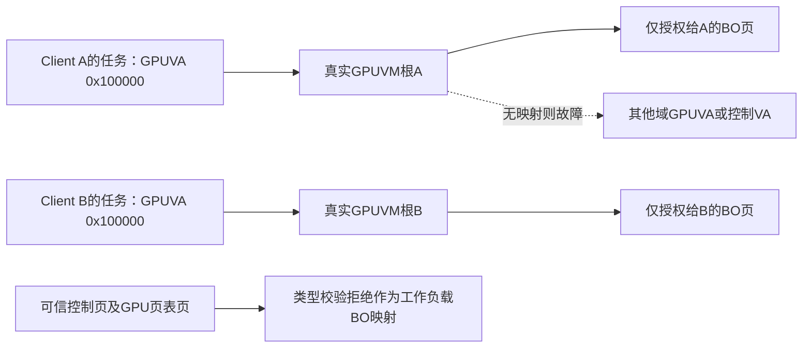

**图怎么读：** 相同GPUVA数值经过不同根可以访问完全不同物理页。Client A猜中B的虚拟地址没有意义，因为A的页表里不存在B的映射。左侧任务可以选择访问地址，但不能选择任意页表根或往表里塞HPA。控制页与工作负载页的类型隔离阻止Client把可信管理数据作为普通BO映射。

实现约束包括：BO所属session与payload owner一致；payload类型只允许GPU数据/命令等合法类型；PTE请求权限不超过对象GPU权限；MAP/UNMAP限于VM公开的user VA范围；不开放Client修改GPU root、可信kernel VA或页表页的接口。大小与offset等端点检查使用减法形式避免整数溢出。

### 16.1 Group并不天然是隔离域

原生Mesa可以在同一个GPUVM中建立多个group。这些group共享页表，所以不能称为彼此隔离。本项目的显式`DRM_PANTHOR_VM_CREATE_ISOLATED`扩展在创建时确定策略：一个隔离GPUVM生命周期只准创建一个group，即使销毁旧group后也不能在该VM里重建第二个。若要新建隔离group，连GPUVM一起重建。

这样可避免旧异步任务与新group通过同一根产生不明确的共享。普通模式保留Mesa兼容语义，不强制所有EGL context都拆为新GPUVM。**当前不是自动将所有应用context都变成独立安全域**；需要互不信任的任务主动使用独立GPUVM及隔离策略。

### 16.2 为什么没有移植Honeycomb式指令验证器

本工程把不同信任域放在不同真实GPUVM，用硬件地址翻译限制访存；可信Proxy和GPU固件仍在TCB内。因此不必为了本版地址空间隔离而直接移植针对其他ISA的静态验证或PTX插桩。但这不等于“GPU指令永远无风险”：若让不可信任务共享同一GPUVM、保护GPU片上状态或防TCB漏洞，需要另行机制与证据。

这里依赖GPU硬件/固件按指定根和权限执行，并限制不可信程序的特权控制操作。只限制Client VM_BIND的user VA范围，不能代替对GPU实际访存能力的约束。GPU合法使用的tiler heap和内部工作区，与不应向工作负载开放的CPU控制页/页表页不同；本文不把所有内部BO称为GPU不可见，也不把一组越域VA负例当作任意Mali指令的安全证明。

本版不声明侧信道、GPU片上残留或恶意Proxy隔离。实际已验证双Client、同VA不同页读写、非法映射拒绝及越域VA故障后的受害group恢复；完整长期对抗矩阵仍是扩展验证。

## 17. IOMMU hook与RMM托管：与GPU内置页表分开理解

“页表都在RMM里”对当前系统不是准确的一句话。需要分成以下三种表：

| 表或记录 | 谁建立和维护 | 用途 |
| --- | --- | --- |
| Realm CPU RTT | RMM | CPU IPA到PA，以及授权共享映射 |
| Mali GPUVM页表 | 可信Proxy中的Panthor/io-pgtable | GPUVA到HPA；RMM提供受控翻译及GPU页租约 |
| 托管其他设备的真实IOMMU表/root | RMM统一服务 | Host RMI或Guest RSI请求下的设备DMA映射 |

### 图14：GPU用页与其他设备DMA映射的互斥

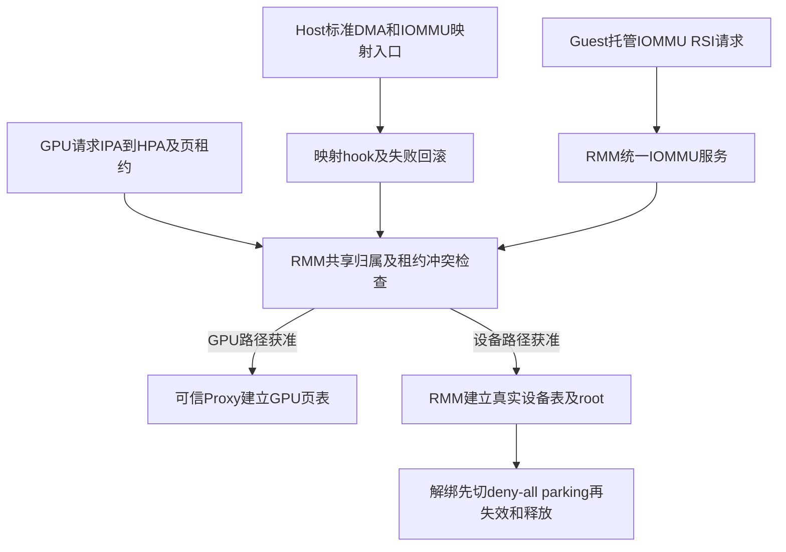

**图怎么读：** 中间共享检查阻止“设备先映射、随后页面转交Realm/GPU”和相反时序的重叠。上层hook必须在PTE发布前取得预留；撤销则在翻译失效完成后释放预留。两边都获准并不意味着共用一张页表，而是共用物理页所有权与冲突规则。

Host普通`dma_map_page`、`dma_map_sg`等经IOMMU分支进入统一映射入口，hook拒绝GPU租约页或已委托Realm页；SG中途失败要撤销已成功段。更完整的managed服务将domain generation、实际表/root、设备bank授权、供电状态、parking和IOTLB都收归RMM。Host先持有真实绑定及PM引用，再GRANT设备给相应Guest domain；REVOKE先阻断旧翻译，再撤销与回收。

代码入口：Host `drivers/iommu/iommu.c`与`opencca-dma-guard.h`；RMM `opencca_gpu_lease.c`、`runtime/rsi/opencca_gpu.c`、`runtime/core/opencca_iommu.c`及其Host/Guest入口。

### 17.1 MMIO、供电与平台能力假设

Host可以负责板级供电、时钟与合法OPP；获得GPU归属的可信Proxy控制工作态任务MMIO。claim、授权、reset和释放按RMM/Host协作生命周期执行。不能把Host正常供电管理权扩展成任意修改GPU root或任务寄存器的权力。

按本项目已确认的范围，目标平台假设能够保护RMM表、可信Proxy页表/控制内存、关键IOMMU配置与工作态MMIO，并阻止未授权CPU/DMA物理访问。这些是**目标平台提供的能力**，不列为当前模拟工程待开发项。软件owner记录本身不阻止任意原始物理写，真实部署仍须确认平台具备这些能力；不额外要求本项目EL2接管普通VM页表。

## 18. 执行计划：缓存结构，不缓存授权结果或GPU完成

大量提交的group、队列布局和同步对象组合重复，变化的只是本次命令流地址、长度、flush编号和timeline值。如果每次都完整传输和重建结构，会反复付出消息体、对象查表和参数装配成本。

P42执行计划把这些内容拆成两部分：`PLAN_REGISTER`登记稳定shape，并在Proxy私有记录中持有真实对象引用；`PLAN_EXEC`传slot、不可复用的plan ID和本次动态patch。Client先比较shape，命中后直接执行；未命中才登记新计划。

### 图15：固定shape与动态patch分离

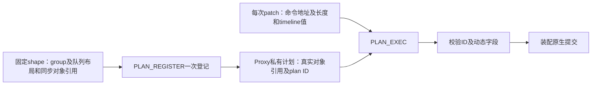

**图怎么读：** 上方内容在对象和结构不变时复用；下方内容每次都来自新请求。Proxy不会拿共享内存中一个可被Client随时改写的“计划指针”直接执行，而是保存经过验证的私有shape和引用。plan ID防止slot被替换后旧请求误用新计划，不能只检查slot编号。

`panthor_client_execute_plan()`在`plan_lock`下进行查找、替换和执行匹配；Proxy的`panthor_proxy_plan_register()`解析实际group和syncobj；`panthor_proxy_plan_execute()`验证动态字段，再调用`panthor_vmshm_group_submit()`。group或syncobj销毁时使相关计划失效，避免句柄复用导致引用偷换。

需要注意：**缓存命中仍有一次同步PLAN_EXEC RPC**。它减少的是结构化控制开销，不会让GPU命令流本身变成零成本，也没有把原生GPU job替换为RMM中的shadow task。

STALE重试只用于可证明尚未dispatch的情况。Client看到`-ESTALE`且没有有效提交结果时可重新注册；若传输失败但可能已经执行，禁止自动重放。同样不能为“提分”跳过动态参数或对象生命周期检查。

## 19. 三层调度：RPC接纳、原生job排队、GPU执行

Proxy的会话轮转解决不同Client请求进入后端的公平性；DRM scheduler解决job依赖与可运行性；Mali固件/硬件再决定实际资源执行。这三层各自排队，不能把“后端接收处理串行”理解成“GPU只能一次执行一个Client”。

### 图16：不同层次的并行与背压

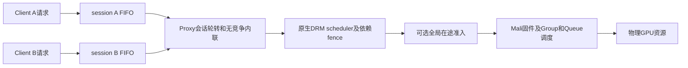

**图怎么读：** 左侧多个Client可同时产生请求；session FIFO保持会话顺序，轮转避免有竞争时长期只服务一个会话。无竞争时Proxy在当前接收线程直接执行提交，省去“交给worker后立刻等待worker”的交接。右侧工作是异步的，Proxy返回接纳结果后GPU可以继续运行已有job。

`panthor_proxy_submit_sched_run()`在队列为空且调度器不busy时内联执行；有竞争时加入会话FIFO，并由`panthor_proxy_submit_sched_pick_locked()`轮转。这里的busy表示提交接纳路径占用，不等于GPU busy。公平接纳也不保证每个Client得到相同FPS：任务长度、依赖、CPU落核和GPU内部调度都不同。

### 19.1 为什么四Client负载可以只允许三个GPU任务在途

部分四Client计算组合曾出现真实GPU超时。当前针对特定四Client负载开启`panthor.max_inflight_jobs=3`：`queue_prepare_job()`检查有界的原生完成fence槽；槽满时返回一个真实依赖fence，让DRM scheduler等待，不阻塞Proxy去做无法完成的忙等。

源码摘录，`panthor_sched.c`：

```c
if (slot == limit)
    dependency = dma_fence_get(sched->admission_fences[0]);
```

获得槽位后保存的是任务finished fence的chain引用；依赖完成后调度器重试准入。这是“限制同时在途以控制压力”，不是减少Client数或延长原5秒超时。该策略没有在本轮单Client720p路径启用，不能拿单Client分数证明其提速；其主要证据是四Client相关负载完成。

## 20. 同步对象、timeline与不可变快照

一个syncobj是可变容器：新的提交、reset、signal或import可能替换其中的fence。timeline又允许按点区分多个提交。导出sync_file需要捕获**当时的那份fence引用**，否则源对象后续被重用会改变旧等待者含义。

### 图17：可变容器与不可变快照的区别

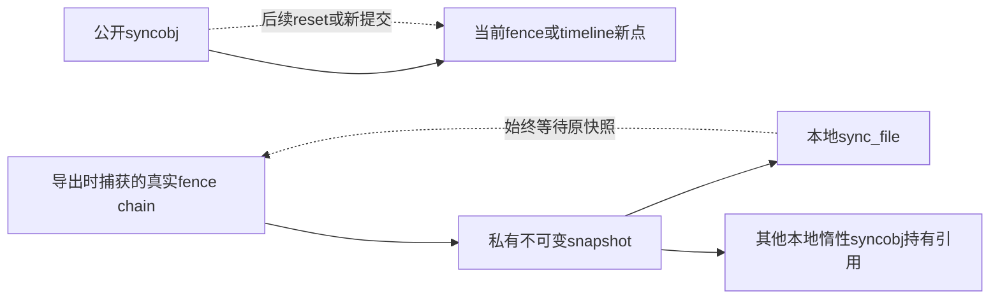

**图怎么读：** 左上容器可以更新，但下方导出的对象保留旧fence，不能被后续reset“带走”。同一快照可被多个本地对象引用；只有最后引用释放，才允许退役Proxy私有句柄。快照固定的是依赖关系，不要求GPU已经完成。

当前Client普通syncobj可先只建立本地对象，需要真实后端句柄时再materialize。导入同session的未完成私有快照时，可把snapshot引用挂到尚未物化的目标，而不立刻创建一个新的Proxy对象。已经物化的目标仍使用真实TRANSFER，以保持后端可见状态。

`panthor_client_syncobj_materialize()`保证不可逆物化：真实CREATE和必要TRANSFER全部成功，才发布新wire handle；失败保留原snapshot。`panthor_client_syncobj_import_snapshot()`在对象锁下替换引用，不让一个延迟worker日后覆盖新状态。

### 20.1 快照融合与按需等待分别省什么

融合snapshot把创建、真实fence捕获和可选完成观察放进一次Proxy操作；后来的`SNAPSHOT_RETIRE`还附带旧快照退役。它省控制往返，不改变“导出时立即捕获”的语义。

`lazy_snapshot_wait`让导出的本地fence在确实需要被CPU等待/通知时才启动worker。有些sync_file只是立刻导入另一个本地对象后关闭，并不需要为它单独启动轮询线程。这里省的是无消费者等待和调度，不是伪造已完成。

私有snapshot最后引用释放后进入有界退役队列，后续新导出附带清理；会话关闭再排空。不能无界缓存旧句柄，也不能只因公开syncobj关闭就释放仍被导出fd引用的fence。

## 21. 完成页与cookie：怎样安全地省等待RPC

对已经完成的工作，继续跨Realm询问“完成了吗”很浪费。完成页让Proxy在真实原生fence成功完成时写入精确cookie，Client在严格匹配时本地回答等待。

### 图18：真实完成到本地快速路径

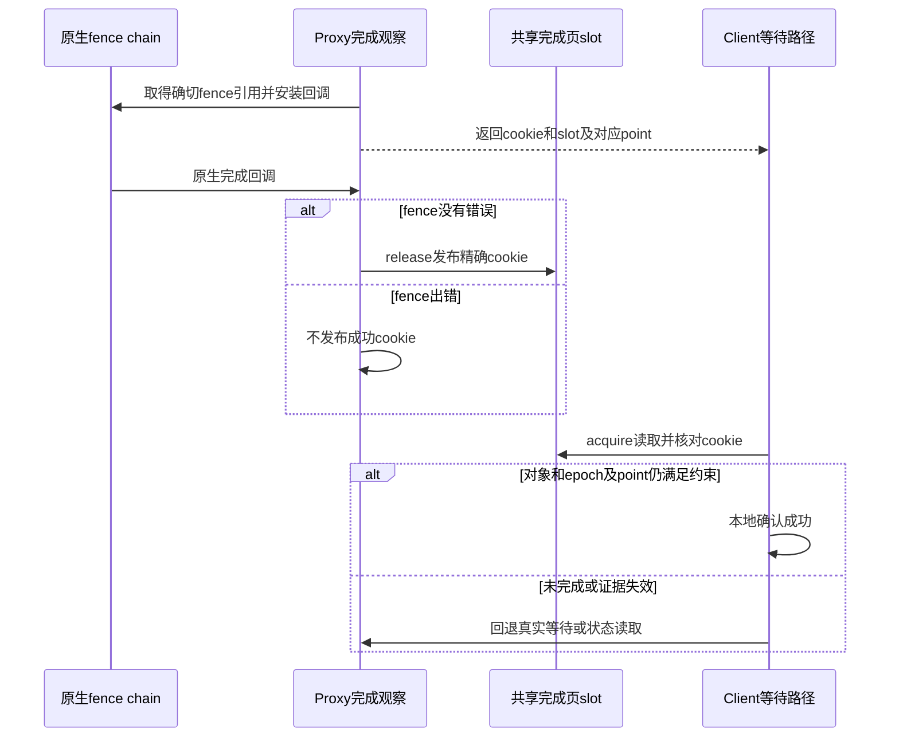

**图怎么读：** Proxy返回cookie时GPU可以仍未完成，所以“知道cookie”不是“看到完成”。只有回调成功发布相同cookie后，Client才可能快速返回。64个slot会复用，但cookie不重用；陈旧读者不会因slot被新任务占用而错认新完成属于旧任务。

源码摘录，`panthor_proxy_snapshot_complete()`：

```c
if (!READ_ONCE(fence->error))
    smp_store_release(&watch->record->cookie, watch->cookie);
complete(&watch->done);
```

Client还检查对象身份、记录的point、mutation状态和proof epoch。新的reset/import/写入等使相应证明失效。完成缓存不能依据Client自报、最大已见数字或某个最后job完成来判断，因为timeline point可能包含前序依赖链和错误。

某些已有快速路径允许“完整原生chain在P成功”证明较早正点完成，前提是原生链确实覆盖它们且无后续修改；另一些缓存保持exact-point。不能把这项有条件前缀证明概括成“任何较小timeline值都自动完成”。未命中不说明任务失败，只是需要原生路径验证。

错误传播也不能丢：内部sync-file worker读取真实fence状态，将GPU错误传播给导出的sync_file；普通DRM等待维持原生完成语义。未发布成功cookie不是一个完整错误码，因此仍需回退状态读取。

代码入口：Proxy `panthor_proxy_point_watch()`及完成回调；Client `panthor_client_plan_completion_record()`、`panthor_client_syncobj_timeline_wait()`、快照worker；`panthor_vmshm.h`中的完成页和能力协商。

## 22. 缓存一致性：屏障、DMA同步和所有权交接不同

CPU写进自己的缓存，不意味着非一致GPU马上能读到；GPU写完后，CPU也可能仍持有旧缓存行。页表、命令、固件输出和BO数据都需要按照实际映射与访问主体处理。

| 机制 | 解决什么 | 不能替代什么 |
| --- | --- | --- |
| release/acquire、内存屏障 | CPU对共享控制数据的访问顺序 | 不自动clean/invalidate非一致DMA缓存 |
| `arch_sync_dma_for_device` | 把CPU侧数据交给设备观察 | 不表示GPU任务已经执行完 |
| `arch_sync_dma_for_cpu` | CPU重新读取设备写出的内容 | 不代替等待对应真实fence |
| WC与WB映射属性管理 | 选择访问策略并避免不一致别名 | 不等于所有地址都可无条件缓存或同步 |
| GPU TLB失效 | 让设备不再使用旧地址翻译 | 不等于清空CPU数据缓存 |

建立WC payload映射前，`realm_xshm_prepare_payload()`处理旧WB缓存并去除冲突的WB线性别名；控制队列仍保留WB。不能为小消息加速把整个payload池随意改成cached，或让同一PA同时通过不一致WB/WC别名被读写。

### 22.1 两项重要优化：按所有权交接与缩小扫描集合

tiler heap等GPU-only内部对象完成CPU初始化后，通过`panthor_kernel_bo_handoff_to_gpu()`交接给GPU，避免每次提交反复同步CPU不再访问的区域。固件输出按真正需要CPU读取的区间同步；仍保留必要clean/invalidate和DMA屏障。

GPUVM原来为同步扫描全部映射VMA；当前在建立/移除VMA时维护`realm_sync_vmas`，仅把需要Realm私有BO同步的VMA放入列表。`panthor_vm_sync_mapped_bos()`只遍历它们。这个“待同步”列表表示需要执行同步的VMA类别，不是一次同步后就永久变干净的dirty列表。

理论上，从每次扫描N个映射变成扫描K个相关映射，控制遍历成本由O(N)降为O(K)，实际该同步的范围和DMA操作不变。因此这是减少无用工作，而不是通过少做必要缓存维护换成绩。既有同期两轮完整720p均值1161→1170.5，+9.5/+0.82%；样本很少，只支持当时组合的小幅收益，不保证所有负载。

## 23. 内存回收：同一共享页不应留下两份物理后备

共享建立前，Client需要一个可被转换的目标IPA窗口。旧路径从Client CMA取得它，随后RMM把这个窗口改为映射Proxy的源页。此时Client和Proxy已访问同一批源页，但Client的guest_memfd仍可能缓存被替换的旧目标页。**映射已替换与旧存储已释放是两件事。**

### 图19：共享前后，哪个物理副本应该消失

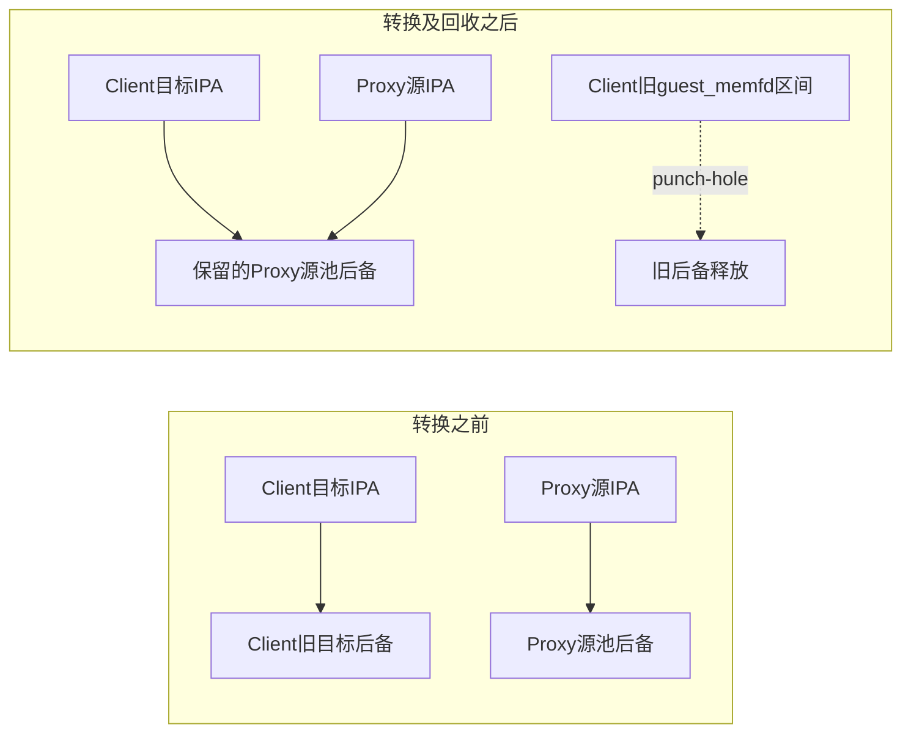

**图怎么读：** 左侧原本有两批物理页；右侧两条IPA访问路径指向同一批源页。虚线回收的是左侧旧目标的guest_memfd缓存，不是仍在给GPU使用的源池。若只是看到两个Guest都能读到相同数据，仍不足以证明旧物理页已释放。

Firecracker在处理私有转共享的MemoryFault时持有VMM锁：先成功调用KVM设置共享属性，再校验完整地址区间及guest_memfd文件偏移，通过`fallocate(PUNCH_HOLE | KEEP_SIZE)`回收旧私有后备，最后建立共享HVA映射、继续vCPU。地址溢出、未对齐、区域空洞、缺少私有后备等情况返回错误；回收失败不继续该vCPU。跨区域回收不是可自动回滚的事务。

`discard_private_range()`位于`firecracker/Firecracker-CCA-MZH/src/vmm/src/vstate/memory.rs`；调用点位于`vstate/vcpu/mod.rs`的`VcpuExit::MemoryFault`分支。KVM/RMM仍负责原私有映射、所有权和引用的退出顺序，VMM不能先punch掉仍在使用的页。

### 23.1 用实际页数与内存分项验证，而非只看VM配置

以下来自单Client ResNet50既有实验，池均为384 MiB。排除普通OS/VM固定预算、GPU页表及未计全的协议私有分配；每列是**各分项峰值相加，不是同一时刻的完整物理总峰值**。

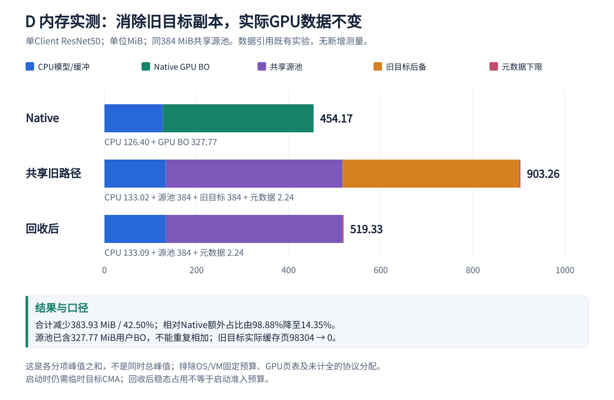

**图怎么读：** 蓝色是CPU模型与运行缓冲，Native绿色是实际GPU BO；共享路径紫色整池已经包含GPU BO，因此没有再加一块绿色。橙色是旧路径仍保留的Client目标后备，回收后整段消失。极细的红色只表示已计量管理元数据下限。横向长度便于看出改动作用于哪一部分，但不把不同时刻的各项峰值伪装成同时峰值。

| 分项，MiB | Native | 共享旧路径 | 回收后共享路径 |
| --- | ---: | ---: | ---: |
| CPU模型、加载与运行缓冲等峰值 | 126.40 | 133.02 | 133.09 |
| GPU用户BO | 327.77 | 包含在下面源池中 | 包含在下面源池中 |
| 完整共享源池 | — | 384.00 | 384.00 |
| Client旧目标后备 | — | 384.00 | 0.00 |
| 已计量管理器私有元数据下限 | — | 2.24 | 2.24 |
| 已测分项合计 | 454.17 | 903.26 | 519.33 |
| 相对Native额外占比 | — | 98.88% | 14.35% |

源池的384 MiB已经包含327.77 MiB实际用户BO，不能重复相加；剩余56.23 MiB包含池内余量、通信控制和对齐空间。优化没有减少实际GPU数据，也没有缩小该实验的池。直接按guest_memfd与文件偏移检查，源池一直有98304个缓存页，旧目标由98304页变为0；合计净减383.93 MiB / 42.50%。

**启动峰值仍需单独考虑。** 当前仍先分配目标CMA，挂接后才回收。后续多Client模型采用逐Client建池、分阶段内存检查和显式回收准入，降低同时保留的无效后备；不会因为稳态少384 MiB，就自动允许忽略启动时的临时需求。准入门槛也不等于运行期间强制保留同样多的Host空闲内存。

## 24. 生命周期：关闭句柄不等于物理页立即可复用

安全和稳定性都依赖生命周期。一个BO可以同时被用户句柄、CPU mmap、GPUVM映射、在途job和导出的同步引用持有。关闭其中一个入口，只减少一种引用；GPU仍可能合法使用它。

### 图20：回收应满足的先后关系

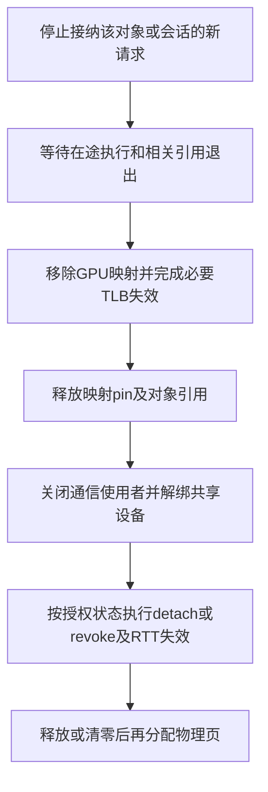

**图怎么读：** 这是贯穿多个组件的先后约束，不是一个函数的逐行调用图。局部对象销毁不必拆除整个共享池；只有池或Realm退出才走后半段。关键是任何仍可能访问旧页的GPU映射、job或CPU共享引用，都不能落在物理页复用之后。

普通syncobj关闭与私有snapshot退役也有同样区别：导出的sync_file可能仍持有真实fence。完成cookie槽位必须避免旧读者把复用后的值当成旧任务完成，因而需要cookie/epoch与引用约束。对象句柄的generation解决编号复用，页pin与fence引用解决物理存储和异步工作的存续，二者不能替代。

设备侧还需保持PM引用、MMIO owner、复位与解绑的顺序。Host可以管理平台供电和时钟；工作态任务控制由获授权的Proxy完成。撤销/复位与页回收经过RMM的归属检查。这里解释正常生命周期，不把完整设备故障组合或任意调度中断恢复写成已完成验收。

## 25. 加速机制总表：究竟省掉了什么

“已实现”指当前源码保留对应机制；不是每项都由本轮独立A/B证明提速。多个机制一起变化时，只能报告组合结果。

| 机制 | 原本的成本 | 当前做法与必须保留的语义 | 证据范围 |
| --- | --- | --- | --- |
| 长期共享BO池 | 按操作搬运大数据、重复授权 | 小控制消息引用共享对象；保留owner、范围、pin和撤销 | 当前Realm主路径已实现 |
| WB控制区、WC payload | 小消息访问慢或数据缓存不一致 | 按用途选属性，转换时处理别名与缓存 | 已实现；不能等价为全池cached |
| 分段BO与局部mmap | 需要整块连续空闲、CPU映射范围过大 | 多extent组成逻辑连续BO，mmap只覆盖请求页 | 已实现并有专项验证 |
| 执行计划缓存 | 每次重传固定结构、重复准备资源 | 固定shape注册一次，动态patch每次校验，生命周期变化失效 | 已实现；不是复用旧授权结论 |
| 多请求在途 | 一把锁覆盖整次RPC导致无关线程互等 | 锁只保护对应结构，以请求ID匹配回复 | 已实现；有依赖的调用仍串行 |
| 空闲Proxy内联提交 | 每个提交必经额外worker调度 | 调度器空闲且无排队时直接执行，有竞争时排队公平接纳 | 已实现；不等于GPU同步执行 |
| Client有界回复轮询 | 每次往返都睡眠和唤醒 | 短时检查回复，超出预算后ARM并重查 | 已实现；占用CPU，需要保留睡眠回退 |
| 回复通知抑制 | Client正在轮询却重复发IRQ | NO_NOTIFY提示避免常见回复通知，需睡眠时恢复可信事件 | 已实现，最新抑制率99.42% |
| 快照融合与惰性物化 | CREATE、TRANSFER、EXPORT及无消费者等待 | 真实捕获合并，未需后端对象时本地保留不可变snapshot | 已实现；不等于删除所有TRANSFER |
| 完成cookie | 已结束的任务仍跨Realm查询 | 真实完整fence chain成功后发布，对象/epoch匹配才本地命中 | 已实现；未完成或含糊时回退 |
| 快照退役捎带 | 每次最后引用释放单独RPC | 有界暂存，随下次新快照请求退役，关闭排空 | 已实现；不能无限延迟释放 |
| GPU-only交接 | 反复同步CPU不再访问的内部BO | 初始化后按所有权交接，保留实际需要的DMA维护 | 已实现 |
| `realm_sync_vmas` | 每次扫描全部GPU映射 | 维护需要同步的VMA子集，只减少无关扫描 | 同期两组均值+9.5分/+0.82% |
| 回收Client旧后备 | 已替换的目标还保留整池物理页 | 成功转共享后punch旧guest_memfd区间 | 同池分项合计903.26→519.33 MiB |
| 分阶段准入和在途限制 | 启动峰值叠加、GPU驻留资源争用 | 顺序建池并检查余量；相关四Client任务最多三个在途 | 已补齐所列ML验收，不宣称单Client提分 |

下列思路已试过但没有收益，当前不默认保留新增复杂路径：普通syncobj批量退役1162→1160；首次物化CREATE+TRANSFER1162→1161；自适应轮询1162→1161；缩计划锁1162→1159；接收/提交流水线1162→1156。历史Proxy主动轮询加请求通知抑制为318→296。它们各自的条件与撤回原因见实验报告，不能横向比较绝对分数，更不能因为“少中断、少锁、少一次调用”就推断必然更快。

## 26. 最新公平对照：单Client固定成本与多Client共享吞吐

下表引用2026-10-21同期两轮矩阵，Native也启动相同数量的进程，分数按每进程/每Client平均。这样能区分“共享同一GPU”的必然分摊与代理栈新增成本。

| 分辨率 / 并发数 | Native每进程均分 | Clientproxy每Client均分 | 分数保留比例 |
| --- | ---: | ---: | ---: |
| 1280×720 / 1 | 1560.50 | 1158.00 | 74.21% |
| 1280×720 / 2 | 812.50 | 768.00 | 94.52% |
| 1280×720 / 3 | 536.67 | 498.33 | 92.86% |
| 1280×720 / 4 | 失败，B轮超时 | 355.50 | 不计算 |
| 1920×1080 / 1 | 1130.00 | 902.00 | 79.82% |
| 1920×1080 / 2 | 587.75 | 597.50 | 101.66% |
| 1920×1080 / 3 | 394.50 | 387.17 | 98.14% |
| 1920×1080 / 4 | 失败，A/B轮超时 | 276.63 | 不计算 |

共同条件：Host #31，CPU0–3固定1.8GHz，Client落CPU2/3/2/3、Proxy落CPU1，GPU实际594MHz，完整33场景、null-noop/finish。Native使用nVHE，Realm共享使用protected hVHE，所以这是两种完整部署栈的对比，不能全归因为RPC。该矩阵使用当时1 GiB租约RMM，不冒充后来2 GiB固件的新矩阵。

单Client时GPU更容易等下一批工作，CPU每次固定往返会直接拉长短帧；并发时可由其他Client填补空隙。每Client分数随并发降低，也可能主要来自大家分摊同一GPU。两Client1080p的101.66%不能解释为代理消除了所有开销：并发调度、不同虚拟化栈和少量轮次都影响结果。四并发Native没有有效完整对照，不能拿单进程Native给它算“同并发保留率”。

### 26.1 为什么锁频后Native提高，单Client却几乎不变

同启动fixed/dynamic/fixed对照中，Native为1561/1428/1559，固定均1560，相比动态+132/+9.24%；动态轮约29.84%时间驻留在较低频率。Client为1155/1159/1151，固定均1153，相对动态−6/−0.52%；三轮都已100%驻留1.8GHz。

Client的有界忙轮询使CPU持续活跃，动态策略本来就把它推到最高频；改为performance没有增加实际频率。Native原来仍有低频驻留，锁频直接帮助CPU侧驱动/提交工作。**这组证据首先解释了“实际频率变化不同”，并不能单独证明Proxy CPU满载或GPU并行能力不足。** Client仍慢的原因需要进一步拆RPC与真实GPU等待。

### 26.2 用简单模型理解，而不是用分数反推唯一瓶颈

对一个确实串行等待的单任务，可写成教学模型：`T ≈ CPU准备 + 必须等待的RPC链 + GPU执行与等待 + 收尾`。真实系统存在重叠，不能把所有采样墙钟机械相加。若某个单场景的原生帧约1毫秒，代理增加固定0.2毫秒，则同场景FPS保留约83.3%；若原生帧约2毫秒，同样开销对应约90.9%。这只是解释为何高分辨率可能保留率更高，不是本项目逐帧实测，也不能把glmark综合均分直接取倒数当作平均帧时。

Amdahl定律同样适用：假设可被某项优化影响的时间比例为p，该部分加速s倍，则整体加速上限为`1 / ((1−p) + p/s)`。缩短一个低频CREATE即使很明显，也可能不影响总分；删除高频且必须等待的一整次RPC才可能影响更大。

排队还需看服务能力与在途数。稳定系统中Little定律`L = λW`把平均在途数、吞吐和端到端延迟联系起来。增加Client可以提高在途数、填补GPU空隙，也会增加排队；队列满后继续加并发不意味着吞吐线性增长。CPU忙碌率含轮询、GPU利用率与真实handler执行时间是不同指标。

## 27. 当前优先方向：减少独立RPC，再拆通知与完成延迟

### 图21：当前链路与尚未实现的快照复用候选

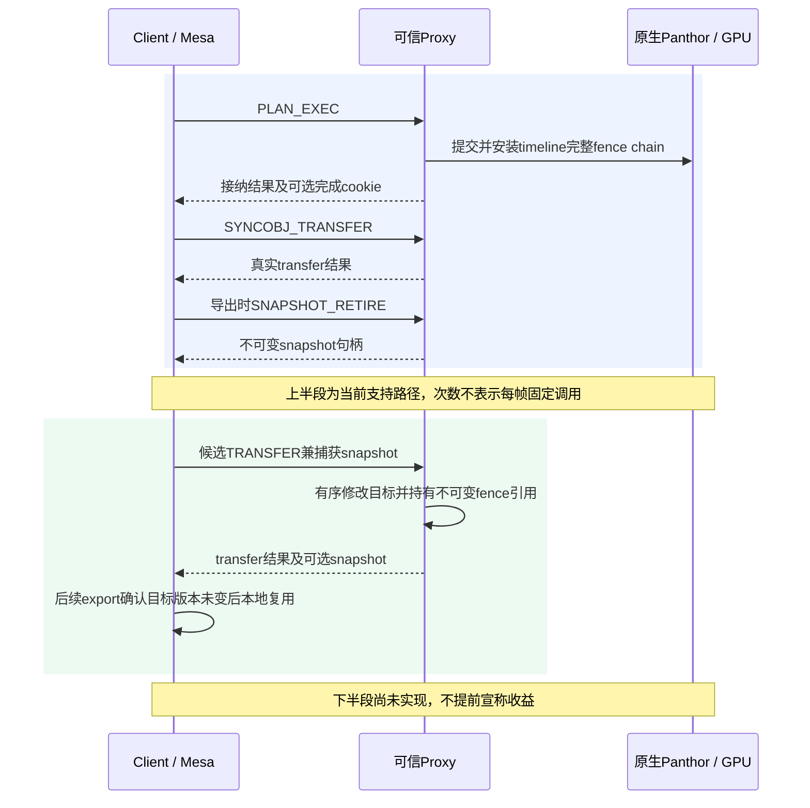

**图怎么读：** 上半段三次操作中，后续代码需要前一次结果，因此即使通信层允许多个请求在途，这条依赖链仍不能自动并行。下半段保留真实TRANSFER的立即可见语义，只把后续需要的snapshot顺带捕获。如果export时对象未变，可以少一次独立RPC；这不是删除fence语义或把任务提前当成完成。

### 27.1 已经量到的时间：入队短，通知和对端等待长

`rpc-breakdown-720-20261022-a`：一个Client、128 MiB池、CPU固定1.8GHz、GPU594MHz、Host #31/protected、2 GiB租约RMM，开启阶段统计。完整720p为1152；此前带统计旧轮1144，+8/+0.70%，但统计点和轮次不同，**不能当成提分**。表为validation、计分与收尾的累计均值。

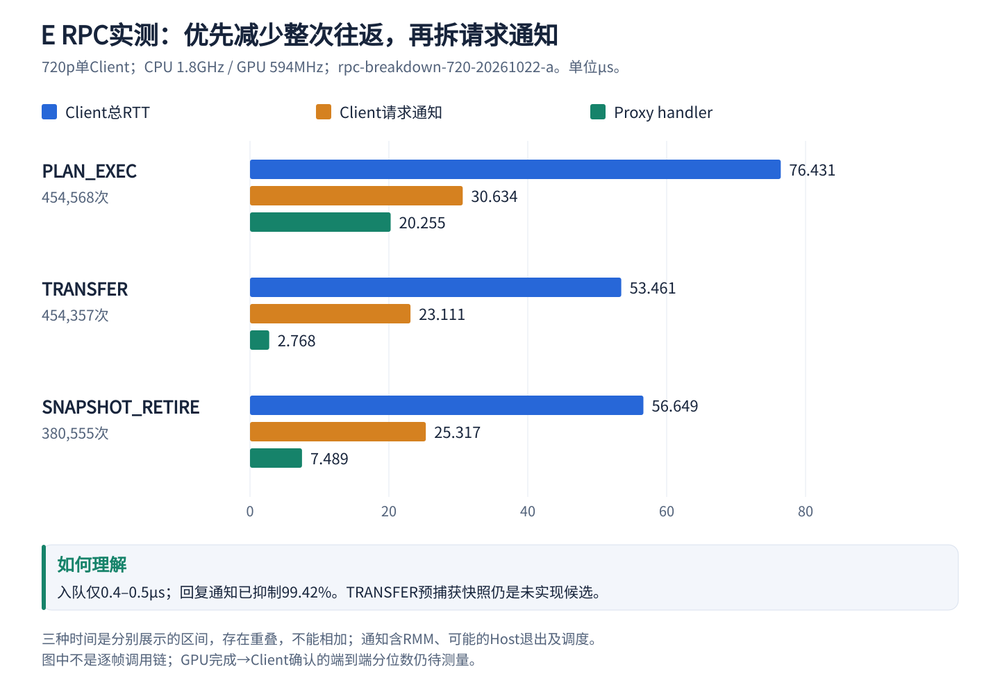

**图怎么读：** 每组蓝条是Client完整往返墙钟，橙条是其中请求通知区间，绿条是另一端测得的handler区间。它们刻意分别绘制，不能首尾拼起来相加。TRANSFER的绿条很短而蓝条仍较长，支持先研究减少整次往返和通知链，而不是只微调TRANSFER内部几行代码。调用次数是累计统计，不代表每帧固定执行一次。

| 操作 | 次数 | Client往返 μs | 入队 μs | 请求通知 μs | 回复轮询 μs | completion等待调用 μs | Proxy handler μs |
| --- | ---: | ---: | ---: | ---: | ---: | ---: | ---: |
| PLAN_EXEC | 454568 | 76.431 | 0.490 | 30.634 | 43.692 | 0.296 | 20.255 |
| TRANSFER | 454357 | 53.461 | 0.418 | 23.111 | 28.756 | 0.154 | 2.768 |
| SNAPSHOT_RETIRE | 380555 | 56.649 | 0.455 | 25.317 | 29.503 | 0.176 | 7.489 |
| TIMELINE_WAIT | 80259 | 72.554 | 0.510 | 26.853 | 43.712 | 0.264 | 5.883 |
| SYNCOBJ_WAIT | 1530 | 598.362 | 0.548 | 34.996 | 513.586 | 48.012 | 530.119 |

前三项入队仅约0.4–0.5微秒，请求通知约23–31微秒，TRANSFER的Proxy handler仅约2.8微秒。它们说明复制队列描述符不是目前最有希望的大头。但这些阶段互相嵌套，Proxy handler发生在Client等待期间，不能把两端数字再相加。

Proxy回复发布聚合均值0.775微秒，1373664次、errors=0。回复通知sent=7927、suppressed=1366192，抑制99.42%；Client轮询attempts=1366959、睡前完成1366613、睡前ARM346。普通回复通知已大多省掉，平均completion等待调用也很短。这里的“睡前完成”可能得到IRQ worker协助，不是纯轮询命中率；0.775微秒包括大量不通知的回复，不能当成一次真实通知的成本。

请求NOTIFY墙钟还包含RMM、可能退出到Host、调度与返回；回复轮询墙钟包含对端执行和排队，不能全部归为本端空转。GPU硬IRQ到线程入口平均27.916微秒、线程处理2.470微秒；尚未覆盖GPU真正结束到Guest硬IRQ入口之前的部分，也没有GPU完成到Client确认的端到端分位数。

### 27.2 第一优先：少一次完整往返，而不是只把一段代码跑快

Client `panthor_client_syncobj_transfer()`物化对象后同步发真实TRANSFER，`panthor_client_syncobj_export_sync_file()`随后仍需建立snapshot。Proxy `panthor_proxy_plan_execute()`虽已持有输出timeline的真实chain及完成观察，响应只有cookie/slot，没有可供未完成导出使用的snapshot句柄。**完成cookie只能证明特定任务已结束，不能代替仍在运行的不可变fence引用。**

较小改动的候选是：TRANSFER中有序捕获目标snapshot，响应一起返回；export在目标未变化时复用，旧snapshot退役随下一次transfer/capture捎带。不能直接把现在两个独立函数挨着调用就称为原子操作，需要以下约束：

| 关键问题 | 需要的具体措施 |
| --- | --- |
| 目标被其他线程reset/import/signal/submit | 目标mutation版本或epoch检查；旧响应不得覆盖新状态；无法证明则回退 |
| 修改目标与捕获之间被插入请求 | Proxy对同一目标建立有序的修改/捕获临界区 |
| 源timeline继续推进 | 保留捕获时完整chain的真实引用，不缓存可变容器或最后一个job |
| 无人export造成泄漏 | 每目标有界保留，覆盖/关闭/无消费者路径回收；导出者独立持有引用 |
| snapshot分配失败 | 已成功TRANSFER保持成功，仅使可选缓存失效；不能重放执行 |
| 新旧协议或一般timeline用途 | 能力协商与原协议回退；先统计实际参数形状和命中率 |

这里省的是后续SNAPSHOT_RETIRE，不是已撤回的首次CREATE+TRANSFER融合。理论上可省的RPC受“相邻transfer/export且目标未改”的实际命中数限制；累计380555次snapshot并不等于都可省，当前尚无命中率和无统计性能测量。

若还想连TRANSFER也省掉，提交时需要知道将来要更新的目标对象，最好由用户态显式给出复合同步操作。当前标准提交不包含未来context目标，不能依据上一次调用猜测。把输出简单改成binary signal也不必然等价于指定timeline点的完整chain。应先评估上述较小候选，再决定是否值得扩展用户态和协议。

### 27.3 第二优先：量清NOTIFY和真实完成的关键链

下一步诊断应分别关联：请求发布→RMM通知/唤醒→Proxy出队→handler→回复发布→Client观察；真实完成另记原生fence回调→cookie发布→Client确认。按请求ID/cookie关联事件，报告中位数与p95/p99，并分开已armed与未armed、Proxy空闲与忙碌、轮询与睡眠回退。不同Guest的`ktime_get_ns()`不能直接相减，除非先验证时基关系；否则使用本端区间与可验证的关联协议。

若主要成本来自唤醒/调度，可再考虑有明确接收状态的通知合并或更稳定的worker落核；如果来自高频依赖链，先减RPC；如果GPU执行后Client仍长时间未见cookie，再研究完成发布和观察。**不能直接重启Proxy无限忙轮询，也不能删除ACK/ARM重查、私有请求副本或真实fence。** 历史主动轮询候选降分已说明，IRQ减少只是中间指标。

候选验收顺序仍遵循当前工作区要求：先无统计完整720p，与同组合对照；同时确认33场景、validation、内核健康和资源恢复，达到既定1000分门槛后再扩展API、计算、多Client和完整回归。本节未实施候选，也没有新跑硬件。

## 28. 从“未成功”到最新状态：内存、驻留与测试窗口分别处理

旧文档里的未执行/失败原因必须保留为历史证据，但阅读当前能力时应使用最新状态，不能继续称已经完成的项目为NOT_RUN。

| 原项目 | 当时问题 | 最新处理及状态 |
| --- | --- | --- |
| ResNet50，3/4 Client | 旧总RAM准入3568/4688 MiB，启动前拒绝；四份GPU页还超原1 GiB租约 | 旧目标回收、逐阶段准入、明确调整池与普通内存、2 GiB有界租约；三/四Client模型已通过 |
| Attention-256/320，4 Client | GPU任务超时、Mesa提交错误；不能直接归因内存不足 | 相关四Client任务限制最多三个在途，原生finished fence提供背压；最新均通过 |
| GEMM/卷积/深度卷积/Softmax，4 Client | 同批GPU错误使耗时不采信 | 在最新独立批次完成；不把旧无效耗时追认为有效 |
| Reduction，4 Client | 未见所有Client共同执行窗口 | 测试加入共同起点与逐次窗口记录，最新通过且有2.394秒真实计时公共窗口 |

最新ML表共40条，31条既有数据保持，九条补测齐全。四Client ResNet50使用每Client336 MiB池、F配置，租约峰值347045页/1355.64 MiB，超过旧1 GiB；最终GPU/DMA租约归零、无本轮OOM。Host最低可用156.45 MiB，说明256 MiB阶段准入门槛不是运行期硬保证。

四Client GPU在途最多三个意味着应用共同运行、GPU任务排队；不意味着四路GPU同时驻留。模型完整运行窗口也包含资格检查和加载，不等于推理循环精确同步。随机输入/权重用于测执行性能，不验证模型准确率。失败候选与Native历史对照的条件差异详见完成报告。

## 29. 已实现、部分实现与目标平台假设

| 类别 | 当前状态 | 解释与范围 |
| --- | --- | --- |
| RMM共享、可信事件、当前Realm通信 | 已实现 | 实际身份、授权范围、RTT映射、持久pending、ACK/ARM重查与撤销 |
| Client/Proxy基本GPU路径 | 已实现 | DRM对象、BO、GPUVM、执行计划、真实提交/完成、缓存及生命周期 |
| 跨GPUVM与Client请求隔离 | 已实现并有选定负例 | 会话资源、generation、payload范围/权限、真实GPUVM root绑定与页租约；普通同VM多Group不宣称互隔离 |
| MMIO授权与统一安全IOMMU服务 | 当前模拟范围已实现并验收 | owner/generation、真实表/root、parking、互斥、IOTLB、设备授权/供电顺序；与Mali内置GPUVM区分 |
| 分段BO、旧目标回收、多Client ML | 已实现并有对应实测 | 不是所有工作负载都用相同池或准入预算；需匹配报告输入 |
| RPC计时与当前瓶颈定位 | 部分完成 | 已有阶段均值；尚缺逐调用形状、完整完成延迟分布与候选命中率 |
| TRANSFER预捕获snapshot、复合提交 | 未实现 | 本文只给设计候选，无收益与并发语义验收 |
| 远程证明与可信Proxy软件身份协议 | 未完成 | 当前信任部署的Proxy；endpoint认证不能证明镜像内容 |
| 多vCPU、长期压力、完整故障组合 | 未完成验收 | 不从单vCPU主流程或旧PASS继承结论 |
| 缓存/调度侧信道及可用性保证 | 不在当前目标 | Host仍可拒绝调度；独立GPUVM不消除共享微架构的侧信道 |
| 可信页表、关键配置、工作态MMIO及非授权CPU/DMA物理保护 | 目标平台能力假设 | 按已确认范围，假设真实平台提供；不是模拟工程待开发项。真实CCA设备部署须确认能力适配 |

页表物理保护是论证前提：软件owner记录本身不能阻止任意物理写入。本项目在假定平台满足这一点的条件下，实现可检查的软件映射与生命周期控制。不能把假设说成已在RK模拟平台证明的完整物理对抗隔离，也不必把此前每次绕过实验都复制进本说明。

当前有Group submit fence历史间歇超时及后续Native四并发超时记录。所列新轮次通过，只证明对应输入与运行范围；不覆盖所有组合或删除历史失败。

## 30. 读代码与排查：按一项任务经过的阶段定位

下表路径相对仓库根目录。函数名用于直接搜索，避免把易变行号当作接口规范。

| 现象 / 想理解的机制 | 先查哪些代码与证据 |
| --- | --- |
| Realm连不上或共享窗口不被接受 | `realm_xshm_bind()`；RMM `xshm_endpoint.c`、`xshm_memory.c`、`xshm_rtt.c`；MEM_DESCRIBE/STATUS与grant状态 |
| 请求能写队列但对端不处理 | `client_comm_vmshm.c` / `proxy_comm_vmshm.c`；`xshm_irq.c`、`xshm_service.c`；pending、armed、IRQ127与ACK/ARM后重查 |
| RPC超时或重复执行疑虑 | 请求ID、pending表、发布状态与完成分派；先确定是否已经入队，不能盲目重试 |
| Client BO容量或mmap失败 | `client_vmshm_manager.c` / `proxy_vmshm_manager.c`；对象generation、extent、offset/length、pin及可用池 |
| GPU页映射到哪里 | `panthor_vm_prepare_map_op_ctx()`、`panthor_vm_map_vmshm_spans()`；`panthor_drv.c`的vmshm后端接口与RMM `opencca_gpu.c` / `opencca_gpu_lease.c` |
| 为什么别的Client句柄无效 | `panthor_proxy_session_lookup()`、会话xarray与payload owner；不能只查用户自报VM ID |
| 提交为何串行或排队 | `panthor_client_drv.c`计划路径；`panthor_proxy_submit_sched_run()`；原生`panthor_sched.c`准入与finished fence |
| 提交成功但结果未就绪 | 原生fence、`panthor_proxy_point_watch()`、cookie发布；区分接纳与完成 |
| sync_file导出慢 | Client materialize/transfer/export函数；Proxy snapshot与真实chain；查看RPC次数而非仅对象数 |
| GPU读到旧数据或CPU结果不一致 | `panthor_gem.c`的GPU交接；`panthor_mmu.c`的`realm_sync_vmas`；payload属性与实际DMA维护 |
| 共享后仍多占一个池 | Firecracker `discard_private_range()`、MemoryFault调用顺序；检查实际guest_memfd页，而非只看RSS |
| 其他DMA设备映射互斥 | Host `drivers/iommu/{iommu.c,opencca-dma-guard.h}`；RMM `opencca_iommu.c`；owner/generation、root与parking |

Guest核心目录均在`Linux-Guest-GPU/`：前后端分别是`drivers/gpu/drm/panthor-client/`与`panthor-proxy/`，原生驱动是`drivers/gpu/drm/panthor/`，协议在`include/linux/{panthor_vmshm.h,vmshm_comm_protocol.h,vmshm_manager.h}`。RMM在`opencca/tf-rmm/runtime/{core,rsi}/`，Host在`Linux-Host-GPU/`。当前编排入口是`scripts/run/run-realm-xshm.py`与`GPU-SFTP/tests/realm-xshm/run-realms.py`，硬件运行统一由`lab-run.py`独占管理。

## 31. 参考、实测证据与论文思想的对应关系

### 31.1 项目内可复核资料

| 内容 | 入口 |
| --- | --- |
| 当前源码、部署组合与范围 | [CURRENT_BASELINE](CURRENT_BASELINE.md)；当前工作树未发布改动不能仅靠HEAD重建 |
| GPUVM root绑定、隔离策略与原生表 | [GPUVM安全强化v1](GPUVM_ISOLATION_V1_20261020.md)及其验收文档 |
| 平台保护能力假设 | [场景2平台假设](SCENARIO2_PLATFORM_ASSUMPTIONS_20261020.md) |
| 分段BO | [分段内存设计](GPU_BO_SEGMENTED_MEMORY_20261020.md) |
| 原生/共享内存口径与回收 | [内存对照](GPU_TASK_MEMORY_COMPARISON_20261021.md)、[旧目标回收](GPU_SHARED_MEMORY_RECLAIM_20261022.md) |
| 多Client与频率 | [公平glmark矩阵](GPU_FAIR_MULTICLIENT_GLMARK_20261021.md)、[CPU频率响应](GPU_CLIENT_CPU_FREQUENCY_RESPONSE_20261022.md)、[Native分数来源](GPU_NATIVE_SCORE_ORIGIN_20261022.md) |
| 单Client固定往返与细分计时 | [路径诊断](GPU_SINGLE_CLIENT_PATH_DIAGNOSIS_20261022.md)、[RPC关键路径](GPU_RPC_CRITICAL_PATH_20261022.md) |
| 保留/撤回的优化与同期分差 | [六方向优化实验](SAFE_PERFORMANCE_OPTIMIZATION_20261018.md) |
| ML九条补测与40条最新表 | [ML完成报告](GPU_ML_COMPLETION_20261022.md)、[ML结果表](GPU_MULTICLIENT_ML_RESULTS_20261021.md) |

关键硬件证据是`build/rpc-path-breakdown-20261022/diagnostic-audit.json`及同目录run/统计，公平glmark位于`build/fair-glmark-20261021/`，调频对照位于`build/client-frequency-response-20261022/`；ML采用`build/ml-completion-20261022/{final-audit,continuation-f}.json`与逐run记录。完整命令、退出码、输入SHA、健康/资源与回收日志均见相应报告及`build/lab-runs/<run-id>/`，本文不重复粘贴运行日志。[36份关键源码的SHA快照](evidence/clientproxy-guide-20261022/source-hashes.json)识别本次解释对应的工作树内容；它不是可直接部署的运行载荷manifest。

### 31.2 基础接口与论文：参考思想，不等于复现整篇系统

| 来源 | 有助于理解的思想 | 本项目如何使用 / 没有声称什么 |
| --- | --- | --- |
| Linux [DRM内存管理](https://docs.kernel.org/gpu/drm-mm.html)、[DRM UAPI](https://docs.kernel.org/gpu/drm-uapi.html)、[DMA-BUF/fence](https://docs.kernel.org/driver-api/dma-buf.html) | 对象引用、独立GPUVM、异步fence与导出同步 | 复用Panthor真实对象与完整fence chain；代理协议保持这些语义 |
| Arm Realm Management Extension与RMM架构 | 由可信monitor管理Realm物理页归属和RTT | 当前实验扩展共享、事件、GPU租约和IOMMU服务；不是所有RSI/RMI扩展均属标准CCA |
| [StrongBox，CCS 2022](https://compass.sustech.edu.cn/strongbox/) | 检查最终设备映射，并保护GPU页表与可信控制面 | 用于确定不能只验证API句柄；本工程依赖可信Panthor和目标平台保护，不声称复现其完整系统 |
| [ACAI，USENIX Security 2024](https://www.usenix.org/system/files/usenixsecurity24-sridhara.pdf)，§5 | 设备访问与内存唯一归属、一致映射和安全交接共同约束 | 对应session归属、真实GPUVM root身份、DMA/GPU页互斥和撤销后延迟复用；不是直接移植另一设备栈 |
| [CAGE，NDSS 2024](https://www.ndss-symposium.org/wp-content/uploads/2024-763-paper.pdf)，§IV-B | 在建立/更新映射时约束非法与重复映射，避免逐访存陷入monitor | 当前在真实GPUVM映射路径绑定root、校验对象和页租约；CAGE独占设备模型不构成本项目并发隔离证明 |
| [PhantomMap，NDSS 2026](https://www.ndss-symposium.org/ndss-paper/phantommap-gpu-assisted-kernel-exploitation/) | 分配、别名、权限、存续状态和最终PTE必须一致 | 用于审视payload类型、权限、生命周期与真实root；其kbase漏洞不直接等同Panthor漏洞 |
| [Honeycomb，OSDI 2023](https://www.usenix.org/conference/osdi23/presentation/mai) | 通过静态验证约束不可信GPU程序，把敏感状态排除出其合法访存能力 | 本项目选独立GPUVM与可信Proxy；没有移植Honeycomb的验证器，也不宣称任意Mali程序已被静态证明安全 |
| [Guardian，Middleware 2024](https://arxiv.org/abs/2401.09290) | 用GPU程序插桩实现空间隔离时，必须约束实际访存指令与可绕过路径 | 帮助区分“同地址空间软件沙箱”与“独立GPUVM”；没有移植其PTX方案 |

相关论文应以论文原文和各自精读页为准。本项目选择的边界是：不可信Client请求与GPU程序不能越过其授权GPUVM访问其他域或可信控制内存；可信Proxy、可信固件和目标平台保护共同构成前提。这个选择可以减少指令验证器的实现需求，不能减少映射、权限、引用、缓存和撤销必须做的检查。
