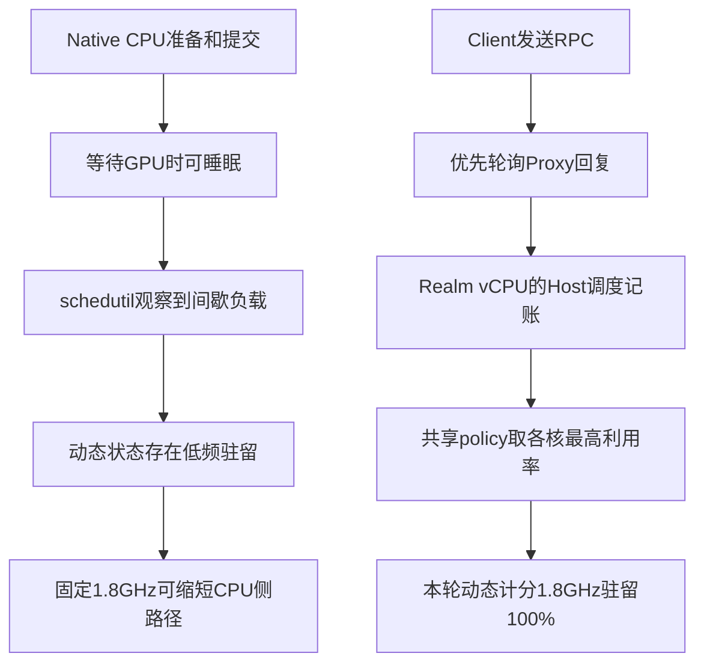

# Native 与单 Client 对 CPU 调频策略的不同响应

**720p差异已用调频反切验证：Native的动态策略存在低频驻留，而单Client的动态策略已保持1.8GHz。** 锁频给Native带来频率增量，给当前单Client路径没有额外频率空间。代理同步往返的优化空间仍独立存在。

## 诊断范围

用户关注的现象是：从动态调频改为固定频率，Native 明显提分，单 Client 的绝对分数却基本不变。需要分别回答“实际运行频率是否同样提高”和“已经高频时代理还慢在哪里”，不能只用固定代理开销解释全部现象。

本次不修改 GPU 驱动、RMM、VMM、Host Image 或固件。复用已完成的 Native 完整720p固定/动态/固定实验，另以当前同一 candidate-f 冻结包进行单 Client 完整720p固定/动态/固定实验；每轮保持 CPU 落核、GPU 频率、128MiB池、用户态与33场景一致，关闭 RPC 计时，保留 Guest CPU 和 Host 观测。Native 在 nVHE 启动中完成自身对照，Realm 在 protected 启动中完成自身对照，不把二者写成相同虚拟化模式。

## 对照测量

Native 对照已完成：固定1.8GHz两轮1561/1559，均值1560；schedutil 1008–1800MHz为1428；固定较动态+132分/+9.24%。动态计分窗口1.8GHz驻留70.16%，其余29.84%在较低状态，固定两轮为100%。具体记录见[Native 提分来源](GPU_NATIVE_SCORE_ORIGIN_20261022.md)。

Native动态轮的166次两秒瞬时读数全部是1.8GHz，驻留计数却记录了低频时间，所以不能用“采样看起来一直最高频”排除调频影响。状态加权频率约1712MHz，也不能直接用1800/1712推导总分变化：驻留窗口包含CPU执行与GPU等待，各阶段的频率敏感性不同，glmark总分还聚合了不同场景FPS。当前实验隔离了governor和最低频率这组策略，未独立量化每个驱动阶段或升频延迟的贡献。

单Client三轮已完成并独立验收。执行顺序为固定A → 动态B → 固定A，固定两轮均值1153，较动态1159为−6分/−0.52%；两端固定自身相差−4分/−0.35%。没有观察到锁频提分，不能凭一次动态条件将这点小负差认定为策略回退。

| 路径 | 固定A1 | 动态B | 固定A2 | 固定均值较动态 | 动态 / 固定的1.8GHz驻留 |
| --- | ---: | ---: | ---: | --- | --- |
| Native | 1561 | 1428 | 1559 | +132 / +9.24% | 70.16% / 100% |
| 单Client | 1155 | 1159 | 1151 | −6 / −0.52% | 100% / 100% |

单Client每轮计分阶段167个两秒观测点，采样间驻留差分均100%处于1.8GHz，其他频率计数增量均为0；GPU实际594MHz，落核与输入SHA相同。最高温度54.538/55.461/55.461℃。计分窗口两个vCPU所在Host核均为100%非idle；Guest窗口含validation，Client为99.11%/99.10%/99.05%，Proxy为32.95%/32.70%/30.08%。完整证据在 `build/client-frequency-response-20261022/audit.json`。

逐场景也能区分策略响应，而不只是总分凑巧接近。下表固定FPS均为两端均值：

| 场景 | Native 动态 → 固定FPS | Native变化 | Client 动态 → 固定FPS | Client变化 |
| --- | --- | ---: | --- | ---: |
| build，use-vbo=false | 948 → 1148.5 | +21.15% | 1121 → 1126 | +0.45% |
| texture，nearest | 2281 → 2463 | +7.98% | 1752 → 1744.5 | −0.43% |
| shading，gouraud | 1907 → 2085.5 | +9.36% | 1555 → 1546 | −0.58% |

Client全部33场景的固定/动态FPS绝对相对差中位数0.34%，23/33项在1%以内。这描述本轮变化规模，不代替更多重复实验的统计检验。

已核实的关键差异是：相同“schedutil、允许1008–1800MHz”的配置，在Native路径中出现29.84%的低频驻留，而在本轮单Client路径中没有出现；锁频并没有给后者额外的频率空间。这里的驻留来自cpufreq状态记账，不是独立硬件时钟测量。

## 代码如何造成不同的负载形态

### Native 可以在等 GPU 时睡眠

当前共用性能入口 `GPU-SFTP/tests/realm-xshm/performance-suite.sh:24` 显式设置 `GPU_SMOKE_GLMARK_FRAME_END=finish`。测试每帧要求 GPU 完成，因此 CPU 准备/提交与等待完成均会影响帧时间，分数不只反映 GPU 着色吞吐；两条路径使用相同条件。

Native 的同步对象等待在 `Linux-Host-GPU/drivers/gpu/drm/drm_syncobj.c:1134` 设置 `TASK_INTERRUPTIBLE`，未完成时在1172行进入 `schedule_timeout()`，完成回调再使等待者继续执行。既有实际进程观测也多次落在 `drm_syncobj_array_wait_timeout`。

Native 同次完整计分的 `/proc/stat` 差分显示，glmark 所在 CPU2 非idle为46.26%/44.24%/46.14%（固定A/动态/固定B）。这不是纯 Mesa 计算占比，但能说明其调度负载并非持续满核。动态策略可以在等待间隙下降；下次 CPU 准备、提交及中断处理重新发生时，会受到当前频率及策略响应的影响。固定频率消除了这组变化，GPU 仍是594MHz。

### Client 在同步 RPC 回复前先做有界忙轮询

性能模式在 `GPU-SFTP/tests/realm-xshm/run-realms.py:905` 启用 `client_comm_vmshm.realm_poll_us=1000`，同时保留并发RPC、完成等待缓存和融合/惰性快照。

实际顺序在 `Linux-Guest-GPU/drivers/char/client_vmshm_comm/client_comm_vmshm.c:1093`：发送请求 → `poll_response()` → ARM并重查 → 必要时等待 completion。`poll_response()` 在928行定义，预算上限1000微秒；958行开始循环，读取/分派回复，空队列时执行 `cpu_relax()`。它会在收到回复、需要重新调度或到达期限时退出，**不是每个RPC固定等待1毫秒**。`cpu_relax()` 也不会像 `schedule_timeout()` 那样将任务切成睡眠等待。

因此，等待 Proxy 执行的几十微秒可表现为 Client CPU 持续运行。这是减少睡眠/唤醒延迟的现有设计选择，同时会抬高调度器观察到的负载。本次未开RPC计时的固定A/动态B，Client Guest 非idle为99.11%/99.10%，Proxy为32.95%/32.70%，窗口含validation与计分；此前带计时诊断为99.25%/31.12%。Client数字包含轮询，不能解读为有效渲染计算占满CPU。

### 一个 Client 也能影响整个 A55 共享调频策略

板端 CPU0–3 共用 `policy0`。`Linux-Host-GPU/kernel/sched/cpufreq_schedutil.c:463` 的 `sugov_next_freq_shared()` 遍历共享策略各CPU，479行取最大利用率，再经165行的 `get_next_freq()` 选择频率；并非把四核平均负载当作调频依据。

本轮单 Client 的 Proxy vCPU落在CPU1，Client vCPU落在CPU2，VMM其他线程在CPU0。“只有一个Client”仍包含两个Realm及其通信路径；一个高负载核就可能维持整个共享策略的高频，Proxy Guest 没满核也不妨碍它运行在高频。

还须区分 Guest 与 Host 的记账。Host 调频看其调度器中的vCPU任务负载；Guest 的 idle 不保证 Host vCPU线程已经进入可调度的睡眠。当前 Realm 入口的普通HCR标志不包含TWI/TWE（`opencca/tf-rmm/lib/arch/include/arch.h:204`）；RMM仅在对应入口标志设置时增加WFI/WFE陷入（`opencca/tf-rmm/runtime/rmi/run.c:312`），Host在REC退出时清除入口标志（`Linux-Host-GPU/arch/arm64/kvm/rme-exit.c:187`）。此前Host两个vCPU核接近100%非idle，而Proxy Guest仅31.12%，与这种记账差异一致。这不证明全部Host忙碌都来自轮询，也不表示物理CPU始终在做有用计算。



## 即使保持高频，代理仍有可优化开销

调频响应与代理效率是两个问题。此前 `single-path-720-20261022-a` 带聚合计时的完整720p为1144，计时覆盖validation、计分与收尾，不能当作本次无RPC统计三轮的同条件分数；但它提供了链路墙钟成本证据：

| 操作 | Client 调用数 | Client 平均往返 | Proxy handler 平均 |
| --- | ---: | ---: | ---: |
| PLAN_EXEC | 452266 | 77.64 μs | 20.53 μs |
| SYNCOBJ_TRANSFER | 452055 | 53.69 μs | 2.58 μs |
| SNAPSHOT_RETIRE，已融合快照/完成登记/退役 | 378063 | 56.68 μs | 7.29 μs |

`Linux-Guest-GPU/drivers/gpu/drm/panthor-client/panthor_client_drv.c:2921` 在命中可复用计划后仍同步执行PLAN_EXEC RPC；2146行的同步对象传递也仍有独立RPC。发送路径在 `client_comm_vmshm.c:806` 包含本端锁、队列发布与通知，792行经Realm通知接口进入RMM；处理后还需发布并接收回复。

这些时间不能全部算成RMM执行或独占通信成本，Client与Proxy的计时互相嵌套，不能累加为总耗时百分比。不过，数十万次“小handler、较长往返”足以支持优先检查同步往返数量、通知/接收调度和完成回传，而不是只优化Proxy中几微秒的handler。

已有公平对照的22类简单场景，每帧栈差中位约169μs（720p）/172μs（1080p），与高频往返在量级上相符；这是由场景FPS推导的差值，尚未逐帧配对RPC，不能声称全部可消除或全部来自安全检查。多pass场景差值更大，需单独区分提交、同步和映射次数。

进一步减少高频RPC应保持ioctl顺序、对象引用、真实fence和可信完成凭据。现有SNAPSHOT_RETIRE已经融合，计划缓存也已启用；不把这些当作尚未实现的新方案。历史自适应轮询、普通syncobj批回收、缩计划锁和流水线候选的无收益/撤回记录仍有效，本轮没有重新实现它们。

## 解释边界

只有“额外固定代理成本”并不足以解释为什么Client完全未提分：如果两条路径的同一CPU段都变快，Client即使另加代理成本也应获得一定收益。本轮驻留对照已补足关键环节：单Client原已保持最高频率，而Native原有低频驻留。各类轮询及Host/Realm idle记账对维持高频的独占贡献没有进一步拆分。

频率高也不等于GPU饱和或Proxy计算满载；本轮没有直接GPU忙闲/队列占用证据。720p的反切实验不能定量代替1080p；三轮中的动态条件只有一轮，微小分差不作为统计显著的优化或回退。本轮新增诊断观测与调频对照，不发布运行代码优化。

## 执行与证据入口

本次三轮由以下控制器串行执行，每轮内部通过 `scripts/maintenance/lab-run.py` 获取Pi/RK独占锁，使用 `run-realm-lease-monitor.py` 监控GPU/DMA租约，最后校验回收文件SHA。诊断wrapper在锁内保存原CPU策略，建立schedutil 1008–1800MHz基础条件；固定轮额外传入 `--cpu-frequency-khz 1800000`，动态轮不传该参数。每轮退出后恢复原CPU策略；未改动冻结包中的runner。

```bash
python3 build/client-frequency-response-20261022/run-comparison.py
```

该控制器使用本次唯一run-id，保留原始证据，不能原样重复覆盖已有运行。内部GPU命令为：

```bash
python3 scripts/run/run-realm-xshm.py \
  --images build/ml-completion-20261022/candidate-f \
  --workload glmark --performance --benchmark-only --suite \
  --profiles glmark-720 --clients 1 --compact-memory --pool-mib 128 \
  --client-cpu-layout round-robin --telemetry \
  --cpu-frequency-khz 1800000
```

完整实际命令和退出码在各 `build/lab-runs/<run-id>/result.json`；GPU命令必须由上述独占入口执行，不能独立裸跑。Native原始对照及独立验收在 `build/native-origin-20261022/`，本次单Client原始33场景、Guest日志/CPU记账、Host健康与采集清单在 `build/client-frequency-response-20261022/runs/`，Host逐两秒采样及CPU策略恢复在 `observations/`，输入冻结SHA在 `input-hashes.json`。

| 本次run-id | 条件 | lab/采集退出码 | 审计 |
| --- | --- | --- | --- |
| `client-freq-fixed-20261022-a` | performance，1800–1800MHz | 0 / 0 | PASS |
| `client-freq-schedutil-20261022-a` | schedutil，1008–1800MHz | 0 / 0 | PASS |
| `client-freq-fixed-20261022-b` | performance，1800–1800MHz | 0 / 0 | PASS |

各轮33场景、validation 26成功/1既知例外/6未知的既定判据、clean、Mali renderer、两个Realm退出0、Host/Guest内核健康、11文件SHA核验、同输入/落核/GPU频率及GPU/DMA租约最终归零均通过。没有超时、OOM或新增GPU错误。独立 `audit-comparison.py` 退出0，Pi/RK最终资源检查退出0，见 `audit.json`、`audit-output.json` 和 `final-resources.json`。RK恢复CPU0–1、pmthor和原GPU/CPU策略，无残留实验进程或loop；没有执行新的1080p/API/多Client回归。

改动目的｜解释Native与单Client对锁频响应不同｜动态1159 → 固定均值1153（1155/1151）｜−6分/−0.52%，固定自身−4/−0.35%｜同candidate-f、protected启动、128MiB池/用户态/CPU落核/GPU，仅切CPU governor/minimum；无RPC计时，Native引用独立nVHE对照｜上述三run-id，lab/采集/审计/资源检查均退出0，命令与原始日志见本节｜保留诊断结论；未改GPU运行代码，新增调频对照性能测量，不作为代码优化或确定性性能回退。
