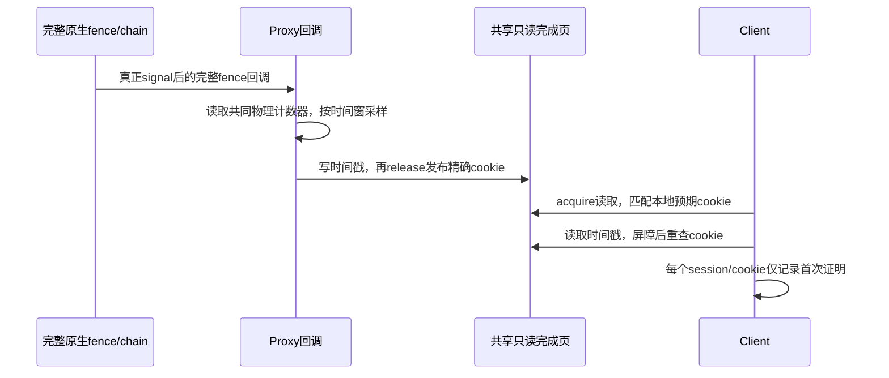

# 原生完整fence完成至Client确认

**后续关闭诊断复核：** 同candidate-c、同runner/VMM/内核/initrd/rootfs，本轮仅关闭RPC/通知/完成计时，完整720p **1159**，对下文计时轮1144为**+15/+1.31%**，对历史1158为**+1/+0.086%**。继续开启TRANSFER预捕获，CPU/落核/GPU/128MiB池不变；新测一轮、分属不同时段，不拆分各计时功能的独占贡献。run-id `completion-diagnostics-off-720-20261022-a`，外层/runner/采集/审计退出0，33场景、正确性/健康/退出/租约归零/资源恢复通过。按用户要求保留实现，正式计分默认关闭诊断；全部证据及保留决定见[性能复核](GPU_PERFORMANCE_DIAGNOSTICS_REVIEW_20261022.md)。下文1144/1146及延迟分布继续作为诊断条件下的原始记录。

## 测量口径与状态

测量Proxy观察到完整原生fence/chain回调、发布精确完成cookie，至Client首次接受该cookie的延迟。它补充[请求通知拆分](GPU_NOTIFICATION_LATENCY_20261022.md)，不能用RPC回复到达或最后一个job完成替代整个原生fence完成。

当前已完成源码与本地Client/Proxy及工具构建；新组合关闭诊断时完整720p为1159分。首轮开启计时1146分，完整性、健康和时钟分析通过，但复核发现首次确认仅覆盖本地cookie检查，RPC等待成功返回的分支未记录；因此该轮不能称完整路径分布。已补齐RPC分支，candidate-c完整720p为1144分，采集、正确性/健康/恢复审计及要求真实RPC回退样本的时钟分析均退出0。取得15676条真实完整fence回调至首次cookie确认样本，平均14.095μs、p50 13.708μs、p95 17.500μs、p99 67.667μs；无对应cookie的RPC等待仍不在该分布内。随后双Client各19项API及计算、SG和并发快照语义回归通过。

## 实现

默认关闭的`--completion-trace`启用两侧`panthor_{proxy,client}.completion_trace=1`，并启用已有通知trace缓冲区。Proxy通过OPEN_SESSION能力位`1<<9`协商完成时间戳；旧对端不解释这些字段。每个完成slot仍为64字节、整页仍为4096字节，仅利用原reserved空间保存原生观察时间、发布前时间、计数频率及观察种类。

Proxy继续持有精确原生fence引用，用`dma_fence_add_callback()`注册回调。成功回调记录为kind1；返回`-ENOENT`表示注册时已经完成，单列kind2，其时间不能回溯为真正的GPU完成时间。错误fence不发布成功cookie，slot耗尽和观察失败继续走原有真实等待，不伪造完成。



回调可处于fence自旋锁内，因此不调用会重入该锁的状态查询，不发RPC；`complete(&watch->done)`保持为对watch上下文的最后一次访问。重用slot前仍排空旧回调，诊断开启时先使旧cookie失效、执行写屏障再更新元数据；成功发布仍使用release。

Client在诊断模式下用私有观察锁串行化精确cookie检查，并记录本页每slot已观察的最大cookie。首次成功acquire后读取物理计数器，读元数据、执行读屏障并重查cookie，防止slot复用时混合两次观测。重复检查不增加样本。路径1/2/3分别为快照worker本地轮询、PLAN_EXEC timeline本地证明、binary本地轮询；4/5/6分别为这三类RPC等待成功后的确认。RPC分支只追加计时，不改变原等待结果或发送新RPC；没有可用对应cookie时增加`rpc_without_proof`，不虚构原生完成时间。timeline仍校验无并发修改、epoch及point前缀关系，计时字段不参与授权或完成判定。

采用与通知相同的24MHz物理计数器及每100ms前2ms采样。Client trace容量扩大到65536条；kind3记录`session/cookie/path/observation_kind`及完成、发布前、Client确认、元数据读取结束和频率。采样依据原生完成时刻，而不是Client查询时刻，避免只采到快查询的完成事件。

Proxy保留requested、成功回调、注册时已完成、错误、取消、slot耗尽、观察建立失败及已采样计数。Client保留首次观察、未采样、有效样本和元数据错误计数。分析器将“Proxy已采样、Client未查询或未采用该证明”的情况列为未观察，不以零延迟补齐。

## 验证与复现

| 项目 | 状态 | 证据 |
| --- | --- | --- |
| Client/Proxy、静态工具 | 构建通过，退出0 | `build/completion-latency-20261022/build-{client,proxy}-final.log`、`build-client-rpc.log`、`build-tools.log`；最终Client使用RPC补齐版 |
| 冻结输入 | 已固定 | `candidate-b/hashes.json`为首轮；`candidate-c/hashes.json`仅更新Client Image，补齐RPC成功分支，Proxy/initrd/runner与b相同；原candidate为未运行的旧ACK预期runner |
| 完整720p，关闭诊断 | PASS，1159分 | `completion-kernel-gate-720-20261022-a`；lab/采集/独立审计退出0，两个Realm退出0/0，健康、正确性、资源恢复及GPU/DMA租约归零通过 |
| 首轮完整720p，开启完成计时 | PASS，1146分；确认路径覆盖不全 | `completion-breakdown-720-20261022-a`；lab/采集/独立审计/初版时钟分析退出0，两个Realm退出0/0，健康/正确性/回收通过；保留为初步测量，不能覆盖RPC确认 |
| 补齐RPC确认后完整720p | PASS，1144分 | `completion-breakdown-720-20261022-b`，candidate-c；首次硬件测试即完整720p，先于API扩展；lab/采集/审计/分析退出0，33场景、既定validation/clean、健康、退出0/0、GPU/DMA租约归零和Pi/RK资源恢复通过，15文件SHA一致 |
| 双Client覆盖/RESET/销毁/导出/并发语义 | PASS，退出0 | `completion-api-2c-20261022-a`；candidate-c及`--completion-trace --bo-sg-mmap`；两侧各19项API、计算/SG、权限/可信IRQ/计时ABI通过，三Realm退出0/0/0，Host/Guest健康、GPU/DMA租约归零及Pi/RK恢复通过，16文件SHA一致，采集/独立审计退出0 |

计时轮在lab租约内使用与门槛相同的CPU1.8GHz、GPU594MHz、单Client/128MiB池/720p/round-robin/null-noop finish，增加`--completion-trace --rpc-stats`。不装Host kprobe，避免额外的Host探针开销混入完成分布；RMM仍是通知阶段已部署并验证的固件。

回收SHA校验通过后运行`audit-transfer-capture.py --experiment build/completion-latency-20261022 --bundle build/completion-latency-20261022/candidate-c --run-id <ID> --capture`，再运行`analyze-gpu-completion-trace.py --run <回收目录> --output <新JSON> --require-rpc-paths`。API审计另加`--api`。首轮a的审计使用当时candidate-b；不得替换其输入哈希。

首轮a取得15466条真实回调后本地确认样本，均值20.396μs、p50 14.000μs、p95 42.292μs、p99 98.000μs；另有1条注册时已完成，明确排除。Proxy采样真实回调16405条，其中939条没有被初版记录；无错误、slot耗尽或建立失败，待完成watch为0。补齐RPC后的统计集合会变化，不能将两版均值差描述成性能优化。

## 补齐RPC分支后的结果

最终分析为`build/completion-latency-20261022/completion-analysis-b.json`，原始采集位于`runs/completion-breakdown-720-20261022-b/`，lab命令与资源证据位于`build/lab-runs/completion-breakdown-720-20261022-b/`。两端计数器均24MHz；Client35302条、Proxy19518条trace，丢弃均0。Client19624次、Proxy10次计时通知的Guest区间均包住RMM时间，确认跨端时钟顺序；完成样本跨越339.402秒、2916个采样窗口。

下表仅统计kind1真实回调至Client首次接受精确cookie，单位μs。六个代码分支均已接入计时；未产生样本的分支保留为空，不能推定其延迟为零或已经获得性能分布。

| 首次确认路径 | 样本数 | 平均 | p50 | p95 | p99 | 最大 |
| --- | ---: | ---: | ---: | ---: | ---: | ---: |
| 全部已观测完成证明 | 15676 | 14.095 | 13.708 | 17.500 | 67.667 | 8739.500 |
| 1 快照worker本地轮询 | 0 | — | — | — | — | — |
| 2 timeline本地证明 | 7963 | 21.904 | 14.875 | 18.083 | 70.583 | 8739.500 |
| 3 binary本地轮询 | 7673 | 5.629 | 0.583 | 0.875 | 0.875 | 8716.458 |
| 4 快照worker RPC成功 | 0 | — | — | — | — | — |
| 5 timeline RPC成功 | 12 | 83.174 | 84.438 | 104.388 | 104.644 | 104.708 |
| 6 binary RPC成功 | 28 | 83.656 | 81.375 | 96.294 | 98.694 | 99.167 |

真实回调至发布前时间平均0.096μs、p50 0、p95/p99 0.292μs；发布前至Client确认平均13.999μs，主要间隔发生在Client采用证明之前。binary的p99很短但最大值约8.72ms，均值受少量长尾影响，不能仅凭均值判断常见传播成本。timeline还包含Client查询时机和完整链前缀证明语义，不能将两类分布差全部视为缓存一致性差异。RPC回退仅40条真实样本，适合确认路径确实存在，不足以宣称稳定尾延迟上界。

Proxy共请求903031个watch：成功回调808876、注册时已完成68、撤销94087；错误、slot耗尽、建立失败及采集时未完成watch均0。采样真实回调16499个，Client观察15676个，另外823个未被首次cookie计时采用，保留为未观察；不将其填为零。注册时已完成的采样2个均被观察，注册观察至确认65.917/1509.667μs，独立列出，不能混入真实回调分布。

Client首次观察768690个cookie，未采样753012、有效计时15678（真实回调15676+注册时已完成2），元数据错误0。RPC成功确认计数71091，其中68471次当时没有可采用的对应cookie，仍按原有真实RPC结果返回；其余2620次具有完成证明，可能是非采样或已被本地检查记录的cookie，不能全当作新增样本。成功RPC计数与唯一cookie数口径不同。**本实验测全已接入证明的本地与RPC分支，不覆盖所有无cookie的等待，也不是所有GPU任务的全量完成分布。**

复现使用冻结candidate-c：

```bash
python3 scripts/maintenance/lab-run.py --run-id <唯一ID> -- \
  python3 build/completion-latency-20261022/observe-run.py \
  python3 scripts/run/run-realm-lease-monitor.py \
  --monitor build/dma-guard-20261018/lease-monitor/opencca_lease_monitor.ko -- \
  python3 scripts/run/run-realm-xshm.py \
  --images build/completion-latency-20261022/candidate-c \
  --workload glmark --performance --benchmark-only --suite --profiles glmark-720 \
  --clients 1 --compact-memory --pool-mib 128 \
  --client-cpu-layout round-robin --cpu-frequency-khz 1800000 \
  --telemetry --transfer-capture --rpc-stats --completion-trace
```

双Client语义测试使用同一lab/lease-monitor包装及candidate-c，工作负载参数为`--workload compute --performance --transfer-capture --completion-trace --rpc-stats --bo-sg-mmap`。compute入口固定两个Client，不传glmark专用的CPU频率、布局、compact或clients参数；语义探针构造的fence不混入上述glmark延迟分布。

该轮两侧均通过512次覆盖、256次导出、128次RESET、timeline及256次并发修改，另有128次快照导出后的源RESET/销毁/DRM关闭和64次导入后的目标RESET/销毁。两Client计时样本分别11/10、元数据错误0，三Realm trace丢弃0；源码SHA与冻结前清单一致。Proxy请求2237个watch，真实回调16、注册时已完成2093、slot耗尽128，错误/建立失败/未完成watch均0。slot耗尽是大量快照覆盖测试中的实际回退覆盖，不要求所有操作均获cookie；该轮所有语义检查仍通过。证据见`completion-api-2c-20261022-a-audit.json`、`completion-api-timing-audit.json`及对应回收目录。provider replacement专项为NOT_RUN，本轮也未重跑Native、1080p或模型矩阵。

## 解释边界

起点是完整原生fence回调中的计数器读数，包含的完成传播从这一CPU观察点开始；没有独立GPU硬件时间戳，不能称GPU内部最后一条指令结束至Client的精确延迟。终点是Client接受精确cookie，早于用户态系统调用返回。发布前时间戳与release store之间仍有少量指令，不将该差距描述为零。

一个原生fence可能被多个协议cookie观察，统计的是完成证明，不是去重后的GPU任务。kind2已经完成的注册样本只报告“注册观察→Client确认”，不得混入kind1的真实完成回传分布。没有被Client消费的完成也必须保留其计数，不能从有效样本推断所有任务均已被观察。

timeline的前缀证明起点是所持完整链的完成，不是较早请求point自己的最早完成时刻。发布到确认还包含Client何时查询、worker排队或RPC返回，不能全归因于共享内存传播。计数器读数相同表示本次测量未分辨出间隔，不意味着回调/发布没有成本；确定性时间窗也不是所有任务的无偏随机抽样。

改动目的｜验证默认关闭的完成计时扩展不破坏正常路径｜通知阶段无诊断1152 → 本版无诊断1159｜+7/+0.61%｜同Host/RMM、单Client720p/128MiB、CPU固定1.8GHz、GPU594MHz、round-robin/null-noop finish；Guest源码及代码布局变化，仅单轮组合比较，不归因提分｜run-id `completion-kernel-gate-720-20261022-a`，命令/退出码/日志见 `build/lab-runs/<run-id>/`、`build/completion-latency-20261022/`，lab/采集/审计退出0｜保留该门槛证据，补齐RPC后的candidate-c另有1144分及双Client验收。

改动目的｜首次测量真实完成证明｜同包关闭1159 → 开启1146｜−13/−1.12%｜增加完成/通知采样及RPC计时，未装Host kprobe；诊断组合开销与单轮差异不拆分｜run-id `completion-breakdown-720-20261022-a`，lab/采集/审计/分析退出0，日志同上｜保留初步数据，RPC确认覆盖缺口随后补齐，不将首轮称为完整验收。

改动目的｜补齐RPC成功返回的首次cookie确认计时｜首轮计时1146 → 补齐1144｜−2/−0.17%；相对上一版关闭诊断1159为−15/−1.29%｜仅更新Client Image并继续开启完成/通知采样及RPC统计，Proxy/initrd/runner不变；不是同镜像开关对照，分布变化和单轮分差不能归因提分或单项诊断开销｜run-id `completion-breakdown-720-20261022-b`，lab/采集/审计/分析退出0；命令、15文件SHA及日志见上述目录｜保留默认关闭诊断及样本边界，无新增FPS收益证据。
