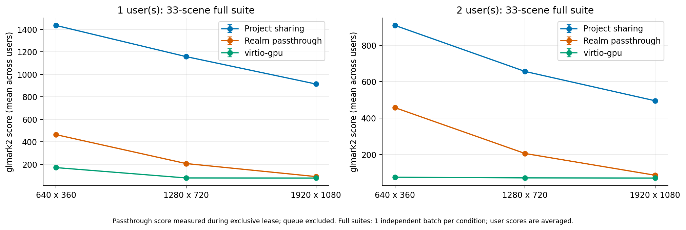
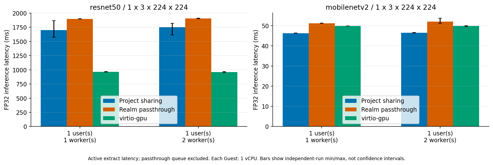
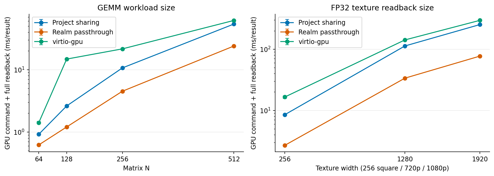
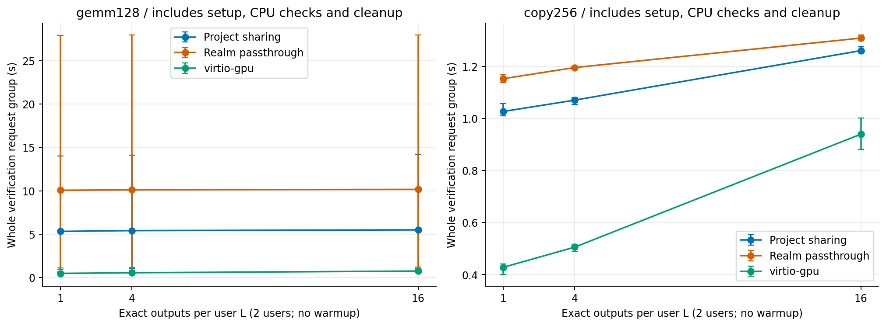

# GPU三方扩展实验：720p、1080p、真实ML及参数对照

本轮正式计划174批，独立审计通过174批，证据核验不可用0批，包含1044行Client工作负载。三方案覆盖共同算子、360p/720p/1080p、真实模型、用户数、批次、资源和完整请求成本；原验收Host/FW与默认运行树已恢复。Host Native仅引用历史分数，本轮未运行。

按用户最终选择，真实模型采用单用户三轮的核心口径；原计划中的9个双用户模型配置移出核心统计。已完成的图形/GLES多用户实验保留，已有双用户模型和原Host模型观察也分别归档。

## 条件与可比范围

正式三方使用同一RK3588/Mali-G610与冻结负载。GLES/图形使用原匹配Host，真实模型三方使用仅启用内建UDMABUF的匹配Host；RMM、Guest、库与模型程序保持。内部数据键native均指常驻Realm协作独占设备的直通分时，与Host原生驱动基准不同。三方案的信任边界、渲染API及额外后端预算仍有差异，所以本报告不把应用分差归为单个安全检查的开销。

直通采用完整请求租约，交接前后VM实例与身份保持；本原型尚未实现跨CVM保留GPU上下文或任意shader抢占。表中结果只描述这一具体原型与配置。

| 条件 | 本项目共享 | Realm直通分时 | virtio-gpu |
| --- | --- | --- | --- |
| 启动/信任边界 | protected hVHE、Client/Proxy Realm、RMM可信授权与完成 | protected hVHE、常驻Realm轮流独占真实GPU | 普通VM、独立nVHE、Host Panthor/virglrenderer后端 |
| 设备使用 | 多个Client共享，按原任务授权与完成协议 | 真实GpuAcquire/加载驱动/执行/卸载/归还；同组串行 | virtio-gpu/virgl；模型仅接受资格通过的Venus |
| CPU | 每Client 1vCPU；CPU2/3；Proxy CPU1、IO CPU0 | 每Realm 1vCPU；CPU2/3、IO CPU0 | 每VM 1vCPU；QMP核验vCPU2/3、后端CPU1/0 |
| 频率 | CPU固定1.8GHz；GPU请求600/实际594MHz，300MHz独立轴 | 相同 | 相同 |
| Guest内存 | 算子/图形476MiB，模型768MiB；320MiB独立轴 | 相同 | 相同 |
| 后端内存 | Proxy随1/2/4用户为268/308/388MiB | 无Proxy Realm | Host后端未施加等额Proxy上限；RSS不等于全部设备内存 |
| 图形API/深度 | GLES3.1 / depth24 | GLES3.1 / depth24 | GLES3.0 / depth32 |
| 固定软件 | Mesa25.0.7-2，固定glmark2/NCNN | 同一固定用户态 | QEMU10.0.13、virglrenderer1.1.0、同Mesa25.0.7-2 |

四用户共享CPU2/3这两个物理核心，没有增加为四个独占核心。图形共用同一只读完整rootfs，SHA256为`5d0c2ec8e5c1830f6a93c39d34bd8ae02a99702792e9e16a9d9034388f606d60`；算子/模型分别使用冻结镜像，清单与最终源哈希均保留。

Venus真实模型需要同版本`virgl-server 1.1.0-2`辅助程序，以及支持Host可见内存映射的标准UDMABUF路径。修复后用两个真实模型先做资格，再执行正式三轮；资格数据不计入性能。为保持核心对比同条件，共享/直通六批单用户模型在新Host重测，旧72行成功记录单列于[原条件模型数据](evidence/gpu-comprehensive-20261114/prior-model-observations.csv)，按Host条件选择，未按分数选择。[兼容配置与证明](evidence/gpu-comprehensive-20261114/venus-compatibility-summary.json)记录版本、镜像、辅助程序及输入SHA。

新模型Host先通过额外完整720p检查：原匹配条件1158→1170，+12分/+1.04%。每条件一次，只记Host配置/构建与测量轮次的组合观察，不归因单项提速。该检查与原三方图形数据分开，原验收1170基线保持。

## 完整图形：720p与1080p均实测

每个条件为一次完整33场景独立批次，所有场景/validation保留。双用户列是各自分数；直通在占有GPU期间计分，未计排队，分数不相加当作总吞吐。

| 分辨率 | 用户数 | 本项目共享 | Realm直通分时 | virtio-gpu |
| --- | --- | --- | --- | --- |
| 360p | 1 | 1435 | 464 | 171 |
| 720p | 1 | 1158 | 207 | 79 |
| 1080p | 1 | 914 | 91 | 78 |
| 360p | 2 | 901 / 915 | 455 / 460 | 76 / 77 |
| 720p | 2 | 694 / 618 | 208 / 205 | 73 / 73 |
| 1080p | 2 | 517 / 474 | 87 / 88 | 72 / 72 |

项目/直通validation为26成功、1已知function/medium失败、6未知；virgl为27成功、0失败、6未知。不能把完成33场景写成所有图像均已证明正确。实际计分为指定分辨率，程序独立validation模式报告800×600。

单用户直通结果单列，用于观察本地直通路径本身的性能。不能把分时原型与共享的全部分差归因于用户排队或GPU交接。

直通单用户完整图形的四段交接调用墙钟如下。完整租约含validation、准备和计分；四段计时不是各固件/reset内部函数的独立耗时。每条件一次，单位ms。

| 完整图形 | 申请 | 驱动加载 | 驱动卸载 | 归还 | 四段/完整租约 |
| --- | --- | --- | --- | --- | --- |
| 360p | 20.444 | 38.652 | 49.852 | 9.779 | 0.03206% |
| 720p | 15.241 | 43.027 | 50.439 | 6.775 | 0.03114% |
| 1080p | 21.149 | 54.150 | 51.771 | 23.885 | 0.04038% |

另做六个代表场景的三次独立重复，每场景显式duration=1秒；完整33场景使用默认时长。范围只代表这三个批次，不能与完整33场景分数混合：

| 六个代表场景 | 本项目共享 | Realm直通分时 | virtio-gpu |
| --- | --- | --- | --- |
| 360p | 957.3 [955.0–961.0] | 305.3 [304.0–308.0] | 88.3 [82.0–94.0] |
| 720p | 829.7 [827.0–834.0] | 142.3 [141.0–143.0] | 64.0 [64.0–64.0] |
| 1080p | 688.7 [684.0–692.0] | 75.7 [75.0–76.0] | 61.0 [61.0–61.0] |

## 历史Native比例与旧版变化

Host Native1437/997来自2026-10-18，Host/代码/CPU/内存条件不同。百分比只为历史参考，不能解释为同条件虚拟化损耗；未补跑Host Native。

| 完整单用户 | 本轮共享 | 历史Host Native | 共享/历史Native | 旧共享参考→本轮 | 绝对/百分比变化 |
| --- | --- | --- | --- | --- | --- |
| 720p | 1158 | 1437 | 80.58% | 1170→1158 | −12 / −1.03% |
| 1080p | 914 | 997 | 91.68% | 923→914 | −9 / −0.98% |

本轮候选Host/RMM、CPU固定策略及内存条件同时变化，只记录组合效果；未将实验1158替换为原已验收1170基线，也不把不同条件旧模型时延与本轮相除宣称提速/回退。

## 真实ML：ResNet50与MobileNetV2

固定官方ONNX权重，经固定PNNX20260526转换，NCNN固定提交`e54f7b1f88434e1d844ea0551b880a1cfb079ce1`。FP32，关闭fp16/bf16/packing，输入为1×3×224×224固定合成张量；每批5次预热、20次正式推理，逐轮检查全部1000个输出与Client单线程CPU参考。核验实际Mali后端，拒绝lavapipe/llvmpipe；不声称每层均在GPU，也不将合成输入数值验证当作ImageNet精度。

下表单位ms/次，均值[独立批次均值最小–最大]；核心配置均为单用户三个独立批次。单次extract含必要传输/等待/输出可见性，初始模型加载和CPU参考另计。2个应用工作线程仍共用1vCPU。

| 模型 | 用户数 | 工作线程 | 本项目共享 | Realm直通分时 | virtio-gpu |
| --- | --- | --- | --- | --- | --- |
| resnet50 | 1 | 1 | 1699.605 [1574.982–1867.119] | 1898.390 [1895.111–1901.670] | 964.474 [960.653–970.689] |
| resnet50 | 1 | 2 | 1750.759 [1616.222–1819.575] | 1906.741 [1903.304–1909.977] | 959.502 [951.127–970.818] |
| mobilenetv2 | 1 | 1 | 46.280 [46.198–46.328] | 51.164 [51.093–51.249] | 49.863 [49.855–49.872] |
| mobilenetv2 | 1 | 2 | 46.424 [46.324–46.587] | 51.999 [51.101–53.678] | 49.814 [49.612–49.929] |

以下为Client内完整应用总时间，包含模型准备、CPU参考、5次预热、20次正式推理、测量屏障/控制等待及清理；单位秒，按独立批次内用户平均后汇总。它不包含在Client开始执行前的直通排队，也不包含VM启动。

| 模型应用总时间s | 用户数 | 工作线程 | 本项目共享 | Realm直通分时 | virtio-gpu |
| --- | --- | --- | --- | --- | --- |
| resnet50 | 1 | 1 | 110.985 [107.791–115.911] | 112.283 [106.882–115.978] | 85.457 [85.115–85.837] |
| resnet50 | 1 | 2 | 107.760 [106.506–110.127] | 110.104 [107.000–116.183] | 85.207 [85.073–85.474] |
| mobilenetv2 | 1 | 1 | 5.426 [4.412–6.318] | 4.905 [4.245–6.221] | 5.008 [4.395–5.511] |
| mobilenetv2 | 1 | 2 | 4.509 [4.427–4.660] | 4.303 [4.259–4.385] | 5.078 [5.013–5.126] |

直通还记录了从同组请求发出到设备归还的排队/服务/响应；[原始租约表](evidence/gpu-comprehensive-20261114/formal-windows-and-leases.csv)保留逐用户值。共享模型批次缺少命令完成通知时间，不能用串口END接收时间代替完整请求终点；三方完整请求的严格匹配对照限于下文共同算子与短请求矩阵。

双用户匹配模型已有共享和直通各两轮观察，全部32行另存于[扩展模型数据](evidence/gpu-comprehensive-20261114/retained-model-extensions.csv)。[扩展范围账本](evidence/gpu-comprehensive-20261114/model-extension-scope-ledger.csv)记录已测、原Host观察和按用户范围未执行项。核心模型准备/设备创建/CPU参考/完整应用时间另见[阶段数据](evidence/gpu-comprehensive-20261114/trained-setup-and-inference.csv)。

Venus在同版本辅助程序、标准UDMABUF内存路径下通过两模型资格，再执行三批单用户正式模型测试；资格样本不混入正式均值。

## 共同算子与规模

三方案使用同一GLES3.0 FP32二进制和数据。每批5次预热、30次正式；单位ms/逻辑输出，含绘制提交/完成等待及全量读回，后续CPU比较另计。这些是ML算子与拷贝，不是完整网络或裸GPU执行时间。

| 单用户负载 | 本项目共享 | Realm直通分时 | virtio-gpu |
| --- | --- | --- | --- |
| GEMM64 | 0.920 [0.916–0.928] | 0.622 [0.608–0.638] | 1.413 [1.377–1.485] |
| GEMM128 | 2.618 [2.606–2.630] | 1.206 [1.183–1.240] | 14.778 [14.671–14.832] |
| GEMM256 | 10.670 [10.575–10.843] | 4.511 [4.500–4.530] | 21.548 [21.519–21.570] |
| GEMM512 | 53.849 [53.841–53.861] | 23.921 [23.895–23.960] | 61.515 [60.778–61.936] |
| Conv32/C4 | 0.911 [0.908–0.913] | 0.612 [0.606–0.617] | 1.411 [1.410–1.412] |
| Conv64/C8 | 4.766 [4.759–4.771] | 1.984 [1.965–1.996] | 17.555 [17.225–18.021] |
| Conv128/C8 | 18.131 [18.113–18.161] | 6.546 [6.528–6.565] | 32.681 [31.890–33.212] |
| Depthwise64/C8 | 4.443 [4.436–4.448] | 1.628 [1.619–1.641] | 17.356 [17.158–17.490] |
| Softmax256² | 18.136 [18.075–18.257] | 5.642 [5.631–5.652] | 21.617 [21.393–21.754] |
| FP32 Copy256² | 8.522 [8.508–8.537] | 2.691 [2.670–2.706] | 16.575 [15.600–17.340] |
| FP32 Copy720p | 112.962 [112.860–113.110] | 33.652 [33.520–33.743] | 141.769 [141.207–142.532] |
| FP32 Copy1080p | 252.753 [252.451–253.129] | 77.184 [76.061–78.978] | 296.193 [295.139–297.097] |

## Profiling与批次：哪些现象已经测到

以下是探针分阶段墙钟，不能直接细分为RMM某个check的成本。先按独立批次/用户平均阶段，再汇总三批；读回包括API和传输/拷贝。

| 负载 | 方案 | 提交/完成ms | 读回ms | 读回占活动API | 随后CPU比较ms |
| --- | --- | --- | --- | --- | --- |
| gemm128 | 本项目共享 | 0.623 | 1.995 | 76.21% | 0.370 |
| gemm128 | Realm直通分时 | 0.737 | 0.469 | 38.88% | 0.523 |
| gemm128 | virtio-gpu | 12.304 | 2.474 | 16.74% | 0.370 |
| conv64c8 | 本项目共享 | 0.765 | 4.001 | 83.95% | 0.742 |
| conv64c8 | Realm直通分时 | 0.913 | 1.072 | 54.00% | 0.742 |
| conv64c8 | virtio-gpu | 12.979 | 4.576 | 26.07% | 0.742 |
| copy1920 | 本项目共享 | 2.708 | 250.045 | 98.93% | 48.179 |
| copy1920 | Realm直通分时 | 9.595 | 67.589 | 87.57% | 48.408 |
| copy1920 | virtio-gpu | 19.763 | 276.430 | 93.33% | 47.570 |

字面GEMM128/L1还可观察首次上下文创建。下面按同批两用户平均；首项来自trial1，后续项来自trial2/3的同负载，其执行位置不同。它是阶段观察，不能作为隔离后的初始化复用优化A/B。

| 方案 | 首工作context阶段ms | 后续同负载context阶段ms | 独立批次首/后 |
| --- | --- | --- | --- |
| 本项目共享 | 12964.801 | 368.991 [368.426–369.557] | 1 / 2 |
| Realm直通分时 | 13309.676 | 281.975 [280.718–283.231] | 1 / 2 |
| virtio-gpu | 347.446 | 97.488 [88.644–106.333] | 1 / 2 |

已有日志还显示时间关联：该字面L1首轮中，直通VM0从本任务前的rootfs挂载记录到Guest `crng init done`约13.083秒，context阶段13.309秒；共享Client1对应为12.786秒与13.108秒，CRNG通知均在renderer输出前。这将进一步profiling的方向缩小到Guest首次EGL准备与熵初始化路径，尚无系统调用/栈跟踪，不能把整个13秒认定为getrandom开销或RMM检查开销。后续熵预初始化须保留可信、不可预测的来源；本轮没有改变随机数设置。[六条观测及原始证据SHA](evidence/gpu-comprehensive-20261114/entropy-context-observations.json)保留测量范围；virtio控制台缺少该内核通知也不证明其熵已提前就绪。

上下文准备与大读回是已经定位到的阶段热点。预先创建/复用上下文或内存可作为后续候选，仍须拆解阶段内部并保留owner、代次、权限、故障与退休边界；本轮没有实施这类缓存，也不把观察差异直接称为优化收益。

同一进程/上下文内，B=1/4/16为每批独立输出数，每进程仍执行5个预热+30个正式批次。每个输出均单独核验，没有通过覆盖同一结果减少实际工作。以下为B1→B16的每输出活动API变化：

| 负载 | 方案 | B1→B16 ms/输出 | 绝对变化ms | 延迟变化 |
| --- | --- | --- | --- | --- |
| gemm128 | 本项目共享 | 2.747→2.675 | -0.072 | -2.62% |
| gemm128 | Realm直通分时 | 1.204→1.499 | +0.294 | +24.44% |
| gemm128 | virtio-gpu | 17.979→7.895 | -10.084 | -56.09% |
| conv64c8 | 本项目共享 | 5.035→4.867 | -0.167 | -3.32% |
| conv64c8 | Realm直通分时 | 1.987→2.512 | +0.525 | +26.43% |
| conv64c8 | virtio-gpu | 25.021→14.083 | -10.938 | -43.71% |
| copy256 | 本项目共享 | 8.993→8.713 | -0.280 | -3.12% |
| copy256 | Realm直通分时 | 2.696→4.386 | +1.690 | +62.68% |
| copy256 | virtio-gpu | 31.967→25.673 | -6.294 | -19.69% |

实测说明批次的效果依赖路径和资源；直通B16变慢的观察保留。B同时改变独立FBO数量及在途工作，不能凭该表推出安全check减少多少或glmark必然提分。初始化/预处理是否有效，应继续按阶段和完整请求测量，不能跳过逐任务授权、映射代次、必要完成与回收条件。

## 用户数、资源和完整请求

[全部对照表](evidence/gpu-comprehensive-20261114/comparison-tables.md)保留1/2/4用户、B1/4/16，[资源轴](evidence/gpu-comprehensive-20261114/resource-sensitivity.csv)保留GPU300/594MHz和Guest320/476MiB。[逐用户数据](evidence/gpu-comprehensive-20261114/formal-workload-rows.csv)含p95与各阶段，[资源采样](evidence/gpu-comprehensive-20261114/resource-observations.csv)保留温度、频率与可用内存。采样无法证明不存在短暂降频；VM RSS不包含所有Host/RMM/设备内存，缺失字段不填零。

活动API只反映占有/执行期间；完整请求从同时发出到最后命令完成，还包括准备、CPU参考/校验、预热、通信/清理与直通排队/交接。短任务的大幅冷初始化开销保留，所以该口径可能与活动API排序不同。不是生产推理服务或纯GPU吞吐，虚拟机启动时间不在窗口内。

[完整请求表](evidence/gpu-comprehensive-20261114/complete-workflow-tables.md)列出同工作1/2/4用户、字面L1/4/16和混合请求。L是每用户恰好L个输出、无预热，与B轴分开。Jain只描述相同工作请求的响应差异，不证明GPU调度公平性；异构工作按固定组合报告，不换算为通用运算吞吐。四用户混合三批轮换负载分配，每种分配单列n=1。

共享原常规批次缺少命令结束通知时间，追加21批相同冻结工作/顺序的纯计时观察，所有原数值/安全门槛保留；仅这些补充批次进入相应完整窗口，未与原API样本合并重复计数。三方逐用户工作签名和顺序已核对。

## 失败、限制与恢复

所有尝试及命令/退出均在[尝试账本](evidence/gpu-comprehensive-20261114/all-attempts.csv)。资格、预检、失败、控制机中断和正式数据分别保留，不混入分数。

| 事件 | 处置与证据边界 |
| --- | --- |
| 首个共享360镜像缺glmark | 计分前失败；图形改用此前已验证的完整只读镜像，原失败保留 |
| 控制机重启中断末个共享代表1080 | 远端完成但外层后检查缺失，原批排除；独占审计后只补该条件一次 |
| virtio四用户日志SSH255 | 原批/父任务保持失败；SHA回收与恢复证明限定影响，仅补失败条件；不可变传输支持有界重试，不重播GPU工作 |
| virtio完整360控制台回显误报 | 只去掉与冻结命令完全一致的回显；真实FAIL/fault/内核告警注入仍被拒绝；旧151/105诊断分排除 |
| 直通300MHz旧dmesg前缀被淘汰 | 原批失败保留；按唯一连续锚点恢复完整新日志窗口，真实fault/丢锚仍拒绝，仅补失败条件 |
| 首次Venus符号拦截诊断 | RTLD_NEXT不能看到局部装载renderer；取消LD_PRELOAD后走标准QEMU trace重新资格，首次失败不能证明硬件不支持 |
| 标准Venus缺渲染服务程序 | Host库为1.1.0-2但独立virgl-server包未部署；同版本包SHA核验后暂存到实验目录，通过官方支持的路径变量使用，库未替换 |
| Venus设备枚举后小资源映射失败 | 记录MAP_BLOB0x208错误及模型失败；外部模块因未导出memfd_fcntl构建失败、未加载。改为同冻结源码仅开启内建UDMABUF，并用标准分配路径重新资格；三方模型按新Host匹配重测 |
| 共享双用户WAIT_HINT超时 | 360为9/18，720为12/23，1080为16/15；唯一最终内核快照计数含validation。仅20ms可选提示，原可信FINISH仍必需，不能称RPC完全健康 |

本轮没有删除RMM/驱动的授权、PTE/owner/代次、IRQ故障历史、完成或生命周期条件。正常GPU/ML结果不补齐MEM05恶意shader/特权命令证明，也不提升尚未实体证明的CPU/DMA/GIC/整设备残留隔离范围；旧Group-submit fence专项仍未据此复验。

最终核验实际原SD2固件、Host Image、完整extlinux、六项默认运行输入及基础rootfs和主要源码哈希；恢复protected hVHE、Realm能力1、CPU0–1、pmthor、GPU300MHz，无VM/loop残留。Host Image SHA256为`f79105ad2809859801a39a1dd3f9db9768c41e6b8e8f4d129e78e60f8d90fbb1`，FIT为`239b9cb5d067fbdba84b4c0bed867a6e48ce5f1c10161653fd86fd3b6fc03f47`；[恢复摘要](evidence/gpu-comprehensive-20261114/restoration-summary.json)附原始完整证明SHA。

## 复查入口

[可移植证据清单](evidence/gpu-comprehensive-20261114/README.md)、[正式计划账本](evidence/gpu-comprehensive-20261114/formal-config-ledger.csv)、[逐样本](evidence/gpu-comprehensive-20261114/formal-measurement-samples.csv)、[全部图形场景](evidence/gpu-comprehensive-20261114/formal-graphics-scenes.csv)、[文件与审计SHA](evidence/gpu-comprehensive-20261114/provenance.json)。PNG/SVG/PDF均可独立使用；批内迭代和多个用户不当作独立重复，不制造跨轮置信区间。

完整命令、退出码、前后资源、UART与原始日志保留在忽略目录`build/lab-runs/<run-id>/`与已核SHA的本地回收目录；`build/gpu-comprehensive-20261114/*-audit.json`为逐批独立审计。可发布目录仅保存结果数据与图，不含运行日志、设备token、凭据或构建缓存。

统一记录：扩展三方参数与负载｜旧条件720p共享1170→本轮1158、1080p923→914｜−12/−1.03%、−9/−0.98%｜Host/RMM/CPU等多项条件同时变化，只归因组合｜逐批run-id、命令、退出和日志见上述账本｜保留有效结果与失败证据，原栈恢复完成；未改RMM/Guest/模型代码，不宣称单项优化提分。
