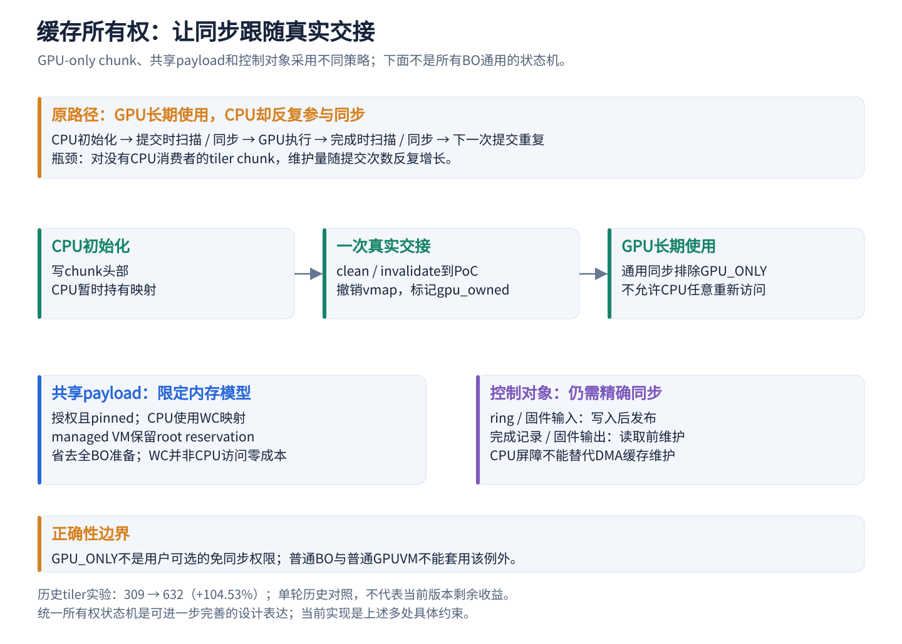
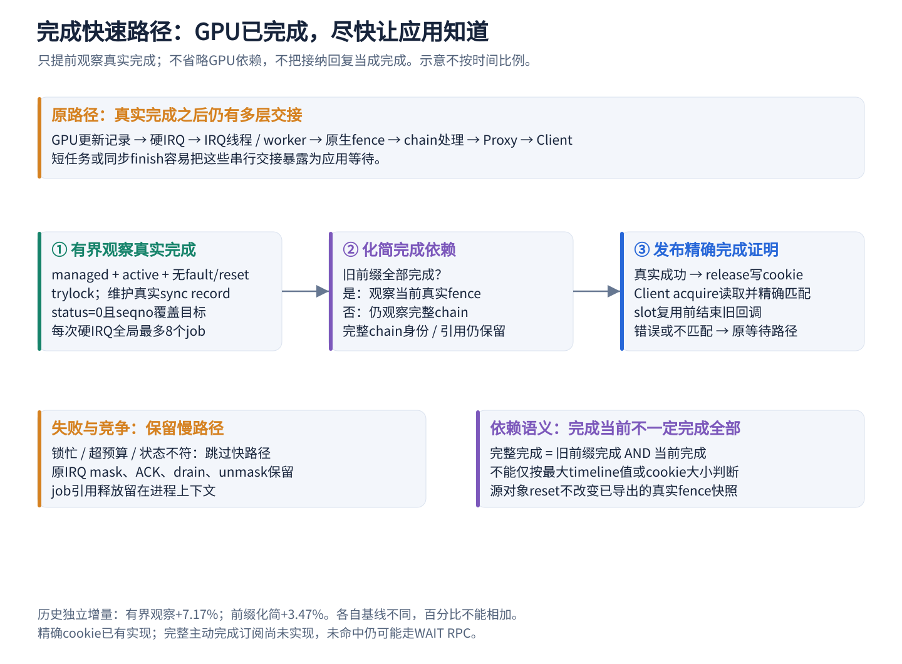
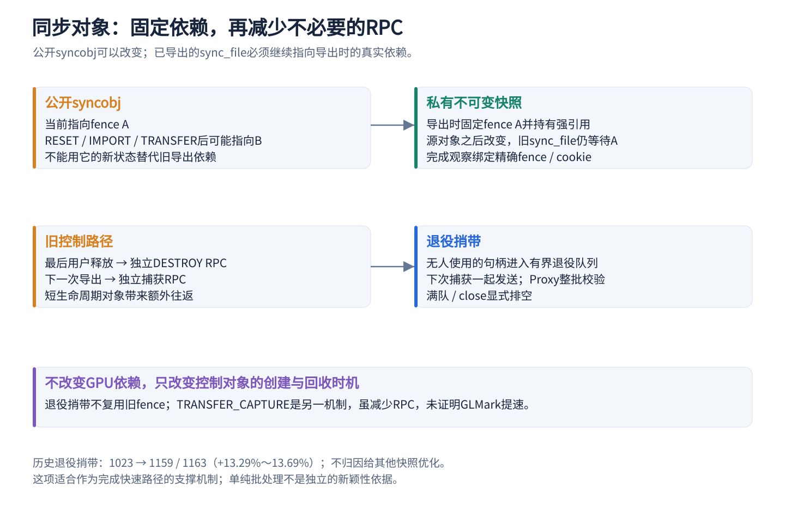
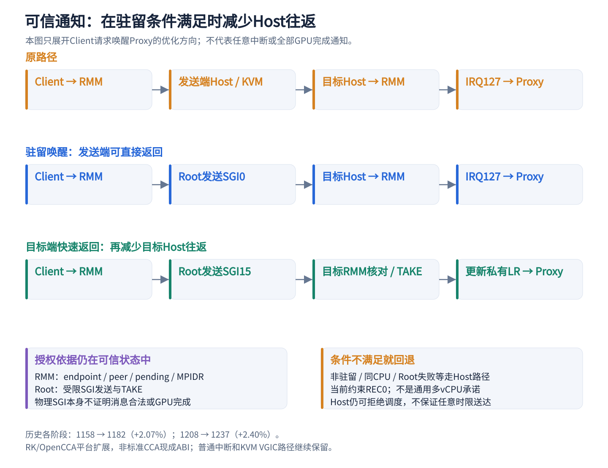

# GPU共享的三个重点优化：代码、原理与论文贡献潜力

版本：2026-10-28。面向当前ProxyClient / OpenCCA项目，结合本地代码和1405冻结组合的既有报告，讲清楚三个最值得深入的系统优化。**未改运行代码，无新增性能测量**；本文是机制讲解和贡献凝练，不宣称已经完成与已有论文的新颖性对比。

完整优化目录与数据见[性能优化全解](GPU_PROXYCLIENT_OPTIMIZATION_DESIGN_GUIDE_20261025.md)，当前版本认定见[CURRENT_BASELINE](CURRENT_BASELINE.md)。下文代码片段为真实源码节选，省略部分以文字说明；图中箭头表示处理或依赖顺序，不表示时间比例。

Notion专题页：[GPU共享的三个重点优化](https://www.notion.so/407659a3b8cc8162b959f93d93325ba9)。

## 1. 先理解：GPU共享为什么会变慢

共享模式中，应用在Client VM内生成GPU工作，通过前端驱动向Proxy VM发请求；Proxy调用真实Panthor驱动控制GPU。大块数据可共享同一批物理页，控制请求则需要跨VM传递和校验。

开销来自三个不同地方：**数据已经共享，缓存却可能反复维护；GPU已经完成，应用却还没看到；请求已经发出，通知却还要经过多次Host交接。** 三个重点优化分别解决这三个问题。

| 重点机制 | 要消除的重复工作或等待 | 特色与技术难点 |
| --- | --- | --- |
| 对象用途与所有权约束下的缓存管理 | 对不再由CPU使用的数据反复同步，对全部已映射BO逐次准备 | 将缓存一致性与对象用途、CPU映射、页的固定及生命周期共同约束 |
| 保持原生依赖语义的完成快速路径 | GPU真实完成后的线程交接、依赖链处理和远端查询 | 真实完成记录、硬IRQ预算、完整依赖、回调竞争与引用回收必须一致 |
| 驻留Realm的可信通知快速路径 | 请求唤醒中的发送端及目标端Host往返 | 物理提示与可信pending分离，绑定真实端点与CPU，保留条件回退 |

三者可以组合，但不是相互替代：缓存管理保证数据可见，完成路径确认特定工作结束，通知让对端及时检查状态。通知到达本身不能证明任务结束。

阅读时会遇到几个缩写：**GPUVM**是GPU使用的地址空间；**managed VM**是本项目按受控共享内存模型创建的GPUVM；**PoC**是相关访问者能够一致观察数据的位置；**WC**是write-combining CPU映射属性；**MPIDR**用于标识CPU亲和关系；**LR**是GIC用于保存虚拟中断状态的寄存器。它们分别关联地址空间、内存可见性和中断投递，不是同一种隔离机制。

## 2. 重点一：让缓存同步跟随真实的数据交接

### 2.1 原路径为什么慢

BO是GPU使用的内存对象。为了让非一致的CPU/GPU看到彼此的写入，驱动需要执行clean、invalidate等缓存维护。CPU的release/acquire屏障只约束相应CPU内存操作的顺序，不能代替DMA缓存维护。

问题出在维护粒度：tiler heap chunk主要供GPU执行图形任务时使用，CPU只在创建时初始化头部。如果每次提交、完成都把这些对象重新扫描、同步，CPU就一直在为没有CPU读者的数据付费。任务越碎、提交越频繁，问题越突出。



### 2.2 代码如何把一次交接做完整

入口在[panthor_heap.c](../../Linux-Guest-GPU/drivers/gpu/drm/panthor/panthor_heap.c)：chunk创建时同时设置内部`PANTHOR_BO_GPU_ONLY`和`DRM_PANTHOR_BO_NO_MMAP`，CPU写好头部后调用`panthor_kernel_bo_handoff_to_gpu()`。

交接实现在[panthor_gem.c](../../Linux-Guest-GPU/drivers/gpu/drm/panthor/panthor_gem.c)约153行。它先验证对象标志、CPU映射及交接状态；对于Realm私有BO，执行以下真实维护：

```c
flush_kernel_vmap_range(kbo->kmap, panthor_kernel_bo_size(kbo));
dma_wmb();
ret = panthor_gem_sync_realm_private_bo(bo, 0,
    panthor_kernel_bo_size(kbo), DMA_BIDIRECTIONAL);
```

只有维护成功，才撤销CPU映射并记录GPU持有状态：

```c
panthor_kernel_bo_vunmap(kbo);
kbo->gpu_owned = true;
```

这里既要让初始化写入到达PoC，也要避免CPU残留脏缓存行以后覆盖GPU的新写入。后续`panthor_gem_needs_realm_sync()`排除GPU_ONLY对象，因而省掉反复维护。**这依赖于对象按受控流程创建和交接，不能随意给普通BO加标志跳过同步。**

### 2.3 为什么共享payload和控制对象还需要不同处理

共享payload仍可能由Client CPU读写，不能照搬tiler的“CPU不再访问”假设。当前managed路径依赖授权、pinned共享页、WC CPU映射和冲突WB别名处理；它也有相应的映射引用和生命周期约束。

[panthor_mmu.c](../../Linux-Guest-GPU/drivers/gpu/drm/panthor/panthor_mmu.c)的`panthor_vm_prepare_mapped_bos_resvs()`先准备GPUVM root reservation，再对managed VM跳过全BO准备：

```c
ret = drm_gpuvm_prepare_vm(&vm->base, exec, slot_count);
if (ret)
    return ret;
if (vm->managed_vmshm)
    return 0;
return drm_gpuvm_prepare_objects(&vm->base, exec, slot_count);
```

这是一种限定内存模型后的特化，不是删除GPUVM同步责任。普通GPUVM继续原路径；内部WB ring、固件输入、完成记录仍在实际写入或读取点维护，job也保留真实fence关系。WC减少某些一致性处理负担，但CPU读回、初始化或读改写可能更贵，“零拷贝”不等于所有访问零代价。

### 2.4 性能与论文价值

历史tiler对照中，BO同步均值**605.877→8.075 μs，减少98.67%**；完整720p得分**309→632，+323 / +104.53%**。两者结合说明当时确实消除了大量重复工作。该实验是早期同诊断配置、各一轮的对照，不是当前1405版本的独立消融。

适合凝练的贡献是：**针对跨VM GPU共享中的不同对象，利用访问与生命周期约束减少重复缓存维护，同时保留真正发生所有权交接时的可见性保障。** 当前已有多个具体机制，尚不能说已实现统一的所有权状态机。若继续完善，可以统一描述“谁能访问、何时交接、何处同步、何时撤销”，并用CPU重新映射、并发写入及撤销测试验证这些约束。

## 3. 重点二：让真实GPU完成更快地对Client可见

### 3.1 GPU完成与应用继续执行之间还有距离

fence是驱动用来表示某个工作或依赖是否完成的对象。GPU写入真实完成记录后，CPU可能还要经历硬中断、IRQ线程、worker、依赖链回调、Proxy发布，再到Client确认。对于短GPU任务和频繁`finish`的应用，这段等待会反复进入关键路径。

本优化不让GPU少算，也不提前认定任务成功，而是**在真实完成条件已经成立时，减少软件交接和重复判断**。



### 3.2 第一层：在硬IRQ中做有界的真实完成观察

[panthor_sched.c](../../Linux-Guest-GPU/drivers/gpu/drm/panthor/panthor_sched.c)约3478行的`group_observe_raw_completions()`仅对managed GPUVM启用，要求group active、可运行、没有未处理fault/reset。它使用trylock，先维护真实sync record，再读取GPU更新的状态和序号。

下面是内层完成判断的真实节选；进入此处之前还检查了`status==0`等条件：

```c
if (completed == budget ||
    READ_ONCE(syncobj->seqno) < job->done_fence->seqno)
    break;
list_move_tail(&job->node, &group->raw_done_jobs);
dma_fence_signal_locked(job->done_fence);
completed++;
```

外层`panthor_sched_observe_raw_completions()`将每次硬IRQ的完成预算限制为**全局最多8个job**。锁忙、状态不符或预算耗尽时，原线程/worker路径继续处理；原中断mask、ACK、drain、unmask均保留。job移到`raw_done_jobs`后，其引用释放仍留在进程上下文。

技术难点是硬IRQ上下文的约束：不能睡眠，锁和执行量必须受控，fence回调也可能在这里执行，且不能与reset或回收竞争。现有验证尚未覆盖完整lockdep、atomic-sleep配置及长期reset/suspend压力，不能把已有功能验证写成这些边界都已证明。

### 3.3 第二层：在旧依赖已完成时化简观察目标

timeline fence chain可以理解为“旧工作与当前工作都结束，整个依赖才结束”。若旧前缀已经全部完成，继续等待完整chain就可能引入额外回调和irq_work；此时可以只观察当前真实fence。

[panthor_proxy_fence.h](../../Linux-Guest-GPU/drivers/gpu/drm/panthor-proxy/panthor_proxy_fence.h)的`panthor_proxy_fence_callback_get()`执行这一判断：

```c
previous = dma_fence_chain_walk(dma_fence_get(fence));
if (!previous)
    return dma_fence_get(chain->fence);
dma_fence_put(previous);
```

若还存在未完成前缀，函数最终返回完整fence继续观察。Proxy分别持有完整`fence`和用于注册回调的`callback_fence`，不能因为观察目标变简单，就丢弃完整依赖的身份和引用。这里利用的是依赖关系，不能改成“最新timeline数值够大，所以前面都成功”。

### 3.4 第三层：给Client一个便宜但精确的完成证明

[panthor_proxy_drv.c](../../Linux-Guest-GPU/drivers/gpu/drm/panthor-proxy/panthor_proxy_drv.c)的`panthor_proxy_snapshot_publish()`在真实fence成功后发布cookie：

```c
smp_store_release(&watch->record->cookie, watch->cookie);
```

[panthor_client_drv.c](../../Linux-Guest-GPU/drivers/gpu/drm/panthor-client/panthor_client_drv.c)的`panthor_client_cookie_completed()`用acquire读取，并与Client私有保存的预期值精确比较：

```c
return smp_load_acquire(&record->cookie) == cookie;
```

slot是完成页中的位置，cookie区分这次具体观察。slot可以回收再用，但旧cookie不能误认新任务；`panthor_proxy_snapshot_unwatch()`会移除旧回调，或等待正在执行的旧回调结束，再释放引用和slot。错误fence不发布成功cookie，需由原等待/错误路径处理；cookie耗尽也回退，不能用`>=`接受别的完成。

这依赖可信Proxy和会话绑定等既有信任条件，cookie不是密码学签名，不能抵御掌握发布权限的Proxy主动伪造，也不授予内存访问权。它主要提供精确身份与完成关联。当前还没有完整主动完成订阅；未命中时Client仍可能发WAIT RPC。

### 3.5 支撑机制：固定快照，再调整对象生命周期



公开syncobj是可变容器，RESET或IMPORT可能让它指向另一个fence；但已导出的sync_file必须始终代表导出时的依赖。因此Proxy保留私有不可变快照和真实fence强引用。惰性等待、按需物化与本地完成复用都必须尊重这个边界。

回收时，Client的`panthor_client_snapshot_retire()`把无人使用的私有快照句柄放入有界队列，下次捕获时捎带发送。Proxy的`panthor_proxy_snapshot_retire()`校验owner、类型、重复项及source冲突后再退役；队满或close显式排空。它省掉独立DESTROY往返，但不复用旧fence，也不提前释放仍在用的依赖。

`TRANSFER_CAPTURE`则是在一次真实TRANSFER中顺便固定快照，供后续导出复用。它与退役捎带不同，已有off/on实验没有证明GLMark提速，不能把二者收益混在一起。

### 3.6 性能与论文价值

| 机制 | 原报告对照 → 候选 | 变化 | 归因边界 |
| --- | --- | --- | --- |
| 硬IRQ有界观察 | 1311 → 1406 / 1404，均值1405 | +94 / +7.17% | 该项Proxy改动；约54.7万job/轮命中不等于少了同样多IRQ |
| 已完成前缀下直接观察当前fence | 1267 → 1314 / 1308，均值1311 | +44 / +3.47% | 该项Proxy改动；已有1000组真实内核fence语义测试 |
| 提交与完成两端减少线程交接 | 1237 → 1274 / 1260，均值1267 | +30 / +2.43% | 原生内联调度与IRQ线程尾处理的组合 |
| 历史退役捎带 | 1023 → 1159 / 1163 | +136～140 / +13.29%～13.69% | 历史阶段；不是TRANSFER_CAPTURE的收益 |

前三项采用各自报告的完整720p、单Client、128MiB池、CPU1.8GHz/GPU594MHz、RR、telemetry/TRANSFER开启及阶段计时关闭条件；它们是不同阶段的对照，百分比不能相加。历史退役实验的完整条件应按原报告读取。

适合凝练的贡献是：**贯通真实GPU完成记录、原生依赖图和跨VM完成证明，在保持同步语义的前提下减少完成可见性延迟。** 更强的验证应分别计量“GPU记录更新→原生fence→Proxy发布→Client观察→应用恢复”的延迟分布，并对短任务、长任务及多Client进行消融；不能仅由GLMark分数反推出每段节省了多少时间。

## 4. 重点三：在驻留条件下缩短可信通知路径

### 4.1 原路径为什么要经过Host

Client发出请求后，Proxy可能需要被唤醒。普通路径中发送端退出到Host，由KVM kick目标vCPU；目标也经过Host，再进入RMM与Proxy。对频繁的小请求，这种交接可能比请求处理本身更显著。

当前优化利用“Proxy正在另一物理CPU上驻留运行”的条件：让RMM与Root固件发送受限物理提示，逐步减少两端Host往返。**它不改变Host仍可控制调度的事实，也不保证任意通知在固定时限内送达。**



### 4.2 发送端：先检查可信端点，再决定是否直接提示

[runtime/rsi/xshm.c](../../opencca/tf-rmm/runtime/rsi/xshm.c)的`handle_rsi_opencca_xshm()`按当前REC所属Realm查找peer并执行可信服务。服务成功且需要唤醒时，才尝试`xshm_endpoint_resident_target()`和Root KICK。

[xshm_endpoint.c](../../opencca/tf-rmm/runtime/core/xshm_endpoint.c)中的目标查询要求端点存在、启用驻留、当前确实驻留、启用IRQ且有可信pending。目标MPIDR来自可信记录，而不是直接接受请求者任意指定的CPU。

普通驻留唤醒用SGI0，发送Client可直接返回，但目标仍经Host。目标启用fast IRQ后先尝试SGI15；不可用时回退SGI0，最后仍可回退Host提示。读取与更改这些策略状态由`xshm_policy_lock()`串行保护。

### 4.3 目标端：物理SGI只是提示，RMM再次核对

[runtime/core/exit.c](../../opencca/tf-rmm/runtime/core/exit.c)的`handle_exception_irq_lel()`在当前REC0上核对Realm身份、当前MPIDR、可信pending与Root TAKE结果：

```c
if (xshm_endpoint_fast_irq_pending(rec->realm_info.g_rd, mpidr) &&
    monitor_call(SMC_RMM_OPENCCA_XSHM_TAKE,
        0UL, 0UL, 0UL, 0UL, 0UL, 0UL) == 1UL &&
    xshm_endpoint_fast_irq_take(rec->realm_info.g_rd, mpidr)) {
```

条件满足时，RMM读取当前私有LR，调用`xshm_irq_inject()`注入IRQ127，再写回私有LR并直接返回同一Realm。Root的SGI处理与可信pending共同决定能否走快路径；不能仅看“收到了SGI15”就相信有合法消息。普通中断继续退出Host处理，不能吞掉调度中断。

### 4.4 技术特色、安全边界与收益

这项机制的核心是**把事件是否有效的判断保留在可信状态里，同时缩短满足条件时的传递路径**。它不是单纯换一个中断号，也不是把全部GIC虚拟化搬进RMM。

现有优化主要针对Client请求唤醒Proxy，受REC0、驻留及平台集成约束；它不是通用多vCPU方案，也没有完成所有GPU结果事件的主动订阅。中断只提示对端检查共享队列，消息仍需验证，任务完成仍需真实fence证明。

| 阶段 | 原报告对照 → 候选 | 变化 | 改动范围 |
| --- | --- | --- | --- |
| 请求驻留唤醒 | 1158 → 1183 / 1181，均值1182 | +24 / +2.07% | RMM / Root / Proxy配套组合，目标仍经过Host |
| SGI15目标端直接返回 | 1208 → 1234 / 1240，均值1237 | +29 / +2.40% | RMM / Root / Proxy / Host辅助模块组合 |

两项均为各自报告中的同频完整720p单Client对照，条件同前述近期链；不是将1158直接与1237比较所得的单项收益。当前实现是RK/OpenCCA扩展，不能宣称标准CCA已有同样ABI。

适合凝练的贡献是：**基于可信端点与驻留状态的跨Realm通知快速路径，在保留授权判断和回退行为的同时减少非可信Host交接。** 如果继续扩展，重点应是端点关闭/重建、迟到提示、驻留状态变化与多vCPU并发，而非仅增加更多SGI分支。

## 5. 如何把这三项写成可信的论文贡献

可以围绕“降低共享边界带来的重复交接”组织性能部分：先减少数据维护，再缩短完成可见性，最后减少通知交接。同步对象生命周期优化作为第二项的支撑；普通短轮询、日志限频、计划缓存等作为实现细节。

| 候选贡献表述 | 现有基础 | 仍需补充的主要证据 |
| --- | --- | --- |
| 对象所有权约束下的跨VM GPU缓存管理 | GPU-only交接、managed路径、控制对象精确维护 | 统一约束说明；当前版本消融；WC CPU代价及错误交接负例 |
| 保持原生依赖语义的完成快速路径 | 有界观察、前缀化简、精确cookie、不可变快照 | 分段延迟分布；并发取消/回收压力；硬IRQ与reset验证 |
| 基于可信驻留状态的跨Realm通知 | 受限KICK/TAKE、私有pending与LR、Host回退 | 驻留变化/关闭竞争；尾延迟和CPU占用；完整事件安全测试 |

没有独立对照的组件不单独分配提分；多个组件共同变化只归因组合效果。近期完整保留链1158→1405为+247 / +21.33%，不能用各项百分比相加，也不能将其全部归因给本文三项。对ML和多Client的通用收益必须另测。

这些是最值得凝练的**系统机制候选**，不是已经证实的“首次提出”。缓存所有权、fence、批处理和SGI本身均不是新概念；论文的新颖性需要落在本项目如何组合并落实跨VM、非一致GPU和CCA的约束，以及相对已有系统减少了哪些必要路径成本。

## 6. 代码与实验依据

源码以本文相对路径链接定位，行号仅是阅读提示；工作树代码存在不等于所有分支已被1405冻结镜像执行。

| 阅读目的 | 代码入口 / 原始报告 |
| --- | --- |
| chunk创建与真实交接 | `panthor_heap.c:148,179`；`panthor_gem.c:120,153` |
| managed提交约束 | `panthor_mmu.c`：`panthor_vm_prepare_mapped_bos_resvs()` / `panthor_vm_sync_mapped_bos()` |
| 真实完成观察 | `panthor_sched.c:3478`；[提前完成报告](GPU_RAW_FENCE_COMPLETION_OPTIMIZATION_20261024.md) |
| 前缀化简与回调生命周期 | `panthor_proxy_fence.h`；[回调优化报告](GPU_FENCE_CALLBACK_OPTIMIZATION_20261024.md) |
| 提交/完成交接组合 | [原生交接优化报告](GPU_NATIVE_HANDOFF_OPTIMIZATION_20261024.md) |
| cookie、快照与退役 | `panthor_proxy_drv.c`：`panthor_proxy_snapshot_publish()` / `panthor_proxy_snapshot_unwatch()` / `panthor_proxy_snapshot_retire()`；`panthor_client_drv.c`：`panthor_client_cookie_completed()` / `panthor_client_snapshot_retire()` |
| 驻留状态与发送端KICK | `runtime/core/xshm_endpoint.c:122`；`runtime/rsi/xshm.c`；[驻留唤醒报告](GPU_RESIDENT_REQUEST_WAKE_20261024.md) |
| 目标端可信返回 | `runtime/core/exit.c:604`；[目标端IRQ报告](GPU_TARGET_IRQ_RETURN_OPTIMIZATION_20261024.md) |
| tiler与早期演进、原始命令与日志 | [性能优化全解](GPU_PROXYCLIENT_OPTIMIZATION_DESIGN_GUIDE_20261025.md)的收益表与历史附录，以及其中引用的原始报告；历史归档仅作证据 |
| 当前正确性覆盖与未测边界 | [正确性与通用性审查](GPU_OPTIMIZATION_CORRECTNESS_AND_GENERALITY_REVIEW_20261025.md) |

每项原始报告保留run-id、命令、退出码和日志位置，本文未重新运行，不另行生成硬件PASS。文档整理记录：讲清三个重点机制｜对照版本与分数为上述历史报告→本次无新版分数｜无新增分差｜未改测试条件、未执行硬件测试｜仅正文与SVG/PNG生成，脚本`python3 scripts/analysis/render-gpu-core-optimizations.py`｜保留为解释文档，创新性与扩展设计待验证。

配图源文件位于`assets/gpu-core-optimizations-20261028/`，重绘入口为`scripts/analysis/render-gpu-core-optimizations.py`。需要Noto Sans CJK SC等中文字体；系统未安装时，可通过`--fontconfig <字体配置文件>`指定。本控制机使用`--fontconfig build/clientproxy-guide-20261022/fonts.conf`完成渲染，PNG已直接随文档保留。
