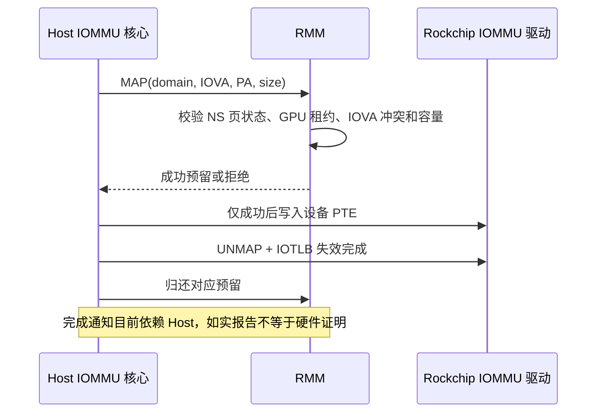

# 其他设备 DMA 防护开发与验证

**范围更新：** 用户随后明确，本轮仅要求使用 IOMMU 的设备在建立映射时不能映射 GPU
受保护物理页，无 IOMMU 的直接 DMA 暂不考虑。当前实现与验收入口见
[IOMMU 映射防火墙](IOMMU_MAPPING_FIREWALL_20261018.md)。
下文保留此前更广范围的实验与失败证据；PL330/DDR 硬件防火墙不再作为本轮准入功能的阻塞条件。

日期：2026-10-18。状态：**软件映射准入已实现；直接驱动页表配置及三套 PL330 的真实 DMA 均成功绕过，完整防护尚未建立。**
本报告记录开发候选，不替代已冻结的性能基线。没有修改 Client/Proxy 协议或 GPU 提交路径。

## 1. 当前硬件与安全定位

当前 RK3588/Mali-G610 属于第二种假设：GPU 使用自己的 MMU，运行设备树的 GPU 节点没有
`iommus`，也不属于 Host 的 IOMMU group；不能把芯片上其他位置存在的 SMMUv3 当成 GPU 的 S2。
GPUVM 管理承担不同 Client 的地址空间控制，但当前基线尚未实现完整的跨 Group shadow 页表隔离。

其他设备走另一条路径：VOP 和多个编解码器使用 Rockchip IOMMU。仅限制 GPU 页表不能阻止
这些设备访问 GPU 所在物理页，需要同时约束其他设备的映射和配置。
另有三套 PL330 控制器没有 IOMMU，真实传输无需经过 `iommu_map()`；第 3.4 节已验证
它们可以读写测试所有的 RMM 委托页，不能仅靠增加 IOMMU 映射 hook 覆盖全部 DMA。
当前 OpenCCA 的 GPT/GPC 有模拟边界，不提供真实 Host 不可绕过的物理机密隔离。

本轮只新增可检验的软件策略及绕过探针，没有给未实现的硬件能力设置成功标志。

## 2. 新增的数据路径



### 2.1 必须双向检查

两个方向都检查，避免“先建 DMA 映射，再把同一页交给 Realm/GPU”的时序绕过：

| 操作 | 准入规则 |
| --- | --- |
| 创建其他设备 DMA 映射 | PA 全范围必须是 RMM 已知的 NS DRAM，不能命中 GPU 租约页；同 domain 的 IOVA 不能重叠 |
| NS 页委托给 Realm | 对应 PA 不得存在 DMA 映射预留 |
| 获取 GPU 租约 | PA 不得命中已登记的其他设备映射；批量失败回滚新增引用 |
| 解除设备映射 | 先删 PTE 并完成驱动失效操作，再释放软件预留 |
| 释放部分区间 | 先验证完整覆盖，再原子更新区间；缺口或容量不足保留预留，不提前放行 |

不能只保护“GPU 当前 bind 的 BO”：GPU unmap 后的 BO 仍可能包含秘密。
因此 Host DMA 准入拒绝**所有已委托 Realm 的页**，直到真正 undelegate。
RMI 的既有 `xshm_policy_lock` 串行化 MAP 与页面委托；GPU/DMA 记录使用同一租约锁。

### 2.2 实现入口

| 模块 | 文件与职责 |
| --- | --- |
| RMM 区间与租约 | [opencca_gpu_lease.c](../../opencca/tf-rmm/runtime/core/opencca_gpu_lease.c)：DMA 区间、GPU 冲突、拆分、回滚 |
| RMM 页状态检查与 ABI | [opencca_gpu.c](../../opencca/tf-rmm/runtime/rsi/opencca_gpu.c)：NS 状态校验、MAP/UNMAP、STATUS |
| 页面委托反向检查 | [granule.c](../../opencca/tf-rmm/runtime/rmi/granule.c)：DMA 预留存在时拒绝 delegate |
| Host 接口 | [opencca-dma-guard.h](../../Linux-Host-GPU/drivers/iommu/opencca-dma-guard.h)：SMC 预留、分块、错误回滚 |
| Linux 映射生命周期 | [iommu.c](../../Linux-Host-GPU/drivers/iommu/iommu.c)：PTE 发布前准入，失效后释放 |
| 单元测试 | [opencca_dma_guard_test.c](../../opencca/tf-rmm/runtime/tests/opencca_dma_guard_test.c) |
| 板端负例 | [opencca_dma_probe.c](../../GPU-SFTP/tests/dma-guard/opencca_dma_probe.c)：真实驱动页表与绕过检查 |
| 真实 DMA 负例 | [opencca_dma_transfer_probe.c](../../GPU-SFTP/tests/dma-guard/opencca_dma_transfer_probe.c)：独占 PL330 通道、普通页正例与委托页实际读写 |

开发 ABI：`0xc400016a` 为 MAP/UNMAP，`0xc400016b` 为 STATUS。
STATUS 版本为 1，硬件保护 flags 为 **0**。
Host 指针仅作 domain cookie，不是可信设备身份。
Host `CONFIG_OPENCCA_DMA_GUARD` 默认关闭；本次候选显式开启。

资源边界：最多 1024 个 DMA 区间；单次预留最多 2 MiB，Host 对更大区间分块。
部分解除映射可能增加区间数量。容量不足拒绝操作，存在可用性影响；不是任意规模设备负载的验证。
非 DRAM/MMIO 和超出 RMM 已知范围的映射目前拒绝，不能视为完整 Linux 设备兼容方案。

## 3. 测试与真实失败

### 3.1 控制机策略测试

命令：`bash scripts/check/check-dma-guard.sh`，退出 0。
ASan/UBSan 下，原 GPU 租约容量、归属、引用、回滚、复用测试及新增 DMA 测试通过。
新增检查覆盖两个申请方向、物理别名、跨 domain、部分解除映射、中间拆分、覆盖缺口、
对齐/零长度/溢出、1024 区间耗尽与回收。原始输出：`build/dma-guard-20261018/unit-results.log`。

### 3.2 首轮板端准入与绕过

run-id：`dma-guard-admission-20261018`；外层退出 **2**，记录 **FAILED**。

```bash
python3 scripts/maintenance/lab-run.py --run-id dma-guard-admission-20261018 -- \
  python3 scripts/run/run-dma-guard.py \
  --module build/dma-guard-20261018/probe-module/opencca_dma_probe.ko
```

| 检查 | 结果 |
| --- | --- |
| 普通 NS 页映射与地址解析 | PASS |
| DMA 已映射页拒绝 delegate | PASS |
| unmap 后允许 delegate | PASS |
| 已委托页的新映射拒绝 | PASS，要求具体 `-EPERM` 且无 PTE |
| 覆盖受保护页的大区间映射拒绝 | PASS |
| undelegate 后允许重新映射 | PASS |
| PTE 清理及 DMA 预留恢复到测试前计数 | PASS，结束预留 0 |
| 绕过通用接口，直接调用驱动 map_pages | **FAIL_BYPASS_DETECTED**，成功建立 4096 字节映射 |
| 真正启动外设 DMA 读取受保护页 | 首轮 **NOT_RUN**；后续自有委托页读写见第 3.4 节 |
| 硬件防火墙、配置保护和复位保持 | **NOT_RUN / 未实现** |

探针 domain 未挂接实际设备；没有读取其他 Realm 数据。
成功写入 PTE 已足以证伪“所有页表修改都被可信组件强制检查”，但不等于观测到实际数据泄露。
外层失败不会因为准入子项通过而改写为总体 PASS。
摘要：[首轮结果](evidence/dma-guard-20261018/dma-guard-admission-20261018-dma-guard.json)。
原始增量日志：`build/lab-runs/dma-guard-admission-20261018/kernel-delta.log`。

### 3.3 GPU 兼容性和性能

`dma-guard-live-gpu-20261018` 在 GPU 活动期间增加映射负例，
`live_gpu_page_mapping_denied=PASS`，最终预留计数恢复为 0。
该轮完整 720p 得分 **1166**，`COMPUTE_CHECK=PASS`、`GLMARK_VALIDATE=PASS`、
`GPU_SMOKE_RESULT=PASS`；同样观测到直接驱动页表写入绕过。
探针运行于该轮初始化过程，性能比较另以不加载探针的独立运行记录。

该轮 GPU 子进程退出 0，两个 Realm 退出码均为 0，内核健康检查无 fault/timeout/warning/Oops，
Host CPU/GPU 频率和驱动恢复、无残留 VM/loop。外层仍因配置绕过返回 2，准确保留失败。
摘要：[活动 GPU 验证](evidence/dma-guard-20261018/dma-guard-live-gpu-20261018-summary.json)、
[DMA 子项](evidence/dma-guard-20261018/dma-guard-live-gpu-20261018-dma-guard.json)。
独立无探针轮 `dma-guard-clean-720-20261018` 退出 **0**，完整 720p **1169**。
相对旧基线 1171 / 1170 的均值 1170.5，差 **−1.5 分 / −0.13%**；
相对旧版两次各为 −2 分 / −0.17%、−1 分 / −0.09%。
正确性、validation、完整场景、清理与两 Realm 内核健康检查通过，VM 退出码均为 0，
Host CPU/GPU 配置、驱动恢复，无 VM/loop 残留。
这是单次独立测量，不证明稳定退化，也不证明零开销。
摘要：[独立轮](evidence/dma-guard-20261018/dma-guard-clean-720-20261018-summary.json)、
[命令和退出码](evidence/dma-guard-20261018/dma-guard-clean-720-20261018-result.json)。
原始输出：`build/dma-guard-20261018/clean-720.log`；
完整板端归档：`build/dma-guard-20261018/board-runs/dma-guard-clean-720-20261018/`。

```bash
python3 scripts/maintenance/lab-run.py --run-id dma-guard-clean-720-20261018 -- \
  python3 scripts/run/run-realm-xshm.py --images build/safe-optimization-20261018/final \
  --workload glmark --performance --benchmark-only --suite --profiles glmark-720
```

统一记录：DMA 准入开发与兼容性检查｜旧版 1171/1170（均值 1170.5）→本版独立 1169｜
−1.5 / −0.13%｜Host/RMM 同时变更、RMM 日志等级不同，无其他 DMA 压力｜
run-id、命令、退出 0 与日志如上｜**保留为开发候选，硬件配置保护待实现；不晋升安全基线**。

双 Client `dma-guard-two-client-20261018` 退出 **0**：两个 Client **各 17 项 API marker**、
实际 GPU 计算、共享页检查、权限负例和 IRQ127 负例/合并检查通过。
三个 Realm 退出码均为 0，内核健康检查通过，Host 驱动/CPU 状态恢复，无 VM/loop 残留。
provider replacement 生命周期专项未执行，1080p、ResNet 与其他多项性能回归未执行，不称为 32/32。
摘要：[双 Client](evidence/dma-guard-20261018/dma-guard-two-client-20261018-summary.json)、
[逐 Client API 与统一判定](evidence/dma-guard-20261018/validation.json)。

```bash
python3 scripts/maintenance/lab-run.py --run-id dma-guard-two-client-20261018 -- \
  python3 scripts/run/run-realm-xshm.py --images build/safe-optimization-20261018/final \
  --workload compute
```

最终 harness 补充收尾错误判定后，`dma-guard-final-admission-20261018` 再次验证相同准入和配置绕过结果，
退出 2；测试模块与策略代码未变，仅 runner 错误路径收尾加强。
[最终结果](evidence/dma-guard-20261018/dma-guard-final-admission-20261018-dma-guard.json)。

可比条件：Guest 冻结输入、默认 256 MiB 池、1280×720、完整 33 场景、
null-noop/finish、GPU 请求 600 MHz/实际 594 MHz 与旧基线一致。
但 Host/RMM 同时改变，且本轮 RMM `LOG_LEVEL=50`，旧 BO 容量基线为 40；
两者均 Debug、RSI_LOG_LEVEL=0、ENABLE_OPENCCA_PERF=0。
CPU 未固定恒频，也没有制造其他 DMA 设备并发负载。
因此只能观察组合差异，不能用这两轮分数估计单个 hook 的精确开销、并发最坏开销或稳定回退。

### 3.4 三套 PL330 的真实 DMA 读写负例

新增可卸载模块与 runner 的 `--transfer` 模式；**未改 Host/RMM/Guest 运行实现，未重新部署固件或内核**。
三套 PL330 的运行设备树均没有 `iommus` 属性，探针还检查其 DMA device 没有 IOMMU domain。
只通过 DMAengine 申请指定空闲通道，不解绑驱动、不抢占已有 DMA 使用者。

每套控制器先完成 4096 字节普通 NS 页拷贝正例，然后测试两种攻击时序：

1. **存量映射：** 先 `dma_map_page()`，再委托目标页；委托成功后 DMA 写入并读回。
2. **新增映射：** 先委托目标页，再 `dma_map_page()`；映射成功后 DMA 写入并读回。

每种时序都校验写入与读回 cookie 完成，成功解除委托后再逐字节验证两个缓冲区；
每张页面 4096/4096 字节匹配。目标始终是模块自行分配的页面，仅处于 RMM `DELEGATED`
状态，**不是已归属某个活动 Realm 的数据页，也不是活动 GPU BO**。
不能把这一结果表述为已经读取真实客户秘密；它证明软件委托状态和现有 hook 没有阻止该设备 DMA。

| 控制器 / 独占通道 | 普通页正例 | 存量映射后委托：DMA 写入、读回 | 委托后新增映射：DMA 写入、读回 | 模块、通道与预留恢复 | 外层退出 |
| --- | --- | --- | --- | --- | --- |
| `fea10000 / dma0chan10` | PASS | **防护失败，两次传输及数据校验成功** | **防护失败，两次传输及数据校验成功** | PASS | **2** |
| `fea30000 / dma1chan0` | PASS | **防护失败，两次传输及数据校验成功** | **防护失败，两次传输及数据校验成功** | PASS | **2** |
| `fed10000 / dma2chan0` | PASS | **防护失败，两次传输及数据校验成功** | **防护失败，两次传输及数据校验成功** | PASS | **2** |

三轮合计 **6 个防护失败场景**、15 次完成且逐字节校验的 DMA 拷贝。
每轮 13 个探针执行/恢复检查均通过，**这不是 13 项安全防护通过**。
三个通道均 `in_use: 0→0`，DMA 预留 `0→0`，模块卸载退出 0，无新增 BUG/Oops/WARNING。
sysfs 的 `memcpy_count/bytes_transferred` 在本驱动路径没有增长，传输结论依据完成 cookie 和数据校验，
不能把未增长的 sysfs 计数当成传输证据。

run-id 分别为 `dma-guard-real-rw-dmac0-20261018`、`dma-guard-real-rw-dmac1-20261018`、
`dma-guard-real-rw-dmac2-20261018`。命令示例：

```bash
python3 scripts/maintenance/lab-run.py --run-id dma-guard-real-rw-dmac0-20261018 -- \
  python3 scripts/run/run-dma-guard.py --transfer \
  --module build/dma-guard-20261018/transfer-module-v2/opencca_dma_transfer_probe.ko
```

后两轮分别增加 `--transfer-controller fea30000.dma-controller --transfer-channel dma1chan0`
与 `--transfer-controller fed10000.dma-controller --transfer-channel dma2chan0`。
逐轮命令、退出码、输入哈希及日志 SHA 见 [真实 DMA 汇总](evidence/dma-guard-20261018/transfer-validation.json)，
原始日志在 `build/lab-runs/<run-id>/kernel-delta.log`，已回收至控制机。
测试源码与 runner 哈希另存 [本阶段源码](evidence/dma-guard-20261018/source-hashes-transfer.json)，
不覆盖先前准入/性能实验的输入证据。

此前单向写入探针 `dma-guard-real-transfer-20261018` 也复现两种时序，退出 2；
后续改为完整写入/读回，不把初轮重复计入三控制器统计。
新 runner 的旧准入模式复测 `dma-guard-runner-compat-20261018`：10 项准入/回收检查通过、
直接驱动 PTE 绕过依旧成立，外层退出 2；真实 DMA 模式未替代旧负例。

统一记录：补齐真实 DMA 访问验证｜原候选独立 720p 1169→本阶段 **未测**｜分差/百分比不适用｜
只新增测试模块与 runner，未改 Host/RMM/Guest 运行实现；测试时无 GPU 负载｜上述 run-id、命令、
退出 2 和日志｜**保留负例；不据此宣称提分或硬件隔离通过**。

## 4. 为什么还不构成完整防护

1. **PTE/MMIO 可绕过。** Host 可直接调用驱动页表函数，甚至直接写内存；本轮已验证前者。
2. **UNMAP 通知可伪造。** RMM 不持有真实设备页表和失效控制权，不能验证 Host 是否真的删表并完成失效。
3. **入口不完整。** 三套无 IOMMU 的 PL330 已验证实际 DMA 读写绕过；identity/bypass domain、设备私有页表及固件控制路径也不经过通用 `iommu_map()`，本轮未逐一实测后几类。
4. **存量和生命周期未闭合。** 启动前映射、设备复位、域重挂、固件重配和 suspend/resume 后恢复需要可信策略。
5. **当前物理平台有模拟边界。** 不能依靠软件租约阻止不受硬件限制的总线事务或 Host CPU 物理访问。

所以，当前代码对应第二种硬件场景的**准入策略原型**，还不是第二种场景完整安全实现。
也没有实现每个 Group 的 shadow GPU 页表隔离，不能把 Linux/GPUVM 资源管理等同于完整恶意任务隔离证明。

## 5. 完整机制的下一步

必须先确定其他设备 DMA 的强制执行点，再增加功能：

- 若使用硬件防火墙：由 Root 独占配置，确定 GPU/其他 master 的真实编号、区域粒度、地址别名和复位语义；
  同时允许受信 GPU 访问、拒绝其他 DMA requester。需要实际事务的允许/拒绝和复位测试。
- 若迁移设备 IOMMU 管理到可信组件：页表及 MMIO 必须对 Host 不可写，由可信组件发布/撤销 PTE、执行失效；
  移除依赖 Host 如实报告的释放语义，并封住 bypass/identity 路径。

当前 TF-A 提供 RK3588 DDR/DSU/SYSMEM 防火墙初始化代码，但公开资料尚未核实 GPU 的
防火墙 master 编号以及可支持目标分配布局的配置方案，因此本轮没有盲写这些安全寄存器。
QoS master ID 不能直接当成防火墙 master index。
仅把同样的 hook 再加到驱动内部不能解决恶意 Host 写 PTE/MMIO 的问题。

现有寄存器定义只给出 16 个 DDR 区域和 42 个 master 权限寄存器；区域编码以 MiB 为单位。
当前 BO 按页分配，不能直接把任意散页当成硬件精确保护区域，也不能为了凑齐区域而
误封其中其他系统内存。要落地需先确定对齐保护池、GPU master 对应权限及 Root 配置独占，
再验证普通 GPU DMA 允许、其他 DMA 拒绝、地址别名和复位后的保护保持。
这些信息目前缺乏足以用于板端配置的可靠依据；因此没有猜测 master 编号或写入未知配置。

### 5.1 按完整目标核验

| 要求 | 当前证据 | 判定 |
| --- | --- | --- |
| 普通 IOMMU 映射遵守页面归属与生命周期 | RMM/Host 准入检查及板端正常接口负例 | 已实现此入口，不能覆盖所有配置路径 |
| 所有其他设备 DMA 均无法触达受保护页 | 三套 PL330 的两种时序均实际读写成功 | **反例成立，未达到** |
| Host 无法绕过页表与配置保护 | 驱动 `map_pages` 直接绕过；Root 独占 MMIO 未实现/验证 | **未达到** |
| 撤销先完成真实失效，再释放保护 | 目前依赖 Host 通知，缺少可信硬件完成证明 | **未达到** |
| reset、重挂、固件和 suspend/resume 保持策略 | 未执行硬件保护生命周期验证 | **NOT_RUN** |
| GPU 正常执行与性能不受破坏 | 既有候选独立 720p 1169、双 Client 功能通过 | 兼容性证据有效，不证明上述隔离 |

继续实现硬件防火墙需要平台安全寄存器/master 映射及访问权限、复位语义的可靠资料，
或具有已验证强制执行能力的平台。当前工作未完成完整防护，不以探针复现成功替代目标完成。

资料核对：Arm 官方 [RK3588 防火墙定义](https://github.com/ARM-software/arm-trusted-firmware/blob/master/plat/rockchip/rk3588/drivers/secure/secure.h)
与仓库内寄存器布局一致；另一个固定版本的 [TF-A 安全初始化](https://chromium.googlesource.com/chromiumos/third_party/arm-trusted-firmware/+/1e0f9ee243186d191c7129b0b859fbdbf46ee563/plat/rockchip/rk3588/drivers/secure/secure.c)
还提示物理地址解码别名必须覆盖。外部实现仅用于设计核对，本轮没有更新上游版本或套用未经板端验证的补丁。

## 6. 构建、部署与回退

| 输入 | 状态 |
| --- | --- |
| RMM Debug 固件 | 构建与布局检查 PASS，`dma-guard-rmm-deploy-20261018` 部署退出 0 |
| Host Image | `6.12.0-opencca-pmthor-opp3`，配置相对运行基线仅增加 DMA_GUARD；构建退出 0 |
| Host 部署 | `dma-guard-host-deploy-v4-20261018` 退出 0，新 boot ID 与配置校验成功 |
| 测试模块 | 与既有 Host release 匹配；加载外部测试模块造成预期 kernel taint，不等于内核 Oops |

输入：[SHA-256](evidence/dma-guard-20261018/inputs.json)；
实现：[源码 SHA-256](evidence/dma-guard-20261018/source-hashes.json)。
Guest 冻结输入仍为 `build/safe-optimization-20261018/final/`，本轮没有改 Guest 代码。

本轮构建命令（Host `.config` 来自原匹配配置，仅打开 DMA_GUARD；固件打包仍使用原匹配 BL31 和既有装载布局）：

```bash
CROSS_COMPILE=aarch64-linux-gnu- cmake --fresh -S opencca/tf-rmm \
  -B build/dma-guard-20261018/rmm -DCROSS_COMPILE=aarch64-linux-gnu- \
  -DRMM_CONFIG=rk3588_defcfg -DCMAKE_BUILD_TYPE=Debug \
  -DLOG_LEVEL=50 -DRSI_LOG_LEVEL=0 -DENABLE_OPENCCA_PERF=0
cmake --build build/dma-guard-20261018/rmm -j8
make -C Linux-Host-GPU O="$PWD/build/dma-guard-20261018/host" \
  ARCH=arm64 CROSS_COMPILE=aarch64-linux-gnu- \
  LOCALVERSION=-opencca-pmthor-opp3 -j8 Image
```

RMM 工具链读取环境 `CROSS_COMPILE`，不能只传 CMake 同名变量。
固件部署入口先检查 ELF LOAD/BSS 交叠；Host 部署入口先检查 Image 内置 release、
模块 release、实际 SD 分区布局和配置差异，再备份实际分区。

保留失败：初次 Host 构建的 SMCCC 常量拼写错误已修正；U-Boot dirty-source 与 pylibfdt 构建失败后，
改用隔离源码、现有已验证 pylibfdt 和系统 dtc 构建成功。
Host 部署前三次分别因 extlinux 路径、重复启动项、启动分区双副本空间不足而在替换内核前停止。
第四次在控制机完整分区备份和板端原内核备份均校验后原位更新；不是断电原子更新。
这些失败日志保留于 `build/dma-guard-20261018/`，不删除或冒充首轮通过。

回退材料只在忽略的构建目录中保留：

- 原 SD 启动固件：`build/firmware-runs/dma-guard-rmm-deploy-20261018/sd-boot-before.bin`。
- 更新前 SD kernel 分区：`build/host-runs/dma-guard-host-deploy-v4-20261018/sd-kernel-before.img`。
- 原 Host Image SHA：`9eb02466ea282125bd29cab14bd0c04a88849dab8b840cb551a482d1d3fbeacf`。

恢复须按环境手册持有 Pi 租约并确认 SD storage 2，不能刷 eMMC。
本次候选未发布到 Git，也不将编译缓存、原始日志或凭据纳入仓库。

## 7. 收尾状态与产物

`dma-guard-staging-cleanup-20261018` 退出 0，逐个核对 SHA、大小、修改时间、挂载及打开 fd 后，
移除本轮 4 份重复内核上传和 3 份测试模块上传，释放 **174,852,416 字节 / 166.75 MiB**。
失败日志、控制机构建输入、SD 回退分区及板端原内核备份保留；没有清理其他运行的对象。
[清理明细](evidence/dma-guard-20261018/staging-cleanup.json)。

最终资源检查退出 0，Pi 空闲约 15.60 GiB、RK 13.89 GiB，未发现实验进程或 loop 残留。
RK 当前为本次开发候选 `6.12.0-opencca-pmthor-opp3 #1`、DMA_GUARD=y，
测试模块已卸载，CPU 恢复 0–1，GPU 为 pmthor。
[Host 状态](evidence/dma-guard-20261018/final-host-state.json)、
[资源](evidence/dma-guard-20261018/final-resources.json)、
[Host GPU/内核健康检查](evidence/dma-guard-20261018/final-host-health.json)。
Host 启动仍有原组合已有的 mmcblk1p3 FAT/efi 挂载错误，本轮未修复；不把 GPU 健康检查当成所有系统服务正常。

冻结性能基线尚未更换，当前板端候选与旧基线的 Host/RMM 哈希不同。
整体判定仍为 **PARTIAL / INCOMPLETE**。配置绕过及 PL330 实际读写绕过已有失败证据；
硬件防火墙的有效阻断、配置独占和复位保持仍未实现/验证。

真实 DMA 阶段另经 `dma-guard-transfer-cleanup-20261018`（退出 0）清理 5 份已验证不再使用的
模块上传副本，释放 **454,632 字节**；模块、通道和页面已正常回收，Host/RMM/Guest 输入未变。
原始实验与源码/模块已归档到控制机 `build/dma-guard-20261018/transfer-evidence.tar.gz` 并校验，
失败证据与原有回退材料保留。[本阶段归档与清理](evidence/dma-guard-20261018/transfer-hygiene.json)。
