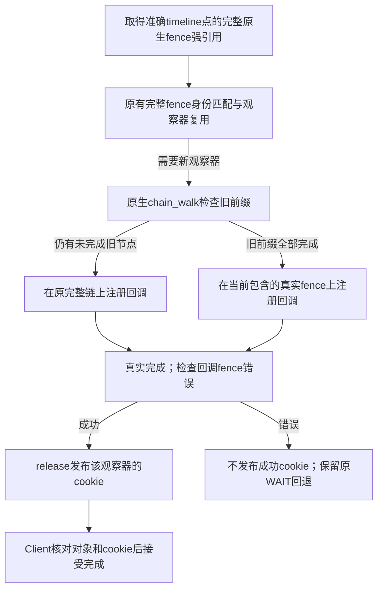

# 完整前缀已完成时，直接观察当前原生 fence

状态：**已保留，两轮1314/1308，均值1311，成为最新本地基线。**
后续基线1405见[有界提前完成报告](GPU_RAW_FENCE_COMPLETION_OPTIMIZATION_20261024.md)；
本报告保留1311阶段证据。完整720p均值对1267为**+44/+3.47%**，两轮分别+3.71%和+3.24%，
均超过3%。双Client和选定ML正确性、当前源码/实际SD固件及板端镜像审计
均通过，计为继续探索后的第一项新增有效设计；此前四项不重复计数。
1158→1182→1208→1237→1267→1311，累计**+153/+13.21%**。
下一项独立2%整数门槛为1338。没有提交或发布。

## 原理与实现

原有Proxy在完整原生timeline链上注册完成回调。Linux的
`dma_fence_chain_cb()`通过`irq_work`继续检查链；ARM64的
`arch_irq_work_raise()`向自身发送IPI，在当前Realm实现上涉及RMM和Host。
先前诊断发现487972次SGI陷入与487905次真实job接近，但没有完成SGI编号/
调用来源的匹配，不把全部SGI归因于该回调，也不声称本轮已测得减少多少SGI。

新设计仍持有捕获时的**完整原生链**，用Linux原有
`dma_fence_chain_walk()`确认旧前缀。只有返回NULL、证明没有尚未完成的
旧节点，才在当前节点包含的真实fence上注册回调；旧前缀未完成时观察原整链。
这是完成证明的等价化简，不把最新job完成当成任意timeline完成。

Proxy观察器分别持有`fence`与`callback_fence`强引用。前者始终用于完整
快照身份和复用判断；后者用于注册/移除回调。销毁先移除回调，已经运行时
等待其最后的completion，再释放两份引用和复用slot。对象reset/replace不
改变已捕获的旧链。RPC协议、数量、请求校验、缓存维护、原生调度与快照
句柄均保留；没有修改通用DMA fence实现。

新增计数仅在session销毁时汇总打印，不启用高频计时。源码：
`Linux-Guest-GPU/drivers/gpu/drm/panthor-proxy/panthor_proxy_fence.h`及同目录
`panthor_proxy_drv.c`。机制参考本项目使用的Linux DMA fence/chain和ARM64
irq_work实现，没有套用论文中的性能数字或宣称新的硬件中断机制。

## 实验与验收

统一条件：完整1280×720/33场景，单Client，compact128MiB池，CPU
performance且min=max1.8GHz，GPU请求600/实际594MHz，round-robin，
telemetry和TRANSFER capture开启，RPC/通知/完成阶段计时关闭。仅Proxy
Image改变；Client/initrd/runner/Host/RMM/Root及SGI15模块与1267相同。

| 验证 | 结果 |
| --- | --- |
| 内核语义测试 | PASS，1000组、2000个fence创建/释放；先后完成、取消、错误及引用检查 |
| 完整720p A | 1314，+47/+3.71%；wrapper/runner rc0，33场景、validation26/1/6、VM0/0、健康/恢复及11文件SHA通过 |
| 相同输入完整720p B | 1308，+41/+3.24%；wrapper/runner rc0，33场景、validation26/1/6、VM0/0、健康/恢复及11文件SHA通过 |
| 双Client API/实际GPU计算 | 两侧各18项API、实际计算、权限/IRQ/内存和生命周期检查通过，VM0/0/0，wrapper/runner rc0，10文件SHA通过 |
| GEMM/卷积正确性 | 29.25197/33.77834ms，各100样本、5次预热，正确性通过；VM0/0，wrapper/runner rc0，10文件SHA通过；不宣称ML提速 |

A记录leaf442255/chain71798；主计分session为442007/71749，真实plan
513759次。计数覆盖不同阶段，不把观察器数当成RPC数。对上一档两轮场景FPS
均值，A有26项增加、4项相同、3项下降；单轮分项没有独立统计显著性。
B记录leaf439117/chain74273，实际保留未完成旧前缀的整链路径。

语义测试在实际Host内核使用与Guest逐字节相同的DMA fence/chain实现，
选择helper也与生产候选逐字节一致。覆盖“当前fence先完成、旧前缀仍pending”
时不得提前完成，以及取消、当前fence错误和引用释放；不是完整Proxy集成证明。
实际双Client检查已包含每侧16轮timeline reset/import/destroy/recreate、
128个sync_file在source reset/destroy及DRM关闭后的快照语义，以及64次
import后的target reset/destroy。并非完整并发故障/销毁矩阵。

run-id：`chain-callback-proof-20261024-a`、
`chain-callback-fences-720-20261024-a/b`、
`chain-callback-fences-compute-20261024-a`、
`chain-callback-fences-ml-20261024-a`。完整argv、退出码和资源记录在
`build/lab-runs/<run-id>/`；冻结包、原始日志、采集SHA、构建记录、完整/
独立patch、源码SHA与审计在`build/chain-callback-proof-20261024/`。
首轮Proxy Image SHA为
`de81703272da4ffa9eeeada82a5d9a3d85ac74496bc6385b817dcbeb9be9e3ee`。
第一轮构建rc0且无新增warning。没有刷写Host或固件、没有提交发布。
内核语义模块首轮构建因变量名与内核`current`宏冲突而失败，更名后构建成功；
原失败和后续成功日志均保留，没有把编译失败当成硬件测试失败或删除证据。
1080p、多Client性能、长稳、完整故障矩阵、独立SGI延迟/来源及ML速度对照
未执行，不能继承历史PASS。四项共42份日志SHA核验通过，独立内核语义
测试也已卸载模块并恢复资源。最终输入、源码、命令、退出码、实际SD固件
与当前板端Proxy审计见[验收证据](evidence/fence-callback-20261024/validation.json)。
对应[冻结输入SHA](evidence/fence-callback-20261024/inputs.json)及
[新增/修改源码SHA](evidence/fence-callback-20261024/source-hashes.json)单独保存。
冻结包为`build/chain-callback-proof-20261024/candidate/`，配套既有final1237
固件和SGI15模块；1267冻结包保留回退。完整tracked diff和新增helper源码/
哈希均已冻结，新增header也包含在独立patch中。
