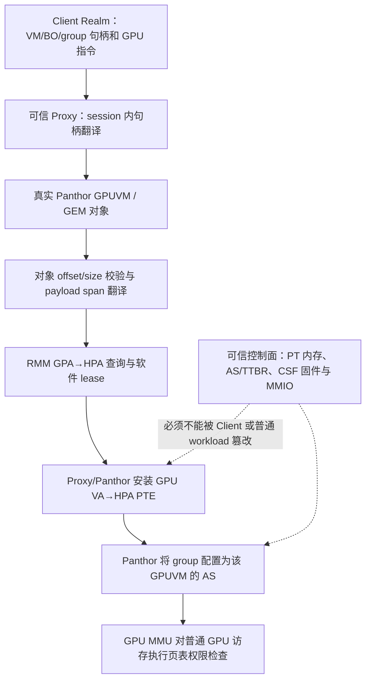
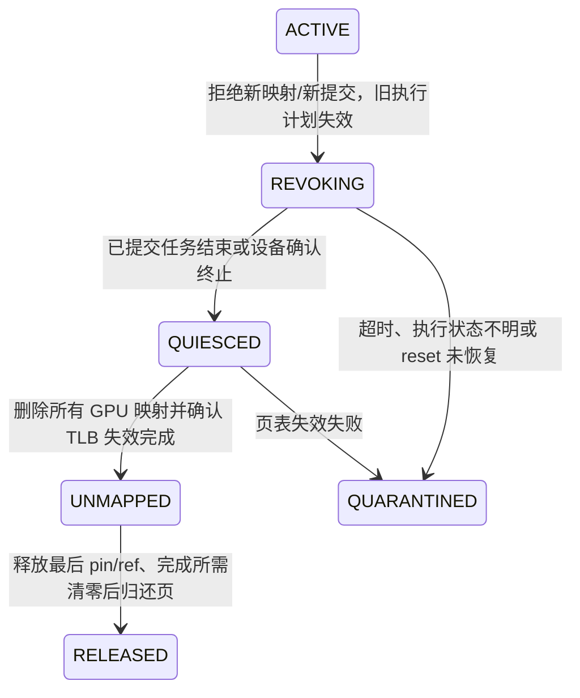

# GPU 隔离调研：论文、公开代码与当前 Realm 代理系统

调研日期：2026-10-18。对象：RK3588 / Mali-G610 / Panthor / Client Realm—Proxy Realm。

**本文是研究与代码对照，不是已经实施的安全改造。未改运行代码，无新增性能测量。** 当前实现以 [CURRENT_BASELINE](CURRENT_BASELINE.md) 为准；本文的建议不替代冻结版本，也不将历史功能 PASS 扩大为恶意 GPU 任务隔离证明。

## 1. 调研结论

最适合当前系统的路线是：**继续由可信 Proxy 创建和控制真实 GPUVM，在映射安装处落实对象归属和权限，在生命周期结束处完成 GPU 停止访问、页表失效和物理页回收的闭环。** 然后再研究把这个控制面缩小到可信 Monitor，以及是否需要同一 GPUVM 内的任务级访存约束。

有四点需要明确。

1. **没有外部 SMMU stage-2，不等于 GPU 任务之间没有内存隔离。** 如果真实 GPU 页表和地址空间选择由可信驱动控制，恶意 shader 的普通访存仍受 GPU MMU 限制。关键是攻击者能否修改页表、替换页表根、获得越权映射或利用驱动漏洞。
2. **GPUVM 是地址空间；group 是调度单位。** 同一 GPUVM 内的多个 group 通常共享其映射。想让互不信任的 group 不能访问彼此的 BO，应分属独立 GPUVM，或者增加软件访存沙箱；单独创建两个 group 不提供这种承诺。
3. **当前实现已有隔离基础，尚缺完整的 GPU 安全论证和专项验证。** Proxy 按 session 翻译 VM/BO 句柄，Panthor 按 GPUVM 创建页表，并把 group 绑定到相应地址空间。这比“Client 可以任意提交 HPA/PTE”更强，但不能据此宣布生命周期、控制内存、残留状态和故障隔离已经全部安全。
4. **任务间隔离与抵御恶意 Proxy/Host 是不同目标。** 当前 Proxy、Panthor 和 GPU 固件仍是可信边界的一部分。RK3588/OpenCCA 的 GPT/GPC 模拟不能提供与真实 CCA 硬件相同的机密性保障。

其中第 1～3 点有本地代码依据，见第 5 节。关于独占执行、可信页表、指令验证和状态清理的不同取舍，见下列论文与代码对照。

## 2. 先定义“GPU 隔离”保护什么

| 维度 | 要阻止的行为 | 仅靠独立 GPU 页表是否足够 |
| --- | --- | --- |
| 地址空间隔离 | A 的 shader 直接读写 B 的 BO、页表或 Proxy 私有数据 | 对普通受翻译访存是基础；还需可信的映射和上下文控制 |
| 控制面隔离 | Client 把别人的句柄、页表根、控制寄存器或固件状态当自己的使用 | 不够；需身份、权限、命令和管理接口检查 |
| 时间与生命周期隔离 | A 释放后继续 DMA，物理页复用为 B 的内存；旧计划访问新对象 | 不够；需引用、撤销、TLB 完成、代际和回收协议 |
| 残留数据隔离 | B 从片上 local memory、寄存器等读到 A 的残留 | 不够；需硬件保证或经过验证的清理机制 |
| 故障与资源隔离 | A 超时、触发 reset、占用所有资源导致 B 失败 | 不够；需配额、抢占、故障域及恢复策略 |
| 侧信道隔离 | A 通过缓存、带宽、计数器或执行时序推断 B | 不够；有硬件分区也不能自动排除所有侧信道 |

威胁模型应逐层增加，不能把不同论文的“安全”直接放在同一尺度上比较。

| 层次 | 攻击者 | 当前研究中的可信基础 | 可研究的目标 |
| --- | --- | --- | --- |
| T0 | 恶意应用和 shader | Client 内核、Proxy、Panthor、固件 | 进程/会话及 GPUVM 之间的读写隔离 |
| T1 | 恶意 Client Realm 内核，可任意构造协议请求和 GPU 指令 | RMM、Proxy、Panthor、固件 | 跨 Client Realm 的 GPU 映射与生命周期隔离 |
| T2 | Proxy 的普通资源管理逻辑也可能恶意 | 独立且不可绕过的映射/提交 Monitor、硬件和固件 | 缩小 TCB；需要重新划分控制权 |
| T3 | 恶意 Host 及其他 DMA 设备 | 真实 CCA/GPC、可信设备控制与证明链等 | 接近机密 GPU 计算的硬件安全承诺 |

T1 下，同一个 Client Realm 内核可以控制该 Realm 已获授权的 CPU 共享池；不能把 Proxy 内部 session 的 API 权限检查解释成对该内核的 CPU 内存隔离。T2/T3 也不是当前平台已经达到的等级。

## 3. 论文和项目总览

“公开代码”表示本次找到的作者/官方实现范围；并不表示所有代码已通过安全审计或能在本项目上直接运行。未确认仓库不等于不存在仓库。

| 工作 | 核心机制和保护对象 | 公开材料/代码状态 | 对本项目的价值与限制 |
| --- | --- | --- | --- |
| **StrongBox，CCS 2022** | TrustZone 中的小型可信组件检查 GPU 映射和任务，控制 GPU 环境 | [作者项目](https://compass.sustech.edu.cn/strongbox/)、[代码](https://github.com/Compass-All/CCS22-StrongBox)；已读关键 TF-A 路径 | 直接参考映射检查、MMIO 与页表保护；原型 Mali/JM 路径不能直接代替 G610/CSF |
| **CAGE，NDSS 2024** | stub/real task 分离；可信 Monitor 重建真实页表、锁定控制面，用 GPU GPT 保护当前 Realm 的 GPU 环境 | [论文](https://www.ndss-symposium.org/wp-content/uploads/2024-763-paper.pdf)、[代码](https://github.com/Compass-All/NDSS24-CAGE)；区分功能与性能原型 | 可借鉴页表增量检查和小 TCB；独占保护模型不能直接当作并发 GPUVM 隔离实现 |
| **PORTAL，IEEE S&P 2025** | P-GPT/N-GPT 拦截未授权 CPU/设备，System Realm 控制 SMMU；设备 S2 做细粒度范围限制 | [论文](https://mainarke.github.io/assets/papers/sp25_sang.pdf)；本次未确认作者公开完整实现仓库 | 参考可信 Broker、归属检查、反向映射和设备交接；通信队列不是 shader 隔离器 |
| **ACAI，USENIX Security 2024** | 可信组件控制设备绑定与 SMMU，保持 CPU/设备映射一致及物理页归属 | [论文](https://www.usenix.org/system/files/usenixsecurity24-sridhara.pdf)、[项目与代码](https://github.com/sectrs-acai/acai) | 将映射一致性写成可检查不变量；没有实际 GPU S2 时须改变强制执行位置 |
| **Graviton，OSDI 2018** | 在 GPU 内可信处理器中执行所有权、上下文保护和安全交接 | [论文与报告](https://www.usenix.org/conference/osdi18/presentation/volos)；本次未确认可复现的完整公开实现 | 理解保护必须覆盖设备控制面；依赖 GPU 硬件改造，不能作为 G610 软件补丁 |
| **CRONUS，MICRO 2022** | 把异构计算拆入隔离 enclave，借助设备内隔离共享资源，用 streaming RPC 协作 | [作者论文](https://i.cs.hku.hk/~heming/papers/micro22-cronus.pdf)、[artifact](https://github.com/hku-systems/cronus)；已读论文与 README | 参考驱动服务分域、异步协作和故障恢复；论文借用设备内隔离能力，没有凭空产生 Mali 硬件分区 |
| **Honeycomb，OSDI 2023** | 静态验证 GPU 二进制访存，结合可信执行入口控制 | [论文](https://www.usenix.org/conference/osdi23/presentation/mai)、[代码](https://github.com/Jiacheng/honeycomb-osdi23-ae)；已读 Rust verifier | 可参考 proof/manifest 缓存与“只执行已验证代码”；公开 validator 面向 AMD RDNA2，不是 Mali 验证器 |
| **Guardian，Middleware 2024** | 在共享 GPU 地址空间中分区，拦截 API，并对 PTX 访存插桩 | [论文](https://arxiv.org/abs/2401.09290)；本次未确认作者公开实现仓库 | 若必须让互不信任任务共享一个 GPUVM，可研究 SFI；需要覆盖全部执行入口及指令访存 |
| **GPUvm，ATC 2014** | GPU 设备虚拟化与受控地址转换 | [论文](https://www.usenix.org/conference/atc14/technical-sessions/presentation/suzuki)；本次未定位完整可复现实验代码 | 提供经典虚拟化背景；不把其结论等同现代 CSF 的实现保证 |
| **gVirt / gHyvi，ATC 2014/2015** | mediated GPU、shadow 页表和受控命令；优化 shadow 维护 | [gVirt](https://www.usenix.org/conference/atc14/technical-sessions/presentation/tian)、[gHyvi](https://www.usenix.org/conference/atc15/technical-session/presentation/dong)；已读 Linux v6.6 GVT-g 路径 | 是可逐函数学习的 shadow 工程实例；Intel 命令格式与硬件假设不能直接搬到 Mali |
| **gVisor nvproxy** | 版本化 GPU ioctl 代理、参数/FD 翻译和允许列表 | [官方安全边界](https://gvisor.dev/docs/user_guide/gpu/)、[代码](https://github.com/google/gvisor/tree/master/pkg/sentry/devices/nvproxy)；已读分派与过滤路径 | 参考协议面缩减和 ABI 管理；官方明确不新增硬件隔离、不验证 DMA buffer |
| **NVIDIA MIG** | 按 GPU instance 分区计算与内存系统资源；同 GI 的 compute instance 仍共享部分资源 | [官方概念说明](https://docs.nvidia.com/datacenter/tesla/mig-user-guide/latest/concepts.html) | 用于理解硬件分区的能力边界；RK3588 不能靠软件配置得到 MIG |
| **LeftoverLocals，2024** | 实证跨进程 GPU local memory 残留，提供多 API 检查程序 | [作者说明](https://leftoverlocals.com/)、[代码](https://github.com/trailofbits/LeftoverLocalsRelease)；已读 README 和一个 listener kernel | 借鉴 canary 残留测试；不能据此宣布 Mali-G610 有同样漏洞 |
| **AMDGPU Process Isolation** | 驱动串行化和 cleaner shader 清理 LDS/GPR；硬件允许时按分区管理 | [内核文档](https://kernel.org/doc/html/v6.16/gpu/amdgpu/process-isolation.html)、Linux v6.16 实现 | 证明“映射隔离”与“状态清理”是独立工程；不能直接在 Mali 执行 AMD cleaner |
| **PhantomMap，NDSS 2026** | 分析 Mali 内存映射和物理页验证缺口，给出静态分析器与驱动防护 | [论文入口](https://www.ndss-symposium.org/ndss-paper/phantommap-gpu-assisted-kernel-exploitation/)、[代码](https://github.com/Lotuhu/PhantomMap)；已读 CSF 防护 patch 和分析器路径 | 对本项目最直接的近期审计参考：所有分配、导入、别名、CPU/GPU 重映射路径必须一致检查 |
| **Behind Bars，USENIX Security 2026** | 实证 MIG 分区间 memory barrier 引起的缓存时序影响 | [会议论文入口](https://www.usenix.org/conference/usenixsecurity26/presentation/gu-cheng)；本次核对官方摘要，未做全文代码复现 | 独立地址空间和硬件资源分区不等于完全侧信道安全 |
| **LGT4CG，JSA 2026** | GPU Shield 保护 CPU–GPU 控制通道，Task Monitor 按离线元数据验证执行原语 | [出版方全文](https://doi.org/10.1016/j.sysarc.2026.103886)；本次读设计/实现部分，未确认公开代码 | 参考小型 Monitor 与预验证执行；EL2 性能原型和预期 EL3 部署要区分，固定模型比动态图形更适合 |
| **AgileOS，2026-06 预印本** | 客户端库 shim、可信 worker 持有真实 CUDA context，保护模块区并插入 PTX 访存 guard | [作者预印本](https://arxiv.org/abs/2606.06697)；正文明确是初步设计，完整结果和代码拟后续发布 | 与 Proxy/Client 和对象表思路接近，不能再以“有代理/对象句柄”为创新；不能当作成熟 Mali 隔离代码 |
| **PAGE404，2026-10-14 预印本** | GH200 页面迁移计数器及中断路径造成跨 MIG 时序通道 | [作者预印本](https://arxiv.org/abs/2610.20962)；本次核对摘要和版本日期 | 作为最新旁证：应审计共享资源与服务事件；不是当前 RK3588 的漏洞证据 |

推荐优先顺序：**PhantomMap + 本地 Panthor → StrongBox/CAGE → GVT-g → ACAI/PORTAL → Honeycomb/Guardian → 状态清理与侧信道研究。** 前三步最容易产生与当前代码直接相关的改进。

## 4. 公开代码中值得逐函数参考的机制

以下链接固定到本次核对的提交或内核版本，避免以后上游更新造成“看的是另一版代码”。这是关键路径抽查，不是完整仓库审计，也没有构建或复现这些系统。

### 4.1 CAGE：shadow 的关键是控制权和校验，不是简单复制任务

核对提交：`c79106486eae0e55b49c3f98c0d4bb01a3d3a91b`。

- [shadow_task.c](https://github.com/Compass-All/NDSS24-CAGE/blob/c79106486eae0e55b49c3f98c0d4bb01a3d3a91b/performance-prototype/arm-tf/bl31/shadow_task.c)：`reconstuct_gpupte()`（仓库原拼写）消费更新区段，`insert_real_gpupte_entries()` 创建真实映射，另有 stub/real buffer 对应关系和完整性检查。
- [功能原型 gpu_protect.c](https://github.com/Compass-All/NDSS24-CAGE/blob/c79106486eae0e55b49c3f98c0d4bb01a3d3a91b/functionality-prototype/arm-tf/bl31/gpu_protect.c)：`init_ccaext_gpu_gpt_realm()`、`enable_gpummio_protect()`、`gptconfig_enable_gpu_gpt_protection()` 控制 GPU 视图和 MMIO 保护。
- [artifact 说明](https://github.com/Compass-All/NDSS24-CAGE/blob/c79106486eae0e55b49c3f98c0d4bb01a3d3a91b/Readme.md)：性能原型在 Juno/Mali-T624 等平台模拟 CCA 行为；功能原型用 RME FVP 和 SMMU/test engine 验证。两者证据不能混合成“真实 G610 已具备相同保护”。

对当前系统的启发：让不可信端提交对象/映射变化，由可信端建立真实映射；稳定映射无需每次完整复制和重验。CAGE 在保护任务进入时阻止其他任务并核验 GPU 空闲，还保护页表根所在 MMIO、代码和元数据；它的安全论证围绕这一独占保护区间展开。

因此，**CAGE 的串行化不能简化成“GPU 只有一张 S2 表”**。可信 GPUVM/S2/硬件分区可以成为另一种并发设计的基础，但那需要重新证明控制权、地址空间选择、片上状态及故障处理。CAGE 本身没有完成这套并发方案。

### 4.2 StrongBox：检查映射，还要保护检查结果

核对提交：`8b1502ff2dfc9199d64528b5f3fb4478143aee25`。

- [access.c](https://github.com/Compass-All/CCS22-StrongBox/blob/8b1502ff2dfc9199d64528b5f3fb4478143aee25/arm-tf/bl31/access.c)：`gpu_table_check()`、`read_ttbr_core()`、`check_added_mapping()`、`setup_gpu_tzasc()`，体现页表遍历、可映射页检查与硬件访问控制的组合。
- [gpu_task.c](https://github.com/Compass-All/CCS22-StrongBox/blob/8b1502ff2dfc9199d64528b5f3fb4478143aee25/arm-tf/bl31/gpu_task.c)：`check_task_buffer()`、`submit_atom()`、中断转交和完成处理。

注意代码中的 `s2table_*` 要结合实际硬件路径判断，不能看到函数名就把它们全部解释成“GPU 每个 group 的 SMMU stage-2”。本次可直接参考的是受控映射与环境保护的组织方法。

对当前系统：只在注册计划时检查一次，随后允许 Client 改动被检查的控制结构，就存在检查与使用之间的不一致风险。但也不能反过来说“所有应用 BO 都必须永久只读”：普通可变数据在独立 GPUVM 内合法变化，与通过校验的代码/权限元数据被偷偷替换，是不同问题。

### 4.3 GVT-g：真正的 shadow 页表在哪里建立

核对 Linux **v6.6** 的历史实现；这是学习样本，不作为当前 RK3588 驱动依赖。

- [gtt.c](https://github.com/torvalds/linux/blob/v6.6/drivers/gpu/drm/i915/gvt/gtt.c)：`ppgtt_populate_shadow_entry()` 读取 guest PFN，通过 `intel_gvt_dma_map_guest_page()` 得到受管理的 DMA 地址，再写入 shadow PTE；`ppgtt_write_protection_handler()` 和 `intel_vgpu_flush_post_shadow()` 处理 guest 表更新及延迟同步。
- [cmd_parser.c](https://github.com/torvalds/linux/blob/v6.6/drivers/gpu/drm/i915/gvt/cmd_parser.c)：`intel_gvt_scan_and_shadow_ringbuffer()`、`intel_gvt_scan_engine_context()`；命令和上下文也进入受控扫描流程。

这里的 shadow 是**GPU 实际使用的可信翻译结果**，并非给提交描述符换一个名字。当前 Client 不持有真实 GPU 页表，因此没有必要先发明一套 Client PTE，再影子复制回来；可以直接强化 Proxy 生成的真实 GPUVM 页表。

### 4.4 Honeycomb / Guardian：共享一个地址空间时的软件约束

Honeycomb 核对提交：`220df49c17ea9feb51133dd472bc8d6bed46d8ba`。

- [global_memory.rs](https://github.com/Jiacheng/honeycomb-osdi23-ae/blob/220df49c17ea9feb51133dd472bc8d6bed46d8ba/hypervisor/validator/lib/validator/prover/global_memory.rs)：`prove()` 组合控制流、标量演化、循环界与范围分析；`check_load_inst()` / `check_store_inst()` 处理访存地址和权限，无法解析的地址会产生验证错误。
- [symbolic_heap.rs](https://github.com/Jiacheng/honeycomb-osdi23-ae/blob/220df49c17ea9feb51133dd472bc8d6bed46d8ba/hypervisor/validator/lib/validator/prover/symbolic_heap.rs)：建立带前置条件的符号内存模型。
- [artifact README](https://github.com/Jiacheng/honeycomb-osdi23-ae/blob/220df49c17ea9feb51133dd472bc8d6bed46d8ba/README.md)：公开范围明确包括 RDNA2 binary validator，完整机密执行评估还依赖特定硬件和评估环境。不能把单独运行 validator 当成已经部署整套可信执行链。

Guardian 则选择对 PTX 访存插桩。两类机制的共同前提是：**攻击者不能绕过验证/插桩入口，不能在验证后偷换实际执行的指令和相关约束。** 检查源码或可信编译器生成结果，并不能自然覆盖恶意 Client 直接上传的任意 GPU 二进制。

对 Mali-G610 的迁移成本包括 Valhall 指令、CSF command stream、间接描述符、纹理/图像与其他访存路径。只给普通 buffer load/store 加检查，不足以证明完整图形栈安全。独立 GPUVM 已能满足第一阶段目标时，不建议先承担这套移植成本。

### 4.5 PhantomMap：物理页“是 GPU 页”仍不等于“属于当前租户”

核对提交：`4937977a6cb2b717d21747f0b29ce3393e3861f8`。

- [CSF kbase 防护 patch](https://github.com/Lotuhu/PhantomMap/blob/4937977a6cb2b717d21747f0b29ce3393e3861f8/mitigation/patch/pixel7_csf/kbase.patch)：为分配/导入页标记 `PageGpu`，在 mmap、alias、CSF 映射和 MMU 插页处检查页类型，释放时清除标记。
- [PageAnalyzer.cc](https://github.com/Lotuhu/PhantomMap/blob/4937977a6cb2b717d21747f0b29ce3393e3861f8/analyzer/src/lib/PageAnalyzer.cc)：可作为查找物理页流向和映射入口的静态分析参考。

该 patch 的直接目标是其论文分析的 kbase 映射问题。本项目使用 Panthor，不能直接套用 CVE 或宣布存在相同漏洞。

但它指出了很实用的审计方法：把 GPU 插页、CPU mmap、DMA-BUF/import、别名、故障补页及释放复用放入同一张生命周期图。对多租户系统，还必须在页类型之上验证 **owner、对象范围、授权、generation 和存续引用**。只有一个全局 `is_gpu_page` 标志，不能阻止 A 映射 B 的合法 GPU 页。

### 4.6 nvproxy：代理接口的安全边界

核对提交：`9e9495997e29dfd6fd75a1bb4a941a91725d341a`。

- [frontend.go](https://github.com/google/gvisor/blob/9e9495997e29dfd6fd75a1bb4a941a91725d341a/pkg/sentry/devices/nvproxy/frontend.go)：`frontendFD.Ioctl()`、参数 CopyIn/CopyOut、嵌套 FD 转换与对象操作。
- [seccomp_filters.go](https://github.com/google/gvisor/blob/9e9495997e29dfd6fd75a1bb4a941a91725d341a/pkg/sentry/devices/nvproxy/seccomp_filters.go)：`frontendIoctlFilters()`、`uvmIoctlFilters()` 按能力允许调用。
- [version.go](https://github.com/google/gvisor/blob/9e9495997e29dfd6fd75a1bb4a941a91725d341a/pkg/sentry/devices/nvproxy/version.go)：维护与驱动版本对应的 ABI。

适合参考的是缩小协议入口、明确结构边界和版本约束。官方文档明确说明，允许列表不消除所转发 NVIDIA 驱动本身的漏洞，也不新增硬件级 DMA 隔离。对本项目同样应分别回答“RPC 是否安全”和“GPU 最终能访问哪些页”。

### 4.7 实际驱动的清理机制：AMDGPU

核对 Linux **v6.16**。

- [amdgpu_gfx.c](https://github.com/torvalds/linux/blob/v6.16/drivers/gpu/drm/amd/amdgpu/amdgpu_gfx.c)：`amdgpu_gfx_run_cleaner_shader_job()`、`amdgpu_gfx_set_run_cleaner_shader()` 及 `enforce_isolation` 控制路径。
- [amdgpu_job.c](https://github.com/torvalds/linux/blob/v6.16/drivers/gpu/drm/amd/amdgpu/amdgpu_job.c)：作业依赖处理调用 `amdgpu_device_enforce_isolation()`，把隔离要求纳入调度链。

可借鉴的是“清理也是必须完成的调度依赖”。不要把普通 cache/TLB flush 当作寄存器/local memory 擦除，也不要认为执行一个普通 shader 就一定覆盖 G610 的全部物理存储单元；覆盖范围须依硬件和固件语义验证。

## 5. 当前代码到底已经提供什么

以下针对调研时的本地源码，包括当前未提交的 GPUVM 同步列表补丁；不是仅根据某一个发布提交推断。

### 5.1 从 Client 对象到 GPU 实际页表



本图中的 RMM 查询是安装映射时的操作。**GPU 每次 load/store 不会进入 RMM 查询 lease。** 运行时的直接访存约束来自已经装载的 GPU 页表及硬件上下文。

### 5.2 本地证据与边界

| 环节 | 代码入口 | 本次确认的事实 | 不能直接推出的结论 |
| --- | --- | --- | --- |
| session 对象权限 | [panthor_proxy_drv.c](../../Linux-Guest-GPU/drivers/gpu/drm/panthor-proxy/panthor_proxy_drv.c)，`panthor_proxy_session_vm_bind()` | VM/BO 经当前 session 的表转换后交给真实后端；MAP 不是直接接受 Client HPA | 不能仅凭该入口证明全部 import/恢复/内核映射入口都等价受控 |
| BO 所属池 | 同文件 `panthor_proxy_session_bo_create()` | payload 使用 `session->owner_vmid`，保存对象与真实 BO 的关联 | 不能证明同 Realm 恶意内核无法访问本 Realm 整个 CPU 共享池 |
| 对象边界 | [proxy_vmshm_manager.c](../../Linux-Guest-GPU/drivers/char/proxy_vmshm_manager/proxy_vmshm_manager.c)，`proxy_vmshm_obj_translate()` | 检查加法溢出和对象范围；支持 SG/连续 span；已有 owner/generation/grant 结构 | “存在 generation 字段”不等于页表、计划、撤销和 reset 全链路已经绑定该 generation |
| 独立页表 | [panthor_mmu.c](../../Linux-Guest-GPU/drivers/gpu/drm/panthor/panthor_mmu.c)，`panthor_vm_create()` | 每个 GPUVM 分配自己的 `pgtbl_ops` 和 root；格式为 `ARM_64_PANATHOR_LPAE_S1` | 不是按 group 自动分配独立 SMMU S2，也不自动阻止同 GPUVM group 互访 |
| 映射准备 | 同文件 `panthor_vm_prepare_map_op_ctx()` | 校验 BO 范围、exclusive VM，vmshm backing 从对象翻译 span | 应继续核对 grant 权限与最终 PTE 权限的交集、失效后异步操作和错误回滚 |
| PTE 权限 | 同文件 `flags_to_prot()` / `panthor_gpuva_sm_step_map()` | READONLY/NOEXEC 等标志转换成页表权限，vmshm 路径使用转换后的 prot | Client 请求的映射权限本身不是可信授权上限 |
| 页表根选择 | 同文件 `panthor_mmu_as_enable()` | 对指定 AS 写 `AS_TRANSTAB_LO/HI` 等寄存器，切换包含 flush/update 流程 | AS 的管理逻辑和控制内存仍需纳入 TCB；不能把 PT 保护归功于外部 S2 |
| group 对应 VM | [panthor_sched.c](../../Linux-Guest-GPU/drivers/gpu/drm/panthor/panthor_sched.c) | group 创建从 VM 池取对应 VM；CSG `config = panthor_vm_as(group->vm)` | 两个 group 的 vm_id 相同，仍然共享映射；AS 数量有限，需安全复用 |
| PT 分配 | `panthor_mmu.c` 的 `alloc_pt()`、`panthor_realm_share_pt()` | PT 来自内核分配路径；本地 `share_pt()` 仅校验对齐，无实际 GPT 改写 | 函数名中的 share/protect 不能作为硬件保护证据；还需检查 PT 是否可能被别名/import 映射 |
| GPA/HPA | [io-pgtable-arm.c](../../Linux-Guest-GPU/drivers/iommu/io-pgtable-arm.c)，`panthor_gpa_to_hpa_batch()` | 构建 GPU 表时查询/缓存 HPA；真实 GPU PTE 使用 HPA | 这不是每次 GPU 访存经过的第二阶段翻译 |
| RMM lease | [opencca_gpu.c](../../opencca/tf-rmm/runtime/rsi/opencca_gpu.c)、[opencca_gpu_lease.h](../../opencca/tf-rmm/runtime/include/opencca_gpu_lease.h) | 通过当前调用 Realm 的 RTT 查询地址；软件元数据跟踪 HPA 与 owner/ref；头文件明确不配置设备或 GPT 权限 | 查询者为 Proxy 时，RMM 的 owner 不是天然的 Client session/GPUVM 身份；lease 不能替代这些粒度的授权 |

**因此，较准确的现状表述是：已有可信 Proxy 管理的 GPUVM/MMU 隔离基础，尚未完成针对恶意 Client 的完整映射、控制面和生命周期隔离验证；尚未实现独立的跨 group shadow 机制。** “只有 API 隔离，GPUVM 完全没有隔离作用”也不符合当前代码。

此外，Panthor 为 ring buffer、同步和固件协作创建部分 kernel BO，并可能映射进 workload GPUVM。应按对象用途核对可写范围、固件/用户权限和地址可见性，不能简单假定“所有内核对象都不在 GPU 地址空间中”。

## 6. CAGE、PORTAL、SMMU 与本项目的关系

### 6.1 它们不是对同一威胁模型采用同一种隔离器

| 设计 | 可信控制点 | 运行时硬件检查 | 主要保护边界 |
| --- | --- | --- | --- |
| CAGE | Monitor 控制真实任务、GPU 环境和 GPT 视图 | GPU 翻译 + GPU GPC；功能原型用 SMMU 模拟部分 GPU 行为 | 在不可信软件栈外建立当前任务/Realm 的受保护独占环境 |
| PORTAL | RMM/Monitor 和 System Realm 管理授权与 SMMU | P/N GPT 的 GPC 世界视图 + 设备 S2 翻译范围 | 防未授权 CPU/设备访问 PORTAL region，并限制设备各自的访问范围 |
| ACAI | RMM/Monitor 控制绑定及受保护设备映射 | 可信 SMMU 配置与 CCA 等保护 | 设备独占归属、CPU/设备映射一致性和物理页归属 |
| 本项目当前 | RMM 管共享；可信 Proxy/Panthor 管 GPUVM | GPU 自身页表；无本数据路径的实际 GPU SMMU S2 | 跨 Client 的对象管理和 GPUVM 隔离基础，硬件机密性边界仍有限 |

对于 SMMUv3，SID 选择 STE，设备 S2 的上下文来自 STE。一个 SID/同一活动 STE 不会凭 group_id 自动切到另一套 S2；能否存在多个同时活动的设备 S2 域，取决于设备和互连实际发出哪些可信 SID，以及 SMMU/平台支持。SSID 常用于选择 S1 context，不能笼统认为增加 SSID 就自然增加 S2 隔离域。

同时，设备外层只有一个 S2 域，仍不意味着可信驱动管理的多个内部 GPUVM 不能隔离。问题在于是否允许每个不可信租户自己控制能够指向其他租户 IPA/PA 的内层翻译，以及外层能否再兜底限制它。

### 6.2 PORTAL 的 GPT 与 S2 不重复

PORTAL 将授权共享区呈现为 Normal PAS，以便普通设备访问，但需要防止不可信 VMM 通过 CPU stage-2 或未授权设备映射偷看这些页。P-GPT/N-GPT 解决这层世界视图授权；可信 System Realm 配置设备 S2，限制已授权设备究竟可以访问哪些页。CPU Realm 之间还受各自 RMM stage-2 约束。

PORTAL 的 command queue 供 RMM/System Realm 处理管理请求。论文 §5 的队列内存描述为 RMM 与 System Realm 受控访问，来源身份由 RMM/队列关联；不能把它直接说成 Client 与 System Realm 都任意写的大块共享 payload 池。其方案也不是一个已经定义了每个 shader、group 或 BO 生命周期的 GPU Broker。

### 6.3 不建议把当前方向称为“完整软件 SMMU S2”

软件在 VM_BIND 时检查合法物理页，并交给 GPU MMU 执行，可实现类似 S2 的**授权结果**。但它不意味着拥有一个独立于 GPU S1、不可被不可信驱动修改的第二道硬件翻译。

更准确的研究表述：**由可信 Proxy 强制执行的 GPUVM 映射授权与生命周期隔离。** 若以后允许 Proxy 自己任意改 PTE，这个表述也不再成立，须把真实 PT 写入、页表根切换和相关 MMIO/固件路径一并交给不可绕过的可信组件。

### 6.4 当前 ROCK 5B 能否通过软件让 Mali-G610 使用外置 SMMU

2026-10-18 已通过 SSH 对当前 RK Host 做只读拓扑检查。结论：**按公开硬件连接与当前实机证据，没有可以通过设备树或驱动配置启用的 GPU→外置 SMMU 路径。** 不能把两个现存 SMMU 的 `disabled` 状态误读成“打开就能保护 GPU”。尚无厂商资料表明存在可将 GPU 流量切入它们的路由开关；若以后取得这种资料，应重新评估。

| 检查项 | 本次观察或原始来源 | 含义 |
| --- | --- | --- |
| 板卡和 Host | `Radxa ROCK 5B`；`6.12.0-opencca-pmthor-opp3` | 是当前运行基线的实体 RK3588 |
| GPU | `fb000000.gpu` 绑定 `pmthor`；设备树无 `iommus`；sysfs 无 `iommu_group` | 当前 GPU 没有外置 IOMMU 域绑定；单凭此项不能证明硬件绝无连接 |
| MMU600_PCIE | `0xfc900000`，`arm,smmu-v3`，实机 `disabled` | 公开拓扑连接五个 PCIe 控制器 |
| MMU600_PHP | `0xfcb00000`，`arm,smmu-v3`，实机 `disabled` | 公开拓扑连接 USB3、GMAC、SATA |
| 已出现的外置 IOMMU 分组 | VOP 和五个 video-codec 设备，共六组 | 它们使用 Rockchip IOMMU，不能挪作 GPU 的硬件访问检查点 |

拓扑依据是上游开发者提交的 [RK3588 IOMMU 补丁](https://lists.infradead.org/pipermail/linux-arm-kernel/2024-May/925589.html)，明确列出上述连接，并指向 Rockchip TRM §8.2；后续 [PCIe SMMU 启用补丁](https://lists.infradead.org/pipermail/linux-rockchip/2024-November/052566.html) 只为相应 PCIe 控制器建立 Requester ID→SID 映射。本次直接依据可读取的上游说明核对拓扑，没有成功读取 TRM PDF 本体。

本地 Host 源码位于 `Linux-Host-GPU/arch/arm64/boot/dts/rockchip/rk3588-base.dtsi`：GPU、MMU600_PCIE、MMU600_PHP 是不同节点。设备树描述既有硬件，给 GPU 人为增加 `iommus = <&mmu600_pcie ...>` 不能创造物理连接；即便产生了软件分组，也不能证明 GPU 流量受到该 SMMU 约束。缺失实际连接时，DMA 重映射还可能令 GPU 使用错误地址。

本次只读探针及输出保存在控制机忽略目录 `build/gpu-smmu-audit-20261018/{probe.py,board.json}`。复核命令为 `ssh root@<RK地址> 'python3 -' < build/gpu-smmu-audit-20261018/probe.py`，SSH 认证另行配置，不把凭据写入脚本。本次完整检查及保存探针均退出 **0**，JSON 解析成功；此前密钥认证预检退出 **255**，改用已有实验室认证后完成检查。这些是只读检查结果，不是 GPU workload PASS。

实际 GPU SMMU 启用、改绑、拒绝访问实验和 GPU 性能回归均为 **NOT_RUN**：没有发现硬件路由依据，因此本次没有部署伪造绑定，也没有修改 DTB、内核、固件或板端驱动状态。继续在本板研究可信 GPUVM/shadow 页表隔离；真实外层 SMMU 研究应使用连接在 SMMU 后的设备，例如另行接入的 PCIe 加速器，或采用功能模拟器。启用普通 SMMU 也不自动获得 RME GPC。

变更记录：补充硬件可行性核对｜对照完整720p **1171 / 1170 → 本次未测**｜分差及百分比不适用｜仅只读检查与文档整理｜run-id `gpu-smmu-audit-20261018`，探针命令与 JSON 见上，未运行 GPU workload｜保留研究结论。**未改运行代码，无新增性能测量。**

## 7. 适合当前系统的改进方向

以下是建议，不宣称已经实现。应先审计现有功能，缺什么补什么，不建立第二套重复对象表或空的安全框架。

### 7.1 第一优先级：明确隔离域，把现有 GPUVM 控制收紧

隔离关系建议写成：

```text
Realm endpoint → session → GPUVM → group 集合
                            └→ 经授权映射的 BO 范围
```

一个 Realm 可以有多个 session/GPUVM；同一 GPUVM 内的 group 允许共享该域的映射。不同 Realm 的对象不得因数字句柄相同而混淆。需要组间隔离时给组分配不同 GPUVM，而不是假定 group 本身就是隔离域。

映射安装时至少满足：

```text
MappedPages(GPUVM) ⊆ AuthorizedPages(owner, object, generation)
PTE_permissions ⊆ object/grant_permissions ∩ requested_permissions
ControlPages ∩ WorkloadWritablePages = ∅
Reuse(page) ⇒ OldGPUAccessQuiesced ∧ OldTranslationsInvalidated
```

`ControlPages` 包括真实 PT、页表根选择所依赖的特权状态和安全授权元数据；CSF 需要刻意映射给 workload 的协作对象应分类处理，不能不加分析地全部归到不可访问集合。

授权通常不应简单禁止一切别名：同一 owner 的合法同 BO 多 VA 映射、共享只读 shader/纹理可能是正常需求。必须禁止的是**未授权的跨域别名和权限提升**，并追踪允许共享的引用。ACAI 的独占设备/物理页不变量可作为思路，不能原封不动套到需要共享对象的 Broker。

### 7.2 第二优先级：撤销与 GPU 异步执行闭环

安全撤销顺序应明确到状态与完成条件：



该图表达共享 backing 最终释放前的 GPU 条件。CPU RTT detach、目标 CPU TLB 失效、共享协议权限收回也要在最终复用前完成；具体顺序受引用模型约束，不能照图绕过 CPU 侧条件。

已提交任务仍可能 DMA 时，不得因为 Client 退出或 RMM CPU 映射 detach 就立即重用页面。无法证明设备静止的超时页进入隔离保留状态，不作为成功回收。

现有对象 generation、计划失效、fence、pin 和 RMM 映射守卫已经提供部分机制；研究应检查它们是否闭合，而不是只增加一个 `revoked` 布尔字段。

### 7.3 第三优先级：把控制结构与可变数据区别处理

独立 GPUVM 的内存隔离依赖真实映射不能越权，并不要求应用的每个数据 BO 都冻结。普通 shader 修改自己的输入/输出不应引发全量重新验证。

若引入 shadow task/指令验证，才需要对被验证代码、命令和间接描述符建立“验证内容就是执行内容”的保证：可信快照、只读控制页、版本化内容或受控更新。只复制顶层提交结构，但让它指向 Client 可随时改写的二级结构，不能解决此问题。

性能路径应以对象注册、VM_BIND 或受控内容更新为粒度完成昂贵检查，在稳定计划执行时检查有效代际与引用；这延续当前可复用执行计划的方向。

### 7.4 第四优先级：状态清理、故障范围及并发条件

需要分别回答：普通错误是否仅终止一个 group/GPUVM；哪些错误要求全 GPU reset；reset 后哪些 epoch、映射、cookie、固件输出和缓存必须失效；哪些片上状态由硬件/固件清理。

安全并发至少要求独立 GPUVM 的映射和 AS 绑定可信、控制结构不可跨域篡改，并验证固件/故障路径。**允许并发不等于已经有跨租户 reset 隔离、公平性或侧信道保护。** 如果某些状态只能通过独占清理交接，须明确选择何种安全配置，测量其代价。

### 7.5 长期方向：缩小 Proxy 的可信部分

只有当目标升级为“不信任 Proxy 的大部分驱动/资源管理代码”时，才值得研究独立的 Mapping/Submission Monitor。它必须实际控制：

- 合法物理页集合及其 owner、权限、代际和存续引用；
- 真实 PT 分配、更新、回收和 AS/TTBR 激活；
- 能影响这些状态的 MMIO、固件协作入口和其他 DMA 路径；
- 撤销、reset、TLB/缓存维护及失败隔离。

若 Monitor 只批准一次 HPA，之后 Proxy 仍能自由改真实 PTE/根寄存器，TCB 并没有实质缩小。把逻辑移到 RMM 也不会在缺少实际硬件强制边界的 RK3588 上自动获得恶意 Host 防护。

## 8. 可以形成研究贡献的方向

现有论文已经覆盖代理、对象虚拟化、shadow 页表、共享队列和软件访存沙箱。创新需要落到本项目特有约束下的**组合不变量、不可绕过的强制执行及实测收益**，不能仅以名称新颖作为贡献。

| 候选方向 | 与现有工作的差别应如何表述 | 需要提供的证据 |
| --- | --- | --- |
| **Realm 授权与 GPUVM 映射的生命周期绑定** | RMM 共享池长期存在，但 GPU 权限按 owner/object/generation 精确派生；CPU 与 GPU 两条访问链在撤销/复用前收敛 | 跨域、别名、撤销竞争、旧计划与页复用负例；证明 Client 身份没有被 Proxy 的单一 Realm 身份吞掉 |
| **可复用计划与增量映射验证结合** | 保留当前快速执行计划，按映射版本重验变化项；把昂贵检查移出稳定提交路径 | 证明任何影响权限/控制流的变化都会失效缓存；记录冷启动、稳定提交和频繁 VM_BIND 的开销 |
| **GPU fault/reset 与共享对象代际联合恢复** | reset 时统一使计划、完成证明和失效映射过期；无法确认设备静止的 backing 不复用 | 注入超时/退出/reset 时的无越权、无旧 cookie 成功及资源恢复证据；区分单域故障与全设备故障 |
| **面向 CSF 的最小可信执行控制面** | 不照搬 JM 的 task 重建，而是识别 CSF 下哪些根、队列、固件输入和映射操作必须由小 Monitor 控制 | 特权入口覆盖图、TCB 定量、绕过测试；如果仍信任整个 Proxy/Panthor，应如实列入 TCB |

前三项与现有实现连续，适合先做可证伪的小步实验；第四项工程风险明显更高。这里不宣称“首次”，需要进一步做逐篇差异和复现后再确定论文贡献。

## 9. 后续验证设计：先证明什么，再测什么

本次没有执行以下测试，状态均为 **NOT_RUN**。这是建议的隔离验收，不是继承已有 API 测试的 PASS。

| 属性 | 建议测试 | 成功判据 |
| --- | --- | --- |
| 相同 VA、独立物理页 | A/B 的独立 GPUVM 在同一 VA 写不同 canary，交错/并发执行 | 各自结果正确，无跨域 canary |
| 任意 shader 地址 | A 读取/写入未映射 VA、B 已知使用的 VA、映射边界外 | 未映射访问被拒绝；A 的合法同 VA 映射只访问 A 的 BO；B 数据不变 |
| 对象身份 | 伪造其他 session 的 VM/BO/group、复用数值句柄 | Proxy 拒绝，真实映射不变化 |
| 权限不可提升 | 只读 grant 请求可写映射、越界 offset/size、整型溢出 | 安装前拒绝或最终 PTE 更窄；读写负例验证 |
| 控制页不可映射 | 枚举用户可用映射/import/alias 入口，请求 PT/特权控制内存 | 无可构造的合法授权路径；对特定已知页做受控负例 |
| 同 GPUVM group 语义 | 两组使用同 VM 与分离 VM 分别测试 | 同 VM 共享是预期，分离 VM 不互访；不把前者当漏洞 |
| 生命周期 | submit 与 unmap/revoke/退出竞争，物理页再分配给 B | GPU 旧访问完成前不复用；复用后无旧写入 |
| ABA 与计划 | revoke 后重建同数字对象，再执行旧 plan/cookie | 旧引用明确失败或失效，不能命中新对象 |
| AS 复用 | GPUVM 数量超过硬件 AS 数量，多次驱逐切换 | 无旧翻译串用，所有权和结果正确 |
| 故障恢复 | A 超时、非法访存、全 GPU reset，B 持续运行 | 按已定义故障范围恢复；不把 B 被全 reset 影响掩饰成故障隔离 |
| 状态残留 | 同一物理 GPU 上 writer/reader canary，区分 local memory、寄存器和 DRAM | 明确覆盖的状态类别；未检测到 canary 只说明测试范围，不能证明全部无泄漏 |
| 压力与资源 | 大 BO、碎片、内存不足、异常 teardown | 无提前复用、pin 泄漏和失败后放宽授权 |

安全负例应在受控测试 BO 中设计，不对其他用户负载做数据探测。非法 GPU 访问可能触发设备级 reset，应按实验室独占规则安排。这里的隔离故障测试属于针对新增安全机制的必要验证，不意味着现在重新跑一轮完整性能套件。

性能比较仍遵守当前开发规则：先完整 720p glmark、正确性、内核健康及资源恢复；达到理想分数后才扩大测量。每轮固定镜像、池大小、CPU/GPU 条件与负载，并保存 run-id、命令、退出码和日志。冷启动、稳定帧、多次重绑和撤销延迟应分开测，不能用一个吞吐均值掩盖安全交接停顿。

### 本次调研的性能记录

| 改动目的 | 对照版本与分数 → 本版分数 | 分差 | 条件差异 | run-id / 命令 / 退出码与日志 | 决策 |
| --- | --- | --- | --- | --- | --- |
| GPU 隔离论文和代码调研 | 当前 GPUVM 同步列表完整720p **1171 / 1170** → **未新增测量** | 不适用，不记作 0% 或提分 | 未改运行代码，无新增性能测量 | 无硬件 run-id；未执行构建、部署或硬件测试 | 保留研究文档；方案待实现和验证 |

上述分数仅来自 [当前基线](CURRENT_BASELINE.md)。同期优化历史为 1162/1160 → 1171/1170，均值 +9.5/+0.82%；这是此前列表补丁的结果，**与本文研究没有因果关系**。当前版本也没有因此获得新一轮全项回归 PASS。

## 10. 核对范围、代码版本与阅读路线

### 10.1 代码版本

| 项目 | 本次核对版本 | 核对范围 |
| --- | --- | --- |
| CAGE | `c79106486eae0e55b49c3f98c0d4bb01a3d3a91b` | README、shadow task、GPU 环境保护、功能原型 GPT 路径 |
| StrongBox | `8b1502ff2dfc9199d64528b5f3fb4478143aee25` | TF-A 的 access/task/定义 |
| Honeycomb | `220df49c17ea9feb51133dd472bc8d6bed46d8ba` | README、global memory prover、symbolic heap、部分测试 |
| ACAI | 主仓库 `490966daf6f3be8798db2de99e2ecdce4deccd0e` | manifest/.gitmodules；TFA `cb989c41c6bec82f9e422ead53b3d9ca991c591d` 的 SMMU 初始化抽查；未追完运行时全部 S2 更新路径 |
| PhantomMap | `4937977a6cb2b717d21747f0b29ce3393e3861f8` | CSF mitigation patch、分析器关键文件和说明 |
| LeftoverLocals | `2e5fc857fd6ef53c30f37c0899c03bad6c7560ef` | README、OpenCL listener kernel；未执行 |
| gVisor | `9e9495997e29dfd6fd75a1bb4a941a91725d341a` | nvproxy 分派、过滤与版本表 |
| Linux GVT-g | `v6.6` | gtt / cmd_parser / scheduler 的关键路径 |
| Linux AMDGPU | `v6.16` | gfx cleaner / job 依赖处理 |
| 当前项目 | 调研时工作树 | Proxy VM_BIND/BO、对象 manager、Panthor MMU/scheduler、GPA→HPA、RMM lease；性能版本由 CURRENT_BASELINE 的冻结清单识别 |

CRONUS 本次只核对论文和 artifact README，未深入其实现；Behind Bars、PAGE404 的分析限官方摘要/版本信息。PORTAL、Guardian 和 LGT4CG 的“未确认公开代码”应在后续复现前重新核对。公开源码复用须逐文件检查许可证，不能从“GitHub 可读”推断可直接复制全部代码。

### 10.2 建议阅读顺序

1. 先读 [当前系统代码讲解](REALM_COMMUNICATION_AND_GPU_EXECUTION_CODE_WALKTHROUGH_20261018.md)，然后沿第 5 节的 VM_BIND → payload span → PTE → CSG AS 路径读本地代码，明确现有隔离边界。
2. 读 PhantomMap 的防护 patch，列出本项目所有物理页进入 CPU/GPU 映射的入口，再对照对象归属和释放时序。
3. 对照 StrongBox/CAGE 看可信组件究竟锁住了哪些内容；再读 GVT-g 的 shadow 表更新，区分“任务代理”和“可信实际翻译”。
4. 用 ACAI 的归属/一致性思路与 PORTAL 的 Broker 分工审视 CPU 共享授权和 GPU 映射是否闭合；不要照搬其硬件前提。
5. 只有在确实需要同 GPUVM 内不可信任务隔离时，继续研究 Honeycomb/Guardian 和 Mali 指令覆盖；并行推进残留、reset 与侧信道的边界说明。

研究产物只增加本文；下载的论文、代码摘取和解析依赖放在忽略的 `build/gpu-isolation-research-20261018/`，不是运行载荷或固定子模块输入。本文给出固定版本与原始链接，临时下载可按产物规范清理，不应复制进源码树当作旧版备份。
