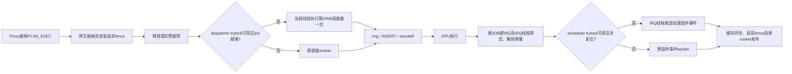

# GPU 提交与完成两端的线程交接优化

状态：**已保留，当前本地基线为1267。** 相同冻结包完整720p
两轮1274／1260，均值1267，对1237增加30分／2.43%；两轮健康、退出和恢复
审计通过。第二轮单独仅+1.86%，按预先记录的均值门槛判定，不声称每轮均达
2%或具有统计显著性。双Client API/实际计算、GEMM/卷积以及源码/实际SD固件
审计全部通过；相对最初1158累计增加109分／9.41%，计为第四项有效组合。
此前单项不足门槛的结果仍保留为失败，不拆成两项成功。

改动目的｜减少GPU提交和完成两端线程交接｜保留1237 → 1274/1260，均值1267｜
+30／+2.43%｜仅Proxy变化，其他冻结输入、频率及配置相同，B额外5点只读条件采样｜下列两轮run-id、
完整命令及日志，四项wrapper/runner均0、42份日志SHA核验｜已保留，基线1267。

## 为什么测试整个路径

当前1237基线的诊断中，PLAN_EXEC同步往返平均37.576μs，其中native同步
接纳10.625μs，异步run_job平均4.022μs。接纳之后仍需等待worker真正写入
GPU ring；GPU中断线程之后，还要由另一个worker处理固件事件和fence。
这些区间可能与RPC/GPU执行重叠，不能直接相加预测分数。

| 候选 | 各自对照 → 分数 | 变化 | 决定 |
| --- | --- | --- | --- |
| 单独内联就绪job调度 | 1208 → 1219 | +11／+0.91% | 已撤回 |
| 单独IRQ线程尾部完成 | 1237 → 1252 | +15／+1.21% | 已撤回 |
| 本文完整组合A | 1237 → 1274 | +37／+2.99% | 性能首轮通过 |
| 本文完整组合B | 1237 → 1260 | +23／+1.86% | 单独未达2%，纳入原定均值 |
| 本文完整组合均值 | 1237 → 1267 | +30／+2.43% | 已保留；选定功能及最终审计通过 |

两个单项使用不同对照，不能将分差或百分比相加。组合同时减少GPU启动前和
完成后的交接；是否形成端到端收益只由新实验判断。没有改变频率、CPU预算、
绑核、worker优先级、轮询窗口、RPC数量、权限检查或真实完成条件。

按两轮场景FPS均值比较，对照1234/1240与候选1274/1260的33场景中，31个
上升、2个持平，无下降；场景变化中位数+2.09%。完整逐场景数据见实验目录
scene-comparison.json，不用某个最高提分场景替代整体门槛或组件归因。



## 实现和并发边界

提交端复用DRM调度器原有select/pop、依赖、credit、backend及fence逻辑，
没有增加第二套调度器。发布job前取得强引用并按scheduler去重；释放全部
drm_exec预留后，trylock尝试执行一次。普通run/free worker与内联路径共用
dispatcher mutex；stop先发布pause，再等待该锁并取消worker。依赖未就绪
或锁忙时保留普通回调和worker，不在Proxy接收线程等待GPU完成。

完成端保留JOB硬IRQ、IRQ线程排空和原设备mask/unmask、ACK顺序。解除屏蔽
后，只用trylock取得scheduler锁；锁忙或reset/pending reset时退回worker，
避免阻塞固件应答。锁内捕获group强引用，锁外用现有completion mutex串行
缓存维护和完整fence完成，随后释放引用。保留DRM unplug临界区和IRQ suspend
中的synchronize_irq，不在硬IRQ中执行可睡眠操作。

两端组合时，IRQ完成不获取dispatcher锁；fence回调仍只排队后续调度工作。
reset/suspend先释放scheduler锁再停止queue，提交内联前已释放预留锁。
这次局部锁依赖检查与选定硬件测试不构成整个驱动并发或长期压力证明。

## 测量条件与证据

完整1280×720、33场景、null-noop／finish、单Client、128MiB紧凑池，
round-robin；CPU最低＝最高1.8GHz，GPU请求600MHz／实际594MHz。
telemetry及TRANSFER capture开启，RPC/通知/完成阶段计时关闭。
仅Proxy Image改变；Client、initrd、runner、SGI15模块及SD固件沿用final1237。

首轮`both-native-handoffs-720-20261024-a`：wrapper/runner均0，33场景，
validation26成功／1既定例外／6无判据，VM退出0/0，Host/Guest健康、无
dmesg覆盖及CPU0–1/pmthor/进程/挂载/loop恢复通过；11份远端日志SHA核验。
直接完成506767次、回退510843次；内联调度入口标记存在。计数包含validation
及退出阶段，只证明机制启用，没有分阶段测量两端各自贡献。

复测`both-native-handoffs-720-20261024-b`同样wrapper/runner均0、33场景、
validation26/1/6、VM0/0、健康及资源恢复通过，11份日志SHA核验。直接完成
501738次、回退506012次，内联入口标记存在。复测中5个现场只读样本均确认
CPU performance/min=max=cur1.8GHz、GPU594MHz及既定线程亲和性；只覆盖采样
窗口，不宣称全程连续监测。性能门槛为首轮至少1262、相同输入复测均值至少
提高2%，不是要求每一轮均提高2%。不追加第三轮寻找更高结果。

统一命令：

```bash
python3 scripts/maintenance/lab-run.py --run-id <run-id> -- \
  python3 scripts/run/run-realm-wake-sgi.py \
  --module build/fast-target-irq-20261024/host-sgi/xshm_wake_sgi.ko -- \
  python3 scripts/run/run-realm-xshm.py \
  --images build/both-native-handoffs-20261024/candidate \
  --workload glmark --performance --benchmark-only --suite --profiles glmark-720 \
  --clients 1 --compact-memory --pool-mib 128 --client-cpu-layout round-robin \
  --cpu-frequency-khz 1800000 --telemetry --transfer-capture
```

精确argv、退出码及实际输入在对应`build/lab-runs/<run-id>/`的result.json和
realm-launch.json；实验目录`build/both-native-handoffs-20261024/`保存设计、
七文件baseline、完整/孤立patch、source-hashes、candidate/hashes、构建、
逐轮run/collect日志、runs证据和audit。构建rc0，无新warning/error。

参考[Linux DRM scheduler](https://www.kernel.org/doc/html/v6.12/gpu/drm-mm.html#gpu-scheduler)
与[workqueue](https://www.kernel.org/doc/html/v6.12/core-api/workqueue.html)的
原生依赖、fence及工作队列语义；实现以仓库内对应源码为准。没有移用论文
收益或假定省去一次排队就必然提分。

## 功能验收与保留结果

`both-native-handoffs-compute-20261024-a`：两个Client分别通过18项API，
实际GPU计算及GPU flow、对象/内存权限、可信IRQ负例与合并检查通过；
wrapper/runner均退出0，VM退出0/0/0，10份日志SHA核验通过。

`both-native-handoffs-ml-20261024-a`：GEMM／卷积正确性通过，实测耗时
29.29452／34.08355ms；wrapper/runner均退出0，VM退出0/0，10份日志核验。
ML仅作为正确性及耗时记录，没有相同条件的开启/关闭对照，不宣称ML提分。
ML入口不支持完整glmark专用的锁频/落核/telemetry参数，因此没有传入这些
参数；其性能数值不能与锁频glmark作为同一条件解释。

两项功能命令均以前文相同lab-run和SGI包装入口执行；冻结包同上。
API使用`--workload compute --transfer-capture`；ML使用
`--workload glmark --performance --benchmark-only --suite --profiles ml-gemm ml-conv
--clients 1 --compact-memory --pool-mib 128 --transfer-capture`。
各项完整argv、run-id、wrapper/runner退出码及日志路径见
[最终验收](evidence/native-handoffs-20261024/validation.json)。

四项共42份远端日志SHA、Host/Guest健康、无dmesg覆盖、辅助模块加载/卸载、
CPU0–1/pmthor/进程/挂载/loop及相应频率恢复通过。四项均观察到内联调度
入口和正数IRQ线程直接完成；功能轮直接/回退分别111/111和221/226。
当前Guest完整diff与冻结candidate-guest.patch一致，七文件
[源码SHA](evidence/native-handoffs-20261024/source-hashes.json)通过；
RMM/Root diff、SGI模块及包装源码与final1237一致。实际SD2的idbloader和
U-Boot SHA分别为`aafd53464c97c69e3498e299eccb78de4d92d777f271be02f8cc66682ad67dc7`
和`5cd766a1e1c38cff67d04319c2e07ebad39171e6c42a914190e4836043be3289`，
与保留固件逐字节核验；本次没有刷写Host或固件。

[冻结输入SHA](evidence/native-handoffs-20261024/inputs.json)对应本节冻结包；
保留仅Proxy变化的完整组合。源码和产物本地保留，未提交或发布。
下一项独立2%整数门槛为1293。若回退，使用实验目录baseline七文件及
baseline-guest.patch，板端通过lab-run恢复final1237 Proxy；RMM/Root和
SGI模块无需变更。此前两个独立候选的未达标结果不被组合PASS改写。

1080p、多Client性能、provider replacement、长期压力及完整硬件对抗矩阵
本轮未执行，不继承旧版本PASS。本轮未重测RPC阶段微秒分解，不将旧1237
计时表当作1267版的测量结果。
