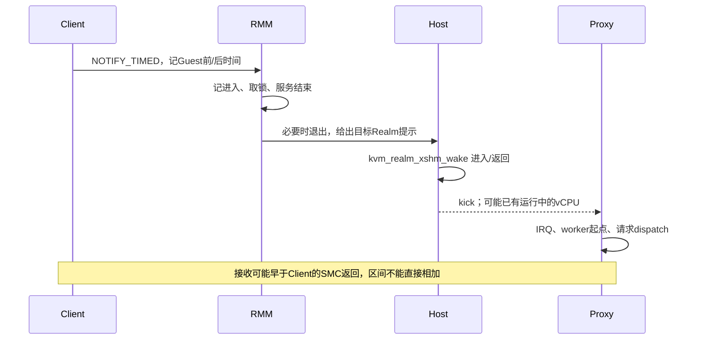

# 请求通知延迟拆分

## 目的与状态

原RPC诊断中，请求入队约0.5μs，通知约23–31μs。本实验分别观测Guest进入RMM、RMM等待策略锁与执行服务、Host唤醒辅助函数、目标调度及Proxy IRQ/worker接收，避免将整个通知往返归因于RMM执行。

TRANSFER顺带捕获不可变快照已单独验收，见[TRANSFER报告](GPU_TRANSFER_CAPTURE_20261022.md)。通知拆分已完成一轮完整720p及跨端时钟配对审计：通知平均30.971μs，其中RMM内部1.042μs；主要时间落在RMM结束至Guest返回的区间，不能把整个通知时长称为RMM服务执行时间。计时ABI的授权、合并、关闭后拒绝及时间戳返回已通过三Realm实测；GPU完成回传另行验证。

## 实现和时钟

`--notify-trace`默认关闭。启用后，双方Guest读取物理计数器`CNTPCT_EL0`，按100ms周期内前2ms采样。采样请求使用新的`NOTIFY_TIMED=18`，RMM仍执行原有经过端点/通道身份验证的NOTIFY；原命令、pending/ack/armed、IRQ所有权和Host提示的权限含义保持不变。REGISTER以能力位64协商支持。

成功的计时命令只使用现有五个SMC返回寄存器：x0状态；x1进入时间；x2取得策略锁时间；x3退出服务并解锁后的时间；x4高32位计数频率、低位Host退出提示。不能从Guest的`ktime_get_ns()`跨VM相减，也不能将Host退出提示解释为访问授权。

本项冻结Guest每侧最多32768条记录，Host模块最多262144条，丢弃数均输出；后续[完成回传](GPU_COMPLETION_LATENCY_20261022.md)候选将Guest容量扩为65536条，不替换本项输入。确定性时间窗在整轮中取样，跨窗口的通知/接收可能无法配对；统计器分别记录不匹配项，不用零延迟补齐。



Host外部模块对`kvm_realm_xshm_wake()`使用kretprobe，对`sched_wakeup`/`sched_switch`使用tracepoint；使用与Guest一致的计数器和时间窗，只记录涉及Firecracker vCPU的调度事件。包装脚本在同一lab租约内装载、收集、卸载，不改Host Image或全局tracefs配置。

## 判定边界

分析器按channel、sequence、type匹配Client请求和Proxy接收，用summary记录的vCPU TID匹配Host辅助函数。所有频率/采样窗口必须一致，Guest前后时间必须包住RMM时间；丢弃记录、kretprobe missed及错误状态会导致分析失败。

- RMM等待锁、服务以及Guest进入/返回分别统计。
- Host辅助函数仅在对应Client通知区间内匹配；有明确目标wakeup和switch时才统计目标调度等待。
- 没有`sched_wakeup`只能记为未观测到该事件，不能证明目标正在运行或将其调度延迟设为零。
- IRQ会广播并合并，worker可处理多个请求。IRQ→worker只能称同一worker观察到的间隔，不能为每个请求独占归因；已在排空队列的请求另列。
- Proxy接收可能与源通知返回重叠；各阶段有不同样本集合，不能将表中平均数相加当总延迟。
- 本项尚不等于GPU fence完成至Client确认的测量。

## 验证记录

| 项目 | 状态 | 证据 |
| --- | --- | --- |
| Client/Proxy、Host诊断模块 | 构建通过，退出0 | `build/notify-latency-20261022/build-{client,proxy}-sampled.log`、`build-host-trace-final.log`；Host模块release显式匹配`6.12.0-opencca-pmthor-opp3` |
| RMM、U-Boot及布局 | 构建/布局通过 | `checkpoint-rmm.log`、`build-uboot.log`；RMM ELF SHA `47c479824b871b1a37413565481baa6097e4f0c91ee8b60550398651b324e3ee` |
| SD2固件部署/启动 | PASS，退出0 | `notify-timing-firmware-20261022-a`；`build/firmware-runs/<run-id>/`保存真实启动区备份、UART、布局和刷写日志；Realm能力1，Pi/RK恢复检查通过 |
| 新组合完整720p门槛 | PASS，1152分 | `notify-kernel-gate-720-20261022-a`，不启用通知诊断；lab/采集/审计退出0，正确性、健康、退出0/0、租约归零与Pi/RK恢复通过 |
| 带通知诊断的完整720p/时钟配对 | PASS，1141分 | `notify-breakdown-720-20261022-a`；lab/采集/常规审计/时钟分析退出0，完整33场景、validation与clean、内核健康、退出0/0、租约归零及资源恢复通过 |
| 计时ABI首次尝试 | FAIL，探针预期错误 | `notify-timed-abi-20261022-a`，退出1；此前ACK=2，探针错误要求新通知后ACK=0，实际正确保留2；尚未执行的后续检查不记PASS，三个Realm正常退出0 |
| 计时ABI授权/合并/关闭后拒绝 | PASS，退出0 | `notify-timed-abi-20261022-b`；未accept状态拒绝2、外部Realm拒绝1、正常通知/合并成功、关闭后拒绝2，时间戳及打包频率/提示通过；lab/采集退出0，三Realm退出0/0/0，Host健康及资源恢复通过。仅修正runner预期，未改固件，原失败证据保留 |

## 计时结果

Guest两侧与Host均为24MHz物理计数器，采样周期2400000 ticks、窗口48000 ticks。Client18938条、Proxy19576条、Host19190条，丢弃均0，kretprobe missed=0。18938次通知的Guest时间全部包住RMM时间，18930次匹配到同一Client vCPU的Host辅助函数；两条辅助函数跨采样边界未匹配。18900次请求匹配Proxy dispatch，38条接收跨窗口未匹配；其中215次dispatch早于源通知返回，说明两端确实重叠。

| 区间 | 样本数 | 平均（μs） | p50（μs） | p95（μs） | p99（μs） |
| --- | ---: | ---: | ---: | ---: | ---: |
| Client通知总时长 | 18938 | 30.971 | 28.583 | 45.500 | 123.451 |
| Guest调用前→RMM入口 | 18938 | 0.683 | 0.583 | 0.875 | 1.167 |
| RMM等待策略锁 | 18938 | 0.170 | 0.292 | 0.292 | 0.292 |
| RMM取锁后服务/解锁 | 18938 | 0.872 | 0.875 | 1.167 | 1.167 |
| RMM内部合计 | 18938 | 1.042 | 1.167 | 1.458 | 1.458 |
| RMM结束→Host辅助函数进入 | 18930 | 12.675 | 11.375 | 24.792 | 25.375 |
| Host唤醒辅助函数 | 18930 | 2.392 | 2.042 | 3.208 | 3.500 |
| Host辅助函数结束→源Guest返回 | 18930 | 14.189 | 12.833 | 16.042 | 106.458 |
| 请求调用前→Proxy dispatch | 18900 | 52.597 | 49.292 | 77.890 | 112.875 |
| RMM结束→关联worker的最近IRQ | 18871 | 39.679 | 38.792 | 52.208 | 61.250 |
| 关联IRQ→worker起点 | 18871 | 9.910 | 6.125 | 36.750 | 79.042 |
| worker起点→dispatch | 18871 | 1.298 | 1.167 | 1.458 | 1.458 |

Host辅助函数区间内18930条均未匹配到目标`sched_wakeup`，所以本轮没有可报告的目标“被唤醒→Host调度上CPU”分布，不能将其填成0，也不能将上述12.675/14.189μs称为Linux运行队列等待。这两个区间包含RMM/Host/Realm退出、异常处理和恢复等未逐指令拆开的工作。Proxy关联IRQ/worker时间还包含Guest内部调度；29条请求已在排空队列或IRQ合并，单列而不伪造唤醒因果。

代码路径也允许这种现象：Host的`arch/arm64/kvm/rme-exit.c`处理`RMI_EXIT_OPENCCA_XSHM`后调用`kvm_realm_xshm_wake()`，后者设置暂态`xshm_wake_pending`并调用`kvm_vcpu_kick()`。KVM先尝试唤醒睡眠vCPU；若目标正在Guest模式，可发送reschedule IPI使其退出，无须产生一次Linux调度wakeup。`rme.c`每次重新进入REC前清除这个Host提示，RMM的`runtime/rmi/run.c`才按真实pending状态注入可信IRQ；Hint不承担中断授权。上述源码解释了未出现调度唤醒的可能路径，没有将“没有wakeup记录”升级为所有目标状态均已被逐次证明。

有Host退出提示的18932条通知平均30.980μs；无提示仅6条，平均1.993μs，样本太少，不能当作消除Host路径后的收益预测。计时开启时PLAN_EXEC/TRANSFER_CAPTURE的全量平均往返为80.969/61.331μs，请求通知33.592/24.823μs，RPC错误/超时均0。下一步优先考虑减少必须触发Host/Realm切换的通知，而不是削弱RMM身份和资源检查；此处尚未实施新优化。

改动目的｜验证通知ABI及诊断关闭时的正常路径｜此前TRANSFER无计时1156 → 新组合1152｜−4/−0.35%｜同单Client/720p/128MiB/CPU固定1.8GHz/GPU594MHz，Guest和RMM源码组合变化，单轮差异不能独立归因｜run-id `notify-kernel-gate-720-20261022-a`，lab/采集/审计退出0，日志与命令见 `build/lab-runs/<run-id>/`、`build/notify-latency-20261022/`｜保留诊断默认关闭候选，不宣称提分。

改动目的｜拆分通知中的RMM/Host/接收路径｜同包诊断关闭1152 → 开启1141｜−11/−0.95%｜增加Guest/RMM计时、RPC统计和Host kretprobe/调度采样，只能归因诊断组合效果｜run-id `notify-breakdown-720-20261022-a`，lab/采集/审计/分析退出0；原始日志和最终 `notification-analysis-verified.json` 位于上述实验目录｜保留诊断证据，不以计时分差宣称运行路径回退。

## 复现

```bash
python3 scripts/maintenance/lab-run.py --run-id <唯一ID> -- \
  python3 build/notify-latency-20261022/observe-run.py \
  python3 scripts/run/run-realm-lease-monitor.py \
  --monitor build/dma-guard-20261018/lease-monitor/opencca_lease_monitor.ko -- \
  python3 scripts/run/run-xshm-notify-trace.py \
  --module build/notify-latency-20261022/host-trace/xshm_notify_trace.ko -- \
  python3 scripts/run/run-realm-xshm.py \
  --images build/notify-latency-20261022/candidate \
  --workload glmark --performance --benchmark-only --suite --profiles glmark-720 \
  --clients 1 --compact-memory --pool-mib 128 \
  --client-cpu-layout round-robin --cpu-frequency-khz 1800000 \
  --telemetry --transfer-capture --rpc-stats --notify-trace
```

按环境手册设置凭据，结束后collector回收并核对SHA，再运行`audit-transfer-capture.py --experiment build/notify-latency-20261022 --run-id <ID> --capture`。时间分析命令为`analyze-xshm-notify-trace.py --run <回收目录> --host-trace build/lab-runs/<ID>/host-notify-trace.log --output <新JSON>`。固件部署run-id及真实启动区备份见上表；本项不替换旧发布manifest。
