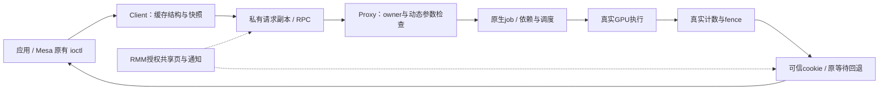

# ProxyClient 保留优化的正确性与通用性审查

日期：2026-10-25。审查对象是 [CURRENT_BASELINE](CURRENT_BASELINE.md) 顶部的本地 **1405** 组合，而非下面保留的历史版本。**本轮审查完成：逐项复核 25 类保留机制、固定 51 份源码/测试输入，结合本地检查和五项新增硬件运行形成判断；未覆盖的压力与平台条件明确保留。**

本轮未修改生产运行代码，没有提交、发布或刷新固件。已有完整 720p 为 1406 / 1404，均值 1405，本轮没有重复跑 720p。新增完整 1080p 补测为 **1044**，用于跨分辨率覆盖；没有同条件关闭优化的对照，不据此宣称新增提分。

## 1. 结论与判定方法

目前检查到的生产快路径按对象类型、归属、队列状态、能力协商和真实 fence 决定，没有发现按 `glmark` / `ncnn` 程序名、进程名或 720p / 1080p 分辨率识别并跳过工作的分支。源码搜索只是定位手段；下文逐项检查真正省去的操作、成立条件、错误与生命周期路径，不能用“没搜到程序名”证明实现正确。

大部分机制属于可复用的系统设计：共享页代替数据复制、缓存不可变提交结构、减少重复 RPC、按所有权维护非一致缓存、复用同一完成观察器、减少线程交接。**有适用条件的优化不等于为测试造假，也不等于适用于任意驱动、平台和负载。** 当前最需要限定的是 managed GPUVM 的内存模型、短轮询的 CPU 成本，以及 RMM/Root SGI15 的平台集成。

本轮未发现已确认的生产功能回归，也未发现识别测试后伪造完成或省去实际 GPU 计算的实现。该结论限于下文审查与执行范围。明确发现的特化是四 Client 在途预算和 ResNet50 内存预算，属于需要披露的实验配置；不能称为普适算法。最需要继续审慎维护的是硬 IRQ 完成路径的并发约束和 managed VM 的内存前提，而非耗时很小的对象查找。

优化主要减少上述边界间的重复处理与交接；图中 owner 检查、真实 job、GPU 执行和真实完成证明不能用缓存结果代替。

另有明确的实验策略：runner 在四 Client 时设置 `panthor.max_inflight_jobs=3`。这是固定并发配置下的资源准入策略，必须随结果披露；不是通用的自适应调度算法，也不是单 Client 提分的来源。

判定分为：机制在约束下合理、已有执行证据、仍欠缺执行覆盖。只审查已保留实现；已撤回的 idle-tick、提交附带直接快照、忙锁旁路等不计入成功优化，也不以先前 PASS 抵消失败。

## 2. 审查的版本与证据范围

冻结包：`build/raw-fence-observation-20261024/candidate/`。

| 输入 | SHA-256 |
| --- | --- |
| Client Image | `bc495269491b44879d1f84556f537903650afad34a06fb94d6676e9ae799349f` |
| Proxy Image | `d0debf770a9a83c332c8fad540d69fdb27f44e30397a76942fdef71d30165304` |
| initrd | `903465ce6f7ca4290aed6f979c7501606ff6729c03656b9e48de4de1f343f0f3` |
| runner | `19fcc60567a232ed8050a710e33baad8eb90225db7fb1ba4bea2123dd9247565` |

本地 `build/optimization-review-20261025/sources.json` 保存 Guest/RMM/Root HEAD、当前补丁及其 SHA、修改文件和未跟踪源码的 SHA、冻结输入校验结果；Guest 完整 diff 与最终冻结补丁相同。工作树本来已有未提交修改，不能只用 Git HEAD 标识当前实现。

本轮复核执行了以下命令，均退出 0：

| 检查 | 实际覆盖 | 记录 |
| --- | --- | --- |
| `bash scripts/check/check-rmm-xshm-events.sh` | 对真实 RMM endpoint/memory/service、GPU lease/control、private IRQ 核心 C 实现运行 ASan、UBSan、`-Wall -Wextra -Werror` 测试 | `build/optimization-review-20261025/rmm-sanitizers.log` |
| `python3 opencca/scripts/setup/apply-local-patches.py --check` | 固定 OpenCCA 补丁清单，预期上游补丁 diff 不作为垃圾修改 | 同目录 `patch-manifest.log` |
| `python3 build/raw-fence-observation-20261024/goal-completion-audit.py` | 重验前两档共八个既有运行的退出码、语义摘要、84 份文件 SHA 和最终源码一致性；不是新硬件运行 | 同目录 `retained-run-evidence.log` |
| `bash scripts/check/check-dma-guard.sh` | GPU/DMA owner 与物理页互斥、撤销及平台 backend 操作桩，ASan/UBSan | 同目录 `dma-ownership.log` |
| `bash scripts/check/check-secure-iommu.sh` | 统一 IOMMU owner/generation、错误路径与 backend 操作桩，ASan/UBSan | 同目录 `iommu-ownership.log` |

统一命令及退出码另存 `local-checks.json` 和 `ownership-checks.json`。另有 `reviewed-source-hashes.json` 固定本轮相关的 51 份源码/测试输入；其中记录哈希不等于每行都已形式化证明。本地 sanitizer 使用部分平台操作桩，不覆盖真实 EL3 切换、硬件缓存一致性或内核并发。

1405 的既有执行证据为 `raw-fence-observation-{720-20261024-a,720-20261024-b,compute-20261024-a,ml-20261024-a}`，见 [提前完成报告](GPU_RAW_FENCE_COMPLETION_OPTIMIZATION_20261024.md) 与其 portable evidence。两轮完整 glmark 各 33 场景，validation 为 **26 成功 / 1 既有例外 / 6 无判据**，并非 33 项全正确。双 Client 各 18 项 API、实际计算与对象权限检查，以及单 Client GEMM/卷积正确性通过，四项 wrapper/runner 均退出 0。

**已补齐的配置覆盖缺口：** 既有 compute 命令没有 `--performance`，没有同时启用性能 profile 的 `realm_poll_us=1000`、`concurrent_rpc=1`、`completed_wait_cache=1`、`lazy_snapshot_wait=1`。本轮 `optimization-review-compute-20261025-a` 开启这些参数并通过下列功能/故障检查；这项新增覆盖来自本轮执行，不来自沿用旧 PASS。

## 3. 数据与内存优化

### 3.1 共享 BO 与零拷贝数据面

Proxy 只从当前 owner 的授权 payload 构造 BO，Client CPU 与 GPU 使用同一批数据物理页；RPC 仍复制并校验控制请求，未把不可信请求直接当作原生结构使用。入口为 [panthor_vmshm_bo_create_from_payload](../../Linux-Guest-GPU/drivers/gpu/drm/panthor/panthor_drv.c#L1652)。

成立条件是 grant/对象引用有效、CPU/GPU 权限匹配、缓存属性一致，且数据页与可信控制内存分离。不同 GPUVM 对 BO 的绑定另有 root 身份约束；VA 连续不代表允许越过 owner 的物理页边界。

判定：通用共享内存设计，在本项目可信 Proxy 与授权池模型下合理。它不消除实际 GPU 数据容量，不证明任意两台 VM 或任意设备都能直接共享缓存一致内存。既有 API、GPUVM 隔离、计算和 glmark 有执行证据。

### 3.2 连续优先、碎片化时分段分配

分配限定在同一个 owner 的池，连续 extent 不足时用 SG 分段，在 GPU 页表中组成连续 VA；Client mmap 按 BO 逻辑偏移遍历分段。保留范围/溢出检查、段数上限、GPU 权限、对象 pin 和释放清零，不能通过段列表扩张授权。物理分段无需 Mesa 识别应用类型。

判定：通用的碎片化处理，性能收益主要表现为容量与可运行性，非保证 FPS 提升。旧实际测试确实制造了 `segments=2` 的 CPU 跨段映射，并在 1080p 使用过多段 GPU BO；详见 [分段内存报告](GPU_BO_SEGMENTED_MEMORY_20261020.md)。本轮最终 1405 组合的 `--bo-sg-mmap` 补测通过，日志再次记录真实 `segments=2`，补齐当前组合覆盖。

### 3.3 回收被共享页替代的 Client 原后备

[discard_private_range](../../firecracker/Firecracker-CCA-MZH/src/vmm/src/vstate/memory.rs#L39) 先验证整段地址、页对齐、后备类型、文件偏移和溢出，再对旧 guest_memfd 打洞；调用在 [MemoryFault 处理](../../firecracker/Firecracker-CCA-MZH/src/vmm/src/vstate/vcpu/mod.rs#L593) 中切换 memory attributes 之后。回收的是已退出使用的旧物理后备，不是源共享池。

判定：消除重复物理后备的通用思路，实现依赖当前 KVM MemoryFault / guest_memfd 协议。必须维持“撤销旧私有映射和引用 → 替换授权映射 → 回收旧后备”的次序；仅发现 `fallocate` 不足以证明顺序正确。既有直接页数实测为旧目标 98304 页 → 0，见 [共享内存回收](GPU_SHARED_MEMORY_RECLAIM_20261022.md)。仍需启动 CMA 目标区，因此这项没有消除启动阶段的全部预算，也不能把池内空闲容量算成已释放内存。

### 3.4 GPU-only tiler heap 所有权交接

tiler chunk 由 [panthor_heap.c](../../Linux-Guest-GPU/drivers/gpu/drm/panthor/panthor_heap.c#L148) 以内核内部 `GPU_ONLY | NO_MMAP` 标志创建，CPU 只初始化 header，再调用 [handoff_to_gpu](../../Linux-Guest-GPU/drivers/gpu/drm/panthor/panthor_gem.c#L153)：完成实际缓存清理/失效并解除 CPU vmap，之后由 GPU 使用。heap context 等仍会被 CPU 修改的对象没有因此变成 GPU-only。

判定：按所有权免除重复缓存同步合理，前提是交接后确实无 CPU 访问。不能只给普通 BO 贴 GPU_ONLY 标签就省同步；新 CPU 访问者需要重新设计所有权交接。普通用户 BO flag 检查不接受该内部扩展位。当前渲染/计算有执行证据，不能据此声称覆盖所有 heap 扩容、reset 与 suspend 压力。

### 3.5 待同步 VMA 子集

[realm_sync_vmas](../../Linux-Guest-GPU/drivers/gpu/drm/panthor/panthor_mmu.c#L3030) 在 map/remap/unmap 时维护，遍历受 `op_lock` 保护。资格仍由实际 BO 的私有/导入/共享/GPU-only 属性决定，必要同步的对象、偏移、长度和方向不变。

判定：预维护索引代替重复过滤的通用优化。历史同期均值 1161 → 1170.5，+9.5 / +0.82%，见 [六方向实验](SAFE_PERFORMANCE_OPTIMIZATION_20261018.md)。但当前 managed 路径更早直接返回，这个列表主要服务普通 Realm GPUVM；不能把旧列表收益再次累加给当前 managed 提交。

### 3.6 WB 控制窗口与 WC 数据区分离

[prepare_payload](../../Linux-Guest-GPU/drivers/char/realm_xshm.c#L185) 保留首 1 MiB 控制区的 WB 访问，payload 采用 WC，与 BO mmap 属性一致。转换前初始 WB 清零已 clean 到 PoC，并移除 WB 线性 alias；不支持该操作或重映射失败会拒绝使用，失败后保留 allocation，避免把线性映射无效的页还给普通分配器。

判定：按数据用途选择缓存属性合理，控制队列仍需 acquire/release 和设备同步。WC 是当前非一致 GPU 方案的必要条件之一，不是全部内存都开 cached。移植到硬件一致平台时策略可变，不能照搬本平台的 alias 操作。失败保留页是受限的错误处理容量成本，不应包装为按需零成本内存；本轮没有故意注入 remap 分配失败。

### 3.7 批量 IPA→HPA、页表页翻译缓存和大块映射

[panthor_gpa_to_hpa_batch](../../Linux-Guest-GPU/drivers/iommu/io-pgtable-arm.c#L445) 使用一个有界数组批量请求翻译；当前 Realm 路径由 [RMM](../../opencca/tf-rmm/runtime/rsi/opencca_gpu.c#L299) 先复制到私有 per-CPU batch，逐页按调用 REC 的授权地址空间翻译，整批获取物理页租约，返回数组失败时撤销本次租约。批量化没有把任意 Client 提供的 HPA 直接写入 GPU 表。

动态数据页映射使用 `CACHE_NONE`，缓存仅用于在当前页表实例生命期内固定的页表页，释放/安装失败/竞争失败移除缓存并释放租约。尝试 2 MiB block 时仍翻译全部 512 个 4 KiB 页，只有 HPA 基址对齐且逐页物理连续才使用 block；否则安装真实 4 KiB 表。不能只验证第一页就推测整段授权或连续。

判定：批量边界切换、固定对象地址缓存与有条件大页都是通用思路，具体安全性依赖当前 RMM 租约、页表页保活及撤销顺序。源码并未缓存任意可被重绑的数据 IPA 的旧 HPA。VM_BIND、分段 BO、GPUVM 越界与实际计算提供执行覆盖，但本轮没有独立 2 MiB 开关 A/B 或逐分支故障注入，不能宣称大页本身提分或所有失败交错已覆盖。

## 4. RPC、通知与对象缓存

### 4.1 私有 producer credit 与有界消息副本

Client/Proxy 生产者缓存已经验证的 `used` 进度，只在 credit 耗尽时 acquire 读取 peer 进度，并拒绝倒退或超过已发送范围的无符号差值。接收方先复制描述符到私有栈，校验固定 slot 几何、长度上下界，再复制有限长度的消息，核对头部长度与描述符长度相同。见 [Proxy send/recv](../../Linux-Guest-GPU/drivers/char/proxy_vmshm_comm/proxy_comm_vmshm.c#L502)。

只清新消息头不会清掉同一通道旧 payload 尾部，但接收方不消费尾部；[queue_reset](../../Linux-Guest-GPU/drivers/char/proxy_vmshm_comm/proxy_comm_vmshm.c#L225) 仍清整段消息池，跨对象释放还有 backing 清零。此优化没有把新的私有内存字节复制到共享尾部。

判定：缓存已验证状态、减少无关复制合理，私有快照继续隔离 TOCTOU。边界自测覆盖共享几何篡改、实际 u32 回绕与 producer overflow；不能把正常队列进度缓存当作允许恶意 peer 控制写地址。高并发和刻意持续修改消息的完整压力尚未覆盖。

### 4.2 Client 短时轮询与多余回复通知抑制

[poll_response](../../Linux-Guest-GPU/drivers/char/client_vmshm_comm/client_comm_vmshm.c#L970) 最多轮询 1000 μs，遇到调度需求退出。`poll_lock` 保证一个 hint owner；队列和 waiter 仍由原锁串行访问。退出时恢复通知并加屏障、排空回复；**所有尚未完成的调用者**，包括没取得 poll_lock 的调用者，都在睡前 ARM 并 acquire 重查，不能因另一个 waiter 完成而省略自己的准备。

判定：低延迟 RPC 中常见的 spin-then-sleep，适用于短请求与空闲 CPU。通知抑制只是 hint，不是完成证明。历史 Client 非 idle 接近 99%，包含忙轮询；未测功耗，不能说同时减少 CPU 开销或适合超售 CPU。本轮两 Client 的 RPC peak 均观测到 2，短轮询与 ARM/等待路径都实际发生，未见 RPC 超时；不是仅验证串行快路径。没有逐次追踪哪个调用者因 poll_lock 忙而回退，不将 peak=2 当作所有锁交错穷举。

### 4.3 IRQ 直接调度接收工作

[realm_xshm_irq](../../Linux-Guest-GPU/drivers/char/realm_xshm.c#L320) 不再先 QUERY SMC 或交接额外 IRQ 线程，只调用有界订阅回调排队 RX work；实际处理、ACK_ARM 和队列重查在 worker。`event_lock` 与先 unsubscribe、后 cancel work 的顺序保护拆卸。

判定：缩短通知链路合理，IRQ 只是唤醒提示，仍需检查队列与消息身份。无关订阅者可能被唤醒，因此不是无条件减少所有 CPU 工作。不能在这个回调中增加睡眠操作；不将项目通知 IRQ 与普通 vCPU SGI pending 混为一谈。

### 4.4 GPU Submission-Plan Caching

[register/execute](../../Linux-Guest-GPU/drivers/gpu/drm/panthor-proxy/panthor_proxy_drv.c#L2309) 缓存经过当前 session 验证的 group、queue shape 和 syncobj 强引用；执行时继续校验 slot/plan ID、动态 stream/flush/timeline 参数并调用原生提交。group/syncobj 删除会失效关联计划，计划 ID 不重用至溢出；未知/过期计划没有派发。

Client [execute_plan](../../Linux-Guest-GPU/drivers/gpu/drm/panthor-client/panthor_client_drv.c#L3062) 仅在 Proxy 明确返回“派发前 ESTALE”时重新注册。RPC 超时或无法确定已接纳的结果不重放，避免重复执行 GPU 工作。计划保留结构，不缓存 GPU 已完成或任意新映射的授权。

判定：重复形状工作负载可复用的预解析设计；不规则 shape 会未命中，需要支付注册成本，固定计划槽也不是无限缓存。历史公平 A/B 为 720p 1153.5 → 1158（+4.5 / +0.39%）、1080p 901 → 901（0%）；不能将其列为已证实大幅提分项，见 [缓存独立对照](GPU_PLAN_CACHE_AB_AND_CONTROL_MEMORY_20261022.md)。

### 4.5 不可变快照、惰性 sync_file 与 TRANSFER_CAPTURE

导出绑定的是某一时刻的真实 native fence，保留强引用，之后 RESET/IMPORT/TRANSFER 不应改变已导出的 sync_file。惰性等待仅延后没有消费者的工作；被 poll/wait 或依赖使用时仍必须建立真实观察。

TRANSFER_CAPTURE 在执行原本 binary TRANSFER 时顺带捕获同一个 fence，提前为下一次导出准备快照。先验证并保留源/目标，再分配私有对象，防止新 ID 恰好把无效源句柄补成有效。Client 用 epoch 和在途 mutation 检查证明缓存仍对应当前目标；不满足条件就按原导出路径重新捕获。详见 [TRANSFER_CAPTURE](GPU_TRANSFER_CAPTURE_20261022.md)。

判定：不可变版本缓存与按需工作合理；该融合只适用已协商能力及匹配的 binary TRANSFER，timeline 目标保留原语义。历史同镜像 off/on 为 1158 → 1156（−2 / −0.17%），省 RPC 已测但没有提分证据；保留为默认关闭、显式选择的实验机制，1405 profile 显式开启。不能将“本轮很多导出命中”推广为所有应用都会受益。

另有默认关闭的 `completed_snapshot`：Proxy 在 session 锁内保留源对象引用，随后获取其真实 native fence 引用并确认该 fence 状态为成功，才返回协商过的“已完成、无远端句柄”结果；这次捕获是导出的生效点，之后源复用不改变该已完成 fence。Client 校验专用标记、两个句柄均为零和本次请求允许该能力，再构造已完成本地 fence。未完成/错误仍须创建真实快照，不得用空句柄代表成功。机制静态上成立，但本轮冻结性能 profile 未开启，不能把它算入 1405 的收益或宣称本轮测过该开关。

### 4.6 快照退役捎带

Client 最后引用释放后有界暂存 private snapshot handle，下次捕获携带退役；满队或关闭走显式排空。Proxy [snapshot_retire](../../Linux-Guest-GPU/drivers/gpu/drm/panthor-proxy/panthor_proxy_drv.c#L2920) 在 session lock 内全批验证 private_snapshot、重复句柄与 source 冲突，全部通过才删除名字；在途原生/计划引用保活底层 fence。

判定：有界延迟释放与 RPC 合并合理。限制是延迟释放会短暂增加存量，静默期也不能无限持有；关闭路径和最后引用必须保持。它减少名字销毁往返，不代表可以提前释放仍被 GPU 使用的内存；请求结果不确定时不盲目重放退役批次。

### 4.7 exact cookie、timeline 完成证明与失效

Proxy 只在观察的真实 fence 已 signaled 且该回调 fence 无 error 时 release 发布 cookie；Client acquire 读取并要求 slot 中 cookie **等于**私有预期值，不能使用 `>=` 或共享 watermark。观察器移除/等待回调结束后才复用 slot，cookie 到达溢出边界时回退原等待。

timeline 快路径只接受一个非零 point、零超时 WAIT_ALL 等有限形状，且要求无在途写入。提交完成证明记录要求全过程为 sole writer；[mutation_begin](../../Linux-Guest-GPU/drivers/gpu/drm/panthor-client/panthor_client_drv.c#L4185) 默认拒绝跨未知写入复用，RESET/IMPORT/SIGNAL/TRANSFER 和对象删除清理相关状态，epoch 溢出禁用复用。普通 WAIT 成功缓存仅匹配同一 point 与 epoch；完整链证明才允许覆盖前缀 point。

判定：带身份和版本的结果缓存合理，单独一个 cookie 不具备授权能力，也不会自行唤醒 Client。含糊、资源不足或未完成时回退真实等待，不假定 GPU 提交成功即执行成功。**错误边界需分别看 leaf 与 chain：Linux chain 的完成状态不等同于自动汇总每个历史 child 的 error；现有测试不能证明所有链错误都传播为用户态错误。** 不能把“本回调检查 fence->error”写成任意错误组合已完全覆盖。

### 4.8 同一个完整 native fence 复用观察器

[point_watch](../../Linux-Guest-GPU/drivers/gpu/drm/panthor-proxy/panthor_proxy_drv.c#L617) 只有 `source->watch->fence == fence` 才复用，比较的是完整真实 fence 身份，不是最新 job、seqno 近似或请求形状。watch refcount 允许源被覆盖/销毁后快照继续存活；最后引用才 remove callback 或等待 callback 完成，再归还 slot。

判定：相同不可变资源共享观察器的通用设计，减少分配与回调注册。不同 fence、无槽位或获取失败仍走独立/原等待路径。复用不降低依赖检查，也不证明该组件本身独立提分；它属于 1182 → 1208 的组合之一。

同一 Client 的现有快照探针并非只有串行调用：`transfer_capture_check()` 会 fork，父子共享同一 DRM file，分别执行 256 次 RESET/TRANSFER 和导出/等待。本轮性能开关补测复用了这个入口，两边均有 `RPC_CONCURRENCY peak=2`，不以两个独立 Client 冒充同一通道的重叠调用。它不穷举多 vCPU 同时执行的竞态。

### 4.9 多请求在途与按请求身份匹配回复

[client_comm_vmshm_call](../../Linux-Guest-GPU/drivers/char/client_vmshm_comm/client_comm_vmshm.c#L1052) 在 `concurrent_rpc=1` 时不把 RPC 整个等待窗口置于一个总 mutex 下；队列、waiter 表、对象与计划仍各有原锁。发送前把带 seq/type 的私有 waiter 挂入表，接收方在同一 waiter lock 下复制匹配响应、移除名字并完成唤醒；超时也持该锁移除，避免异步访问已返回的栈 waiter。异常 seq/type 不唤醒其他调用者。

判定：request-ID 复用有界传输队列是通用设计，不意味着有依赖的 ioctl 可以任意重排，也没有删除 plan/session 锁。每个调用仍同步等待自己的接纳回复；同一 fd 的状态变更通过 epoch/state lock 处理。两边 peak=2、并发 mutation 和睡前 ARM 实测通过，不代表已穷举取消、迟到回复和 64 位 seq 回绕。

### 4.10 Proxy 接纳器空闲时就地执行

[submit_sched_run](../../Linux-Guest-GPU/drivers/gpu/drm/panthor-proxy/panthor_proxy_drv.c#L1041) 在 scheduler lock 内确认队列为空且 busy=false，先置 busy 再解锁执行原 plan handler；竞争时仍按 session round-robin 排队。执行结束清 busy 并检查排队数，必要时重新排 worker。请求保存私有 plan 副本和 session 强引用，关闭失败队列后逐个完成等待者；深度到上限返回 EBUSY。

判定：没有公平选择需要推迟时省一次 workqueue 交接，设计通用且有条件。它与第 5.5 节的原生 DRM scheduler 内联是不同层，不能混算；这里没有绕过 owner/native 参数验证，也没有让长期占用者跳过其他已排队 session。当前双 Client 计算可覆盖多会话使用，但本轮未专门持续填满接纳队列测公平性尾延迟。

## 5. 原生驱动与固件通知优化

### 5.1 managed GPUVM 只预留 root，省去全 BO 扫描

[prepare_mapped_bos_resvs / sync_mapped_bos](../../Linux-Guest-GPU/drivers/gpu/drm/panthor/panthor_mmu.c#L3012) 对 managed VM 仍准备 VM root 预留，但不逐个准备所有映射 BO，也不扫描全部 BO 做缓存维护。managed 标记只能由 vmshm VM 创建入口设置，普通 DRM VM_CREATE 仍走原路径。

必要前提是：用户数据只来自已经授权且 pinned 的共享 payload，其 CPU 映射为 WC，WB 线性 alias 已清理/移除；内部 kernel BO 在 ring、interface、sync record、heap context 等明确交接点同步；VM_BIND 仍锁 root 和目标 BO，映射持有 GEM/GPUVM 引用，job 更新 root fence。共享 BO 首次绑定后 root 身份固定，防止任意跨 VM 复用。

判定：这是**当前 managed 内存模型下的条件优化**，不是“GPU 提交永远只需锁一个 root”的普遍结论。若以后开放外部 dma-buf 导入、可迁移 BO、WB CPU 数据映射或跨 VM BO 共享，必须重新审查逐对象预留、隐式同步与缓存维护。不能仅因 managed flag 为 true 就默认新对象也满足前提。

### 5.2 精确 cache-line 同步与在写入点发布固件输入

queue input、完成记录只同步包含有效字段的完整 cache line，初始化/reset 仍全量维护；heap context 初始化补一次实际同步。STOP、fault/fatal 确认、heap 更新按具体 CS 写入点发布，不再每次 CSG doorbell 都遍历所有 CS 输入；子输入先于父门铃可见的顺序保留，输出读取仍 invalidate。

判定：缩小维护集合合理，依赖结构布局、缓存行边界与所有 CPU 写入者完整枚举。不能以 CPU `smp_wmb` 代替非一致 GPU 的 clean/invalidate；新增固件字段或写入点须同步加入。收益只在 [1208 组合](GPU_PIPELINE_OWNERSHIP_OPTIMIZATION_20261024.md) 中验收，未证明各组件独立提分。

### 5.3 RMM 驻留目标唤醒

[RSI xshm](../../opencca/tf-rmm/runtime/rsi/xshm.c#L25) 从当前 REC 的 RD 取得 caller 身份，policy lock 下验证 peer、pending、resident 与实际物理 MPIDR。目标正在其他 CPU 运行时，RMM 经 EL3 发物理 SGI 促使其检查通知；不满足条件时保留 Host 调度提示与 REC 再入时的私有注入。

判定：可信组件直接唤醒已驻留目标，减少不必要 Host 调度交接，设计合理。Host 仍负责未驻留 vCPU 的运行机会，不能保证不受拒绝服务；物理 SGI 本身不证明消息有效。REC0 路由、CPU 迁移/离开时清理 resident 状态是当前平台约束。本轮 sanitizer 实测 resident/fast-IRQ policy，真实切换和迁移压力不能由此替代。

### 5.4 Root SGI15 与 RMM 私有 LR 直接恢复

Root 验证调用方、目标 MPIDR、保留参数和 SGI 配置，使用预留物理 SGI15；目标 RMM [IRQ 入口](../../opencca/tf-rmm/runtime/core/exit.c#L604) 再核对当前 RD/REC/MPIDR、私有 pending 与 TAKE 结果，才向私有 LR 注入 IRQ127 并直接返回 Realm。SGI0 / Host 退出仍是回退。Host 辅助模块仅准备专用 SGI 接收环境，不决定消息完成或授权。

判定：跨平台可借鉴的可信通知思路，**当前实现强依赖 RK/OpenCCA 的 SGI 预留、Root 路由和 REC0**，不是标准 CCA 通用接口。普通 VM 或 Realm 内部的标准 SGI 仍由 KVM VGIC 分发，其 `pending_latch` 不属于这份 RMM endpoint `irq_pending`。需要明确保留 SGI15、匹配固件/模块，不能直接与其他系统的 SGI 用途混用。

### 5.5 就绪 job 在原生提交线程中内联调度

[vmshm_group_submit](../../Linux-Guest-GPU/drivers/gpu/drm/panthor/panthor_drv.c#L2233) 先按原路径建 job、处理真实依赖与输出 fence、更新 reservation，再持强引用发布 job；释放 `drm_exec` 后按 scheduler 去重，尝试一次 [drm_sched_run_job_now](../../Linux-Guest-GPU/drivers/gpu/drm/scheduler/sched_main.c#L1519)。

内联与 run/free worker 共用 dispatcher mutex；trylock 失败或 pause 时回退，stop 先发布 pause 再等待 dispatcher 并取消 work。内联复用原 scheduler 的 select/pop、credit、依赖与 run_job，而非绕过队列直接写 ring；选中的也不必就是本次提交的 job。

判定：保持调度器语义、减少线程交接合理。它移动了 CPU 工作所在上下文，不保证总 CPU 工作减少，也不是无条件延迟更低；重依赖、多 scheduler、公平性和 reset 交互需要额外覆盖。没有把提交应答变成 GPU 已完成，也没有提升测试进程优先级。

### 5.6 IRQ 线程尾部处理固件完成事件

保留原 JOB 硬 IRQ、IRQ 线程排空/ACK/解除屏蔽；尾部 trylock scheduler，未 reset 时捕获 group 引用，锁外在原 completion mutex 下执行真实缓存同步和完成处理，锁忙/reset 时回原 worker。引用释放仍按原生命周期。

判定：同样是减少中间线程交接，方法可复用，实现依赖 Panthor 固件事件和锁顺序。与内联提交一起构成 1237 → 1267 的组合；两个单项早先都没达到保留门槛，不能拆成两个独立已证实提分结果。完整 lockdep、reset/suspend 压力尚未验证。

### 5.7 已完成前缀时观察当前真实 fence

[panthor_proxy_fence_callback_get](../../Linux-Guest-GPU/drivers/gpu/drm/panthor-proxy/panthor_proxy_fence.h#L7) 用真正的 `dma_fence_chain_walk` 检查旧前缀；只有没有未完成前缀时，才在当前 contained fence 上注册回调，否则保留整链观察。原完整 fence 仍持强引用，避免把最新 fence 当成整链。

判定：在依赖前缀已满足后缩短通知路径合理，可推广至类似组合依赖；不能对有 pending 前缀的 timeline 无条件观察 leaf。既有真实内核模块覆盖 1000 组 previous/current 顺序、取消、当前 error 与引用回收，2000 创建/2000 释放。它是确定性交错测试，不是多 CPU 随机竞态压力；chain 历史 error 的语义边界同 4.7。

### 5.8 硬 IRQ 有界提前观察原生完成

[group_observe_raw_completions](../../Linux-Guest-GPU/drivers/gpu/drm/panthor/panthor_sched.c#L3478) 仅处理 Realm managed GPUVM：slot 查找与 group/queue 短锁均 trylock，先取得 group 强引用；核对 active/can_run、VM usable、fault/reset 状态，invalidate pinned sync BO、`dma_rmb`，真实 seqno 覆盖精确 job 序号且 status 为零才 signal 原生 fence。每次 IRQ 全局最多完成 8 个 job，固定 slot/queue 扫描仍存在。

已完成 job 移到 `raw_done_jobs`，原进程上下文 worker/termination 回收引用。普通完成/终止持同一 group IRQ lock 并屏蔽本地 IRQ，queue fence lock 仍在；原硬件 mask、IRQ_WAKE_THREAD、固件 ACK/drain/unmask 不变。跳过快路径不丢工作，后续普通路径继续处理，因此 budget 不意味着其余队列永远不能完成。

判定：提前观察**实际完成**而非提前宣称完成，局部设计合理，但它是当前并发审查风险最高的保留项：回调可能在硬 IRQ 运行，缓存维护必须不可睡眠，fault/reset 与状态发布有交错。当前 ARM64 pinned-page 同步是本地 cache 操作，vmap invalidate 在此配置无额外睡眠；换架构不能自动沿用。`CONFIG_PROVE_LOCKING`、`CONFIG_DEBUG_ATOMIC_SLEEP` 未开启，正常日志无告警不等于完整原子上下文证明。本轮最终组合的主动 foreign-VA fault 产生错误 fence、攻击 group fatal，受害者数据保留且可继续提交；没有把故障 job 错报为成功。该定点故障不等于 reset/suspend 全压力覆盖。

## 6. 性能证据能支持哪些结论

| 保留组合 | 完整 720p 对照 → 新版均值 | 绝对 / 百分比 | 可以归因的范围 |
| --- | ---: | ---: | --- |
| RMM 驻留请求唤醒 | 1158 → 1182 | +24 / +2.07% | 本组合及其受控条件 |
| 队列副本/credit、managed 所有权、观察器和精确同步 | 1182 → 1208 | +26 / +2.20% | 整个组合，不能分拆贡献 |
| SGI15 目标直接返回 | 1208 → 1237 | +29 / +2.40% | 配套 Root/RMM/模块的实现 |
| 原生提交与 IRQ 线程尾部交接 | 1237 → 1267 | +30 / +2.43% | 两端组合；第二轮单独 +1.86% |
| 已完成前缀直接观察当前 fence | 1267 → 1311 | +44 / +3.47% | 该 Proxy 改动 |
| 硬 IRQ 有界观察真实完成 | 1311 → 1405 | +94 / +7.17% | 该 Proxy 改动 |

统一比较条件为完整单 Client 720p、128 MiB 紧凑池、CPU 1.8 GHz、GPU 实际 594 MHz、round-robin、telemetry/TRANSFER、阶段诊断关闭；每一档的完整命令、退出码、日志、run-id 和输入 SHA 见对应优化报告。1158 → 1405 累计 +247 / +21.33%；不能将百分比简单相加，也没有足够重复次数主张统计显著性或普遍收益。

早期 tiler/轮询/IRQ/退役机制已经包含在 1158 中，历史实验条件不同，不能把它们的旧分差拼接成当前同期 A/B。计划缓存的低 lookup/assemble 均值只能说明命中路径很短；原生校验、生命周期、安全检查并非全部归在统计中的 validate 阶段。

原生完成优化并未减少物理 JOB IRQ：1405 两轮计数约 110.85 万 / 110.99 万。此前能把 IRQ 数近乎减半的候选也未达提分门槛，说明不能把“少一个 RPC/IRQ/worker”直接等同于端到端速度提高。

## 7. 需要披露的实验配置与适用边界

| 项目 | 当前事实 | 对结论的影响 |
| --- | --- | --- |
| 四 Client 在途限制 | runner 仅在四 Client 时配置 `max_inflight_jobs=3` | 固定资源策略；多 Client 对照必须披露，不能说是自动普适调度 |
| 分阶段内存准入 | 按所选池大小估算各 Realm RAM/CMA；`--reclaim-targets` 顺序建源/目标池，并在建池、attach 与 workload 前检查可用内存 | 资源容量策略，不能用“稳态已回收”忽略启动双份后备的峰值 |
| 性能 profile | 显式开启短轮询、并发 RPC、完成缓存与惰性等待 | 其他默认模式的 PASS 不自动覆盖这些开关 |
| 真实硬件安全 | RK 实验模拟部分 CCA/设备保护能力 | 本文不将提分/正确性测试冒充真实 GPT/GPC/SMMU 硬件安全证明 |
| 可信 Proxy | 当前安全模型信任 Proxy；Client 请求仍不可信 | managed 内存快路径建立在可信执行者和限定内存来源上 |
| glmark null-noop / finish | 有 GPU 渲染，不覆盖真实窗口显示/合成全链路 | 不能直接解释为桌面帧率、呈现延迟或所有图形应用收益 |
| 单 vCPU Realm | 现有主 runner 配置 `vcpu_count=1` | 双 Client 不等于单 Realm 多 vCPU 并发验证 |
| 小样本与缺失验证判据 | 两轮主要图形成绩，26/1/6 validation | 不能宣称所有像素正确、长期稳定或每个应用都更快 |
| 非常规内核配置 | 未启用完整 lockdep/atomic-sleep 检查 | 不能以无 kernel warning 代替完整锁与原子性验证 |

额外保留的 `completed_snapshot` 开关默认关闭，冻结性能 runner 也未开启，不能算入 1405 的实际提分路径。`fused_snapshot`、`lazy_snapshot_wait`、`completed_wait_cache` 默认关闭，由性能 profile 显式开启；`transfer_capture` 另外通过命令选择。同步文件 worker 的轮询预算与通信回复轮询是不同参数，不应混淆。阶段计时、分配账本和 trace 是有实际分析调用者的诊断工具，不属于提高分数的机制；正式对照保持诊断条件相同。

分阶段准入的核心是容量核算与峰值控制，思想可复用；但 `ncnn-resnet50` 下普通内存预算，以及四 Client 的 232/296 MiB、缩小 SWIOTLB 等是按模型和并发数配置的**工作负载专用实验预算**。这是本次发现的另一类需要披露的特化，与驱动按程序名称跳过真实工作不同。新模型必须重新测内存并通过准入，不能把这些常数包装为通用最小 RAM 算法；本轮 GEMM/卷积不启用该 ResNet 专用选项。

发现一处不影响运行的维护问题：[sync_file worker 注释](../../Linux-Guest-GPU/drivers/gpu/drm/panthor-client/panthor_client_drv.c#L1806) 仍称“所有 Client RPC 共用一个 transport mutex”，而当前 `concurrent_rpc=1` 时跳过该 mutex；Proxy 的串行 handler 约束仍在，非阻塞查询避免阻塞依赖提交的设计仍成立。实际行为应以参数和 `client_comm_vmshm_call()` 为准；本轮不为修正文案改变已冻结生产源码。

## 8. 本轮补测结果与失败记录

补测使用相同冻结 1405 Image，不添加生产快路径，不改变 runner 的计分逻辑；硬件测试必须经 `lab-run.py` 同时取得 Pi/RK 租约。

| 补测 | 为什么值得执行 | 当前状态 |
| --- | --- | --- |
| 双 Client compute + `--performance --transfer-capture --bo-sg-mmap --gpu-fault-isolation` | 把优化开关与并发、真分段映射、真实错误 fence/受害者恢复放在同一运行 | PASS：`optimization-review-compute-20261025-a`，wrapper/runner/采集/审计 rc0；额外 RPC 统计仅用于功能覆盖 |
| 同冻结包完整单 Client 1080p / 192 MiB | 验证最新完成/缓存优化不依赖 720p 与较小 BO 集合 | PASS：`optimization-review-1080-20261025-a`，1044 分；wrapper/runner/采集/审计 rc0 |
| 同冻结包双 Client GEMM/卷积 | 检查多会话计算、真实并行窗口与缓存/调度交互 | PASS：`optimization-review-ml2-20261025-a`，两边正确性及共同计量窗口通过，wrapper/runner/采集/审计 rc0 |
| 不加载 SGI15 模块，同时补普通 native GPUVM 功能 | 验证直接返回回退，并确认非 managed VM 的预留/缓存同步路径未被破坏 | PASS：`optimization-review-native-fallback-20261025-d`，四个原生模式、原生 GPU 计算及双 Client 功能通过；wrapper/runner/采集/审计 rc0；前面三次测试夹具失败保留如下 |
| 真实内核 fence 前缀/当前节点与取消 | 验证 leaf 回调选择和强引用释放，避免仅用用户态模拟推断 | PASS：`optimization-review-fence-proof-20261025-a`，1000 组 / 2000 创建 / 2000 释放，wrapper/审计 rc0，模块已卸载 |
| 同一 Client 多调用者 RPC | 用现有 fork 共享 DRM file 探针与 RPC peak 记录定向覆盖并发，不以两个独立 Client 代替 | PASS：两边 peak=2；未穷举全部锁交错 |

性能 compute 共执行两边各 19 个 API 模式，另有一项主动 GPU fault（共 39 次 gpu-smoke 命令）。快照、timeline 缓存失效、导出后源 reset/destroy、import 和 256 次并发 mutation 均有专门 PASS marker；实际 GPU 计算、权限/内存/IRQ 检查通过。唯一允许的预期 translation fault 位于 VA `0xa00000`，错误 fence、攻击者 fatal、受害者 canary 与重新提交通过。

Client 1 轮询尝试 3239 次、睡前完成 3218 次、ARM 71 次；Client 2 对应 3137 / 3122 / 94。三项不是互斥分类，其他调用者可能未取得轮询锁，不能简单用尝试数减完成数推算所有睡眠次数。Proxy raw 真实完成 105 个 job，IRQ-tail direct/deferred 为 92/145；只是实际命中证据，不据此计算提分。VM 退出 0/0/0，预期故障之外的内核健康、Host 健康、模块卸载及资源恢复通过，10 份远端文件 SHA 核验。

1080p 使用完全相同的冻结 Client/Proxy/initrd/runner，单 Client、192 MiB 池、CPU 1.8 GHz、GPU 实际 594 MHz、round-robin、telemetry/TRANSFER，关闭阶段计时。完整 33 场景、validation 26/1/6、VM 0/0、健康与资源恢复、11 份远端文件 SHA 核验通过。raw 实际完成 411056 个 job、IRQ-tail direct/deferred 为 400861/436209；证明路径在 1080p 也被使用，不单靠最终 score 判断。统一记录：跨分辨率覆盖｜720p 保留均值 1405（不重跑）→ 本轮 1080p 1044｜分差/百分比不适用，分辨率和池不同｜上述条件｜run-id 同表、wrapper/runner/审计 rc0｜保留基线，不新增优化收益归因。

双 Client ML 每项各 100 个计量样本、5 次预热，按实际 GPU 结果验证，并要求预热后存在共同计量窗口：

| 工作负载 | Client 1 平均 ms | Client 2 平均 ms | 共同窗口 / 窗口并集 |
| --- | ---: | ---: | ---: |
| FP32 GEMM 512 | 57.56239 | 57.85380 | 99.11% |
| FP32 卷积 64×64×32，3×3 | 66.58179 | 66.25267 | 99.27% |

共同窗口由 Host 单调时钟接收串口标记估算，证明两个 Client 的计量区间重叠，不能推断 GPU 内部同时执行比例。该轮使用每 Client 128 MiB 紧凑池、performance profile，未启用 glmark 专用的 CPU 固频/round-robin/telemetry 组合；没有同期旧版对照，不计算 ML 提速。VM 0/0/0、内核/Host 健康及模块/资源恢复通过，14 份远端文件 SHA 核验；raw 完成 421 个 job，IRQ-tail direct/deferred 为 439/854。

普通 native 补测的三次失败明确保留：`optimization-review-native-fallback-20261025-a` 在第一个 basic 探针退出 1，原探针要求 Client 的 `DRM_CAP_PRIME=0`，实际原生 Panthor 返回正常的 3；后续 workload 未执行。`...-b` 的独立测试副本增加显式 `--native`，要求 PRIME=3，并保留原 VM_BIND、提交与生命周期断言；四个原生模式通过，但随后误用了 Client 专有 `DRM_PANTHOR_VM_CREATE_ISOLATED`，原生 VM_CREATE 正常拒绝并返回 EINVAL，整轮退出 1。源码 `panthor_ioctl_vm_create()` 传入 `managed_vmshm=false`；这个标志的支持边界不能用原生测试绕过。`...-c` 同样通过四个原生模式，但夹具只给 Client 挂载 workload rootfs，Proxy 的 `/dev/vda` 不存在，compute 启动退出 127，外层退出 1；不能判断为 GPU 计算失败。三次 VM 均退出 0/0/0、Host 无新增内核错误，原始失败日志已回收，共 39 份远端文件 SHA 核验；不能把它们计作整轮 PASS。

最终 `...-d` 使用同一冻结 Client/Proxy Image，仅派生 initrd 中的测试程序和 runner，并给 Proxy 挂载同一只读 workload rootfs：原生模式使用 PRIME=3 的前提，普通 VM 实际计算取代不适用的 Client 隔离探针，后续 Client 探针仍要求 PRIME=0 并保留全部断言。initrd 其他文件内容逐项 SHA 相同；该轮不用于性能比较，也不宣称与原始 initrd 完全相同。隔离攻击的执行证据来自前面的 Client GPUVM 正常/主动故障测试。

该轮 40 次 gpu-smoke（Proxy 四模式及两 Client 各 18 模式）全部退出 0，三个 Realm 的实际 GPU 计算正确性通过；原生 group-submit 包含重复提交、句柄复用、六 job 批次完成及错误批次不产生部分输出 fence。私有通知负例与合并检查通过，SGI15 模块未加载，Proxy 四次 fast-IRQ 统计均为 `resumes=0 enabled=1`，说明真正使用回退。managed Client 的 raw 完成仍命中 72 个 job、IRQ-tail direct/deferred 为 95/94。VM 0/0/0、内核/Host 健康与资源恢复通过，10 份远端文件 SHA 核验。这里验证普通原生路径仍能工作，未证明全部 dma-buf 导入或隐式同步组合。

初次密钥登录失败，随后使用用户先前提供的实验室凭据恢复正常补测；凭据不写入证据文件。没有绕过双机租约直接跑 RK。五项新增成功运行的远端 Realm 日志共 45 份 SHA 核验，fence 模块另有本机保存的内核执行记录；三项失败另计，不能混入成功数。

具体补测 argv 已固定在 `build/optimization-review-20261025/run-hardware.py`：不带 `--execute` 仅输出计划；带该参数时每项取得独立 lab 租约、保存命令/退出码并回收校验远端日志。case 为 `compute`、`1080`、`ml2`、`native-fallback`、`fence-proof`；另保留原纯 `fallback` 命令但不重复执行。每次要求新的 run-id，不会自动把外层 rc0 当成语义验收通过。各成功/失败运行的**完整命令、退出码和日志位置**保存于 [validation.json](evidence/optimization-review-20261025/validation.json)；原始日志为 `build/optimization-review-20261025/runs/<run-id>/`，Host 与资源证据为 `build/lab-runs/<run-id>/`，fence 内核日志为对应 lab 目录的 `chain-callback-proof-dmesg.log`。

最后经独立租约 `optimization-review-finalize-20261025-a` 恢复普通 1405 runner 与原始 initrd，核验全部六项运行输入及实际 SD 两段固件；未刷写固件。最终源码/补丁与本轮开始的快照一致，CPU 恢复 0–1、GPU 恢复 300 MHz、驱动为 pmthor，无本轮 VM、loop 或测试模块残留。恢复命令、实际输入 SHA 与结果见 [inputs.json](evidence/optimization-review-20261025/inputs.json)。

### 补测与逐项分析的对应关系

下面的“覆盖”表示相关路径实际执行，不能解释为每项独立 A/B、所有分支穷举或形式化证明。C=本轮性能模式 compute，G=完整 1080p，M=双 Client ML，N=普通 native 与通知回退，F=真实内核 fence 模块，L=本地 sanitizer/策略测试，H=已复核的历史证据。

| 条目 | 核心不变量 | 执行覆盖与主要限制 |
| --- | --- | --- |
| 3.1 共享 BO | 来源授权、owner 与引用有效 | C/G/M；不含任意外部导入 |
| 3.2 分段分配 | 分段不扩张授权，mmap 偏移正确 | C 真正两段、H；未穷举碎片组合 |
| 3.3 原后备回收 | 替换/撤销旧映射后回收 | H 直接页数实测；本轮只复核代码和固定 VMM |
| 3.4 GPU-only heap | CPU 初始化同步后不再访问 | G/M/N heap；未测长时间扩容/reset |
| 3.5 同步 VMA 索引 | 增删与 op_lock 一致 | N 普通 GPU 计算；非独立开关测试 |
| 3.6 WB/WC 分离 | 去 WB alias，保留必要屏障 | C/G/M；未注入 remap 失败 |
| 3.7 批量翻译/页表缓存/大页 | 逐页授权、保活、失效 | C/N 与 L；无独立大页 A/B |
| 4.1 credit/私有消息副本 | 有界复制、私有校验 | C/N/L；非持续恶意消息压力 |
| 4.2 轮询与通知抑制 | 睡前 ARM 和 acquire 重查 | C 并发 peak=2、ARM 命中；未测能耗 |
| 4.3 IRQ 直接接收 | 中断只排队，拆卸有同步 | C/G/M/N；未反复卸载压力 |
| 4.4 提交计划 | 缓存形状，动态参数仍检查 | C/G/M/H；不重放结果不确定的请求 |
| 4.5 快照/TRANSFER | 捕获真实 fence、epoch 失效 | C 并发变更/源销毁；completed_snapshot 未开启 |
| 4.6 退役捎带 | 最后引用后退役，有界排空 | C/G/H；未穷举异常断连 |
| 4.7 cookie/timeline | 精确身份、真实完成、sole writer | C 失效/错误 fence；历史 chain error 有语义边界 |
| 4.8 同 fence 观察器复用 | 指针身份与 slot 引用正确 | C/G/M；无长期 slot 压力 |
| 4.9 并发 RPC | waiter 生命周期与 seq/type 匹配 | C 两边 peak=2；非 seq 回绕穷举 |
| 4.10 Proxy 就地接纳 | 空队列才能内联，保留公平排队 | C/M；未测饱和公平性尾延迟 |
| 5.1 managed root 预留 | 限定 WC/pinned 来源，引用保活 | C/G/M，N 普通路径；新增来源需重审 |
| 5.2 精确缓存同步 | 所有 CPU 写入点先于门铃可见 | C/G/M/N；未穷举固件状态变化 |
| 5.3 驻留唤醒 | 归属/MPIDR/pending 一致 | L/C/G/M，N 回退；未测迁移压力 |
| 5.4 私有 LR/SGI15 | 物理提示不充当授权 | L/C/G/M，N 禁用模块；依赖平台接口 |
| 5.5 原生内联调度 | 原 scheduler 的依赖/credit/锁不变 | C/G/M；重依赖/reset 压力未做 |
| 5.6 IRQ 线程尾处理 | 引用有效、锁忙仍可回退 | C/G/M；未启用完整 lockdep |
| 5.7 前缀完成观察 leaf | 真正 walk 链，保留全链引用 | F 1000 组、C/G/M；非随机多 CPU 压力 |
| 5.8 硬 IRQ 提前完成 | 真实 seqno/status、有界、进程回收 | C 主动 fault、G/M；原子性与 reset 长稳仍有限 |

这些限制是结论边界，不把“审查完成”解释为“工程所有可能场景均已验证”。没有证据要求撤回当前保留组合；后续新增内存来源、导入、CPU 过度分配或多 vCPU 支持时，应优先重审其对应前提。

## 9. 证据与复核入口

- 当前实现和性能：[CURRENT_BASELINE](CURRENT_BASELINE.md)、[硬 IRQ 完成](GPU_RAW_FENCE_COMPLETION_OPTIMIZATION_20261024.md)、[前缀回调](GPU_FENCE_CALLBACK_OPTIMIZATION_20261024.md)。
- 通知和原生交接：[驻留唤醒](GPU_RESIDENT_REQUEST_WAKE_20261024.md)、[目标 IRQ 返回](GPU_TARGET_IRQ_RETURN_OPTIMIZATION_20261024.md)、[原生交接](GPU_NATIVE_HANDOFF_OPTIMIZATION_20261024.md)、[所有权组合](GPU_PIPELINE_OWNERSHIP_OPTIMIZATION_20261024.md)。
- 较早机制：[计划缓存独立 A/B](GPU_PLAN_CACHE_AB_AND_CONTROL_MEMORY_20261022.md)、[TRANSFER_CAPTURE](GPU_TRANSFER_CAPTURE_20261022.md)、[安全优化实验](SAFE_PERFORMANCE_OPTIMIZATION_20261018.md)、[分段 BO](GPU_BO_SEGMENTED_MEMORY_20261020.md)、[旧目标后备回收](GPU_SHARED_MEMORY_RECLAIM_20261022.md)。
- 本轮静态快照、本地执行与退出码：`build/optimization-review-20261025/`；既有远端执行记录为 `build/lab-runs/<run-id>/`，完整回收日志与 SHA 见各实验目录。后续补测不覆盖原失败证据。
