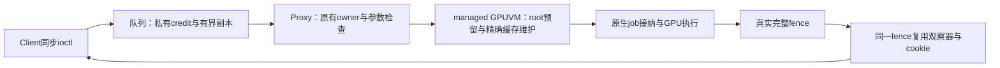

# ProxyClient全路径所有权复用优化

状态：**已保留；当前本地开发基线为1208分，尚未提交发布。**

## 目的与首轮结果

在已保留的驻留请求唤醒基线1182分上，减少通信队列、原生提交和完成路径对
已知状态的重复读取、缓存维护及观察器分配。完整720p两轮1210／1206分，
均值1208，较1182增加26分／2.20%；两轮单独提高2.37%／2.03%。
性能门槛及选定功能验收通过；两轮观测不构成统计显著性或长期稳定性证明。
连同上一项驻留请求唤醒，1158 → 1182 → 1208，两项独立达标方案累计提高50分／4.32%。

| 对照或候选 | 完整720p得分 | 相对1182 | 决定 |
| --- | ---: | ---: | --- |
| 驻留请求唤醒基线A/B | 1183 / 1181，均值1182 | — | 已保留 |
| 仅通信队列副本与credit缓存 | 1189 | +7 / +0.59% | 单独撤回 |
| 仅原生所有权与同fence观察器组合 | 1199 | +17 / +1.44% | 单独撤回 |
| 仅CS输入按写入点发布 | 1186 | +4 / +0.34% | 单独撤回 |
| 本文完整组合A | 1210 | +28 / +2.37% | 已保留组合 |
| 本文完整组合B | 1206 | +24 / +2.03% | 同冻结输入确认 |
| 本文组合均值 | 1208 | +26 / +2.20% | 新开发基线 |

这些不同批次的增量不能相加。本文全部改动只算一个组合方案，不能把其中各项
分别计为已达到2%的独立优化。

## 实现



**通信队列。** 生产者私有保存已验证的消费进度，直到本地credit耗尽才以acquire
重新读取共享used索引，拒绝倒退或超出已发送范围的进度；保留队满与u32回绕语义。
只清消息头并复制有效载荷，接收方先私有复制并校验描述符，再复制其已验证长度的消息，
核对消息头与描述符长度一致。没有直接信任共享请求指针。

**GPUVM与缓存维护。** 只有可信vmshm建VM入口设置managed标记，普通DRM ioctl
创建的VM继续原路径。提交持有并更新VM root预留，映射和对象仍保留GEM/GPUVM引用，
VM_BIND仍锁root与目标BO。用已存在的ring、接口、同步记录和tiler所有权交接覆盖
实际CPU/GPU数据交换，移除managed VM逐提交扫描全部映射对象的保守路径。
heap context初始化增加一次真实缓存同步；运行时queue input及同步记录只维护
包含有效字段的完整cache line，初始化和重置维护保持完整。

**完成观察。** 原生TRANSFER_CAPTURE照常建立不可变快照，再比较快照捕获的完整
native fence与源对象当前观察器持有的实际fence指针；只有相同对象才能复用。
观察器引用计数保证源被覆盖或销毁后，快照仍保留回调、cookie、槽位和fence。
最后一个引用释放才移除或等待回调并回收槽位。不同fence继续独立观察，错误fence
不发布成功cookie；回调不获取session mutex。

**固件输入。** 初始化/启动及heap更新沿用具体CS mask发布；STOP与fatal/fault
确认在写入点发布。CSG门铃不再遍历所有硬件CS输入。CSG/global的真实缓存维护
和子输入先于父门铃可见的顺序保留，GPU输出读取仍执行invalidate。

原生同步接纳返回、显式依赖和完整fence、安全owner/generation/授权检查、RMM
共享与可信IRQ均保留。RPC数量、通知协议、频率、绑核、轮询窗口及工作线程优先级未调整。

## 测试条件和证据

完整1280×720、33场景、null-noop／finish、1Client、128MiB紧凑池、round-robin，
CPU固定1.8GHz、GPU请求600MHz／实际594MHz；telemetry及TRANSFER capture开启，
高频诊断关闭。两份内核改变，initrd、runner、rootfs、VMM及驻留唤醒固件沿用对照。

A/B轮 `pipeline-ownership-720-20261024-a/b`：各wrapper/runner退出0，33场景，validation
26成功／1已知例外／6无判据，VM退出0/0，Guest及Host健康通过、无dmesg环覆盖，
CPU/GPU、进程、挂载和loop恢复；各11份日志回收并核验SHA。A轮主会话执行475258次plan，
同fence观察复用475224次，仅证明路径命中，不证明该组件独立提分或RPC时延降低。

统一命令：

```bash
python3 scripts/maintenance/lab-run.py --run-id <run-id> -- \
  python3 scripts/run/run-realm-xshm.py \
  --images build/pipeline-ownership-20261024/candidate \
  --workload glmark --performance --benchmark-only --suite \
  --profiles glmark-720 --clients 1 --compact-memory --pool-mib 128 \
  --client-cpu-layout round-robin --cpu-frequency-khz 1800000 \
  --telemetry --transfer-capture
```

证据：`build/pipeline-ownership-20261024/`下的design、candidate.patch、
combined-guest.patch、candidate/hashes.json、两份build日志、run/collect日志、
runs/<run-id>/以及逐轮audit.json；外层记录在`build/lab-runs/<run-id>/`。

B轮审计通过。双Client API/compute已通过，run-id
`pipeline-ownership-compute-20261024-a`，命令为统一wrapper包裹
`scripts/run/run-realm-xshm.py --images build/pipeline-ownership-20261024/candidate --workload compute --transfer-capture`。
两边各18项API共36项，包括VM_BIND、group submit fence、快照reset/destroy、timeline
和GPUVM隔离；两Client实际GPU计算、权限、内存与可信IRQ负例通过。wrapper/runner
退出0、VM退出0/0/0、Guest/Host健康和资源恢复通过，10份日志已回收核验。
provider replacement为独立单Client生命周期项目，本轮NOT_RUN。

GEMM/conv已通过，run-id `pipeline-ownership-ml-20261024-a`，相同冻结包，统一wrapper
下使用`--workload glmark --performance --benchmark-only --suite --profiles ml-gemm ml-conv --clients 1 --compact-memory --pool-mib 128 --transfer-capture`。
各100次计量、5次warmup；GEMM512为29.33731ms，卷积64×64×32为33.76139ms，
正确性通过。wrapper/runner退出0，VM退出0/0，Guest/Host健康、资源恢复和10文件
SHA回收通过。ML未设置glmark专用锁频/telemetry参数，只作正确性验收，无同期成对
速度对照，不宣称ML提速。

未将旧基线PASS继承为新代码验收；1080p、多Client性能、长稳及完整硬件对抗矩阵未执行。
当前选定group fence测试通过，历史额外回归的间歇超时记录继续保留。

## 冻结与最终审计

| 文件 | SHA-256 |
| --- | --- |
| Client Image | `bc495269491b44879d1f84556f537903650afad34a06fb94d6676e9ae799349f` |
| Proxy Image | `6f82c16a144b2c19ba6a1aa7ad4ecb1145fa61530fbe5c90769b2c626a2881ef` |
| initrd | `903465ce6f7ca4290aed6f979c7501606ff6729c03656b9e48de4de1f343f0f3` |
| runner | `19fcc60567a232ed8050a710e33baad8eb90225db7fb1ba4bea2123dd9247565` |

当前与回退包分别为`build/pipeline-ownership-20261024/candidate/`和
`build/request-resident-20261024/candidate/`，均使用上一项已部署的驻留请求唤醒固件，
固件在`build/request-resident-20261024/firmware/`。本组合未刷写Host或固件。

`build/pipeline-ownership-20261024/final-audit.py`已执行退出0，生成
`final-audit.json`：核验四轮42份远端证据文件SHA、逐项API和ML语义、完整720p
逐轮审计、退出码、内核健康、CPU/GPU/挂载/loop恢复、实际输入及源码；当前Guest
与冻结combined-guest.patch一致，RMM/Root改动与上一档已验收源码一致。
两项方案均值分别提高2.07%和2.20%。两轮边界与组件归因限制如前，不额外拆分排名。

设计参考：已保留驻留唤醒的PORTAL可信通知分析，以及
[Linux DMA API](https://docs.kernel.org/core-api/dma-api-howto.html)对非一致设备
所有权交接的要求、[DRM syncobj](https://www.kernel.org/doc/html/v6.12/gpu/drm-mm.html#drm-sync-objects)
对真实fence生命周期的定义。没有直接移用论文收益；本轮以组合端到端实验判定。
