# ProxyClient 性能优化全解：设计原理、代码路径与实测效果

版本：2026-10-28。本文对应当前本地 **1405冻结组合**。本次按性能收益重构阅读顺序，补齐代码中的遗漏机制与测量边界，并更新配图；**未改运行代码，无新增性能测量**。第11节为当前同频图形矩阵，第12节为同版本ML/NCNN对照，历史演进与失败证据集中在后部。

阅读顺序按机制族已有实验中最明显的收益安排：**数据与缓存 → RPC接收/等待 → 快照与同步 → 真实完成可见性 → 可信通知 → 收益有限的结构优化和容量优化**。各章内部也优先展开更有效的手法。收益排序用于阅读，不是部署或叠加顺序；旧版本的巨大增幅不能视为当前1405上的剩余空间。

**两种收益口径分开看。** 早期突破来自不同基线、部分仅单轮或多项组合；1158之后六项使用各自的两轮均值，并按相对提分降序列示。累计1158→1405为+247/+21.33%，不相加各项百分比；没有独立对照的组件不单独分摊贡献。机制存在、实际开启、工作量减少、应用提速是四种不同证据。

本次最重要的补充是：FLUSH_ID=0的GPU保守刷新、WC数据的CPU读写代价、清零与分配器锁边界、多Client准入/核分区，以及平均响应与整批吞吐的区别。它们尚无新增提分证明，详见第10节。

Notion 页面：[ProxyClient 性能优化全解](https://www.notion.so/404659a3b8cc81c3ad40d50169107942)。本地保留正文、SVG/PNG及重绘脚本。

聚焦论文贡献候选的独立讲解见[GPU共享的三个重点优化：代码、原理与论文贡献潜力](GPU_CORE_OPTIMIZATIONS_EXPLAINED_20261028.md)，包含代码节选和四张机制图。

## 1. 收益优先阅读：先看历史突破，再看近期增量

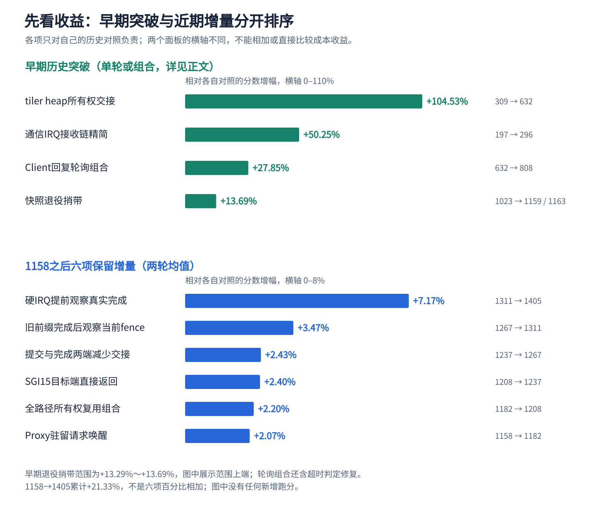

### 1.1 早期历史突破：按各自对照的相对提分降序

以下为历史阶段的对应实验，各行只与自己的对照比较。部分开启了诊断、只测一轮，不能把这些数字接成当前同期控制实验，也不能将百分比相加。

| 优化 | 历史对照 → 候选 | 分差 / 变化 | 证据范围与当前状态 |
| --- | --- | --- | --- |
| GPU-only tiler heap 所有权交接 | 309 → 632 | +323 / +104.53% | 各一轮，同诊断；有 BO 同步耗时直接证据 |
| 通信 IRQ 直接排队 RX，删除 QUERY 和额外 IRQ 线程 | 197 → 296 | +99 / +50.25% | 各一轮，同诊断配置；机制保留 |
| Client 调用线程短轮询与回复通知抑制 | 632 → 808 | +176 / +27.85% | 各一轮，100 μs；同镜像还包含超时判定修复 |
| 下次捕获捎带退役旧快照 | 1023 → 1159 / 1163 | +136～140 / +13.29%～13.69% | 同候选镜像复测，保留；没有复用旧快照容器 |
| 快照融合与按需等待 | 296 → 318 | +22 / +7.43% | 同镜像切两个开关；只归因组合 |
| 提交回复携带真实 timeline 证明＋Client 安全复用 | 957 → 1022 / 1022 | +65 / +6.79% | P38+P39 组合；P39 单项对 962 为 +60 / +6.24% |
| 按实际读取对象同步固件输出 | 829 → 859 | +30 / +3.62% | 历史单轮；选择性同步思想保留 |
| GPUVM 待同步 VMA 索引 | 均值 1161 → 1170.5 | +9.5 / +0.82% | 同期两组；当前主要服务普通 Realm GPUVM |

来源为 `docs/archive/20261018/history/PROXY_REALM_PERFORMANCE_OPTIMIZATION_20261018.md` 与 `SAFE_PERFORMANCE_OPTIMIZATION_20261018.md`。归档资料仅作为历史实验依据，当前实现以正文核对的工作树和 `CURRENT_BASELINE.md` 为准。

### 1.2 近期六项保留增量：按相对提分降序


| 保留机制 | 对照 → 两轮候选 / 均值 | 增量 | 可归因范围 |
| --- | --- | --- | --- |
| 硬 IRQ 有界提前观察真实完成 | 1311 → 1406 / 1404，均值 1405 | +94 / +7.17% | 本项 Proxy 变化 |
| 旧前缀已完成时直接观察当前 fence | 1267 → 1314 / 1308，均值 1311 | +44 / +3.47% | 本项 Proxy 变化 |
| 提交与完成两端减少线程交接 | 1237 → 1274 / 1260，均值 1267 | +30 / +2.43% | 原生内联调度＋IRQ 线程尾处理组合 |
| SGI15 目标端直接返回 | 1208 → 1234 / 1240，均值 1237 | +29 / +2.40% | Proxy/RMM/Root/Host 辅助模块组合 |
| 全路径所有权复用 | 1182 → 1210 / 1206，均值 1208 | +26 / +2.20% | 队列 credit、副本、managed 同步和观察器等整个组合 |
| Proxy 驻留时请求唤醒 | 1158 → 1183 / 1181，均值 1182 | +24 / +2.07% | RMM/Root/Proxy 配套组合 |

统一条件：完整单 Client 1280×720、33 场景、null-noop / finish、128 MiB 紧凑共享池、CPU 固定 1.8 GHz、GPU 请求 600 MHz / 实际 594 MHz、round-robin、telemetry / TRANSFER 开启、阶段诊断关闭。整个保留链 **1158 → 1405，+247 / +21.33%**。每档改动范围不同，不能把组合中的小组件再单独计一次收益。1182 和 1267 的第二轮单独略低于 2%，按当时预先记录的首轮 / 均值规则保留。

### 1.3 已实现但不能宣称大幅提分

| 机制 | 独立实验结果 | 正确表述 |
| --- | --- | --- |
| Submission-Plan Caching | 720p：1153.5 → 1158，+0.39%；1080p：901 → 901 | 减少解析与请求字节；没有稳定明显提分证据 |
| `TRANSFER_CAPTURE` | 同镜像 off/on：1158 → 1156，−0.17% | 已验证省掉大量导出 RPC；未证明 GLMark 提速，默认关闭，当前性能 profile 显式启用 |
| 分段 BO | 实际出现两段及 GPU 多段映射，正确性通过 | 解决碎片化与容量，不等于提升执行速度 |
| Client 旧目标后备回收 | ResNet50 分项合计 903.26 → 519.33 MiB | 内存收益明确；720p 单轮 1158 → 1157 不构成提速 |
| 批量翻译 / 页表页缓存 / 有条件 2 MiB block | 保留代码与相关执行覆盖 | 无各子项独立开关跑分，不编造收益比例 |
| 热路径日志限频 / 关闭高频诊断 | 多轮历史现象支持诊断影响 | 属于日志卫生和测量配置；不能包装成新的 GPU 算法 |

## 2. 优先级一：数据与缓存，消除最大重复工作

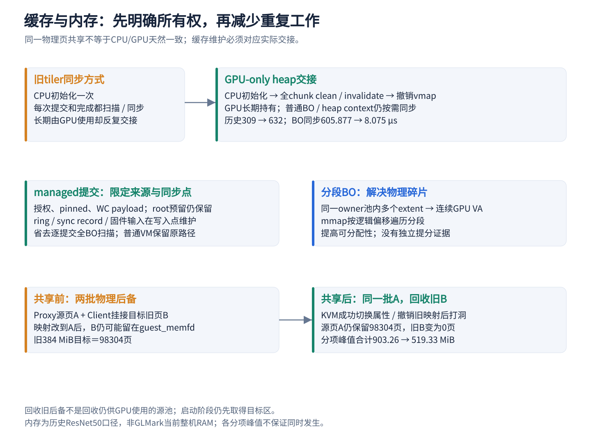

### 2.1 GPU-only tiler heap：一次正确交接代替逐次同步

旧路径每次提交和完成扫描全部映射的私有 BO。tiler heap chunk 的 CPU 实际上只初始化一次头部，随后主要由 GPU 读写，反复把整块 chunk 同步给 CPU 没有对应消费者。

现实现以内部 `PANTHOR_BO_GPU_ONLY | DRM_PANTHOR_BO_NO_MMAP` 创建这类 chunk。初始化完成后执行真实 clean/invalidate 到 PoC，撤销 vmap，再设置 GPU 持有状态。后续通用同步排除它；CPU 不能再次随意映射它。heap context、ring、固件接口和普通 BO 不享有这个例外。

代码：`panthor/panthor_heap.c` 约 148 行；`panthor/panthor_gem.c:153` 的 `panthor_kernel_bo_handoff_to_gpu()`。

```c
panthor_kernel_bo_vunmap(kbo);
kbo->gpu_owned = true;
```

这两行发生在完整初始化同步成功之后。用户不能通过普通 BO_CREATE 自行传入内部 GPU_ONLY 位来关闭必要同步。

历史诊断中，BO 同步均值 **605.877 → 8.075 μs（−98.67%）**，后端提交 **621.163 → 20.885 μs**，完整 720p **309 → 632**。这既有得分变化，也有被消除工作的直接计时依据；仍然只是当时组合的一轮对照。

### 2.2 精确同步：只维护真正交接的对象和 cache line

较早的固件输出优化从“每次读一个寄存器都同步整个输出面”改成在读具体对象时维护对应输出。后续进一步将 queue input、完成记录限制到包含有效字段的完整 cache line，初始化/reset 仍全量维护。

CS 输入在 STOP、fault/fatal ACK、heap 更新等实际写入点发布，不再每敲一次 CSG doorbell 就遍历所有硬件 CS 输入。子输入先可见、再写父门铃；GPU 输出读取仍 invalidate。

代码集中于 `panthor/panthor_sched.c`、固件 interface helper 与 `panthor_kernel_bo_sync_for_device/cpu()`。CPU release/acquire 或 `smp_wmb` 不能代替非一致 DMA 的 clean/invalidate。新增固件字段或 CPU 写入者必须补上相应发布点。

历史“按读取对象同步输出”为 **829 → 859（+3.62%）**。后续 cache-line / 写入点发布仅在 1208 整体组合获得保留，不重复分配贡献。

### 2.3 managed GPUVM：限定内存模型后省去全 BO 扫描

现有 managed 数据仅来自授权且 pinned 的共享 payload；CPU 数据映射为 WC，冲突 WB alias 已处理。VM_BIND 仍锁 root 与目标 BO、持有真实映射引用，job 仍更新 root fence。内部 WB 内核 BO 在 ring、queue interface、完成记录、heap context 等实际交接点分别维护。

因此提交可以保留 GPUVM root 的 reservation，省去每次准备全部已映射 BO 的 reservation 和全量缓存扫描。普通 DRM VM_CREATE 不会设置 managed 标记，继续原路径。

代码：`panthor/panthor_mmu.c:3012`。

```c
ret = drm_gpuvm_prepare_vm(&vm->base, exec, slot_count);
if (ret)
    return ret;
if (vm->managed_vmshm)
    return 0;
return drm_gpuvm_prepare_objects(&vm->base, exec, slot_count);
```

这只是 root 预留分支的原码摘录，不是完整同步算法。它成立的依据是上述固定内存来源、属性和对象生命周期；未来加入外部 dma-buf、可迁移 BO、WB 数据或跨 GPUVM 共享时，需要重审。该项属于 **1182 → 1208 组合**，不能独占其 +2.20%。

### 2.4 待同步 VMA 索引：提前筛选，而非提交时重复过滤

普通 Realm GPUVM 在 map/remap/unmap 时维护 `realm_sync_vmas`，只把确需维护的映射加入列表。提交和完成遍历这个子集，资格条件、偏移、长度和 DMA 方向不变；`op_lock` 保护列表与映射变化。

代码：`panthor/panthor_mmu.c` 的 `panthor_vm_sync_mapped_bos()`（约 3030 行），资格函数为 `panthor_gem_needs_realm_sync()`。复杂度由遍历全部 N 个映射变成遍历 K 个相关映射，实测同期均值 +0.82%。

**当前 managed 路径更早返回，不依赖这份列表。** 因此该历史收益不能再次相加到近期 managed 提交优化。

### 2.5 WB 控制窗口与 WC payload 分离

`realm_xshm_prepare_payload()`（`drivers/char/realm_xshm.c:185`）保留首 1 MiB 控制区 WB，用于小消息、索引与完成记录；数据区用 WC，与 BO mmap 属性配套。转换前先清理旧 WB 内容并移除冲突 alias，避免同一 PA 的不一致映射造成旧缓存覆盖 GPU 输出。

这是当前非一致平台的内存属性设计，不是“整个共享池开 cached”。重映射失败拒绝继续使用，不把状态不明的页还给普通分配器。没有单独提分百分比。

### 2.6 长期共享 BO：大块数据不走 RPC

Proxy 从当前 owner 授权的 payload 创建真实 BO，Client CPU 映射这些页，GPU 通过该 Client 对应的真实 GPUVM 访问相同 HPA。命令流、输入和输出数据无需随着每次 ioctl 在两台 VM 之间复制。

代码入口：`Linux-Guest-GPU/drivers/gpu/drm/panthor/panthor_drv.c` 的 `panthor_vmshm_bo_create_from_payload()`（约 1652 行），以及共享池管理器。控制消息仍需私有快照、长度与身份校验，数据零拷贝不等于控制请求零校验。

它是架构基础，收益随数据量和访问模式变化；没有独立同条件对照可将某个固定 GLMark 提分百分比全部归给共享 BO。BO 页必须由授权和对象引用保活，GPU fence / 映射引用释放前不能归还池。

## 3. 优先级二：RPC接收与等待，缩短串行控制链

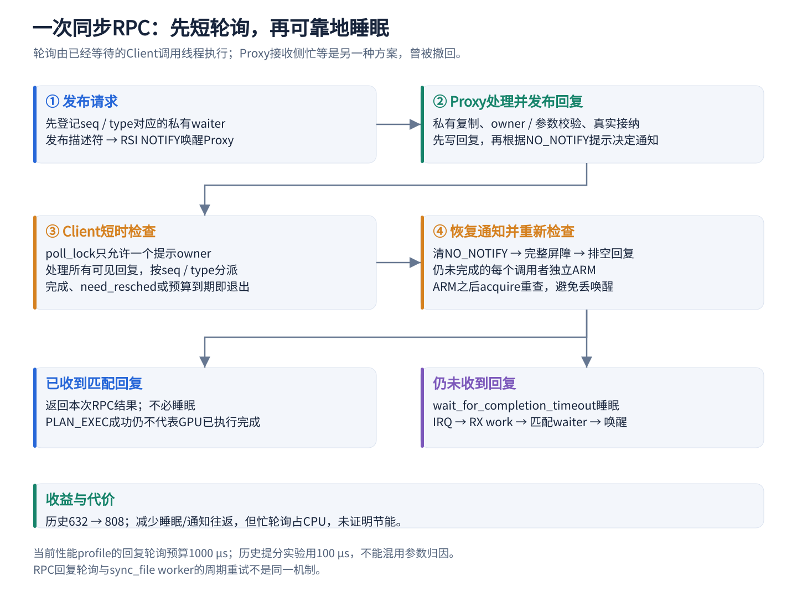

### 3.1 通信 IRQ：删除 QUERY 与额外交接

旧链路是“IRQ → IRQ thread → QUERY SMC → RX work → 收消息”。当前 `realm_xshm_irq()` 只执行有界订阅回调，回调排队 RX work；worker 再私有复制、校验、排空、ACK_ARM 并重查。省下一次查询与线程交接。

代码：`drivers/char/realm_xshm.c:320`，Client 的 `client_comm_vmshm_receive()` 及 Proxy 对应接收回调。卸载仍先 unsubscribe，再 cancel work，避免回调访问已释放设备。IRQ 只是提示，不是请求有效性或 GPU 完成的证明。

历史同诊断配置 **197 → 296，+50.25%**。这项通信 IRQ 与 GPU JOB IRQ 是两条不同链，不能将后者的优化和这里混为一谈。

### 3.2 Client 短轮询＋多余回复通知抑制

发送前先把私有 waiter 登记到 seq/type 表；请求发布后，已经等待 RPC 的 Client 调用线程有界分派回复。一个调用者通过 `poll_lock` 持有 `NO_NOTIFY` 提示，Proxy 先发布回复、再检查提示，避免给正主动检查队列的 Client 再发一次昂贵通知。

若回复尚未来，退出轮询时先恢复通知、屏障和排空回复；每个尚未完成的调用者睡前独立 ARM，再 acquire 重查队列，最后调用 `wait_for_completion_timeout()`。包括没取得 poll_lock 的调用者也必须 ARM，不能根据别人的完成推断自己无需准备。

代码：`drivers/char/client_vmshm_comm/client_comm_vmshm.c:970` 的 `client_comm_vmshm_poll_response()`、其后的 `client_comm_vmshm_prepare_response_wait()`，以及 Proxy 回复队列通知函数。

历史 P9 用 100 μs 窗口，**632 → 808**，PLAN_EXEC 均值 **148.456 → 93.251 μs**；该镜像还修复超时误判，只能评价整体。当前 profile 预算为 1000 μs，遇 `need_resched()` 提前退出。两个时期的参数不可混用归因。

代价是 CPU 忙轮询；Client 非 idle 接近 99% 包含这种工作，不能解释成 CPU 都在产生有效渲染，也不能宣称节能或适用于 CPU 超售。

### 3.3 并发 RPC 与空闲时就地接纳

`concurrent_rpc=1` 允许多个调用者各自等待 seq/type 对应的回复，不再由一个 transport mutex 覆盖全部等待时间；队列锁、waiter 锁、plan/session 锁仍存在。回复与超时移除 waiter 使用同一锁，防止迟到回复写入已经退出的栈。

Proxy 接纳器在私有调度锁下确认队列空且 `busy=false`，先置 busy，再在当前线程执行原 handler；有竞争时仍走有界队列和 session round-robin。它仅避免不必要 worker 交接，不改变同步接纳回复语义。

代码：`client_comm_vmshm_call()`（约 1052 行）；`panthor_proxy_drv.c` 的 `panthor_proxy_submit_sched_run()`（约 1041 行）。当前双 Client 功能实测各通道 RPC peak=2，但不代表单线程 Mesa 已具备跨 ioctl 的流水化。

### 3.4 私有 credit 与有界副本

生产者缓存已验证的消费进度，credit 耗尽才 acquire 读 peer used 索引，检查倒退、越界和 u32 回绕。接收方先私有复制描述符、验证固定槽位几何与长度，再复制有限长度消息，核对头部与描述符长度。

代码：`drivers/char/proxy_vmshm_comm/proxy_comm_vmshm.c` 与 Client 对称实现。有效字节外的旧槽尾部不被消费；queue reset 与跨对象释放仍全量清零。私有副本继续防止校验后共享请求被改写。

收益来自减少共享状态读取、无关清零和复制，属于 1208 组合；此前类似候选单独未达保留门槛，不能宣称每项独立提速。

## 4. 优先级三：快照与同步，减少高频对象往返

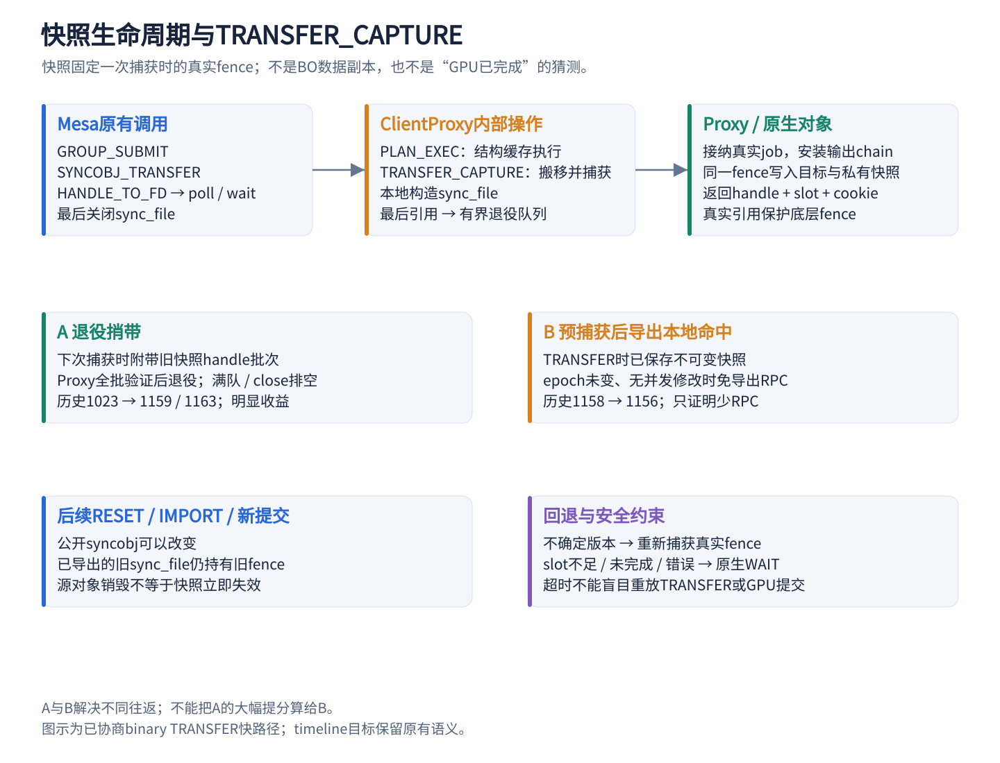

### 4.1 下次捕获捎带退役：消除一个高频独立 DESTROY

旧链路在最后一个 sync_file 释放时单独发 DESTROY，下一次导出再发快照请求。当前只把无人使用的私有 snapshot handle 放入有界退役队列，下次捕获时一起发送；Proxy 全批验证 owner、private_snapshot、重复项及 source 冲突后，再删除名字并交给引用计数释放。满队或关闭走显式排空。

代码：Client `panthor_client_snapshot_retire()` / `..._take()`（约 573 / 596 行）；Proxy `panthor_proxy_snapshot_retire()`（约 2920 行）。

这里**没有**复用旧 fence、没有回收仍在使用的 BO，也没有提前销毁 GPU 依赖。它只是把控制对象退役附带到下一条本就需要的请求上。历史 **1023 → 1159 / 1163**，是高收益 RPC 数量优化；代价是短期延迟释放的少量存量，必须有界并在 close 清理。

### 4.2 不可变快照、对象按需物化与惰性等待

公开 syncobj 是可修改的容器，后续 RESET、IMPORT、TRANSFER 或提交会替换它指向的 fence。sync_file 则必须固定导出当时的真实 fence，之后源被 reset/destroy 也不能改变旧文件代表的依赖。

因此导出持有不可变私有快照和真实 fence 强引用。它不是 BO 内容的副本，也不是 VM snapshot。Client 对无需远端操作的空 binary 对象可先仅建本地对象，真正需要远端语义时才物化；同会话导入可持有已有私有快照，而不是立即制造新远端对象。

`lazy_snapshot_wait` 将尚未被 poll/wait 或依赖使用的等待工作延后；真正存在消费者时才启动真实观察。不能把“从未使用”与“已经完成”混为一谈，空对象的 WAIT_FOR_SUBMIT 等仍需要正确物化。

代码：Client `panthor_client_syncobj_materialize()`（约 1412 行）、snapshot import/export 与 `panthor_client_sync_fence_work()`（约 1788 行）。历史 `fused_snapshot + lazy_snapshot_wait` 组合为 **296 → 318**，不能拆分两者贡献。

### 4.3 复用真实 timeline 完成证明：少发冗余 WAIT

原生提交已经安装精确 timeline 点的输出 chain 时，PLAN_EXEC 可以附带该点的真实观察凭据。Client 在 sole-writer、同对象/epoch、无未知 mutation 的条件下保存证明；若完整 chain 在 P 已完成，且 chain 确实覆盖所查前缀点，允许据此确认受覆盖的较早点。

这与“timeline 数值更大就一定完成”不同。普通 WAIT 成功缓存仍严格匹配同 point/epoch；只有完整链证明可以覆盖前缀，RESET/IMPORT/SIGNAL/TRANSFER/删除与溢出都会失效相关缓存。

代码：Proxy `panthor_proxy_plan_execute()` 的 WATCH 分支，Client `panthor_client_plan_completion_record()`（约 3132 行）、timeline wait（约 2347 行）、`panthor_client_wait_cache_mutation_begin()`（约 4185 行）。

历史 P38+P39 **957 → 1022 / 1022，+6.79%**；P39 相对直接 P38 962 为 +6.24%。两者共同包含“拿到真实证明”和“安全消费证明”，不要把这两段当成两个独立 +6% 的改动。

### 4.4 exact cookie：便宜检查背后的真实完成证明

Proxy 为观察器分配不可复用 cookie 与 slot，持有精确 native fence。真实回调在 fence 成功时 release 发布 cookie；Client acquire 读取，必须等于私有保存的预期 cookie。

```c
return smp_load_acquire(&record->cookie) == cookie;
```

摘自 Client `panthor_client_cookie_completed()`（约 650 行）。Proxy 发布点位于 `panthor_proxy_snapshot_publish()`，约 578 行。

slot 复用前必须移除旧回调或等待其结束；cookie 溢出回退真实 WAIT，不能用共享 watermark 或 `>=` 接受新任务的完成。cookie 只是身份绑定的完成证据，不授予访问权限，也不自行唤醒睡眠线程。

### 4.5 同一完整 fence 的观察器复用

TRANSFER_CAPTURE 捕获的完整 native fence 若恰好与源观察器 `fence` 指针相同，可以复用 watch/cookie/slot，引用计数保活。比较对象身份，不能只比较 seqno 或认为“看起来同一提交”就合并。

```c
if (source && source->watch && source->watch->fence == fence) {
    watch = source->watch;
    refcount_inc(&watch->refs);
    syncobj->watch = watch;
```

摘自 Proxy `panthor_proxy_point_watch()`（约 613 行）。源对象被覆盖后，快照引用仍持有观察器；最后一个引用才注销回调并回收 slot。不同 fence、无资源或失败仍回退。这项属于 **1208 组合**，不是早期已撤回的旧回调容器复用候选，也没有独立提分百分比。

### 4.6 TRANSFER_CAPTURE：把一次真实 TRANSFER 的结果提前留给导出

Mesa 常在 GROUP_SUBMIT 后把某 timeline 点转到 binary syncobj，随后导出 sync_file。既然 TRANSFER 已找到所需完整真实 fence，就在同一个有序操作内将同一 fence 引用写入公开目标和私有快照，回复快照句柄、slot/cookie，并可附带退役旧快照。

后续 HANDLE_TO_FD 若能证明目标 epoch 未变、无在途 mutation，就本地持有快照创建 sync_file，省掉独立导出捕获 RPC。RESET/IMPORT/SIGNAL/SUBMIT/TRANSFER 等更新版本；并发或无法证明时回退独立捕获。原生 TRANSFER 成功但可选捕获失败，不能让 Client 重放已经成功的修改。

代码：Proxy `panthor_proxy_handle_transfer_capture()`（约 2964 行）、原生 `panthor_vmshm_syncobj_transfer_capture()`，Client transfer/export 缓存路径。timeline 目标、未协商能力或资源不足走原路径。

历史同镜像 off/on **1158 → 1156**，虽约 **381700 次导出命中**，仍没有提分证据。当前保留为默认关闭、性能 profile 显式开启能力；不能把上一节退役捎带的 +13% 算成这一项收益。

### 4.7 尚未实现：完整主动完成订阅

当前 cookie 主要供主动检查。`panthor_client_sync_fence_work()` 未命中 cookie 时，仍可能发零超时 WAIT RPC，睡眠后重试，再 signal 本地 fence；没有把每个完成 cookie 都做成能精准唤醒 Client 等待者的主动订阅。

所以“有共享完成页”不等于“已经完全取消 WAIT 查询”。完成订阅需要绑定等待者、取消/关闭、迟到通知及重查协议；现有 GLMark 大多走本地已完成证明，其可改善范围不能只按旧 WAIT 次数推算。

## 5. 优先级四：真实完成可见性，近期最有效的增量

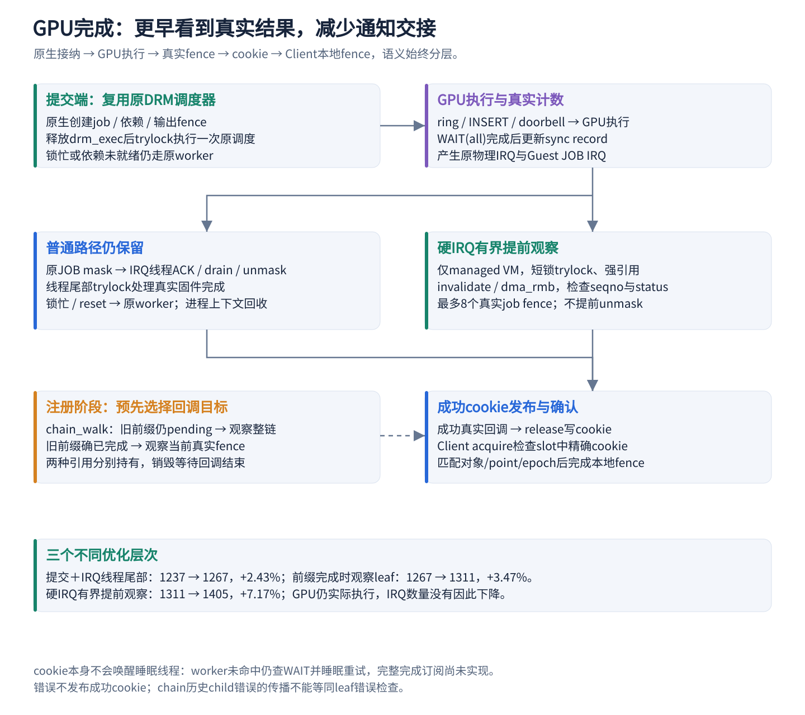

### 5.1 硬 IRQ 有界提前观察真实完成

GPU 已更新真实完成计数，但普通路径仍可能等待 IRQ 线程/worker 才 signal 原生 job fence。当前在原硬 IRQ 里增加一个很短、可跳过的观察：仅 managed GPUVM，slot/group/queue 短锁全部 trylock；持 group 引用，检查 active、usable、fault/reset 状态，维护真实 sync record 缓存并按 DMA 顺序读取。

只有真实 `seqno` 已覆盖具体 job fence 且 `status==0`，才 signal 原生 fence。每次硬 IRQ 全局最多 8 个 job，完成的 job 移到 `raw_done_jobs`；原 worker/termination 在进程上下文释放引用。原设备 mask、IRQ_WAKE_THREAD、ACK/drain/unmask 全部保留。

代码：`panthor/panthor_sched.c:3478` 的 `group_observe_raw_completions()`、`panthor_sched_observe_raw_completions()`。

图中左下的前缀检查发生在注册观察器时，虚线表示预先选择的回调关系；不是 GPU 完成之后才临时决定观察哪个 fence。

```c
if (completed == budget ||
    READ_ONCE(syncobj->seqno) < job->done_fence->seqno)
    break;
list_move_tail(&job->node, &group->raw_done_jobs);
dma_fence_signal_locked(job->done_fence);
completed++;
```

这是提前**观察已经完成**的工作，不能理解成提前完成 GPU，也没有省略原生命令流 WAIT(all)。锁竞争、状态不满足或超过预算直接回退，不阻止普通路径继续处理。

完整 720p **1311 → 1406 / 1404，均值 1405，+7.17%**。两个运行各约 54.7 万 job 命中提前完成，物理 JOB IRQ 仍约 110.9 万；因此收益不能解释成减少中断总数。

这是当前最依赖并发与平台约束的优化：回调可运行在硬 IRQ，缓存操作必须不可睡眠，reset/fault 和引用生命周期要保持互斥。现有执行证据包含错误 fence 与受害者恢复，但没有完整 lockdep、atomic-sleep 配置或长期 reset/suspend 压力证明。

### 5.2 旧前缀确实完成后，直接观察当前真实 fence

timeline 的完整 chain 包含当前 fence 与旧前缀。通用 chain 完成回调可能通过 irq_work 再检查前缀，在 ARM64/Realm 上增加额外交接。若注册时能证明旧前缀已经全部完成，就可以把“完整 chain 等待”化简成“当前真实 fence 等待”，同时仍持有完整 chain 身份。

真实生产 helper 位于 `panthor-proxy/panthor_proxy_fence.h:7`：

```c
if (chain) {
    previous = dma_fence_chain_walk(dma_fence_get(fence));
    if (!previous)
        return dma_fence_get(chain->fence);
    dma_fence_put(previous);
}
return dma_fence_get(fence);
```

仍有未完成前缀就观察完整 chain；不能只看最新 job。Proxy 分别持有完整 `fence` 与 `callback_fence`，前者用于快照身份和复用，后者用于注册/移除回调。销毁等待正在运行的回调结束，再释放引用与复用 slot。

完整 720p **1267 → 1314 / 1308，均值 1311，+3.47%**。真实内核测试覆盖 1000 组前缀/当前先后、取消、当前 error 与引用回收。未做独立 SGI 来源配对，不能宣称精确减少了某个数量的 IPI。

### 5.3 提交与完成两端减少线程交接

提交端原生创建 job、收集依赖、安装输出 fence 并完成 reservation 更新后，先释放 `drm_exec`，再尝试在当前线程运行一次原 DRM scheduler。共用 dispatcher mutex、select/pop、credit、依赖与 backend；锁忙、暂停或依赖未就绪则保留原 worker。选中的 job 也可能是调度器原先排队的其他 job，不能绕过公平选择直接启动本次请求。

代码：原生 `panthor_vmshm_group_submit()`（`panthor_drv.c` 约 2233 行）、`drivers/gpu/drm/scheduler/sched_main.c:1519` 的 `drm_sched_run_job_now()`。

```c
if (!mutex_trylock(&sched->dispatch_lock))
    return false;
```

完成端保留原 JOB 硬 IRQ 和线程的 ACK/drain/unmask，在 IRQ 线程尾部 trylock、取得 group 引用后处理真实固件完成，减少再交给另一 worker 的延迟。锁忙或 reset 仍回原路径，引用回收保持进程上下文。

单独内联调度 **1208 → 1219（+0.91%）**、单独 IRQ 尾部处理 **1237 → 1252（+1.21%）** 都未达门槛；后来组合 **1237 → 1274 / 1260，均值 1267（+2.43%）** 才保留。不能把两个单项重新计成两项成功。

## 6. 优先级五：可信通知，减少Realm与Host交接

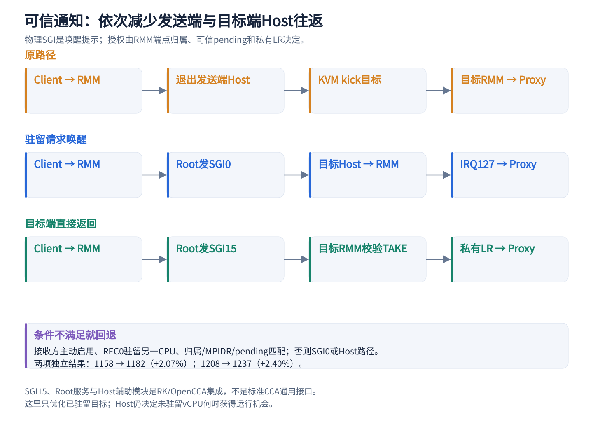

### 6.1 SGI15 目标端直接返回：再省目标 Host 往返

驻留方案中目标还需退出 Host 一次。后续使用预留 SGI15，Root 验证目标与中断配置、记录提示；目标从 Realm 进入 RMM 后，核对当前 RD/REC/MPIDR、私有 pending 和 Root TAKE，更新正在运行的私有 LR 注入 IRQ127，直接回到同一 Realm。

代码：`opencca/tf-rmm/runtime/core/exit.c:604` 的 `handle_exception_irq_lel()`，配套 Root SGI 服务、`tools/xshm-wake-sgi/` 模块与 `scripts/run/run-realm-wake-sgi.py`。

```c
if (xshm_endpoint_fast_irq_pending(rec->realm_info.g_rd, mpidr) &&
    monitor_call(SMC_RMM_OPENCCA_XSHM_TAKE,
        0UL, 0UL, 0UL, 0UL, 0UL, 0UL) == 1UL &&
    xshm_endpoint_fast_irq_take(rec->realm_info.g_rd, mpidr)) {
```

完整实现随后读取、修改、写回私有 LR，保留 Active+Pending 等状态；Root 只清自己的 SGI15 pending，不吞掉普通调度中断。辅助模块准备专用接收环境，不决定消息授权或 GPU 是否完成。

完整 720p **1208 → 1234 / 1240，均值 1237，+2.40%**。这是当前 RK/OpenCCA 的平台集成，不是标准 CCA 现成提供的通用 ABI。普通 vCPU IPI 和 KVM VGIC 状态不因这项改动全部转交 RMM。

### 6.2 驻留请求唤醒：先省发送端 Host 往返

普通请求通知遇到需要唤醒目标时，发送 Client 退出 Host，由 KVM kick 目标 vCPU。新路径在 Proxy 主动启用、REC0 确实驻留另一物理 CPU 时，由 RMM 验证 endpoint/peer/pending 与实际 MPIDR，经 Root 发固定物理 SGI0；发送 Client 可直接返回。目标 CPU 此时仍经过 Host，再进入 RMM 注入可信 IRQ127。

代码：`opencca/tf-rmm/runtime/rsi/xshm.c`、`runtime/core/xshm_endpoint.c` 及 Root 对应受限 SGI 服务。物理提示不是授权，可信 pending 仍由 RMM 私有状态维护。非驻留、同 CPU、Root 失败保持 Host 回退。

完整 720p **1158 → 1183 / 1181，均值 1182，+2.07%**。这是接收 Proxy 选择启用的请求方向，不把旧双向候选的设计和成绩混入。

## 7. 收益有限但有结构价值：Submission-Plan Caching

一个稳定提交通常重复使用同一个 group、queue 布局和同步对象关系，只变命令地址/长度、flush 信息和 timeline 值。Client 将固定 shape 注册一次；Proxy 缓存经当前 session 校验的布局和 syncobj 强引用，返回 slot/plan ID。命中时 `PLAN_EXEC` 只携带标识与动态字段。

代码：`panthor-proxy/panthor_proxy_drv.c:2307` 的 `panthor_proxy_plan_register()`、约 2388 行的 `panthor_proxy_plan_execute()`；Client `panthor_client_execute_plan()`（约 3062 行）。

```c
plan = session->plans[req->slot];
if (!plan || plan->id != req->plan_id) {
    ret = -ESTALE;
    goto out;
}
```

执行仍检查动态字段，组装真实 submit，并调用 `panthor_vmshm_group_submit()`。group/syncobj 删除会使相关计划失效；只有明确派发前 ESTALE 才重注册。结果不确定的超时不能盲目重试 GPU 提交。

独立 A/B 特意采用“一次 RPC 的即时解析”作为关闭缓存对照，没有人为让关闭路径多一次 REGISTER：

| 指标 | 关闭缓存 | 开启缓存 | 可以说明什么 |
| --- | --- | --- | --- |
| 720p 两轮均分 | 1153.50 | 1158.00 | +0.39%，小于关闭组 7 分轮差 |
| 1080p 两轮均分 | 901.00 | 901.00 | 无提分 |
| 1080p 诊断 lookup＋validate＋assemble | 2.549 μs | 1.264 μs | 重复解析减少约 1.286 μs / 50.43% |
| 1080p 诊断同步往返 | 85.621 μs | 84.774 μs | 边际节省小，样本加权不同 |
| 固定请求 payload | 472 B | 248 B | −47.46%，不等于固定槽容量同比缩小 |

因此不能说低 lookup 时间证明 GLMark 的高分主要来自计划缓存。保留正式计划机制；仅供 A/B 的 `plan_cache=0`、`UNCACHED_SUBMIT` 和控制分配账本后来已清理，不能把历史开关当成当前可用接口。

依据：`GPU_PLAN_CACHE_AB_AND_CONTROL_MEMORY_20261022.md`。这是后续已完成的独立补测，不再沿用早期“没有关闭/开启对照”的旧结论。

## 8. 容量与可运行性：内存、映射与多Client预算

### 8.1 连续优先、碎片时分段

大 BO 在单 owner 池内优先连续分配，失败后用多个 extent 组成 SG，通过 GPU 页表形成连续 GPU VA；Client mmap 逐段解释逻辑偏移。保留段数、边界、权限、pin、清零与释放检查。物理不连续不影响 GPU VA 连续，也不允许越过 owner 授权。

代码主要在 `drivers/char/proxy_vmshm_manager/` 与 `client_vmshm_manager/`，原生 BO 接收授权 payload 描述。当前组合实际两段 mmap 与 GPU 计算通过；收益是避免因连续大块不足而启动失败，没有独立执行性能增量。

### 8.2 共享挂接后回收旧目标页

历史 Client 先取得目标私有页 B，RMM 再将目标 IPA 改为源页 A。映射已经共享 A，但 guest_memfd 仍可能保留 B。Firecracker 在 KVM 成功切换 shared 属性、旧映射及引用被撤销后，对校验过的 guest_memfd 范围执行 `PUNCH_HOLE | KEEP_SIZE`，消除稳态重复后备。

代码：`firecracker/Firecracker-CCA-MZH/src/vmm/src/vstate/memory.rs:39` 的 `discard_private_range()`；调用点在 `vstate/vcpu/mod.rs` 约 593 行。检查完整范围、页对齐、文件偏移和溢出，失败不继续 vCPU。

| 历史 ResNet50 内存分项 | 优化前 | 优化后 |
| --- | ---: | ---: |
| 源池 | 384.00 MiB | 384.00 MiB |
| Client 旧目标后备 | 384.00 MiB | 0.00 MiB |
| 已测分项峰值合计 | 903.26 MiB | 519.33 MiB |
| 相对原生 454.17 MiB 的额外比例 | 98.88% | 14.35% |

这是分项峰值之和，不是同时整机峰值；未包括所有 OS/VM 和全部控制结构。直接页数证明源页仍为 98304、旧目标从 98304 变 0。启动阶段仍先取得目标 CMA，不能写成“从未分配过目标页”。同条件 GLMark 单轮 1157 对历史 1158 不构成提速；该报告的 ResNet 耗时差异仍待解释，不以功能 PASS 代替性能无回退。

### 8.3 批量 IPA→HPA、页表页缓存与有条件大页

`drivers/iommu/io-pgtable-arm.c:445` 的 `panthor_gpa_to_hpa_batch()` 使用有界数组批量请求 RMM；`opencca/tf-rmm/runtime/rsi/opencca_gpu.c:299` 先私有复制，按当前 REC 授权逐页翻译和获取物理页租约，失败撤销本批租约。

缓存只用于当前页表实例生命期内固定的页表页，动态数据页走 `CACHE_NONE`。尝试 2 MiB block 时仍逐页验证 512 个 4 KiB 页的授权、HPA 连续与基址对齐，失败回 4 KiB 表。省的是边界调用和重复固定地址翻译，不是省掉授权检查。

这些映射优化的潜在收益主要在建表/VM_BIND，不是每次 PLAN_EXEC 的 lookup。没有单独 2 MiB 或各子项 A/B，不能列固定提分。

### 8.4 紧凑预算与准入不等于驱动算法收益

小共享池、缩减 SWIOTLB/CMA 余量、顺序建源池/目标池并回收旧后备，可以降低 Host 峰值压力。当前四 Client 设置 `panthor.max_inflight_jobs=3`，是固定资源准入策略；ResNet50 也有按工作负载和并发数制定的预算。

必须随实验披露这些参数，不能包装成普适自适应调度或“每个应用的最小 RAM”。多 Client 功能通过不代表所有模型都已通过，同一运行窗口重叠也不证明 GPU 内部同时执行。

### 8.5 日志与计时：控制观察者开销

高频成功日志改为首次 marker 或限频，错误仍保留；RPC、通知和完成阶段计时默认关闭，诊断时才显式开启。计时读取、聚合锁和记录会扰动短请求，排查性能下降时应先关闭诊断复测，不应把有实际诊断用途的代码直接当垃圾删除。

例如同一 candidate-c 输入，诊断开启历史 1144，关闭后一轮 1159，+15 / +1.31%。轮次不同，只支持诊断组合有影响，不能精确拆分到某个计时点，也不算新的执行算法收益。报告为 `GPU_PERFORMANCE_DIAGNOSTICS_REVIEW_20261022.md`。

控制结构历史独立账本还表明：1080p 开缓存时 Proxy 已跟踪分配器容量峰值约 2116.05 KiB、Client 约 43.73 KiB，其中计划分配点独立峰值仅 1.50 KiB；Proxy buddy 元数据约 2 MiB 才是主要分项。不同分配点峰值不能相加，也不能将整池空闲空间称为控制结构成本。账本是后来已清理的实验工具，这些数值不冒充当前 1405 的新内存测量。

## 9. 瓶颈证据：历史1237计时与端到端关键路径

1237 基线开启 RPC 计时的一轮完整 720p，得分 1233；统计含 validation、计分与收尾，486231 次 PLAN_EXEC 尝试。它不是最终 1405 的重新计时。

| 阶段 | 平均 μs | 同步往返占比 |
| --- | ---: | ---: |
| RPC：通信、排队与未分类残差 | 24.017 | 63.92% |
| lookup | 0.362 | 0.96% |
| validate：Proxy 显式检查 | 0.491 | 1.31% |
| assemble | 0.326 | 0.87% |
| native：同步接纳 | 10.625 | 28.28% |
| aux：观察与记账 | 1.755 | 4.67% |
| 合计 | 37.576 | 100.00% |

lookup＋validate＋assemble 总共 **1.179 μs**。RPC 残差约 24 μs，包含约 0.676 μs queue 等待，不能称为纯共享内存传输或纯 RMM 执行。native 不含 GPU 异步执行；低 validate 也不表示原生、RMM、对象生命周期的检查都只花这一段时间。

早期 1080p 的 **81.152 / 61.238 μs** 属于更早版本和不同分辨率，不能把两组差额当作独立延迟 A/B。当前 1405 未重新做同口径完整分解，不能宣称“最新 RPC 精确占 63.92%”。

判断应同时看：一次 RPC 在通知/处理/回复中如何等待；一批 GPU 工作实际产生多少串行 RPC；以及接纳后到真实完成的异步交接。近期 1311→1405 并未减少 RPC 数，却显著提分，说明后半程完成可见性同样可能在关键路径上。

## 10. 复查补充：遗漏机制、性能代价与下一步优先级

本节为 2026-10-28 的定向代码与文档复查。原文已覆盖主要的已验证提分手法；此次没有发现遗漏某项已证明的大幅提分优化。以下补齐的是未展开的机制、配置边界和归因方法。**未改运行代码，无新增性能测量**；当前工作树中有某接口，不等于冻结性能镜像已开启它。

### 10.1 最值得补充的 GPU 执行开销：FLUSH_ID 为零

目前 Client 在初始化时分配 `__GFP_ZERO` 的本地 `flush_id_page`，`panthor_client_mmap_flush_id()` 将该页只读映射给用户态。工作树未见把真实 GPU FLUSH_ID 持续发布到此页的路径。`panthor_drm.h` 的 `latest_flush` UAPI 明确规定：零表示提交前无条件执行缓存刷新。原生 `panthor_sched.c` 生成的包装命令将 `latest_flush` 交给 `FLUSH_CACHE2`，等待它后再 CALL 用户命令流。

所以除了 CPU 侧缓存维护，还应单独分析 **GPU 侧的保守刷新是否增加了执行成本**。这条路径在旧探索报告中已有分析，但原性能总览没有展开。它可能影响短任务或共享缓存中的驻留数据，不能仅由源码判断实际代价，更不能据此断言它就是 ResNet50 的瓶颈。Native 在某次工作负载中是否传入有效非零 ID，也须采集确认。

不能把 shadow 页设成固定非零值、周期性复制旧计数，或在 Proxy 收到提交时直接替换为“最新值”：FLUSH_ID 的含义与用户命令构建时刻及之后的 CPU 写入有关，错误的新鲜度可能让必需的刷新被省略。后续需先证明观测与写入顺序、PM/reset/计数代次及只读映射的保护条件，再比较刷新触发、GPU 等待和端到端耗时。**当前为保守兼容机制及待测方向，没有提分结果。**

代码：`Linux-Guest-GPU/drivers/gpu/drm/panthor-client/panthor_client_drv.c` 的 `panthor_client_mmap_flush_id()` 和 `flush_id_page` 初始化；`Linux-Guest-GPU/include/uapi/drm/panthor_drm.h` 的 `latest_flush`；`Linux-Guest-GPU/drivers/gpu/drm/panthor/panthor_sched.c` 的 `FLUSH_CACHE2` 命令生成。历史分析：`GPU_PROXYCLIENT_OPTIMIZATION_EXPLORATION_20261024.md` 的 “FLUSH_ID shadowing”。

### 10.2 零复制的另一面：WC 数据对 CPU 访问的代价

共享 BO 避免跨 VM 搬运，但不保证 CPU 读写成本接近普通 WB 内存。当前 payload 使用 WC：连续写入可能较合适，CPU 读回、读改写、小粒度访问及某些初始化方式则可能昂贵。控制区保留 WB 不能自动消除数据区的这些代价。实际吞吐仍需测量，不以“WC”标签推导确定的带宽损失。

应按 CPU 写入、GPU 使用、CPU 读回分别计量，区分资源创建/清零、首次上传、稳态计算与结果映射。ResNet50 的性能保留比例在 1/2/3/4 并发分别为 75.07%/45.09%/59.71%/38.08%，说明图形高分不能推广到所有 ML；这些总耗时没有定位 CPU、GPU、访存或内存压力中的唯一原因。

可研究按用途划分 staging、读回和 GPU 常驻资源：额外复制有时可能换来更低 CPU 成本，但应比较完整生命周期。不得为改善 CPU 带宽直接增加冲突 WB alias；任何 WB 数据快路径都要重新满足 managed GPUVM 的缓存交接条件。

### 10.3 已有但未充分讲清：清零成本与分配器串行化

`proxy_vmshm_object_release_and_put_maybe_unlock()` 对非 slab、超过 64KiB 且已可释放的大对象，在摘除公开 lookup、确认无在途 pin 后，暂时释放 `mgr->lock` 进行清零，再加锁归还 backing。它减少某个内层锁的持有时间，并不省略安全清零；外层 `proxy_vmshm_init_lock` 仍持有，**不能据此宣称所有分配/释放已经可并行**。该路径没有独立 FPS 收益证据。

`proxy_vmshm_buddy_mark_block()` 会逐页维护 block 尾部元数据，分配器也有按页元数据容量。若后续确认 BO churn 或大块分配位于关键路径，再测对象尺寸分布、锁等待、清零带宽、元数据维护和碎片化。per-Client 分配域、延迟回收或预清零池均只是候选，必须保证旧 GPU 访问结束、对象不可重新 lookup、清零完成后才重新授权，且容量有界。

工作树还存在默认关闭的 `diagnostic_zero_on_alloc`，它是诊断开关，会额外触及 GPU-only 数据页；不能把它写成冻结基线默认行为、性能优化或可随意启用的所有权协议。代码位于 `drivers/char/proxy_vmshm_manager/proxy_vmshm_manager.c`。

### 10.4 多 Client 的性能：准入轮转、GPU 时间和核分区要分开

Proxy 的 session RR 决定请求接纳顺序；原生 scheduler 决定就绪 job/group 运行；GPU core mask 则限制可用执行资源。这三层不是同一种调度。减少接纳队列等待不等于增加设备吞吐，限制在途数量也可能是在降低竞争或避免资源峰值。

四 Client 的 `panthor.max_inflight_jobs=3` 在 `queue_prepare_job()` 中通过真实 finished fence 管理准入槽位；其具体路径还受非空命令流等条件限制。它不是为每 Client 固定分配三个核心，也不直接证明同一时刻硬件只运行三个 group。Native 对照没有该参数，必须继续披露差异。

工作树还有默认关闭的 `group_core_partitions`：按 session_id 选择 compute/fragment mask 子集并收紧 max cores。它在 group 创建时生效，不是按负载自适应，也不是按可信 Client 汇总份额；多个 session 可能落在同一分区，输入 mask 不同时也不能直接宣称全局互斥分区。没有独立收益或安全隔离证明，不计入 1405 提分。

后续比较准入上限、时间片或核分区时，需同时看 GPU 饥饿/占用、每 Client 尾延迟、归一化进展和整体吞吐；先确认实际瓶颈再调参。固定算力切分可能降低长任务吞吐，不把“更多并发”预设为更快。

### 10.5 端到端关键路径：减少操作不等于缩短等待

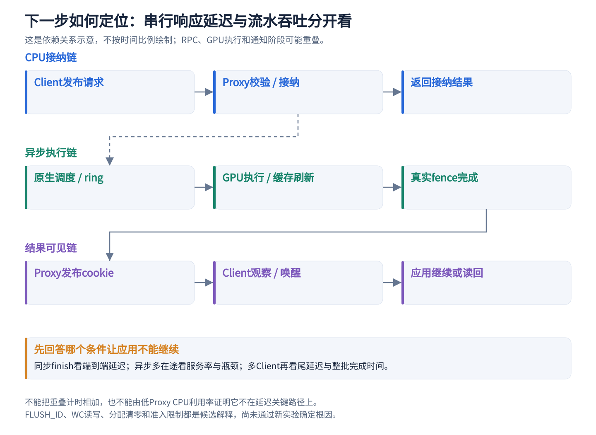

同步 finish 型任务主要受依赖链上的响应延迟影响；多在途任务的稳态吞吐还取决于各层服务能力和可重叠程度。Proxy 平均 CPU 利用率低，不表示它不在延迟关键路径上。RPC 次数、IRQ 次数、cookie 命中数只证明机制触发，不能独立证明应用少等了多久。

旧 1237 profile 中 lookup＋validate＋assemble 为 1.179μs，同步往返为 37.576μs。即使假设三项完全消失且其他阶段不变，也只会减少约 3.14% 的该次同步往返，对应往返服务速度约提高 3.24%；这是理想上界说明，不是最新 1405 的帧率预测，更不支持删除安全检查。端到端中这些阶段若与别的工作重叠，收益可能更小。

建议沿提交 ID 记录发布请求→Proxy 接纳→ring 可见→真实完成→cookie 发布→Client 观察→应用返回，分开给 p50/p95/p99 与 GPU 空闲间隙。跨 VM 计数器可比性、采样开销、依赖顺序和对象代次必须先成立；不能将相互重叠的平均时间相加。

### 10.6 多 Client 平均耗时不能替代整批吞吐

现有 ML 原始报告已经给出下表，但旧总览只保留平均耗时，容易让读者误判退化范围。固定每参与者迭代次数时，部分参与者先完成、剩余者后续独占设备，可改变算术平均值；整批完成窗口是另一个必要视角。

| 任务 / 并发 | 平均迭代耗时保留比例 | 整批窗口保留比例 | 能说明什么 |
| --- | ---: | ---: | --- |
| 卷积 / 3 | 89.23% | 99.35% | 平均响应退化与整批吞吐变化不同 |
| 深度卷积 / 4 | 81.85% | 98.03% | 不能只据均值断言总体算力损失约18% |
| Reduction / 4 | 82.23% | 91.49% | 整批窗口仍有差距，需要继续定位 |
| Softmax / 4 | 91.80% | 98.36% | 总体完成时间更接近原生，公平性仍待测 |

这些是现有 `GPU_CURRENT_NATIVE_ML_COMPARISON_20261026.md` 的数据整理，未重新运行。窗口比例为 Native 窗口÷Clientproxy 窗口；只有总工作量相同、计时边界一致的有效批次，才可据窗口讨论这批工作吞吐。NCNN 公共窗口含初始化/加载，不冒充纯推理迭代吞吐；以上表也不能证明公平性或统计显著性。

### 10.7 后续优化与测量的优先级

| 优先级 | 下一步 | 判定依据 |
| --- | --- | --- |
| 首先 | 复核当前版本逐场景差距及端到端关键等待 | 当前完整分段计时来自旧1237，不能直接当作1405瓶颈分布 |
| 高 | 在正确性前提下分析 FLUSH_ID 与 WC 访问成本 | 原总览遗漏GPU刷新语义及CPU数据访问代价，但收益尚未知 |
| 高 | 分析 ResNet50 等真实退化及多Client平均值/窗口分歧 | 使用现有差距选择工作负载，不能把图形优化比例套用于ML |
| 条件性 | 分配清零/锁、在途上限、时间片、核分区 | 只有对应成本或竞争被证实后，才进入改动与A/B |
| 后置 | 继续微调lookup、重复尝试复合RPC/主动订阅 | 既有小占比、负向实验或低覆盖证据不足以支持优先投入 |

轮询策略仍应同时报告 CPU 时间与任务延迟。历史自适应轮询、额外 per-plan 流水线、复合提交及部分 IRQ 合并已有失败记录；只有负载、瓶颈证据或设计条件发生明确变化时再试，不把它们重新列为已实现成功优化。完整主动完成订阅也应先确认实际存在阻塞消费者，而非只因机制更复杂就预期提分。

本次统一记录：重构性能优化文档、补齐遗漏分析并更新配图｜运行基线1405、同代码后续矩阵1395 → 本次未测｜分差与百分比不适用｜未改运行代码，无新增性能测量，无硬件 run-id｜仅执行文档、引用、图形生成及发布检查｜保留文档；新方向均待验证。历史分数的对照、命令、退出码和日志继续以原报告为准。

## 11. 当前效果：完整同频Native与Clientproxy矩阵

以下是 2026-10-25 全部 16 配置重测，每配置一轮；Native 是同 Host 多进程，Clientproxy 是多个独立 Client。两侧 CPU 固定 1.8 GHz、GPU 实际 594 MHz，使用相同用户态。

| 分辨率 / 并发数 | Native 分数 | Clientproxy 分数 | 分数保留比例 |
| --- | ---: | ---: | ---: |
| 1280×720 / 1 | 1561.00 | 1395.00 | 89.37% |
| 1280×720 / 2 | 811.00 | 832.00 | 102.59% |
| 1280×720 / 3 | 535.33 | 537.33 | 100.37% |
| 1280×720 / 4 | 384.50 | 381.50 | 99.22% |
| 1920×1080 / 1 | 1129.00 | 1043.00 | 92.38% |
| 1920×1080 / 2 | 587.50 | 603.00 | 102.64% |
| 1920×1080 / 3 | 394.00 | 392.67 | 99.66% |
| 1920×1080 / 4 | 失败（GPU 超时） | 280.00 | — |

均为每进程/Client 平均，比例使用未舍入值。不能把 102% 理解成硬件算力增加：存在调度、样本波动及 Native nVHE / Realm protected hVHE 差异；四 Client 还有 Native 不具备的在途限制。三/四并发的平均值也不代表每个 Client 公平性相同。

当前矩阵 1395 和优化链均值 1405 是同一代码，新一轮两侧增加同样外部采样、时段与样本口径不同，差 **−10 / −0.71%**；1080p 新单轮 1043 对此前 1044 为 **−1 / −0.10%**。不把这种差异写成新代码退化或新增优化收益。

15 配置有效、1 个 Native 四进程1080p GPU超时；没有未执行项，异常批次成绩不采信。该失败未见 OOM，不能归因内存不足。Clientproxy 八项均通过，但不据此宣称修复 Native 超时根因。

## 12. 适用边界：当前版本ML / NCNN同频对照

本轮使用第 11 节相同代码：720p 单 Client 1395、1080p 单 Client 1043。完整 10 项任务、1–4 并发，两侧各 40 个配置重新执行；Native N 个进程对照 N 个独立 Client Realm。CPU 固定 1.8GHz、GPU 实际 594MHz，工作负载 CPU2/3/2/3。Native NCNN 用 cpuset 防止库自行扩大 CPU 范围，首批仅 taskset 的 12 项排除。

| 任务 / 并发数 | Native 耗时（ms） | Clientproxy 耗时（ms） | 性能保留比例 |
| --- | ---: | ---: | ---: |
| GEMM / 1 | 28.96 | 29.28 | 98.89% |
| GEMM / 2 | 57.80 | 57.73 | 100.12% |
| GEMM / 3 | 失败（GPU 超时） | 76.37 | — |
| GEMM / 4 | 失败（GPU 超时） | 109.91 | — |
| 卷积 / 1 | 33.43 | 33.84 | 98.79% |
| 卷积 / 2 | 66.68 | 65.95 | 101.09% |
| 卷积 / 3 | 77.69 | 87.06 | 89.23% |
| 卷积 / 4 | 失败（GPU 超时） | 132.03 | — |
| 深度卷积 / 1 | 21.41 | 24.05 | 89.04% |
| 深度卷积 / 2 | 43.21 | 43.05 | 100.36% |
| 深度卷积 / 3 | 51.56 | 56.63 | 91.04% |
| 深度卷积 / 4 | 65.35 | 79.85 | 81.85% |
| Reduction / 1 | 10.25 | 10.62 | 96.55% |
| Reduction / 2 | 19.44 | 19.27 | 100.89% |
| Reduction / 3 | 23.29 | 26.26 | 88.70% |
| Reduction / 4 | 28.79 | 35.01 | 82.23% |
| Softmax / 1 | 19.20 | 19.92 | 96.38% |
| Softmax / 2 | 38.35 | 38.34 | 100.02% |
| Softmax / 3 | 45.26 | 49.62 | 91.21% |
| Softmax / 4 | 57.47 | 62.60 | 91.80% |
| Attention-256 / 1 | 776.73 | 776.99 | 99.97% |
| Attention-256 / 2 | 1544.29 | 1552.70 | 99.46% |
| Attention-256 / 3 | 失败（GPU 超时） | 2178.50 | — |
| Attention-256 / 4 | 失败（GPU 超时） | 失败（GPU 超时） | — |
| Attention-320 / 1 | 1224.24 | 1223.13 | 100.09% |
| Attention-320 / 2 | 2392.02 | 2387.08 | 100.21% |
| Attention-320 / 3 | 失败（GPU 超时） | 3338.76 | — |
| Attention-320 / 4 | 失败（GPU 超时） | 失败（GPU 超时） | — |
| MobileNetV2 / 1 | 29.87 | 31.36 | 95.25% |
| MobileNetV2 / 2 | 59.74 | 60.30 | 99.07% |
| MobileNetV2 / 3 | 50.04 | 54.76 | 91.38% |
| MobileNetV2 / 4 | 94.32 | 115.52 | 81.64% |
| MobileNetV3 / 1 | 26.57 | 28.06 | 94.69% |
| MobileNetV3 / 2 | 54.14 | 53.92 | 100.42% |
| MobileNetV3 / 3 | 45.89 | 46.81 | 98.05% |
| MobileNetV3 / 4 | 90.92 | 失败（GPU 超时） | — |
| ResNet50 / 1 | 1148.49 | 1529.83 | 75.07% |
| ResNet50 / 2 | 1249.76 | 2771.58 | 45.09% |
| ResNet50 / 3 | 1872.09 | 3135.51 | 59.71% |
| ResNet50 / 4 | 2131.85 | 5598.40 | 38.08% |

耗时越低越好，比例为 Native 平均耗时÷Clientproxy 平均耗时，使用未舍入值。每配置一轮，Native 33/40、Clientproxy 37/40 通过，32 行可计算比例。不是 1311/1405 的优化消融，不将 glmark +21.33% 套用于 ML。

GLES 100 次、5 次预热，Attention-320 为 10 次、2 次预热，预热后释放计时屏障；计时包含 dispatch/barrier/glFinish/map。NCNN 100 次、2 线程、panvk-direct，随机输入/空权重；共同窗口包含资格检查和加载，不宣称迭代精确并发吞吐或模型精度。两秒采样下的短窗口使用前后最近样本核对频率。

同一 rootfs/Mesa/脚本/模型；Native nVHE 与 Realm protected hVHE、Proxy CPU1 以及四 Client 在途上限 3 的差异保留。超过100%不证明硬件算力增加；单轮均值也不证明公平性或统计显著性。失败项不使用异常耗时，驱动恢复后其他项目独立验收。

完整条件、失败项、逐进程分布、共同窗口、准确命令/run-id/退出码/日志及最终恢复见[当前 ML 对照报告](GPU_CURRENT_NATIVE_ML_COMPARISON_20261026.md)和[机器摘要](evidence/native-ml-current-20261026/results.json)。本轮未改生产运行代码，无新增 GLMark 测量。

## 13. 历史附录：普通VM基础与Realm P1–P42演进

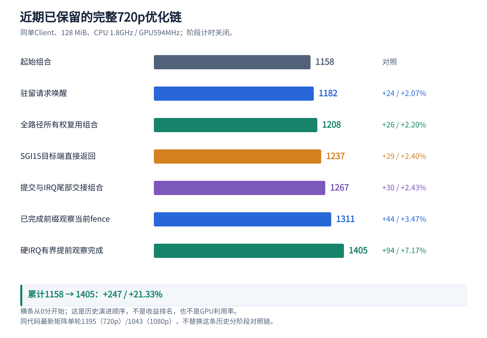

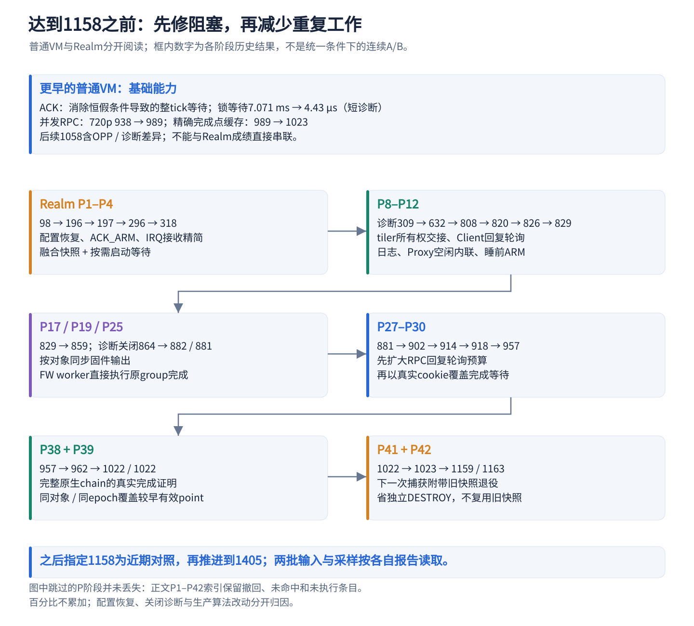

这一节补齐早期工作，而非把近期六项重新命名。分成两条历史路径：**2026-10-16 的普通 VM 代理路径**，以及 **2026-10-18 的 Realm 可信通信路径**。旧普通 VM 曾测得 1058/847；Realm 初期即使复用不少驱动能力，仍受到新的通知与缓存交接成本影响，从 98 分重新排查。两条路径的分数不能直接串联，也不能将 98→当前分数整体视作某个算法的单因素提升。

以下源码均相对 `Linux-Guest-GPU/`；RMM 源码相对 `opencca/tf-rmm/`。行号为本次阅读位置，函数名用于后续定位。历史修改已被演进替代的部分，以原报告和独立 patch 为准，不要求当前每一行仍与早期相同。

### 13.1 更早的基础一：修复固件 ACK 的整 tick 等待

**问题不是 GPU 每次需要几毫秒，而是 CPU 早已可以继续，却仍被错误的等待条件拖住。** 旧 Guest 在固件 ACK 未到时执行 `wait_event_timeout(*wq, false, 1)`。条件恒假，即使 IRQ 唤醒也不会因 ACK 已到而提前返回；当时 `CONFIG_HZ=250`，一个 tick 约 4 ms。部分调用还持有 scheduler 锁，延迟因此传给其他提交者。

现在 `drivers/gpu/drm/panthor/panthor_fw.c:1496` 的 `panthor_fw_wait_acks()` 先短轮询 ACK，未成功才睡眠，并以实际 ACK 条件等待。核心原码为：

```c
if (wait_event_timeout(*wq,
                       (panthor_fw_read_ack(ptdev, ack_ptr) & req_mask) == req,
                       msecs_to_jiffies(timeout_ms)))
    return 0;
```

`panthor_fw_read_ack()` 仍先同步 GPU 固件输出，再读 ACK；超时后还有最后一次检查及 `-ETIMEDOUT`，没有把“已通知”当成“已确认”，也没有提前完成 GPU fence。

同工具链短场景对照中，`run_job` 平均锁等待 **7.071 ms → 4.43 μs**，build/desktop 为 **64/43 → 959/440 FPS**；它们是两个短场景的 FPS，不是完整 GLMark 总分。早期一轮修复候选还出现新增像素验证失败，原失败保留；后续严格复测和 DMA 生命周期排查分别记录，不能只凭高 FPS 接受候选。详细证据见普通 VM 历史报告的 `control-stats`、`ackfix-stats`、`ackfix-strict-v2`。

### 13.2 更早的基础二：并发 RPC，取消跨整个等待期的大锁

旧 `rpc_lock` 从发送前一直持有到收到回复。一个 sync_file worker 的查询，可能把 Mesa 主线程后续 CREATE、TRANSFER 或 SUBMIT 堵在锁外；这些请求本可以在通信层同时在途。

现行 `drivers/char/client_vmshm_comm/client_comm_vmshm.c:1052` 的 `client_comm_vmshm_call()` 通过 `serialize = !client_comm_vmshm_concurrent_rpc` 选择是否保留旧串行模式。开启时，每次调用先登记私有 waiter，回复按 **seq + 预期类型** 分派；发送队列、waiter 表和对象状态仍分别加锁。超时撤销与回复处理使用同一 waiter 锁，避免迟到回复写入已退出的栈。

**普通 VM 历史完整成绩：720p 938→989，+51/+5.44%；1080p 777→804，+27/+3.47%。** 同镜像 OFF/ON/OFF/ON 的短场景还测得 build +8.29%、blur +0.84%、terrain 持平。旧全局锁等待的诊断计数归零，剩余队列锁与处理等待仍存在；这不是无锁通信，也不意味着 GPU 同时运行四个任务。该能力后来进入 Realm 的 P1 profile，所以不能再把它当作 1158 之后的新收益。

### 13.3 更早的基础三：精确完成点缓存，减少重复非阻塞 WAIT

Mesa 会重复查询同一个 timeline point。已经由原生成功 WAIT 证明完成的点，若对象没有被改写，不必再次跨 VM 查询。早期缓存采用文件级 `sync_epoch`；过于保守地遇到任何 ioctl 都失效，结果命中很低。

审计后，将 **BO_CREATE、BO_MMAP_OFFSET、GEM_CLOSE** 列为保持同步状态的操作：它们只管理 BO 及映射偏移，不替换 syncobj 中的 fence。未知操作、提交、VM_BIND 和同步对象修改仍按规则失效。现行 `panthor-client/panthor_client_drv.c:4191` 的 mutation 分类保留这三个例外。

原生查询结果缓存至今仍要求**同对象、同 epoch、精确相同 point**，其核心判断为：

```c
if (syncobjs[0]->completed_valid &&
    syncobjs[0]->completed_epoch == cache_epoch &&
    syncobjs[0]->completed_point == points[0]) {
    args->first_signaled = 0;
    atomic64_inc(&panthor_client_wait_cache_hits);
    goto out_unlock;
}
```

此判断位于 `panthor_client_syncobj_timeline_wait()` 内，且外层已限定单对象、非零 point、非阻塞 WAIT_ALL、无在途修改。它与后来的“完整原生 chain 覆盖更早点”是两种不同证明，不能随意把等号改成大于等于。

历史完整成绩在并发 RPC 上从 **989→1023（+34/+3.44%）**、**804→841（+37/+4.60%）**，完整运行各一轮。另有同镜像缓存 OFF/ON 交替短场景：build +6.14%、blur +4.80%、terrain +8.00%，但 buffer 局部仍有下降。其后普通 VM **1058/847** 使用标准 OPP 并关闭计时，跨启动与诊断条件改变，不能将 1023→1058 全归因于缓存或调频。

### 13.4 P1–P4：先恢复可比配置，再缩短 Realm 接收链

**P1：98→196，+98/+100%。** 同旧 Client/Proxy/RMM，只恢复性能 runner：Proxy/Client 分别固定 CPU1/2，CPU0–3 在线、不运行第三个空闲观察者，GPU 请求 600 MHz/实际 594 MHz，并发 RPC 和完成点缓存开启。这是多项配置的组合，不是新的驱动算法；即使配置恢复，简单场景仍有约 4 ms 级固定等待。

**P2：原子 ACK_ARM，196→197，+1/+0.51%，且增加诊断，未证明提分。** 接收端排空队列后，过去需 QUERY/ACK/ARM 多次跨界。现 `runtime/core/xshm_endpoint.c:409` 在受保护事件状态下执行：

```c
event->acknowledged = event->pending;
event->armed = true;
event_snapshot(channel, side, output);
```

RMM 只修改已认证接收端的事件，不在这里消费消息。Guest 随后必须 acquire 重查队列：通知若早于 ACK_ARM，重查可见先前的数据；若晚于 ACK_ARM，新的 NOTIFY 消耗 armed 并产生唤醒。**不能只合并调用而删掉重查。** 这是当前通知链的基础能力，单独实测并未显著提分。

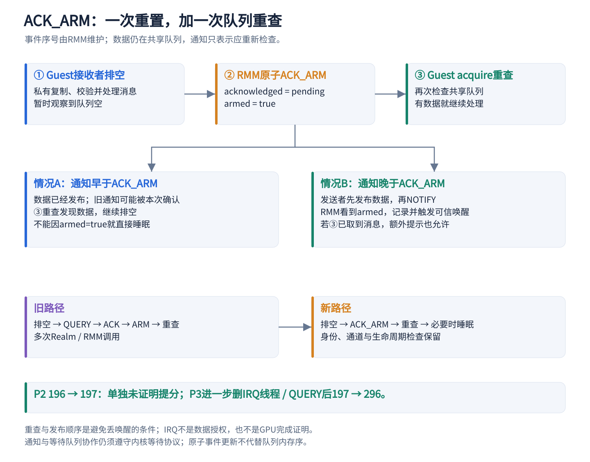

**P3：197→296，+99/+50.25%。** 进一步删掉通信专用 IRQ thread 和 QUERY，硬 IRQ 只运行有界订阅回调、调度 RX work；消息私有复制和校验仍在 worker 中完成。`drivers/char/realm_xshm.c:320` 与两侧 receive 回调是现行入口。ACK_ARM 本身没有解决主要等待，缩短整条接收交接才明显有效。

**P4：296→318，+22/+7.43%。** 同一镜像开启 `fused_snapshot` 与 `lazy_snapshot_wait`：一次请求创建并捕获真实 fence 快照；没有消费者的 sync_file 不立即启动等待 worker。该轮 105222 个 lazy discard、实际本地等待/轮询为零，表明删除的是无用等待，不是 GPU 执行或依赖。两开关同开，只能归因组合。现行 `panthor_client_sync_fence_enable_signaling()` 在真正启用 signaling 时才取得 fence 引用并安排 worker；在 fence 锁下不发 RPC。

### 13.5 P8–P12：先消除大块重复同步，再减少睡眠与调度交接

P5 的 Proxy 接收侧 200 μs 忙等曾令 **318→296（−22/−6.92%）**，已撤回。P6 加诊断的 309 分作为 P8 对照，**318→309 不是生产代码退化**。P7 旧镜像未取得独立有效分数，不能混入后续结果。

**P8：309→632，+323/+104.53%。** tiler heap chunk 初始化完成一次真实缓存交接后，撤销 CPU vmap、交由 GPU 长期持有，后续通用 BO 同步不再逐次扫描这类 GPU-only chunk。BO 同步均值 605.877→8.075 μs，后端提交 621.163→20.885 μs。这是早期最大且有直接工作量证据的改动；具体缓存边界见前述数据与缓存章节。

**P9：632→808，+176/+27.85%。** Client 调用线程本来就在等本次回复，让它短时检查回复队列；Proxy 看到 `NO_NOTIFY` 提示时省掉多余回复通知。窗口结束仍未完成，再恢复通知、ARM、重查、睡眠。早期窗口 100 μs；该候选还包含超时判定修复，不能把得分全部归给一个提示位。PLAN_EXEC 均值 148.456→93.251 μs。P10 日志限频 **808→820（+12/+1.49%）** 仅单轮，视为日志卫生，不宣称稳定提分。

**P11：820→826，+6/+0.73%。** Proxy 接纳调度器空闲时，在原接收线程执行 handler，避免“排 worker 后原线程立即阻塞”。现 `panthor-proxy/panthor_proxy_drv.c:1040` 的 `panthor_proxy_submit_sched_run()` 在锁下同时检查队列空与 `busy=false`，先占执行权；竞争请求仍有界排队、按 session round-robin，结束后重新安排期间入队的请求。

```c
if (!queued && !panthor_proxy_submit_sched.busy) {
    panthor_proxy_submit_sched.busy = true;
    inline_submit = true;
} else {
    list_add_tail(&submit.node, &session->submit_queue);
    session->submit_queue_depth++;
    atomic_inc(&panthor_proxy_submit_sched.queued);
    panthor_proxy_submit_sched_queue_locked(session);
}
```

同时用内核 completion 替代栈请求上的 done 布尔加 waitqueue，修复发布 done 后调用者先返回、唤醒方仍访问栈对象的生命周期竞态。性能证据为 PLAN_EXEC **92.540→79.253 μs**、Proxy handler **34.831→22.351 μs**，原生接纳 **18.260→18.367 μs** 基本不变：减少的是代理交接。它与近期 `drm_sched_run_job_now()` 的原生 DRM 调度内联处于不同层，不能重复归因。

**P12：826→829，+3/+0.36%。** 已拿到自己回复的调用者无需再为本次 RPC ARM；未完成者才执行 ARM/acquire 重查后睡眠，包括未拿到 poll_lock 的并发调用者。现入口 `client_comm_vmshm_prepare_response_wait()`，不能用“另一个 waiter 完成”替代本次完成。该轮约 269 万次回复轮询中，约 241 万次睡前完成、约 28 万次调用者睡前 ARM；后者不含 RX worker，不是 SMC 总数。只有单轮小分差，保留的是合理流程和正确性边界，不宣称可靠的独立提分。

### 13.6 P17、P25：减少读取范围和异步完成交接

P13–P16 均未获值得保留的提升，恢复到 829 对照。**P17：829→859，+30/+3.62%。** 旧代码为读单个 queue/CSG 状态而同步 global、全部 CSG/CS 输出。改为读取当前 CSG、实际事件 CS 及对应 queue 页时只维护目标范围，ACK 轮询只读 ACK 所在行，事件边界仍显式读回完整所需输出。现 `panthor_fw_sync_output_for_cpu()`、`panthor_fw_read_ack()`、scheduler 的 `cs_slot_process_irq_locked()` 保留这一方向；boot/reset 全量维护单独保留。

该轮原生接纳 18.322 μs、BO 同步 7.339 μs 基本不变，说明改善来自未被同步接纳计时覆盖的异步读取与处理。P18 将 JOB 完成排队前移到硬 IRQ **859→849（−10/−1.16%）**，已撤回，不能与现行有严格上限的真实完成观察混淆。P19 关闭诊断后 **859→864（+5/+0.58%）**，属于测量配置。

P20–P24 的驻留唤醒、读回范围、发布点、NC 接口和精确点确认候选未证明有效，均未进入 P25 对照。**P25：864→882/881，+18/+2.08%、+17/+1.97%。** 保留原线程化 JOB IRQ，在 FW worker 捕获 group 强引用、释放 scheduler 锁后执行原完成函数，少排一次 group worker；tick/reset 路径继续延后处理。每 group 的 `completion_lock` 将完成与终止串行化，引用回收在合适上下文进行。

现 `panthor_sched.c` 的 `csg_slot_sync_update_locked()`、`group_complete_jobs()` 及 `completion_lock` 是这一基础的演进实现。**“减少一次 worker”必须说明减少哪一跳**：P25 减 FW→group，近期 1267 组合进一步在 IRQ thread 尾部处理，1405 才有硬 IRQ 有界观察，三者不是同一项重复记账。

### 13.7 P27–P30：两个不同的轮询窗口，分别解决两种等待

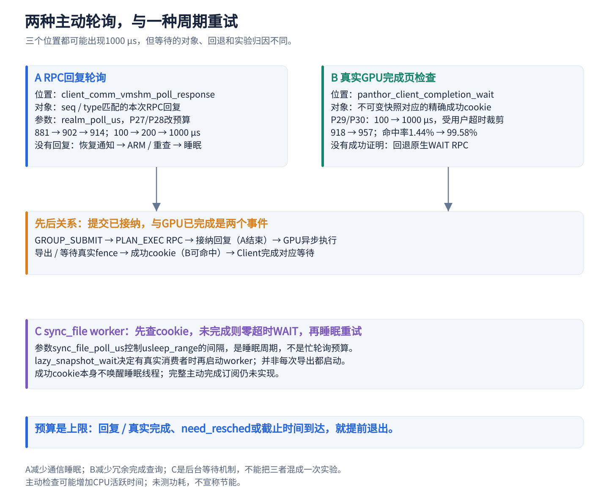

**第一种等 RPC 回复。** P27/P28 沿用同一组内核，仅将 `client_comm_vmshm.realm_poll_us` 从 100→200→1000 μs。完整成绩 **881→902（+21/+2.38%）→914（+12/+1.33%）**，各一轮参数实验。调用者睡前拿到回复的比例 91.27%→96.25%→99.94%；1000 μs 是最大预算，收到回复或需调度就提前退出，不是每次强制忙等 1 ms。它不会把尚未完成的 GPU job 变成完成。

**第二种等真实 GPU fence 的完成证明。** P26 单独把临时 binary 容器保留本地，虽减少 RPC，却 **881→862（−19/−2.16%）**，撤回。P29 随后将延迟容器与真实不可变快照完成页组合：Proxy 真实 fence 成功回调写入 slot 的唯一 cookie；Client 对该快照先本地检查，命中就免 WAIT，未完成、错误或无槽位仍回原 WAIT。完成页只表示已捕获对象的真实完成，不接受任意非零值。

P29 完成检查预算仅 100 μs，**914→918（+4/+0.44%）**，命中 4368/303317＝1.44%，不能称为明显收益。P30 **只把这第二种预算改为 1000 μs**，**918→957（+39/+4.25%）**，完成页命中 314836/316152＝99.58%；RPC 回复窗口仍是 P28 的值，不随本次修改。

现行 `panthor_client_completion_wait()`（约 1572 行）根据用户绝对截止时间裁剪 1 ms 检查预算，保留 WAIT_ALL/ANY、signal_pending 和 need_resched；`panthor_client_snapshot_completed()` 核对精确 cookie。另一个参数 `sync_file_poll_us` 是 **sync_file worker 在 WAIT 未完成后睡眠重试的间隔**，不是以上任何主动轮询预算。不能因为数字都为 1000，就把三处等待当作同一开关。

这种优化用 CPU 活跃时间换更少睡眠/跨界，不宣称节能或适用于 CPU 超售。P29/P30 必须作为逐步验证后的组合看待，不能回头把 P26 单独标成成功。

### 13.8 P38–P39：复用完整原生 timeline chain 的真实完成

P31 的简单较小 point 缓存 **957→957**，撤回；P32–P37 的容器复用、已完成快照、旧融合和绑核也未取得有效提升，未叠加进新基线。

P38 将原生已安装的 timeline fence 及其完成记录附带在提交回复中，Client 记录对象、point、proof epoch、slot/cookie。单项 **957→962（+5/+0.52%）**，未证明稳定提分。P39 利用固定内核 **完整 dma_fence_chain 完成包含未回收祖先完成** 的语义，允许同对象未改写时，用已完成的捕获点 P 证明有效正点 p≤P。它不是从单个 GPU job 完成推断此前所有任务完成，也不是跨对象水位。

现在 `panthor_client_syncobj_timeline_wait()` 仍先要求 `proof_epoch == pcfile->proof_epoch`、`proof_point >= requested_point`，再核对 slot 的精确成功 cookie；未来点、epoch 改变和 writer 在途均不能命中。后面的旧原生查询缓存继续只接受精确 point。

**P38+P39：957→1022/1022，+65/+6.79%，两轮同输入。** 相对 P38 为 +60/+6.24%。首轮约 69.55 万次较早点凭据命中、5.44 万次精确点凭据命中；timeline WAIT 从 P38 的 419168 降到 71337。计数含启动与验证、工作量随帧率变化，不能直接算成固定每帧节省，但说明命中了实际高频查询。此处省的是冗余 CPU 查询，真实 GPU 依赖与原生 fence 没有省掉。

### 13.9 P41–P42：把回收附在下一次捕获，跨过千分后的主要突破

P40 完成回调对象复用 **1022→1024（+2/+0.20%）**，复用部分撤回，只保留无调用者旧接口清理。P41 仅把成功日志变为一次 marker，**1022→1023（+1/+0.10%）**，作为日志清理保留，不宣称提分。

真正的突破是 **P42：1023→1159/1163，+136～140/+13.29%～13.69%**。导出的不可变快照最后一个引用释放时，Client 不再立即同步发一个 DESTROY，而把已退役的私有句柄加入有界批次，下次捕获新快照时一并发送；满队、关闭和不支持此协议时有独立排空/回退。

Proxy 在修改前验证整批的 session、private 类型、非零、非源、无重复和数量上限，删除旧名字但不破坏仍被原生 job/fence 引用的对象。新捕获仍创建新快照，**并不复用旧快照容器**。回收已成功而新捕获失败时，整条 RPC 不是回滚事务；超时不重放这批带副作用的请求，剩余对象由 session close 清理。

首轮 attempts/plan 的整轮摊销比约 **3.729→2.896（−22.33%）**，不是单个 PLAN_EXEC 的内部 RPC 数；这一轮未采集逐 RPC 延迟，不编造每个 DESTROY 节省多少 μs。现行入口为 Client 的 snapshot retire 队列和 Proxy 的 `panthor_proxy_snapshot_retire()`，详细生命周期见快照章节。

**为何后面又以 1158 为 baseline？** 1159/1163 是 10 月 18 日 P42 冻结输入的两轮；后续 1158 来自之后的复测/profile 与计划缓存实验，内存预算、工具和条件需按各报告读取。不能把两轮 1161 的均值改写成 1158，也不能把这几分差异直接认定为某项优化回退。1158 是近期六项的指定对照，保留原口径即可。

### 13.10 P1–P42 精简索引：成功、撤回与未执行均保留

这张索引用来完整覆盖早期尝试；“保留”指当时进入后续组合的机制，具体代码可能已演进。没有有效分数的条目不估算收益，小分差不认定统计显著。各行只与自己的对照比较，百分比不能累加。

| 阶段 | 目的 / 机制 | 对照→本轮；分差 / 比例 | 决定与边界 |
| --- | --- | --- | --- |
| P1 | 恢复性能 profile | 98→196；+98/+100% | 配置组合保留，不单项归因 |
| P2 | 原子 ACK_ARM | 196→197；+1/+0.51% | 基础能力保留；新增诊断，未证明提分 |
| P3 | 通信 IRQ 直接安排 RX | 197→296；+99/+50.25% | 保留；各一轮 |
| P4 | fused + lazy snapshot | 296→318；+22/+7.43% | 组合保留 |
| P5 | Proxy 接收侧 200 μs 忙等 | 318→296；−22/−6.92% | 撤回 |
| P6 | 增加诊断 | 318→309；−9/−2.83% | 诊断轮，不是生产优化 |
| P7 | 旧空闲内联候选 | 无独立有效成绩 | 不计收益；后移植为 P11 |
| P8 | GPU-only tiler heap 交接 | 309→632；+323/+104.53% | 保留 |
| P9 | Client 回复短轮询和通知抑制 | 632→808；+176/+27.85% | 组合保留；含超时修复 |
| P10 | 热路径日志限频 | 808→820；+12/+1.49% | 日志清理，不宣称稳定提分 |
| P11 | 空闲 Proxy 接纳器内联 | 820→826；+6/+0.73% | 保留条件快路径和生命周期修复 |
| P12 | 只在睡前 ARM | 826→829；+3/+0.36% | 保留流程，未证明稳定提分 |
| P13 | 有效范围消息复制 | 829→830；+1/+0.12% | 旧实现撤回；后续组合重做另计 |
| P14 | Proxy 活跃合并通知 | 829→826；−3/−0.36% | 撤回 |
| P15 | 复用退役私有快照容器 | 829→813；−16/−1.93% | 撤回；不同于 P42 |
| P16 | 批量预分配空 syncobj | 829→827；−2/−0.24% | 撤回 |
| P17 | 按读取对象同步输出 | 829→859；+30/+3.62% | 保留精确维护方向 |
| P18 | JOB 硬 IRQ 直接排后续 | 859→849；−10/−1.16% | 撤回；不同于现行有界观察 |
| P19 | 关闭诊断 | 859→864；+5/+0.58% | 测量配置 |
| P20 | 早期双向驻留唤醒 | 864→871；+7/+0.81% | 旧方案撤回；不同于近期 1182 |
| P21 | 缩 queue/sync 读回范围 | 864→865；+1/+0.12% | 旧候选撤回 |
| P22 | CS 按写入点发布 | 864→856；−8/−0.93% | 旧候选撤回 |
| P23 | 私有 NC 固件接口 | 864→866；+2/+0.23% | 撤回 |
| P24 | TRANSFER 精确 point 确认 | 864→863；−1/−0.12% | 未命中，撤回 |
| P25 | FW worker 就地完成 fence | 864→882/881；+18/+2.08%、+17/+1.97% | 两轮后保留并继续演进 |
| P26 | 单独的 lazy binary 容器 | 881→862；−19/−2.16% | 撤回；引用修复独立保留、无提分归因 |
| P27 | 回复预算 100→200 μs | 881→902；+21/+2.38% | 单轮参数实验 |
| P28 | 回复预算 200→1000 μs | 902→914；+12/+1.33% | 单轮参数实验 |
| P29 | 完成页 + 延迟容器 | 914→918；+4/+0.44% | 低命中；与后续 P30 一起评估 |
| P30 | 完成页检查 100→1000 μs | 918→957；+39/+4.25% | 组合后续复测 957，保留 |
| P31 | 简单复用较小 point 查询 | 957→957；0/0% | 撤回，不同于 P39 |
| P32 | binary 持 point 快照复用 | 957→955；−2/−0.21% | 未命中，撤回 |
| P33 | 初始 signaled 本地状态 | 957→957；0/0% | 未命中，撤回 |
| P34 | 独占 private 容器复用 | 未部署、未执行 | 撤回，无有效成绩 |
| P35 | 开 completed_snapshot | 957→928；−29/−3.03% | 不启用 |
| P36 | 旧 TRANSFER 捕获融合 | 957→951；−6/−0.63% | 撤回；不同于后续 TRANSFER_CAPTURE |
| P37 | Proxy 迁至 GPU IRQ CPU0 | 957→944；−13/−1.36% | 不采用 |
| P38 | 回复携精确 timeline 凭据 | 957→962；+5/+0.52% | 单独未证明稳定；与 P39 组合 |
| P39 | 完整 chain 覆盖较早点 | 962→1022/1022；+60/+6.24% | 对 957 为 +65/+6.79%，组合保留 |
| P40 | 回调对象复用 | 1022→1024；+2/+0.20% | 复用撤回，只保留旧接口清理 |
| P41 | 成功日志一次 marker | 1022→1023；+1/+0.10% | 日志清理，不宣称提分 |
| P42 | 下次捕获捎带快照退役 | 1023→1159/1163；+136～140/+13.29%～13.69% | 同候选两轮，保留 |

这些结果也解释了为什么不能只数 RPC 或 IRQ：P26 减少对象 RPC 却退分；P29 减少 RPC 但完成页低命中，只多 4 分；P30 把真正的等待覆盖住才有明显增益。应观察 CPU 生成任务、Proxy 接纳、GPU 执行与完成返回之间的重叠关系。

### 13.11 早期证据与复核入口

Realm 主要证据来自 `docs/archive/20261018/history/PROXY_REALM_PERFORMANCE_OPTIMIZATION_20261018.md`；普通 VM 来自同目录 `GPU_GLMARK_OPTIMIZATION_20261016.md`。归档里的“当前”“待复测”应按原时间理解，以各条最终结果为准。

下表记录的是历史已执行结果，本次未重新运行。Realm 命令统一为：

```bash
python3 scripts/maintenance/lab-run.py --run-id RUN_ID -- \
  python3 scripts/run/run-realm-xshm.py \
  --images build/realm-performance-20261018/IMAGE_DIR \
  --workload glmark --performance --benchmark-only
```

下表 P2、P3、P4、P8–P12、P17 历史命令另含 `--rpc-stats`，其余不加。每项原始日志位于 `GPU-SFTP/log/realm-xshm/RUN_ID/`，wrapper/前后资源在 `build/lab-runs/RUN_ID/`，对应控制输出与 patch 位于 `build/realm-performance-20261018/`。这些是证据位置，不表示所有冻结二进制随 Git 分发。

| 阶段 | 历史 run-id | IMAGE_DIR | 历史 runner/wrapper rc |
| --- | --- | --- | --- |
| P1 | `realm-perf-profile-v1-glmark-20261018` | `profile-v1` | 0/0 |
| P2 | `realm-perf-ack-arm-v2-glmark-20261018` | `ack-arm-v2` | 0/0 |
| P3 | `realm-perf-hardirq-v3-glmark-20261018` | `hardirq-v3` | 0/0 |
| P4 | `realm-perf-snapshot-v4-glmark-20261018` | `snapshot-v4` | 0/0 |
| P8 | `realm-perf-heap-owner-v8-glmark-20261018` | `heap-owner-v8` | 0/0 |
| P9 | `realm-perf-caller-poll-v9-glmark-20261018` | `caller-poll-v9` | 0/0 |
| P10 | `realm-perf-ratelimit-v10-glmark-20261018` | `ratelimit-v10` | 0/0 |
| P11 | `realm-perf-inline-v11-glmark-20261018` | `inline-v11` | 0/0 |
| P12 | `realm-perf-lazy-arm-v12-glmark-20261018` | `lazy-arm-v12` | 0/0 |
| P17 | `realm-perf-output-range-v17-glmark-20261018` | `output-range-v17-p12` | 0/0 |
| P25 | `realm-perf-inline-completion-v25-glmark-20261018`、`realm-perf-inline-completion-v25-r2-glmark-20261018` | `inline-completion-v25-p19` | 各 0/0 |
| P27 | `realm-perf-reply-poll200-v27-glmark-20261018` | `reply-poll200-v27-p25` | 0/0 |
| P28 | `realm-perf-reply-poll1000-v28-glmark-20261018` | `reply-poll1000-v28-p25` | 0/0 |
| P29 | `realm-perf-immutable-completion-v29-glmark-20261018` | `immutable-completion-v29-p28` | 0/0 |
| P30 | `realm-perf-completion-poll1000-v30-glmark-20261018` | `completion-poll1000-v30-v29` | 0/0 |
| P38 | `realm-perf-submit-proof-v38-glmark-20261018` | `submit-proof-v38-v30` | 0/0 |
| P39 | `realm-perf-native-prefix-v39-glmark-20261018`、`realm-perf-native-prefix-v39-r2-glmark-20261018` | `native-prefix-v39-v38` | 各 0/0 |
| P41 | `realm-perf-quiet-sync-v41-glmark-20261018` | `quiet-sync-v41-v39` | 0/0 |
| P42 | `realm-perf-retire-v42-glmark-20261018`、`realm-perf-retire-v42-r2-glmark-20261018` | `retire-v42-v41` | 各 0/0 |

普通 VM 的命令使用 `scripts/run/run-vmshm-e2e.sh`，不是上述 Realm runner。ACK 三组 run-id 前缀为 `glmark-opt-20261016-`，分别是 `control-stats`、`ackfix-stats`、`ackfix-strict-v2`；三者外层 rc 都为 0，但 `ackfix-stats` 有两项新增验证失败，应判正确性不接受。并发完整测量为 `concurrent-full720/full1080`，完成缓存完整测量为 `cache-bo-full720/full1080`，均带同一前缀、历史 rc=0；精确 `.command/.status/.log` 在 `build/glmark-optimization/`，原始 Guest/Proxy 日志在 `GPU-SFTP/log/shared/vmshm-1client/RUN_ID/`。缓存独立交替对照为 `opp3-cache-ab-{off1,on1,off2,on2}`，完整 1058 为 `opp3-regression31-glmark-1280x720`。失败、不稳定归因与未执行范围留在原报告，不用这些历史 PASS 保证当前新运行。

## 14. 负向证据：撤回和未获收益的方向

以下只保留影响设计判断的代表项；完整失败日志不搬进正文，也不删除原始证据。

| 候选 | 对应实验 | 决定与启示 |
| --- | --- | --- |
| Proxy 主动忙等＋请求通知抑制 | 318 → 296，−6.92%；后续 8 μs 接收轮询 1167 → 1125 | 撤回；减少 IRQ 不等于快，可能挤占有效工作 |
| 放开不同 PLAN slot 在途＋通知合并 | 均值 1153 → 1160，+0.61%，门槛 1% | 撤回；单线程 Mesa 跨 ioctl 主要只有 1 个在途请求 |
| `SUBMIT_CAPTURE` 复合提交 | 均值 1167 → 1152.5，−1.24% | 撤回；RPC/提交约 2.249→1.276 仍未提速 |
| 普通 syncobj 批退役、CREATE+TRANSFER、自适应轮询、缩计划锁、额外流水线 | 1162 → 1160 / 1161 / 1161 / 1159 / 1156 | 撤回；原本已本地化/惰性化的对象不再有足够独立 RPC 可省 |
| 无竞争时延后 idle 调度 | 1311 → 1320，+0.69% | 撤回；物理 IRQ 曾从约104万降到54万仍未达门槛 |
| `PLAN_EXEC` 附带直接 fence 快照 | 1311 → 1304，−0.53% | 撤回；大量命中不等于关键等待被消除 |
| 懒建原生快照句柄 | 1237 → 1249，+0.97% | 撤回；未达当时 2% 门槛 |
| 默认关闭的 `completed_snapshot` | 旧组合 957 → 928，−3.03% | 当前冻结 profile 未开启；不计入 1405 收益 |

通用 transport 的并发 RPC 仍保留；撤回的是额外 per-plan 并行窗口等候选，二者不矛盾。旧单项撤回也不禁止在重新满足条件并经过新实验的组合中使用相关思想，但旧失败不能转写成当时已经成功。

## 15. 路径索引：从完整任务路径定位优化位置

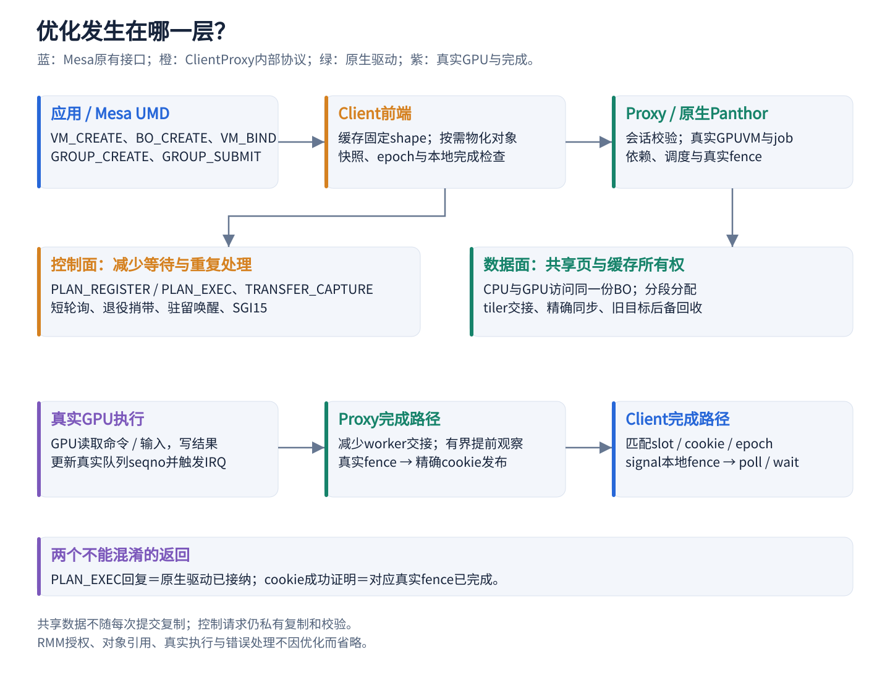

Native 下，Mesa 直接调用原生 Panthor；ClientProxy 下，Mesa 仍使用相同 DRM UAPI，由 Client 内核前端转换为内部 RPC，可信 Proxy 校验后调用原生 Panthor。CPU 写入命令和输入数据属于共享 BO 的普通内存访问，不是每写一次就发送 RPC。

| 阶段 | Mesa / 应用可见接口 | ClientProxy 内部实现 | 优化重点 |
| --- | --- | --- | --- |
| 建立资源 | `VM_CREATE`、`BO_CREATE`、`mmap`、`VM_BIND` | 远端对象、共享页与真实 GPUVM 映射 | 数据共享、分段 BO、批量地址翻译 |
| 创建执行对象 | `GROUP_CREATE`、`SYNCOBJ_CREATE` | group/queue 关联、对象按需物化 | 避免未使用对象的远端创建 |
| 写入任务 | CPU 写 BO / 命令流 | 同一批授权物理页 | 避免复制，保留正确缓存交接 |
| 提交 | `GROUP_SUBMIT` | 首次 `PLAN_REGISTER`；命中后 `PLAN_EXEC` | 固定结构复用、通知和接纳延迟 |
| GPU 执行 | 应用不直接操作硬件 | 原生 scheduler、ring、doorbell、GPU | 减少调度交接，不省略执行 |
| 转移和导出依赖 | `SYNCOBJ_TRANSFER`、`HANDLE_TO_FD` | `TRANSFER_CAPTURE` 或独立快照请求 | 不可变快照、退役捎带 |
| 等待完成 | `poll`、sync_file、syncobj wait | 真实 fence、cookie、本地 fence、必要时 WAIT RPC | 缩短完成可见性，复用准确证明 |

`PLAN_EXEC`、`TRANSFER_CAPTURE`、`SNAPSHOT_RETIRE` 都是本架构内部协议，不是要求 Mesa 新增调用的公开 ioctl。普通组提交本来就可以包含多个 queue submit；“一次 RPC”不必等于“一个 GPU job”。

**必须区分两条返回链。** `PLAN_EXEC` 回复成功，表示原生驱动完成同步接纳、安装相应输出 fence；GPU 可在之后异步执行。GPU 真正完成后，原生 fence 才能 signal，Proxy 才能发布相应完成证明，Client 才能完成对应本地 fence。优化不能把接纳回复当成 GPU 完成。

## 16. 验证范围、代码阅读顺序与复核入口

保留优化各自附完整命令、run-id、退出码与日志。完整 glmark 是 33 场景，validation 为 **26 成功 / 1 已知数值例外 / 6 无判据**，不写成 33 项像素正确。近期每档还有双 Client API/实际计算、GEMM/卷积正确性、内核健康、VM 退出与资源恢复。ML 的当前性能保留比例须使用同任务、同并发、同频率的 Native 与 Clientproxy 数据；优化链及逐项 ML 消融不作为本次对照，不宣称 +21.33% 同样适用于 ML。

当前组合的进一步检查覆盖性能参数下并发 RPC、实际两段 BO、快照/reset/destroy、真实错误 fence 和受害者继续执行、普通 native GPUVM 与无 SGI15 模块回退，以及 1000 组真实内核 fence 语义。尚不等于多 vCPU、所有错误组合、长稳/reset/suspend 与硬 IRQ 全并发证明。RK 上的模拟也不替代目标平台需满足的真实设备保护条件。

### 16.1 近期得分证据

| 设计 | 720p run-id（A/B 均 rc0） | 机制报告与日志根目录 |
| --- | --- | --- |
| 驻留唤醒 | `request-resident-720-20261024-a/b` | `GPU_RESIDENT_REQUEST_WAKE_20261024.md`；`build/request-resident-20261024/` |
| 所有权组合 | `pipeline-ownership-720-20261024-a/b` | `GPU_PIPELINE_OWNERSHIP_OPTIMIZATION_20261024.md`；`build/pipeline-ownership-20261024/` |
| 目标直接返回 | `fast-target-irq-final-720-20261024-a/b` | `GPU_TARGET_IRQ_RETURN_OPTIMIZATION_20261024.md`；`build/fast-target-irq-20261024/` |
| 两端线程交接 | `both-native-handoffs-720-20261024-a/b` | `GPU_NATIVE_HANDOFF_OPTIMIZATION_20261024.md`；`build/both-native-handoffs-20261024/` |
| fence 前缀化简 | `chain-callback-fences-720-20261024-a/b` | `GPU_FENCE_CALLBACK_OPTIMIZATION_20261024.md`；`build/chain-callback-proof-20261024/` |
| 硬 IRQ 观察 | `raw-fence-observation-720-20261024-a/b` | `GPU_RAW_FENCE_COMPLETION_OPTIMIZATION_20261024.md`；`build/raw-fence-observation-20261024/` |

精确 argv、wrapper/runner 退出码与前后资源在 `build/lab-runs/<run-id>/{result,realm-launch}.json` 及各实验回收目录；对应 `docs/shared/evidence/` 保存可迁移验收摘要。早期 P3/P8/P9 等完整命令和 rc0 证据在历史原理报告各自小节；不能省略其当时诊断/参数差异。

当前 720p 复现命令形状如下，只用于说明，不是本次新执行：

```bash
python3 scripts/maintenance/lab-run.py --run-id <新的唯一ID> -- \
  python3 scripts/run/run-realm-wake-sgi.py \
  --module build/fast-target-irq-20261024/host-sgi/xshm_wake_sgi.ko -- \
  python3 scripts/run/run-realm-xshm.py \
  --images build/raw-fence-observation-20261024/candidate \
  --workload glmark --performance --benchmark-only --suite --profiles glmark-720 \
  --clients 1 --compact-memory --pool-mib 128 --client-cpu-layout round-robin \
  --cpu-frequency-khz 1800000 --telemetry --transfer-capture
```

### 16.2 代码阅读顺序

路径前缀 `Guest` 在下表仅表示仓库 `Linux-Guest-GPU/`，不是另一个分支。行号对应本文整理时的工作树；后续变更优先按函数定位。

| 阅读主题 | 文件 / 函数 |
| --- | --- |
| Client 对象、计划、快照和 timeline | `Guest/drivers/gpu/drm/panthor-client/panthor_client_drv.c`：`execute_plan`、`syncobj_materialize`、`sync_fence_work`、`cookie_completed`、mutation |
| Proxy 计划、退役和完成观察 | `Guest/drivers/gpu/drm/panthor-proxy/panthor_proxy_drv.c`：`plan_register/execute`、`point_watch`、`snapshot_retire`、`handle_transfer_capture` |
| 前缀证明 helper | `Guest/drivers/gpu/drm/panthor-proxy/panthor_proxy_fence.h:7` |
| RPC 轮询与 waiter | `Guest/drivers/char/client_vmshm_comm/client_comm_vmshm.c:970` |
| 有界复制 / credit | `Guest/drivers/char/proxy_vmshm_comm/proxy_comm_vmshm.c` 及 Client 对称实现 |
| 共享属性 / IRQ | `Guest/drivers/char/realm_xshm.c:185`、`:320` |
| BO 数据与所有权 | `Guest/drivers/gpu/drm/panthor/panthor_gem.c:153`、`panthor_heap.c:148` |
| managed root / 同步列表 | `Guest/drivers/gpu/drm/panthor/panthor_mmu.c:3012` |
| 原生接纳与真实完成 | `Guest/drivers/gpu/drm/panthor/panthor_drv.c`、`panthor_sched.c:3478` |
| 原 DRM scheduler 内联入口 | `Guest/drivers/gpu/drm/scheduler/sched_main.c:1519` |
| 地址翻译 | `Guest/drivers/iommu/io-pgtable-arm.c:445`；`opencca/tf-rmm/runtime/rsi/opencca_gpu.c:299` |
| 驻留通知与私有 LR | `opencca/tf-rmm/runtime/rsi/xshm.c`、`runtime/core/xshm_endpoint.c`、`runtime/core/exit.c:604` |
| 旧目标页回收 | `firecracker/Firecracker-CCA-MZH/src/vmm/src/vstate/memory.rs:39` 及 `vstate/vcpu/mod.rs` |

### 16.3 资料索引

- 当前冻结组合与载荷入口：`docs/shared/CURRENT_BASELINE.md`。
- 25 类机制及 51 份源码/测试输入审查：`GPU_OPTIMIZATION_CORRECTNESS_AND_GENERALITY_REVIEW_20261025.md`。
- 计划缓存独立 A/B 与直接控制结构计量：`GPU_PLAN_CACHE_AB_AND_CONTROL_MEMORY_20261022.md`。
- 原理与协议：`GPU_CLIENTPROXY_ARCHITECTURE_GUIDE_20261022.md`、`GPU_TRANSFER_CAPTURE_20261022.md`。
- RPC / 通知 / 完成计时：`GPU_CURRENT_RPC_PROFILE_20261024.md`、`GPU_IRQ_ROUTE_PROFILE_20261024.md`、`GPU_NOTIFICATION_LATENCY_20261022.md`、`GPU_COMPLETION_LATENCY_20261022.md`。
- 内存与可运行性：`GPU_BO_SEGMENTED_MEMORY_20261020.md`、`GPU_SHARED_MEMORY_RECLAIM_20261022.md`、`GPU_CURRENT_MULTICLIENT_MEMORY_20261025.md`。
- 撤回证据：`GPU_PLAN_EXEC_WINDOW_OPTIMIZATION_20261023.md`、`GPU_PROXYCLIENT_OPTIMIZATION_EXPLORATION_20261024.md`、`SAFE_PERFORMANCE_OPTIMIZATION_20261018.md`。
- 最新结果：`GPU_FIXED_FREQUENCY_GLMARK_20261025.md` 与 `evidence/fixed-glmark-current-20261025/results.json`。

设计依据主要是 Linux DMA API 的 CPU/设备所有权、DMA fence/chain、DRM GPUVM 与 scheduler 语义，以及共享队列的 release/acquire 和有界生命周期设计。PORTAL 的可信通知与 world-switch 成本可作为通知路径的研究参考；本文所有提分只来自本项目实验，没有移用论文性能数字，也不把本文工程实现直接等同于论文原方案。
