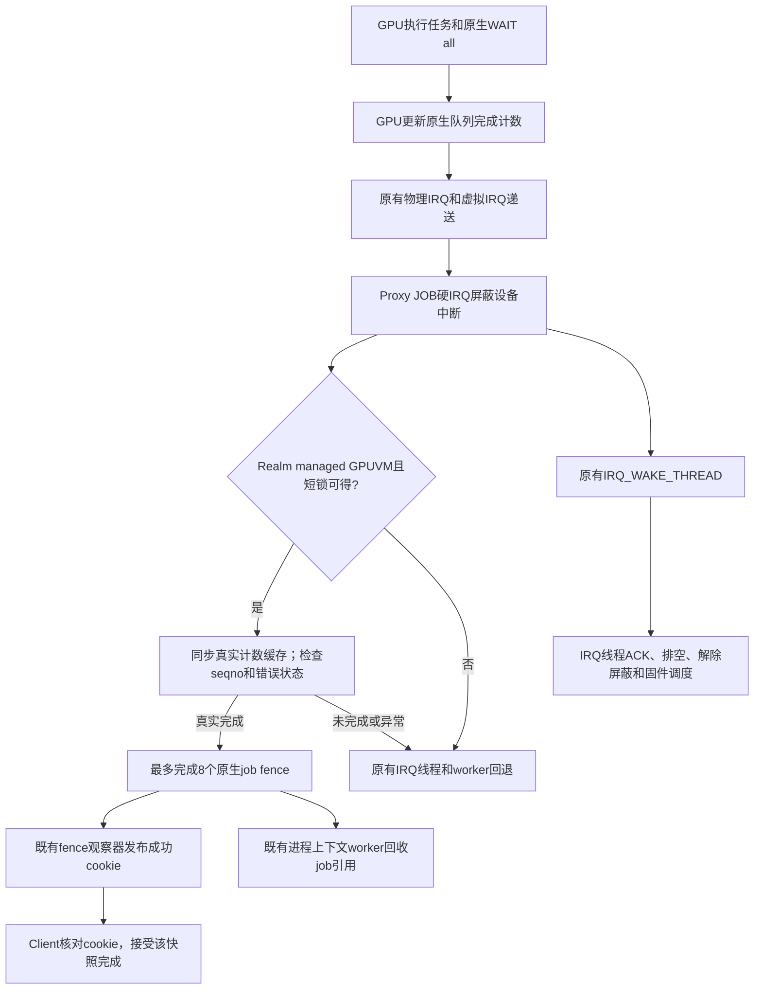

# GPU 真实完成的有界提前观察

状态：**已保留。** 完整720p两轮1406/1404，均值1405，对上一档保留基线
1311为**+94/+7.17%**，分别+7.25%/+7.09%。双Client和选定ML正确性、
源码/板端镜像/实际SD固件审计全部通过，成为最新本地基线。

统一记录：缩短真实完成发布等待｜1311 → 1405（1406/1404）｜+94/+7.17%｜
仅Proxy Image改变，其余可比条件相同｜下列四项run-id、wrapper/runner
均rc0、42份日志SHA核验及最终审计｜保留。没有提交或发布。

这是继续探索后的第二项新增达标设计，与上一项1267→1311（+3.47%）
分别验收；此前四项不重复计数。完整保留链1158→1182→1208→1237→1267
→1311→1405，累计**+247/+21.33%**。后续独立2%整数门槛为1434。

## 为什么选择这个方向

此前1267基线的诊断测得Guest JOB硬IRQ到IRQ线程平均约30.25μs；这是
旧版本、开启诊断时的观测，不当作本轮精确节省量。另一方面，历史
idle-tick延后方案把物理JOB IRQ从1041586降到544487，完整720p仍只增加
0.69%。因此，本轮检查真实完成到Client看到结果的关键等待，而非仅减少
中断、RPC或worker总数。

## 实现

新增硬IRQ钩子只观察真实完成，不处理完整固件事件，不提前解除中断屏蔽。
GPU原有命令流的WAIT(all)、原生完成计数、CPU缓存失效和dma_rmb均保留；
只有计数覆盖具体job的真实fence序号且status为0，才发布完成。没有轮询
硬件、伪造成功cookie或把最新job直接当作整条timeline完成。

范围限定为Realm中的managed GPUVM，以避开可能睡眠的普通映射BO扫描。
inactive、VM不可用、未处理fault或reset均保留原路径。整个硬IRQ最多处理
8个已完成job，锁竞争时直接回退，不分配内存或等待mutex。

slot指针有独立短锁，取得group强引用后再解锁；硬IRQ使用trylock，避免
等待被自己打断的线程。group完成短锁与原queue fence锁串行化普通完成、
提前完成和终止。已完成job先移入retirement列表，原worker或终止路径在
进程上下文释放引用。完整fence身份、旧前缀证明、错误抑制、取消与slot
复用同步沿用已保留的回调设计。

这与已撤回的P18不同：P18把完整处理移到硬IRQ并提前unmask，本轮保留
原mask、IRQ线程、ACK/drain/unmask，只提前观察有界的真实完成。
依据是当前Linux DMA fence原子回调契约和Panthor原生队列完成协议；没有
把论文或其他平台的性能数字作为本项目收益。

## 测试条件与当前结果

| 项目 | 结果 |
| --- | --- |
| 对照版本 | 保留1311，完整720p两轮1314/1308 |
| 候选完整720p A | 1406，+95/+7.25%；wrapper/runner rc0 |
| 同输入完整720p B | 1404，+93/+7.09%；wrapper/runner rc0 |
| 双Client API及实际GPU计算 | 两侧各18项API、实际GPU计算及fence生命周期通过，wrapper/runner rc0 |
| GEMM、卷积正确性 | 29.28419/33.63555ms，各100样本、5次预热；正确性通过，wrapper/runner rc0；不宣称ML提速 |
| 保留/撤回 | 保留，最新本地基线1405；1311冻结包保留回退 |

两侧条件：1280×720完整33场景，单Client/compact128MiB，CPU固定1.8GHz，
GPU请求600/实际594MHz，round-robin，telemetry和TRANSFER capture开启，
RPC/通知/完成阶段计时关闭。仅Proxy Image改变，Client/initrd/runner、
Host/RMM/Root和SGI15模块不变；没有改变优先级、频率或轮询窗口。

A/B均通过33场景、validation26/1/6、VM退出0/0、Host/Guest健康、无日志环
覆盖、频率/CPU/驱动/进程/挂载/loop恢复及各11份日志SHA核验。分别547491/
547954个job走提前完成路径，物理JOB IRQ为1108535/1109917次；不把路径计数当成节省的
微秒数，也不宣称减少了IRQ。对基线两轮场景均值，候选两轮均值为30项提高、3项持平；
只有描述性分项对照，不宣称各场景独立统计显著。

run-id为`raw-fence-observation-720-20261024-a/b`、
`raw-fence-observation-compute-20261024-a`及
`raw-fence-observation-ml-20261024-a`。完整命令、退出码与
资源记录在`build/lab-runs/<run-id>/`；冻结输入、独立/完整patch、源码SHA、
构建日志、原始测试/回收SHA、审计和锁/生命周期复核在
`build/raw-fence-observation-20261024/`。Proxy Image SHA为
`d0debf770a9a83c332c8fad540d69fdb27f44e30397a76942fdef71d30165304`，
构建rc0、无新增warning/error；未刷写Host或固件，未提交发布。

双Client运行`raw-fence-observation-compute-20261024-a`已独立检查两侧
各18项API、16轮timeline reset/import/destroy/recreate、128个sync_file
在source reset/destroy及DRM关闭后的快照语义、64次import后的target
reset/destroy，以及实际GPU计算、权限/IRQ/内存检查。VM退出0/0/0、健康、
资源恢复及10份日志SHA通过；本轮提前完成计数为73，证明竞争/生命周期
用例实际运行了该路径，不只继承单Client性能测试的通过结论。

ML轮提前完成计数210，VM退出0/0、健康、资源恢复及10份日志SHA通过。
四项共42份日志核验，`raw-fence-observation-final-audit-20261024-a`最终审计
wrapper/script rc0，确认当前完整Guest diff、修改源码及未变的fence helper、
RMM/Root、SGI模块、板端Proxy SHA与实际SD固件一致。板端恢复CPU0–1、
原驱动/频率，无本次VM、挂载、loop或辅助模块残留。

验收命令与结果见[验证记录](evidence/raw-fence-completion-20261024/validation.json)，
[冻结输入](evidence/raw-fence-completion-20261024/inputs.json)和
[源码SHA](evidence/raw-fence-completion-20261024/source-hashes.json)。
两项新增设计的独立门槛、八次工作负载运行及84份日志重新核验见
[目标完成核验](evidence/raw-fence-completion-20261024/goal-completion.json)；旧四项不计入本次新增数量。
当前使用`build/raw-fence-observation-20261024/candidate/`，配套既有
`build/fast-target-irq-20261024/firmware-final/`及同一SGI15模块/包装入口；
不从增量构建缓存直接选镜像，Client缓存含已撤回实验，须先重建再冻结。

1080p、多Client性能、同条件ML速度对照、长稳、主动GPU故障/reset压力、
debug-lockdep构建和独立IRQ到cookie延迟未执行；正常日志没有告警不等于
完整并发证明。旧失败设计和未执行项继续保留。
