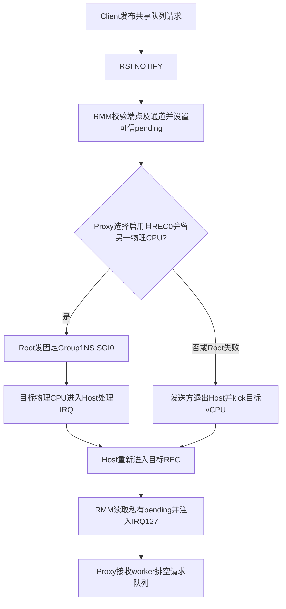

# Proxy驻留时的请求通知优化

状态：保留为本地开发基线，尚未提交或发布。此前GitHub基线仍为Guest `39d95dd028d485ca837bf1b3c5123db2eefbaa75`。本轮只保留接收Proxy主动启用的请求方向优化；Client回复通知保持原路径。

改动目的｜减少Client发请求时的Host退出｜完整720p基线1158 → 1183 / 1181，均值1182｜均值+24 / +2.07%｜同负载、CPU/GPU频率、内存与落核；RMM/Root/Proxy为组合变化｜下列run-id、命令和日志，均rc0｜保留。第二轮单独为+23 / +1.99%，收益接近门槛；按两轮均值达到至少2%，不声称每轮均超过2%或具有统计显著性。

## 原理和边界



原路径在授权通知需要唤醒时，让发送Client退出至Host，由KVM找到目标并kick。新路径仅在Proxy实际驻留另一物理CPU时，由RMM调用受限Root服务发送物理SGI，发送Client可直接返回。目标CPU仍经过Host，再进入RMM；没有绕过Host调度，也不是从Client直接向Proxy注入任意虚拟IRQ。

物理SGI0是固定Host reschedule提示；可信通知仍由RMM私有pending和保留LR决定。Root只接受既定RMM调用上下文，校验MPIDR及保留参数，调用者不能选择中断号。目标物理MPIDR来自REC实际进入时的CPU，不能由Client提供。其他普通Guest IPI仍走各自的虚拟GIC路径，不能据此推断所有虚拟中断都已交给RMM维护。

Proxy provider绑定后启用`RESIDENT_BIND`，最后一个provider解绑时关闭；默认不启用。非驻留、同CPU或Root调用失败回退Host路径。驻留发布与退出共用策略锁；已经完成的WFI/WFE或CPU_SUSPEND退出遇到待处理通知时改为IRQ退出，避免进入睡眠丢失唤醒；CPU_OFF语义不变。当前目标为REC0，多vCPU交付不在验收范围内。

没有改变CPU预算、亲和性、优先级、轮询窗口、定时器或GPU调度。没有改动映射权限、快照、缓存维护、原生fence或完成cookie。`RESIDENT_BIND/STATS`为新命令19/20和能力位128，已有命令18及能力位64保持兼容。

## 测量和验收

| 测试 | 结果 | 退出码及证据 |
| --- | --- | --- |
| `request-resident-720-20261024-a` | 1183；33场景，validation 26成功/1已知例外/6无判据 | wrapper/runner rc0；采集VERIFIED 11文件 |
| `request-resident-720-20261024-b` | 1181；同上 | wrapper/runner rc0；采集VERIFIED 11文件 |
| `request-resident-compute-20261024-a` | 双Client API/GPU流程、真实计算、权限/内存检查通过 | wrapper/runner rc0；VM退出0/0/0；采集VERIFIED 10文件 |
| `request-resident-ml-20261024-a` | GEMM、卷积均通过 | wrapper/runner rc0；VM退出0/0；采集VERIFIED 10文件 |
| `request-resident-firmware-20261024-a` | SD2固件部署，Host恢复、RME能力1 | wrapper/deploy rc0；启动区原始备份保留 |

上述负载Guest/Host内核健康检查通过，无dmesg覆盖。CPU0–1、GPU300MHz、进程/loop与租约等恢复检查通过。双Client功能运行的provider replacement明确为NOT_RUN。1080p、多Client性能、完整安全与长期压力矩阵本轮未执行；不继承旧组合PASS。

720p为单Client、1280×720完整33场景、null-noop/finish、128MiB紧凑共享池、round-robin，CPU固定1.8GHz，GPU请求600MHz/实际594MHz；telemetry和TRANSFER capture开启，RPC/通知/完成高频计时关闭。Client/initrd/runner与1158原基线逐字节一致；RMM有效构建选项已对照。A/B分别观测请求直接唤醒968469/967834次、Host回退31414/33226次，idle rescue均0；这些是通知机会计数，不能当GPU任务数或每次通知节省时间。没有重新测量通知延迟。

ML用于验证功能适用性，其runner不接受glmark专用CPU频率、落核、telemetry选项，因而未附加这些选项；没有同条件ML原基线测量，不宣称ML提速。

```bash
python3 scripts/maintenance/lab-run.py --run-id request-resident-720-20261024-a -- \
  python3 scripts/run/run-realm-xshm.py \
  --images build/request-resident-20261024/candidate \
  --workload glmark --performance --benchmark-only --suite --profiles glmark-720 \
  --clients 1 --compact-memory --pool-mib 128 --client-cpu-layout round-robin \
  --cpu-frequency-khz 1800000 --telemetry --transfer-capture

python3 scripts/maintenance/lab-run.py --run-id request-resident-ml-20261024-a -- \
  python3 scripts/run/run-realm-xshm.py \
  --images build/request-resident-20261024/candidate \
  --workload glmark --performance --benchmark-only --suite --profiles ml-gemm ml-conv \
  --clients 1 --compact-memory --pool-mib 128 --transfer-capture
```

以上为已执行命令的说明；run-id不可重复使用，精确argv见对应`build/lab-runs/<run-id>/result.json`。双Client命令是同wrapper和冻结包加`--workload compute`。固件命令是同wrapper加`--allow-rk-reboot -- python3 scripts/run/deploy-rmm-firmware.py --run-id request-resident-firmware-20261024-a --firmware build/request-resident-20261024/firmware`。

本地证据：`build/request-resident-20261024/{run-a,run-b,preflight-compute,ml-a,deploy}.log`、`runs/<run-id>/`、`policy-tests.log`、`rmm-option-comparison.json`及构建日志。ASan/UBSan覆盖默认/启用/关闭、IRQ绑定、目标驻留/迁移、通知与idle两种串行顺序、回复不启用和端点回收；既有端点/内存/GPU租约/IRQ策略测试通过。RMM、TF-A、U-Boot及Proxy构建rc0；Proxy首次格式警告已修复，固件保留既有链接器警告。

## 冻结输入与回退

冻结包：`build/request-resident-20261024/candidate/`。源码变更分别保存在同目录上级`guest.patch`、`rmm.patch`和`tfa.patch`，与各自负责范围核验一致。

| 输入 | SHA-256 |
| --- | --- |
| Client Image | `e5d6fea941f905da659e5db9b5b9b7bc9936dd88b36a6ed21803accb85527c1e` |
| Proxy Image | `a9dc41f86f7d4e42f0967004ce1960bfb1ce8d5fb0aa293e4aab2222f07da5a9` |
| initrd | `903465ce6f7ca4290aed6f979c7501606ff6729c03656b9e48de4de1f343f0f3` |
| runner | `19fcc60567a232ed8050a710e33baad8eb90225db7fb1ba4bea2123dd9247565` |
| idbloader | `b78768f89c177a09c371c96abeb52c9b1293661cbd28c19a9bf4b904801095ec` |
| u-boot.itb | `44a11655af2114dc4f21fd1536beb90293b5b4783ab06376456751f1e64e5de0` |
| RMM ELF | `93b65f8f2f0d5b58cc532441254e659297556ed95595d667631c19b101e6d569` |
| BL31 ELF | `e1d52642995dc627174c309d5914d99ccb7e67e36b2c0742ff2b5ec574c57b1d` |

回退固件为`build/notify-latency-20261022/firmware/`，已与本次部署前SD实际启动区对应两槽逐字节核对；原始备份位于`build/firmware-runs/request-resident-firmware-20261024-a/sd-boot-before.bin`。恢复Guest Image不能代替恢复固件。后续独立候选使用新冻结包，禁止将可变构建目录的Image覆盖到本包冒充已测输入。

## 参考与历史区别

PORTAL §4.4/§6.6提供可信通知与world switch成本的设计参考；固定Root SGI是本项目具体实现，不移用论文性能数据。历史双向P20为864→871（+0.81%）且已撤回；当前方案只让接收Proxy选择启用，保留现有精确cookie/回复轮询基线及后续生命周期修复，不能部署旧P20固件代替本组合。
