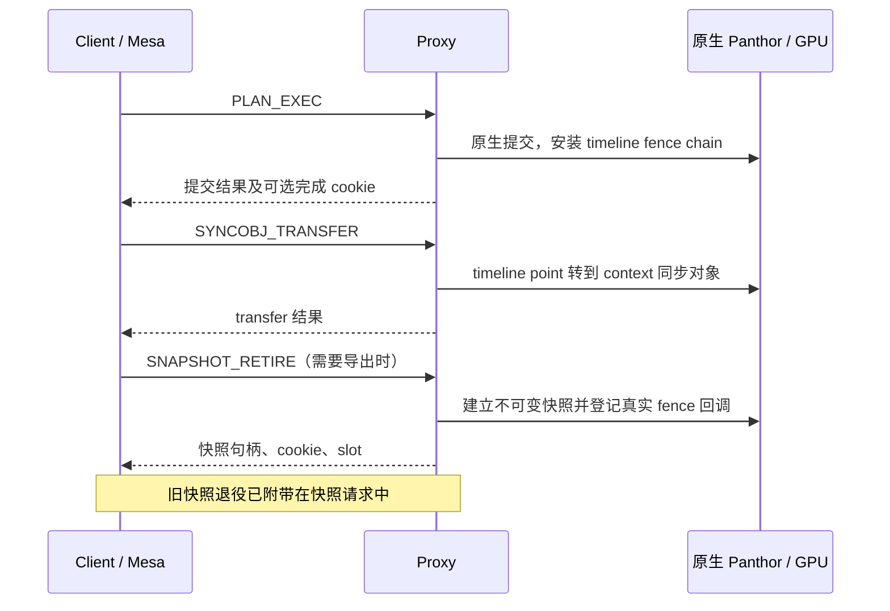

# 单 Client RPC 串行路径与通知延迟排查

## 目的与边界

本次优先检查高频独立 RPC 能否减少，以及请求通知、回复发布和完成等待分别花费多少时间。新增代码只在既有 `rpc_stats` 开关开启时采样；不更换 Host/RMM，不修改提交顺序、真实 fence、队列私有快照或可信事件协议。关闭统计不读取新增阶段时钟。

已有完整720p诊断为1144分，单Client固定/动态/固定对照为1155/1159/1151。新增阶段计时不是性能优化，不能根据诊断分数宣称提分。原有调频结论、失败与未执行记录继续保留。

## 新一轮实测与结论

`rpc-breakdown-720-20261022-a` 完整720p **1152分**，已独立审计通过。与此前带RPC统计的1144分相比为 **+8/+0.70%**；本轮增加阶段时钟、Proxy响应统计，且各只有一轮，不能解释为优化收益。当前没有修改独立RPC数量或通知策略。

Host #31/protected、2 GiB RMM GPU租约；一个Client、128 MiB池、CPU固定1.8GHz、round-robin落核、GPU请求600/实际594MHz；initrd和runner与candidate-f逐字节相同，两份Guest内核只增加本轮通信计时。统计为validation、计分和收尾的最后累计快照，阶段计时互相嵌套，不能相加为独占耗时。

| 操作 | 调用数 | Client往返 μs | 入队 μs | 请求通知 μs | 回复轮询 μs | completion等待调用 μs | Proxy handler μs |
| --- | ---: | ---: | ---: | ---: | ---: | ---: | ---: |
| PLAN_EXEC | 454568 | 76.431 | 0.490 | 30.634 | 43.692 | 0.296 | 20.255 |
| SYNCOBJ_TRANSFER | 454357 | 53.461 | 0.418 | 23.111 | 28.756 | 0.154 | 2.768 |
| SNAPSHOT_RETIRE | 380555 | 56.649 | 0.455 | 25.317 | 29.503 | 0.176 | 7.489 |
| SYNCOBJ_TIMELINE_WAIT | 80259 | 72.554 | 0.510 | 26.853 | 43.712 | 0.264 | 5.883 |
| SYNCOBJ_WAIT | 1530 | 598.362 | 0.548 | 34.996 | 513.586 | 48.012 | 530.119 |

前三项请求通知占各自发送区间的96.88%–97.32%，入队仅约0.4–0.5微秒。Proxy聚合回复发布 **0.775微秒**，1373664次、错误0；这个计时包括抑制通知的常见路径以及需要通知和重试的路径，不能当作一次真实回复通知的独占成本。回复通知sent=7927、suppressed=1366192，抑制率 **99.42%**。Client轮询attempts=1366959、睡前完成=1366613、睡前ARM=346；这些是总窗口统计，不是逐操作配对。

因此优先级明确：**先减少高频同步操作的整次往返，再拆请求侧NOTIFY为何耗时约23–31微秒；普通回复发布和平均睡眠等待不是这三项的主要成本。** 不能把回复轮询的29–44微秒全算成本端轮询，也不能把通知墙钟全部记为RMM内部执行。低频阻塞SYNCOBJ_WAIT仍有真实等待和长尾；本轮没有单独测量GPU完成→Client可见的端到端延迟分布。

GPU job硬IRQ至线程入口平均27.916微秒、线程处理2.470微秒，pending=0；这个边界不覆盖GPU执行或硬IRQ进入Guest以前的部分，且与RPC等待重叠。Proxy Guest非idle32.58%、Client99.24%含忙轮询；尚无Proxy持续有效计算满核或GPU硬件饱和证据。

| 状态 | 内容 |
| --- | --- |
| 已实现并验收 | 既有开关下的Client五阶段计时、Proxy聚合响应计时；完整720p、正确性、健康及回收 |
| 部分完成 | 独立TRANSFER及快照路径的代码可行性调查，见后文候选；尚无逐调用参数形状统计 |
| 未实现 / 未验收 | TRANSFER预捕获快照、复合提交；命中率、实际省RPC数量、无统计性能收益、并发语义专项 |
| 未执行 | 本轮Native、1080p、API/计算/多Client扩展；不由单Client诊断覆盖 |

## 已核实的串行链路



图表示代码支持的路径，不是逐帧配对追踪；部分提交不导出快照，不能把累计次数换算成每帧固定三次RPC。

Client 的 `panthor_client_syncobj_transfer()` 始终物化双方并同步调用真实 TRANSFER；`panthor_client_syncobj_export_sync_file()` 又单独调用快照建立。Proxy 的 `panthor_proxy_plan_execute()` 已在提交返回前取得输出 timeline 的真实 fence chain 并安装完成观察，但响应只有完成 cookie/slot，没有可供尚未完成的 transfer/export 持有的不可变快照句柄。因此不能仅凭现有完成 cookie 跳过这些操作。

工作区保留的 Mesa 25.0.7 参考源码 `build/realm-performance-20261018/mesa-25.0.7-reference/pan_csf.c` 中，`csf_attach_sync_points()` 最后明确执行 `drmSyncobjTransfer(ctx->syncobj, 0, vm_sync_handle, vm_sync_signal_point, 0)`；`pan_fence.c` 又通过导出、导入 sync_file 建立持久 fence。context 目标反复使用，不能把这条路径当成每次创建全新目标。该参考源码解释一种明确调用来源，尚未对本轮每次 TRANSFER 的参数形状计数，不能声称全部调用都满足该模式。

## 可以减少往返的具体候选

### 优先：在 TRANSFER 中顺带捕获可复用的导出快照

相比直接删掉 TRANSFER，这个候选可以保留其现有立即可见语义：Proxy 照常执行真实 TRANSFER，在同一个有序操作内为目标 fence 建立不可变私有快照及完成观察，响应同时返回快照引用信息。后续 export 若确认目标未变化，直接持有该快照创建本地 sync_file，省掉一次独立 SNAPSHOT_RETIRE 往返。旧快照退役批次移到下一次 transfer/capture，关闭会话仍需排空。

需要实现的约束：

- Client 对目标对象的修改和缓存发布必须有版本或现有 mutation/epoch 校验；并发 reset/import/signal/submit、对象销毁或无法证明未改变时回退现有 RPC。不能让较旧响应覆盖较新状态。
- Proxy 必须将同一目标的真实修改及快照捕获串成一个有序操作，防止另一请求插入后捕获错版本；现有分开的transfer和snapshot函数不能直接拼接便宣称原子。
- 缓存必须持有真实不可变快照的引用；pending fence 仍可导出，源 timeline 后续推进不改变旧快照。不能仅缓存成功状态，也不能用最后一个 GPU job 替代完整 chain。
- 每个目标至多保留有界的预捕获引用，导出对象按引用计数延长生命周期；覆盖、无消费者、关闭及失败路径回收。不得每次 transfer 无界创建而无人退役。
- 功能协商决定响应格式；快照分配失败应使可选预捕获失效，已成功的真实 TRANSFER 不能被伪报失败或重放。传输结果不确定时沿用现有不重试执行规则。
- 对普通 timeline→timeline、多目标、多线程及非 glmark 调用保持原协议回退。实际调用形状和命中率必须另测。

这个候选减少的是后续快照请求；不是再次尝试已撤回的普通同步对象延迟回收，也不是已无收益的首次 CREATE+TRANSFER 融合。目前仅完成可行性分析，尚未实现或测得收益。

### 再评估：把提交及其输出同步操作显式表达为一次复合请求

若要同时去掉 TRANSFER，最明确的方法是由用户态显式提供提交后的同步操作，Proxy 在安装 timeline 后执行原本的 exact-point transfer/capture，一次返回。当前标准提交调用没有未来的 context 目标信息；不能从过去一次参数推断未来调用，也不能偷偷提前修改可被其他线程观察的公开目标。

只为提交追加一个 binary signal 也不能直接视为等价：原 TRANSFER 捕获的是指定 timeline 的完整原生 fence chain，需要验证此前依赖和错误传播。另一路是完整虚拟化同步对象的逻辑状态、引用和计划失效，但改动面更大。应先验证上一候选的命中率与完整720p收益。

## 通知与完成路径的判断

Client 每次成功发布请求后仍调用 RMM NOTIFY。RMM 只有对端处于 armed 状态时才退出到 Host 提示唤醒；pending 与可信 IRQ 状态仍留在 RMM。通知墙钟包括 RMM、可能的 Host 退出/返回及调度，不能称为纯 RMM 执行时间。

Proxy 回复已经读取 NO_NOTIFY 提示。上一轮单Client统计为 sent=7491、suppressed=1339568，约99.44%的回复已抑制通知；Client 的1341110次轮询尝试有1340001次在睡前完成。`completed_before_sleep` 可能包含IRQ worker协助，不是纯轮询命中率。这些已有机制说明继续削减回复通知数量的空间较小，尚不能由此排除单次回复发布或请求侧唤醒的成本。

有界回复轮询的墙钟包含对端执行、排队、调度以及本端检查，不是全部可删除的轮询开销；`wait_for_completion_timeout()` 的调用墙钟也不等于纯睡眠时间。真实GPU完成由原生 fence 回调发布精确 cookie，成功回调前不能提前确认完成。

历史P5的Proxy主动短轮询和请求通知抑制使完整720p由318降至296（−22/−6.92%），已撤回；减少IRQ不等于提分。本轮不重复该候选，也不删除接收端 ACK/ARM 后重查、私有消息副本或长度/身份检查。

## 新增计时口径

| 字段 | 覆盖范围 | 不包含或不能解释为 |
| --- | --- | --- |
| `queue_avg_ns` | Client `queue_send()` 墙钟 | 外层发送锁等待；不只包括 memcpy |
| `notify_avg_ns` | 请求侧 `kick_proxy()` 墙钟 | 不能分离 RMM、Host退出和调度 |
| `reply_poll_avg_ns` | 有界回复轮询及分派墙钟 | 不是纯轮询CPU成本 |
| `arm_avg_ns` | 睡前准备函数墙钟 | 已完成时只做条件检查；不保证真的ARM |
| `completion_wait_avg_ns` | completion等待函数调用墙钟 | 不是纯睡眠或纯唤醒延迟 |
| `PANTHOR_PROXY_RESPONSE_STATS` | 所有Panthor回复的发送及EAGAIN重试墙钟 | 聚合而非按操作；与handler计时嵌套 |

全部为本端时钟，不直接相减两个Guest的 `ktime_get_ns()`。Client字段按该操作的所有调用取均值，含未进入某阶段的零样本；Proxy最后会话关闭统计可能尚未计入最后一条关闭响应。

## 构建、正确性与复现证据

Client/Proxy增量Image构建均退出0，无编译warning/error；两仓库 `git diff --check` 通过。新增计时代码位于 `drivers/char/client_vmshm_comm/client_comm_vmshm.c` 和 `drivers/gpu/drm/panthor-proxy/panthor_proxy_drv.c`，不开启统计时不执行新增采样。冻结包为 `build/rpc-path-breakdown-20261022/candidate/`，保留一套诊断输入，不改旧candidate-f。

完整33场景、Mali renderer、既定validation（26成功/1已知例外/6无判据）、clean、两个Realm退出0、Host/Guest健康、11份回收文件SHA核验均通过。Client所有RPC统计errors/timeouts为0，Proxy响应errors为0；GPU/DMA租约final/dma_final/errors均0，租约峰值26022页。168个计分观测点满足CPU1.8GHz、GPU594MHz和线程亲和性，最高温54.538℃。

Pi/RK资源收尾检查退出0、issues为空；RK恢复CPU0–1、pmthor及测试前频率设置，无实验VM/broker/loop残留。lab、日志采集、独立审计退出码均0。

改动目的｜拆分高频RPC关键路径｜旧诊断1144 → 本轮1152｜+8/+0.70%｜同720p/单Client/128MiB/CPU1.8GHz/GPU594MHz，增加细分计时，单轮分差不归因优化｜run-id `rpc-breakdown-720-20261022-a`，如下命令，退出0；原始证据及SHA见下述路径｜保留诊断实现及证据，RPC融合与提分待验证。

```bash
python3 scripts/maintenance/lab-run.py --run-id rpc-breakdown-720-20261022-a -- \
  python3 build/rpc-path-breakdown-20261022/observe-run.py \
  python3 scripts/run/run-realm-lease-monitor.py \
  --monitor build/dma-guard-20261018/lease-monitor/opencca_lease_monitor.ko -- \
  python3 scripts/run/run-realm-xshm.py \
  --images build/rpc-path-breakdown-20261022/candidate \
  --workload glmark --performance --benchmark-only --suite \
  --profiles glmark-720 --clients 1 --compact-memory --pool-mib 128 \
  --client-cpu-layout round-robin --cpu-frequency-khz 1800000 \
  --telemetry --rpc-stats
```

证据根目录 `build/rpc-path-breakdown-20261022/`：`build-client.log`、`build-proxy.log`、`candidate/hashes.json`、`source-hashes.json`、`client.config`、`proxy.config`、`rpc-breakdown-720-20261022-a.log`、`diagnostic-audit.json`、`runs/rpc-breakdown-720-20261022-a/`、`observations/`、`final-resources.json`。实际命令/退出码与租约记录另在 `build/lab-runs/rpc-breakdown-720-20261022-a/`。独立审计命令为 `python3 build/rpc-path-breakdown-20261022/audit-run.py`，退出0。

参考：[前一轮路径诊断](GPU_SINGLE_CLIENT_PATH_DIAGNOSIS_20261022.md)、[已尝试的优化](SAFE_PERFORMANCE_OPTIMIZATION_20261018.md)、[单Client调频对照](GPU_CLIENT_CPU_FREQUENCY_RESPONSE_20261022.md)。
