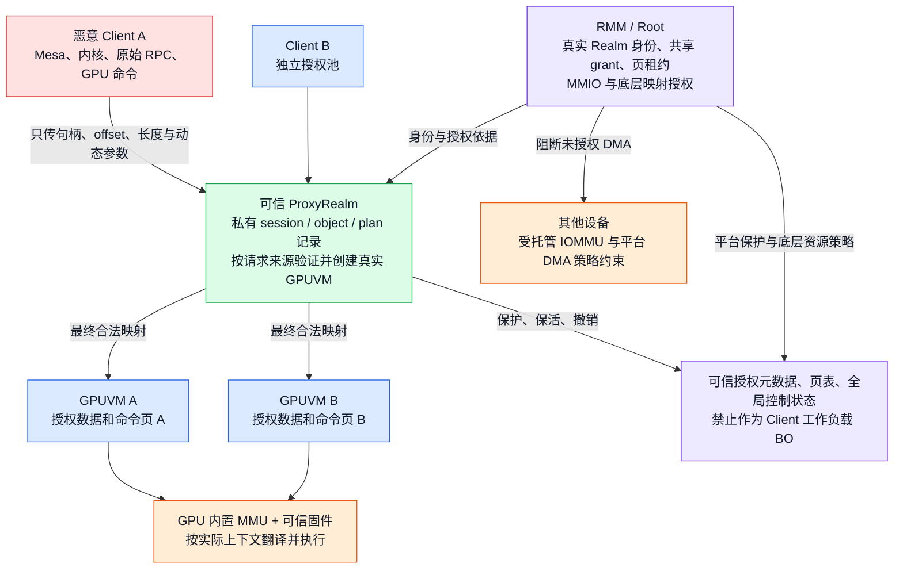

# 面向可信 ProxyRealm 与恶意 Client 的 GPU 安全设计

日期：2026-10-26。依据当前工作树、[当前基线](CURRENT_BASELINE.md)、场景二平台假设，以及下文列出的论文原文、作者公开资料和出版元数据整理。本文是研究与设计评审，**未改运行代码，无新增性能测量**，没有执行硬件攻击实验，也没有更新 Notion。

## 1. 建议采用的路线

保留当前结构：**可信 ProxyRealm 集中管理真实 GPU，按 Client/session 创建独立 GPUVM，映射只来自该 Client 的授权对象；GPU 内置 MMU 在执行时持续实施地址空间隔离。RMM负责 Realm 身份、共享授权、物理页租约和底层资源保护。**

最直接的研究组合是：

- **PORTAL**：将复杂设备管理放在隔离的可信服务 Realm；页表、MMIO、DMA 与 CPU 访问保护必须同时成立。
- **ACAI**：身份、归属和 CPU/设备地址翻译的一致性；共享代理场景需扩展成“原始 Client → 授权对象 → GPUVM”，不能只验证调用者是 Proxy。
- **PhantomMap**：检查应覆盖实际物理页和最终安装映射的时刻，同时覆盖对象生命周期；只保护页表存储本身并不够。
- **MOLE**：GPU MCU 固件及其加载、重载过程也是信任链的一部分。
- **Graviton**：上下文归属、页表控制与安全回收必须贯穿设备资源生命周期。

Honeycomb 与 Guardian 说明了另外两种重要路线，但当前没有必要直接移植其验证器或插桩。这个判断有前提：互不信任的 Client 使用独立 GPUVM，真实页表由可信驱动管理，GPU/固件正确实施上下文与权限隔离，可信控制状态不会被用户命令任意改写。**这些前提需要分别说明；“没有硬件 Stage-2”本身既不证明安全，也不证明不安全。**

## 2. 安全目标、攻击者与平台前提

| 项目 | 本文采用的模型 |
| --- | --- |
| 要保护的对象 | 其他 Client 的 GPU 数据、Proxy/RMM 私有授权元数据、真实页表/root、关键设备配置，以及安全回收所依赖的可信状态 |
| 恶意 Client | 可以控制 Client 内核、绕过前端直接构造 RPC、修改自己的共享队列和 BO 内容、提交任意 GPU 命令、重放旧句柄和旧计划 |
| Host 与其他 VM | 可以恶意发起接口请求和调度行为；对受保护内存、配置和 MMIO 的原始访问由约定的平台能力阻断 |
| 可信软件 | RMM/Root、ProxyRealm 的内核、后端与原生 Panthor，以及 GPU MCU 固件；不声称抵抗恶意 Proxy 或这些组件的任意代码执行漏洞 |
| 隔离单位 | 不同 Client Realm 的 GPUVM；同一 GPUVM 内的普通 Mesa Group 共享地址空间。相互隔离的任务应创建不同 GPUVM |
| 不作承诺 | 抵抗 Client 自己的恶意内核来保护该 Client 的应用；完整侧信道/物理攻击防护；Host 拒绝调度时的可用性；完整故障恢复与长期压力保证 |

平台前提沿用[已确认的平台能力](SCENARIO2_PLATFORM_ASSUMPTIONS_20261020.md)：可信页表与元数据不能被未授权物理写入；关键 root/任务 MMIO 受保护；其他设备及绕过 IOMMU 的未授权 DMA 被阻断；交接与电源变化不破坏保护。**这些不是 RK3588 模拟工程新增待开发项，也不是任意 CCA 平台天然具备的能力。**

Host 可按约定处理板级供电、时钟和合法 OPP，相关操作不能授予其固件替换、页表/root 修改或工作态 GPU 任务配置权限。若不研究故障和拒绝服务，可以排除恶意断电造成的可用性问题，但仍不能让断电后的旧授权直接恢复为有效授权。

GPT/GPC 的 Realm PAS 不能独自区分每一个 Realm 的 owner；CPU 的 Realm 间隔离还依赖 RMM 管理的 RTT。即使假设具有设备专用 GPT 视图，也必须明确视图选择不可伪造，以及它按设备而非按 GPU 内部 Client 上下文授权的粒度。

## 3. 关键论文如何对应本项目

下表区分“论文机制”“可借鉴内容”和“不能直接推出的结论”。没有把不同威胁模型的性能数据拼接成本工程收益。

| 文献与原文定位 | 论文机制 | 本项目应借鉴什么 | 需要避免的套用 |
| --- | --- | --- | --- |
| [PORTAL，S&P 2025](https://mainarke.github.io/assets/papers/sp25_sang.pdf)，§3.3、§4 | System Realm 管理 SMMU；保护 PORTAL region、页表和配置；结合 CPU/设备翻译与 GPT 视图 | 复杂 GPU 服务放在可信 Proxy；底层保护覆盖内存和配置；用度量/证明确认服务身份 | PORTAL 本身已经使用可信服务 Realm，不能将“把 SMMU 控制放进 Realm”单独称为本项目相对它的新机制；不能声称其设备 Stage-2 自动提供 GPU 内部所有租户隔离 |
| [ACAI，Security 2024](https://www.usenix.org/system/files/usenixsecurity24-sridhara.pdf)，§5 | INVid、INVown、INVbind、INVhost、INVdev；同步 Realm CPU S2 与设备映射 | 从真实身份检查授权，维护 GPA/HPA 一致视图；撤销和设备交接受控 | 原文强调设备的独占 owner；多个 Client 共用可信 Proxy/GPU 不是原模型的直接证明。共享池可能源自 Proxy，不能要求所有 HPA 原生独占归属于 Client |
| [CAGE，NDSS 2024](https://www.ndss-symposium.org/wp-content/uploads/2024-763-paper.pdf)，§IV-B/C | stub/real shadow task；检查并重建映射，保护 MMIO、任务元数据和代码 | 在可信边界生成真实映射，保护执行期间的控制面 | 本项目直接创建真实 GPUVM，无须复制一套 stub/real task；CAGE 的受保护执行模型不能直接证明当前多 Client 并发安全 |
| [StrongBox，CCS 2022](https://compass.sustech.edu.cn/strongbox/)；[TDSC 扩展](https://compass.sustech.edu.cn/paper/strongbox-tdsc24.pdf) | Arm GPU 隔离执行、动态内存保护、关键控制面保护 | MMIO、映射和任务控制状态应一起保护 | 独占执行与当前共享 GPUVM 模型不同；还须结合 MOLE 重新审视固件加载的信任边界 |
| [PhantomMap，NDSS 2026](https://www.ndss-symposium.org/wp-content/uploads/2026-f201-paper.pdf)，摘要、§VII | 利用分配与映射解耦、缺少物理地址校验；防御覆盖最终映射路径 | object/type/owner/generation、真实 backing、根绑定与最终 PTE 必须一致；防止释放后重用 | 它研究的 Mali 驱动漏洞不能直接等同于本项目 Panthor 漏洞；“是 GPU 页”这一标签也不足以区分多租户 |
| [MOLE，CCS 2025](https://fengweiz.github.io/paper/mole-ccs25.pdf)，§3.2/3.3、§4、§9 | 不可信驱动初始化恶意 GPU MCU 固件，MCU 在后续可信任务中执行 | 固件输入、加载者、加载时机和重载权限都要可信；MCU 不能被当成天然安全的黑盒 | 原文明确区分 shim-style 与完整驱动可信的 VM-style；不能把前者的攻击结论直接写成本项目已复现漏洞 |
| [Graviton，OSDI 2018](https://www.usenix.org/system/files/osdi18-volos.pdf)，§4 | 在 GPU 命令处理侧管理安全上下文、页归属、映射、回收和证明 | 生命周期中的归属一致性与安全清零；保护实际上下文配置 | 原文依赖 GPU 机制扩展；本项目可信 Proxy 是有意接受的更大 TCB，不能声称同等去驱动信任能力 |
| [Honeycomb，OSDI 2023](https://www.usenix.org/system/files/osdi23-mai.pdf)，§3–7 | 静态验证 AMD GPU kernel 的内存访问条件，可信启动验证过的代码，并限制驱动/OS 的控制 | 如果以后排除完整驱动信任，或无法保护 GPU 可见控制状态，其验证思路值得研究 | 它并非单纯解决“同地址空间多租户”；还在缩减驱动信任。需要代码完整性、受控启动与参数前提，不能只做一次检查后允许任意改写代码；AMD 验证器不能直接用于 Mali |
| [Guardian，Middleware 2024](https://arxiv.org/abs/2401.09290)，摘要、§1 与设计部分 | 将公共 GPU 地址空间分区，PTX 插桩限制内存访问，拦截 GPU API | 若未来把恶意 Client 合并到一个 GPUVM，可借鉴 SFI/边界检查 | 当前独立 GPUVM 不需要为分数而合并地址空间；NVIDIA PTX 插桩不能直接移植到 Mali |
| [CRONUS，MICRO 2022](https://i.cs.hku.hk/~heming/papers/micro22-cronus.pdf) | 隔离的加速器 enclave 与跨 enclave RPC | 将通信边界作为验证入口，分离设备与应用职责 | 其 RPC/共享机制不是本项目协议的现成安全证明 |
| [ccAI，MICRO 2025](https://compass.sustech.edu.cn/paper/ccai-micro25.pdf)，§2.2 与设计部分 | PCIe Security Controller 加 TVM 内 Adaptor，兼容既有驱动和多类 xPU | 可信完整驱动与接口兼容是可接受的设计取舍，TCB 不必为最小而最小 | PCIe 控制器不是本项目集成 Mali GPU 的直接实现；论文也有固件可信前提 |

## 4. 建议的完整保护结构



图中“禁止作为工作负载 BO”并不表示 GPU 页表遍历器不能读页表、固件不能访问自己的内存。必须区分 **GPU 内部可信执行主体的必要访问**和 **Client 命令/着色器可发起的访问**。后者不能因为也来自同一 GPU，就取得前者的全部权限。

## 5. 映射授权：为什么只检查 Proxy 的 CPU Stage-2 不够

当前源池由 Proxy 准备，经 RMM grant 映射到对应 Client；Proxy 因而可以合法访问多个 Client 的授权池。设其可访问集合为 `Pool_A ∪ Pool_B`：

> RMM 证明某个 Proxy IPA 合法，只说明对应 HPA 对 Proxy 有效；不能据此证明 A 发起的请求有权将它安装进 GPUVM_A。

代码依据：[opencca_gpu_ipa_to_pa](../../opencca/tf-rmm/runtime/rsi/opencca_gpu.c#L225) 使用当前 REC 的 `realm_ipa_to_pa()`，批量翻译取得当前 Realm 的页租约。这是必要的底层约束，而**原始 Client 的授权必须在上层继续检查**。当前已有 session/owner 检查正是为此服务，本文不是声称当前仅有 RTT 检查。

### 5.1 权威记录与不变量

建议把现有分散的安全约束明确记录为以下逻辑关系；这是设计表达，不要求新造一套令牌框架：

```text
ClientIdentity  := 经过 RMM 通道认证的实际 endpoint / Realm
ObjectAuthority := ClientIdentity + session + object_id + generation
                   + type + allowed_permissions + live_backing
MappingIdentity := 实际 GPUVM 根引用 + ObjectAuthority + offset / size / VA
```

Client 只提交对象名和对象内偏移，真实物理页从 Proxy 私有记录中的 backing/spans 取得。句柄可以被猜到，不应依赖“编号保密”；判断依据是所属命名空间和授权关系。

必须保持：

```text
WorkloadPTEPages(GPUVM_A) ⊆ AuthorizedPages(A, object, generation)
PTEPermissions ⊆ ObjectPermissions
UntrustedWorkloadPages ∩ PrivateAuthorizationAndPageTablePages = ∅
Reuse(page) ⇒ 旧访问已终止、旧翻译已失效、旧引用已释放、页已清零
```

这里的 `AuthorizedPages` 是授权给该 Client 的页集合，并非要求物理页最初一定由该 Client 分配。明确共享的内存可以拥有多个授权读者，但当前 GPUVM v1 不开放跨根 BO 共享，不能用只读别名隐式绕过。

### 5.2 一次 VM_BIND 的安全步骤

1. 从可信通道取得 Client 身份，查找该身份可访问的 session。
2. 将描述符和请求复制到 Proxy 私有内存，检查这个副本的完整长度、类型、计数和范围。复制可能得到恶意混合内容，因此所有消费字段仍须校验；不能依赖对方遵守更新协议。
3. 仅在该 session 中查 GPUVM、BO、同步对象；核对 payload 的 owner、带 generation 的 handle、类型、权限及存续状态。
4. 对 offset/size/VA 使用避免溢出的边界检查；禁止 Client 重绑保留 GPUVA；从对象私有 backing 生成目标页列表。
5. 持有必要对象引用与 pin，在最终原生映射准备处校验 BO 的真实 GPUVM 根归属；经合法 Proxy IPA 翻译/租约后，可信 Panthor 安装实际 PTE 并处理同步/回滚。
6. 销毁先撤销公开名称和缓存引用；实际 GPU 访问、unmap/TLB 与保活条件全部满足后，才清零并复用物理页。

“A 猜中 B 的 BO 编号”“A 把某个数值伪装成 B 的 HPA”“A 重放旧 generation”“A 复用已销毁 VM 的整数编号”应分别在命名空间、接口语义、generation 和实际根引用处被拒绝。不能只靠 Client 前端不产生这些请求。

### 5.3 现有代码已经做了什么

| 约束 | 当前代码入口 | 判断 |
| --- | --- | --- |
| 可信通道绑定及请求副本 | [Proxy 收包](../../Linux-Guest-GPU/drivers/char/proxy_vmshm_comm/proxy_comm_vmshm.c#L605)、[通道身份](../../Linux-Guest-GPU/drivers/char/proxy_vmshm_comm/proxy_comm_vmshm.c#L1707) | 描述符/消息有限复制；Client identity 从已绑定的 Realm 通道资料取得 |
| session 归属 | [session lookup](../../Linux-Guest-GPU/drivers/gpu/drm/panthor-proxy/panthor_proxy_drv.c#L852) | 请求方身份必须匹配 session owner |
| MAP/UNMAP 范围、BO owner 与 handle | [VM_BIND](../../Linux-Guest-GPU/drivers/gpu/drm/panthor-proxy/panthor_proxy_drv.c#L2086) | 限定用户 VA；核对当前 session BO 和 payload 归属 |
| 对象类型、权限、pin 与存续 | [check_gpu_map](../../Linux-Guest-GPU/drivers/char/proxy_vmshm_manager/proxy_vmshm_manager.c#L1955) | 仅 GPU_BO/COMMAND_BO 可以通过此工作负载映射入口 |
| BO 绑定真实根 | [prepare_map](../../Linux-Guest-GPU/drivers/gpu/drm/panthor/panthor_mmu.c#L1471) | 保存根 GEM 强引用，跨根只读别名也拒绝；不依赖可复用整数 ID |
| 批量 IPA 翻译与租约 | [RMM GPU 服务](../../opencca/tf-rmm/runtime/rsi/opencca_gpu.c#L299) | 使用调用 Realm 的真实 RTT；不能替代前述原始 Client 检查 |
| 创建/销毁与映射专项 | [GPUVM 验收](GPUVM_ISOLATION_VALIDATION_20261020.md) | 已有 owner、generation、保留 VA、跨根和实际 GPU 翻译故障证据；覆盖边界见第 10 节 |

## 6. 执行时隔离与控制缓冲：优先补核对的边界

独立 GPUVM 能阻止 A 的普通 GPUVA 访问落到 B 的未映射数据页。但是，它不能自动证明 GPUVM_A 内的所有映射都适合被 A 的任意命令访问。

本轮源码阅读发现应明确区分两类控制内存：

- **Proxy 私有授权状态、CPU 内核对象、真实 GPU 页表、RMM 元数据**：不能被 Client CPU 或用户 GPU 指令访问；页表仅允许可信遍历器等必要主体读取。
- **原生驱动有意映射给本 Group 的队列、同步或接口缓冲**：可能需要被命令处理器或 GPU 访问，不能直接与前一类一起称为“完全不在 GPUVM 中的控制内存”。必须核对访问主体、可写字段和后果。

具体依据：

| 源码事实 | 安全意义 |
| --- | --- |
| [queue ringbuf](../../Linux-Guest-GPU/drivers/gpu/drm/panthor/panthor_sched.c#L3965) 和 [group syncobjs](../../Linux-Guest-GPU/drivers/gpu/drm/panthor/panthor_sched.c#L4088) 通过 `panthor_kernel_bo_create(..., group->vm, ...)` 建立 | 它们在该 Group 的实际 GPUVM 中；`NO_MMAP` 限制 CPU 用户映射，不自动等于 GPU 不可访问 |
| [kernel_sync_map_flags](../../Linux-Guest-GPU/drivers/gpu/drm/panthor/panthor_sched.c#L714) 使用 NOEXEC/缓存属性；[flags_to_prot](../../Linux-Guest-GPU/drivers/gpu/drm/panthor/panthor_mmu.c#L1259) 生成读写权限 | NOEXEC 防止取指，不等于禁止数据写入；“保留高地址”也不是秘密或独立权限 |
| [原生 job 包装指令](../../Linux-Guest-GPU/drivers/gpu/drm/panthor/panthor_sched.c#L2518) 在调用用户 stream 后等待并更新 sync 计数 | 计数是执行协议的一部分；要明确用户 stream 是否有能力越过规定顺序修改它 |
| [提前完成观察](../../Linux-Guest-GPU/drivers/gpu/drm/panthor/panthor_sched.c#L3478) 根据 native sync BO 中的 status/seqno signal fence | 必须确认恶意工作负载不能伪造这个安全相关输入，尤其不能诱导仍在使用的页被回收 |

这是一项**需要验证的访问边界，不是本轮已证实的漏洞**。源码路径本身不足以证明实际 CSF 权限行为，也没有进行攻击实验。既有“真实计数、完整 fence 引用、缓存同步与锁保护”的正确性检查，不等于已经证明计数对恶意 GPU 命令不可伪造。

推荐先做最小核对：列出每个 GPUVM 中的内部映射及其用途，确认用户 CS/着色器、队列包装指令和 MCU 各自的权限。如果硬件/固件已有有效权限边界，记录依据并做一个定向负例即可；如果确实缺少边界，再选择：

1. 由可信固件/独立受保护上下文维护最终完成记录，普通用户 stream 无权改写。
2. 将必须供 GPU 使用的接口数据视为不可信输入；由可信私有状态约束其影响，资源释放使用不能被用户伪造的排空/访问终止依据。
3. 只有在无法做到前两项、且必须允许用户命令与可信状态共享同一可写权限域时，才研究针对 Mali CSF 的受控命令子集/验证，借鉴 Honeycomb 的完整性与受控启动思想。

不能简单给所有同步页加只读：正常 GPU 队列协议本身可能需要写它；也不能仅隐藏 GPUVA 或禁止 VM_BIND 覆盖已有高地址。需要保护的是**访问和可信消费关系**。

## 7. Proxy 身份与固件：把信任假设落实到启动过程

RMM 能识别“正在调用的是哪个 Realm”，不等于识别“这个 Realm 正在运行批准的 Proxy 软件”。当前架构说明已记录完整镜像远程证明和角色身份协议尚未完成，这个软件缺口应与平台物理保护假设分开。

建议的最小协议：

1. 由可信策略固定批准的 Proxy 镜像、配置、驱动与 GPU 固件版本，不能让恶意 Host 自行选择期望度量值。
2. 通过 Realm 初始度量/证明确认该镜像，并将批准的 `Proxy role` 绑定到实际 Realm 实例；设备 owner 和共享服务授权引用这个实例，而非 Host 传来的字符串或整数 VMID。实例销毁后绑定失效。
3. GPU 固件放入受度量的 initrd/镜像，或由可信 Proxy 依据批准的签名/摘要验证。若固件来自运行期可修改 rootfs，单独度量内核并不能覆盖它；单纯计算一个由 Host 同时提供的摘要也无效。
4. 初始化、复位后重载、重新绑定仍由同一可信加载链完成；Client 不暴露固件加载、root 替换、全局调试或任意 MMIO 接口。
5. Client 在释放敏感数据前确认对端绑定的是预期 Proxy 服务。远程证明可复用 CCA 能力，但需把服务角色和会话关联到证明对象。

代码事实：[panthor_fw_load](../../Linux-Guest-GPU/drivers/gpu/drm/panthor/panthor_fw.c#L883) 通过 `request_firmware()` 取得固件并检查格式/版本。**格式和版本检查不是供应方真实性验证**；这里没有据此证明存在完整固件签名链。现有冻结文件 SHA 核验可保证实验输入一致，但其作用不同于抵抗恶意 Host 的部署证明。

MOLE 的攻击依赖不可信主体掌握固件管理。本项目完整驱动位于可信 Proxy 中，因此没有必要照搬其攻击配置；仍应保证“可信加载者”没有加载攻击者替换的输入。

## 8. 共享内存、提交缓存与完成通知的安全规则

### 8.1 共享内存是传输介质，不是授权数据库

每 Client 的共享池只授权该 Client 与 Proxy。由于 Client 内核可以访问自己的授权池，不应将其安全性建立在该 Client 的 stage-1 页表只读属性或前端自律之上。

RMM/Proxy 的 owner、backing 列表、计划对象和回收依据留在可信私有内存。共享环索引、长度、offset、cookie 都按对方可以修改来设计；其他 Client 不能借此改变自己的写入目标或访问范围。

业务 BO 可以由 Client 修改；一次私有 RPC 快照不冻结 BO 内的命令流。采用独立 GPUVM 时应允许恶意命令仍被限制在授权访问域中。若改为 Honeycomb 类静态验证，则需要额外保证验证后的代码及其执行前提不能被再次修改，不能混用两种模型的前提。

### 8.2 Submission-Plan Caching 可以保留

[计划注册/执行](../../Linux-Guest-GPU/drivers/gpu/drm/panthor-proxy/panthor_proxy_drv.c#L2309) 缓存经过 session 解析的提交形状及 syncobj 引用；[失效处理](../../Linux-Guest-GPU/drivers/gpu/drm/panthor-proxy/panthor_proxy_drv.c#L2285) 在相关 Group/syncobj 销毁时清除计划。执行仍检查 slot/plan ID，并把本次动态参数交给原生提交。

安全上应缓存“已解析且仍被引用的对象关系”，不能缓存“以后任何新页或新命令都可信”。授权生命周期变化要失效；不能把计划命中称为 GPU 指令静态验证。无需为了安全在每次 PLAN_EXEC 中重新扫描全部页表或增加逐页 RMM 调用。

### 8.3 IRQ、cookie 与 fence 分别代表什么

- IRQ 只提示有事件；接收方继续检查队列、对象和请求状态。
- 提交 RPC 返回表示原生驱动接纳，不表示 GPU 已完成；不确定是否接纳时不能盲目重放。
- 完成 cookie 是对特定观察器/对象的完成缓存，不能授权跨域映射或直接回收底层物理页。Client 自报或改写本地完成状态，最多影响自身 API 观察，不能改变 Proxy 的回收决策。
- Proxy 私有 snapshot 及实际 native fence 引用保护对象生命周期，但 fence 的底层完成来源仍须满足第 6 节的不可伪造条件。给一个可被工作负载篡改的完成值套上真实 `dma_fence` 对象，不会自动增加可信性。

延迟释放、退役捎带、短时轮询与 IRQ 精简都可保留；减少通知不是削减授权检查的理由。无需为这个设计新增每 RPC 加密/MAC，除非共享链路在模型中对未授权主体可篡改，或需要新增端到端认证目标；同一恶意 Client 对自己的请求签名也不能解决越权问题。

## 9. 单一 GPU SMMU Stage-2 与软件提前翻译的选择

### 9.1 对当前工程的建议

**维持 GPU 内置 MMU 的独立 GPUVM 路线；不为了形式上具有 SMMU Stage-2 而重构当前热路径。** 当前路径已经在可信软件中取得合法 HPA，安装真实 GPU PTE。当前其他受托管 IOMMU 的实际页表/root 则由 RMM 创建和维护，见 [opencca_iommu_map](../../opencca/tf-rmm/runtime/core/opencca_iommu.c#L262)。两者不能合并描述成“所有 GPU 页表都由 RMM 创建”。

### 9.2 对用户提出的新场景的判断

假设 GPU 可以经过 SMMU，但整个 GPU 只有一个 S2 根：

| 方案 | 如何隔离 Client | 收益与限制 |
| --- | --- | --- |
| GPU S1 → 一个共享 SMMU S2 | GPUVM_A/B 的 S1 必须分别只映射各自授权页；S2 可以映射所有已授权 Client 的集合 | S2 是设备整体的额外边界；仅有并集 S2 不能阻止 A 的错误 S1 指向 B，仍依赖可信 Proxy 的逐 Client 检查 |
| 不使用 GPU SMMU S2，映射时软件预翻译 | Proxy 按 Client/object 授权检查，解析 Proxy IPA/backing 到 HPA，写入相应 GPUVM 的 S1 PTE | 兼容当前结构，无需每次 GPU 访存做软件翻译；缺少第二层对整个设备的额外限制，安全依赖真实 PTE、GPU/固件权限及平台保护 |
| 按 Client 串行切换共享 S2 根 | 切换前排空旧 Client 访问，换根并失效翻译，之后只运行新 Client | 能按时段限制设备可见页，但增加切换与排空成本，限制跨 Client 并行，不适合当前性能目标 |

这里的“软件 Stage-2”更准确叫**映射建立时的受授权 IPA→HPA 预翻译/合成映射**。软件只在建表时工作；之后每次访问仍受 GPU 内置硬件 MMU 约束。它不天然比正确管理的硬件 S2 更安全，也不凭空获得后者的独立防线。低开销在机制上合理，但本轮没有软件/硬件 S2 同条件 A/B，不能量化宣称收益。

若平台提供独立 SMMU 边界，可将其作为额外保护，而不是替代 GPUVM。设计覆盖范围必须包括页表遍历、MCU/固件以及旁路路径；否则只限制 shader 数据访问不足以约束整个设备。GPU 必须读取页表和固件内存时，还要考虑是否能按内部主体区分权限，不能粗暴将全部可信内存从设备访问集合排除。

### 9.3 其他设备是否必须由 Proxy 管理

“所有设备请求都经可信入口”是可行设计，但**当前 RMM 托管 IOMMU 已完成的功能不必搬进 Proxy 才能安全**。可以保留 Proxy 管 GPU 对象策略、RMM 管基础授权和其他设备真实表的分工；若未来采用 PORTAL 风格 System Realm，也须复用同一授权来源，避免两份互不一致的 owner 数据。

对其他设备请求，应检查“该设备/域是否获准访问该 HPA 及权限”，而不只是检查“地址之前是否被某设备映射”。不同 IOMMU domain 中相同 IOVA 可以合法共存；CPU/GPU 对同一业务页的显式共享也可合法。当前互斥服务是有意采用的较严格策略，不等于所有共享都必须永远禁止。

## 10. 建议优先级与最小验证

| 优先级 | 具体工作 | 当前状态与理由 |
| --- | --- | --- |
| 高 | 核对 GPUVM 内部 ring/sync/接口映射对用户 CS 和 shader 的权限，以及 native 完成计数能否被伪造 | 第 6 节给出具体源码依据；属于尚未证明的安全边界，不是已复现漏洞。结果决定是否真需要额外命令约束 |
| 高 | 将 Proxy role、实际 Realm 实例与批准镜像/固件绑定 | RMM 通道身份和实验 SHA 已有；完整证明/角色协议仍需补齐，或明确作为新的可信部署前提 |
| 高 | 维护 Client → session → object/gen → 实际 GPUVM 根 → backing 的统一授权关系 | 核心代码已实现；优先补少量原始恶意 RPC/生命周期负例，避免依赖前端拒绝 |
| 中 | 对 BO、临时映射、租约、plan/snapshot 的释放做一次联合生命周期核对 | 不要求全面故障注入，但必须排除正常销毁/重用诱发的跨域访问和旧授权复活 |
| 可选 | GPU 片上残留专项、侧信道、设备故障/可用性与长期压力 | 按研究目标另列；不能因不做而宣称“完整 GPU 机密计算攻击面已覆盖” |

建议把最小安全验证集中在五类具体结果，使用已有实验框架，不要求重跑全部性能矩阵：

1. **真实跨 Client 授权**：绕过 Client 前端向 Proxy 发送另一个 Client/session 的资源引用、伪造 owner、过期 generation 和旧 plan；后端拒绝且受害数据不变。
2. **实际 GPU 访存**：两个 Client 使用相同 GPUVA 读写各自 canary；攻击者尝试访问未授权目标，不能读写受害数据。现有同 Client 双 GPUVM 探针可复用思路，但不能冒充跨 Client 证据。
3. **可信控制缓冲**：有针对性地确认用户 GPU 命令对内部控制映射的访问权限和可影响字段；验证提前完成路径不会把攻击者可写值当成安全回收证明。
4. **正常回收与重用**：销毁 BO/Group/VM、创建同编号新对象、重放旧请求；不发生旧映射访问新 owner，重用页已清零。这里验证安全性，不扩展成完整故障恢复项目。
5. **部署身份**：将未批准镜像/固件的 Realm 声称为 Proxy，设备控制或敏感数据释放应被可信策略拒绝；若采用可信预置镜像模型，明确由哪个可信组件保证，而非记为已经做过证明。

已有证据见 [GPUVM v1 验收](GPUVM_ISOLATION_VALIDATION_20261020.md) 和 [当前版本正确性审查](GPU_OPTIMIZATION_CORRECTNESS_AND_GENERALITY_REVIEW_20261025.md)。前者实际越域 VA 故障是在**同一 Client 内两个 GPUVM**之间；后者覆盖性能优化、实际计算与部分错误/生命周期语义。两者都不等于本节新增恶意攻击矩阵已经完成。

若后续确实改代码，优先让新增检查停留在创建、映射、计划注册/失效、销毁与部署阶段，保留正常提交快路径。性能只需先做同条件完整 720p glmark，再加一至两个 ML 负载；必须比较相同的冻结输入与频率。当前固定频率单 Client 已有 720p Native/Clientproxy **1561/1395**、1080p **1129/1043**，只是引用[既有对照](GPU_FIXED_FREQUENCY_GLMARK_20261025.md)，不是本轮新增安全设计的性能结果。

## 11. 其余文献的研究位置与清单校正

不需要把文献库中的每种机制都变成当前工程待实现项。下面保留其作用，同时说明本轮核实深度。

| 原清单条目 | 如何使用 | 本轮核实程度 |
| --- | --- | --- |
| 1、41：CPU-GPU 机密计算综述 | 建立攻击面和文献索引 | Crossref 核实标题、DOI `10.1145/3793532` 和 2026 年元数据/摘要；未逐页精读全文 |
| 2：SoK Accelerator TEE | 以访问控制、内存保护、证明和 TCB 分类本方案 | [NDSS 原文](https://www.ndss-symposium.org/wp-content/uploads/2026-f1424-paper.pdf)与项目页已取得并核对分类，不将所有防护都视为必选 |
| 3、4：两个 GitHub 合集 | 发现论文和代码，不能作为最终安全结论来源 | 获取 README；重要结论回到论文原文。第 3 个库带有粗略厂商分类，不能把其“GPU A100 TEE”标题当成 Graviton 已在 A100 部署的证据 |
| 5：通用机密计算综述 | 更广的背景索引 | 本轮未精读，不据此新增设计结论 |
| 2.1 的 TDSC 两项 | Arm GPU/CCA 路线扩展 | `10.1109/TDSC.2023.3334277` 是 StrongBox 的 TDSC 工作，元数据为 2024，已取得作者 PDF；`10.1109/TDSC.2025.3615787` 标题已核，卷期元数据为 2026-01，未取得并精读全文，不推断其新增机制 |
| 9/38：HIX；11/39：HETEE；13：GEVisor | 可信设备访问、隔离 monitor 与完整可信执行栈的替代路线 | 本轮仅通过公开索引/摘要与 SoK 交叉核对，未逐篇完整审计；不移植 x86/PCIe 机制到集成 Mali |
| 10/29：Telekine | 调度/执行时间泄漏这一独立目标 | 原论文链接有效性本次受网络超时影响；不据二手摘要宣称当前已实现或必须实现其方案 |
| 12：LITE；19：Plutus；20：Secure Memory Architecture；25：Adaptive Security；26：Common Counters；27：PSSM | GPU 外存加密/认证及元数据带宽优化 | 本轮主要核对索引/SoK 范围，未精读全部原文；在当前平台物理保护前提下不新增为模拟工程任务 |
| 14：SAGE | 软件 GPU 执行证明的不同路线 | 核对 [ATC 2023 官方页面](https://www.usenix.org/conference/atc23/presentation/ivanov)；不把它视为无需任何假设即可替代 CCA/固件证明 |
| 17：XpuTEE | GPU TEE 的其他系统架构 | SoK 索引列为 TOCS 2025；本轮未取得原文作技术结论，原清单二级链接不作为机制证据 |
| 21：Discrete GPU Security；30/31：GPU 内存管理/虚拟化泄漏 | 回收清零、映射与残留检查 | 作为相关工作入口，当前设计中的生命周期结论主要依据已读 PhantomMap/Graviton 和本项目代码 |
| 22：Confidential Computing within an AI Accelerator | 加速器自身证明/隔离的对照 | 不是 Mali GPU 原型，未精读；不将另一设备能力套用到当前 GPU |
| 23/24：H100/Hopper 技术资料 | 厂商受支持的固件、证明与部署策略参考 | 本轮访问 [NVIDIA 当前概览](https://docs.nvidia.com/confidential-computing/overview)，页面标注 Dev；不能声称已经核对原清单两份历史白皮书所有细节 |
| 28：MOLE；29：Telekine；38：HIX；39：HETEE；41：综述 | 与前面条目重复 | 归并计数，不当成独立研究结果 |
| 32：Lightning；33：Whispering Pixels；34：LAK；36：Behind Bars；37：GPUArmor | 故障、片上残留、侧信道或内存安全方向 | 本轮未核实完整原文及全部出版信息；Behind Bars 给定页面请求超时，不能由此判定论文不存在。相关方向可以另立研究，不写成已证明当前代码受影响 |
| 35：Guardian | 同一 GPU 地址空间的隔离 | 已读原文；与独立 GPUVM 的边界差异见第 3 节 |
| 40：SGXIO；42：Enclaves as Accelerators；43：Secure and Timely GPU | 可信 I/O、运行时和实时性背景 | 本轮未精读，不作为必须重构当前方案的依据 |
| 44/45：GPUReplay / GR-T | 重放路径可缩减 TEE 内 GPU 栈，但与通用实时多 Client 驱动代理不同 | 已核实 GR-T 对应 **Safe and Practical GPU Computation in TrustZone，EuroSys 2023**，DOI [10.1145/3552326.3567483](https://doi.org/10.1145/3552326.3567483)；不是一篇仅名为“GR-T: GPU Replay-based Trusted Execution”的已核论文。GPUReplay 原条目标题不完整，暂不作为另一个已精读条目 |

额外值得纳入后续范围的是 **GPU 片上数据残留（如 LeftoverLocals 方向）**：独立 GPUVM 和释放系统内存清零不自动清除寄存器/片上本地存储。这与微架构侧信道不同。如本研究仅证明地址空间隔离，可以明确排除；如要宣称跨租户全部直接数据泄漏都被阻止，需要进一步依赖硬件清理保证或专门验证。本轮未做该实验。

## 12. 资料与评审记录

论文 PDF/提取文本复用 `build/gpu-isolation-research-20261018/`，本轮新增来源位于 `build/security-design-review-20261026/`；PDF 不加入源码树。精简的 URL、SHA256、读取范围和当前代码哈希见 [调研证据](evidence/security-design-review-20261026/sources.json)。获取失败或仅核元数据的文献没有写成“已精读”。

本轮建议中，映射授权与独立 GPUVM 是已有实现的维护原则；GPU 可见内部缓冲的访问边界是新增待核对项；度量/证明与角色绑定是部署协议建议；硬件物理保护继续作为已确认的目标平台前提。四者不混记成“代码全部未完成”或“安全已经全部证明”。

统一记录：论文调研与当前场景安全设计评审｜对照 1405 冻结组合，引用既有同频 720p Clientproxy 1395 → 本轮未测｜分差/百分比不适用｜**未改运行代码，无新增性能测量**｜无硬件 run-id/命令/退出码，资料与源码哈希见调研证据；既有测试引用原报告｜保留现有架构，新增设计建议与待核对边界，不发布、不替换冻结载荷。
