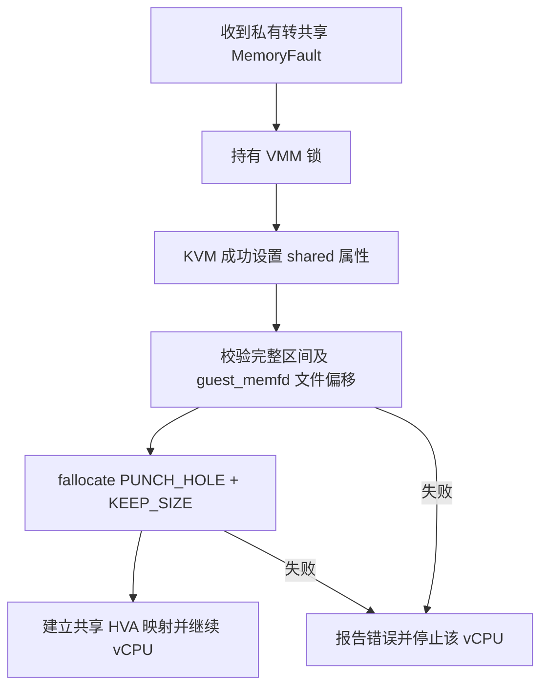

# 共享 GPU 旧目标后备页回收（2026-10-22）

**已实现并完成本轮开发验证：共享挂接后回收 Client 原有私有后备页，直接页数检查确认释放384 MiB。** 相同单Client ResNet50、相同384 MiB源池下，已测分项峰值合计由903.26降为519.33 MiB，减少383.93 MiB / 42.50%；相对原生454.17 MiB，额外开销由98.88%降至14.35%。

这是各分项峰值的合计，不是同时发生的完整物理总峰值；普通OS/VM预算、GPU页表和未计全的协议私有分配不在统计范围。原生使用前次两轮对照，本轮没有重跑原生。原始口径与数据保留在[优化前内存报告](GPU_TASK_MEMORY_COMPARISON_20261021.md)。

## 实测结果

单位为MiB（2²⁰字节）。共享优化前后均为一轮。

| 分项 | 原生两轮均值 | 共享优化前 | 共享优化后 |
| --- | ---: | ---: | ---: |
| CPU模型、加载和运行缓冲及用户态库峰值 | 126.40 | 133.02 | 133.09 |
| GPU用户BO需求 | 327.77 | 327.77，包含在源池内 | 327.77，包含在源池内 |
| 完整共享源池 | 不适用 | 384.00 | 384.00 |
| Client旧目标私有后备页 | 不适用 | 384.00 | **0.00** |
| 已计量Proxy私有分配器元数据下限 | 不适用 | 2.24 | 2.24 |
| **已测分项峰值合计** | **454.17** | **903.26** | **519.33** |
| **相对原生的额外占比** | — | **98.88%** | **14.35%** |

原生合计为CPU加用户BO；共享合计为CPU加完整源池、旧目标后备及元数据下限。共享列不能在384 MiB源池之外重复加327.77 MiB用户BO。

原先约56.23 MiB的池内余量及控制/对齐空间仍保留，没有靠缩池取得本轮结果。旧目标后备直接减少384 MiB；CPU采样峰值增加约0.0723 MiB，因此分项合计净减少383.93 MiB。

运行期间按两个VMM各自guest_memfd、池IPA与实际文件偏移做只读检查：

| 区域 | 请求页数 | 优化前实际缓存页 | 优化后实际缓存页 |
| --- | ---: | ---: | ---: |
| Proxy共享源池 | 98304 | 98304 | 98304 |
| Client旧目标后备 | 98304 | 98304 | **0** |

源池仍有活动引用，Client旧目标区的`cache_only_pages`与`prepared_pages`也均为0。这证明回收了不同于源池的真实后备，不能用VMM RSS或Guest的CMA统计替代这项证据。

## 实现原理

旧路径先从Client CMA取得挂接目标区，再替换Realm映射；KVM/RMM撤销旧私有映射及其引用之后，guest_memfd仍持有缓存页，映射替换本身没有释放这批物理存储。

本次仅改Firecracker VMM，Host、RMM、Client与Proxy内核均不变：



- `src/vmm/src/vstate/memory.rs`新增`discard_private_range`：检查非零、页对齐、地址和文件偏移溢出、完整区域覆盖及私有后备。先验证所有分段，再逐段执行回收；文件长度和邻接范围保持不变。
- `src/vmm/src/vstate/vcpu/mod.rs`在成功切换共享属性之后、建立共享HVA之前调用回收，同一VMM互斥锁覆盖整个处理顺序。回收失败不恢复该vCPU执行；后续系统调用失败可能已回收前面的分段，不宣称事务回滚。
- 使用Host现有guest_memfd的punch-hole接口；内核先使相关KVM映射失效并处理TLB，再截断指定缓存页。私有映射销毁、Realm所有权及引用释放仍走原有KVM/RMM逻辑。
- 两种现有seccomp策略仅为vCPU增加`fallocate`且mode必须为3，即`PUNCH_HOLE | KEEP_SIZE`。本轮Realm入口使用`--no-seccomp`，规则已检查、随release构建，未完成seccomp启用时的硬件端到端验收。

该优化作用于私有转共享的内存转换，不依赖GPU BO内容，也没有增加GPU任务数据拷贝。它消除了挂接后的旧物理后备；**启动阶段仍先取得目标CMA，不能声称已经消除启动瞬时需求。**

## 构建、测试与保留问题

| 项目 / run-id | 结果 | 范围与限制 |
| --- | --- | --- |
| ARM64 musl release构建 | PASS / rc0 | 锁定依赖、离线构建；初次linker配置失败保留，显式指定交叉链接器后通过 |
| 新函数聚焦单测 | PASS / rc0，1 passed | 逐字提取生产函数和同一测试，使用实际vm-memory/nix依赖；验证跨区域/非零偏移、相邻页、文件长度和非法范围 |
| 完整VMM单测编译 | FAIL | 12个既有接口编译错误，涉及RealmConfig、旧Vm/Vmm接口等；没有修无关测试，不能称全量单测通过 |
| `memory-reclaim-720-20261021-a` | PASS / rc0，1157分 | 完整33场景，validation为沿用的26成功/1已知数值例外/6无判据，clean通过；Realm退出0/0 |
| `memory-reclaim-dual-20261021-a` | setup FAIL / rc1 | 性能包旧probe不认识`--gpuvm-isolation`，输出usage/exit2，该检查未执行；不是GPU或内存故障。三Realm正常退出，旧VMM自动恢复 |
| `memory-reclaim-dual-20261021-b` | PASS / rc0 | 换用匹配F探针；双Client API、实际计算、GPUVM隔离、SG mmap、权限/IRQ负例及共享检查通过，退出0/0/0；provider replacement为NOT_RUN |
| `memory-reclaim-resnet50-20261021-a` | PASS / rc0 | 相同384 MiB池、100 loops、2 NCNN threads；模型与后端检查通过，退出0/0，直接页数检查通过 |
| `memory-reclaim-finalize-20261022-a` | PASS / rc0 | 恢复匹配F的普通initrd和runner，保留候选VMM；Pi/RK结束资源检查rc0，无本次VM、loop及Host诊断模块残留，CPU0–1、GPU300 MHz和pmthor恢复 |

三个成功GPU运行均通过Host/Guest健康检查、GPU/DMA租约最终归零与资源恢复。ResNet50采集1110个含模型进程的CPU样本、1173个有效Proxy负载样本，采样间隔200 ms；非常短的瞬时峰值可能遗漏。

**性能记录：** 相同33场景、128 MiB池、单Client固定CPU2、CPU0–3固定1.8 GHz、GPU请求600/实际594 MHz，已有公平720p两轮均值1158 → 新版单轮1157，**−1分 / −0.086%**。这是单轮观测，不宣称提分或稳定无损。Host仍为#31/protected，RMM timer-v6 + 1 GiB租约；Guest内核和用户态不变。

ResNet50本轮1545.78 ms，相对旧轮1217.04 ms增加328.74 ms / 27.01%。两轮均未固定CPU恒频、Client允许在CPU2–3间运行，现有证据不能区分运行波动与改动影响；**这项耗时差尚未解释，不把模型PASS写成推理性能无回退。** 本轮内存结论来自相同BO需求与真实页数，不依赖耗时改善。

改动目的｜回收共享挂接后滞留的旧目标后备｜公平720p均值1158 → 本版单轮1157｜−1 / −0.086%｜同池/负载/落核/频率，VMM内存转换改变；ResNet50未锁CPU频率｜本节run-id及下列命令、rc和日志｜保留内存优化候选，推理耗时差待验证，不替换发布manifest。

## 未实现 / 未执行

- 池内余量尚未缩减；后续可评估按负载设置较小池，或分段增长、空闲段回收。需保留控制区、碎片余量和每Client配额，等待GPU fence及映射引用释放后才可回收。
- Guest配置预算、CMA预算及多Client内存准入未修改。物理后备减少不会自动降低保守准入计算；三/四Client ResNet50仍未重测，不能据此改成已支持。
- provider replacement、长期压力、多vCPU及seccomp启用的硬件验收未执行；既有失败和NOT_RUN保留。
- 全部协议私有快照、队列、完成记录和分配器取整尚未逐项计全；14.35%不是完整虚拟化内存额外占比。

## 复现与证据

从仓库根目录，使用已配置的SSH环境变量。每次重跑使用新run-id，冻结输入和回退文件保持不变：

```bash
python3 scripts/maintenance/lab-run.py --run-id memory-reclaim-720-20261021-a -- \
  python3 scripts/run/run-realm-lease-monitor.py \
  --monitor build/dma-guard-20261018/lease-monitor/opencca_lease_monitor.ko -- \
  python3 build/gpu-memory-reclaim-20261021/run-candidate.py \
  --bundle build/gpu-memory-reclaim-20261021/standard -- \
  --workload glmark --performance --benchmark-only --suite --profiles glmark-720 \
  --clients 1 --compact-memory --pool-mib 128 --client-cpu-layout round-robin \
  --cpu-frequency-khz 1800000 --telemetry

python3 scripts/maintenance/lab-run.py --run-id memory-reclaim-dual-20261021-b -- \
  python3 scripts/run/run-realm-lease-monitor.py \
  --monitor build/dma-guard-20261018/lease-monitor/opencca_lease_monitor.ko -- \
  python3 build/gpu-memory-reclaim-20261021/run-candidate.py \
  --bundle build/gpu-memory-reclaim-20261021/functional -- --workload compute --bo-sg-mmap

python3 scripts/maintenance/lab-run.py --run-id memory-reclaim-resnet50-20261021-a -- \
  python3 scripts/run/run-realm-lease-monitor.py \
  --monitor build/dma-guard-20261018/lease-monitor/opencca_lease_monitor.ko -- \
  python3 build/gpu-memory-reclaim-20261021/run-memory.py
```

以上三轮实际退出均为0。性能命令的精确实际参数以`build/lab-runs/<run-id>/result.json`及`firecracker.json`为准；候选安装控制器有失败自动回退。

证据根目录为`build/gpu-memory-reclaim-20261021/`，属于Git忽略的实验归档：

- `inputs.json`、三个包的`hashes.json`：源码、候选和冻结输入。
- `runs/<run-id>/`：逐项日志、采样、summary与逐文件SHA；720p、双Client-b、ResNet50分别11/10/11个文件，双Client-a失败13个文件。
- `gmem-reclaim.json`、`memory-result.json`：真实页数、分项合计与比例；与优化前`build/gpu-task-memory-20261021/results.json`对比。
- `firecracker-final-build.log`、`focused-unit.log`、`focused-unit/extraction.json`及`unit-build.log`：构建、聚焦单测及全量编译限制；早期linker和harness依赖版本错误日志保留。
- `finalize.json`、`postflight.json`、`final-audit.json`及`build/lab-runs/<run-id>/`：默认运行输入恢复、Pi/RK资源、独立校验、锁、退出码、租约及健康检查。

候选VMM SHA-256：`fb2c3816d776a288d34b8c7f5b74b1e1722bb64d79079cac9c303319361310ec`；回退文件`previous-firecracker`为`1da45f6ad565434ff4bef82f8e1c15faed17f940ae8297a7a05bfc7278be6b66`。匹配功能initrd为`10e2721ce4a57f32a1fb10aac643cc56f41c55917e06727fd1c18916d3799e03`，内存测量initrd为`77219acb4ae43c81e2be321cd615aace986b7267bb5a8530756a90de75a9a452`。标准性能包使用旧性能探针，不能用于新GPUVM检查。

板端保留已测候选；控制机固定发布运行树及原runtime-manifest未替换，新控制机需要按上述实验包重建/安装，不能把旧固定归档当作包含本优化。
