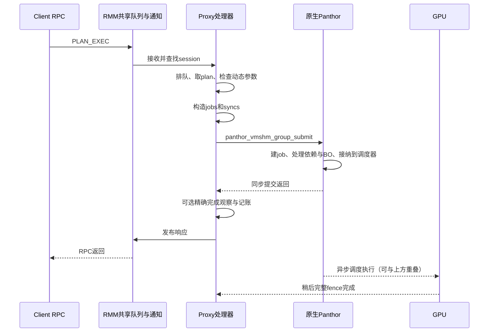

# 1080p glmark 提交路径计时分解

本实验已完成单Client完整1080p glmark的提交路径计时及硬件验收。PLAN_EXEC平均往返81.152μs；各项实测、代码边界与解释限制如下。计时默认关闭，诊断分数不替换正式性能表。

已发布至GPU Virtualization下的[Notion新文档](https://www.notion.so/401659a3b8cc81e0837df0c8a4362465)，父页面、表中均值及计数、图和说明已回读验证；记录为`build/submit-phases-20261022/notion-publication.json`。

## 实测结果

单Client、1920×1080、完整33场景，CPU固定1.8GHz、GPU请求600MHz/实际594MHz，Proxy vCPU在CPU1、Client在CPU2、VMM I/O在CPU0，192MiB共享池、round-robin/null-noop finish，TRANSFER预捕获继续开启。只启用RPC与提交/IRQ计时，不额外启用通知和完成时间戳trace。Host #31、当前通知计时RMM/2GiB租约元数据，Client/用户态/runner与原candidate-c相同。以下统计含validation、计分和退出阶段，非仅计分窗口。

本轮PLAN_EXEC共 **353662** 次尝试，Client/Proxy RPC与分阶段计数一致；实际原生提交353520次，Proxy非零返回142次，正好等于未计入原生提交的尝试数。传输错误和超时为零，完整glmark无提交/GPU错误。下表按每次尝试统计，包含正常计划失效/重注册的成本，不把所有尝试误称为成功原生提交：

| 阶段 | 每次 PLAN_EXEC 平均 μs | 占同步往返 |
| --- | ---: | ---: |
| RPC：传输、排队及剩余等待 | 61.238 | 75.46% |
| lookup：会话/缓存对象查找 | 0.324 | 0.40% |
| validate：Proxy显式参数检查 | 0.497 | 0.61% |
| assemble：原生提交结构构造 | 0.320 | 0.39% |
| native：原生Panthor同步接纳 | 16.695 | 20.57% |
| aux：完成观察及尾部记账 | 2.077 | 2.56% |
| 合计 | 81.152 | 100.00% |

辅助核对：Proxy pre-response service平均20.672μs，显式queue阶段0.669μs（已包含在RPC残差内，不能重复相加），Client往返中service之外60.479μs；service与顺序阶段之和间隙0.090μs。RPC由聚合残差求得，不能仅凭本表继续拆成RMM、Host调度、共享内存或锁的独占成本。

### 首次注册与摊销

PLAN_REGISTER **150** 次，三侧相关计数匹配、错误和超时为零。注册/执行尝试次数比为0.0424%；注册往返摊到每次执行尝试为0.024μs，尝试加注册摊销合计81.175μs。将全部执行尝试和注册的RPC总和除以实际原生提交数，则每次最终原生提交摊销81.208μs。一次冷提交实际需要两个串行往返；不能把全局两个均值当成它的逐请求分布。

Client代码只允许对已证实未派发的ESTALE重新注册，不会对可能已经执行的传输错误重放。当前聚合日志没有逐errno直方图；非零返回数与未进入原生统计的差额一致、完整工作负载成功，符合这一正常计划失效路径，不将其称为GPU任务失败，也不宣称逐次测得了具体errno。拒绝路径的未细分尾部时间落在aux中。

| 阶段 | 每次 PLAN_REGISTER 平均 μs |
| --- | ---: |
| RPC：传输、排队及剩余等待 | 51.211 |
| lookup：会话/缓存对象查找 | 1.797 |
| validate：Proxy显式参数检查 | 0.753 |
| assemble：原生提交结构构造 | 1.902 |
| native：原生Panthor同步接纳 | 0.000 |
| aux：完成观察及尾部记账 | 0.266 |
| 注册往返合计 | 55.928 |

注册不调用原生group submit，因此native这一项为0仅表示该阶段没有此调用，不代表对象创建/映射或整个初始化无成本。

### 原生提交内部

以下均为native的子项，按353520次实际原生提交归一化，不能再叠加到上方每次尝试的总时间。原生内部统计从部分前置校验之后开始，其均值15.981μs，外层native按实际调用归一化为16.702μs，还包括前置校验/dev_enter、统计提交及dev_exit等，总差0.721μs。

| 原生子阶段 | 每次提交平均 μs |
| --- | ---: |
| 提交上下文初始化 | 0.682 |
| job创建及添加同步操作 | 1.557 |
| 收集输出signal | 1.227 |
| BO reservation准备/锁定 | 1.888 |
| 映射BO的DMA/cache同步 | 4.858 |
| 依赖及job arm | 1.950 |
| 更新reservation/提交scheduler/安装fence | 2.220 |
| 上下文清理 | 1.005 |

嵌套push细项与push总计重叠；异步run_job统计与本表同步接纳也可能重叠，均未再次求和。不存在对native函数返回之后GPU执行时长的本轮精确测量。

## 实验支持什么结论

1. 通信与排队残差占75.46%，lookup+validate+assemble合计仅1.141μs/1.41%。优先继续减少必须串行完成的独立RPC，并定位通知和响应传播，比删减Proxy参数检查更有依据。这里不能据小validate占比声称所有隔离机制都便宜；映射准入、缓存注册和原生检查各有其他边界。
2. Client原有计时显示send平均32.823μs，其中notify平均31.875μs；等待回复平均47.580μs，其中reply_poll平均46.936μs。这些是另一套嵌套边界，不能加到上方分解中；notify也不是单独RMM内部执行时间，wait/poll包含Proxy处理。它们进一步指向通知与等待路径，而非定位到某个硬件环节。
3. 本轮Proxy Guest忙碌率26.38%，Client Guest为98.68%，均为既有采样器覆盖的validation+计分窗口。Host CPU1/2所承载的vCPU线程均约100%，但Guest统计未显示Proxy满载，不能据Host线程忙碌率直接判Proxy算力瓶颈；Client忙碌也可包含主动等待。本轮结果不能外推为四Client无Proxy瓶颈。
4. 原生内部较大的已测子项为BO/cache同步4.858μs。可以继续按BO及实际所有权交接定位，但真实DMA/cache同步仍须保证；不能因追求低延迟直接删掉必要同步。

后续候选方向为保持顺序及真实fence语义的有界批量/异步提交、减少可合并的控制往返，以及在不丢唤醒的前提下优化通知/ACK/ARM和响应消费。本轮没有实现或验证这些候选，不宣称它们必然提高某个分数。既有执行计划缓存、空闲调度器inline和TRANSFER预捕获已在被测组合中，不把它们再描述为本轮新优化。

## 构建、正确性和恢复

| 项目 | 结果 | run-id与退出码 |
| --- | --- | --- |
| Proxy内核构建 | PASS，无编译警告；固定仓库固件目录 | `build.log`，make rc0 |
| 首个硬件测试：完整720p，诊断关闭 | PASS，1156分，达到1000门槛 | `submit-phases-gate-720-20261022-a`；lab/runner/采集/分析rc0 |
| 单Client完整1080p，RPC计时开启 | PASS，892分；匹配计数与阶段闭合校验通过 | `submit-phases-1080-1c-20261022-a`；lab/runner/采集/分析rc0 |
| 双Client功能及并发语义 | PASS，各19项API及计算/SG、同步/快照语义 | `submit-phases-api-2c-20261022-a`；lab/runner/采集/独立审计rc0 |

两项glmark均33场景、Mali renderer、clean及既定validation通过（26成功/1既有数值例外/6无判据）；Realm退出均0/0，API为0/0/0。Host/Guest内核健康、CPU/GPU恢复、GPU/DMA租约归零和Pi/RK资源恢复通过。每轮结束在lab锁内恢复普通candidate-c四项输入并逐一核对SHA，诊断实现保留、正式运行不自动启用。

本轮720p与旧candidate-c关闭诊断1159分相比为 **-3分/-0.26%**；相同频率/落核/池/场景/TRANSFER选项，不同Proxy Image、启动和测试时段，单轮分差不宣称优化收益。1080p的892分属于诊断运行；未重复同镜像关闭诊断1080p，不据历史902或内存采样881精确推断本轮诊断损失，不替换主性能表。

构建前首次直接make因默认`/usr/lib/firmware`缺少嵌入固件而失败，未部署；使用已有构建脚本的固定仓库固件目录后构建成功。原失败日志保留于`build/native-ml4-20261022/proxy-submit-phase-build.log`。

证据根为`build/submit-phases-20261022/`，冻结输入在`candidate/hashes.json`，源码diff/配置/构建命令在`provenance.json`；各轮原始输出和SHA清单在`runs/<run-id>/`，资源/租约/实际命令/退出码及输入恢复在`build/lab-runs/<run-id>/`。分析结果为`<run-id>-analysis.json`，API为`<run-id>-audit.json`。Proxy Image SHA为`251b7f94111c51ad064b3e9b7738b7b3029b7d9f4c94c646972cba67cf8471bf`。

复现所需计时命令（外层再加与本轮相同的observer和输入恢复包装可复现资源证据）：

```bash
python3 scripts/maintenance/lab-run.py --run-id <新ID> -- \
  python3 scripts/run/run-realm-lease-monitor.py \
  --monitor build/dma-guard-20261018/lease-monitor/opencca_lease_monitor.ko -- \
  python3 scripts/run/run-realm-xshm.py \
  --images build/submit-phases-20261022/candidate \
  --workload glmark --performance --benchmark-only --suite --profiles glmark-1080 \
  --clients 1 --compact-memory --pool-mib 192 \
  --client-cpu-layout round-robin --cpu-frequency-khz 1800000 \
  --telemetry --transfer-capture --rpc-stats
```

回收后运行`python3 scripts/analysis/analyze-submit-phases.py --run <回收目录> --output <新JSON>`；完整固定测量流程及所有退出码另保存在`workflow.py`与lab记录中。

改动目的｜拆分提交计时，默认关闭且不改变授权/提交语义｜旧candidate-c完整720p1159 → 本版1156｜-3/-0.26%｜仅增加Proxy诊断代码，条件如上、单轮不归因提分｜上述run-id、命令、rc0及日志｜保留计时实现并关闭默认诊断；不修改正式1080p或多Client主表。

## 计时范围

起点为 Client 的 `client_comm_vmshm_call()` 入口，终点为同一次 RPC 返回；不包含此前 Client ioctl 的用户数据复制、本地对象查找与执行计划匹配，也不包含返回后的本地完成记录。这是一次执行请求的同步往返，不是完整 ioctl、帧耗时或 GPU 执行时间。



一次往返具有如下互斥分类：

$$
T_{\mathrm{RPC\ boundary}}=T_{\mathrm{RPC}}+T_{\mathrm{lookup}}+T_{\mathrm{validate}}+T_{\mathrm{assemble}}+T_{\mathrm{native}}+T_{\mathrm{aux}}.
$$

`T_aux` 单独列出完成观察、引用释放和记账，避免把它们误称为检查或通信。若保留原五项近似公式，必须明确省略了这一项。各项是经过线程调度的墙上时间，不是排除抢占后的纯 CPU 执行时间。

| 项目 | 代码边界和实际含义 |
| --- | --- |
| RPC | 同一批 Client 往返总时间，减去 Proxy 的 lookup / validate / assemble / native / aux 总时间。包含请求与响应传输、通知、队列和调度等待、锁等待及未细分的计时/记账间隙；是均值残差，不能直接称为纯网络或 RMM 开销。 |
| lookup | Proxy 的 session 身份查找、plan 槽读取；首次注册还包括 Client group 到 Proxy group 的翻译、syncobj XArray 查找及引用获取。缓存执行不会再次完整查找每个对象。 |
| validate | Proxy 显式的请求边界、plan ID、job 参数、sync 类型与 timeline 值检查。注册时检查固定结构，执行时仍检查动态字段；不代表全部安全开销。 |
| assemble | 注册时分配并保存计划，执行时填充原生 `drm_panthor_queue_submit`、`drm_panthor_sync_op` 和范围数组。 |
| native | 外层完整包围 `panthor_vmshm_group_submit()`：包括原生再次校验、job 创建、依赖、BO reservation/cache sync、arm、push 和清理；不包括异步 `run_job` 或 GPU 真正执行到完成。 |
| aux | 精确完成 watch/proof 建立、提交后记账、解锁、session 引用释放，以及调度器返回后的尾部工作。 |

## 为什么必须分开首次注册与缓存执行

Client 的 `panthor_client_execute_plan()` 先匹配包含 group、queue 和 sync 布局的执行计划。未命中时发出 PLAN_REGISTER，再发 PLAN_EXEC；命中时只发送 plan ID 与动态命令流/timeline 参数。

Proxy 在 session 内完成 group/syncobj 的查找和固定关系检查，保存原生句柄与引用；资源销毁或关系变化会使相关计划失效。PLAN_EXEC 仍核对 session、槽和 plan ID，检查动态参数，原生 Panthor 继续检查 job 和对象关系。不能因为缓存执行的 lookup/validate 数值小，就解释成取消了隔离检查。

注册查找中的 helper 包含少量合法性检查，查找与校验并非微指令级严格分割。session 查找内的锁等待也归在 lookup；显式 session 锁等待与提交调度器前段归在 queue，并纳入 RPC 残差。局部数组清零等少量工作也位于 queue 边界，因此它不是纯粹的睡眠等待统计。

注册开销的摊销口径为 `注册次数 / 执行次数 × 注册平均往返`；一次未命中请求需要注册往返加执行往返。全局两个均值只能给出总体摊销，不能还原某个冷提交的精确延迟。

## 实现与统计校验

新增分阶段累计统计复用 `panthor_proxy.rpc_stats` 开关，默认关闭，不改变通信 ABI、对象授权、提交和等待语义。只增加 Proxy Image；Client、initrd、runner 沿用 `build/completion-latency-20261022/candidate-c`。源码为 `Linux-Guest-GPU/drivers/gpu/drm/panthor-proxy/panthor_proxy_drv.c`。

计时从 Proxy handler 中 session 查找之前开始，顺序阶段之间只记一次时间差；worker 执行时沿用同一个请求样本。累计值在原统计锁下更新，最终日志为 `PANTHOR_PROXY_SUBMIT_PHASES`。解析器 `scripts/analysis/analyze-submit-phases.py` 校验：

- Client、Proxy RPC 和新分阶段统计的每种 operation 次数完全相等；传输错误和超时为零，注册成功。执行请求可能被提交前的失效计划检查拒绝；其数量单列，不能混同GPU错误。
- 分阶段之和不超过 Proxy pre-response service 时间，service 不超过 Client 往返总时间，RPC 残差非负。
- PLAN_EXEC尝试次数减去Proxy拒绝数等于原生group submit次数；公式使用每次尝试的时间，原生内部子项使用每次实际提交的时间，分别归一化。
- 日志中可观察到的Client命中加未命中次数与对应Proxy成功runs一致；session快照可能未覆盖初始化探针，未覆盖数量单列，不将部分session计数误当成全量。
- 保留额外 aux 与计时边界间隙，不把父计时和其子项重复相加。

统计覆盖本轮完整验证、计分和退出阶段的最后累计快照，不是只覆盖计分33场景。聚合统计只支持总和、均值和已有最大值，不能提供上述各阶段的 p50/p95/p99。

RPC 残差使用两端各自测得的时长总和，先确认调用集合一致，再做总和相减；不相减两端的绝对时间戳，因此不依赖 Guest 时钟起点相同。它不是逐请求跨端链路追踪，不能仅靠这个残差分离哪一次通知或哪一把锁造成长尾。

Client 原有的 `wait_avg_ns` 包含远端正在处理请求的时间；直接把它当作 `T_RPC`，再加 Proxy 四项，会重复计算远端工作。本实验所说的通信等待，特指扣除已单列远端工作后的剩余时间。

## 解释与优化方向

只有得到实测分解后，才能判断是否应继续优先优化串行往返。原生函数中的 BO cache sync、job 创建和 scheduler push 由已有嵌套统计细分；它们是 native 的子项，不能再加到总提交延迟中。异步 `run_job` 也不能与同步 native 相加。

`T_validate` 只覆盖提交入口的显式检查。GPUVM/IOMMU 建表和物理页归属准入发生在映射/资源生命周期路径；缓存注册中的检查、session 身份查找以及原生驱动内部校验分别落在注册、lookup 或 native 中。不能用这一项的占比表示整个系统安全机制的开销。

诊断模式额外执行时间读取和累计统计，短 lookup/validate 阶段的数值包含其计时成本。所有诊断分数单独记录，不替换正式关闭计时的性能表，也不从单次分数差拆分某一个诊断功能的独占代价。正常运行继续关闭高频诊断，按用户要求保留诊断实现。

PLAN_EXEC 只是一种 RPC；BO/VM 映射、同步对象导出、TRANSFER 和真实等待等也可能影响整帧。不能把本表中某项的占比直接当成整帧或总分损失占比，也不能把累计 RPC 时间简单相加到 GPU 时间上。即使某阶段归零，渲染吞吐也受 GPU 工作量、其他串行依赖及流水线重叠限制。
