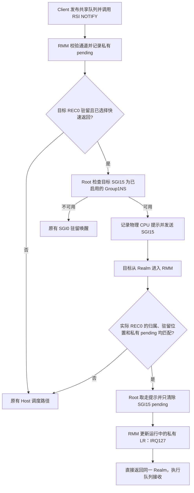

# 目标 Realm 通知的直接返回优化

状态：**已保留，当前本地基线为1237**。最终版完整720p为
**1234 / 1240，均值1237，增加29分 / 2.40%**；两轮分别增加2.15%和
2.65%，均超过首轮门槛1233。双Client和ML功能验收、实际SD固件及当前
源码核验均完成，计为第三项有效设计。初版1235单独保留，不混入最终均值。

## 目的和机制

上一档驻留唤醒省去了发送端 Client 的 Host 往返，但目标物理 CPU 收到
SGI0 后，仍须退出到 Host，再进入 RMM 注入可信 IRQ127。本方案尝试省去
目标端这一次上下文保存、Host 处理和恢复过程。请求及完成的含义不变。



新路径需要明确的接收端选择：先绑定可信 IRQ 和驻留唤醒，再启用快速
返回。普通 Client 回复路径保持原设计。Host 辅助模块独占 SGI15，提供
CPU 上下线处理及普通中断回退；不替换 Host 内核镜像。

初版对所有已选择该机制的 REC0 物理 IRQ 查询 Root。最终候选增加私有
pending 前置检查，避免无关物理 IRQ 的额外 Root 调用；同时补齐原始诊断
ioctl 的命令边界。二者仍属于同一个完整通知设计，不分别计提分。

## 状态和竞争处理

- 物理 SGI 只负责促使 CPU 检查状态。实际授权来自 RMM 私有的 Realm
  归属、通道和 pending，Host 伪造 SGI 不能凭空生成可信事件。
- Linux SMP 使用 SGI0–7；本平台安全中断属性配置使用 SGI14。辅助模块
  拒绝已有 SGI15 映射，Root 每次仍核对实际分组及启用状态。
- Root 不读取 IAR，不确认其他中断；只写 SGI15 的 GICR pending 清除位。
  kick 和 take 受同一个 RMM 策略锁串行化。迟到 SGI 和过期提示可走普通
  Host 处理，不能覆盖另一个 Realm 的事件授权。
- 直接返回时修改硬件中正在运行的最后一个私有 LR，保留 Active+Pending，
  不以旧 REC 保存状态覆盖其他 LR。正常退出后仍保存实际硬件状态。
- 原有每轮进入前的定时器检查保留；其他物理 IRQ 仍保持 pending，随后
  触发普通退出。消费一次提示不会清除普通调度 IPI。
- ARM/ACK_ARM、队列排空、提交参数检查、真实 fence、cookie 及生命周期
  均沿用现有设计。通知成功不等于 GPU 任务完成。
- 迁移、空闲退出和销毁仍使用驻留方案的规则。辅助模块只在所有 VM
  退出后卸载，并验证 CPU、驱动、挂载及 loop 恢复。

这些是实验平台上的中断集成；不据此宣称标准 CCA 已提供同一扩展接口，
也不据 RK3588 运行结果宣称完成真实硬件机密隔离或长期压力验收。

## 已取得证据

统一记录：减少目标端通知的 Host 往返｜已保留1208 → 初版1235｜
**+27 / +2.24%**｜同一完整720p/33场景、单Client、128MiB紧凑池、
round-robin、CPU固定1.8GHz、GPU请求600/实际594MHz、telemetry和
TRANSFER capture启用、阶段诊断关闭；改变Proxy/RMM/Root并增加Host
辅助模块，Client/initrd/runner/Host镜像不变｜
`fast-target-irq-720-20261024-a`，wrapper/runner退出0，日志见下｜
**初版已归档，最终以1234/1240及后续功能验收决定保留**。

初版场景及validation为33项、26成功/1已知例外/6无判据；无非预期
validation失败。VM退出0/0，Host/Guest健康和资源恢复通过，11份远端
日志SHA核验通过。实际快速返回 **1,007,633次**；驻留直接提示
1,025,489次、Host提示25,663次，辅助模块普通回退17,856次。这些计数
证明路径实际使用，不等于RPC数，也不能据此计算单次延迟收益。

最终版本记录：减少目标端通知的Host往返｜1208 → **1234 / 1240，
均值1237**｜**+29 / +2.40%**，相对原1158累计+79 / +6.82%｜
上述相同完整720p条件，Proxy/RMM含最终接口及pending前置检查，Root和
辅助模块不再变化｜`fast-target-irq-final-720-20261024-a/b`，各自
wrapper/runner退出0，33场景及validation26/1/6、Host/Guest健康、VM0/0
和资源恢复通过，各11份日志SHA核验通过｜**已保留，更新本地基线为1237**。

两轮快速返回分别1,018,871和1,024,179次；驻留直接/Host提示分别为
1,040,003/34,284和1,045,946/34,729，空闲救援均0；模块普通回退分别
21,132和21,767次。不能将初版1235与最终均值1237之间的差额归因于
pending前置检查；没有同条件独立开关实验。未重测RPC各阶段微秒分解。

ASan/UBSan策略测试通过，新增覆盖：未绑定/无驻留启用拒绝、错误归属、
错误物理CPU、无事件重复提示、迁移、禁用/重启用、正常入口消费、销毁
后重建及10,000次通知/读取/消费交错。Proxy、RMM、Root、Host模块及
U-Boot构建成功，固件布局检查通过。Proxy首次构建因未显式指定已有
GPU固件目录而失败，修正构建参数后成功，首份失败日志保留。

| 验证 | 当前状态 |
| --- | --- |
| 初版完整720p | 1235，首轮通过；不是最终冻结基线 |
| 最终版本完整720p及相同输入复测 | 1234 / 1240，均值1237；两轮及各11份日志核验通过 |
| 最终版本双Client API/实际计算 | 两边各18项API，实际计算、权限/IRQ/内存检查通过；VM0/0/0 |
| 最终版本GEMM/卷积正确性 | 29.29263 / 33.66347 ms；各100样本、5次预热，正确性通过，VM0/0 |

双Client和ML运行分别为`fast-target-irq-final-compute-20261024-a`及
`fast-target-irq-final-ml-20261024-a`；wrapper/runner均退出0，分别10份日志
核验通过。四项共42份日志，内核健康、模块卸载及CPU/驱动/挂载/loop
恢复全部通过。ML仅作为本版正确性与实测耗时记录，没有同期Native或
关闭/开启对照，不宣称ML提分。双Client运行约9分钟，包含完整18项选定
API及共享内存撤销流程；没有展开多Client性能或完整硬件攻击矩阵。

## 复现与产物

可审查的冻结输入见[输入SHA](evidence/target-irq-return-20261024/inputs.json)，
源码见[源码SHA](evidence/target-irq-return-20261024/source-hashes.json)，四项
实际完整argv、退出码、run-id、日志位置、实际SD固件核验及前两项历史
达标记录见[最终验收](evidence/target-irq-return-20261024/validation.json)。
Client沿用1208冻结二进制；本轮仅重建Proxy。辅助模块维护源码与实测
构建源码逐字节相同，复用其已验证的冻结模块；模块vermagic与运行Host的
`6.12.0-opencca-pmthor-opp3`匹配，构建显式指定同一LOCALVERSION。

源码入口：`runtime/core/exit.c` 的同REC返回、`xshm_endpoint.c` 的接收端
策略、`lib/gic/src/gic.c` 的运行中私有LR访问，均位于`opencca/tf-rmm`；
Root逻辑位于`trusted-firmware-a/services/std_svc/rmmd/rmmd_main.c`。
Guest位于`Linux-Guest-GPU/drivers/char/realm_xshm.c`；Host辅助模块及
租约包装入口见`tools/xshm-wake-sgi/README.md`。

```bash
python3 scripts/maintenance/lab-run.py --run-id <unique> -- \
  python3 scripts/run/run-realm-wake-sgi.py \
  --module build/fast-target-irq-20261024/host-sgi/xshm_wake_sgi.ko -- \
  python3 scripts/run/run-realm-xshm.py \
  --images build/fast-target-irq-20261024/candidate-final \
  --workload glmark --performance --benchmark-only --suite \
  --profiles glmark-720 --clients 1 --compact-memory --pool-mib 128 \
  --client-cpu-layout round-robin --cpu-frequency-khz 1800000 \
  --telemetry --transfer-capture
```

初版冻结包、固件、源码补丁、构建日志和逐文件核验见
`build/fast-target-irq-20261024/`；初版日志位于
`runs/fast-target-irq-720-20261024-a/`，独占租约及辅助模块证据位于
`build/lab-runs/fast-target-irq-720-20261024-a/`。最终包为
`candidate-final/`、`firmware-final/`、`final-source-hashes.json`。
仅刷SD2固件，实际启动区备份和UART保留在`build/firmware-runs/`。

回退目标为1208冻结包`build/pipeline-ownership-20261024/candidate/`和
驻留固件`build/request-resident-20261024/firmware/`。初版及最终版本都
未提交或发布，未改变既有GitHub基线。
