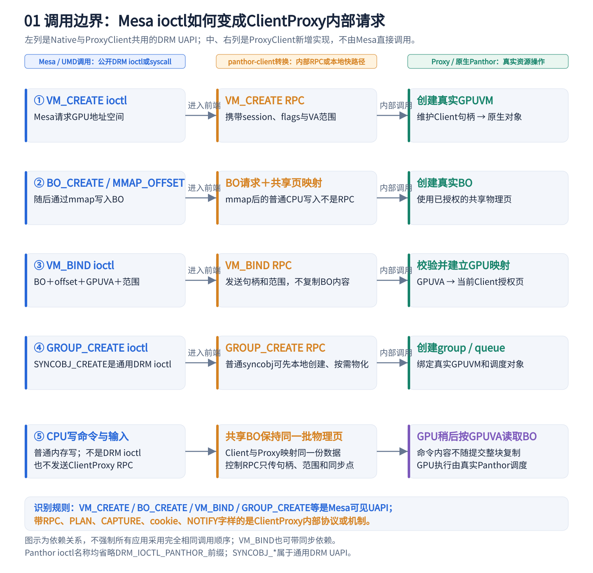
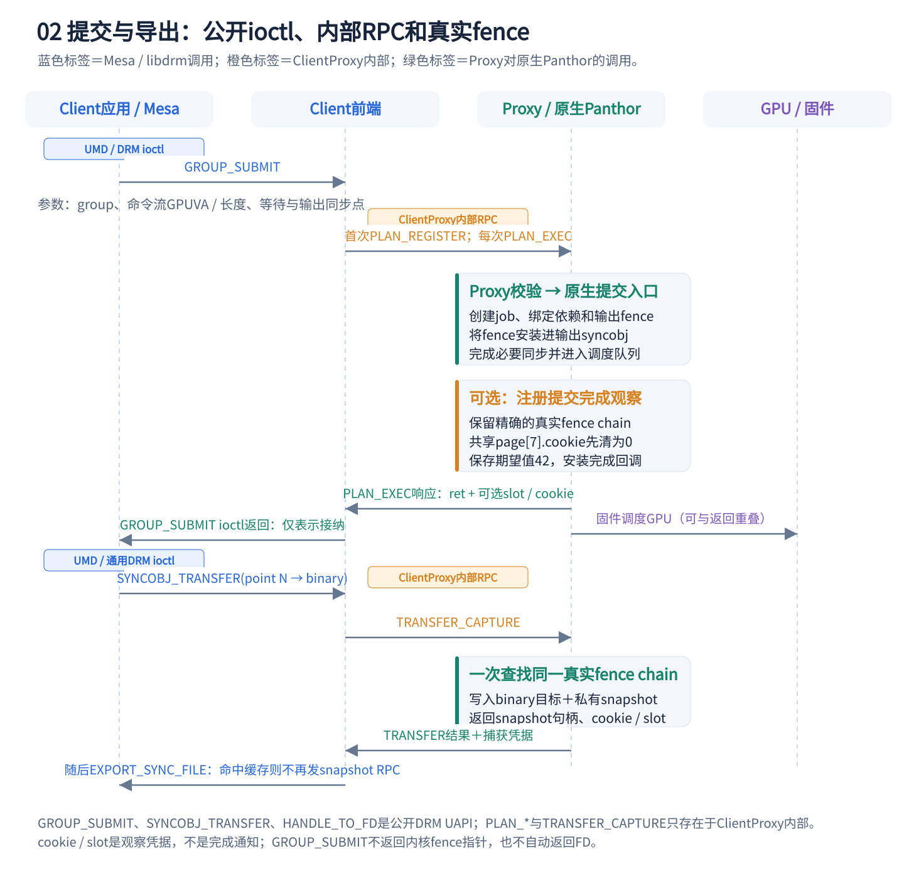
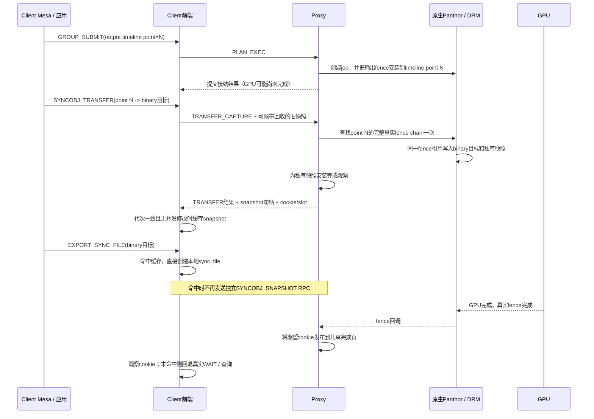
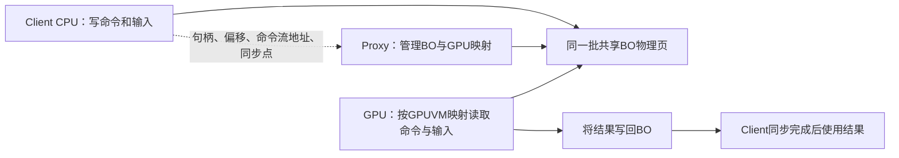
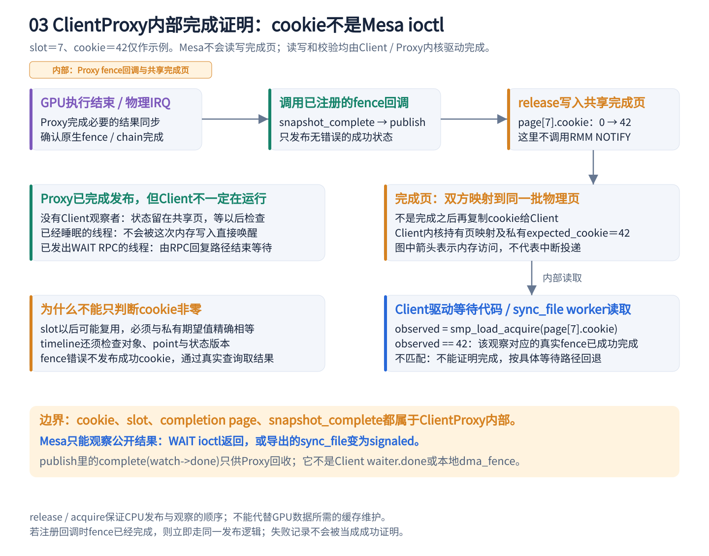
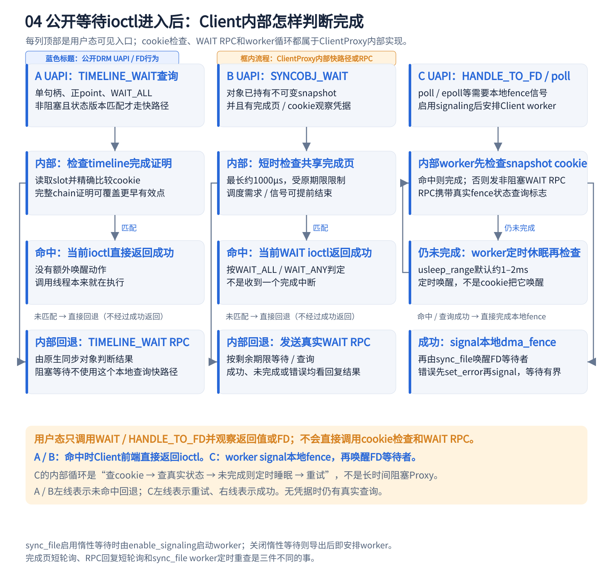
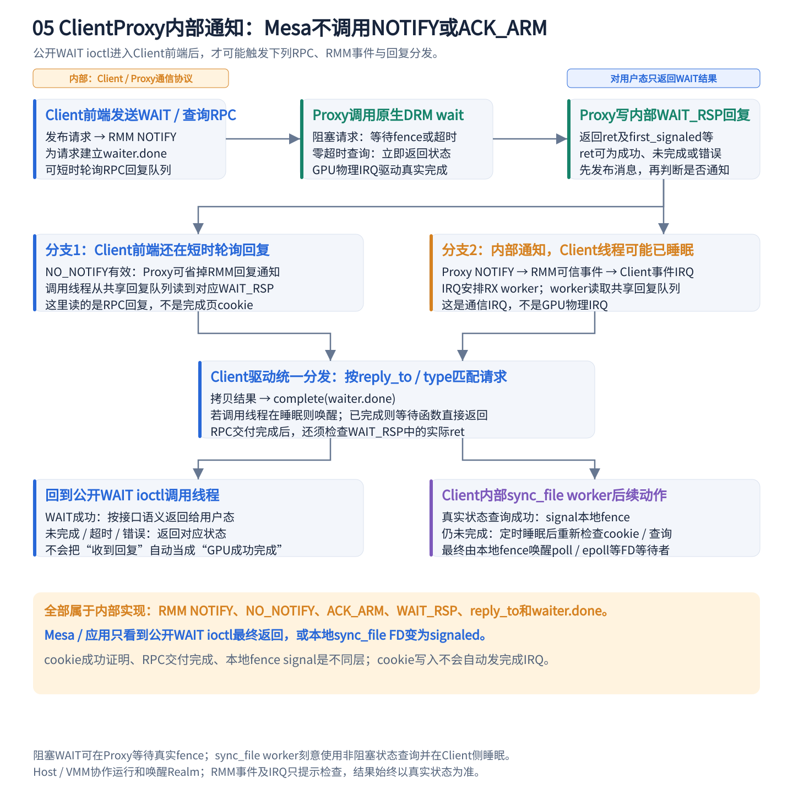

# GPU任务如何运行：Native 与 ProxyClient 对比

依据2026-10-23当前实现整理。**未改运行代码，无新增性能测量。** 本文中的ProxyClient指当前Client Realm与Proxy Realm共享GPU的路径。

**核心：应用在Client中生成GPU命令；Proxy负责检查请求、管理真实设备资源，再交给原生Panthor驱动调度执行。GPU计算本身仍在同一块物理GPU上完成。**

## 1. 彩色流程图：资源创建、命令写入、提交与执行

除角色颜色外，图片统一使用三类边界标签：**蓝色“UMD / DRM ioctl”表示Mesa、libdrm或应用通过公开UAPI发起的调用；橙色“ClientProxy内部”表示前端转换出的RPC、cookie、完成页和通知协议；绿色“Proxy / 原生Panthor”表示Proxy校验后执行的真实后端操作。** `PLAN_REGISTER`、`PLAN_EXEC`、`TRANSFER_CAPTURE`、`WAIT_RSP`、`NOTIFY`和`ACK_ARM`都不是Mesa直接调用的ioctl。图中省略部分错误处理；资源准备是依赖示意，不要求所有应用采用完全相同的调用顺序。

**写入和提交分开：** Mesa通过`mmap`得到的CPU指针写命令流和输入；`VM_BIND`建立GPU访问BO的映射；`GROUP_SUBMIT`才请求执行。图1将相关操作归为一组，不表示`BO_MMAP_OFFSET`、`mmap`或普通CPU写入各自都发送一次RPC。

**Native对照：** 同样由Mesa生成命令并调用DRM ioctl，但直接进入本系统的原生Panthor；省去Client前端、跨Realm RPC和Proxy对象转换。两条路径都有原生job、GPUVM、调度与fence，应用的图形API和GPU命令流仍在应用所在系统生成。

### 1.1 ioctl与返回值对应

下表Panthor操作名均省略`DRM_IOCTL_PANTHOR_`前缀，通用同步操作省略`DRM_IOCTL_`前缀。GPU地址空间创建的实际名称是`VM_CREATE`，不是`GPUVM_CREATE`。

| 调用 | Client看到什么 | Proxy / 原生驱动完成什么 |
| --- | --- | --- |
| `VM_CREATE` | 返回本地`vm_id` | 创建当前session的真实GPUVM并维护对应关系 |
| `BO_CREATE` | 返回BO句柄、大小等 | 分配由授权共享页支持的真实BO |
| `BO_MMAP_OFFSET` → `mmap()` | 先返回映射offset，再由系统调用取得CPU虚拟地址 | 前端把对应BO页映射给Client应用；CPU写入无需逐次RPC |
| `VM_BIND` | 指定`vm_id`、BO、offset、GPUVA及映射范围 | 检查对象和范围，建立真实GPUVA到BO页的映射；可带同步操作 |
| `GROUP_CREATE` | 返回group句柄，创建参数中描述队列 | 创建关联GPUVM的真实group及其queues |
| `SYNCOBJ_CREATE` | 返回本地同步句柄 | 需要后端参与时再物化真实同步对象 |
| `GROUP_SUBMIT` | 指定group、命令流地址/长度、等待和输出同步点；返回提交状态 | 前端转换成`PLAN_REGISTER` / `PLAN_EXEC`，原生驱动创建job及输出fence并安装到指定syncobj |
| `SYNCOBJ_TIMELINE_WAIT` / `SYNCOBJ_WAIT` | 按句柄及相应同步点等待 | Client可验证已有完成证明；未命中则RPC等待真实fence |
| `SYNCOBJ_TRANSFER` | 将源syncobj的指定point转给目标syncobj | 普通路径只执行真实TRANSFER；符合条件的binary目标走内部`TRANSFER_CAPTURE` RPC，同时预先捕获后续导出所需的不可变fence快照 |
| 内部RPC `TRANSFER_CAPTURE`（不是应用ioctl） | Client仍看到一次普通`SYNCOBJ_TRANSFER` | Proxy在一次请求中回收旧快照、执行TRANSFER、保存同一真实fence chain的私有快照，并返回快照句柄及可选cookie/slot |
| `SYNCOBJ_HANDLE_TO_FD`＋`EXPORT_SYNC_FILE`标志 | 返回Client本地`sync_file` FD，可等待或转交 | 捕获导出当时的真实fence快照；Client用本地代理fence表示其完成状态 |
| `SYNCOBJ_FD_TO_HANDLE`＋`IMPORT_SYNC_FILE`标志 | 将FD中的同步依赖导入目标syncobj | 保持导出时的快照语义；不是把它换成源对象的最新任务 |

**不是每次提交都执行全部调用。** BO、GPUVM、group和同步对象通常可复用，导出FD也只是应用需要时才做。

## 2. 创建、提交、执行：逐步对照

| 阶段 | Native | ProxyClient |
| --- | --- | --- |
| ① 准备资源 | 应用打开DRM设备；创建BO、GPUVM、group/queue和同步对象，将BO绑定到GPU虚拟地址 | Client前端保留本地句柄，通过RPC让Proxy建立真实对象；Proxy将经授权的共享BO页面映射进对应GPUVM |
| ② 生成GPU工作 | Mesa将绘制或计算请求转换为命令流，把命令和输入写进BO | 同样由Client中的Mesa生成，写进Client与Proxy共享的BO；无需把全部数据装进RPC |
| ③ 提交请求 | GROUP_SUBMIT ioctl将命令流地址、长度、队列和同步点交给原生驱动 | 前端转为RPC；Proxy依据当前session查找对象，检查归属、参数和关系，组装原生提交结构 |
| ④ 接纳与执行 | Panthor创建内核job，关联依赖和输出fence，完成必要的缓冲/缓存同步后入队；依赖满足后由驱动和固件安排GPU执行 | Proxy调用原生Panthor的提交入口，随后走相同的job、依赖、调度与GPU执行路径；多个Client共享物理GPU的调度资源 |
| ⑤ 完成与取结果 | GPU完成事件经中断处理使对应fence完成；应用等待结束后读取或继续使用BO | 真实fence完成后，Proxy可向共享完成页发布对应cookie；Client验证命中，不能命中则走真实等待RPC。结果仍在共享BO中 |

BO是存放命令、纹理、顶点或张量的缓冲对象；GPUVM决定GPU虚拟地址能访问哪些页面；group/queue组织执行队列；fence表示某次异步工作的完成状态。

**资源创建通常可以复用，不是每帧都重新建页表、分配全部BO。** 当前提交还会缓存计划：首次遇到一种提交结构时执行`PLAN_REGISTER`，之后以`PLAN_EXEC`携带本次命令流地址、长度和同步点等动态参数，减少重复传输与查找。缓存失效时重新注册。

### 2.1 `TRANSFER_CAPTURE`：为后续fence导出预先冻结快照

`TRANSFER_CAPTURE`不是新的用户态ioctl，也不负责提交GPU job。它是Client驱动实现普通`SYNCOBJ_TRANSFER`时使用的内部复合RPC，解决的是**任务提交之后的同步对象传递与`sync_file`导出成本**。

典型路径如下：Mesa先通过`GROUP_SUBMIT`把输出fence安装到timeline syncobj的某个point，再将该point TRANSFER到binary syncobj；如果稍后要把binary syncobj导出为`sync_file` FD，导出语义要求捕获“导出这一刻对应的fence”，不能继续跟随以后写入该公开syncobj的新任务。

它具体合并了三件事：

1. **TRANSFER。** 根据源syncobj、`src_point`和flags取得完整原生fence chain，并替换binary目标当前持有的fence。
2. **CAPTURE。** 创建Client不可直接修改的私有snapshot syncobj，把同一个fence引用写进去。以后公开目标被RESET、SIGNAL、IMPORT或再次TRANSFER，都不会改变这份已冻结快照。
3. **观察与回收。** 尝试为私有快照分配完成页slot和cookie，并把旧私有快照的退役句柄附带在本次请求中回收，减少独立销毁RPC。

Client收到响应后不会无条件采用快照。只有本次操作期间没有其他同步对象修改、文件级`sync_epoch`没有变化或回绕、目标仍存在且没有别的缓存，才把snapshot挂到目标syncobj。后续`EXPORT_SYNC_FILE`还会再次检查代次和并发修改；检查失败就放弃缓存，走原有的独立snapshot RPC。因此该优化不会用过期快照冒充当前导出状态。

边界和失败语义如下：

- 当前预捕获只用于`dst_point == 0`的binary目标；timeline目标继续走普通TRANSFER。
- 捕获的是fence引用和完成观察信息，不复制命令、纹理、输出BO或GPU结果数据。
- `TRANSFER_CAPTURE`成功只表示同步依赖已经建立并取得观察凭据，不表示GPU已经执行完成；cookie仍要等真实fence完成后才会发布。
- 私有快照分配失败时，后端仍执行普通TRANSFER，后续导出按原路径重新捕获快照；如果快照已创建但没有可用的完成观察slot，快照本身仍然有效，只是后续等待不能使用cookie快路径，必须查询真实snapshot。真实TRANSFER失败时，本次新建的私有快照会被销毁。
- Proxy按当前session和Client VMID查找源、目标及退役对象；私有snapshot不能作为公开可写目标，避免Client修改已经承诺给某个`sync_file`的快照。

在已验证的720p批次中，预捕获使381700次导出直接命中缓存，独立snapshot请求降到31次；但同条件关闭1158、开启1156，差−2分（−0.17%），**只证明RPC数量确实减少，尚无GLMark提分证据**。当前保留的是`PLAN_EXEC`之后单独执行`TRANSFER_CAPTURE`的设计；2026-10-23尝试把二者进一步合成一次`SUBMIT_CAPTURE` RPC，720p均分从1167降到1152.5（−1.24%），该候选已经撤回，不能与现有`TRANSFER_CAPTURE`混为一谈。详细验证见[TRANSFER预捕获报告](GPU_TRANSFER_CAPTURE_20261022.md)。

## 3. RPC传控制信息，共享BO存任务数据

**共享表示两侧访问同一批物理页，不是每次提交复制一份任务缓冲。** CPU共享映射与GPUVM映射是两件事：前者让Client/Proxy访问BO，后者让GPU访问BO；都建立正确后，GPU才能执行Client生成的命令。

RMM提供Realm身份、共享页授权和映射、可信事件等基础能力。Proxy依据会话对象及授权页面建立真实资源，不能把Client自报的任意物理地址直接当成合法BO。正常GPU任务调度仍由Proxy中的Panthor与GPU固件完成。

### 3.1 先纠正一个关键理解：cookie不负责主动通知

**当前实现是“共享完成状态＋Client主动观察＋真实WAIT回退”，没有“cookie写入后自动向Client发送完成IRQ”的通用推送路径。** 前版图中从“发布cookie”直接连到“Client完成同步”，省略了观察者和等待方式，容易误读。

三件事必须分开：GPU物理IRQ让Proxy处理原生任务完成；共享cookie让Client能够本地证明完成；RMM通信事件IRQ用于提示Client检查RPC回复队列。**即使前两件事都已发生，也不表示一个睡眠中的Client线程已被唤醒。**

### 3.2 cookie怎样准备、发布、被识别

以`slot=7`、`cookie=42`为例，数字只是说明，不是实测日志：

1. **先建立共享完成页。** session初始化时，Client请求完成页并取得内核映射；Proxy与Client访问同一批底层页，不是完成时再拷贝一份。Client对象描述符要求`CPU_READ`，应用没有直接mmap这张完成页的接口。
2. **为精确fence建立观察。** Proxy保留真实输出点的完整fence chain，分配slot，将共享`page[7].cookie`先清为0，私有watch保存期望值42，并通过`dma_fence_add_callback()`安装完成回调。PLAN_EXEC观察只覆盖符合条件的提交；快照导出也可建立自己的观察。
3. **把观察凭据返回Client。** 提交响应或快照响应携带slot与期望cookie；Client私有记录还关联对象、point、状态版本等。**拿到42只是知道“以后应当看到什么”，不能据此宣布完成。** 如果注册时fence已经完成，Proxy立即走同样的发布逻辑。
4. **GPU完成后才发布成功cookie。** GPU物理IRQ进入Proxy原生完成路径；真实fence完成会触发`panthor_proxy_snapshot_complete()`。无fence错误时，`panthor_proxy_snapshot_publish()`执行`smp_store_release(&page[7].cookie, 42)`。回调不发送RPC，也不调用RMM `NOTIFY`。
5. **Client读取并精确比较。** 等待代码执行`smp_load_acquire(&page[7].cookie)`，只有读到私有期望值42才命中。读到0或另一个cookie都不能证明完成；slot可能复用，因此不能仅判断非零。timeline还要检查对象和状态版本等条件。

release/acquire建立CPU发布与观察顺序，**不能替代GPU数据本身所需的缓存维护**。完成页证明是可选优化：无slot、无观察、状态失效或fence错误均保留真实查询路径；cookie未匹配本身不区分这些原因。

### 3.3 到底谁在Client读取cookie，谁让应用继续运行

| 等待入口 | 谁检查cookie | 命中后怎么结束等待 | 未命中怎么办 |
| --- | --- | --- | --- |
| `SYNCOBJ_TIMELINE_WAIT`的本地快速查询 | 当前ioctl调用线程 | 直接返回成功；线程本来就在执行，无需额外唤醒 | 发真实timeline WAIT RPC；按原请求语义查询或等待 |
| 持有snapshot的`SYNCOBJ_WAIT` | 当前调用线程，在完成页上有界轮询 | 满足WAIT_ALL / WAIT_ANY后直接返回ioctl | 按剩余期限发真实WAIT RPC |
| 导出`sync_file` FD后的等待 | Client的`panthor_client_sync_fence_work()` | 完成Client本地`dma_fence`，再由sync_file唤醒poll/epoll等等待者 | 非阻塞查询真实snapshot状态；未完成则在Client侧定时睡眠后重试 |

**第一行不是所有timeline等待都轮询。** 当前本地证明快路径仅用于单句柄、正point、恰好`WAIT_ALL`、非阻塞查询，并要求没有并发状态修改、版本有效等。它可以用完整chain的已完成上界确认更早有效点；阻塞timeline等待会走真实RPC。

**第二行才有约1000μs的完成页短轮询。** 它受用户原始绝对期限限制，遇调度需求或信号可提前退出；对象没有快照观察凭据时直接回退。它与传输层的“RPC回复队列短轮询”检查不同内存、解决不同问题。

**第三行另有worker循环。** 启用惰性等待时，FD被需要fence信号的消费者使用、触发`enable_signaling()`后才安排worker；关闭惰性等待时可在导出后启动。worker每轮先查cookie，未命中则发`timeout_rel_nsec=0`的真实状态查询；仍未完成时执行`usleep_range()`，默认请求约1–2ms后再检查，实际调度可能更晚。**这个worker是被定时器重新调度，不是被cookie写入唤醒。** 成功后`dma_fence_signal()`本地代理fence；错误先记录error再signal。等待有总时限，不在Proxy长期阻塞这条查询。

### 3.4 什么时候真正向Client发通知

当需要真实WAIT / 查询时，通知链路如下：

1. Client把请求发布到共享请求队列，再调用RMM `NOTIFY`；Proxy收到通信事件IRQ，硬中断仅安排RX worker，后者取得消息私有副本并校验身份、类型和参数。
2. Proxy调用原生DRM wait。带正等待期限的请求可以等到真实fence完成或超时；零超时请求立即查询，可能返回尚未完成。**sync_file worker使用的是后一种方式。**
3. Proxy将`WAIT_RSP`写入共享回复队列，包含实际返回码及`first_signaled`等。Client正在短时轮询且设置`NO_NOTIFY`时，Proxy可以不发回复通知；否则经RMM可信事件向Client投递通信事件IRQ。
4. Client调用线程直接轮询，或事件IRQ安排RX worker；两者最终使用同一个回复分发函数。它按`reply_to`和type匹配等待者、保存回复，再调用`complete(&waiter.done)`。若线程睡眠则唤醒，若完成发生在睡前则等待函数直接返回。
5. 调用线程还要检查回复中的真实ret：成功、未完成、超时或错误。**`complete(waiter.done)`仅表示这次RPC回复已交付，不代表GPU任务一定成功。** 普通WAIT按结果返回；sync_file worker则决定signal本地fence，或继续定时重试。

RPC回复轮询转睡眠时，顺序是清`NO_NOTIFY`、屏障、重查、`ACK_ARM`、再重查；仍未完成才`wait_for_completion_timeout()`。Host / VMM协作调度或唤醒Realm，消息授权和完成判定仍由对应可信路径处理。

### 3.5 四个容易混淆的“完成”，以及fence怎样返回应用

| 对象或动作 | 所在位置 | 真正含义 |
| --- | --- | --- |
| 原生`dma_fence`完成 | Proxy的Panthor / DRM | GPU工作及其对应同步依赖的实际完成状态 |
| `complete(watch->done)` | Proxy观察回调内部 | 供Proxy拆除watch、回收时确认回调退出；不会跨Realm唤醒Client |
| `complete(waiter.done)` | Client传输层 | 对应RPC回复已交付，唤醒RPC调用线程；还要检查回复ret |
| 本地代理`dma_fence_signal()` | Client的sync_file worker | 将观察到的结果反映到本地FD，唤醒本地fence / sync_file等待者 |

**`GROUP_SUBMIT`不会直接返回内核fence指针，也不会自动返回fence FD。** 应用指定输出syncobj及timeline point，Proxy把真实输出fence安装进去；提交返回接纳状态及可选观察凭据。应用随后按句柄等待，或显式执行`SYNCOBJ_HANDLE_TO_FD`＋`EXPORT_SYNC_FILE`导出**Client本地FD**。FD内部代理fence跟踪Proxy捕获的不可变快照；快照可在捕获时仍未完成，后续由上述观察 / 查询路径完成本地fence。

因此，“cookie通知Client”更准确的说法是：**Proxy发布共享完成证明；Client的观察者读取后结束对应等待；需要阻塞通信时，由WAIT RPC回复走可信通知路径。** 本次补充`TRANSFER_CAPTURE`流程和说明，未改运行代码，无新增性能测量。

## 4. 最容易混淆的三个点

- **GPU命令与内核job不同：** Mesa在Client生成GPU要执行的命令流；Panthor在提交时创建用于依赖、排队和完成跟踪的内核job。Proxy组装的是提交参数，并不重新生成所有shader或绘制命令。
- **提交返回不等于GPU完成：** ioctl/RPC成功表示工作已被接纳；GPU可能正在排队。应用通过fence或同步对象确认完成后，才能按接口约定使用结果。
- **通知不等于完成证明：** 可信事件用于提示对端检查队列；共享完成cookie对应真实fence的完成记录。没有匹配记录时必须回到真实等待路径。

性能差别主要出现在GPU执行前后的CPU路径：ProxyClient额外经过RPC、排队、对象检查和完成回传。当应用频繁执行“提交后立即等待”时，这些延迟更难与GPU工作重叠。具体测量见[1080p glmark：GPU提交路径开销分解与实验分析](https://www.notion.so/401659a3b8cc81e0837df0c8a4362465)。

## 实现对应

| 代码入口 | 对应过程 |
| --- | --- |
| `panthor_client_drv.c`：`panthor_client_group_submit()`、`panthor_client_execute_plan()` | Client提交、计划复用与RPC |
| `panthor_proxy_drv.c`：`panthor_proxy_plan_register()`、`panthor_proxy_plan_execute()` | Proxy对象查找、校验与原生参数组装 |
| `panthor_drv.c`：`panthor_vmshm_group_submit()` | 原生job创建、依赖/fence、缓冲同步与调度入队 |
| `panthor_client_drv.c`：`panthor_client_syncobj_transfer()`、`panthor_client_syncobj_export_sync_file()` | 选择`TRANSFER_CAPTURE`、校验代次并缓存snapshot；导出时命中缓存或回退独立捕获 |
| `panthor_proxy_drv.c`：`panthor_proxy_handle_transfer_capture()`、`panthor_proxy_session_syncobj_transfer()` | 校验session与对象，顺带退役旧快照，创建私有snapshot并返回观察凭据 |
| `panthor_drv.c`：`panthor_vmshm_syncobj_transfer_capture()` | 只查找一次完整原生fence chain，并将同一fence引用安装到binary目标和私有snapshot |
| `panthor_proxy_drv.c`：`panthor_proxy_point_watch()`、`panthor_proxy_snapshot_publish()` | 观察凭据分配、精确fence回调与release发布；不发完成通知 |
| `panthor_client_drv.c`：`panthor_client_cookie_completed()`、`panthor_client_completion_wait()` | acquire读取、cookie精确匹配、snapshot完成页短轮询 |
| `panthor_client_drv.c`：`panthor_client_syncobj_timeline_wait()`、`panthor_client_sync_fence_work()` | 受限timeline本地证明快路径；sync_file worker观察 / 查询、定时睡眠与本地signal |
| `client_comm_vmshm.c`：`client_comm_vmshm_dispatch_response()` | RPC回复匹配与`complete(waiter.done)`，不是原生GPU完成回调 |

更完整的本地说明：`docs/shared/GPU_CLIENTPROXY_ARCHITECTURE_GUIDE_20261022.md`。
