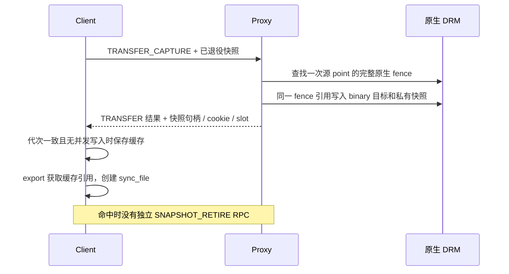

# TRANSFER 预捕获不可变导出快照

## 目的与当前状态

减少 `PLAN_EXEC → TRANSFER → SNAPSHOT_RETIRE` 中最后一次同步往返。新增实验开关 `--transfer-capture`，默认关闭；只在双方协商支持且 Client 有共享完成页和退役队列时启用。同期无RPC计时的完整720p为关闭1158、开启1156，−2分/−0.17%，尚无提分证据；开启轮381700次导出命中，已实际省去对应的独立快照往返。双Client各19项API及真实计算、SG、并发快照语义和资源回收已验收；细分计时轮1149分，独立快照请求仅31次。

后续[请求通知拆分](GPU_NOTIFICATION_LATENCY_20261022.md)已完成固件部署、完整720p、Host辅助函数/调度采样和跨端配对，RMM内部平均1.042μs，通知总时长30.971μs；计时ABI权限与合并测试通过。真实原生fence完成至Client确认的[计时路径](GPU_COMPLETION_LATENCY_20261022.md)已通过关闭诊断时的720p门槛1159；补齐RPC分支后计时轮1144、双Client各19项API/计算/SG及并发语义通过，已观测完成证明平均14.095μs，无cookie等待另列范围限制。下述硬件结果均属于不含后续计时改动的TRANSFER冻结包，不能转作最新源码整体通过证明。

## 实现



原生后端新增 `panthor_vmshm_syncobj_transfer_capture()`。它先保留目标和私有快照对象，按原 binary TRANSFER 的参数调用 `drm_syncobj_find_fence()`，再将同一完整 fence 引用写入两个对象。目标的替换是实际 TRANSFER 的生效点；之后其他请求修改公开目标或源 timeline，均不会改变私有快照。没有使用最后一个 job、完成 watermark 或可变同步对象代替真实 fence chain。

Proxy 先按会话、身份和句柄保留源及目标，再分配私有快照，避免无效源句柄被新分配的 ID 意外补成有效。可选快照分配失败时只执行一次普通 TRANSFER；其成功不依赖预捕获成功。原生操作失败时销毁本次私有快照。pending 和 error fence 都保留原生语义；完成观察无法分配 slot 时仍可使用真实 snapshot wait。

Client 使用既有文件级 `sync_epoch` 和在途修改计数。TRANSFER 返回时只有本操作独占修改、代次未变且目标未销毁，才发布缓存；export 只有无在途修改、代次未变时才能取得缓存引用。RESET、IMPORT、SIGNAL、SUBMIT、销毁和未知写入均经过修改入口；代次溢出后停止复用。发生并发或无法证明未变化时，保留原独立导出请求。

每个公开目标最多持有一个缓存引用；下一次 TRANSFER 先释放旧引用，再附带发送已经无人使用的私有快照退役批次。多个 sync_file 和同会话 import 通过既有引用计数延长快照生命，最后引用释放后才退役。无消费者的快照由下一次覆盖或对象关闭回收；队列满和关闭阶段沿用显式销毁路径。传输结果不确定时不重放 TRANSFER 或退役批次，会话关闭回收未确认对象。

目标为 timeline 的 TRANSFER 沿用原协议。旧 Proxy 未协商能力、本地包装分配失败、完成页不可用时也沿用原路径。这里只减少后续导出 RPC，没有删除 TRANSFER，也没有猜测下一次提交的目标。

## 验证记录

| 项目 | 状态 | 证据 |
| --- | --- | --- |
| Client / Proxy Image | 已构建 | `build/transfer-capture-20261022/build-client-final.log`、`build-proxy.log`，退出0 |
| 扩展快照语义测试 | PASS，两Client均有专门marker | `transfer-capture-api-2c-20261022-b`；每Client重复覆盖512次、导出256次、RESET128次、timeline及256次并发修改 |
| 关闭开关完整720p | PASS，1158分 | `transfer-capture-off-720-20261022-a`，独立审计退出0 |
| 开启开关完整720p | PASS，1156分 | `transfer-capture-on-720-20261022-a`，独立审计退出0 |
| 双Client API启动尝试 | 未执行，参数错误 | `transfer-capture-api-2c-20261022-a`，退出2；误带仅允许compact图形场景的锁频参数，未启动Realm |
| 双Client API / 计算 / SG / 并发语义 | PASS，各19项，退出0/0/0 | 修正参数后使用新run-id `transfer-capture-api-2c-20261022-b`；lab/采集/审计退出0，GPU/DMA租约均归零 |
| 多Client图形性能 / 1080p / 模型 | 未执行 | 双Client功能不代替并发性能测量 |
| 导出快照缓存命中 | 已测，RPC细分通过 | 无计时轮455759次capture全部发布，381700次命中，discarded=0；命中约99.99%的381732次导出 |
| 开启capture及RPC计时的完整720p | PASS，1149分 | `transfer-capture-rpc-720-20261022-a`；lab/采集/审计退出0，33场景、正确性、健康、退出及租约归零通过 |

关闭开关这一轮有457029次用户态 binary TRANSFER，开启455759次，两轮timeline目标均0次；这只证明本轮计数，不泛化为其他应用的参数形状。开启轮每次capture均已发布，其中83.75%随后被导出消费；其余预捕获不能算实际省下的导出RPC。退役queued/sent/close为455494/455493/1、fallback=0，未变成大量独立销毁请求。两轮均有33场景、既定 validation（26成功、1已知例外、6无判据）、健康、两个Realm退出0、输入/回收文件SHA、CPU/GPU频率和资源恢复通过。带计时的旧1152不作为本次性能对照。

含validation和计分的Guest CPU窗口中，Proxy非idle占比31.35%→30.90%，Client99.08%→99.11%（包含忙轮询）。这些单轮观测不足以证明大幅降低CPU成本，也不能将旧RPC平均耗时乘以省去次数，直接预测图形提分；GPU执行和完成等待可能重叠，需继续实际计时。

计时轮452667次capture全部发布，379683次导出命中，discarded=0；独立 `SNAPSHOT_RETIRE` 为31次，`SYNCOBJ_DESTROY` 为75次，所有RPC错误与超时均0。旧诊断轮 `rpc-breakdown-720-20261022-a` 有380555次独立快照请求；两轮并非同期单变量性能对照，只用于说明实际协议调用形状变化。

| 操作 | 次数 | Client平均往返（μs） | 请求通知（μs） | 等待回复轮询（μs） | Proxy handler（μs） |
| --- | ---: | ---: | ---: | ---: | ---: |
| PLAN_EXEC | 452878 | 78.486 | 31.241 | 45.040 | 20.249 |
| TRANSFER_CAPTURE | 452667 | 59.624 | 23.783 | 34.260 | 8.206 |
| SNAPSHOT_RETIRE | 31 | 104.830 | 25.243 | 77.884 | 7.075 |
| SYNCOBJ_TIMELINE_WAIT | 78727 | 74.737 | 27.158 | 45.514 | 6.069 |
| SYNCOBJ_WAIT | 1517 | 666.643 | 34.363 | 573.275 | 597.841 |

以上区间可能重叠，不能相加解释为独占CPU时间。合并确实减少同步往返，但无计时1158→1156仍无提分证据；通知和真实完成路径需要继续测量。

改动目的｜测量合并后的RPC形状｜无计时开启1156 → 开启RPC计时1149｜−7/−0.61%｜同冻结包和单Client720p/128MiB/CPU1.8GHz/GPU594MHz，增加计时开销，单轮差异不独立归因｜run-id `transfer-capture-rpc-720-20261022-a`；命令与退出码见 `build/lab-runs/<run-id>/`，日志与审计见 `build/transfer-capture-20261022/`，lab/采集/审计均退出0｜保留诊断结果，不宣称提分。

改动目的｜验证 TRANSFER 顺带捕获，减少导出往返｜同镜像关闭开关1158 → 开启开关1156｜−2/−0.17%｜单Client、720p、128MiB池、CPU固定1.8GHz、GPU请求600/实际594MHz、round-robin、null-noop/finish，均关闭RPC计时｜run-id `transfer-capture-off-720-20261022-a` / `transfer-capture-on-720-20261022-a`，lab/采集/审计退出0；命令、日志和审计见 `build/lab-runs/<run-id>/`、`build/transfer-capture-20261022/`｜保留默认关闭候选供语义与计时验证，未宣称提分。

## 复现

在 `lab-run.py` 租约下，使用冻结包 `build/transfer-capture-20261022/candidate`：

```bash
python3 scripts/maintenance/lab-run.py --run-id <唯一ID> -- \
  python3 build/transfer-capture-20261022/observe-run.py \
  python3 scripts/run/run-realm-lease-monitor.py \
  --monitor build/dma-guard-20261018/lease-monitor/opencca_lease_monitor.ko -- \
  python3 scripts/run/run-realm-xshm.py \
  --images build/transfer-capture-20261022/candidate \
  --workload glmark --performance --benchmark-only --suite --profiles glmark-720 \
  --clients 1 --compact-memory --pool-mib 128 \
  --client-cpu-layout round-robin --cpu-frequency-khz 1800000 \
  --telemetry --transfer-capture
```

去掉 `--transfer-capture` 为同期对照；诊断轮另外添加 `--rpc-stats`。每轮结束后先用 `collect-realm-evidence.py` 校验回收，再用 `scripts/analysis/audit-transfer-capture.py` 审计；开启轮审计同样加 `--capture`。原始失败、未执行项目和旧回退包保留。
