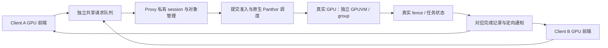

# Arm GPU 高效虚拟化共享与多 Client 任务安全隔离：设计与实现方案

日期：2026-10-28。本文基于当前代码、[当前基线](CURRENT_BASELINE.md)及已完成的论文研读，给出后续系统设计和实施路线。**未改运行代码，无新增性能测量。**“已有”表示能定位到当前实现，不表示本文新增完成了硬件验证；“拟实现”不作为当前安全保证。

项目分为两个部分：第一部分解决缺少原生虚拟化支持的 Arm GPU 如何实现直通、高效共享和合理调度；第二部分解决恶意 Client 如何被限制在自己的 GPU 任务与资源范围内。两部分共用上下文、映射、提交和完成路径，但分别评价功能与性能、安全边界。

## 1. 整体结构与设计边界

| 部分 | 方向 | 当前基础 | 后续重点 |
| --- | --- | --- | --- |
| 直通与高效共享 | 直通和共享功能实现 | 单 VM 直通、Proxy/Client 转发、多 Client GPUVM 和完成回传 | 统一资源模型，明确并发与退出语义 |
| 直通与高效共享 | 共享开销优化 | 长期共享池、提交计划、同步快照、通知和真实 fence 路径优化 | 分阶段计时、短任务优化、受控批处理与消融 |
| 直通与高效共享 | 共享调度策略 | Proxy 按 session 轮转，原生 Panthor 调度 | 按真实 Client 聚合配额，兼顾吞吐、尾延迟与公平性 |
| 任务安全隔离 | 访存隔离 | 独立 GPUVM、RMM 共享授权、页引用及撤销机制 | 最终物理页授权闭环，覆盖所有映射入口和复用竞态 |
| 任务安全隔离 | 事件通信安全 | RMM 持久事件、ACK/ARM、真实 fence 与精确 cookie | 补齐物理中断来源边界、任务终态及设备代次管理 |
| 任务安全隔离 | 驱动安全与权限隔离 | 完整 Proxy 驱动可信，已有私有对象与输入校验 | 独立可信管理器掌握关键权限，驱动加固与攻击验证 |

功能原型与目标安全架构分开评价。RK3588/OpenCCA 是实现与测试载体，不因其能力限制否定目标设计；以软件模拟的保护、可信配置前提和实际硬件强制执行的机制，应分别记录。

当前架构中，完整 Proxy 内核、Panthor 驱动及其依赖属于可信计算基。增强架构允许复杂驱动服务被攻破，但要求真实页表、设备控制和权威任务状态由另一个受保护执行域管理。将两个模块放在同一可任意写内存的内核中，不构成这一边界。

## 2. 第一部分：Arm GPU 直通与高效共享机制

### 2.1 直通和共享的功能实现

**目标。** 在不依赖原生 GPU 虚拟功能的前提下，先建立单 VM 可用的真实设备路径，再通过 Proxy/Client 架构让多个 VM 复用同一个 GPU。直通用于功能基础及对照，共享路径提供上下文和地址空间复用，而非让多个 VM 无约束地同时操作同一组物理寄存器。

**直通路径。** Host 管理设备绑定，VMM 描述设备并建立 MMIO/IRQ 路径，Guest 驱动完成初始化、内存映射和任务提交。普通 VM 路径包含 Host 的 GPA→HPA 转换与中断 eventfd/irqfd 转发；CCA 路径必须使用可信身份及授权路径，不能把普通 Host 翻译结果当成 Realm 物理页授权证明。

相关实现入口：

- [Host pmthor](../../Linux-Host-GPU/drivers/pmthor/)、[KVM hypercall](../../Linux-Host-GPU/arch/arm64/kvm/hypercalls.c)和[Firecracker GPU 集成](../../firecracker/Firecracker-CCA-MZH/src/vmm/src/gpu_passthrough.rs)。
- [Guest 页表实现](../../Linux-Guest-GPU/drivers/iommu/io-pgtable-arm.c)：特殊 Stage-1 路径中的地址转换、真实地址描述符和页表地址处理。
- [RMM GPU 接口](../../opencca/tf-rmm/runtime/rsi/opencca_gpu.c)：Realm 翻译、映射授权及 lease 生命周期。详细现状见[直通实现分析](../passthrough/GPU_PASSTHROUGH_IMPLEMENTATION_ANALYSIS.md)。

**共享路径。** Client 保留 DRM/Panthor 前端，通过共享队列发送受限请求；Proxy 建立私有 session、BO、GPUVM、group 和同步对象，并调用原生 Panthor。GPU 完成后，Proxy 根据真实 fence 发布对应完成记录，再通知原 Client。当前共享路径使用 RMM 授权的共享资源，不重新引入已退役的普通 VM/memfd broker 路径。

共享功能应统一以下对象关系：`Client → session → GPUVM/BO/group/syncobj → submission`。同一 Client 可有多个 session；不同 Client 的对象不得因句柄数值相同而混用。一个 GPUVM 内的多个 group 共用地址空间，不能把 group 当成天然内存隔离边界。

实施时保留现有原生驱动作为执行后端，在[Client 前端](../../Linux-Guest-GPU/drivers/gpu/drm/panthor-client/panthor_client_drv.c)、[Proxy 后端](../../Linux-Guest-GPU/drivers/gpu/drm/panthor-proxy/panthor_proxy_drv.c)及[通信协议](../../Linux-Guest-GPU/include/linux/vmshm_comm_protocol.h)间明确：对象创建/导入、映射、提交、等待、销毁的请求与错误语义。对提交结果不明的 RPC 不自动重发，避免响应丢失后重复执行同一任务。

**交付与验收。** 单 VM 直通、单/多 Client 图形与计算正确性、对象关闭与退出、并发创建和销毁均需覆盖；既检查应用结果，也检查对象引用、设备绑定和资源释放。功能可用不直接等于多 Client 安全。

### 2.2 共享开销上的性能优化

**目标。** 减少虚拟化引入的请求转发、数据交换、同步等待和通知开销，同时保留授权、真实完成判断和资源生命周期检查。

先把一次任务拆成：Client 编码及排队、跨 VM 请求、Proxy 校验及调度、原生提交、GPU 等待/执行、fence 发布、通知及 Client 唤醒。跨 VM 时间戳只有在计数器来源、频率和可比性验证后才能相减；否则分别测本地阶段和端到端耗时。排队时间不能统称为通信开销。

| 优化方向 | 实现方式 | 必须保留的条件 |
| --- | --- | --- |
| 数据交换 | 长期共享池、页/BO 引用复用，避免每次任务重复建立缓冲 | 保留 Client 归属、权限、撤销和清理；零复制不等于无授权 |
| 请求路径 | 预注册提交计划，动态参数私有复制；无竞争时直接执行准入路径 | 缓存命中仍检查代次、对象有效性和动态字段；不能绕过等待中的 Client |
| 批处理 | 合并小请求、有限批次消费和通知合并 | 批次有上限；不提前启动尚未授权的任务，不无限延迟短任务 |
| 同步路径 | 复用已验证同步快照，直接观察对应真实 fence | 仅对确切对象/同步点生效；错误、取消和不满足证明条件时走完整路径 |
| 通知路径 | 减少不必要线程切换和唤醒，适当提前观察真实完成 | IRQ 只是唤醒；保留原生 ACK、drain、unmask 和引用安全 |

当前基线已经包含多项上述机制，不应将它们重新包装为未实现的新方案。计划缓存、减少 RPC、降低 IRQ 数量或扩大 BO 容量，均应以最终应用测量判断收益，不能仅以计数器下降宣称提速。

现有证据：完整 720p 的保留优化链为 1158→1405，绝对增加 247 分、相对增加 21.33%；最后一项为 1311→1405，增加 94 分、7.17%。最后一项对照为单 Client、128MiB 池、CPU 1.8GHz、GPU 实际 594MHz、RR、telemetry/TRANSFER 开启及阶段计时关闭，两轮 1406/1404。整条链涉及多项变化，只归因组合效果。运行命令、退出码、run-id 和日志见[优化总览](GPU_PROXYCLIENT_OPTIMIZATION_DESIGN_GUIDE_20261025.md)与[真实 fence 优化报告](GPU_RAW_FENCE_COMPLETION_OPTIMIZATION_20261024.md)。

同代码的后续固定频率矩阵单 Client 为 1395；相对历史 1405 为 −10/−0.71%，新增外部采样且测试时段不同，不能解释为代码退化。完整原生/共享及多 Client 对照使用[固定频率报告](GPU_FIXED_FREQUENCY_GLMARK_20261025.md)，不混用不同频率或不同并发口径。

**实施顺序。** 先做低侵入阶段计时，找出主要占比；再对批量大小、计划复用、通知策略逐项消融；最后评估组合收益和额外 CPU/内存代价。现有 IRQ→cookie 独立测量、完整优化链 ML 消融和长稳/reset 压力仍不能视为已完成。

### 2.3 共享的合理调度策略

**目标。** 面向图形与计算、长短任务混合负载，提高利用率与总体吞吐，同时限制正常 Client 被大量请求或长任务拖慢的程度。默认不承诺硬实时。

当前 `panthor_proxy_submit_sched_pick_locked()` 每次从一个 session 取出一个请求，将仍有请求的 session 放回队尾；`panthor_proxy_submit_sched_run()` 在无竞争时省去工作队列交接。它实现的是 **session 级提交准入轮转**，不是按 Client 的 GPU 执行时间公平。原生[Panthor 调度器](../../Linux-Guest-GPU/drivers/gpu/drm/panthor/panthor_sched.c)还会决定 group/队列的实际运行，两个层次必须协同。

建议增量实现“**真实 Client 聚合配额 + 加权赤字轮转（DRR）+ 原生执行调度**”：

1. 从可信端点取得 Client 身份，汇总其全部 session/group，配置在途任务数、排队深度、BO 字节和控制请求速率上限。新增 session 不增加总份额，阻止多 session 抢占公平性。
2. Client 层按可信配置权重发放预算，内部再轮转 session/group。权重与优先级不能由 Client 任意提高；空闲份额可借用，有竞争时恢复约束。
3. 先按保守估计成本准入，再依据可信可观测的服务占用修正预算。提交次数只适用于近似等长任务；依赖等待不直接计为 GPU 消耗，多个上下文重叠运行时也不能把墙钟时间当作独占 GPU 周期。
4. 对批次、在途数量和连续准入设置上限，以兼顾短任务延迟；结合原生 group 优先级和队列限制，避免 Proxy 层公平后又在原生队列中无限堆积。
5. 比较 RR、加权 DRR 和加入等待时间补偿的 DRR，选择能由测量支持的最简策略。没有可靠抢占能力时，DRR 只能改善准入公平，不能给任意恶意长 kernel 提供有限完成延迟。

实现位置以 Proxy 现有调度入口为主，增加按 Client 聚合的运行队列、预算和计量；原生 Panthor 仅补充必要观测/控制，不重复构造一套完整 GPU 调度器。准入时固定任务、group 和预算的关联，完成/取消只结算一次，Client 退出后停止新增准入并清退待执行请求。

调度评价包含总体吞吐、每 Client 相对独占运行的 slowdown、p50/p95/p99 延迟、最长排队时间及 GPU/CPU 利用率。公平性可对归一化进展 `x_i = 共享吞吐_i / 独占吞吐_i` 计算 Jain 指数 `J=(Σx_i)²/(n·Σx_i²)`；不同权重时再按权重归一化。只对同一竞争窗口内可运行的 Client 比较，同时披露未就绪和依赖阻塞时间。

恶意请求洪泛、反复建 session 或诱发设备故障应被配额和可信准入限制。若任务拒绝结束且不能可靠抢占，应终止/隔离相关上下文；必须全局 reset 时允许其他任务失败，但不能错报成功、泄露数据或提前复用页面。不要求透明恢复和自动重放。

## 3. 第二部分：多 Client GPU 任务安全隔离

### 3.1 威胁模型与保护前提

攻击者可完全控制某个 Client 的应用、内核、原始请求、共享输入以及 GPU 命令，可伪造句柄、制造并发竞态、重放消息、洪泛提交和主动触发 GPU fault。Host/VMM 不作为 Client 身份或页授权的可信来源。

平台假设：RMM/Root 保护可信执行域；设备身份、真实 MMIO 与 DMA 路径可信确定；CPU 和设备均不能绕过保护修改真实页表、根配置和关键控制状态；GPU 固件可信加载。攻击者不能凭同一 PAS 身份取得其他 Realm 的页。封装外物理攻击和微架构侧信道不纳入本方案主要保证；不承诺恶意 Host 拒绝调度时仍可用。

需要区分两种模型：

- **M0：当前可信 Proxy。** 完整 Proxy 内核和 Panthor 正确执行授权及完成判断；加固用于减少其被攻破的概率。
- **M1：拟实现权限隔离。** 复杂驱动服务可以失陷；独立保护域中的 GPU 可信管理器、必要底层后端、固件与 RMM 仍可信。失陷服务不得扩大映射权限或伪造权威完成，但仍可能拒绝服务。

### 3.2 访存隔离：限制“能够访问什么”

**核心不变量。** Client A 的每个有效 GPU 映射必须同时满足：对象属于 A 或被显式授权给 A；最终 HPA 属于当前授权页集合；PTE 权限不超过授权；真实根关联 A 的 GPUVM；映射在执行期间保持有效。Proxy 能访问 A、B 两方共享池，不表示它可以替 A 将 B 的页装入 GPUVM。

GPU 采用硬件 Stage-1：在映射建立阶段，由可信管理路径依据 RMM 认证的原始 Client，完成 IPA→HPA 翻译、对象/实际页/权限/生命周期检查，生成直接指向合法 HPA 的 Stage-1 映射；执行期间由硬件 Stage-1 持续限制访问。软件翻译替代的是地址解析阶段，不替代运行期隔离。其他设备继续采用硬件 Stage-2，但同样执行可信授权。

实施重点：

1. **独立地址空间。** 不同 Client 使用独立 GPUVM/根和上下文归属；默认不允许隐式跨 Client BO 导入。将来若增加共享，需显式授权对象、权限和撤销语义。
2. **最终页校验。** 检查 BO、分段 extent、导入、别名、页池和故障补页等所有到达 PTE 的入口；验证页来源和当前授权，不只检查 GPUVA 范围或中间页地址数组。
3. **稳定授权。** 使用私有页列表和强引用/lease，禁止在“检查通过”与“安装映射”之间被替换；撤销和安装需有可说明的串行化点。批量失败必须回滚，不能发布半授权根。
4. **控制面保护。** 保护实际 PTE、根指针、GPU MMU/SMMU 配置、启动队列和关键 MMIO；阻断 Host CPU、其他设备 DMA 和不可信驱动的旁路修改。固件/内部 MCU 的高权限访问也必须纳入授权边界。
5. **撤销与复用。** 停止新提交，等待或终止旧访问，撤销映射并完成翻译失效，确认在途访问结束，释放引用，清理后再交给其他 Client。任务终态或一条完成通知都不能单独证明页面可回收。

当前代码入口是 Proxy 对象管理、[Panthor MMU](../../Linux-Guest-GPU/drivers/gpu/drm/panthor/panthor_mmu.c)、[GEM](../../Linux-Guest-GPU/drivers/gpu/drm/panthor/panthor_gem.c)、RMM `opencca_gpu.c` 及 xshm 内存服务。下一步应整理“页来源→授权→实际 PTE→撤销”的覆盖表，优先补齐检查遗漏与复用竞态，而非单纯再加一层页表。当前现状分析见[安全设计审查](GPU_SECURITY_DESIGN_REVIEW_20261026.md)。

### 3.3 事件通信安全：限制“谁能改变任务状态”

必须同时考虑 **GPU→Proxy 的物理中断**与 **Proxy→Client 的跨 Realm 通知**。RMM 保护后者，不自动证明前者的来源可信；普通 eventfd/irqfd 转发也不等价于安全中断直通。

当前基础包括：RMM 按实际调用方维护端点，保留 pending/acknowledged/armed 状态；接收方 drain 后 ACK/ARM 并重新检查队列，避免丢失唤醒。Proxy 从真实原生 fence 发布成功 cookie，Client 以 acquire 读取并与私有预期 cookie 精确相等比较；不是用“大于某序号”证明任意任务完成。Client 的 sync/proof epoch 用于本地同步缓存有效性，不能当作已实现的设备 reset epoch。

增强设计应建立以下可信链：

`物理事件及设备状态 → 对应上下文/job/fence → 权威任务终态 → 完成记录 → RMM 定向唤醒 → Client 核对`。

1. **物理中断来源。** 由可信接收路径拥有物理 IRQ 注册、关键路由及源状态读取/ACK 权限；若要防恶意 Host 伪造物理中断，还需保护相关 GIC/虚拟注入控制，并核对真实到达及设备状态。借鉴 Devlore，但不宣称当前已完整实现其机制。
2. **任务状态绑定。** 提交时记录可信 Client、session 代次、group/job 及 fence；完成只能由可信后端依据真实状态推进。设备错误、取消与成功分开，错误不能进入当前成功 cookie 快路径。
3. **代次与复用。** 拟增加设备代次，结合对象代次/唯一 cookie 拒绝 reset、close/reopen 后迟到的事件。槽位复用前撤除回调并等待正在执行的回调结束；cookie 耗尽应拒绝继续分配而非回绕复用。
4. **通知不作证明。** 重复、合并和乱序唤醒可幂等处理；一个物理 IRQ 可对应多个 job，也可能尚无任务完成。不因收到通知而直接成功、释放页或提升权限。
5. **发布与回收分离。** 正确处理设备/CPU 缓存一致性及 release/acquire 顺序。完成记录发布、输出对 CPU 可见、任务成功、DMA 静止和页面可复用分别满足各自条件。

实现以[xshm 端点事件](../../opencca/tf-rmm/runtime/core/xshm_endpoint.c)、IRQ 路径、Proxy `snapshot_publish()`/watch 生命周期和 Client `panthor_client_cookie_completed()` 为基础。增强模型中权威 fence/状态解析必须随可信管理器受到保护，不能信任失陷驱动主动上报的“已完成”。

安全目标是伪造/错投/重放不能造成错误完成或越权状态变更。恶意 Host 抑制真实 IRQ 或停止调度仍可导致服务停滞；应记录可用性边界，不能据此降低完成真实性要求。

### 3.4 驱动安全与权限隔离：限制“驱动失陷能做什么”

由独立可信 GPU 管理器控制真实映射、上下文归属、关键配置、启动与撤销权限；复杂驱动服务仅处理普通请求和资源组织。结合接口收缩、私有输入副本、边界与类型检查、对象生命周期管理及模糊测试，降低攻击面并限制失陷影响。

该方向的核心是重新分配权限，而非只增加检查：

| 职责 | 复杂驱动服务 | 独立可信管理器 |
| --- | --- | --- |
| 请求解析与计划 | 处理功能请求，形成候选操作 | 校验窄接口、身份、对象和状态 |
| 页与上下文 | 请求分配/映射，缓存非权威句柄 | 持有实际页授权、GPUVM 根、对象归属及代次 |
| 提交与调度 | 提议 group/任务/调度策略 | 强制配额，确认合法上下文与受控启动路径 |
| 完成 | 消费已发布状态，向应用返回 | 读取可信设备状态，关联真实 fence，发布权威终态 |
| 设备控制 | 无真实关键 MMIO 写权限 | 管理关键配置、失效、撤销与必要终止 |

建议管理器接口限制为 `context_create`、`map/unmap`、`submit`、`query_completion`、`revoke` 等语义操作；具体 ABI 后续确定。来源由 RMM/可信通道附带，参数只含受检句柄、范围和代次；不得接受任意物理地址、任意寄存器脚本或服务侧函数指针。`submit` 返回的是受理结果，不能冒充 GPU 已完成。

实施分三步：先枚举 Panthor 中能写 PTE、换根、控制固件队列、敲启动门铃和解释完成的入口；再把这些权限及其必要低层实现收敛到可信后端；最后把复杂服务放入另一个 Realm 或具有真实访问控制的执行域，移除其 CPU/DMA/MMIO 旁路。可信管理器不是一个只检查参数、随后调用不可信驱动任意回调的薄封装。

任意 GPU 命令流的安全仍依赖上下文 MMU、命令处理权限和可信固件。若某命令能改根或操作全局设备状态，就必须在受控接口禁止/验证，或通过固件与硬件权限保证其不可达。仅保护 SMMU 不足以自动区分同一设备内部的多个 Client；固件及内部 MCU 不能成为绕过受保护配置的路径。

加固覆盖 IOCTL/RPC 的长度、类型、计数溢出、嵌套数组、flags 和对象状态；消费前取私有副本，检查后使用同一副本。提交计划缓存不等于 GPU 命令内容已经静态验证；可变命令数据仍需其执行权限约束。生命周期采用强引用、明确关闭状态与锁顺序，防止异步回调、销毁和并发提交交错形成 UAF。

模糊测试作为验证手段，覆盖 Client IOCTL、绕过正常前端的原始跨 VM 请求、Proxy 管理器接口，以及创建→映射→提交→关闭的状态序列和并发交错。既用合法 GLES/Vulkan/计算调用到达深层路径，也直接变异原始请求，避免用户库过滤隐藏攻击面。

验收 M1 必须在模拟复杂服务被控制的条件下，主动尝试改 PTE、换 root、跨 Client 句柄提交、访问关键 MMIO及伪造完成。只有另一个保护域确实拒绝这些操作，才能宣称限制驱动失陷影响。TCB 统计包含管理器运行环境、底层后端、固件和依赖，不仅统计新增接口行数。

## 4. 与相关论文的关系及可形成的系统贡献

| 工作 | 可借鉴内容 | 本项目应推进的增量与边界 |
| --- | --- | --- |
| [PORTAL](gpu-security-papers/PORTAL_SP2025.md) | 可信服务 Realm、保护真实配置及设备 I/O 管理 | 从共享设备 owner 继续追踪原始 Client，形成多 Client 授权和提交闭环；服务 Realm 本身不是新贡献 |
| [ACAI](gpu-security-papers/ACAI_USENIX2024.md) | 身份、设备、映射归属一致性 | 扩展到共享 GPU 的上下文及页生命周期；不能直接沿用其设备独占模型的结论 |
| [CAGE](gpu-security-papers/CAGE_NDSS2024.md) | Arm CCA 下 GPU 保护与执行管理 | 围绕现有 GPUVM/group 实现保护，不为类比论文重复引入无必要的 shadow task |
| [PhantomMap](gpu-security-papers/PHANTOMMAP_NDSS2026.md) | 追踪中间元数据到实际物理页的攻击链 | 将最终页校验与 Client 授权、lease、撤销和快速复用联动；不推断 Panthor 已有同款漏洞 |
| [MOLE](gpu-security-papers/MOLE_CCS2025.md) | GPU 内部 MCU/固件可能破坏 TEE 假设 | 保护固件加载与内部控制权限；签名不等价于固件无漏洞 |
| [Devlore](GPU_DEVLORE_DEEP_REVIEW_20261027.md) | 可信设备中断与注入控制 | 连接物理 GPU 事件、真实任务状态和多 Realm 定向通知；当前 RMM 通知不是全链路完成证明 |
| [GEVisor](gpu-security-papers/GEVISOR_SOCC2023.md) | 可信 monitor、I/O 保护与异步调用 | 借鉴受保护参考监控器与状态不变量，明确实际隔离域和 TCB；不直接移植其平台假设 |
| [AvaGPU](gpu-security-papers/AVAGPU_CCS2023.md) | 调度、可信进度观测与恶意占用 | 为共享准入和最低进展提供思路；不假定任意 Client 命令有可信 WCET 或必经检查点 |
| [StepStone](gpu-security-papers/STEPSTONE_SP2026.md) | 通过用户态 GPU 库到达驱动深层路径 | 补充原始 IOCTL/RPC 和有状态并发测试；fuzzing 不作为权限隔离证明 |

值得重点验证的系统贡献候选有三个：**保留原生驱动兼容性的低开销共享路径；绑定真实 Client 的分层共享调度；贯通真实物理页、任务状态和设备权限的可信控制后端。** 最后一项将内存、事件和驱动失陷限制连接到实际执行控制，而非仅增加消息协议字段。是否达到论文创新要求，还需结合相近系统的功能、安全边界与实验比较判断。

## 5. 分阶段实现与验证计划

| 阶段 | 工作与交付物 | 进入下一阶段的条件 |
| --- | --- | --- |
| A：现状闭环 | 整理资源/权限所有者、全部 PTE/启动/完成入口、当前 M0 保证及未覆盖项 | 能从 Client 请求追踪到真实映射、提交、完成和回收，未验证项显式列出 |
| B：共享调度 | Client 聚合配额、分层准入、计量与背压，保留无竞争快路径 | 多 session 不增份额；混合负载下吞吐、延迟、公平性有可复核对照 |
| C：安全补齐 | 最终页授权覆盖、代次/终态、物理 IRQ 边界、并发撤销 | 负向测试不能导致错误成功、跨 Client 访问或旧映射复用 |
| D：权限分离 | 独立可信管理器及必要后端，复杂服务移出关键权限域 | 服务被控制后不能改真实配置、启动未授权上下文或伪造终态 |
| E：综合评估 | 性能消融、攻击注入、状态序列 fuzzing、TCB 与限制报告 | 结果包含失败与未测项，不用单一 glmark 分数代替安全验证 |

阶段 B 与 C 可分别推进；D 依赖 A/C 明确权威状态与实际控制入口。本文不要求新增透明故障恢复子系统，但恶意 Client 引发 fault、关闭或 reset 后仍须维持归属、终态和回收不变量。

建议的验证矩阵：

| 方向 | 必测场景 | 判断依据 |
| --- | --- | --- |
| 功能 | 单 VM 直通、1–4 Client 图形/计算、创建退出和并发销毁 | 正确输出、错误码、引用与资源状态 |
| 性能 | 同频原生/共享、短长任务、图形计算混合、批次消融 | 完整 glmark、吞吐/延迟/公平性和 CPU/内存代价 |
| 内存 | 他人句柄/页、伪造 extent、只读升写、导入别名、撤销竞态和快速重用 | GPU fault 或明确拒绝；受害者数据与控制页未变化 |
| 事件 | 假/重复/乱序/合并通知、旧 session/reset 事件、ACK/ARM 交错、错误 fence | 不错投、不错误 SUCCESS、不提前回收；可用性失败单独记录 |
| 驱动 | 畸形 IOCTL/RPC、合法深层序列、并发 UAF；失陷服务越权操作 | 内存检测报告及独立边界拒绝证据，二者分别评价 |
| 恶意占用 | 多 session 洪泛、长 kernel、反复 fault、关闭期间继续提交 | 配额生效，其他 Client 无数据/状态越权；不承诺无条件连续服务 |

现有测试入口可复用 [Realm xshm runner](../../scripts/run/run-realm-xshm.py)、[GPU 测试资料](../../GPU-SFTP/tests/realm-xshm/README.md)与[原生/直通对照脚本](../../scripts/run/run-host-vs-passthrough-gles-perf.sh)，具体参数按对应版本文档核对，不将此计划当成已执行命令。

后续硬件实验遵循[环境与测试手册](../start/AGENT_ENVIRONMENT_AND_TEST_RUNBOOK.md)和[产物管理](../start/DEVELOPMENT_AND_ARTIFACT_HYGIENE.md)，经 `scripts/maintenance/lab-run.py` 获取独占锁。性能优化先跑完整 720p，达到 1000 分门槛及正确性/健康要求后，再扩大到 API、计算和多 Client 回归。每项结果记录 run-id、命令、退出码、日志与条件差异；已有 Group submit fence 超时未解决记录不得被历史 PASS 覆盖。

## 6. 本次文档变更记录

改动目的｜将项目组织为两部分、六方向，给出代码落点、保护前提、实现路线及验证方法。

对照版本与分数 → 本版分数｜运行代码保持原状；历史优化基线 1405，本次未测。

分差及百分比｜不适用；没有新增性能归因。

测试条件差异｜仅文档整理，未部署、构建或操作硬件；**未改运行代码，无新增性能测量**。

run-id、命令、退出码与日志｜无硬件 run-id；本地链接与源码锚点检查见[静态核验记录](evidence/design-plan-20261028/static-audit.json)，仅证明文档引用可定位。

保留/撤回/待验证｜保留方案文档；调度增强、物理中断保护补齐、独立管理器及 M1 保证均待实现和验证。
