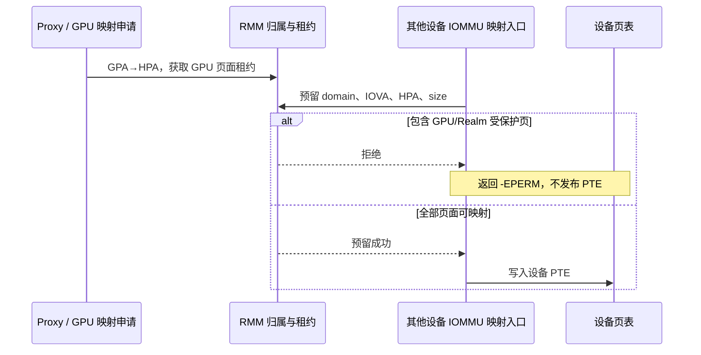

# IOMMU 映射防火墙：GPU 与其他设备的物理页互斥

**历史映射准入阶段：** 当前另已实现统一 RMI/RSI、RMM 真实设备页表/root/IOTLB 与 parking，见[开发验收](SECURE_SERVICES_VALIDATION_20261019.md)。本文的范围、直接 PTE/PL330 绕过和旧失败证据仍保留；新候选不据此宣称 hostile Host 硬件隔离完成。

日期：2026-10-18。本文按用户确认的范围描述当前实现：**其他使用 IOMMU 的设备建立映射时，
不得把 GPU 受保护的物理页映射进自己的地址空间**。无 IOMMU 的直接 DMA 暂不纳入本轮验收。

## 1. 比较物理页，不比较设备虚拟地址

GPU VA、NPU IOVA 和 Client GPA 可以不同，但最终可能指向同一张物理页。
因此防火墙检查目标 **HPA 区间**，即使其他设备换一个 IOVA、增加写权限或提交 SG 列表，
也不能绕过物理页冲突检查。



## 2. 已实现的规则与代码

| 操作 | 处理 | 代码 |
| --- | --- | --- |
| GPU 获取页面租约 | 记录 HPA、所属 Realm、引用；拒绝与已登记设备映射重叠的页；批量失败回滚 | [opencca_gpu_lease.c](../../opencca/tf-rmm/runtime/core/opencca_gpu_lease.c) |
| 设备建立 IOMMU 映射 | 写 PTE 前请求 RMM，逐页检查物理范围；拒绝 GPU 租约冲突和已委托 Realm 页 | [iommu.c](../../Linux-Host-GPU/drivers/iommu/iommu.c)、[Host 接口](../../Linux-Host-GPU/drivers/iommu/opencca-dma-guard.h)、[RMM 接口](../../opencca/tf-rmm/runtime/rsi/opencca_gpu.c) |
| 设备先映射，页面随后交给 Realm/GPU | 存在 DMA 预留时拒绝 delegate/GPU 租约申请，防止反向时序绕过 | [granule.c](../../opencca/tf-rmm/runtime/rmi/granule.c)、租约代码 |
| 设备解除映射 | 删 PTE、完成驱动 IOTLB 同步后释放预留；部分区间拆分或失败均保守处理 | IOMMU 核心与租约代码 |
| SG 中途遇到受保护页 | 失败并撤销前面已安装的段，回收预留，不留下部分成功映射 | `iommu_map_sg()` 与 `__iommu_map()` |

保护持续到页面归属可以安全释放。GPU 暂时 unmap 但仍属于 Realm 的 BO 也保持拒绝，
不会因为一次任务结束就允许其他设备读取尚未释放的数据。
RMM 使用同一 GPU/DMA 租约锁维护冲突记录；RMI 外层策略锁协调映射与页面委托。

开发配置为 `CONFIG_OPENCCA_DMA_GUARD=y`，RMM ABI 1。
最多 1024 个设备区间、每次 RMM MAP 至多 2 MiB；Host 对更大的范围分块并处理回滚。
当前准入只接受 RMM 已知的普通 DRAM，MMIO 映射不在该接口授权范围内。

## 3. NPU 等驱动如何经过该检查

当前 Host 的通用路径如下：

| 设备驱动入口 | 最终检查路径 |
| --- | --- |
| `dma_map_page()` 的 IOMMU 分支 | `__iommu_dma_map()` → `iommu_map()` → `__iommu_map()` → RMM 准入 |
| `dma_map_sg()` / `dma_map_sgtable()` 的 IOMMU 分支 | `iommu_dma_map_sg()` → `iommu_map_sg()` → 每个物理连续段的 `__iommu_map()` |
| DMA coherent 分配的 IOMMU 分支 | `iommu_map_sg()` 或 `__iommu_dma_map()`，经过同一检查 |

上述调用来自 [dma-iommu.c](../../Linux-Host-GPU/drivers/iommu/dma-iommu.c) 与 IOMMU 核心。
板端启用的 Hantro codec 通过 `vb2_dma_contig_memops` 使用这些入口。

**当前内核和运行设备树没有启用 NPU 驱动或 NPU platform 设备**，因此本轮使用
`fdb50000.video-codec` 的真实 Rockchip IOMMU 创建独立、未挂接设备的测试 domain。
不改该设备正在使用的 domain，不启动编解码任务。
对于之后接入的 NPU，需要核对其驱动走上述入口，并使用同一探针选择实际设备再次验收；
本轮不声称已运行 NPU 推理或 NPU DMA。

## 4. 测试入口与当前结果

[板端探针](../../GPU-SFTP/tests/dma-guard/opencca_dma_probe.c) 的默认模式只测试映射准入。
[runner](../../scripts/run/run-dma-guard.py) 按该范围判定成功并返回 0；
直接驱动页表绕过诊断须显式加 `--audit-bypass`，历史 PL330 诊断仍由 `--transfer` 显式选择。
这些扩展诊断结果单独记录，不改变本轮 IOMMU 映射入口的判定。

```bash
python3 scripts/maintenance/lab-run.py --run-id <唯一ID> -- \
  python3 scripts/run/run-dma-guard.py \
  --module build/dma-guard-20261018/mapping-module/opencca_dma_probe.ko \
  --device fdb50000.video-codec
```

加 `--images build/safe-optimization-20261018/final`，对 **GPU 负载期间一次采样的租约页**
增加读映射、写映射、IOVA 别名、大范围覆盖与 SG 拒绝检查。
探针不固定该 GPU 租约，后续检查时 GPU 映射可能已经解除；只要页面仍属于 Realm，
RMM 的页面归属策略仍会阻断其他设备映射。因此这些检查不能证明同一 GPU 映射在测试全程持续存在。
探针只尝试映射，不读取 GPU 页面内容。

普通页正例及 SG 正例必须成功，防止“全部拒绝”冒充隔离；拒绝必须返回 `-EPERM`，
对应 IOVA 必须没有 PTE。SG 列表使用重复普通物理页强制拆段，确保拒绝之前至少有一段
已经成功安装，随后检查所有段为空及 RMM 计数恢复，实际覆盖失败回滚。

| run-id | 检查 | 结果 | 外层退出码 |
| --- | --- | --- | --- |
| `iommu-map-admission-20261018` | 普通页/SG 正例、委托前后互斥、读写/别名/覆盖区间拒绝、失败回滚 | 15/15 PASS | 0 |
| `iommu-map-live-gpu-20261018` | 重复上述检查，增加 GPU 负载期间采样页面的 6 项检查 | 21/21 PASS | 0 |

两轮模块均成功卸载，DMA 预留计数恢复，无新增 Host 内核错误。第二轮完整 720p
**33 场景，1169 分**；validation 为 26 成功、1 已知数值例外、6 无判据，
无意外失败。两个 Realm 退出码均为 0，无 CSG 超时、FW ping 超时、GPU 翻译故障、
内核 warning 或 oops，CPU 在线状态与 GPU 频率恢复。

逐轮命令、退出码、检查列表、输入及日志 SHA 见
[本轮验收记录](evidence/dma-guard-20261018/iommu-mapping-validation.json)，
运行源码指纹见 [源码 SHA](evidence/dma-guard-20261018/source-hashes-mapping.json)。
原始日志保存在 `build/lab-runs/<run-id>/`；GPU 板端日志已逐文件校验并归档至
`build/dma-guard-20261018/board-runs/iommu-map-live-gpu-20261018.tar.gz`。

仅清除两份确认未使用的板端上传模块，释放 190,320 字节；回退材料与日志保留。
最终 RK 无实验进程、无 loop 设备，内存可用约 3.03 GiB、根分区可用约 13.89 GiB。
Pi 本轮未改动。见 [归档与资源恢复](evidence/dma-guard-20261018/iommu-mapping-hygiene.json)。

## 5. 验收边界与性能记录

本轮保证的是经过已接入 Linux DMA/IOMMU 映射接口的申请受到 RMM 检查。
它依赖这些入口被正常使用；恶意内核直接改 PTE/MMIO 的硬件配置保护仍属于另一层能力，
已有失败证据保留于 [先前扩展诊断报告](GPU_DMA_GUARD_IMPLEMENTATION_20261018.md)。
无 IOMMU 的直接 DMA 已由用户明确暂不考虑，不再作为本轮开发阻塞。

探针失败时应先核对残留 PTE、页面委托和 RMM 预留，再决定恢复；异常 unmap 的自动清理
不保证覆盖所有测试窗口。不得在资源状态不明时直接重跑。本轮两次正常完成均验证了预留恢复。

统一记录：补齐 IOMMU 映射验收｜原候选独立完整 720p 1169 → 本轮 1169｜
**0 分 / 0.00%**｜Host/RMM/Guest 运行实现未改，仅修改可卸载探针、runner 和文档；
本轮增加并行探针，GPU 请求 600 MHz/实际 594 MHz，单 Client、256 MiB，CPU 非恒定频率｜
上述 run-id、命令、退出码和 `build/lab-runs/<ID>/` 日志｜保留准入实现，按本轮范围验收。
该结果表明本轮兼容性检查通过；包含探针的 GPU 运行不能用于单独估算 hook 开销，
也不据此宣称性能优化。未执行其他负载或新一轮完整多项回归。
