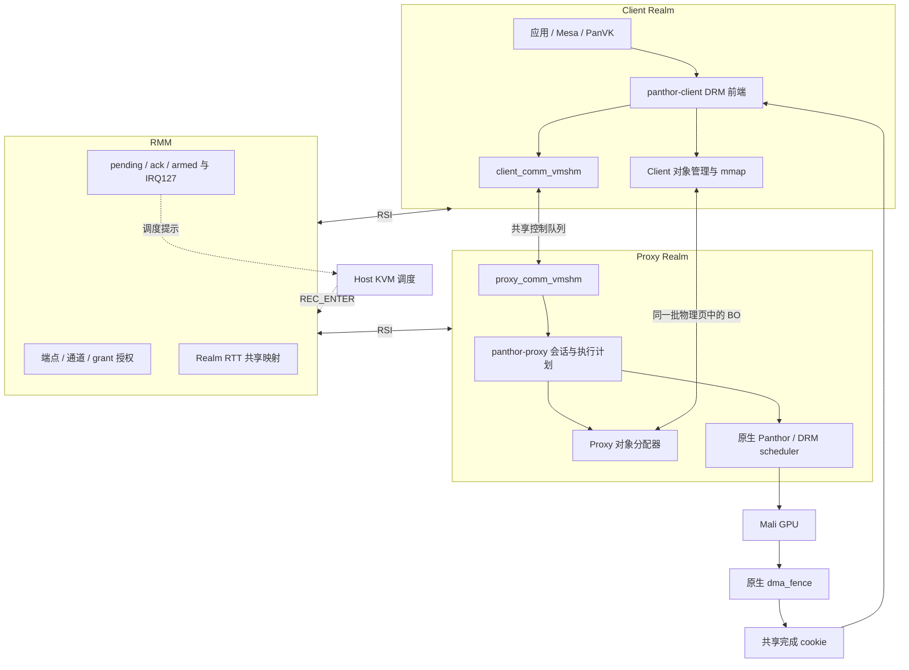
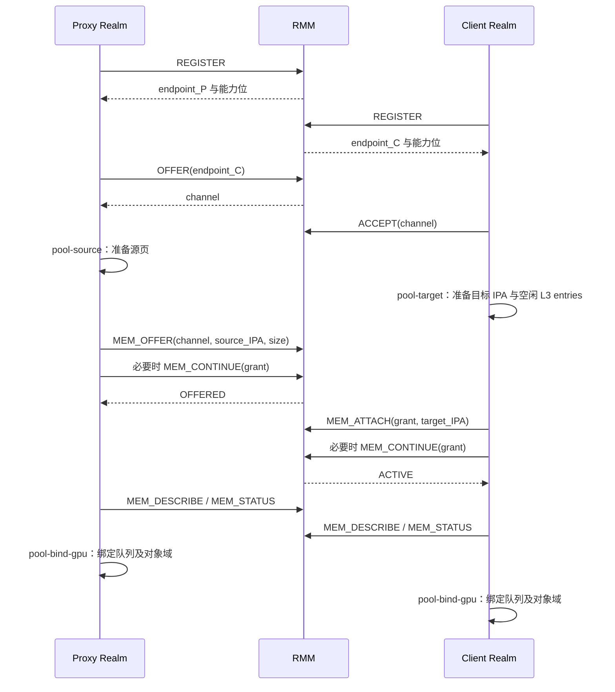
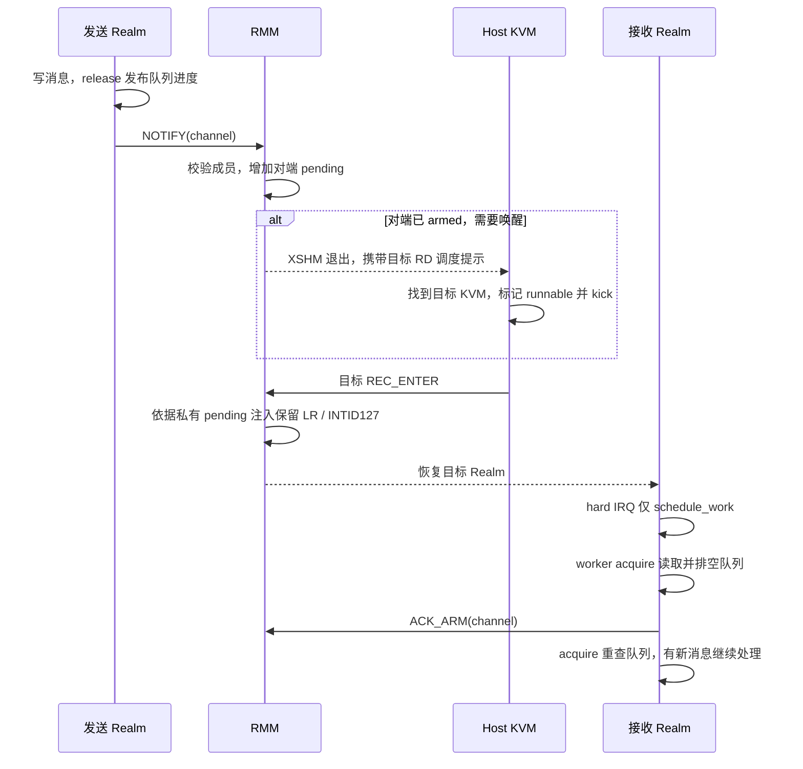
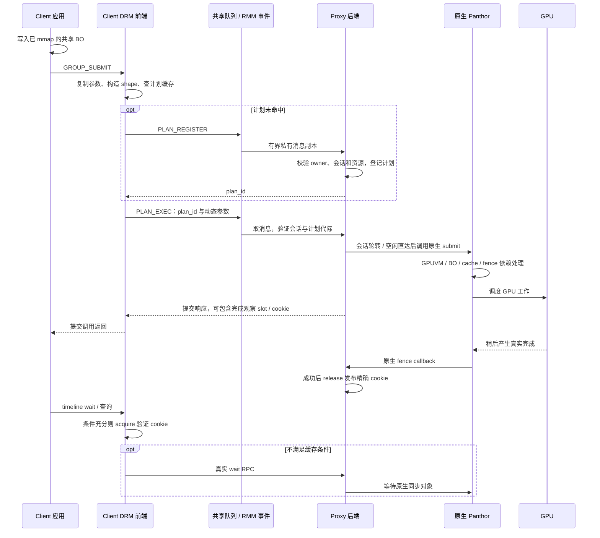

# 多 Realm 通信与代理 GPU 执行：当前实现的代码与原理

日期：2026-10-18。范围：当前工作树的 **RMM-only 通信、P42 执行计划和 BO 容量修复**，包含 memfd 退役后的路径。版本、冻结镜像和设备条件见[当前基线](CURRENT_BASELINE.md)。本文是代码讲解，不是待实施方案；代码片段注明“摘录”或“伪代码”。

**未改运行代码，无新增性能测量。** 当前清理后完整 720p glmark 为 **1157**；清理前组合为 1161，差值 −4 / −0.34%，仅为既有单次测量差异，不能归因于本文或宣称稳定回退。Native 参考 1437。输入、命令、退出码与日志索引见[退役验收记录](MEMFD_RETIREMENT_20261018.md)。

本文回答两个问题：

1. Proxy Realm 与多个 Client Realm 如何建立真实共享映射，并通过 RMM 管理的事件与虚拟中断通信？
2. Client 的 DRM 请求如何变成 Proxy 的原生 Panthor 操作，最终在 GPU 上执行，并把真实完成状态传回 Client？

## 1. 先建立整体模型

当前设计把控制和数据分开：**RMM 授权长期共享内存并维护可信通知；Client/Proxy 用有界队列传控制消息；GPU BO 的内容留在共享池；Proxy 把经过会话校验的请求交给原生 Panthor。**



### 1.1 组件分别承担什么

| 组件 | 承担的职责 | 不应误解成的能力 |
| --- | --- | --- |
| Client DRM 前端 | 保留应用看到的 DRM 接口；复制用户参数；管理本地句柄、计划和完成缓存 | 应用不能借此直接操纵 Proxy 内核指针 |
| Proxy 后端与原生 Panthor | 分配实际资源、建立 GPUVM、校验会话引用、提交任务、观察真实 fence | 仍是需要信任的服务和驱动栈 |
| RMM | 从运行上下文认证 Realm；授权映射；维护通知状态；控制可信 IRQ 注入 | 不解析 GPU 指令，不判断 shader 是否安全 |
| Host KVM / VMM | 创建和调度 Realm，转送 RMM 的唤醒提示 | 唤醒提示不授予共享权限，也不代表任务完成 |
| 共享内存 | 两端都能读写的通信介质和 BO 载体 | 数据天然可信、不可篡改或已经具备消息事务性 |

Proxy 内核能访问各 Client 授权给它的池，因此它属于这些 Client 的共同可信计算基。当前实现没有把 Proxy 变成一个可以任意恶意而仍保持所有 Client 机密性的组件。

### 1.2 不混淆五种身份与地址

| 名称 | 当前代码中的含义 |
| --- | --- |
| Realm endpoint | RMM 分配的 Realm 实例标识，绑定实际 RD，而非请求自己声明的身份 |
| channel | 两个 endpoint 之间的 RMM 通道 |
| grant | 在指定 channel 上，将源 Realm 的一段内存映射给指定对端的授权记录 |
| session | 一个 Client DRM 文件对应的 Proxy 资源命名空间；每个会话有自己的 BO、VM、group、syncobj 表 |
| GPUVM / group | 原生 Panthor 的 GPU 地址空间 / 调度对象；不是 Realm，也不是独立 SMMU StreamID |

部分代码沿用 `client_vmid` / `owner_vmid` 字段名；在当前通信绑定中，它们携带的是 **RMM 认证的借用方 endpoint ID**，不能理解为硬件 SMMU VMID。

CPU 访存的地址链是 `CPU VA → Guest stage-1 → Realm IPA → RMM RTT → PA`。GPU 地址链由 Panthor GPU 页表管理。**CPU 侧共享 RTT 的建立，不会自动产生 GPU 侧的 SMMU stage-2 保护。**

## 2. 主线一：如何建立多 Realm 通信

### 2.1 入口与分层调用链

管理工具经 `/dev/realm-xshm` 进入 Guest 驱动；实际身份和权限判断放在 RMM：

```text
realm-xshm 管理工具（Guest CAP_SYS_ADMIN）
  → realm_xshm.c 的 ioctl / xshm_call
  → RSI 扩展调用
  → handle_rsi_opencca_xshm(rec, ...)
  → xshm_service_call(actual RD, command, ...)
      ├─ xshm_endpoint：身份、通道、持久事件
      ├─ xshm_memory：共享授权状态机
      └─ xshm_rtt：实际读取 / 安装 / 撤销 Realm RTT entries
```

源码入口：[Guest realm_xshm.c](../../Linux-Guest-GPU/drivers/char/realm_xshm.c)、[RMM RSI 入口](../../opencca/tf-rmm/runtime/rsi/xshm.c)、[service 分派](../../opencca/tf-rmm/runtime/core/xshm_service.c)。

管理工具权限只约束 Realm 内的普通进程；抵抗其他 Realm 冒充身份，依靠 RMM 根据 `rec->realm_info.g_rd` 识别调用者。不能因为工具需要 root，就省略 RMM 的成员与所有权检查。

### 2.2 端点、通道和共享池的创建时序

以 Proxy 提供池、Client 借用池为例。下面是 API 时序示意，`continue` 的具体次数取决于大小，不是可以直接逐行复制的 shell 脚本。



[RMM 端点实现](../../opencca/tf-rmm/runtime/core/xshm_endpoint.c)将 endpoint 与 RD 绑定；ID 单调分配，不能依靠猜到 ID 获得权限。`OFFER` 指定另一个已注册端点；只有指定接受方可以 `ACCEPT`，通道生效后，后续操作继续校验调用者是成员。

**身份认证不等于远程证明。** 现有 runner 可以协调启动并传递 ID，但没有实现“通过度量和远程证明确认该 endpoint 的代码就是预期 Proxy”的完整协议。恶意 Host 拒绝启动或向管理流程提供错误对象，仍需部署策略和证明机制处理。

多 Client 采用“Proxy 分别与每个 Client 建通道、建独立池”的结构。Client0 不需要也不会因为 Proxy 与 Client1 建了通道，就自动获得 Client1 的映射。当前双 Client 编排可从 [run-realms.py](../../GPU-SFTP/tests/realm-xshm/run-realms.py) 的 `pool-source`、`mem-offer`、`mem-attach`、`pool-bind-gpu` 调用处阅读。

### 2.3 共享的本质：两个 RTT 指向同一批 PA

假设源池从 Proxy 的 `IPA_P` 开始，目标窗口从 Client 的 `IPA_C` 开始。第 i 页成功 attach 后：

```text
RTT_Proxy (IPA_P + i × 4096) ──┐
                              ├──→ 同一个 PA_i
RTT_Client(IPA_C + i × 4096) ──┘
```

因此，Client 写入 BO，Proxy 和 GPU 可以使用同一份物理数据；这里没有每次把整个 BO 序列化进 RPC 的步骤。两个 Realm 的 IPA 可以不同，协议中的对象偏移也不是任何一端的内核指针。

[RMM RTT 后端](../../opencca/tf-rmm/runtime/core/xshm_rtt.c)执行以下检查：

| 阶段 | 核心检查与动作 |
| --- | --- |
| 读取源页 | IPA 属于调用方受保护范围；源 RTT 为 assigned RAM；PA 对应 DATA granule；不接受请求直接指定任意 PA |
| 检查目标 | 目标为受保护范围内的未分配 RAM 叶子条目，要求 L3；拒绝覆盖现有映射 |
| 安装映射 | 从仍受保护的源 RTT 重新取得 PA，创建目标 assigned RAM entry，维护页表引用并执行要求的 TLBI |
| 撤销映射 | 确认目标仍是预期 PA，再改为 unassigned RAM；维护引用和 TLBI |

`pool-target` 会准备相应层级与 RIPAS 状态。其准备过程中的临时 shared/protected 转换，不代表最终池采用普通 Host 可见的 Normal-world memfd 路径。最终数据共享由上述 RTT 关系建立。

这里没有实现 PORTAL 的 P-GPT / N-GPT 切换；`xshm_rtt` 明确不修改 GPT/PAS。RK3588/OpenCCA 的实际 GPT/GPC 仍存在模拟边界，不能根据“RMM 授权共享”就宣称已经具备真实 CCA 硬件对恶意 Host 的完整保密性。

### 2.4 为什么需要分段状态机

512 MiB 以 4 KiB 页计共有 131072 页。如果一次 RSI 完成所有检查、安装和失效，会让一次 Monitor/RMM 路径占用过长。当前每次最多推进 **64 个状态机工作步**，由同一 actor 调用 `MEM_CONTINUE` 继续。

常量和状态定义见 [xshm_memory.h](../../opencca/tf-rmm/runtime/include/xshm_memory.h)，实际转换见 [xshm_memory.c](../../opencca/tf-rmm/runtime/core/xshm_memory.c) 的 `advance`。

| 状态 | 数值 | 含义 |
| --- | --- | --- |
| FREE | 0 | 无授权记录 |
| OFFERING | 1 | 分段检查源页 |
| OFFERED | 2 | 源授权准备好，尚未完成目标挂接 |
| PREPARING | 3 | 先检查整个目标范围可安装 |
| INSTALLING | 4 | 逐页安装目标 RTT |
| ACTIVE | 5 | 全部映射安装完成，可以绑定上层传输 |
| UNMAPPING | 6 | 逆序撤销已安装条目 |
| QUARANTINED | 7 | 撤销遇到异常，保留保护状态，拒绝当作普通空闲资源释放 |

正常路径为 `FREE → OFFERING → OFFERED → PREPARING → INSTALLING → ACTIVE`。借用方 detach 完成回到 OFFERED；提供方 revoke 完成清除授权。失败的部分安装要先走 UNMAPPING；撤销发现页表不符合预期时进入 QUARANTINED，保留相关保护，避免错误回收。

要区分两种“3”：**接口返回状态 3** 可表示分段未完成；**grant 状态 3** 是 PREPARING。前者必须结合操作类型、有效 grant 和进度判断；容量耗尽也使用相同返回码语义，不能无条件循环 CONTINUE。

源映射在授权存续期间由策略层保护。Host 的 DATA 销毁、RTT 销毁/折叠、RIPAS 修改、Realm 销毁等可能改变相关翻译的操作，经 [xshm_policy.c](../../opencca/tf-rmm/runtime/core/xshm_policy.c) 检查并和共享操作使用一致的锁域。这里依赖源 RTT 保持权威，不另外存一份可能过期的全量 PA 数组。

**ACTIVE 是上层使用条件，不是整个区间硬件原子生效。** INSTALLING 阶段已经逐步写入目标 PTE，不能宣称恶意目标 Realm 在 ACTIVE 前绝对读不到已安装的前缀页。当前可信 Guest 绑定代码在 ACTIVE 后才启用队列；如果未来需要“所有页同时对恶意借用方可见”的更强语义，需要另行设计提交门控。

### 2.5 从授权映射变成队列和对象域

[realm_xshm.c](../../Linux-Guest-GPU/drivers/char/realm_xshm.c) 的 `realm_xshm_bind` 不接受 Host 直接伪造一段共享窗口来绑定驱动，而是重新询问 RMM：

```text
MEM_DESCRIBE(grant)
  → channel、provider endpoint、borrower endpoint、调用方本地 IPA
MEM_STATUS(grant)
  → 必须 ACTIVE，页数匹配
REGISTER / 本地 pool 信息
  → 本 Realm 身份、角色、本地 IPA 和分配范围匹配
  → 构造内核 platform_data
  → 注册 proxy_comm_vmshm / client_comm_vmshm 平台设备
  → 建立 payload 对象域
```

当前一个池分成两部分：

| 区域 | 大小/属性 | 用途 |
| --- | --- | --- |
| 控制区 | 前 1 MiB，WB | 队列头、描述符、avail/used、消息槽等 |
| payload 区 | 剩余范围，当前默认 WC | GPU BO、相关共享对象及完成记录等 |

`realm_xshm_prepare_payload` 在建立 WC payload 映射前，对旧 WB 映射做必要缓存处理，并去掉 WB 线性别名，避免同一 PA 被 WB/WC 不一致地并发使用。控制队列保留 WB，减少频繁 CPU 控制访问的成本。不能把 WC 理解为不需要任何 GPU DMA 所有权交接。

### 2.6 队列怎么传消息

共享 ABI 在 [vmshm_comm_protocol.h](../../Linux-Guest-GPU/include/linux/vmshm_comm_protocol.h)：每条通道有两个方向的队列；每队列 256 个槽，每消息槽 512 字节。消息 payload 的偏移为 36 字节，因此 GPU RPC 负载上限是 **476 字节**；不能用结构体尾部对齐后的 `sizeof` 代替这个 wire offset。

两端当前都是 AArch64 little-endian。它是受静态断言约束的本地共享 ABI，尚不是通用跨端序序列化格式。

发送和接收代码分别位于 [Client 通信实现](../../Linux-Guest-GPU/drivers/char/client_vmshm_comm/client_comm_vmshm.c) 与 [Proxy 通信实现](../../Linux-Guest-GPU/drivers/char/proxy_vmshm_comm/proxy_comm_vmshm.c) 的 `queue_send` / `queue_recv`。

发送逻辑可概括为以下**伪代码**：

```c
lock(local_tx_lock);
peer_used = load_acquire(shared_used_idx);
if (local_avail - peer_used >= queue_size)
    return -EAGAIN;                 // 有界背压，不覆盖未消费槽
slot = local_avail & private_mask;
copy_message_to_fixed_slot(slot, private_request);
write_descriptor_for_fixed_slot(slot);
write_barrier();
write_avail_entry(slot);
store_release(shared_avail_idx, ++local_avail);
unlock(local_tx_lock);
notify_peer_if_needed();
```

接收方不信任共享描述符。它保留自己的队列几何与本端进度，检查对端发布距离不超过队列容量；把描述符和整个固定消息槽复制到私有内存，再校验偏移、容量、消息长度、类型等，最后才交给业务 handler。消费完成后发布 used 进度。

这处理的是“恶意长度/偏移诱导越界”和“校验后再从共享描述符读取”的风险。**私有副本不使共享消息天然不可篡改**：对端仍可能在复制期间改写数据，得到混合快照；必须保证所有解析和边界校验仅依据已经复制的私有内容，业务引用仍要独立验证。当前没有为每条消息添加密码学认证或通用事务快照协议。

### 2.7 RMM 如何实现可信通知

通知不是 Realm 直接改写另一 Realm 的 GIC，也不是恢复旧 irqfd 通道。实际过程是：



[RMM endpoint](../../opencca/tf-rmm/runtime/core/xshm_endpoint.c) 为每个方向维护 `pending`、`acknowledged`、`armed`；`NOTIFY` 增加对端的持久事件计数，必要时设置 endpoint 的 IRQ pending。多个通知可以合并成一次 IRQ，不能要求一次消息必须对应一次中断。

可信 IRQ 的几个关键点：

| 位置 | 实际行为 |
| --- | --- |
| [RSI 入口](../../opencca/tf-rmm/runtime/rsi/xshm.c) | 使用实际 RD 验证发送者；只对认证通道的对端生成唤醒提示 |
| [Host rme-exit.c](../../Linux-Host-GPU/arch/arm64/kvm/rme-exit.c) / [rme.c](../../Linux-Host-GPU/arch/arm64/kvm/rme.c) | 处理 XSHM 退出，通过目标 RD 查找 Realm 并 kick vCPU；只是调度协作 |
| [RMM run.c](../../opencca/tf-rmm/runtime/rmi/run.c) | REC0 进入前，读取 RMM 私有的 IRQ pending，再注入可信 LR |
| [xshm_irq.c](../../opencca/tf-rmm/runtime/core/xshm_irq.c) | 拒绝 Host 传入非零保留 LR，或在其他活动 LR 中伪造 INTID127；注入使用 RMM 保留的最后一个 LR |
| [GIC 保存恢复](../../opencca/tf-rmm/lib/gic/src/gic.c) | Host 可见的 LR 拷贝不包含保留 LR；保留状态由 RMM 跨退出保存，不接受 Host 覆盖 |
| [Guest IRQ 驱动](../../Linux-Guest-GPU/drivers/char/realm_xshm.c) | IRQ handler 只分派已注册回调、调度 worker，不在硬中断中解析 RPC 或执行可睡眠调用 |

因此，Host 不能仅凭构造一个 INTID127 就制造合法 RMM 事件；不过 Host 仍可以不调度目标 Realm，延迟或阻断进展。持久 pending 处理的是事件状态丢失，不是对恶意调度者的可用性保证。

当前约束是 **每 Realm 一个已验收的 vCPU、REC0 绑定、INTID127**，不能直接外推为任意多核 Realm 的完整路由设计。

### 2.8 为什么排空后还要 ACK_ARM 和重查

如果接收方只“排空后睡眠”，发送方可能恰好在“判断空”和“开始睡”之间发布消息，发生丢唤醒。当前 `ACK_ARM` 把“确认当前 pending”和“准备接收下一次唤醒”放在 RMM 同一临界区中；之后还必须重新读取队列。

以下是 worker 的**伪代码**：

```c
for (;;) {
    drain_all_published_messages();
    rmm_ack_arm(channel);
    if (!queue_has_available_acquire())
        break;
}
```

三种交错都要考虑：

| 消息发布时机 | 如何保证继续处理 |
| --- | --- |
| ACK_ARM 之前 | 即使事件被一并确认，之后的 acquire 重查能看见队列数据 |
| ACK_ARM 之后 | 新 NOTIFY 看到 armed，产生新的可信 pending / 唤醒 |
| 重查之后、worker 返回前 | 后续 IRQ 调度接收工作；队列内容持续存在 |

通知和数据发布必须保持顺序。IRQ 数量、pending 计数、队列消费进度是三套不同状态；任何一套都不能替代另外两套。

### 2.9 短轮询与 RPC 匹配

Client 发起 RPC 时先创建 waiter、生成 seq 并挂入私有等待链表，再发布请求，避免快速响应到达时还没有等待者。响应必须按 `reply_to` 和预期响应类型匹配；返回数据必须装进调用者声明的容量。

`client_comm_vmshm_call` 先尝试有预算的短轮询；轮询所有者通过 `USED_NO_NOTIFY` 提示 Proxy 暂缓不必要的响应中断，预算上限受代码约束为 1000 μs。该标志只是性能提示，不提供授权，也不能代替睡眠路径的可信通知。

退出轮询、准备睡眠时，仍执行 ACK_ARM 和 acquire 重查；未拿到轮询所有权的并发调用也不能跳过这一步。超时只能说明“没有及时观察到响应”，不证明对端从未执行请求。

### 2.10 解绑和撤销为什么必须按生命周期走

共享映射撤销后，如果原生 GEM、GPUVM 或在途任务仍使用这些页，就可能产生 use-after-free 或 DMA 访问错误。Guest 的 `pool-unbind` 先 quiesce，检查通信 fd、session、对象引用与 pin 等是否允许排空；不满足时返回忙并保持受控状态，而不是先拆 RTT 再祈求任务结束。

解绑后才能继续安排 detach/revoke。当前 `/dev/client_comm_vmshm`、`/dev/proxy_comm_vmshm` 的保留用途是引用生命周期检查；它们不是继续开放的任意原始 RPC 读写通道。

## 3. 主线二：GPU 请求如何转发与执行

### 3.1 应用接口没变，但热路径不再等于逐次搬运 GROUP_SUBMIT

应用仍通过 Client 的 DRM 节点使用 BO、VM、group、syncobj 等接口。前端在内核中解码 ioctl，复制用户数组和嵌套同步参数，转换成有界协议。

- BO 创建、VM 创建与绑定、group 和 syncobj 生命周期等仍有类型化 RPC。
- 高频 GROUP_SUBMIT 被拆成 `PLAN_REGISTER` 和 `PLAN_EXEC`。
- GPU 指令流与数据保留在共享 BO，执行消息只携带地址、长度、flush 信息和 timeline 值等动态参数。
- RMM 不参与每条 GPU 指令解释，也不替代原生驱动的资源与同步处理。

主要协议见 [panthor_vmshm.h](../../Linux-Guest-GPU/include/linux/panthor_vmshm.h)，ABI 版本当前为 2。OPEN_SESSION 还协商功能位，不能把“ABI 相同”理解为所有可选完成优化均可使用。

### 3.2 会话：把一个 DRM 文件变成受控资源命名空间

[Client 前端](../../Linux-Guest-GPU/drivers/gpu/drm/panthor-client/panthor_client_drv.c) 的会话建立通过 `panthor_client_rpc_open_session`；[Proxy 后端](../../Linux-Guest-GPU/drivers/gpu/drm/panthor-proxy/panthor_proxy_drv.c) 为其创建原生 `panthor_vmshm_session`，保存实际 channel，并创建各类私有 xarray。

```text
Client DRM file
  └─ session_id
       ├─ 本会话 VM 表：Client VM handle → Proxy 原生 VM handle
       ├─ 本会话 BO 表：Client BO handle → 原生 GEM + payload 对象
       ├─ 本会话 group 表
       ├─ 本会话 syncobj / heap 表
       └─ 8 个可复用执行计划槽
```

每次请求都需要同时通过两个关口：

1. channel 上的 requester endpoint 必须匹配 session 的 owner；
2. 请求引用的资源必须在该 session 对应的私有表中找到。

下面是 `panthor_proxy_session_lookup` 的关键**源码摘录**：

```c
session = panthor_proxy_session_find_locked(session_id);
if (session && session->owner_vmid != requester_vmid) {
    /* 记录拒绝，并使查询失败。 */
    session = NULL;
}
if (session && session->closing)
    session = NULL;
```

handler 的 `requester_vmid` 来自 `proxy_comm_vmshm_channel_client_vmid(channel)`，channel 又来自 RMM 验证后的绑定与本地接收路径。它不是请求 payload 中允许 Client 随意填写的 owner。

例如 Client0 猜出 Client1 的 session_id，仍会被 owner 检查拒绝；在自己的 session 中填入另一个会话的 BO handle，也不能绕过本会话的资源查表。这里的保障依赖可信 Proxy 正确执行校验。

### 3.3 BO 创建：控制走 RPC，实际数据使用共享页

一次 BO 创建和 mmap 的调用链：

```text
Client DRM_IOCTL_PANTHOR_BO_CREATE
  → panthor_client_bo_create
  → BO_CREATE RPC
  → panthor_proxy_session_bo_create
  → proxy_vmshm_alloc_ext(owner = channel 的 Client endpoint)
  → panthor_vmshm_bo_create_from_payload
  → 原生 GEM 引用并 pin 这份 payload backing
  → 返回会话内 BO handle、payload handle、offset、size
  → Client 对象管理器校验身份、权限、描述符范围
  → panthor_client_mmap 将本地池 IPA 对应页映射到应用
```

对象分配器见 [proxy_vmshm_manager.c](../../Linux-Guest-GPU/drivers/char/proxy_vmshm_manager/proxy_vmshm_manager.c)，Client 对象查询见 [client_vmshm_manager.c](../../Linux-Guest-GPU/drivers/char/client_vmshm_manager/client_vmshm_manager.c)，原生 GEM 接入见 [panthor_gem.c](../../Linux-Guest-GPU/drivers/gpu/drm/panthor/panthor_gem.c)。

GPU 连续 BO 使用按页计的 extent 分配，避免普通 buddy 的幂次向上取整导致大对象白白消耗池容量。这里只是管理预先共享好的池空间，不是每创建一个 BO 都重新建立一遍整个 Realm 共享映射。

Client mmap 还检查 `BO_NO_MMAP`、BO 内偏移、申请长度和 payload 分配范围。默认为 WC；指针指向 Client 的本地 IPA 映射，不接受 Proxy 返回一个内核 VA 就直接解引用。

同一 Client 的多个 DRM session 仍处于同一 Realm 内核的信任域；对象 API 权限不能升级为“恶意 Client 内核不能访问自己整个已映射池”的硬件页级隔离。Proxy 能访问自己提供给各 Client 的池，也是其可信服务角色的必然结果。

### 3.4 VM_BIND：GPUVA 与资源所有权的交点

Client 创建的是逻辑 GPUVM，Proxy 创建实际 Panthor VM。VM_BIND 请求中的 VM、BO、syncobj 句柄都由 Proxy 在本会话内翻译；校验范围、标志和同步操作后才调用原生 `panthor_vmshm_vm_bind`。

地址关系可以画成：

```text
应用 CPU VA ─Guest S1→ Client IPA ─RMM RTT→ 共享 PA
                                                  ↑
GPU 指令中的 GPUVA ─Proxy Panthor 建立 GPU 页表────┘
```

GPU 的页表建立仍在 [panthor_mmu.c](../../Linux-Guest-GPU/drivers/gpu/drm/panthor/panthor_mmu.c)，使用 `ARM_64_PANATHOR_LPAE_S1`。当前平台的 [io-pgtable-arm.c](../../Linux-Guest-GPU/drivers/iommu/io-pgtable-arm.c) 在相关映射路径通过 RMM GPA→HPA 批处理取得硬件地址，用于 GPU PTE。

这一步不能描述成“软件已经实现了完整 SMMU S2”。它提供受控地址解析和现有 GPUVM 构建路径，但没有建立硬件 SMMU 的按发起上下文二次检查，也没有完成跨 Group 的强制 shadow 页表方案。

### 3.5 执行计划：固定结构与动态参数分开

很多帧具有相同的队列选择、同步对象集合和同步操作类型，每次变化的只是命令流位置、大小和 timeline 点。当前设计将这些不变量缓存起来。

以下结构为 [panthor_vmshm.h](../../Linux-Guest-GPU/include/linux/panthor_vmshm.h) 的**字段摘录**，省略数组容量宏展开：

```c
/* 注册：静态结构 */
struct panthor_vmshm_plan_register_req {
    __u64 session_id;
    __u32 client_group_handle;
    __u32 job_count, sync_count, slot;
    struct panthor_vmshm_plan_job jobs[PANTHOR_VMSHM_MAX_GROUP_SUBMITS];
    struct panthor_vmshm_plan_sync syncs[PANTHOR_VMSHM_MAX_GROUP_SUBMIT_SYNCS];
};

/* 执行：引用已注册结构，并携带本次变化 */
struct panthor_vmshm_plan_exec_req {
    __u64 session_id, plan_id;
    __u32 slot, pad;
    struct panthor_vmshm_plan_job_patch jobs[PANTHOR_VMSHM_MAX_GROUP_SUBMITS];
    __u64 timeline_values[PANTHOR_VMSHM_MAX_GROUP_SUBMIT_SYNCS];
};
```

| 静态部分，PLAN_REGISTER | 动态部分，PLAN_EXEC |
| --- | --- |
| group、job 数量与队列索引 | 每个 job 的 `stream_addr`、`stream_size` |
| 每个 job 对应的 sync 子区间 | `latest_flush` |
| syncobj 句柄、WAIT/SIGNAL 等标志 | 本次各 sync 操作的 timeline value |

当前每会话 8 个计划槽；每次最多 6 个 queue submit、合计 16 个 sync 操作，group 最多 16 个队列。上限由有界协议和消息槽容量约束，不能无条件支持任意大型 submit。

Client `panthor_client_group_submit` 和 `panthor_client_execute_plan` 的流程为：

1. 将用户 job / sync 数组复制到本地，检查元素数量、步长、范围及整数溢出。
2. 构造本次静态 shape，查找本 DRM 文件的 8 槽缓存。
3. 不命中则选择槽，发送 PLAN_REGISTER；Proxy 校验后返回单调分配的 plan_id。
4. 命中则直接发送 PLAN_EXEC，只传该计划标识及动态数据。
5. 检查响应；必要时记录与本次 SIGNAL 对应的完成观察信息。

Proxy 的 `panthor_proxy_plan_register` 把 group、syncobj 等引用解析到可信私有结构。执行时仍校验槽和 plan_id、动态范围及同步要求，再构造原生提交参数。计划槽只是存储位置，plan_id 才区分槽中的不同代际；不能让旧请求误用后来装入同一槽的新计划。

group、syncobj、私有 snapshot 等相关资源销毁会使引用计划失效；session 关闭清理所有计划。但计划并不冻结命令流内容，也不承诺 VM_BIND 变化自动产生全量命令安全重验证。

### 3.6 它与 shadow task 的准确关系

当前实现借鉴的是“把可重复结构注册为可信对象、执行时只提交变化”的思路，减少重复查找和参数搬运。它尚不是 CAGE/StrongBox 意义上的完整 shadow task：

| 问题 | 当前执行计划 |
| --- | --- |
| 是否缓存经校验的 group / sync 结构 | 是 |
| 是否避免反复传整套静态提交参数 | 是，命中时只发 EXEC |
| 是否把 GPU 指令完整复制为受保护的 shadow command stream | 否 |
| 是否冻结 Client 可写的命令页 | 否 |
| 是否建立无法跨域映射的 shadow GPU 页表 | 否 |
| 是否由可信监控器验证每条 GPU 指令的全部访存 | 否 |

因此，性能上的“执行计划缓存”不能被写成已经完成“对恶意 GPU 任务的强安全隔离”。两者需要不同的不变量和证据。

### 3.7 Proxy 提交调度：空闲直接执行，竞争时会话轮转

`panthor_proxy_submit_sched_run` 将 PLAN_EXEC 送入统一提交入口：

- 调度器空闲时，在当前接收线程直接执行，避免一次 workqueue 切换后又立即阻塞等待。
- 已有竞争时，进入每会话 FIFO；全局按可运行会话 round-robin 选择，防止同一会话在 CPU 提交入口连续占满位置。
- 当前等待队列全局上限 256；超限返回 `-EBUSY`，不无界增长。
- 提交请求持有 session 引用，关闭中的 session 拒绝新工作。

这里轮转的是 **CPU 侧提交机会**，不按 GPU 实际耗时分配时间片。一个耗时很长的 GPU job 仍可能影响其他 Client；这不是 GPU 时间公平、故障域隔离或抢占时限的证明。

单入口串行调用原生提交，也不意味着整个 GPU 必须等一个 Realm 的所有工作完成后才能提交另一个。原生提交返回之后，GPU 任务可以仍在途；实际硬件排队与调度交给 Panthor。当前没有由此推出已实现安全多 VM 并行的结论。

### 3.8 原生 Panthor 最终做什么

[panthor_drv.c](../../Linux-Guest-GPU/drivers/gpu/drm/panthor/panthor_drv.c) 的 `panthor_vmshm_group_submit` 不是在 Proxy 中再次模拟一个用户态 ioctl 调用，而是对接原生驱动的内核入口，保留原生 GPUVM、同步和调度流程：

```text
panthor_proxy_plan_execute
  → panthor_vmshm_group_submit(real_session, group, jobs, syncs, ...)
  → panthor_submit_ctx_init
  → panthor_job_create，并接入每个 job 的同步操作
  → 收集 SIGNAL / 等待依赖
  → drm_exec 锁定相关 mapped BO reservation
  → panthor_vm_sync_mapped_bos(..., DMA_TO_DEVICE)
  → 加入依赖并 arm job
  → push 到 DRM scheduler，更新 reservation fences
  → 原生 Panthor 调度和固件 / CSF 驱动 GPU 执行
```

继续追踪硬件侧可读 [panthor_sched.c](../../Linux-Guest-GPU/drivers/gpu/drm/panthor/panthor_sched.c) 的 `queue_run_job`、job 完成处理和 `dma_fence_signal_locked` 调用。Proxy 不根据“RPC 已响应”自行伪造 GPU 完成。

CPU 消息顺序由 acquire/release 管理，CPU 与 GPU 的非一致性缓存由 DMA 交接管理，执行先后由 fence/dependency 管理。这是三个不同问题：**屏障不能代替 DMA 缓存维护；DMA 缓存维护不能代替 GPU fence。**

### 3.9 一次提交的完整时序



这里的三个“完成”必须区分：共享消息已消费；原生驱动已接受提交；GPU 工作及其要求的依赖链真正完成。它们不能相互替代。

### 3.10 完成 cookie 如何减少同步 RPC

Proxy 可以将一个确定 timeline 点对应的原生 fence/chain 绑定到共享完成槽。槽共 64 个，每槽 64 字节；cookie 单调分配、不复用，0 表示没有证明。

`panthor_proxy_snapshot_complete` 的关键**源码摘录**：

```c
if (!READ_ONCE(fence->error))
    smp_store_release(&watch->record->cookie, watch->cookie);
complete(&watch->done);
```

回调只发布完成值，不在可能持有 fence 自旋锁的上下文执行可睡眠 RPC。换用一个旧槽前，Proxy 必须移除旧回调，或等待它完成，避免迟到回调污染新使用者。

Client 的快速判断还受以下条件限制：对应 syncobj 和 epoch 仍有效、没有并发/后续 mutation、记录的 timeline 证明适用、槽中 cookie 必须精确等于预期值。不能只比较“观察到某个更大的 cookie”，因为不同槽和不同任务不共享一个安全的完成水位线。

本地 timeline 快路径只覆盖实现允许的受限查询条件，例如单对象、非零点、相应 WAIT_ALL 语义和零超时查询；不满足时仍走真实原生 wait。完整成功链上的证明前缀与一般缓存的精确点命中也有区别，不能把任意更早或更晚的 timeline 点一概视作已完成。

cookie 的依据是可信 Proxy 观察到的原生 fence，不是 RMM 对 GPU 执行的认证；它也不是 MAC、签名或远程证明。共享内存布局和对象权限接口不能被解释成对恶意 Realm 内核的不可伪造密码学凭据。

### 3.11 错误重试必须避免重复执行

PLAN_REGISTER 本身不提交 GPU 任务；PLAN_EXEC 可能已经入队后才发生响应丢失。因此：

| 返回情形 | 当前处理原则 |
| --- | --- |
| 已验证为执行前的陈旧计划：`-ESTALE` 且 `proxy_group_handle == 0` | 可重新注册，并按代码限制进行有限次数重试 |
| 传输超时、异常响应、含糊通信失败 | 不自动重放 EXEC；无法据此推断 GPU 未收到任务 |
| 原生资源或提交错误 | 保留具体错误，交由调用方处理，不伪造成功 |

这是防止重试导致重复 SIGNAL、重复写入或重复执行；当前协议仍不是支持跨崩溃恢复的通用 exactly-once 执行日志。

## 4. 两条主线之间的安全不变量

| 不变量 | 当前落实位置 | 边界 |
| --- | --- | --- |
| 通道调用者是实际参与 Realm | RSI 实际 RD + endpoint 成员检查 | 不等于已证明 Realm 运行预期镜像 |
| 共享目标只能访问已授予范围 | RMM grant 与 RTT 安装/撤销 | 本平台硬件 GPC 模拟边界仍存在 |
| 源映射存续期不能被重映射后偷换 | RMM 策略锁与 Host RMI 变更守卫 | 生命周期、回滚和异常必须继续 fail closed |
| 消息不能用恶意长度/偏移驱动越界 | 固定槽、私有副本、私有几何、范围检查 | 不保证消息复制期间内容原子稳定 |
| 请求不能跨 Client 使用 session | channel endpoint 与 session owner 校验 | 可信 Proxy 仍可访问多个池 |
| 资源不能跨 session 直接引用 | 每会话私有资源表与句柄翻译 | 不替代 GPU 硬件访存隔离 |
| 中断不是 Host 任意伪造的通信授权 | RMM 事件状态与保留 LR | Host 可拒绝调度，通知可合并 |
| 释放不能早于引用和 DMA 使用结束 | session/BO/GEM 引用、pin、quiesce | 不是已验收的热卸载或长期压力证明 |
| 本地完成判断必须对应真实 fence | 精确 cookie、epoch、无 mutation、回退原生等待 | 不抵抗恶意 Proxy 伪造服务结果 |
| 不用含糊错误重放 GPU 执行 | EXEC 重试条件受限 | 没有通用崩溃恢复 / exactly-once 协议 |

**仍未实现的关键项是跨 Group 的强制 GPU 内存隔离。** 目前已有 GPUVM 与可信驱动的正常映射机制、CPU 侧共享授权和 API 所有权检查，但没有能宣称抵御任意恶意 GPU 指令、页表篡改、设备共享状态攻击的完整方案。未来 shadow GPU 页表、命令页保护、撤销与 GPU quiesce 的联动应独立实现和验证，不能借本文的通信机制替代。

## 5. 性能收益从哪里来，以及仍有哪些成本

| 机制 | 实际减少的成本 | 仍然存在的成本 |
| --- | --- | --- |
| 长期 RMM 共享池 | 每次 BO 使用重新建映射、整块数据跨 Realm 复制 | 初次建池 O(页数) 检查与映射；多个 CONTINUE 调用 |
| 控制队列与 payload 分离 | 控制访问使用 WB，数据不塞进小消息 | WB/WC 属性管理和真实 DMA cache 交接 |
| 执行计划 | 重复传静态结构、重复资源解析 | 每次 EXEC RPC、动态校验、原生 job 创建 |
| 空闲直接提交 | 无竞争时一次 workqueue 交接与随后的阻塞 | 有竞争时排队与会话轮转 |
| 短轮询 / 通知合并 | 短响应的一部分 IRQ 与睡眠唤醒 | CPU 轮询时间、超预算后的事件路径 |
| 原生 fence 完成 cookie | 满足条件时的一部分 timeline wait RPC | fence 注册/回调、共享读；不命中回退 |
| 私有快照有界延迟回收 | 快照释放的逐个往返 | 资源仍需持有、登记，并最终批量回收 |
| 页粒度连续 extent | 大 BO 的 buddy 幂次取整浪费 | 连续空间碎片、池容量上限 |

这些是由代码路径分析得到的成本变化，**不是逐项消融实验的量化收益**。当前 1157 分是组合结果。完整历史优化、Native 对照和各批次条件见[性能汇总](GPU_NATIVE_PROXYCLIENT_COMPARISON_20261018.md)；大 BO 优化见[容量修复报告](GPU_BO_CAPACITY_FIX_20261018.md)。

默认性能配置为每 Realm 768 MiB、CMA 320 MiB、共享池 256 MiB；大负载显式改为每 Realm 1 GiB、CMA 576 MiB、池 512 MiB。GPU 请求 600 MHz、实际 594 MHz。池大小、CPU 绑核、镜像、Host/RMM 版本改变都可能影响性能，不能混合批次作单变量归因。

## 6. 按这个顺序读代码

以下给出文件与函数，而不是依赖很快过期的整段行号。表中标识均按本文编写时的当前工作树核对。

| 阅读步骤 | 文件 | 重点函数/结构 |
| --- | --- | --- |
| 1. Guest 创建与绑定池 | [realm_xshm.c](../../Linux-Guest-GPU/drivers/char/realm_xshm.c) | `realm_xshm_bind`、`realm_xshm_prepare_payload`、IRQ 订阅和池 ioctl |
| 2. RSI 认证入口 | [rsi/xshm.c](../../opencca/tf-rmm/runtime/rsi/xshm.c) | `handle_rsi_opencca_xshm`，实际 RD、REC0 与 Host 退出提示 |
| 3. RMM 通道与通知 | [xshm_endpoint.c](../../opencca/tf-rmm/runtime/core/xshm_endpoint.c) | `xshm_endpoint_call`、`xshm_endpoint_peer`、`xshm_endpoint_irq_take` |
| 4. 内存状态机与 RTT | [xshm_memory.c](../../opencca/tf-rmm/runtime/core/xshm_memory.c)、[xshm_rtt.c](../../opencca/tf-rmm/runtime/core/xshm_rtt.c) | `advance`、`xshm_memory_call`、source/target/install/restore |
| 5. 可信 IRQ 保存与进入 | [xshm_irq.c](../../opencca/tf-rmm/runtime/core/xshm_irq.c)、[run.c](../../opencca/tf-rmm/runtime/rmi/run.c)、[gic.c](../../opencca/tf-rmm/lib/gic/src/gic.c) | `xshm_irq_host_valid`、`xshm_irq_inject`、`gic_copy_state_from_rec_entry` |
| 6. Client RPC | [client_comm_vmshm.c](../../Linux-Guest-GPU/drivers/char/client_vmshm_comm/client_comm_vmshm.c) | `queue_send`、`queue_recv`、`client_comm_vmshm_call`、响应轮询和 ACK_ARM |
| 7. Proxy 接收与分派 | [proxy_comm_vmshm.c](../../Linux-Guest-GPU/drivers/char/proxy_vmshm_comm/proxy_comm_vmshm.c) | `proxy_comm_vmshm_dispatch_one`、`proxy_comm_vmshm_drain_rx` |
| 8. Client GPU 提交 | [panthor_client_drv.c](../../Linux-Guest-GPU/drivers/gpu/drm/panthor-client/panthor_client_drv.c) | `panthor_client_bo_create`、`panthor_client_mmap`、`panthor_client_execute_plan`、`panthor_client_group_submit` |
| 9. Proxy 对象与提交 | [panthor_proxy_drv.c](../../Linux-Guest-GPU/drivers/gpu/drm/panthor-proxy/panthor_proxy_drv.c) | `panthor_proxy_session_lookup`、`panthor_proxy_plan_register`、`panthor_proxy_submit_sched_run`、`panthor_proxy_snapshot_complete` |
| 10. 原生 GPU 执行 | [panthor_drv.c](../../Linux-Guest-GPU/drivers/gpu/drm/panthor/panthor_drv.c)、[panthor_sched.c](../../Linux-Guest-GPU/drivers/gpu/drm/panthor/panthor_sched.c) | `panthor_vmshm_group_submit`、`queue_run_job`、真实 job fence 信号 |

## 7. 现有验证能证明到哪里

本文只阅读源码和既有证据，未重新构建、启动 Realm 或占用板端测试资源。清理后的既有验收如下，完整命令、退出码、输入和日志路径按链接追溯：

| 既有 run-id | 结果 | 覆盖范围与限制 |
| --- | --- | --- |
| `memfd-retirement-720-20261018` | PASS，退出 0，720p 1157 | 完整 33 场景；validation 26 成功、1 已知数值例外、6 无判据；不能写成 33 项正确性全通过 |
| `memfd-retirement-dual-20261018` | PASS，退出 0 | 双 Client 各 17 项 API、Compute、权限与 IRQ 负例及合并；不等于长期 GPU 并发安全证明 |
| 本文编写 | 未执行硬件测试 | 仅文档、源码符号与本地链接核对；无新增提分数据 |

证据：[720p summary](evidence/memfd-retirement-20261018/720-summary.json)、[双 Client summary](evidence/memfd-retirement-20261018/dual-summary.json)、[构建与验收状态](evidence/memfd-retirement-20261018/validation.json)、[源码哈希](evidence/memfd-retirement-20261018/runtime-source-hashes.json)。provider replacement 等未执行项继续标记 NOT_RUN，不继承旧 PASS；既有 Group submit fence 超时记录继续保留，见[归档索引](../archive/20261018/README.md)。

RMM 独立逻辑测试可从 [runtime/tests](../../opencca/tf-rmm/runtime/tests/) 的 endpoint、memory、irq 用例阅读；实际多 Realm API、拒绝、映射与 IRQ 测试入口见 [Realm 工具说明](../../GPU-SFTP/tests/realm-xshm/README.md)。测试组织与部署必须遵守[环境手册](../start/AGENT_ENVIRONMENT_AND_TEST_RUNBOOK.md)，不能把本文的时序伪代码当成新的部署脚本。

## 8. 理论资料与本实现的对应关系

- [TF-RMM 项目说明](https://rmm.docs.trustedfirmware.org/en/latest/readme.html)：区分 Host 使用的 RMI 与 Realm 使用的 RSI。本文的 xshm 是本项目扩展，不能当作标准 RMM 已普遍提供的接口。
- [Linux 内存屏障说明](https://docs.kernel.org/core-api/wrappers/memory-barriers.html)：理解共享队列中的 release/acquire、发布与观察顺序。屏障不提供消息认证。
- [Linux DMA API 使用说明](https://docs.kernel.org/core-api/dma-api-howto.html)：理解 CPU/GPU 非一致性缓存与 DMA 所有权交接，避免把 CPU 屏障误当缓存同步。
- [Linux dma-buf / dma-fence 文档](https://docs.kernel.org/driver-api/dma-buf.html)：理解异步工作、完成 fence 和错误状态。本文的完成 cookie 是围绕真实原生 fence 建立的受限快路径。

PORTAL、CAGE 等论文的历史调研保留在[归档索引](../archive/20261018/README.md)。当前实现采用 RMM 管理共享授权与通知的方向，并不表示已经复现论文中的硬件安全前提、P-GPT/N-GPT、任务隔离或远程证明机制。
