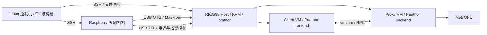

# GPU 虚拟化：无上下文 Agent 环境部署与测试手册

版本：2026-10-15。所有控制机命令默认在仓库根目录执行；标注“Pi 上”或“RK 上”的命令只在对应设备执行。

## 1. 目标、阅读顺序与证据边界

本手册面向只拿到 Git 仓库的新 Agent，按“识别环境 → 恢复固定载荷 → 连接硬件 → 必要时部署 → 执行测试 → 保存证据”的顺序操作。不要依赖原开发机的绝对路径、已编译缓存、SSH 私钥或聊天上下文。

先读本文第 2–5 节，确认自己属于哪种场景，再选择对应部署分支：

| 现场状态 | 应执行的路径 | 完成条件 |
| --- | --- | --- |
| 新控制机，现有 RK 板运行正确 Host | clone/bootstrap → 网络发现 → 只读检查 → 第 8 节测试 | 不需要重刷 SD |
| RK 可登录，但 Host 内核或模块不匹配 | 第 6 节准备 Image/模块 → 第 7.2 节更新 SD kernel 分区 | 串口、SSH、GPU 驱动和模块一致 |
| Pi 是新装系统 | 第 5 节准备刷机工具及硬件控制 | 能识别 UART、Maskrom、SD |
| RK 是空白 SD 或无法启动 | 第 7.3 节准备完整 Host 系统和固件 | 先恢复 Host，再运行 Guest 测试 |
| 正常测试失败 | 第 10 节保存证据、按层排查 | 定位失败层，不能只重跑到偶然通过 |

相关文档的职责：

- 本文是环境与执行流程的主入口。
- [快速复现](FRESH_CLONE.md)：已有健康板端时的最短路径。
- [Pi 刷机操作手册](RASPBERRY_PI_FLASH_RUNBOOK.md)：接线、Maskrom、串口、SD 操作细节。
- [载荷与来源](../../GPU-SFTP/ARTIFACTS.md)：归档、rootfs、NCNN/glmark 来源与重建要求。
- [测试与 Bug 分析](../shared/PANTHOR_SHARED_GPU_FIX_VERIFICATION_20261015.md)：实现原理、修复原因和历史测试结果。
- [仓库整理与验证记录](../shared/GPU_REPOSITORY_PUBLICATION_20261015.md)：本次发布的构建、完整回归及后续失败记录。

2026-10-15 已有完整硬件回归 **32/32 通过**，基线 Host 为 `6.12.0-opencca-pmthor #10`。但之后额外的干净副本短回归在 `group-submit-syncpoint` 出现 `SYNCOBJ_WAIT_AFTER_GROUP_SUBMIT ... Timer expired`，尚未定位；因此不能宣称任意 clone 后全矩阵已经稳定通过。该失败不应被早先 PASS 覆盖。按用户要求，不再追加 rsync 验证。

本次没有对空白实体 SD 重新执行整盘刷写。空白板部署章节整合了现有构建、镜像和刷机流程，需要现场完成并记录验证。普通 PC 只承担控制/构建；实际 GPU 测试依赖物理 RK3588 与匹配的 OpenCCA 环境。

## 2. 系统拓扑与各组件职责



| 组件 | 负责什么 | 核心源码或配置 |
| --- | --- | --- |
| Host Linux | KVM、GPU 归属、Client 内存翻译、PFN 引用与 reset | `Linux-Host-GPU/` |
| Client Linux | DRM/Panthor 前端、BO/VM/syncobj、提交转发 | `Linux-Guest-GPU/` |
| Proxy Linux | 接收 RPC、调用真正的 Panthor/GPU | 同一 Guest 源码的 Proxy 配置 |
| Firecracker | 启动 VM，提供 vmshm/GPU 设备集成 | `firecracker/Firecracker-CCA-MZH/` |
| vmshm-broker | VM 间共享内存与通知协调 | `firecracker/vmshm-broker/` |
| RMM/固件 | OpenCCA 启动与实验性 Realm 管理 | `opencca/tf-rmm/` 等 |
| 运行树 | 内核、用户态、rootfs、配置、测试源码及日志 | `GPU-SFTP/` |

共享模式是两个或多个 Client 经 Proxy 访问 GPU；直通模式将 GPU 提供给单 VM。普通共享测试通常要求 Host GPU 绑定 `pmthor`；Host 原生性能测试临时切换到 `panthor`，测试脚本结束后恢复。

## 3. 控制机从零准备

### 3.1 依赖、磁盘和仓库恢复

推荐 Ubuntu 24.04 / Debian，Python ≥ 3.10。仅恢复运行载荷至少预留 10 GiB；构建多个内核、固件及 Host 镜像需要明显更多空间。先运行 `df -h`，避免构建中途耗尽磁盘。

```bash
sudo apt-get update
sudo apt-get install -y git curl ca-certificates python3 openssh-client \
    sshpass rsync file xz-utils

git clone https://github.com/marsha1111mao-del/gpu.git
cd gpu
export WORKSPACE="$PWD"
./scripts/setup/bootstrap.sh
python3 scripts/check/check-checkout.py
```

bootstrap 初始化固定提交的第一层子模块，恢复 175 个固定运行文件，下载并校验两个 Guest rootfs。公开 clone 和下载不需要开发者 GitHub 身份。

```bash
git rev-parse HEAD
git submodule status
python3 scripts/artifacts/restore-runtime.py --check
```

子模块状态中的 `-` 表示未初始化，`+` 表示提交与父仓库指针不同。不要把未初始化或任意最新分支当成已验证版本。仅在无需下载镜像时使用 `bootstrap.sh --no-rootfs`；这不代表已经具备运行环境。

归档恢复默认拒绝覆盖不同内容的本地文件。如果此前自行构建了载荷，先备份，确实需要恢复基线时再执行：

```bash
python3 scripts/artifacts/restore-runtime.py --force
```

`--force` 会替换运行目标，不会把自行构建的文件自动归档。`check-checkout.py` 是固定基线检查；自行重建后哈希不同可能是预期结果，必须明确记录“源码构建组合”，不能继续称其为原二进制基线。

### 3.2 两类 rootfs 必须区分

| 文件/位置 | 用途 | 获取方式 |
| --- | --- | --- |
| `GPU-SFTP` 中 manifest 指定的 `rootfs.ext2` | 精简 Guest 基础系统 | bootstrap 固定 Release |
| `rootfs-panfrost.ext4` | 带 Mesa/Panfrost 用户态的 Guest 基础系统 | 同上 |
| `opencca/rootfs/opencca-image-rockchip-rock5b-rk3588.img` | 物理 RK 的完整 Host SD 系统 | 单独准备或 Debos 构建 |

前两个 Guest 镜像不能作为整盘 Host 镜像刷入 SD。Release `rootfs-20260603` 的两个文件合计约 1.75 GiB；大小和 SHA-256 以 `GPU-SFTP/rootfs-manifest.json` 为准。运行脚本制作测试副本并注入载荷，不依赖旧开发机曾手工修改的镜像副本。

## 4. 发现设备、设置变量并检查板端

### 4.1 找到机器，先验证角色

现有实验室地址如下，迁移网络时必须重新确认：

| 角色 | 地址 | 识别方式 |
| --- | --- | --- |
| Pi 有线首选 | `mzh@192.168.31.189` | `/home/mzh/opencca-flash/flash.sh` |
| 同一 Pi 无线备用 | `mzh@192.168.31.52` | 同一设备，不是第二台 Pi |
| RK3588 | `root@192.168.31.18` | GPU platform 设备、pmthor、OpenCCA 内核 |

```bash
ip -br addr
ip route
scripts/net/discover-opencca-hosts.sh --cidr 192.168.31.0/24
```

脚本仅支持指定的 `/24` 扫描；自定义用户与凭据可用 `PI_USER/PI_PASS/RK_USER/RK_PASS` 环境变量。全新 Pi 尚未安装 `flash.sh` 时，自动角色识别可能找不到它，需要从路由器租约或现场终端获得地址，再完成第 5 节。不要仅凭端口 22 开放认定角色。

扫描失败时先判断控制机能否创建 socket；`Operation not permitted` 可能来自执行环境权限，并不能证明板子离线。不要因为临时 DHCP 变化直接使用 `--update-docs` 替换全部文档地址。

### 4.2 设置统一会话变量

以下凭据交互读取，不保存到仓库。换成自己的地址与账号；已有实验室的初始密码应从设备管理者获取。

```bash
export PI_HOST=mzh@192.168.31.189
export RK_HOST=root@192.168.31.18
read -rsp 'Pi SSH password: ' PI_PASSWORD; echo
read -rsp 'Pi sudo password: ' PI_SUDO_PASSWORD; echo
read -rsp 'RK SSH password: ' RK_PASSWORD; echo
export PI_PASSWORD PI_SUDO_PASSWORD RK_PASSWORD

export REMOTE_HOST="${RK_HOST#*@}"
export REMOTE_USER="${RK_HOST%@*}"
export REMOTE_PASS="$RK_PASSWORD"
export REMOTE_ROOT=/root/GPU-SFTP

export OPENCCA_RPI_HOST="$PI_HOST"
export OPENCCA_RPI_PASSWORD="$PI_PASSWORD"
export OPENCCA_RPI_SUDO_PASSWORD="$PI_SUDO_PASSWORD"
export OPENCCA_RK_HOST="$RK_HOST"
export OPENCCA_RK_PASSWORD="$RK_PASSWORD"
export OPENCCA_FIRMWARE_STORAGE_ID=2
export OPENCCA_KERNEL_STORAGE_ID=2
export OPENCCA_ROOTFS_STORAGE_ID=2
```

测试脚本使用 `REMOTE_*`；刷机脚本使用 `OPENCCA_*`。只设置其中一组不会自动配置另一组。变量应保留在同一 shell，避免凭据进入提交、终端截图和交接报告。

### 4.3 只读检查 Host

```bash
SSHPASS="$RK_PASSWORD" sshpass -e ssh -o StrictHostKeyChecking=accept-new "$RK_HOST" 'bash -s' <<'RK'
uname -a
ip -br addr
findmnt /
lsblk -o NAME,SIZE,FSTYPE,PARTLABEL,MOUNTPOINTS
cat /proc/cmdline
cat /sys/devices/system/cpu/online
ls -l /dev/kvm /dev/pmthor
readlink -f /sys/bus/platform/devices/fb000000.gpu/driver
lsmod | grep -E 'pmthor|panthor' || true
modinfo pmthor_drv 2>/dev/null | head -n 12
modinfo panthor 2>/dev/null | head -n 12
pgrep -af 'firecracker|vmshm-broker' || true
df -h / /root
RK
```

基线应满足：Host 为匹配的 OpenCCA pmthor 内核；`/dev/kvm`、`/dev/pmthor` 存在；GPU driver 链接尾部为 `pmthor`；没有其他测试的 VM/broker；CPU 通常在线 `0-1`。直通对比还要求同一内核版本下有可加载的 `panthor.ko` 与 `pmthor_drv.ko`。

如果已有他人的 VM，先确认归属，不要直接 `pkill firecracker`。普通测试需要独占当前 GPU 环境，禁止并行启动两套回归。

板端基础依赖为 bash、tar、mount、losetup、timeout、dmesg、taskset、modprobe、Python 3、SSH 和足够工作空间。缺失时在 RK 上安装：

```bash
apt-get update
apt-get install -y rsync python3 util-linux kmod coreutils tar
```

当前板端 rsync 已安装为 3.5.0，无需再专门测 rsync。单 Client 的 tar 兼容路径也已修复首次 rootfs 同步。部署过程本身应通过 SHA 校验文件，不额外建立 rsync 性能测试。

现有固定网络由 Pi NetworkManager 与 RK systemd-networkd 管理。Pi 有线 `.189` 优先，无线 `.52` 备用；RK 配置在 `/etc/systemd/network/10-opencca-lan.network`，当前接口 `enP4p65s0`。换网时先确认真实接口、网段、网关和 DNS。路由器应对静态 IP 做 reservation 或排除，避免地址冲突；不要远程直接覆盖网络配置而没有 UART 恢复路径。

## 5. 全新 Pi 与硬件控制准备

已有健康 RK 时可以先完成测试，不必为了新控制机重新配置 Pi 或进入 Maskrom。

### 5.1 接线与设备枚举

- Pi 与 RK 接入控制机可达的局域网。
- Pi USB 连接 RK 的 OTG/Maskrom 口；普通 USB 外设口不能替代。
- 独立 USB-TTL 接 RK UART：TX→RX、RX→TX、GND→GND，使用 3.3V TTL。
- UART 默认 `/dev/ttyUSB0`、1500000 波特、8N1、无流控；设备名变化时先查 `/dev/serial/by-id/`。
- Maskrom USB 常见标识 `2207:350b`；正常启动不要求始终出现在 Maskrom。
- GPIO/继电器接 Maskrom 按键与电源的方式必须核对真实接线。插座命令成功并不证明板子断电；USB 可能反向供电。

### 5.2 恢复 Pi 工具目录

控制机先恢复固件相关源码和上游补丁：

```bash
./scripts/setup/bootstrap.sh --firmware
python3 opencca/scripts/setup/apply-local-patches.py --check
```

Pi 上安装依赖：

```bash
sudo apt-get update
sudo apt-get install -y git rsync python3 python3-venv python3-dev \
    build-essential minicom usbutils libusb-1.0-0 uhubctl
mkdir -p /home/mzh/opencca-flash
```

如果 Pi 账号不是 `mzh`，调整目标路径，并设置 `OPENCCA_RPI_FLASH_ROOT`。控制机复制已打补丁的工具和 loader：

```bash
SSHPASS="$PI_PASSWORD" sshpass -e rsync -a \
    --exclude=.git --exclude=.env \
    opencca/opencca-flash/ "$PI_HOST:/home/mzh/opencca-flash/"
SSHPASS="$PI_PASSWORD" sshpass -e rsync -a \
    opencca/opencca-assets/rk3588/rk3588_spl_loader_v1.16.113.bin \
    "$PI_HOST:/home/mzh/opencca-flash/tools/rk3588/"
```

Pi 上选择与 `uname -m` 对应的工具。下例适用于 64 位 ARM Pi：

```bash
cd /home/mzh/opencca-flash
uname -m
ln -sfn rkdeveloptool-arm64 tools/rkdeveloptool
chmod +x tools/rkdeveloptool-arm64
cp -n .env.template .env
mkdir -p snapshot
python3 -m venv board/maskrom/venv
board/maskrom/venv/bin/pip install -r board/maskrom/requirements.txt
./flash.sh help
```

`board/maskrom/maskrom.sh` 使用的环境就是 `board/maskrom/venv`。这里显式安装依赖并检查退出码，避免旧 setup 脚本中的 `|| true` 隐藏安装失败。

编辑本地 `.env`，逐项核对 `OPENCCA_SPL_LOADER`、`OPENCCA_RKDEVELOP_TOOL`、`OPENCCA_TTYUSB`、GPIO 引脚、电源脚本、USB hub/端口。模板的 GPIO 11、Tasmota 地址和 USB 端口只是默认示例，不能证明新接线可用。保留 SPL v1.16.113；不要将含设备 token 的 `.env` 提交。

### 5.3 手动恢复链路

在 Pi 上用 `lsusb`、`sudo ./tools/rkdeveloptool ld` 检查 Maskrom；用 `./flash.sh minicom` 查看串口。自动控制未配置好时可手动按住 Maskrom 键后上电，确认工具列出 Maskrom 再松开。具体操作参见 Pi 手册。没有确认目标存储与分区前，不运行写入命令。

## 6. 从源码构建：按目标选择

复现已有结果优先使用固定载荷；只有修改代码或必须更换系统时才重建。构建成功只证明可编译，新组合仍需硬件回归。

### 6.1 内核、模块与探针

```bash
sudo apt-get install -y build-essential gcc-aarch64-linux-gnu \
    g++-aarch64-linux-gnu flex bison bc libssl-dev libelf-dev \
    device-tree-compiler libdrm-dev pkg-config cmake ninja-build clang lld meson
JOBS=8 ./scripts/build/build-verified-kernels.sh
./scripts/build/build-panthor-ioctl-smoke.sh
./scripts/build/build-pfn-lifetime.sh
```

四种配置位于 `configs/verified-20261015/`，分别为 Host、Client、Proxy、passthrough。可只构建一个角色：`build-verified-kernels.sh host`。此入口要求源码目录没有 in-tree `.config/include/config`，输出在 `build/verified-kernels/`，再复制 Image 到运行树。不要为了满足此条件删除有价值的开发目录；另建干净 clone 即可。

| 角色 | 运行 Image 目标 |
| --- | --- |
| Host | `GPU-SFTP/linux-host-kernel/Image` |
| Client | `GPU-SFTP/firecracker-bins/kernels/shared/client/Image` |
| Proxy | `GPU-SFTP/firecracker-bins/kernels/shared/proxy/Image` |
| passthrough | `GPU-SFTP/firecracker-bins/kernels/passthrough/Image` |

需要完整 Host 模块时使用单独的 in-tree 构建入口：

```bash
INSTALL_MODULES=1 JOBS=8 ./scripts/build/build-host-kernel-payload.sh
```

它在缺少 `.config` 时初始化固定配置，默认 release 后缀为 `-opencca-pmthor`。模块暂存至 `GPU-SFTP/linux-host-kernel/modules-staging/lib/modules/<kernelrelease>/`。部署 Image、模块、initrd 时必须使用同一 kernelrelease，目标端执行 `depmod`。只更换 Image 可能导致直通切换时 `invalid module format`。

### 6.2 Firecracker 与 broker

按 rustup 的安装方式准备 Rust，再使用真正的 ARM64 musl 工具链：

```bash
rustup toolchain install 1.83.0 --profile minimal
rustup target add --toolchain 1.83.0 aarch64-unknown-linux-musl
LINKER=/path/to/aarch64-linux-musl-gcc ./scripts/build/build-firecracker-runtime.sh
```

`/path/to/...` 必须换成已安装且 `--version` 可执行的真实路径。glibc 的 `aarch64-linux-gnu-gcc` 不能充当 musl linker。组件使用 Cargo.lock；不要用依赖升级解决构建问题。`firecracker-deps` 的 rust-vmm-ci 子模块映射已补齐，必要时在该仓库执行 `git submodule update --init --recursive`。

### 6.3 OpenCCA 固件与上游补丁

```bash
./scripts/setup/bootstrap.sh --firmware
python3 opencca/scripts/setup/apply-local-patches.py --check
mkdir -p opencca/snapshot
```

`opencca/patches/manifest.json` 固定上游提交、六组补丁及 loader 来源。补丁应用后上游子仓库有 tracked diff 是预期状态，校验器还会检查 diff 与清单是否一致。不要 reset 掉补丁，或在已有补丁上随意继续应用旧 mail patch。

固件构建入口为：

```bash
make -C opencca/opencca-build/buildconf -f firmware_opencca.mk NPROC=8 build
```

先读 `env_aarch64.mk`，准备它要求的 `aarch64-none-linux-gnu-` 工具链，或显式配置兼容前缀。原开发机工具链绝对路径不能直接复制到新机器。检查 compiler、CMake、Python、交叉 binutils 后再开始；不要盲目执行旧工具链下载脚本。输出检查 `opencca/snapshot/` 下的 `idbloader.img`、`u-boot.itb`、`tf-rmm.elf`、`bl31.elf`。本次 RMM 源码构建通过，但没有重新证明新控制机完整 TF-A/U-Boot 编译和实体刷写。

### 6.4 GLES、ML、NCNN 与 glmark2

RK 上源码编译 GLES/ML 需 gcc、pkg-config、`libegl1-mesa-dev`、`libgles2-mesa-dev`、`libgbm-dev`、`libdrm-dev`。单项测试省略 `--skip-gles-remote-build` 即从仓库当前 C 源码编译；复现固定载荷则保留该选项。

NCNN 和 glmark 的实际使用源码随 `GPU-SFTP/runtime/` 归档提供，先解压到新目录再构建：

- NCNN 为 `20260526`，含 glslang。CMake Release，`NCNN_VULKAN=ON`、`NCNN_BUILD_BENCHMARK=ON`，关闭不需要的 tools/examples/tests/python。保留 Vulkan probe、三个完整 param 和依赖库。静态链接关系以实际 `benchmark/CMakeFiles/benchncnn.dir/link.txt` 为准。
- glmark2 使用定制 null swap 源码，Meson flavor 为 `null-glesv2`；安装后按运行布局提供 `glmark2-es2-null-noop`、data 和动态依赖。最终测试明确使用 `frame-end finish`。不能用未经修改的 null 二进制替代后仍沿用原结果。

本次验证了既有 NCNN/glmark 载荷运行，没有重新完成所有第三方源码的独立干净构建。来源、许可证与哈希参见 ARTIFACTS。

## 7. 部署分支

### 7.1 健康 Host：只部署测试运行树

完成第 4 节检查后，首项共享测试会同步运行树与两个 Guest 基础 rootfs：

```bash
RUN_ID="onboard-$(date +%Y%m%d-%H%M%S)" \
    ./scripts/run/run-vmshm-e2e.sh --skip-build --sync-rootfs --vm-create-smoke
```

检查退出码、`RESULT: PASS` 和 Guest 的 `PANTHOR_VM_CREATE_SMOKE=PASS`，然后进入第 8 节。首次运行不要加 `--skip-sync`。统一回归也会自动完成首次同步，若直接运行统一回归，无需先执行本节单项。

`--skip-build` 复用控制机恢复的内核和 VMM；`--skip-gles-remote-build` 复用已准备 GLES 程序；`--skip-sync` 复用板端运行文件。这三个选项含义不同，不能互相替代。

### 7.2 只更新 Host SD kernel 分区

当前布局为 p3 `PARTLABEL=kernel`，128 MiB ext4/extlinux，起始 LBA `0x8000`；p4 `PARTLABEL=root`，起始 LBA `0x48000`，挂载 `/`。旧布局 root 从 `0x8000` 开始时绝不能直接写 kernel。

先从实际启动分区的 extlinux 配置确认 Image/initrd/DTB 路径、root 参数与 cmdline，再备份旧启动文件和匹配模块。下面所有 `/path/to/` 均为需要自行确认的输入：

```bash
./opencca/scripts/image/build-raw-kernel-image.sh \
    --image "$WORKSPACE/GPU-SFTP/linux-host-kernel/Image" \
    --initrd /path/to/matching/initrd.img \
    --dtb /path/to/rk3588-rock-5b.dtb \
    --root PARTLABEL=root \
    --version 6.12.0-opencca-pmthor \
    --cmdline 'rootwait isolcpus=1,2,3 maxcpus=2 nohlt cpuidle.off=1 rcupdate.rcu_cpu_st ignore_loglevel initcall_debug' \
    --output "$WORKSPACE/opencca/snapshot/kernel-pmthor-extlinux.img"

./opencca/scripts/firmware/flash-rk3588-via-pi.sh \
    --kernel-image "$WORKSPACE/opencca/snapshot/kernel-pmthor-extlinux.img" \
    --flash-kernel --wait-rk --dry-run
```

脚本名保留 `raw-kernel`，当前输出实际为 ext4/extlinux 镜像，不是旧 raw FIT。将匹配模块部署到 Host rootfs，确认 dry-run 目标、Pi 目录、storage ID 与输入文件后，去掉 `--dry-run` 执行更新。wrapper 先检查在线 RK 分区，再由 Pi 读取 GPT 校验。布局检查失败应查清原因，不要直接禁用检查强写。

默认启动策略在 rootfs 配置 `blacklist panthor`，并显式加载 `pmthor_drv`；不要在 kernel cmdline 永久 blacklist panthor，否则 Host 原生对比不能手动加载它。旧 `deploy-host-kernel-and-test.sh` 的 `/boot/vmlinuz-...` 默认路径不能代替当前 p3/extlinux 的真实启动配置。

### 7.3 空白 SD：准备完整 Host 系统

这是与 Guest 镜像恢复不同的流程。必须具备 OpenCCA 固件、完整 Host OS、匹配 Host Image/模块/initrd/DTB，以及串口恢复手段。仓库没有随 Guest Release 发布完整 Host 整盘快照。

可使用经过来源和哈希确认的已有 Host 镜像；若从源码构建，使用 `opencca/debian-image-recipes/`：

1. 安装 Debos、QEMU user/binfmt、bmap-tools、pigz 及 Debian 打包依赖。x86 控制机需要确认虚拟化/交叉执行能力；不要为解决权限问题全局 `chmod 777 /dev/kvm`。
2. 准备自己的 arm64 Linux `.deb` 到 recipes 的 `prebuilt/linux/`，并将匹配 `idbloader.img`、`u-boot.itb` 放到 `prebuilt/u-boot-rock5b-rk3588/`。可在初始化 Host 配置后使用内核 `bindeb-pkg` 目标打包，并检查实际生成的包名、release 和架构。
3. 在 recipes 目录参考以下入口生成 ospack 与整盘镜像：

```bash
mkdir -p out
debos --artifactdir=out -t architecture:arm64 opencca-ospack-debian.yaml
debos --artifactdir=out -t architecture:arm64 -t platform:rock5b-rk3588 \
    opencca-image-rockchip-rk3588.yaml
```

4. 检查输出 GPT：必须明确区分 p3 kernel 和 p4 root。配方生成分区不等于 p3 已安装本项目 extlinux 启动文件；需要将第 7.2 节构建的匹配 kernel 镜像写入正确分区，或在整盘部署后按检查过的布局单刷 p3。对旧 root-at-0x8000 镜像先研究 `convert-opencca-image-to-raw-kernel-layout.py`，操作本地备份副本，不能覆盖原 root。
5. 在 arm64 环境或正确 binfmt/chroot 下为当前模块生成 initrd，校验 root 参数、DTB 与内核 ABI。使用 `patch-opencca-rootfs-image.sh --help` 检查 root 登录、静态网络、DTB/loader 修补选项。其网络参数来自 `OPENCCA_RK_STATIC_IP/GATEWAY/DNS/ETH_IFACE`。

不要直接运行会下载上游 latest 并删除 prebuilt 的旧 artifacts 下载流程，再称其为固定验证组合。完整构建流程的输出应单独保存 manifest、配置和验证记录。

### 7.4 SD 刷写与首次启动

正常流程固定 `storage ID 2=SD`；`1=eMMC` 禁止使用，`9=SPI` 是独立流程。整盘写入会覆盖 SD 现有数据，只在部署确实需要重装且已保存所需数据时执行。

设置 `OPENCCA_ROOTFS_IMAGE` 指向已检查的完整 Host 镜像；需要镜像登录修补时，交互读取并 export `OPENCCA_RK_ROOT_PASSWORD`，不要写入文档或 Git。先预览：

```bash
export OPENCCA_ROOTFS_IMAGE=/absolute/path/to/verified-host-disk.img
./opencca/scripts/firmware/flash-rk3588-via-pi.sh \
    --sync-rootfs --patch-rootfs-on-pi --flash-rootfs --wait-rk --dry-run
```

核对后去掉 `--dry-run`。固件独立更新入口为 `--flash-sd-firmware --wait-rk`；如完整镜像已经包含匹配固件，先确认版本再决定是否需要。首次启动持续读取 UART，区分 bootloader、TF-A/RMM、Host kernel、root 挂载、网络各阶段。SSH 恢复后重新执行第 4.3 节；不要以刷写命令返回 0 代替 Host 可运行证明。

## 8. 正常测试：入口、原理和通过标准

### 8.1 统一矩阵与证据

在确认硬件空闲、变量正确后执行：

```bash
python3 scripts/run/run-regression.py --passthrough \
    --run-id "acceptance-$(date +%Y%m%d-%H%M%S)"
```

不需要直通对比时省略 `--passthrough`。仅当已确认板端载荷与本地一致时加 `--remote-prepared`；`--quick` 缩短循环，不能替代正式性能测量。run-id 必须唯一，只允许字母、数字、`-`、`_`。

每项 stdout/stderr 和退出码保存在 `GPU-SFTP/log/regression/<run-id>/`，`summary.json` 每项完成后更新，遇错立即停。全部 32 项包含直通及前后环境检查，最终为 `REGRESSION_RESULT=PASS cases=32`。单项详细日志位于 `GPU-SFTP/log/shared/`、`GPU-SFTP/log/passthrough/`；记录各脚本输出的实际目录，不能仅凭文件名推断通过。

### 8.2 测试总览

| 测试组 | 主要机制与覆盖 | 正式参数 | 判定依据 |
| --- | --- | --- | --- |
| IOCTL 17 项 | Client handle 与 Proxy 对象映射、BO/VM、同步对象、Group/Heap 生命周期 | 逐项启动 | 用例 marker、退出码、整体 RESULT |
| PFN 生命周期 | 同一 GPA 去重引用、device 与 VM 双持有、最终 reset 后释放 | 32 次重复翻译、两种关闭顺序 | 程序和内核日志 checker 均通过 |
| Compute | GLES shader 读写 BO、提交、fence、CPU 读回校验 | 4/16/64/128 MiB | 结果校验与 perf 数据 |
| ML | GEMM、conv、depthwise、reduction、softmax、attention | 100 次 + 5 预热，GEMM 512 | 六算子 ML_CHECK 与 ML_RESULT |
| Attention 320 | 更长 GPU 工作负载与同步链 | 10 次 + 2 预热 | 数值校验和整体退出码 |
| NCNN | Vulkan 执行实际网络拓扑 | 三模型，每个 100 次 | GPU 探针、各模型与 NCNN_RESULT |
| glmark2 | GLES 图形场景及提交完成同步 | 720p / 1080p 全场景 | 硬件 renderer、场景与验证报告 |
| 双 Client | 两个 Client 同时经 Proxy 使用 GPU | 每个 4 MiB、100 次 + 5 预热 | 两 Client 都完成并校验 |
| Host / passthrough | 原生与单 VM 路径性能对比 | 同一用户态、对应循环 | 两路径校验、对比报告、恢复 pmthor |

### 8.3 IOCTL 单项

```bash
RUN_ID="ioctl-$(date +%Y%m%d-%H%M%S)" \
    ./scripts/run/run-vmshm-e2e.sh --skip-build --sync-rootfs --vm-bind-smoke
```

替换最后一个参数即可选择：`--ioctl-smoke`、`--vm-create-smoke`、`--bo-create-smoke`、`--bo-lifecycle-smoke`、`--bo-mmap-smoke`、`--vm-bind-smoke`、`--vm-bind-async-sync-smoke`、`--vm-state-flush-smoke`、`--syncobj-lifecycle-smoke`、`--syncobj-wait-smoke`、`--syncobj-transfer-smoke`、`--syncobj-timeline-wait-smoke`、`--syncobj-signal-query-smoke`、`--sync-file-snapshot-smoke`、`--group-lifecycle-smoke`、`--group-submit-syncpoint-smoke`、`--tiler-heap-lifecycle-smoke`。

VM_BIND 还检查不同映射大小复用；sync_file snapshot 关注“导出时 fence”的语义，不能用后来替换的 syncobj fence 混淆。Group submit 返回成功不代表 fence 已完成，仍需等待和验证。最新干净副本失败就发生在这一等待阶段，见第 10 节。

### 8.4 Compute 与 ML

```bash
./scripts/run/run-vmshm-e2e.sh --skip-build --sync-rootfs \
    --gles-compute-smoke --skip-gles-remote-build \
    --gles-client-mem-mib 512 --gles-proxy-mem-mib 384 \
    --gles-smoke-args '--count 1048576 --iterations 100 --warmup 5 --perf --exclude-cpu-prepare'
```

`count` 单位是 uint32 元素，4/16/64/128 MiB 分别为 `1048576/4194304/16777216/33554432`。4/16 MiB 测量 100 次，64/128 MiB 测量 20 次，均预热 5 次。比较性能时必须保持是否排除 CPU prepare 的条件一致。

```bash
./scripts/run/run-vmshm-e2e.sh --skip-build --skip-sync \
    --gles-ml-smoke --skip-gles-remote-build \
    --gles-client-mem-mib 512 --gles-proxy-mem-mib 384 \
    --gles-smoke-args '--kernel all --gemm-size 512 --iterations 100 --warmup 5'
```

Attention 长负载将参数替换为 `--kernel attention --attention-size 320 --iterations 10 --warmup 2`。可选 kernel 为 `all/gemm/conv/depthwise/reduction/softmax/attention`。通过依据包含数值结果，不只是打印运行时间。

### 8.5 NCNN Vulkan

```bash
GLES_NCNN_LOOP_COUNT=100 GLES_CLIENT_BO_MMAP_CACHED=0 \
    ./scripts/run/run-vmshm-e2e.sh --skip-build --skip-sync \
    --gles-ncnn-smoke --skip-gles-remote-build \
    --gles-client-mem-mib 512 --gles-proxy-mem-mib 384
```

模型是 mobilenet_v2、mobilenet_v3、resnet50 的完整 param，使用随机输入和空权重。结果证明执行路径和性能，不证明模型精度。检查 Vulkan GPU probe 和三项 `NCNN_MODEL_RESULT=PASS`，最后 `NCNN_RESULT=PASS`。对象共享窗口会按该模式配置到更大范围，相关高 GPA 配置由脚本处理，避免手工改回旧小窗口。

### 8.6 glmark2

```bash
GLES_GLMARK_FLAVOR=null-noop GLES_GLMARK_FRAME_END=finish \
    ./scripts/run/run-vmshm-e2e.sh --skip-build --skip-sync \
    --gles-glmark-smoke --skip-gles-remote-build \
    --gles-client-mem-mib 512 --gles-proxy-mem-mib 384 \
    --gles-glmark-size 1280x720
```

再以 `1920x1080` 执行。完整测试不设置 `GLES_GLMARK_BENCHMARKS`；只跑 build 场景属于短回归。null-noop 不做显示器呈现，finish 等待 GPU 完成，所得分数不能表述为屏幕 FPS。检查 renderer，不能接受 llvmpipe 软件回退；报告中有一个已知 framebuffer 验证例外，应单独计数，unexpected validation failure 必须为零，不能隐藏在总分里。

### 8.7 双 Client 与单 VM 直通

```bash
./scripts/run/run-vmshm-2client-e2e.sh --skip-sync \
    --gles-compute-smoke --skip-gles-remote-build \
    --gles-smoke-args '--count 1048576 --iterations 100 --warmup 5' \
    --gles-client-mem-mib 128 --gles-proxy-mem-mib 192

./scripts/run/run-host-vs-passthrough-gles-perf.sh \
    --host-rootfs-userspace --skip-sync --skip-remote-build \
    --exclude-cpu-prepare --iterations 100 --warmup 5 \
    --large-count-iterations 20 --large-count-warmup 5
```

双 Client 自动调整 CPU 并恢复，检查两份结果。直通脚本临时切换 Host 驱动，需要匹配模块；结束后检查 `pmthor` 和 CPU `0-1`。不得在另一套共享 VM 活跃时手工解绑 GPU。

### 8.8 PFN 引用生命周期

统一矩阵执行程序后再检查内核日志。独立执行需 Host 空闲，且程序已同步到板端：

```bash
mkdir -p GPU-SFTP/log/manual
SSHPASS="$RK_PASSWORD" sshpass -e ssh "$RK_HOST" \
    'timeout 35 /root/GPU-SFTP/firecracker-bins/bin/pmthor-pfn-lifetime; status=$?; dmesg; exit "$status"' \
    > GPU-SFTP/log/manual/pfn-lifetime.log 2>&1
python3 GPU-SFTP/tests/pmthor-pfn-lifetime/check_kernel_log.py \
    GPU-SFTP/log/manual/pfn-lifetime.log
```

程序退出非零必须保留为失败，不能被后续 checker 退出码覆盖。它检查同 GPA 重复翻译仅维持唯一 PFN 引用、device/VM 两种关闭顺序、旧 VM 仍存活时新打开返回 EBUSY、最终 reset 完成后再释放引用。仅检查进程结束或 MemAvailable 不足以证明生命周期正确。

## 9. 故障注入与实验路径

### 9.1 Proxy SIGKILL

这是恢复能力测试，工作负载预期失败。已有报告记录先确认多次成功 `SYNCOBJ_IMPORT_SYNC_FILE ... status=0`、再杀本次 Proxy，检查 Host reset/PFN 回收，随后同一 boot 正常 Attention 和长回归通过。不能将这个 FAIL 当成正常工作负载通过。

后续 Agent 复现时先从本次 run 的 PID/命令行确认 Proxy 归属，保存 Client/Proxy/broker/Host 日志，只 kill 本次 Proxy，随后有序关闭对应 Client/broker。检查最后 reset 与引用释放，恢复驱动和 CPU，最后执行正常用例证明恢复。不要用全局 pkill 替代归属判断。

### 9.2 不能并入正常通过清单的实验

- Realm 最小 Compute 的历史成功只证明该实验执行路径；`HOST_READ_SUCCEEDED` 表明没有证明 Host 读取被硬件 GPT/GPC 拒绝。
- `check-opencca-gpt-design-denial.sh` 为源码/设计检查，不是物理硬件拒绝证据。
- 多 Realm 共享仍有隔离与生命周期前提，不能由普通 Client/Proxy 测试推出机密共享成立。
- PRIME 导入导出未支持；预期 errno 用于能力边界检查，不能写成 PRIME 功能通过。
- ONNX Runtime 程序保留用于 CPU/provider 探索，没有已通过 GPU Provider 基线。
- 原始 Vulkan probe 为诊断工具；正常矩阵中的 NCNN Vulkan 应单独按其 GPU probe 和执行结果判断。

## 10. 故障定位、清理与证据保全

### 10.1 按层排查

| 现象 | 先查什么 | 下一步 |
| --- | --- | --- |
| SSH timeout / 无地址 | 控制机路由、网段、Pi 双网卡、UART | 区分系统未启动与地址变化 |
| socket EPERM | 当前执行环境的网络权限 | 不重刷板子 |
| bootstrap 哈希失败 | 下载是否完整、manifest、本地是否自行编译 | 备份差异后重新获取固定输入 |
| OpenCCA patch 检查失败 | 基线提交、补丁哈希、额外 tracked diff | 保存差异，恢复正确来源 |
| 缺 `/dev/pmthor` | 内核、driver 绑定、模块 ABI、启动策略 | 恢复匹配内核/模块 |
| VM 启动失败 | `/dev/kvm`、VMM/Guest Image、内存、配置 | 读 Host 与 VMM 日志 |
| BO mmap / VM_BIND 错误 | Client/Proxy handle、映射长度、对象窗口 | 对照修复报告保留 GPA/大小 |
| fence 超时 | Client submit/wait、Proxy submit/import、GPU 中断/reset | 不能以 submit status=0 判通过 |
| GPU renderer 是 llvmpipe | render node、Mesa 库、设备传递 | 软件回退不计 GPU PASS |
| 内存不回收 / EBUSY | 旧 VM fd、device/VM 持有、PFN reset 日志 | 不提前 free，不关闭保护检查 |
| rsync 不存在 | 板端基础包 | 安装即可；不新增专门测试 |
| 刷内核布局检查拒绝 | GPT kernel/root 起点与标签 | 修正镜像布局，不跳过保护 |

### 10.2 本次最新的未解决记录

额外运行 `fresh-clone-20261015-quick` 已在 `group-submit-syncpoint` 停止：前面的 preflight 与 IOCTL 项通过，但 Client 在成功提交空 stream/signal syncpoint 后，两次 session 均出现 `SYNCOBJ_WAIT_AFTER_GROUP_SUBMIT ... Timer expired`，最终 `PANTHOR_IOCTL_INIT=FAIL status=1`、`RESULT: FAIL`。根因未定位，不能断言与 rsync、干净 clone 或特定内核代码存在因果关系。

原始日志位于原控制机：`build/fresh-clone-20261015/GPU-SFTP/log/regression/fresh-clone-20261015-quick/group-submit-syncpoint.log`；此目录被 Git 忽略，新 clone 不会自动拥有它。仓库发布记录保留该事实与关键摘录。下一轮调试应先比较同一次运行的 Proxy 和 Host 日志、timeout 参数与 fence 状态；不要删掉用例、缩减成功标准或反复重跑掩盖失败。

### 10.3 停止与恢复

1. 先保存当前 run 的目录、summary、Host dmesg、进程及 driver/CPU 状态。
2. 优先让当前脚本正常退出并执行其 cleanup。中断后只清理由该 run 启动且已核实身份的进程。
3. 用 `findmnt`/`losetup -a` 确认本次 rootfs 副本挂载，卸载本次对象；不要全局卸载其他任务。
4. 在没有 VM 占用后按直通脚本的恢复流程恢复 pmthor；遇 EBUSY 先查旧 VM/fd，不强行释放 GPU 仍可能访问的页。
5. 检查 `/dev/pmthor`、driver 链接、CPU 在线状态、无残留本次 VM/broker。日志中如有 GPU fault/reset，记录时间范围。
6. 若下一步被授权做复测，先执行最小相关用例，再执行受影响矩阵；区分“恢复成功”与“原问题已经修复”。

## 11. 交接材料与后续代码发布

每次交接至少记录下面内容；PASS 必须附 run-id、退出码与关键 marker。没有执行的流程写“未执行”，不要从旧报告推断本次成功。

```text
日期 / 操作者：
控制机 OS / 架构 / 仓库路径：
主仓库 commit 与 git submodule status：
Pi / RK 地址、角色识别、UART/Maskrom 状态：
RK uname、driver、CPU、SD GPT、模块 release：
载荷：固定快照 / 自行构建；manifest 校验情况：
部署：实际修改了哪些设备、镜像、模块、配置：
测试：命令、run-id、参数、退出码、PASS/FAIL marker：
结果边界：循环数、分辨率、renderer、模型空权重等：
失败与未执行项：
证据文件位置及是否已归档：
结束状态：进程、挂载、driver、CPU、已知残留：
下一步：
```

组件代码先在组件仓库提交并推送，再更新父仓库指针，最后推送主仓库。clone 公共代码无需开发者权限；push 需要具有仓库写权限的 GitHub 身份。可用 `ssh -T git@github.com` 确认实际身份，GitHub 验证成功仍可能退出码为 1。多密钥时为本次命令设置 `GIT_SSH_COMMAND`，不要将某人的密钥路径或私钥纳入部署依赖。

提交前检查 `git diff --check`、组件指针、文档链接和敏感信息。日志、密码、设备 token、临时下载与编译缓存不进入 Git；需要共享证据时提供脱敏摘要或独立归档。完成后验证远端 main 指向本地提交，再把最终 commit、手册路径、验证范围与未解决项交给下一位 Agent。
