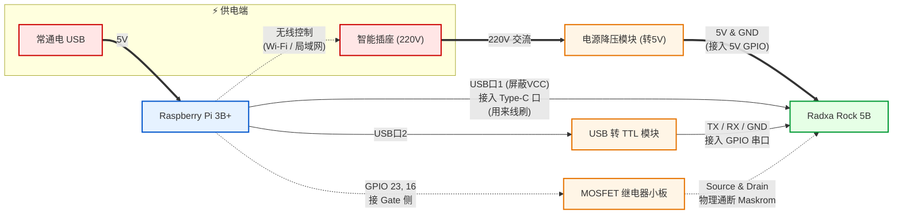

# 硬件清单

最小硬件清单：

| 名称                 | Comment                       |
| -------------------- | ----------------------------- |
| Rock 5B（16G）       | OpenCCA似乎只用了4G           |
| eMMC模块（16G）      | 是插上去的模块，不是芯片      |
| 12V转12V、5V电源模块 | 5V从GPIO供电、12V从Type-C供电 |
| USB2TTL              | 接GPIO串口                    |
|                      |                               |

自动化硬件清单：
| 名称               | Comment                     |
| ------------------ | --------------------------- |
| 树莓派、SD卡、电源 | 最好4、5，如果是3要硬件Hack |
| 米家智能插座3      |                             |
| Type-C公头测试板   |                             |
| USB转杜邦线1P      |                             |
| 10K欧电阻          |                             |
| 220欧电阻          |                             |
| 发光二极管         |                             |
| MOSFET IRLZ44N     |                             |

接线关系：

MOSFET小板接在树莓派这个口：https://pinout.xyz/pinout/pin16_gpio23/




## Rock 5B进入Maskrom模式

参考https://docs.radxa.com/rock5/rock5b/low-level-dev/install-os

Maskrom功能及其精简，因此每次刷机前都需要刷入Maskrom专用的Loader提供后续刷机指令（教程里有）

**Linux**

```
sudo rkdeveloptool db rk3588_spl_loader_v1.15.113.bin
```

**Windows**

下载镜像 -> 填写Loader路径 -> 强制按地址写 -> 执行

或

高级功能 -> Boot -> 选择Loader文件 -> 下载

## 初始化Rock 5B

二手Rock 5B上可能多个启动介质上都有固件，需要清空这些介质中的固件，避免启动到错误的介质

首先进入进入Maskrom模式

**Linux**

刷入Loader后，切换到不同介质，并执行清除：

```
pi@pi3bp:~/opencca-flash $ sudo rkdeveloptool db rk3588_spl_loader_v1.15.113.bin
pi@pi3bp:~/opencca-flash $ sudo rkdeveloptool
---------------------Tool Usage ---------------------
ChangeStorage:          cs [storage: 1=EMMC, 2=SD, 9=SPINOR]
pi@pi3bp:~/opencca-flash $ sudo rkdeveloptool cs 1
pi@pi3bp:~/opencca-flash $ sudo rkdeveloptool ef
pi@pi3bp:~/opencca-flash $ sudo rkdeveloptool cs 2
pi@pi3bp:~/opencca-flash $ sudo rkdeveloptool ef
pi@pi3bp:~/opencca-flash $ sudo rkdeveloptool cs 9
pi@pi3bp:~/opencca-flash $ sudo rkdeveloptool ef
```

**Windows**

刷入Loader：高级功能 -> Boot -> 选择Loader文件 -> 下载

清除介质：高级功能 -> Boot -> 

- 选择EMMC -> 切换存储 -> 擦除所有
- 选择SD -> 切换存储 -> 擦除所有
- 选择SPINOR -> 切换存储 -> 擦除所有

## 自动化刷机

手动进入Maskrom模式需要完成以下操作：

1. 按住Maskrom按钮
2. 重新给开发板上电

因此自动化刷机主要包含两部分：

1. 通过树莓派GPIO口控制Maskrom按钮通断
2. 通过智能插座控制开发板电源

### Maskrom按钮

参考https://opencca.github.io/docs/guides/hardware/中电路图及图片从开发板上导出Maskrom按钮的引脚：


然后按原理图焊接洞洞板，以下是优化过的布局，比OpenCCA文档里的好焊


### 智能插座

这里使用米家智能插座3自动化控制Rock 5B电源

插座初始化接入米家后，通过项目https://github.com/PiotrMachowski/Xiaomi-cloud-tokens-extractor获取智能插座授权Token，通过Token及IP地址后可在内网控制插座

将Token填入`board/power/power_plug_xiaomi.py`即可控制插座：
```python
import sys
from miio import Device, DeviceException

# 小米智能插座3 (cuco.plug.v3) 配置
IP = "192.168.1.190"
TOKEN = "REPLACE_WITH_LOCAL_DEVICE_TOKEN"

def main():
    if len(sys.argv) < 2:
        print("Usage: python3 power_plug_xiaomi.py {on|off|toggle|status}")
        sys.exit(1)

    action = sys.argv[1].lower()

    try:
        # 使用基础 Device 类
        plug = Device(ip=IP, token=TOKEN)
        
        if action == "on":
            result = plug.send("set_properties", [{"did": "power", "siid": 2, "piid": 1, "value": True}])
            print("Turn ON result:", result)
        elif action == "off":
            result = plug.send("set_properties", [{"did": "power", "siid": 2, "piid": 1, "value": False}])
            print("Turn OFF result:", result)
        elif action == "status":
            result = plug.send("get_properties", [{"did": "power", "siid": 2, "piid": 1}])
            print("Status result:", result)
            if result[0].get("code") == 0:
                is_on = result[0].get("value")
                print(f"Power is {'ON' if is_on else 'OFF'}")
            else:
                print(f"Failed to get status {result}")
        elif action == "toggle":
            status = plug.send("get_properties", [{"did": "power", "siid": 2, "piid": 1}])
            if status[0].get("code") == 0:
                is_on = status[0].get("value")
                print(f"Current status: {'ON' if is_on else 'OFF'}")
                if is_on:
                    result = plug.send("set_properties", [{"did": "power", "siid": 2, "piid": 1, "value": False}])
                    print("Turn OFF result:", result)
                else:
                    result = plug.send("set_properties", [{"did": "power", "siid": 2, "piid": 1, "value": True}])
                    print("Turn ON result:", result)
                    print("Plug turned ON")
            else:
                print(f"Failed to get current status {status}")
        else:
            print(f"Unknown action: {action}")
            sys.exit(1)
    except DeviceException as e:
        print(f"Error communicating with plug: {e}")
        sys.exit(1)

if __name__ == "__main__":
    main()
```

添加对应的shell脚本`power_plug_xiaomi.sh`
```shell
#!/usr/bin/env bash
set -euo pipefail

#
# Script to interact with Xiaomi Smart Plug 3 (cuco.plug.v3)
#

# Get directory of this script
DIR="$(cd "$(dirname "${BASH_SOURCE[0]}")" && pwd)"

function power_control() {
    python3 "$DIR/power_plug_xiaomi.py" "$1"
}

set +u
case "$1" in
    on|off|toggle|status) power_control "$1" ;;
    *) echo "Usage: $0 {on|off|toggle|status}"
esac
```

修改`power.sh`切换使用小米智能插座开关电：

```shell
#!/usr/bin/env bash
set -euo pipefail
readonly SCRIPT_DIR=$( cd -- "$( dirname -- "${BASH_SOURCE[0]}" )" &> /dev/null && pwd )

# USB="${OPENCCA_USB_SCRIPT:-power_usb_generic.sh}"
PLUG="${OPENCCA_PLUG_SCRIPT:-power_plug_xiaomi.sh}"
POWER_REBOOT_DELAY="${OPENCCA_POWER_REBOOT_DELAY:-3}"

cd $SCRIPT_DIR

for script in "$PLUG"; do
    if [[ ! -x "$script" ]]; then
        echo "Error: Required script '$script' is missing or not executable."
        exit 1
    fi
done

function power_on() {
    bash "$PLUG" on
    # bash "$USB" on
}

function power_off() {
    # bash "$USB" off
    bash "$PLUG" off
}

function power_reboot() {
    power_off

    # XXX: Depending on the usb dock, we may have to sleep longer
    #      because power is cut in a delayed matter.
    sleep $POWER_REBOOT_DELAY
    
    power_on
}

function print_usage() {
    echo "Usage: $0 {on|off|reboot}"
    exit 1
}

case "$1" in
    on) power_on ;;
    off) power_off ;;
    reboot) power_reboot ;;
    *) print_usage ;;
esac
```

### USB Hack

在关闭智能插座后Rock 5B仍然可以从连接至树莓派的USB接口取电，要以下办法断电：

1. 树莓派4、5：使用`uhubctl`关闭USB接口，是OpenCCA的原方案
2. 拆一根线剪掉VCC
3. Type-C公头测试板 + USB转杜邦1p，不连接VCC线。后续若需要12V-20V供电可以从公头测试板提供

